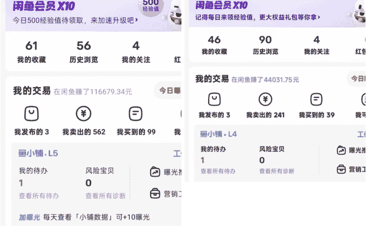
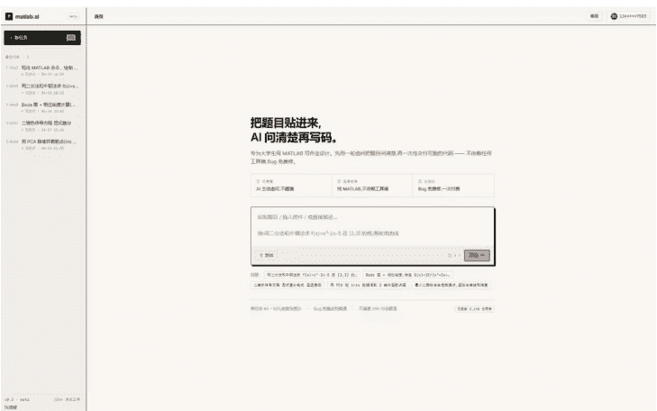
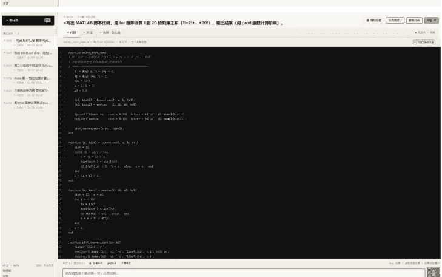
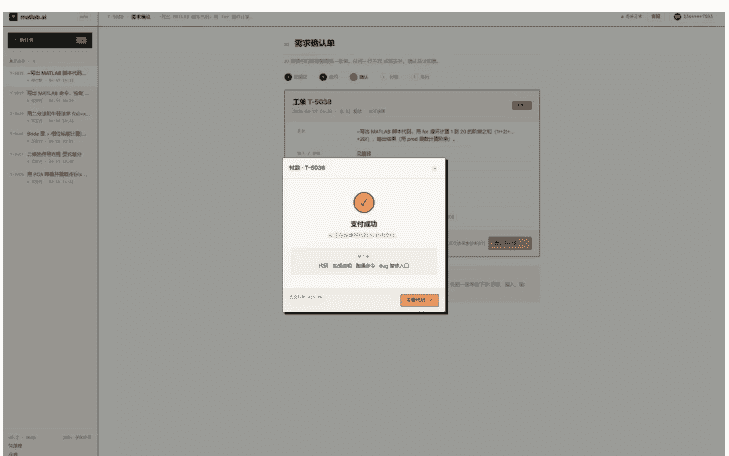
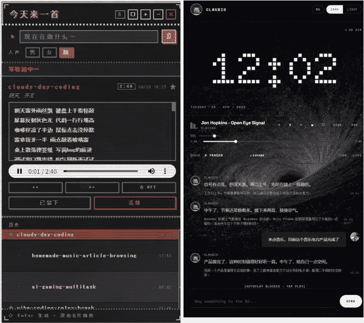
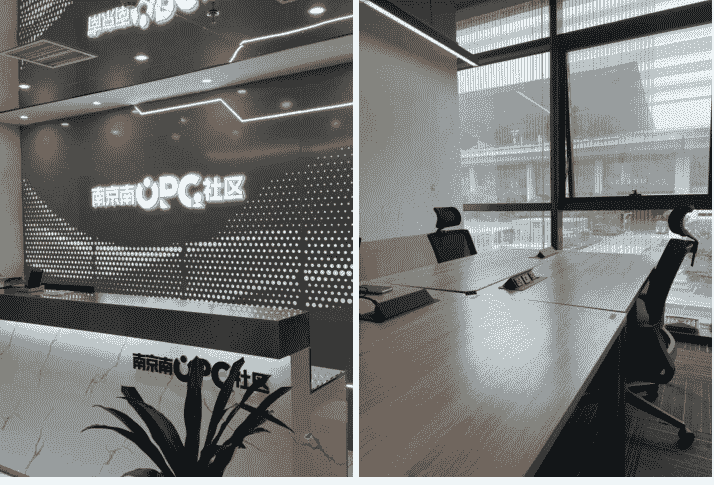

# 40 万跨三个年头累计：更值得琢磨的是力气怎么摆

先说明白，这既非操作指南，也非打鸡血。我叫都督，02 年生，赚钱一年级。横跨三个年头，我把大模型嵌进矩阵脚本外协、编程委托、小团队协作，也做过自用的小器具；毕业后的暑假又试了 Codex 深度带练。账面合计约 40 万。

先讲清楚：40 万不是某年陡增，而是三个年头加总；Codex 带练也只摸到雏形，谈不上稳定复刻。真正想给还在找路的人看的，是我反复在用的三格精力盘——主力盘供回款，试探盘探可能，种子盘做小验证。

先把判断摆前面：

- 安全感别只押一处。眼前要活，后手也要留。
- 原型能转，不等于买卖能立；让人反复用、愿意掏钱，中间藏着大量脏活。
- 重来一回，先盘自身条件，再瞧市场缺什么。围观与上手，两码事。
- 40 万跨三个年头加总，Codex 带练刚见亮，别把回看当速成神话。

## 一、近几个年头，我不断换切口，也不断校验旧打法

2023 年，我密集接触大模型。写作、作图、剪辑、写码都碰过。读的是计算机方向，最后把精力收束到模型与 MATLAB 的组合上。

2024 年休学，我冲这条线。那时闲鱼上能把模型嵌进矩阵脚本结项的人还少。盘子多大我不敢吹，只敢说，在目力所及的圈子里，我跑得靠前。那轮折腾把我从“只会使模型的人”推成“得管生意的人”：技术之外，流量也得琢磨，之后干脆拉了个小班子。

真下场才懂，一桩买卖是由多少细碎环节堆起来的。

2025 年复学后，我把念头做成旁人能直接上手的物件。做了 matlab.ai，用来承接原先的矩阵脚本委托。过去接单是先问目标、再写程序、最后返工；我想把这几步塞进一条流程：对方提目标，系统追问确认，再让系统生成程序并回传结果。旧外协里攒下的心得反过来指导设计，比如哪些资料得先抠明白，结项后对方往往还需要怎样的售后。

还有件自娱的小器具，我叫它“今天来一首”。缘由相当个人化：我不想再被平台推荐歌单牵着走，想照眼前情境现攒一曲来听。于是把 Claude 的写词本事接到 MiniMax 的演唱本事上，由语言模型填词，再让语音模型开嗓，成了自娱的小器具。

这些折腾让我对造物这件事理解更落地。眼下看，动机大致分三类：一是用模型盘活主业，把重复环节固化；二是看见旁人的难处，先做个能跑的原型；三是单纯图乐子，自己觉得有趣就动手。它们常常重叠。matlab.ai 既想让主营更顺，也想让委托方提目标更省事；歌词玩意更像自我娱乐，重点在乐趣。

但造物比想象中厚。模型能快速搭出原型，可从能跑到被长期使用，夹着大量活。这也逼我重估：眼下从哪切入更现实。

同一年，我也给校内的老师讲过课。独自钻研与开口授课，难度不同。自身熟练靠手感与心得，要带旁人则得把省略的步骤摊开。

到 2026 年 7 月拿到毕业证，暑假空出一整段。我想从零再打通一条线，验一验自身。2024 年矩阵脚本外协跑出过成绩，不意味着下一轮还能复刻。我想看看过去捕捉目标、识别机会的路子有多少能迁移。于是挑了 Codex 带练，一边调研一边实测。

挑这条线，跟校园阶段的底子有关，也跟之后想往公司端走有关。我碰到过相当多高校学生，他们想把大模型用进学习与手头任务，缺的是具体案例。我使了几年模型，也上过讲台，便想试试能否搭把手。带练另有一层好处：能近距离听学习者卡在哪，也能结识若干老板和各岗人员。

眼下只能算刚验过一程。想变成能持续的生意，还缺好几块拼图。

## 二、进账上来以后，关键是学会分配关注

读到把生意拆成三层的说法，我很认同：主力盘扛眼下主要回款；试探盘值得继续下注；种子盘做早期摸底。

这三种角色要同时被看见，但投入节奏不同。落到单个人身上，道理相通。假如你手上有一条买家稳定、回款尚可的线，把多半力气押进去并不奇怪，日子要花钱，已经有人掏钱的事，当然值得认真做。可新线从念头到有人用、到肯掏钱、到稳定给结果，要耗工夫；你急着变现，这段路也缩不短。等旧线明显吃力时才去找新财源，可选空间就窄了。

### 1. 主力盘：要养着，也要更新

矩阵脚本外协是我从零起步、被市场检验过的线。它给我的不止现金，还有一整套做生意的惯性：先摸清哪里有人要，接上头后把条件抠透——数据长什么样、结果拿去做什么、最后交什么文件。条件定清后才动手码程序、跑结果、改毛病。前置没抠明白，后面动作越快，返工越凶。

用模型时这点更明显。随手抛一句模糊指令，它照样能铺陈出像模像样的长文。可像模像样与真正对路之间，隔着人的分辨。做矩阵脚本让我越发看重前后咬合：从目标里估活儿大小，借模型落地，再复核并讲清。任一环节都会左右委托方体感。

竞争也在变。能借模型码程序的人多起来，原先“我懂你不懂”的差距正在收窄；模型本事变强，买家对速度的胃口也被抬高。这并非说矩阵脚本没饭吃了，而是主力盘也得换招。部分活儿可以挑着不接，部分环节则得往深里做。买家肯为哪块掏钱、跟两年前比有没有变，只能靠实际谈单去摸。从前好用的报价和做事套路，不能原样搬到底。

对已跑顺的线，我眼下更看重能不能长久。某阵子回款漂亮固然可喜；后续有没有持续订单、结项会不会把自身榨干，也得算。接外协常只记得单子进账多少，却漏算前置沟通耗了多久、后置返工磨了几轮。把钟点重新摊进去，才看得清这单生意划不划算。

主力盘能给人底气。日常开支有托底，试新线时才敢照反馈拐弯；不然尚未成型的尝试，很容易被逼着马上养家糊口。但主力盘也得盯，别因为熟就认定它会一直照旧生钱。

### 2. 试探盘：先贴近人，再谈规模化

对把东西做成成品，我始终有兴趣。把某处卡点理顺，落成能反复调用的物件，这活儿本身就勾人。碰过模型编程后，手更痒了；原先被开发功底拦住的点子，眼下能先搭个架子试。

可真下场，感受更具体。模块能跑，只解开一部分扣子：它到底对应谁的刚需？对方原先靠什么凑合？肯不肯换招？日后坏了谁修？这些全都会左右它能不能被长期用下去。码程序时目标清楚，做完一个模块立刻见效；可人的欲望与操作惯性并不乖。你自认好用，对方也许只回一句凑合；你熬夜细抠的地方，未必左右他拍板。

于是我更明白，把东西做成成品，得靠年头养。模型压低了实现门槛，余下功夫仍得学、仍得磨。

亮明我的看法：眼下我更想拿人工协助当切口，先挨着具体的人，把卡点解透。这条取舍跟我的底子有关。大模型让更多人有条件做软件，不意味着人人肯亲自做。某人具备某项本事，与他肯不肯为它耗钟点，完全是两码事。图省事、求稳当、有人兜底，本就可以拿来收费。

健身是个好比喻。Keep 这类 App 能给动作说明和训练表，有人照着练就够；另一些人更需要教练盯着自身状态，随时改计划，并在练的过程中给回声。同叫健身，钱付给谁，换来的推力并不一样。我对模型授课的看法类似：资料遍地都是，某人在实操里卡壳时，常需要旁人点出他此刻停在哪。这种判断加临场微调，正是人工协助能给出的分量。

当然，人工协助也有限制。成品能把一轮研发的成果复制给更多买家；单兵带练却得实打实投钟点。把客单价拉高，进账也许更漂亮，但背后是更重的备课、沟通与追进度。价高并不自动等于生意轻松。

于我来说，从人工协助起步，价值在于能更直接地撞见卡点、校验认知。后续若看到某类诉求反复冒头，再琢磨哪块能沉淀成内容、哪块值得做成小应用。到那一步，成品能派什么用场会更清楚。

成品与带练能互相供血，可眼下我得先把启动次序排明白。

### 3. 带练验证：用新事情检验旧路子

这个暑假挑 Codex 深度带练，跟此前攒下的底子有关。我摆弄大模型已有三个年头，在矩阵脚本外协里跑过实战，也琢磨过成品与授课。筹备新线时，Codex 正好是我盯得最紧的标的，周围聊它的人也多了起来。

另有一层盘算：想朝公司端走。要往那边走，先得摸清企业里的人日常怎么干活、哪段最费钟点、哪些老症结长期没人碰。我想借带练多碰有真需求的人：高校学生、老板、各岗打工人都有可能。围着他们手头的活儿聊，我才可能看清模型到底在哪个环节能顶上去。

这类摸底，对我之后做成品、做公司端都有用。先把具体卡点看透，再掂量自己能拿什么。部分卡点能做成小工具，部分得坐下来细聊，再给对应的帮手。

调研加实测之后，这个暑假把它跑出了雏形，我也愿意继续押注。往后能不能持续聚到合适的人、带练质量稳不稳，仍得慢慢看。

眼下单人带练定价五小时。前段先讲大模型能替人干什么，重心放在三块地基：指令写法、流程串联、Skills。讲完不落地没用，最终仍要回到学习者手头的生意里动手。所以我会请学员带着自家活儿来：某类重复工序，或某个想落地的点子。先选范围清楚、适合当场演练的题目，把条件与素材备齐，再借 Codex 分步推进。哪儿卡住，就查那儿缺哪块：是资料不够，还是路数得改。

对刚摸大模型的新手，我有把握把底子讲透，并陪他实操一轮。五小时里，我想让他弄清模型能替他干什么、如何把条件说明白，并亲自跑完一轮全流程。以后再撞见相似活儿，可以顺着手感继续练，慢慢自己收尾。

眼下提起知识付费，不少人先皱眉，这我懂。课程囤了一摞，真到用时仍发懵；海报吹得天花乱坠，结项只塞来厚厚一叠材料。踩过这些坑，谨慎并不奇怪。我要把带练做扎实，就得靠结果说话：服务哪类人得讲明，能陪到哪一步得有分寸，碰到拿不准的地方就共同核对，别为了撑住老师架子硬编答案。眼下只开线上单兵带练；将来要不要往线下走，我有点念头，但还得再摸。

### 4. 三种角色，不是三个格子

别把矩阵脚本、成品、Codex 往三个抽屉一塞，就以为排兵布阵结束。哪条线处在什么火候，得看它眼下的真实状态。矩阵脚本曾是跑通过的现金牛；成品里藏着大量摸索；Codex 带练刚过测试，仍在验证期。往后哪条线扛大梁，只能让持续战绩来回答。

种子盘未必是某个已命名的新标的。有时它只是某个值得钻研的目标，或某类能小规模试水的给结果路径。

我眼里的并行，是照看当前板块时，顺手给下阶段腾出合理档期。手头进账得护住；新线要圈定投入边界；最嫩的点子先做成只回答单个疑问的小试验。几条线的权重本就该有轻有重。初上路者，头等大事多半是先有稳定现金流；有班可上的人，本职与专业功底也值得细养。给以后铺路，不妨从学一点、试一点起步，犯不上一上来就让自己扛三条线的总责。

这套分法给我的提醒很实在：眼下有进账，要惜福；往后的饭票，也得趁还有余裕早盘算。

## 三、如果今天再开一局，我会怎么选赛道

我能掏出来的，多半是自身踩过的路。休学、做矩阵脚本、再返校，这些取舍都绑着当时的处境。你有你的日子要过，犯不着为证明胆量，把旁人的轨迹重走一遍。

倘若再开一局，我先把眼光收回自身：手头有什么牌，又能把什么牌打顺。

### 1. 先盘点自己，再定起点

挑赛道时，人总爱先瞟旁人。瞧见谁跑得顺，便去扒他的成品与定价，顺手估自己照抄能赚几成。这再自然不过，撞见机会谁不手痒。

可对方眼下秀出来的，未必带着他从前砸进去的功底。你见他举重若轻，兴许只是最硬的骨头，他早啃过了。我干矩阵脚本，也沾了专业底子：碰过编程，肯钻大模型，之后又在谈单、结项、授课上耗过钟点。这些牌凑到一处，才凑出后来的局面。旁人若缺这层底子，只冲着某件生意的名头就开干，碰到的难处会大不相同。合我脚的起跑线，挪到旁人脚下，可能得先垫几块砖。

因此我先盘一遍真干过的活：哪些活儿，旁人已肯掏钱请我出手？哪些卡点，我能独自收拾到底？还有些领域，虽谈不上拿手，我却愿意长期钻，也能摆上桌掂量。

这里得说实话。翻完课程与亲手干过一轮，差距很远；照猫画虎做出来，跟换个场景仍能收尾，还差一截。同时得看现实处境：一天能挤出多少钟点，眼下有没有硬性支出，这些都会左右取舍。短期要稳现金流，就先把接得住的活排在前面；要长期啃的路线，单独腾时段。

安排总完不成，常因塞进来的活太满。一天就两小时，却把全天填满，当然撑不住。

### 2. 先贴近人，别只问“这东西你用得着吗”

路线大致定了，我先打听旁人眼下的处理办法。不妨向对方讨教：这卡点你眼下拿什么招应付？最硌手的是哪段？这比张口问“我做这东西你用得着吗”更能摸到真需求。嘴上说“挺好”只是客气，肯把真活儿递过来，才算有分量的动作。之后肯不肯掏钱，得另行确认。

这点是我干矩阵脚本时悟到的。买家带着清楚活儿来，沟通自然有落点。把条件抠明白后，才好估活儿大小、掂自家功底，判断是否接得住。

收个尾：它不是操作手册，也不是鸡汤。40 万跨三个年头加总，Codex 带练刚摸到门道；更值得带走的，是那套兼顾眼下与后手的力气配比。手头有进账，要惜福；往后的饭票靠哪条线，趁余裕尚在，早点盘。

脑子里过一遍，事情看起来都很顺。真正要对别人讲清目标、做法、最终收获，之前没捋顺的空隙立刻露出来。

所以启动新事，我习惯先找愿意听懂的人聊聊当下在发生什么，看自己有没有能搭手的空间。关于品类，我更倾向先确认这件事是否真的值得被解决，再去想功能怎么排。要是第一批潜在使用者在哪里都没摸清，继续堆功能往往不是当下最该投入的精力。

我对产品的兴趣还在，只是排序会被更重视：先去碰真实需求，再决定做得多大。这样能减少自己跟自己聊得热闹的时刻。

### 三）小步试验，算清楚投入

起点最好是一桩事，边界清晰就行。

锁定特定人群，聚焦单一痛点。动手前把范围、交付形态写明白，别做到中途才发现双方预期根本不一致。

做完后回头观察真实使用：成果到手后能否独立使用？哪个环节仍需要反复求助？这些回馈会牵动下一次定价与交付安排方式。

我所说的由零到一，包含这些运营细节：有人愿意买单，自己能交付，客户拿到后真能用上——这条链路必须完整走过。

跑一段时间后要强制停下来复盘。

若始终触达不到合适的使用者，先解决触达问题。若有人愿意交流却无人付款，就要重新评估需求分量与方案匹配度。

还有一种情形：钱能收，但每次交付都超预期，占用时长持续扩张。这时要审视服务边界与作业流程。承诺过多的事项、可以前置准备的环节，都值得重新梳理。

资金与工时必须一起核算。

早期学剪辑，我花七千元买课程，后来靠剪片赚了三千余元。账面上是有盈利，却连学费都没回本。

这次经历让我明白，看到流水同时要看前期投入。现在评估某项目，我会把学习费、工具费算进去，准备、沟通、修改消耗的时间也不能忽略。

尤其不要因为看见别人晒出某月表现，就默认自己后续每月都能复制。旺季淡季差异明显，早期红利与后期竞争也不一样。先弄清楚收入产生的条件，再判断自己是否具备复现能力。

已有正职的人，也别因副业某月表现不错就冲动离职。我当年选择休学，但每个人的责任与可承受的试错额度都不同。

尝试之后继续做、调整打法或停止，都可以。关键在于知道决策依据，把碰到的问题记录下来。下次重启时才有可用的经验。

### 四）带着具体任务边做边学

想借助AI做点事，我的建议是先把目标写具体。

准备服务谁？要完成哪项产出？自身还缺哪些能力？把这些想清楚，学习路径才好安排。

AI学习范围太大，工具越堆越深，最后容易迷失起点。

用一份真实任务练习，具体感会立刻提升。完成它需要哪些信息，AI输出哪里不符要求，原因是什么，都能在实操中同步学习。

比如让AI辅助数据分析。若自己对数据与分析方法不熟，得到一张精美的图也难以判断其意义。这时就去补相关知识，补完再回来验证结果。

我自己的认知也是在真实项目里累积的。遇到问题查资料、尝试解决，再检视该方法能否迁移到下一个任务。

学会一种方法后，可换一批素材独立复现。离开示范后能否完成，卡住时能否自查原因，这些都是检验学习深度的信号。

至于变现，核心在于有没有人需要你的供给并愿意付费。学会用AI之后，需求挖掘、要求沟通、交付执行，这些环节依然要走。

因此对我而言，学完一个工具最好立刻找件事落地。用过之后，哪些掌握了哪些还欠缺，比看教程时更清晰。

最近健身给我一个新启发，关于正反馈。大多数人健身目标是减脂，而减脂周期长，正反馈慢，容易坚持不住。如果把运动时的畅快感当作正反馈，反而更容易保持并享受过程。

商业逻辑类似：把赚钱当唯一正反馈，从起点到首单的周期很长，容易放弃。那是否可以把其他节点也当成正反馈？留给大家思考。

## 四、聊聊专注以及自我认知

过去一年，我更愿意静下来。遇到问题先沉淀研究一段时间，想不通也没关系。尝试一次结果偏离预期，就去追查是哪一环节出了偏差。

毕业后我会继续寻找机会，也会持续学习。眼下先把已有的业务盘清楚，持续打磨，把实操中碰到的坑整理出来。哪里尚未熟练，就预留时间补足。

部分想法目前只能到此。未来做到什么程度，要看真实结果。

写文章这件事我想重新捡起，写写做事中的判断、哪些想法后来被修正、哪些实践与最初预想不同。

这些过程值得被记录。

前面提到人生三件大事：吃饭、睡觉、悟道。聊完想法，另外两件事也要兼顾。项目要推进，饭要好好吃，觉要好好睡。为自己预留休息，也为身边的人预留陪伴时间。

恰好国庆将近。

预祝大家国庆愉快，手上进行的事都能有进展。假期有空，和家人朋友吃顿饭聊聊天，好好放松。

全文较长，感谢阅读。对了，我加入了赚钱的联合办公，和一群伙伴一起工作成长，三个月后看能走到哪里，一起期待。

文中若有共鸣，或对你使用AI、做项目有一点启发，麻烦点个赞鼓励一下，首次发文很需要支持，哈哈。

实际操作中遇到的困惑，或对文中观点有不同看法，欢迎评论区交流。我是都督，一个持续寻找项目的实践者。本文主要分享个人蜕变与复盘。若对MATLAB与Codex感兴趣，后续再写实操篇。希望带来不一样的视角。

——分割线——

读完这份SOP，你可能觉得自己掌握了。但九成的人实操时会在开端卡住。

工具与教程只是初级门槛，真正的门槛是立刻行动与圈层信息差。

如果你想看到全网最新的变现打法，并与一群执行力强的极客一起下场拿结果，欢迎关注我的核心私域：【懒人专属群】。

我们不谈虚的，只做商业闭环拆解与AI效率压榨。系统内已沉淀一千余个跑通的套利实战案例。

□ 查阅圈子完整数字资产与上车门槛：
https://lazyso.com/insider/

认同价值并准备下场干活的，可扫码加我微信（lazyhelper1）
备注：【实操上车】，不闲聊

