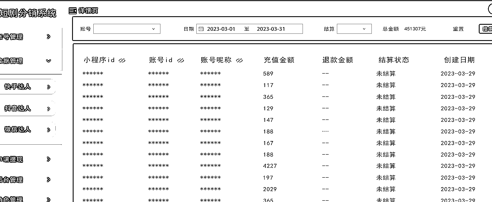
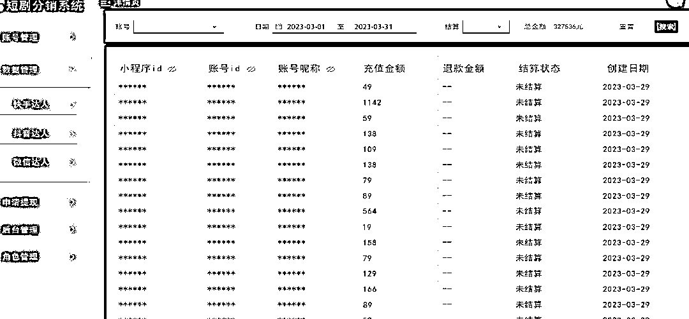
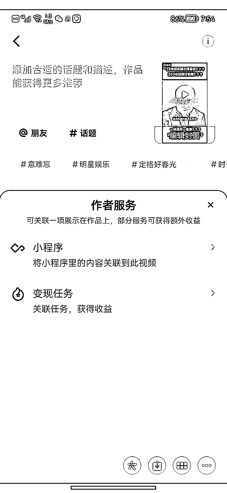
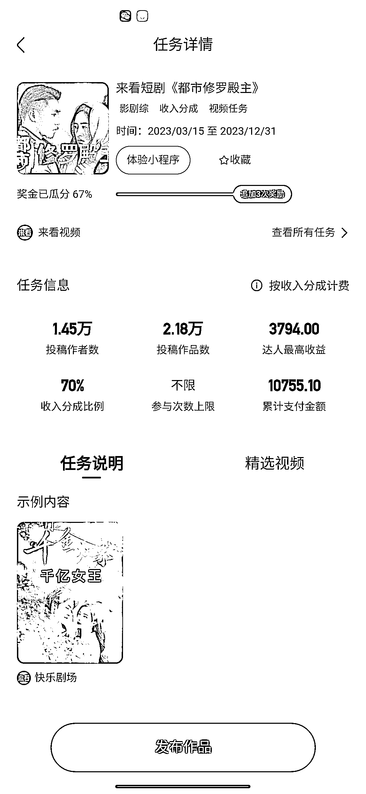

# 39 天短剧实操：从启动到账本的真实复盘

原文：[`www.yuque.com/for_lazy/thfiu8/gg1s0vt2mch92nph`](https://www.yuque.com/for_lazy/thfiu8/gg1s0vt2mch92nph)

## 《聊一聊短剧的发展》

作者： 龙哥

日期：2023-03-29

距离上次发帖又过去整整一个月，这次回来是想把自家跑了近40天的短剧项目摊开来讲。之前在社区分享过两次想法，这次直接上手干了。发帖时电脑正卡在视频渲染里动不了，就趁着在家空档把账先算一遍。

先说前期砸进去的成本。

1. 设备投入：二手华为 Mate20，6+64GB 规格，单价 450 元，共入手 60 台，花费 27,000 元。

2. 人力投入：招募 30 名在校兼职。薪酬结构是底薪 + 按条计酬 + 充值分成。底薪 1000 元/人/月，30 人合计 3 万。1 元/条的基础计价以及 5%-10% 的提成，是结算后另行核算的。这个薪资方案我们前后改了多次才稳定，初期碰到的坑远超预期。

3. 账号投入：300 张电信、联通电话卡，月租 5 元/张，另需预存 30 元话费。合计成本 45,000 元。

三项加起来首批投入 10.2 万元，资金是我和合伙人共同出资。

理想很丰满，执行很骨感。短剧前期的回报极不稳定，运气权重非常高，很容易劝退。数据表现也存在明显矛盾点：播放量高不等于充值高；纯搬运内容在抖音、快手极易被限流甚至封号；原创度清洗难度大，靠 AI 自动剪辑批量生产的素材基本没有出路。爆款样式被大量复制后，最终靠的还是偶然性。

团队组建的过程同样反复。起初在校园里启动，和我、合伙人、校内一位老师以及社团负责人一起，把影视后期专业的同学都拉来试做。登记人数超过 200 人，最终能留下 60 多人，再往后稳定下来只剩 30 人。计费模式也走了个循环：先是纯分成，再改按条结算，后来变成底薪，最后演进为底薪 + 按条 + 分成的组合。折腾的根源在于管理跟不上和收益波动。

早期我招学生的形式，和外面招代理本质区别不大，只是给了少量底薪、压低提成、提高了执行要求。但变现效果并不理想，且批量养号难度很大。

反观市场上成熟的代理玩法就轻很多。代理赚钱了平台才赚钱，分成比例极低，后台数据由自己掌控。信息差就此产生：充值流水和分成透明度存在落差；代理是否盈利并不影响上游，持续拉新就能维持存量；一旦某个代理跑通，其复制成本极低，主要是发资料、偶尔维护社群、开直播讲解、配合活动。熊猫短剧的活动力度在同行里是比较激进的，我加了四个同行的群做过对比。

另外一个变化是，抖音、快手在三月份已将短剧推广开放给全体达人，新注册号也能接 CPS 任务。如来看剧场在快手可达 70% 分成且无服务费，九州在快手为 60% 分成。抖音上九州的基础分成约 26%，经星图投放可提升至 60%-80%。只要有官方指引，新号也能逐步接到任务。

说到目前的产出。现阶段手里大约 300 个账号，抖音充值流水约 45 万，快手流水约 32 万。抖音 75% 分成到账约 33 万余，快手 90% 分成到账约 30 万余，合计一个月到手约 60 万。结算周期集中在每月 5-10 号。期间损耗的账号不少。300 号的成型，是我自费购置手机与卡号，再配合仍在坚持的学生一起批量起号的结果。

这 300 个号背后，是一个影视专业共 9 个年级的学生群体，每个年级 50-60 人左右，最终做着做着就流失大半。能留下的学生执行力很强，比如后台管理系统就是学生自己开发的，理由是更便于管理。

这种产教融合的路径，对学校资源是有价值的。剪辑短剧既能锻炼剪辑手感，也能提升软件操作熟练度与工作效率。

综合来看，这 60 万属于实打实的辛苦钱换来的。

评论区：

晓飞 : 这个帖子没有写好，我一两点钟那会，写的时候还脑子清晰知道怎么写来着，结果刚刚写就忘了！

不过我最近跟赚钱圈友合作，重新测试另外一种方式，看能不能赚钱！反正目前这种是赚钱了，但是赚个辛苦钱！反正很累，没有我做影视工作室这活好！[偷笑] 晓飞 : 有时间我也写个干货技术含量高的，把我们自己做短剧整理的，总结的问题，全部整理写个帖子来！[呲牙] 正宇 : 60 个手机，我曹。 晓飞 : 二手机，便宜，本来是圈友找的 600 多好手机没有要，就重庆这边捡的便宜货，坚持下 正宇 : 可以，27000+也不少了，哈哈哈 苗小羊 : 大佬，学生兼职，这个底薪怎么算？按照条数？1000 一个月，必须一天剪辑够几条嘛？ Mr.炎 : 一个月 60W 是收入是吧？利润有多少？ 晓飞 : 因为别个学生都说，他们自己在 b 站，闲鱼这些上面接个剪辑视频，游戏直播剪辑，一条都 10 块钱起步，没得法，然后就重新来商量，底薪 1 千，就是一开始他们提供的号，我这边不提供手机跟号，因为那个短剧是需要手机 APP 来发布的！所以这个是必须的，才有这个 1 千底薪原因！ 剩下就是你剪辑一条视频我给 1 块钱，按照我说的要求来，参考我视频来，这是普通合格视频，然后你的视频播放量爆了，这就是精品视频，按照 3 块钱一条计算！这个就很少但是给学生一个机会 如果有充值给 5-10% 这个必须一天最少发一个合格视频给我上传你们的号，这就是前期我们的，一般就是后来不断根据实际情况调整，有些号学生就想直接赚分成