# 从0到300+账号矩阵：我如何用网盘拉新项目，四个月变现30万，3.8万字完整复盘
## 从零搭建三百号矩阵：盘拉新项目四个月实现三十万，我的复盘笔记
260717 副业SC 精华
文中数据均可核实！
各位好，我是龙哥。
00后出身体制外，本科普通院校土木专业，毕业后先去工地，后靠线上流量才脱离原有行业。
仅看结果，也算有点成绩。
2023年我主导一个抖音号做到四十万关注，当年借助账号与后端知识付费体系，整体到账约五十万。
知乎目前有一万余粉丝。
公众号前后操作过三号，累计关注超三万，多次产出十万+阅读。
但很长一段时间里，我总觉得拿不出真正的东西分享。
我清楚自己的短板。

我经历过爆款，也完成过变现，却习惯跟随风口。近期决定续费赚钱，前后犹豫了很久。
并非平台问题，而是信息密度过高。
案例繁多、方向混杂、信号频繁。
以至于做流量多年的人也会产生信息焦虑。
一边浏览他人输出，一边自问能提供什么价值？
直至今年，我从零起步跑通了网盘引流新用户项目。
就这么一个赛道，让我从一个对引流完全陌生的小白，四个月左右拿到约三十万的回报。
为规避风险，我们实际使用两套迅雷工作台。因为初期采用多关键词申请，工作台自然也开两套。后续也验证了该操作本身不违规，相关数据可随时查证。
最初聚焦迅雷引新，后期切换平台做UC引新，目前两套并行。关键在于迅雷后台数据不可篡改，随时可查。
过程中构建过三百余号矩阵，联系过代发团队，做过评论配合，踩过违规红线，被封过账号，也完整经历了项目从红利期到衰退期的全周期。
坦白说，现下这套打法已被平台重点压制，低质内容泛滥。
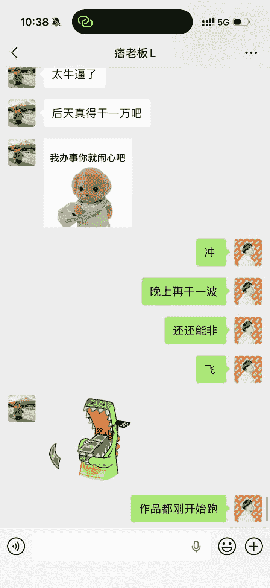
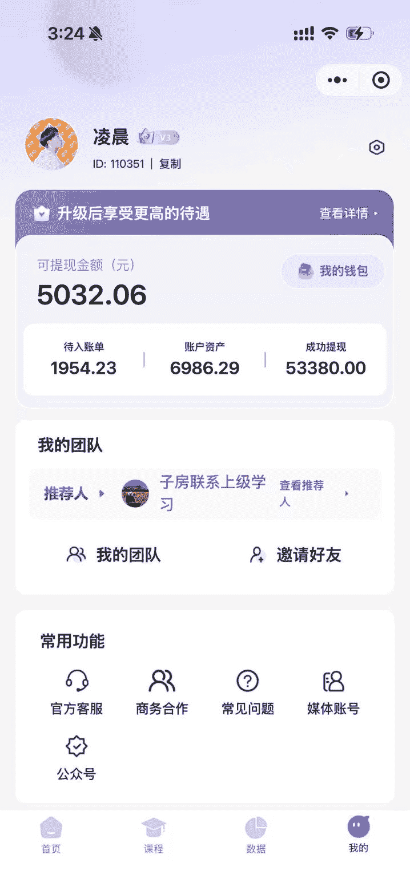
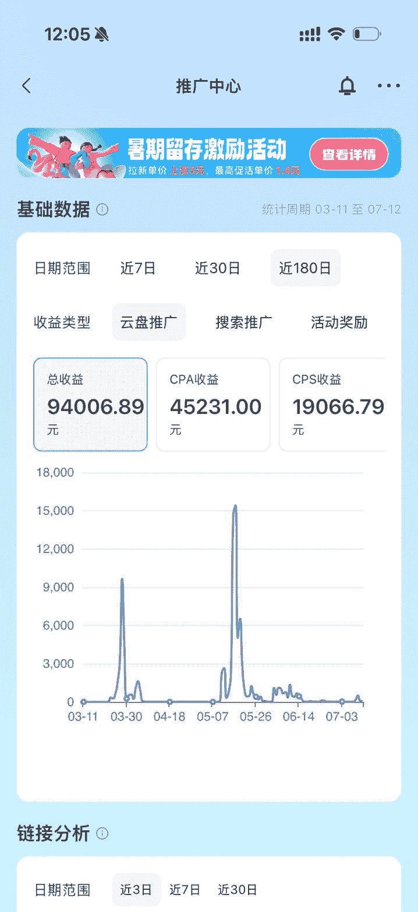
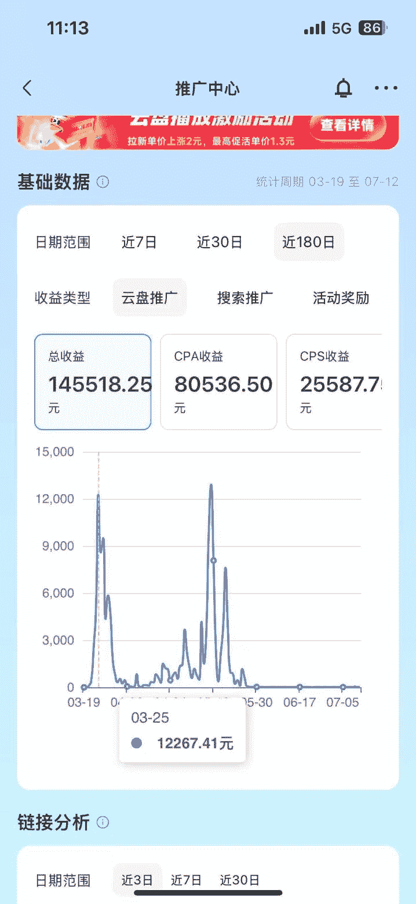
峰值阶段日净利曾触及一万四、一万五。当然收益始终波动。
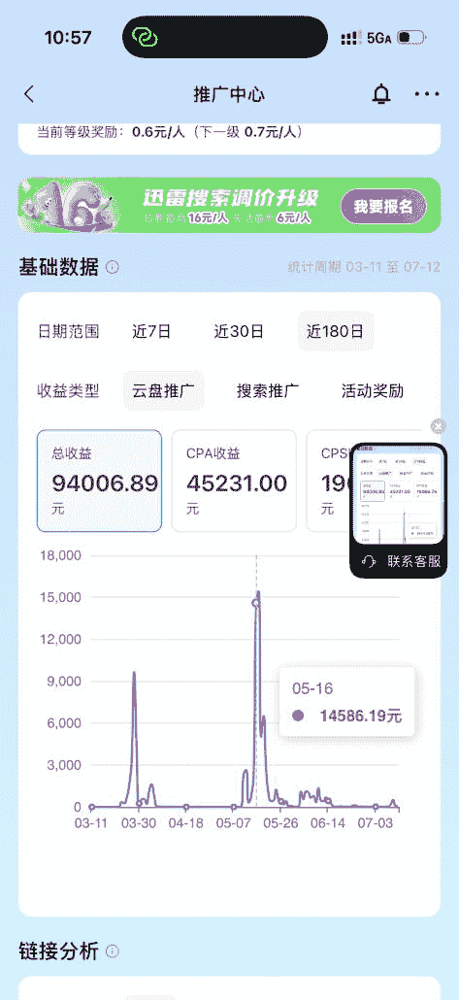
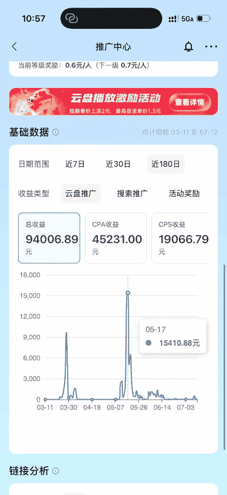
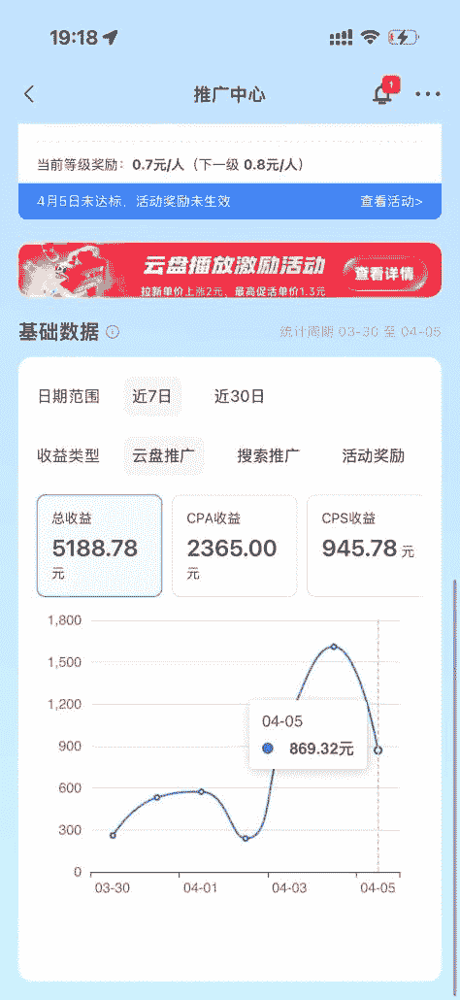
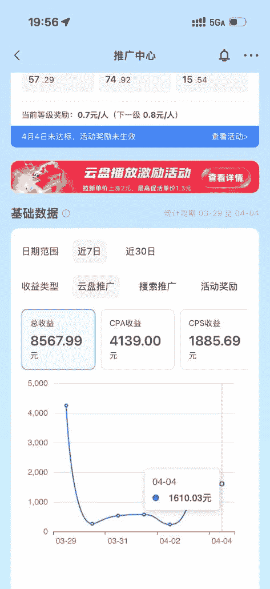
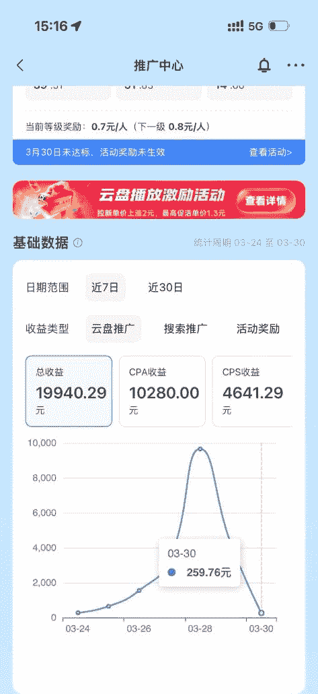
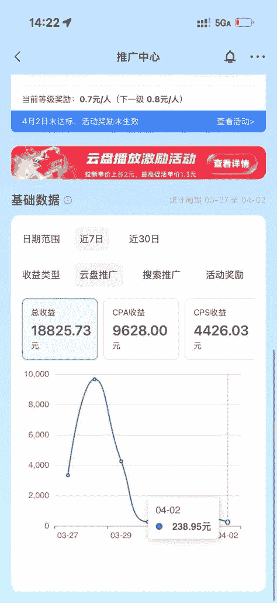
整体路径是从发现机会，到五条作品小范围验证，再到外包扩量、承接转化、风控应对、小规模协作，真正把从零到一跑通。
此篇并非网盘拉新的实操教程。
我也不想把一个已进入下行的项目包装成人人可复制的赚钱机会。
那不真实，也不负责。
网盘拉新远不止我提到的打法，我们现阶段也在探索新形态。
我真正想拆解的是：
一个业务从零到一，如何被察觉、被验证、被放大、遇到阻碍、解决问题，再迈向下一阶段。
符合以下情况的人，这篇或许有用：
- 初入圈，对项目从发现到落地的动作链条缺乏认知。
- 有流量经验，但长期停留在内容与播放，尚未完成完整变现闭环。
- 在做短期项目，想了解低成本验证、外包对接、矩阵搭建、风控处理的思路。
- 手握项目但单人承压，想把流程拆分，逐步形成小团队。
- 习惯追踪信息差与风向，但难以真正落地。
全文约三万八千字，写作耗时一周左右。如有遗漏，后续会补充截图、视频、SOP与操作细节。
只看干货可直接跳转第三章，项目验证与外包部分。
愿意看完整故事，我会从险些放弃续费赚钱、质疑自身是否有分享资格讲起。
对我而言，这不仅是一次项目复盘，也是我对自己的一次拷问：我究竟能分享什么？
我的答案是：递不出永远有效的方案，但可以把自己真实走过的一次零到一经历，完整地呈现在大家面前。
整体围绕以下维度展开：
- 机会捕捉
- 作品验证
- 承接打通
- 外包寻找
- 矩阵扩张
- 风控迭代
- 收益复盘
## 写在前面
成稿后我统计字数，约三万八。
这是我近年写得最用心、最完整的一次复盘。
从搭框架到填内容再回头补细节，花了整整七天。
即便如此，我也不敢称完美。
项目本身是动态的，许多细节是回忆整理与复盘同步进行的。
截图、视频、SOP、话术、表格后续会继续完善。
阅读后有不解之处，欢迎评论区留言，我会尽量更新回复。
核心内容是：一个从未接触过拉新的新手，如何触达网盘拉新，并一步步完成机会捕捉、作品验证、外包、矩阵、承接与风控解决，进而在四个月内实现三十万变现的完整经过。
有结果，也有大量过程记录。
我知道部分章节不够精炼，但希望把来龙去脉说清楚。
真正的价值往往不止于最终数字，而在于中间的每一步操作。
例如我为何看上这个方向。
首批验证是如何开展的。
第一条跑出来的作品是什么样子。
为何百万播放仍可能归零。
外包团队是如何找到的。
外包SOP怎样设计。
评论配合为何能提升转化。
平台收紧后我们如何逐步调整。
这些从结果层面是看不到的。
所以这更像一次个人复盘，而非标准教学。
想看实操可直接从第三章开始，前两章多为个人背景与接触经过。
在此之前我迷茫很久，不知该分享什么，是否有资格分享。
至今我仍更愿意把自己定义为新手，而非专家。
此篇不是证明我多厉害。
若能帮你少走弯路，或让你对零到一跑项目、组建协作者有更具体的认知，便已足够。
也算是我加入赚钱以来，提供的一点心得。
## 一、为何写下这份复盘
大家好，我是龙哥。
第五期赚钱会员，后续几期未续。
这次续费我纠结了很久。
不是平台不好，恰恰相反，是信息过于密集、繁杂。
多到长期做流量的人都会焦虑。
每日打开都能看到新项目、新案例、新玩法、新风向。如今我更重视风向判断。
有人做小红书，有人做视频号，有人做AI，有人做私域，有人做出海，有人做本地生活，有人做无人直播。
看起来都对，都像机会。
但我根本消化不完。
一度觉得不是我在获取信息，是信息在追着我跑。
越看越焦虑，越看越觉得自己一无所获。
于是有一段时期我选择了停滞。
原因很简单：我不知道该看什么，也不知道自己能输出什么。
这听起来有些矛盾。
履历上并非毫无产出。
2023年操盘抖音号至四十万粉，当年依靠账号、知识付费与直播音浪，变现约五十万。
后来自媒体上知乎号一万多粉。
公众号做过三个，累计三万粉，写出过不少十万+。
B站有九万粉。当时分享垂直账号运营，还曾获选。之前两万五，现在九点四万。
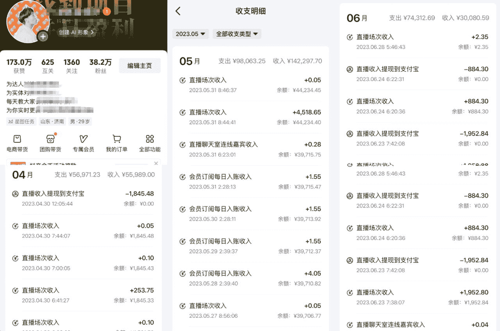
将这些列出，似乎我具备分享资格。
但内心始终没底气。
我总在自问：做成一个号，就代表此刻所说每一句话都有价值吗？
赚过一点钱，就能指导他人？
写的内容对别人真有帮助吗？
还是把过去的经历包装成方法论？
我很久不愿分享的原因。
不是没有内容，而是觉得内容分量不够。
我骨子里有很强的不配得感。
即便外界认为我做过账号、做过流量、赚过钱，我自己清楚问题很多。
难以长期坚持一件事。
容易被新机会吸引。
能把号做起来，也能写爆款，但流量过后沉淀很少。
这也是我近年最大的困惑。
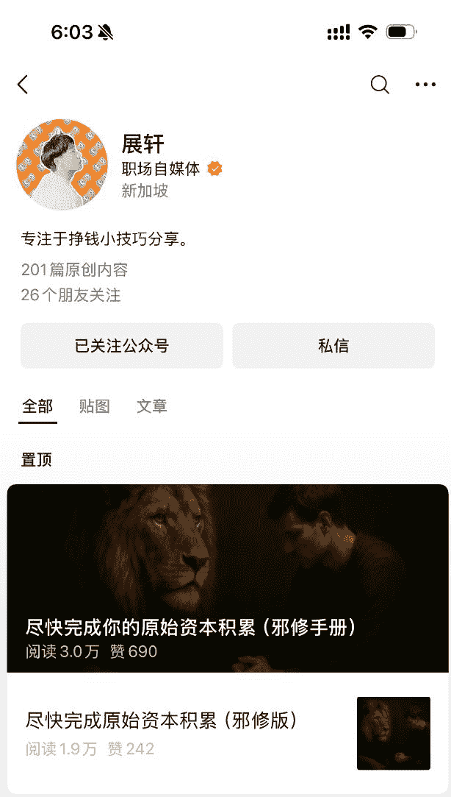
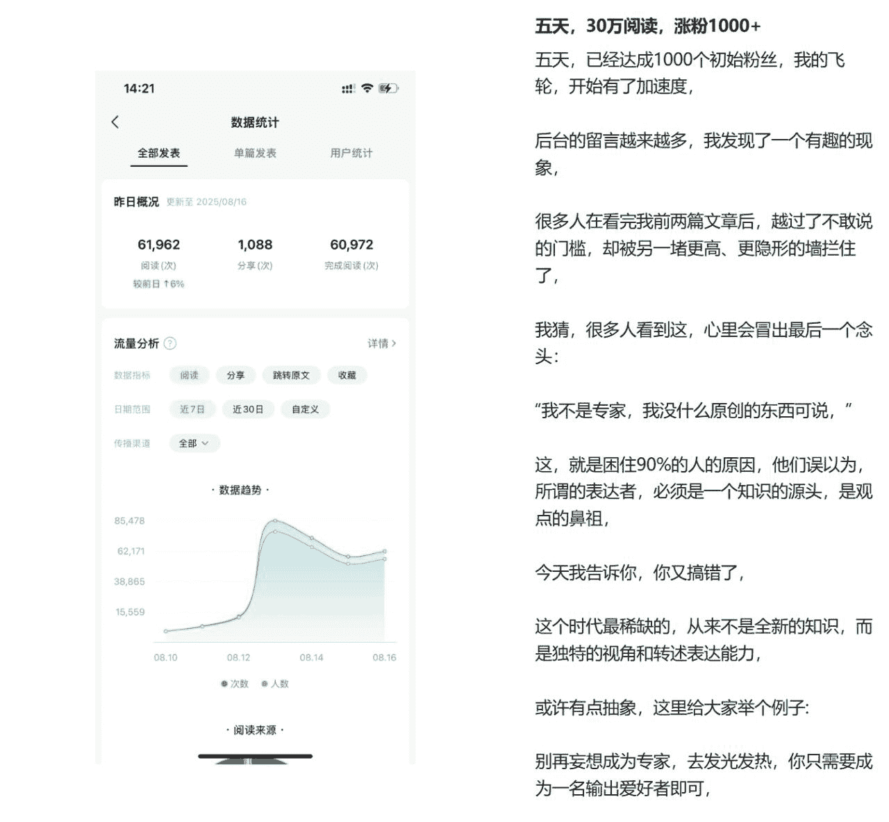
当然上方很多截图已找不回，但不影响核实。需要数据的话，我的账号可供查看。
我00年，普通本科土木工程。
毕业后去了工地。
生活很具体也很单调，每天图纸、混凝土、钢筋、现场问题、甲方要求。
不算痛苦，但我清楚那不是长期生活。
后来靠一波流量红利离职。
给过去两年一个概括，最贴切的说法是：
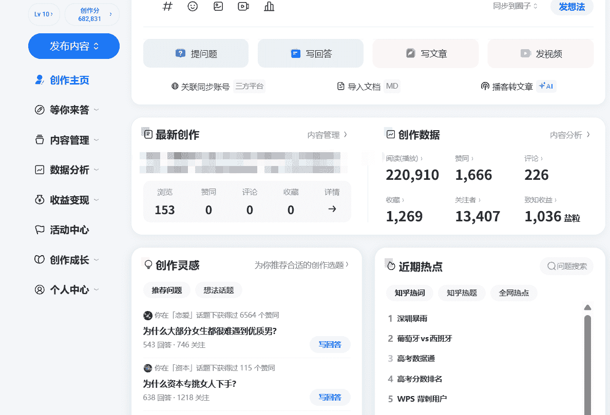
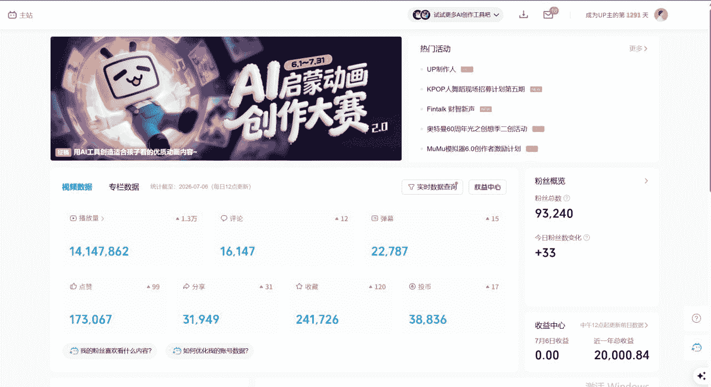
哪里有红利就往哪里冲。
哪个平台能起量就研究哪个。
哪个项目反馈快就去试哪个。
但问题在于，我一直在挖坑，从未想过建一口属于自己的深井。
包括之前四十万粉的抖音号。
不是没价值，而是后期变现乏力，我没耐心深挖。
做过公众号，写过高阅读，但未形成稳定商业闭环。
做过知乎，也做过知识付费，多为阶段性。
有结果但不扎实，有收入但不安心。
所以重新面对赚钱时，心情很复杂。
一方面这里有很多高手与真实案例。
另一方面我也在问：我能带来什么？
我不是最懂AI。
不是最懂私域。
不是最懂团队管理。
不是最懂商业模式。
连最擅长的流量，我也觉得只是阶段性抓住几次机会，并未形成稳定体系。
于是续费犹豫了很久。
直到我想起赚钱里看到的一句话。
主持人问嘉宾如何找到行业，嘉宾只回一个字：分享。
好像是留学赛道，具体是谁记不清了，原文已找不到，这里抱歉。
它让我对续费有了信心。
我过去把分享想得太重了。
总觉得只有足够成功、足够厉害、有确定答案的人才有资格分享。
可能不是这样。
分享可以是指路，也可以是把自己真实走过的路摊开。
包括判断、迟疑、踩坑、误判、起初不重视、后来的爆发、项目进入下行后的无力感。
与其说是下行，不如说当前模板在下行。但拉新不局限于我今天说的玩法，我至今仍在寻找新流量模板来延续。
如今我能感知到，网盘拉新的需求一直存在，市场非常大。学习资料、影视、软件安装等都能作为入口，每个环节都有人做到过结果。
这也是我决定写下这篇复盘的原因。
这个项目让我四个月从零到一变现三十万。
回头看它已进入下行期，不再是简单复制就有强正反馈。
但正因为经历了上行、爆发、放大、竞争、衰退，才值得完整记录。
它不只是一个网盘拉新项目：
从机会捕捉到低成本验证；
从第一条作品到第一个正反馈；
从单人跑通到找外包放大；
从几个号到三百多个账号的全网矩阵。
但要说明，封号是常态。每天打开可能全违规，所以要持续补充外包号，有时补的追不上掉的。
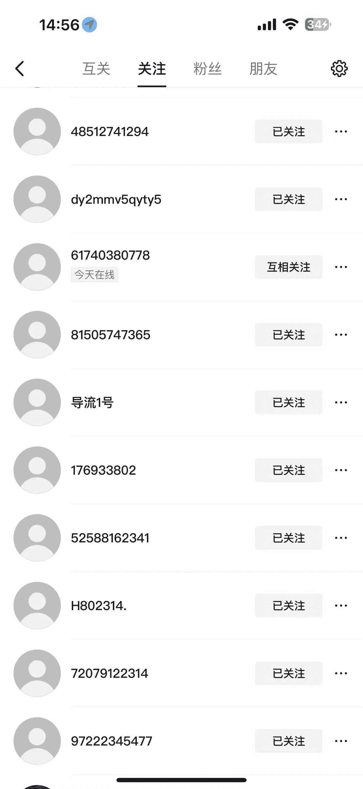
从快速赚钱到处理违规、引流、承接、结算、账号损耗。
再到项目下行、反馈变弱、成本变高、规则收紧。
几乎涵盖了短周期流量项目会经历的全过程。
我希望把过程讲清楚。
不是让大家现在去做就能赚同等收益。
不真实也不负责。
我想分享的是：
机会出现时我是怎么发现的；
从怀疑到验证到重视的路径；
如何判断值不值得做；
如何用最小成本跑通闭环；
内容怎么做、作品怎么发、数据怎么看、外包怎么找、矩阵怎么搭；
引流和违规问题怎么处理；
项目下行后我如何重新看待它。
如果你所在赛道正处上行期，这套打法可直接迁移。
你是新手，这篇能让你看到一个项目从发现、验证、放大到复盘的完整路径。
你有流量经验，也许会看到熟悉的问题：
为何有流量不赚钱？
为何爆款不能沉淀？
为何账号越多管理越乱？
我都经历过，有些解决了，有些还在解。
所以这不是标准答案。
我花了很长时间整理，就是逼自己把零散的经验性技巧，整理成可表达、可复盘、可参考的路径。
也真心觉得对赚钱里的朋友有帮助。
发现、验证、放大、控风险、复盘周期的能力是可以迁移的。
这才是我最想写的东西。
我的故事、迷茫、答案都在这里。
准备好了，我们从项目最开始讲起！
## 二、我是怎么接触到这个项目的
非要问我为何能发现这个项目，答案不是我多敏锐，而是我把自己放到了更容易接触一线信息的位置。
看时间线，其实三月十六号我们开始正式操作，真正上手跑通是三月二十八号左右。
今年我想做高客单付费产品，因为很多东西没亲眼见过，很难想象。
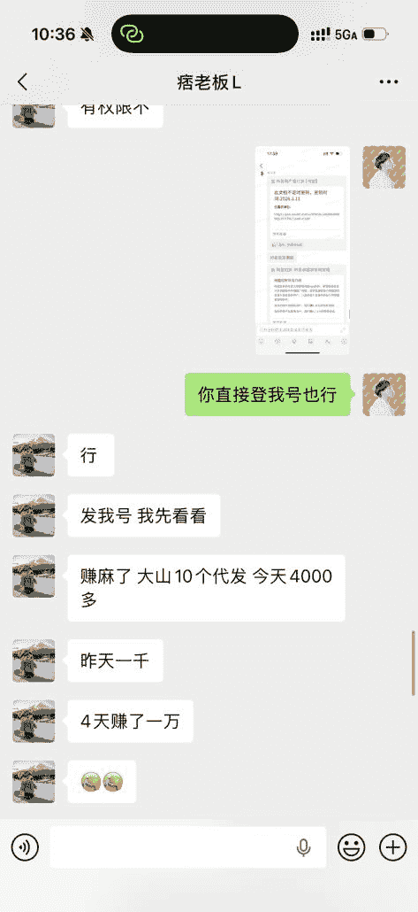
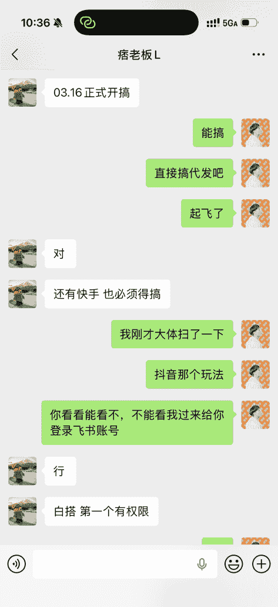
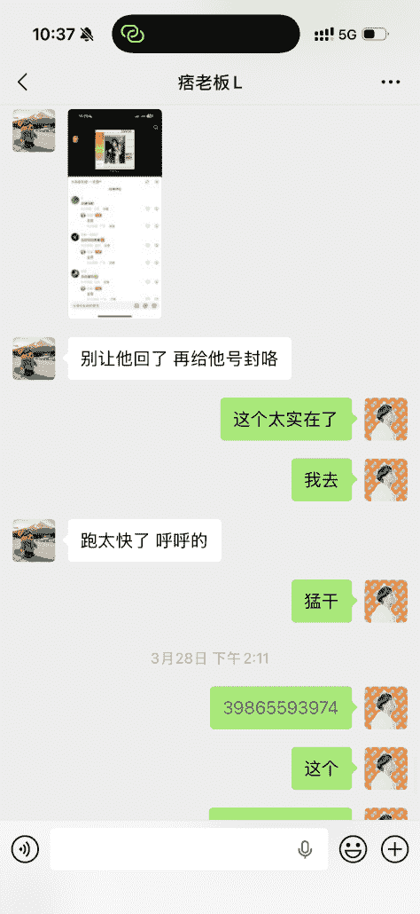
没见过高客单怎么卖，就很难理解成交。
没见过线下团队怎么跑项目，就很难理解前端到后端的完整环节。
没见过一群实战的人每天聊什么、看什么、测什么，就很难知道机会长什么样。
所以今年我去了临沂。
先声明，这篇文章不是推荐社群。我只是讲清楚我是怎么一步步接触到的。
2024年我加入过一个2980的社群，后来他们在做线下门徒项目。临沂离济南不远，我家在济南，去的成本不高。
更重要的是，我想去线下看看，真正一线的人每天在做什么？怎么发现项目？怎么验证？怎么跑出结果？
我去临沂最初目标不是网盘项目，我本想做个人IP。
因为我对自己定位很清楚：会做流量，但产品运营、产品设计、产品介绍、高客单成交这套不熟。
能把流量做起来，但流量之后怎么变成稳定产品，怎么讲清楚、怎么搭信任和成交链，这些不是强项。
所以去线下本质是学习。我觉得知识付费就该付。如果有人能让我少踩坑、省时间，我愿意付费。
包括线下也一样。线上沟通时首负说过不用交费，但我觉得没必要。想学别人的东西，就该尊重时间和经验。
到线下后，发现很多人在做不同项目。有人做网盘，有人做其他流量项目，每个项目有对应负责人。既有前端流量，也有后端承接。
对我来说，最大价值不是标准答案，而是能看到很多项目真实发生。
网盘项目就是在这个环境里进入视野的。当时听到一个信息：网盘拉新，一天能做到三千。
坦白说，单纯在网上看到“每天赚几千”“月入十万”之类的话，我通常不会太激动。这样的宣传早就泛滥了：有人说日入3000，有人说一天5000，还有人说普通人零基础也能做到。
看得多了，人自然会产生怀疑：
这是真的吗？
是不是只展示成功案例？
是不是为了卖课？
是不是只截取了某一天的高峰数据？
如果自己参与，会不会反而成了最后接盘的人？
所以最初听到“网盘一天能有3000收益”时，我的第一反应并不是兴奋，甚至对网盘拉新还有些抵触。毕竟这个项目早就存在，在我印象里，它像是很多年前就有人在做的老项目。那时候我会想：现在还有机会吗？
但线下观察和线上浏览，完全是两种感受。
在线上，你看到的只是别人讲出来的结果；在线下，你能看到身边的人每天真实操作。他们会交流当天的数据，展示后台截图，讨论哪类作品容易起量、哪个账号被限制、哪些素材还能继续测试、怎样的承接方式转化更高。
当这些事情就在你身边持续发生时，可信度会完全不同。
不过即便如此，我也没有马上下场。真正让我开始重新审视这个项目的，是我当时的一位同事，也是后来和我一起做项目的合伙人。他只是做了一次非常简单的测试。
他当时发布了一条健身博主锐评类内容，制作方式并不复杂。从剪辑到发布，前后大概只用了5分钟。很多人可能会觉得：这样的内容也能带来收益吗？
我当时同样不太相信。
可是第二天，数据反馈出来了。
这条作品的播放量不到2万，但通过主页上的置顶引导视频，带来了1000多次有效播放。这里要特别区分两个概念：
作品播放量，不等于项目有效流量；
真正影响转化的，是用户有没有从前端作品进入后端引导内容。
因为用户只有继续点击、产生兴趣并进入承接页面，才算真正进入了后续转化链路。
最终，这1000多次引导播放带来了约200元收益。按照平台结算规则，网盘第一条作品的数据通常要到第三天才能完整体现。也就是说，一条制作时间大约5分钟的内容，最终带来了200元左右的回报。
当时我们没有专门留截图，因为一开始谁也没想到它会成为一个值得记录的案例。我也只能尽量把整个过程还原出来。这里并不是一开始就能稳定产生收益，而是先经过测试，再从数据里看到可能性。
200元这个数字本身并不惊人，但它给我的冲击，却比网上看到“日入1万”的截图更强。
原因很简单：它是真实发生在身边的完整过程。
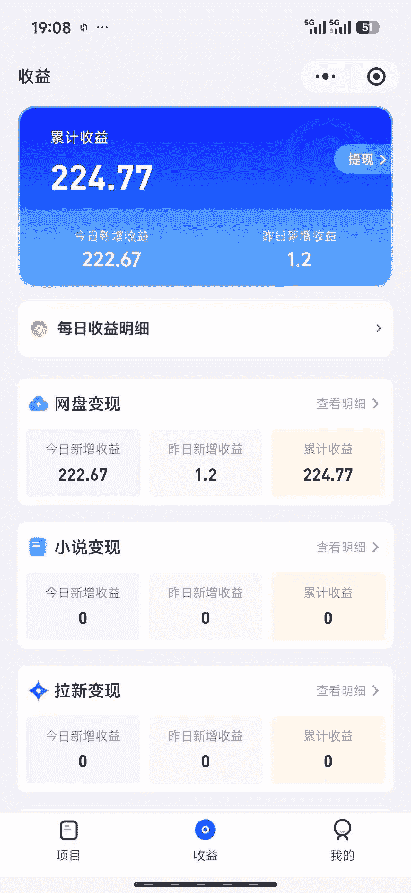
一条作品播放不到2万次，带来1000多次引导视频播放，最后产生约200元收益。作品怎么做、用户怎么进入、数据怎么变化、平台如何结算，这条链路清清楚楚地摆在眼前。
到了这个时候，你才会意识到：这并不是一个只存在于别人故事里的机会，而是一套确实能够跑通的流程。
网上看到别人说一天赚5000，你很难判断真实性；但当你亲眼看到身边的人用几分钟发布一条内容，并且真的拿到收益时，感受完全不一样。
因为前者只给了你结果，后者把过程也展示出来了。
很多人并不是从来没接触过所谓的信息差，而是这些信息离他们太远。他们看不见真实动作，也无法验证数据，自然很难相信，更不会马上行动。
这也是我后来越来越重视圈子和环境的原因。
一个真正有价值的圈子，并不是每天告诉你“这个项目稳赚”“那个项目必赚”。现实中根本不存在永远稳赚的项目。圈子的意义在于，它能让你看到机会如何真实发生，看到别人怎样从零开始，看到一个项目究竟是靠什么一步步跑出来的。
不是靠包装，而是靠一条条内容、一个个账号和一次次测试积累结果。
看到同事那条作品的数据后，我开始觉得这个项目有些出乎意料。至少在当时的阶段，只要内容方向没有偏得太离谱，发布之后就存在获得反馈的机会。
当然，这里必须说明，那是项目处于上升阶段时的情况。
现在回头看，当时确实属于相对友好的时期：参与的人还不多，平台限制没有完全收紧，用户对这类内容仍有新鲜感，很多作品发布后都能获得不错的曝光。
但人在红利期里，往往很难立刻意识到自己正在经历红利。很多事情只有等阶段过去，再回头看，才会发现当时的环境有多好。
于是我也开始亲自测试。
我先做了5条健身博主锐评类作品。具体的制作方法，这里暂时不展开，后面会单独讲素材来源、同行拆解、快速剪辑、引导设置、批量生产，以及如何判断一条内容是否值得继续复制。
5条作品发布后，第一天就有一条内容突破了100万播放。
这个结果出来时，我自己也有些意外。那时候我对代发流程并不熟悉，尤其是承接话术还没有完全摸索清楚，但前端内容依然跑出了百万播放。
按照当时的转化比例，如果后端承接完整，理论上这条内容可能带来几千元收益。但我犯了一个很典型的错误：置顶视频和后续引导没有及时搭好。
也就是说，前端流量已经出现，后端却没有接住。
最后，这条百万播放的作品实际结算只有1000元左右。
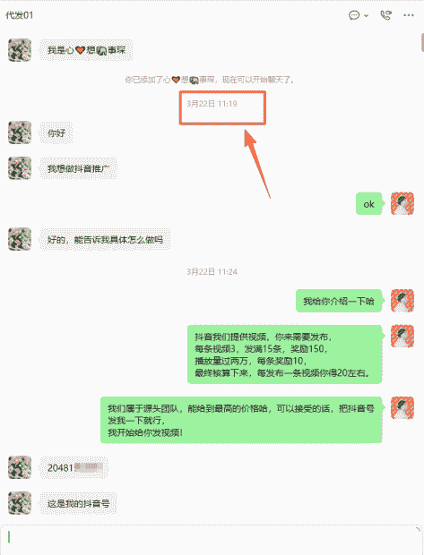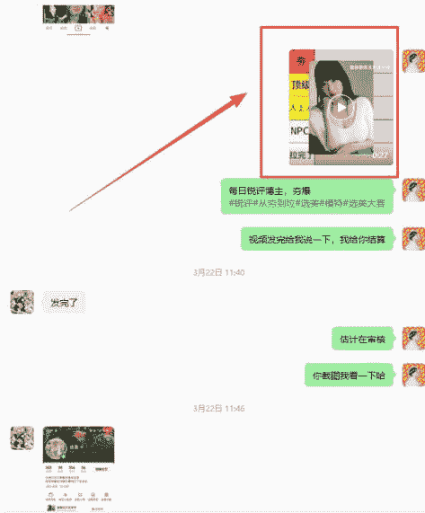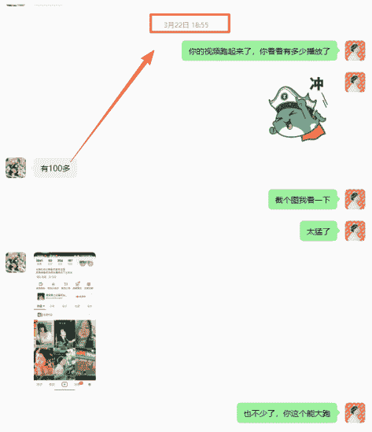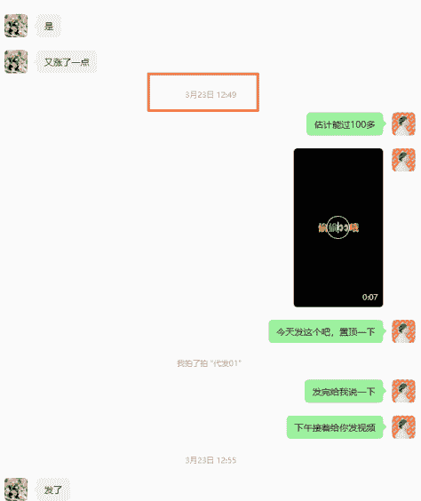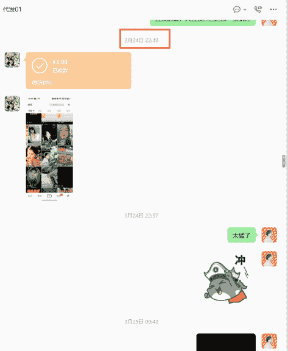
这个案例说明了一个非常重要的事实：
播放量高，不代表收益一定高；作品爆了，也不等于转化已经完成。
如果主页承接、置顶视频、评论区引导以及后续路径没有配套，前面辛苦积累的流量就可能被白白浪费。
所以后来我越来越重视完整链路，而不是只盯着播放数据。这个项目真正产生收益的关键，不是单独某个环节，而是从内容吸引、主页承接、用户点击到最终完成动作的整体配合。
到了第三天，又有一条作品获得了二三十万播放。那时我基本可以确认，这并不是偶然爆了一条，而是在当时的环境下，确实具备一定的复制空间。
它的底层逻辑并不复杂：
找到一个存在信息差的机会；
用较低成本做出测试；
根据实际数据判断是否有正反馈；
出现结果后，再不断优化和放大。
看起来很简单，但真正难的是，很多人在线上看到类似信息时，可能连测试都不会做，直接就划走了。
因此，我从这件事里得到的第一个经验是：
不要只关注那些看起来高大上的机会。很多真正能产生收益的项目，刚开始都显得普通，甚至有些不起眼。赚钱并不总是以体面、华丽的方式出现。
## 三、网盘拉新究竟是什么
在拆解具体操作前，先把“网盘拉新”这件事讲明白。
它并不是最近才出现的新玩法，实际上已经存在很多年。但真正参与之后我才发现，有些项目并不是因为新才有价值，而是因为它背后的需求一直没有消失。
“拉新”这个词，可以理解为平台通过各种渠道获取新用户。一个互联网产品想增加下载量、注册量和使用量，就会给推广者设置奖励。
网盘平台同样需要用户注册、下载、转存资料，甚至开通会员，因此会把这些用户行为转化成推广收益。
推广者可以通过短视频、教程、软件、资料包、内容合集等方式吸引用户，再把用户引导到网盘完成指定动作。只要符合平台规则，就可能获得对应结算。
常见收益来源大致包括以下几类：
- **新用户注册或下载**
用户通过你的推广路径首次注册、下载网盘，推广者可能获得拉新佣金。
- **已有用户转存文件**
一些平台不仅关注新用户，老用户完成资料转存，也可能对应一定收益。
- **会员及其他增值行为**
用户在使用过程中开通会员、扩容或完成其他指定动作，也可能产生额外回报。
归纳起来，整个流程就是：
用内容吸引用户 → 用户因资料、课程、软件或合集产生需求 → 通过网盘承接 → 用户完成注册、保存、转存或下载 → 平台根据规则结算。
举几个容易理解的例子。
有人会把软件教程、课程资料上传到网盘，再通过贴吧、知乎、小红书或短视频平台分享。用户因为想获取教程而打开网盘，如果他属于新用户，就可能产生推广收益。
也有人在电商平台用0.01元，也就是1分钱，出售资料包。用户下单后，系统自动发送网盘链接。在用户打开链接、保存资料或注册网盘的过程中，也可能产生收益。
相信经常在闲鱼购买资料的人都注意过，很多资料价格只有0.01元，但卖家真正获得的收益，可能来自后续的网盘拉新，有时一位用户就能带来10到20元左右的回报。
另外，短视频平台上常见的软件、模板、资料合集、学习资源分享，本质上也可能采用类似的承接方式。
用一句话概括：
网盘拉新，就是利用内容或资料制造需求，再通过网盘完成用户注册、保存、转存、下载等动作，从而获得推广平台的结算。
## 四、项目具体怎么操作
下面开始拆解整个流程。尽量把步骤讲得清楚，让大家知道第一步做什么、需要准备哪些东西，以及一条完整链路如何搭建。
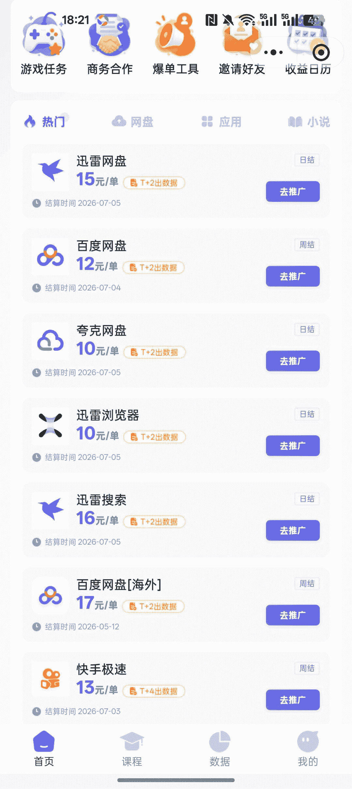
### 第一步：准备文件和平台
目前我们主要测试的是UC网盘拉新。
如果你想自己尝试，首先在应用商店下载UC浏览器。安装完成后，才会涉及文件整理、链接分享、用户转存以及后续引导。
为了降低大家的测试门槛，我也把自己整理过的文件放出来。如果你暂时不想重新制作内容，可以先保存或转存这份文件，按照现成版本跑一遍流程。
文件信息如下：
来自**UC**网盘分享文件：
「学习资料**😍**」
链接：**https://drive.uc.cn/s/b52aa28ae2784**
**UC**网盘支持原画播放、云解压、投屏，上传下载快打开:
输白茶聚精会神解開
这里也可以配合电脑截图查看文件详情。
文件整理其实是我们前期踩过的一个坑。
最开始测试时，文件体积偏大。按照前端数据推算，原本以为收益可能接近1万元，最后实际只有2000元左右。复盘之后发现，问题并不一定出在流量，而是文件太大，导致用户保存过程不顺畅。
有些人点进去之后无法保存，有些人操作到一半就退出了。对于网盘拉新而言，用户必须完成完整动作，平台才会记录有效数据，因此文件大小会直接影响转化。
后来我们重新处理了文件，让用户更容易保存和操作。现在这份文件可以直接保存。
不过需要提前说明：文件本身可以保存，但查看具体内容需要会员权限。如果后续申请了平台拉新权限，通常会有相应会员权益，这一点不用过度担心。
这里一定要记住：
用户能否顺利打开文件、保存文件，以及整个路径是否足够简单，都会影响最终结果。
### 前端吸引与后端内容
我们制作的这类作品，本质上依靠较强的视觉吸引力筛选目标用户。直白一点说，前端内容确实带有一定擦边流量属性。
但必须强调，后端文件需要保持正规合规。真正违规的内容不仅无法长期使用，很多时候也无法正常上传到网盘，更不可能形成稳定项目。
因此，重点不是在后端放违规内容，而是通过前端内容吸引用户，再把需求承接到合规资料上，引导用户完成保存、转存或下载等动作。
我们测试过动画、网课、女性向视频等多种方向。表面上文件名称可能偏吸引眼球，但实际内容本身是正常的。不同文件对应的人群不同，最终的保存率和转化效果也会有所差异。
如果你想先测试，可以直接转存这份现成文件，跑通完整流程后，再根据自己的内容方向和目标用户重新整理版本。
### 第二步：接入推广工具
文件准备好后，还要解决一个问题：
用户完成保存、转存等动作之后，收益数据通过什么渠道统计？
这时就需要使用第三方小程序。它可以理解为连接网盘文件、用户行为和推广结算的中间工具。没有这一步，即使用户完成了操作，也可能无法形成完整的数据记录和结算路径。
我们目前使用的是下面这个小程序。
之前我们也测试过其他平台，不同工具在数据更新时间、结算规则和稳定性方面会有差异。有时数据预估和最终结果不完全一致，也不一定单纯是平台问题，还可能与流量质量、用户完成率、文件大小和承接方式有关。
所以测试时不要只看一天的数据，最好观察一段时间，再判断整体效果。
目前使用下来，这个小程序的流程相对顺畅，也能对接官方渠道。想测试的，可以扫码完成注册。
注册完成后，需要绑定自己的UC账号ID。
只有绑定成功，后续用户通过你的链接完成注册、保存或转存，后台才可能正确记录到你的推广数据。
新用户注册属于拉新；部分老用户完成转存，也可能形成相应数据。
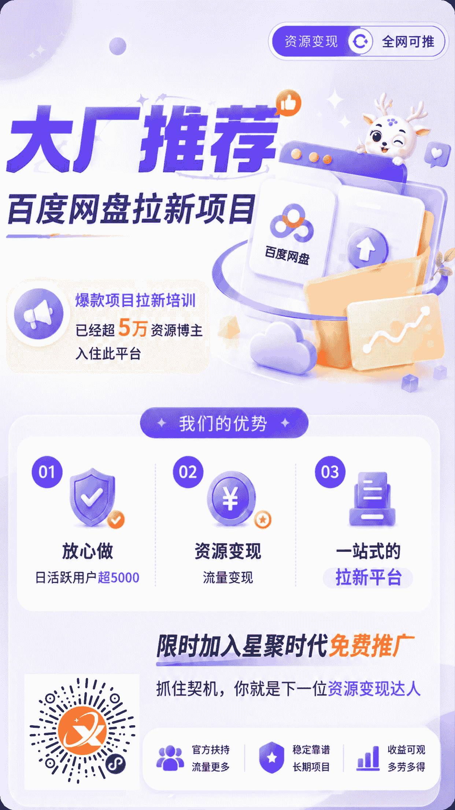
因此，绑定步骤不要省略。
第一项是申请签约并完成账号绑定。按照平台页面提示逐步操作即可。
其中第五张截图建议提前保存，因为后面申请推广权限时还会再次用到。凡是流程中出现可以截图留存的页面，最好先保存下来，避免后面重复操作。
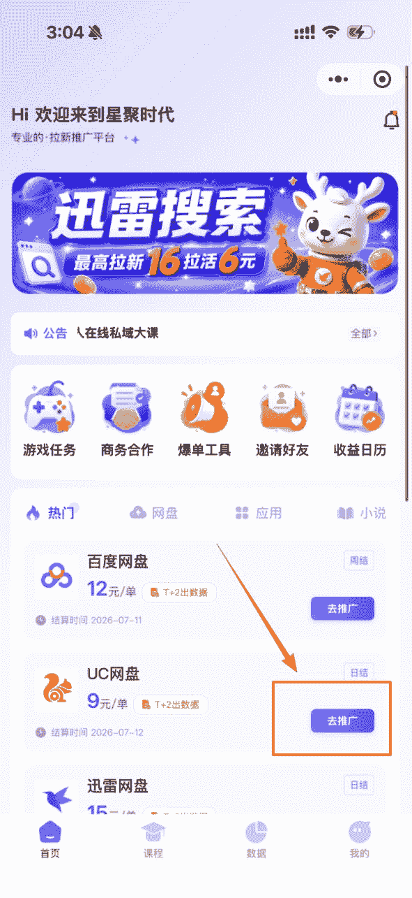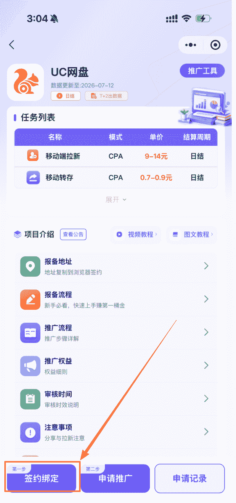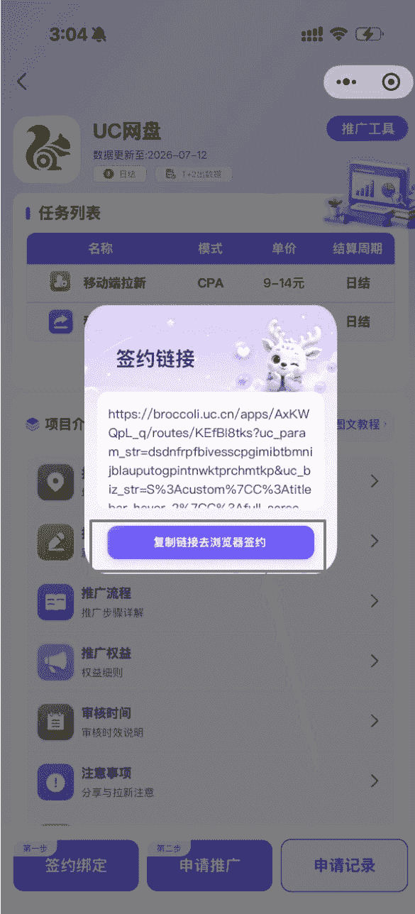
如果部分步骤不清楚，也可以查看小程序内置的视频教程。
第二项是申请推广资格。
按照页面提示填写资料即可，但有几个信息需要格外注意：
- UC网盘ID，要填写前面第五张截图中的对应ID；
- 手机号码，填写本人手机号；
- 同时上传前面绑定成功的截图。
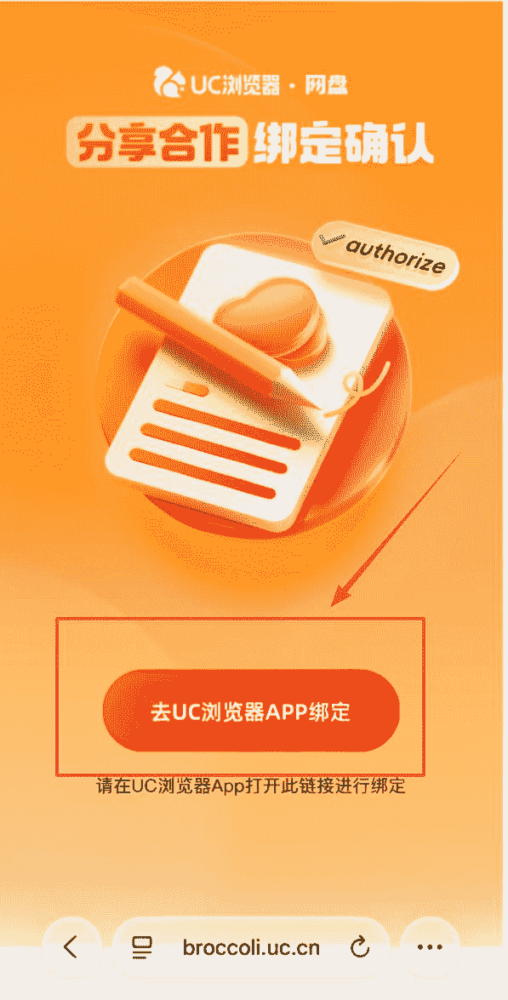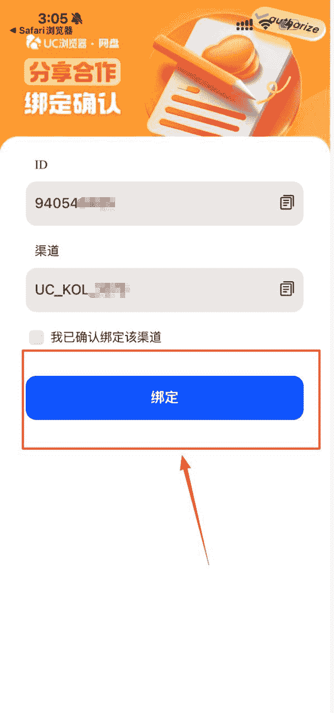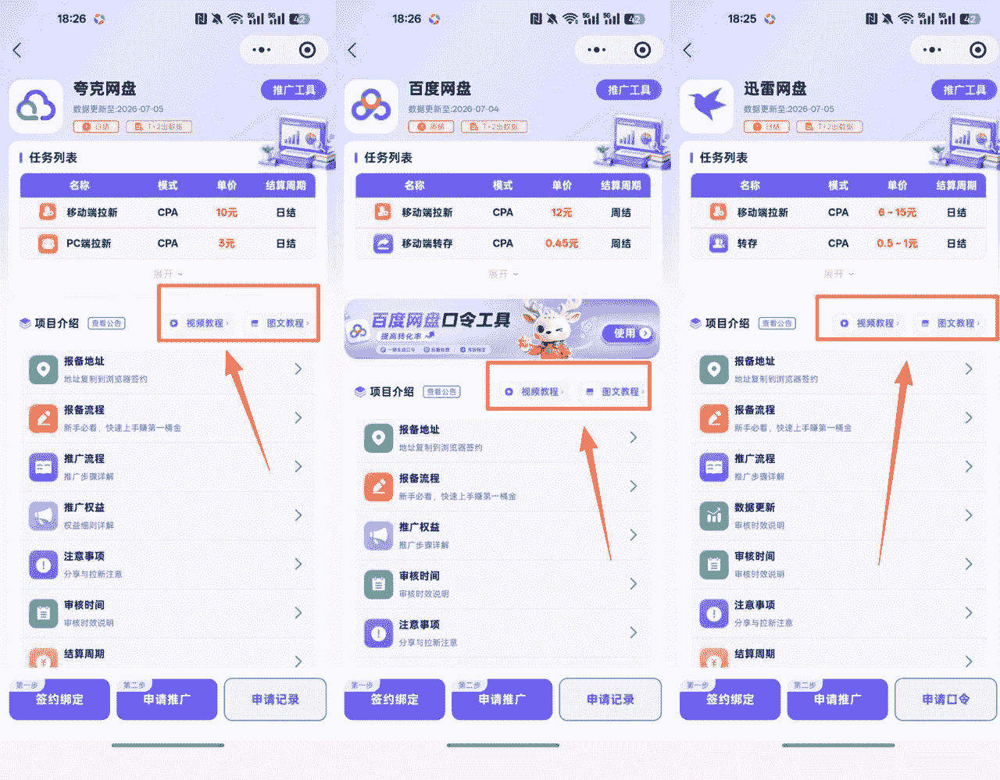
提交后等待平台审核。
一般情况下，审核速度不会太慢，大约一个小时左右可能完成。如果比较着急，也可以联系相关人员协助催办。
这类流程不要凭印象填写，尤其是UC网盘ID和绑定截图，必须保持一致。
完成签约、绑定和推广审核后，你再分享自己的UC网盘链接。当用户通过你的路径完成保存、转存或注册，就有机会产生推广收益。
这里还要说明一点：UC和迅雷的后台体验并不完全相同。迅雷的数据显示相对直观，有时可以通过分数大致估算收益。
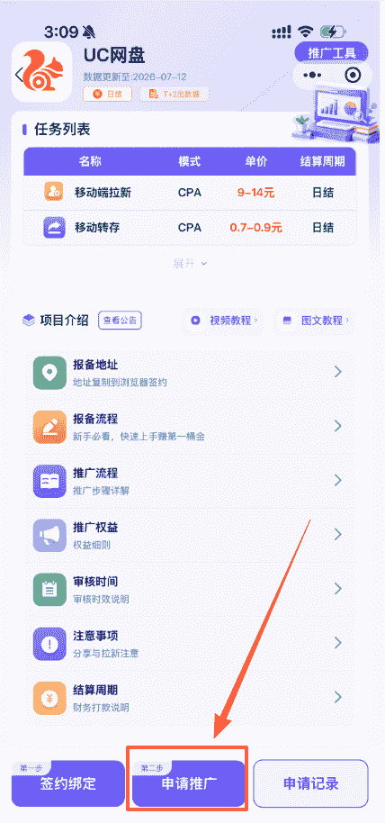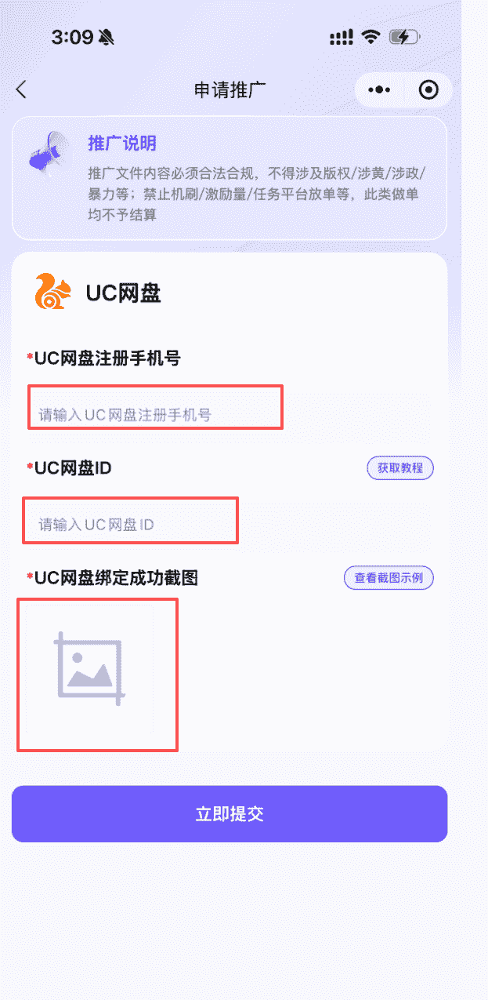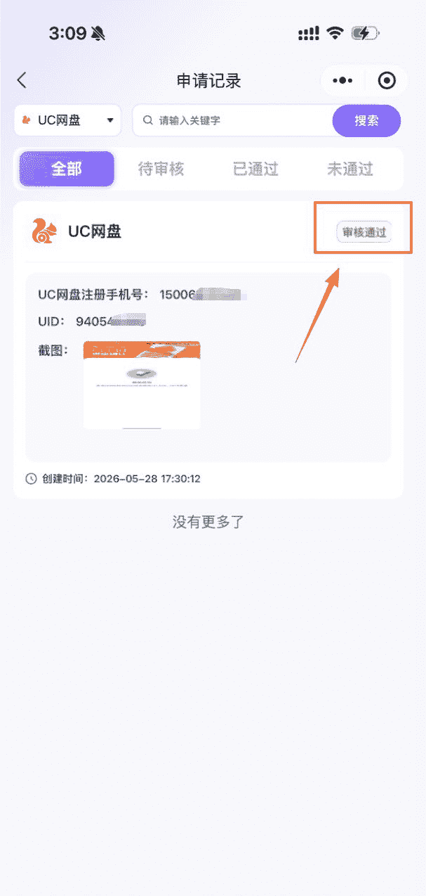
UC目前没有那么完整的实时官方后台，通常每天更新一次。一般在下午2点之后，打开小程序进入数据页面，就能查看前一天或最新的结算结果。
### 第三步：前端内容怎么做
完成账号绑定、推广权限和数据查看之后，才进入内容部分。
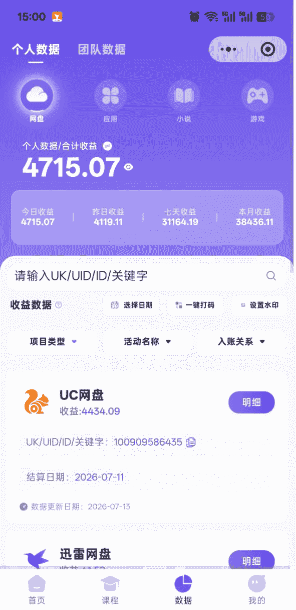
我们究竟发布什么样的作品？这一块决定用户是否愿意停留、点击主页并继续完成后续动作。
这里先用截图说明，不展开视频演示。
大家看到的标题，实际上就是分享链接下方配套的那段文案。看起来只是简单的一句话，但它是完整承接路径中的一环。
用户先被作品吸引，再看到标题和提示，接着进入主页、寻找文件、保存内容并完成转存。
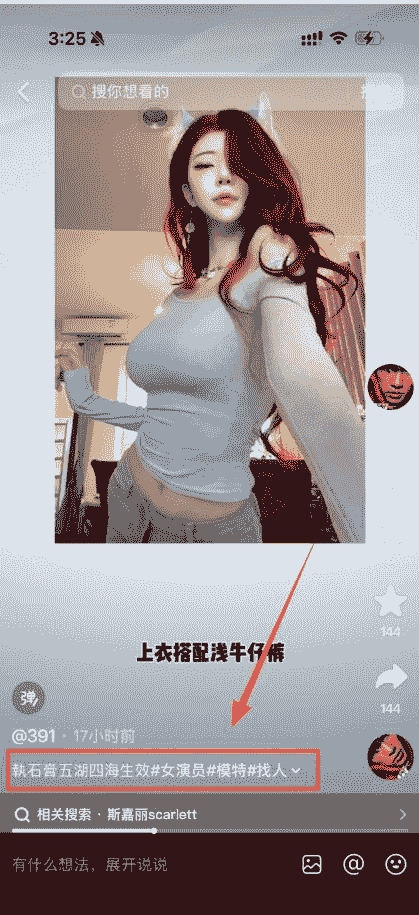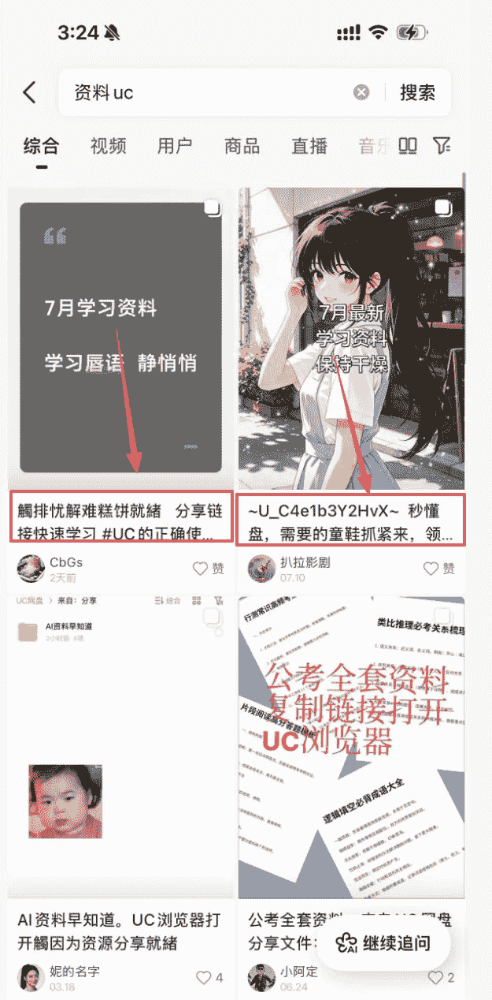
打开之后，大致就是下面这种页面。因此，短视频标题和简介里会放置对应的UC链接，也就是前面提供的文件入口。
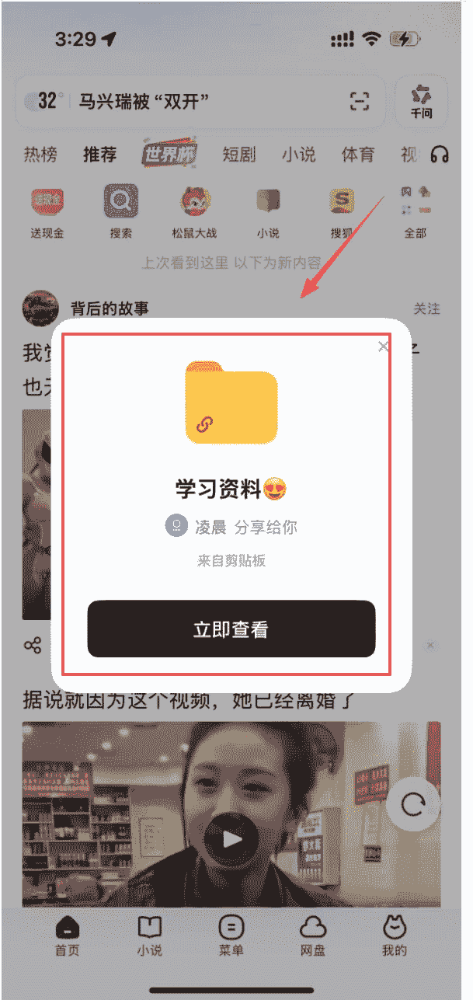
有人可能会问：用户为什么愿意复制这个链接？
这正是整条链路的关键。
用户刷到作品，只代表完成了第一步。接下来他还需要产生兴趣、点击主页、看到明确提示，并愿意复制链接、打开UC、进入文件页面。
作品的作用是吸引注意力；主页的作用是把下一步说清楚。
过去我们也测试过很多种承接方式，从置顶视频，到主页简介、关联小号、背景图和评论区配合。随着平台限制变化，某些方法会逐渐失效，就需要及时调整。
所以先记住一个核心判断：
用户愿意从作品进入主页，链路就已经完成了一半。
作品简介可以按照类似思路设置。到这里，锐评类内容的基本流程就算搭建完成了。
但真正执行时会发现，细节决定最终效果，尤其是怎样提高用户点击主页的概率。
因为用户看完视频后直接划走，后端所有设计都没有意义。
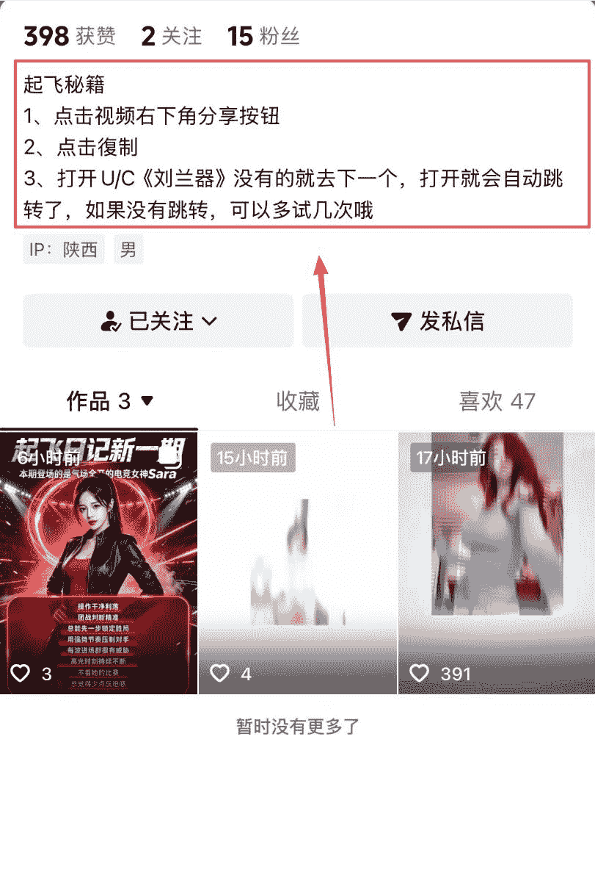
因此，后续优化主要围绕两个方向展开：
- **作品内的轻提示**
例如在内容中自然提到相关资料位于主页。但这类表达在流量增加后可能受到平台限制，需要控制方式和频率。
- **评论区辅助承接**
作品负责让用户停下来，评论区则进一步提醒用户进入主页。
有些用户本来没有立即行动的打算，但看到评论区有人提到入口、主页或相关资料后，往往更容易顺着提示继续操作。
这就是评论组的作用。
这些评论并非完全随机产生，而是由我们安排其他账号进行配合。作品刚开始起量时，评论是否及时跟上、提示是否自然，都需要有人持续观察和调整。
后面还会继续拆解这部分的具体做法。
实测下来，我们内部的转化大约能到五成左右。
按这个效率算，一支作品带来一万次转发，落袋的收益大概在五千上下。
需要先把话说清楚，这个数字不等于你现在就能照搬去预期。
眼下的环境和过去已经不一样了。
锐评这个套路放到现在想再刷出爆炸式播放，难度比三月时翻了几倍。
三月那阵子，这类内容几乎是自带推流。
我们当时有条作品冲到三百多万播放，那段时间节奏很猛。
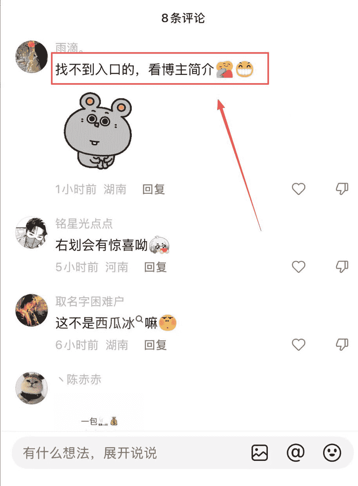
不过要说明一下，当时跑的是迅雷拉新，不是现在用的 UC，承接也是大号点小号的玩法。
为什么那会能起来，后面又被一步步收紧，后面我会单独拆。
聊到这里，网盘拉新的底层思路其实已经很清晰了。
如果你想自己上手，完全不必死磕我用的这个模板。
游戏拉新可以做。
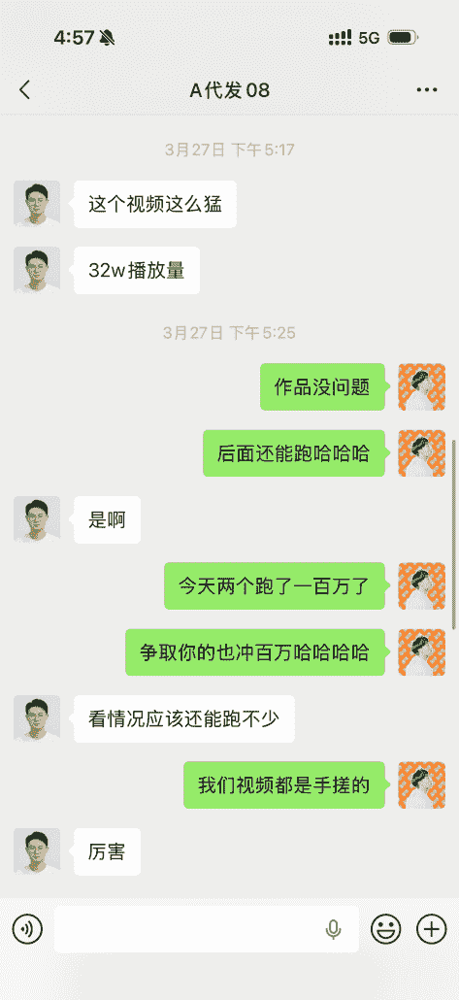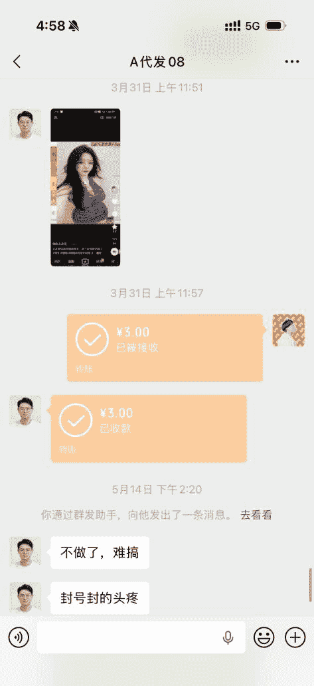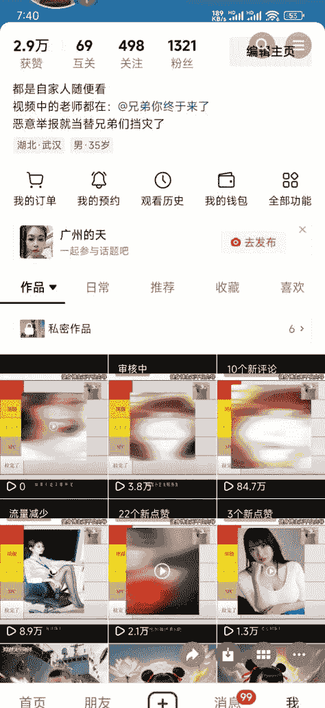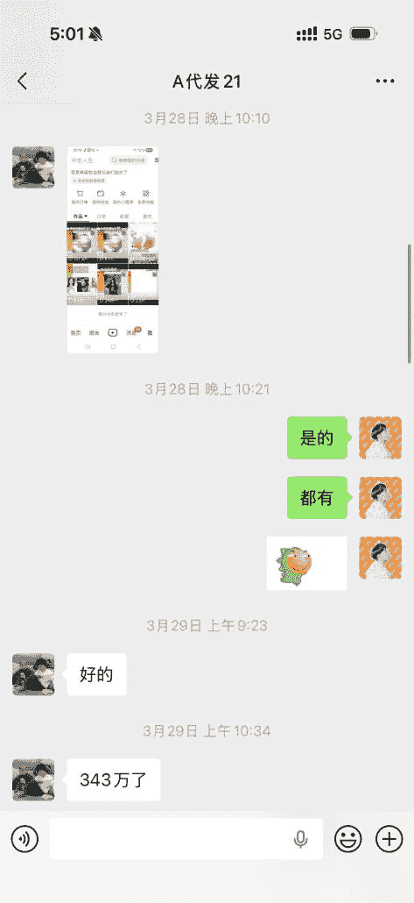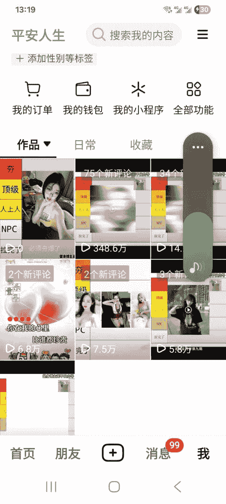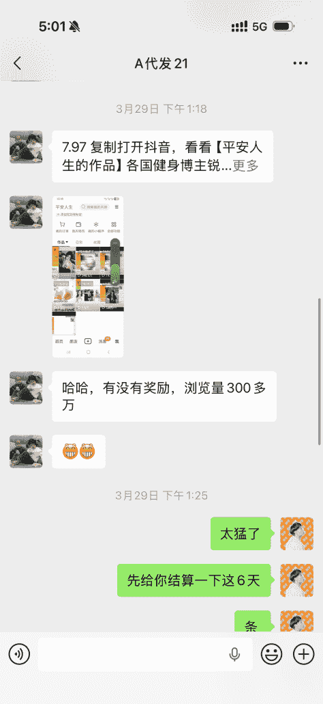
资料拉新也能做。
剧集、短剧、软件、教程、素材合集，这些赛道里每天都有人把钱赚到。
关键不在复制我的锐评套路，关键在吃透整条链路：找到对标号，拆它的内容框架，学它的表达，最后先把第一笔钱赚到。
用自己的号试水，别一开始把事情想复杂。
先挑对标，照着做，发几条看数据就行。
实打实赚到第一笔钱，比空研究十天理论更有用。
当时我们走的不是自发号路线，而是代发路线。
所以后面真正要拆的是，如何让代发严格按流程执行作品，这是项目放大的核心。
自己发号，个人精力有限。
但如果把成片、文案、承接打成包交给代发执行，就能同时测更多号、更多内容、更多入口。
代发池子里偶尔会出现那种“神号”。
这类号很怪，你自己发推不动，一到它手里就炸；有些号不管发什么，平台都愿意给量。
碰到这种号，价值极高。
比如下面这个代发号，单号为我们创造的价值接近一万，但我们结算给对方不到三百。
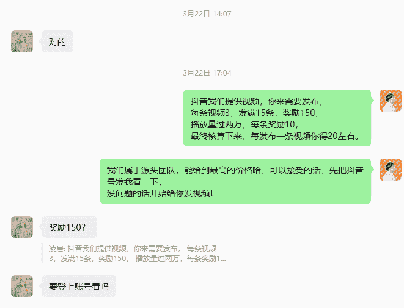
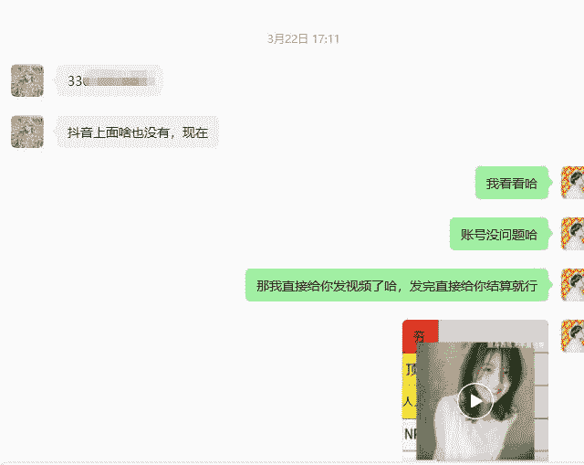
这就是我反复强调代发的重要性所在。
找代发本身并不难。
基本是几句话把规则讲明白，让对方按要求发。
难的不是拉人，而是把素材、文案、截图、

结算、反馈等环节全部标准化。
网盘拉新的全流程其实就这几步：文件准备好，平台绑定好，作品发出，用户点进主页，复制口令，打开 UC，保存或转存，后台产生数据与收益。
看着简单，落地才发现每一步都能挖出问题。
为什么有播放后台没数据？为什么昨天能用的承接今天就失效？
这几个月我们反复踩坑反复测。
封号、换承接、换文件、流量高转化低的复盘轮番上演。
如果只念一遍流程，大家感受不到真实难点。
所以后面我要拆的不是步骤，而是我从发现项目到跑通闭环再到矩阵放大，中间遇到什么问题、怎么解决的。
希望能让大家做项目时更有耐心。
看到这里，想自己先试试，条件其实已经具备。
但还是提醒，别被我的玩法限制思维。
剧集、游戏、资料、软件、教程、短剧、素材合集，底层都是相通的。
我们现在仍在持续找新模版。
不同阶段的风向不同，内容形态也在变。
从前面截图也能看出，我们不是靠一个模版打到底，每个周期都在迭代。
个人玩家可以先用自己的号小测。
想放大再用后面的代发打法。
核心是先做一个能让用户停留的前端，再用拉新去承接需求。
给你一个判断法则：只要刷到某类内容，评论区大量求资源、求链接、求教程、求入口，就值得考虑是否能用拉新接住。
这才是可迁移的能力。
我们现在不只做抖音一个平台。
这次拿网盘拉新复盘，是因为它从发现、测试、放大、违规、下行，生命周期非常完整。
它带来的价值，不只是一个项目，而是展示一个项目从0到1如何成长。
内容到这里可能还不够厚。
下面我会继续拆，从发现项目，到几条作品跑通首轮验证，再到找代发、建矩阵、控风险、组小团队，逐步展开。
感兴趣就继续看。
反响好的话我也会分享其他拉新玩法和多平台测试经验。
拉新赛道我越做越觉得空间很大。
差点忘了，给大家看下当时具体的内容形态。
我们用的是健身博主锐评这类模版。
直白说，它靠带擦边属性的内容吸引特定人群，所以当时一直在测哪种素材点击更高，哪种模版更容易进主页并完成动作。
需要说明，我们网盘里没有违规内容。
测试文件主要是大学生网课、公开舞蹈视频、海绵宝宝动画等。
转化逻辑是：用户刷到作品产生兴趣，按主页提示打开网盘保存文件；新用户完成保存即产生拉新收益；后续开通会员还能有会员分成。
回头看，前端给用户的预期和网盘实际内容并不完全一致。
用户以为能看到想要的东西，打开后未必是预期内容。
再直白点，转化建立在信息差上，而非资料本身价值。
实操写到这，认真看完基本具备动手条件。
接下来要做的和我们每天做的相同：持续找新模版，小范围测数据，再用代发扩大样本。
表现好的继续放大，数据差的及时复盘更换。
重点提醒：模版有生命周期。
早期我们发这类内容，单条常几十万上百万播放。
同质化增加后，原模版数据明显下滑，且易违规。

早期易爆，但我们不懂主页与评论引导，大量流量浪费。
后来摸清评论引导、主页承接、转化路径后，播放虽不如巅峰，但流量利用率大幅提升。
### 五：5 条作品跑通闭环
先看作品形态。
本质是用擦边类视频吸粉，引到网盘看内容。
网盘内容是合规的，用户不清楚里面是什么，想看需开会员！
前面讲了铺垫，包括去临沂、接触网盘项目、看到身边人一条作品变现80元才重视。
但项目是做出来的，不是听出来的。
尤其是流量项目，听再多案例不如自己发一条拿数据。
只有实操才发现，以为懂了其实只是听明白。
真正问题都在执行中浮现。
所以从这一章起，我会用实操视角完整拆解。
不只讲赚了多少。
后面会写第一条作品如何发，第一批代发如何找，数据如何判断，承接问题如何发现，几条账号如何滚到五百多个矩阵。
先从首轮测试说起。
上手后第一轮没搞复杂。
大概做了5条作品。
早期制作成本极低，从剪辑到发布5到6分钟，后面熟练更快。
第一轮结果：作品发出第三天收益出来，大约100到200元。
单看数字不算惊人。
但我更在意的是链路真的跑通了。
这证明它不是传闻，是我能操作验证的项目。
真正让我重视承接的，是后面那条百万播放作品。
第二天剪的一条爆了，播放到100万。

这是第一次做项目，没料到如此简单的东西能到百万量级。
也正因没想到，犯了个低级错误：置顶引导视频没放好。
结果前端爆了，后端转化极差。
按当时转化率，这条本可带来更高收益，因承接没跟上浪费很大。
这次给我很深的提醒。
过去总觉得做流量关键是爆款。
这次直观感受到，爆款只是起点，后端承接不到位一样被浪费。
网盘拉新不是靠播放量赚钱，播放是入口，决定收益的是用户是否走完设计路径。
路径是：刷到作品->产生兴趣->点主页->看到置顶引导->按引导去网盘搜索关键词->下载/转存/开通权益->后台产生收益。
任何一环断掉，收益打折。
流量只是可能性，被承接住才变现。
后来还有条作品冲到350多万播放，当时量级很夸张。
现在回看，真实转化并不高，因为没做评论区引导。

后面会重点说。若当时做了评论引导，收益预计翻倍。当时约8000，要在现在跑出来，转化2万左右完全可能。
这是必须经历的坑。

也因跑过大播放，更清楚同样爆款，承接做没做差别巨大。
很多人觉得赚不到钱是没流量，事实很多是拿到流量没接住。
作品爆了主页没设计，用户来了不知道怎么导，导了表达模糊，表达清楚又触违规。
难点在于环节衔接。
这也是我后期做矩阵更重视 SOP 的原因。
一个号靠记，几十上百号必须标准化：
- 作品如何发
- 主页如何设
- 置顶视频如何挂
- 发完如何截图
- 数据如何看
- 违规如何处理
不固化，盘子必乱。
第一轮测试收益不高，但给了三个判断：
第一，前端能出流量。
第二，用户会走进后端引导。
第三，承接做好具备放大可能。
从此不再当试水，而是认真拆解放大的项目。
接下来问题变成：能不能让更多人帮发？能不能用更多号分散流量？一条跑通能否复制成几十上百条？
这就到关键一步：找代发。
## 六、我是怎么找代发的
本阶段目标不是赚钱，是验证：同内容换不同号发是否还能跑。
单靠自己上限低。
能找到多人重复执行同一动作，项目才从副业变矩阵。
所以爆炸起点不是剪辑不是爆款，是找代发。
很多人觉得找代发简单：找人发视频给钱就行。
实际操作下来，找代发本身就是个转化漏斗。
要解决四件事：怎么找到人，怎么让他信你，怎么让他愿意开干，怎么让他持续干并帮你拉人。
解决不了，手里有素材项目也放大不了。
### 1. 第一批代发
最初从朋友圈开始，之前做过流量，手里有批兼职粉。
这类人适合代发，项目门槛极低，只需按要求发作品并截图反馈。
所以我在朋友圈发了招募：
有闲置短视频号的，可接代发任务，按规则发作品，发完结算。

代发核心素质是执行力。
你给什么他发什么，你说怎么截图他就怎么截。
矩阵里，动作标准比人聪明更重要。
### 2. 小白没有私域去哪找代发
并非人人都有关注粉。
没私域、没朋友圈基础、没现成资源怎么办？
可去兼职平台测试，如企业桥、项目帮帮。
具体操作我录了视频：

类似平台可自行尝试。
我不是打广告，只是不确定是否找人，可先去这些地方找愿意做兼职的人。
初期无需开会员、投广告。
多数平台有免费发布、免费曝光、免费获取线索。
先用免费的，每天加四五个人，已够早期测试。
验证完再考虑放大。
第一步朋友圈发一轮。
第二步朋友圈没资源，去兼职平台白嫖。
第三步每天加几个人后，先磨话术 SOP。
第四步代发稳定后拓渠道。
我们初期没投广告，代发是逐步攒起来的。放量时发现缺代发很被动，才尝试投放。
小白不必投放，但要知道渠道存在。
### 3. 更接地气的找代发方式
平时用小红书、闲鱼、抖音，也可直接找人。
本质是找愿意做兼职、按要求发内容的人，即兼职粉。

不必局限垂直平台。
很多普通用户有号有碎片时间，只要任务简单、收益透明就会尝试。
抖音可用素人种草思路捞人，或在评论区截流。
下面这套话术模版可直接用，实测每日可找5到10人，转化约三成。
话术勿复杂，照抄即可。用此法小规模跑，每日发3条作品连发三天会有反馈。
关键不是第一天找多少人，而是是否真执行。
坚持三天必有反馈！

### 4. 找到人之后
很多人找代发失败不是没人接，而是不会转化。
对方顾虑很多：你是谁？靠谱吗？会不会赖账？发了影响账号吗？怎么操作？麻烦吗？为什么才3块？
这些不提前解决，人会流失。
所以我加到代发后先给完整话术。
核心点之一是先亮实力。
你要让对方第一眼感受到的，不是临时找个人试试水的小号，而是一直在做、且已经做成规模的团队。
我当时就刻意营造出自己是团队负责人、是头部组织的形象。
这并不是装腔作势，核心是建立信任。
兼职人群最关心的从来不是你项目有多 fancy，而是三件事：你靠不靠谱？会不会拖欠结算？有没有源源不断的任务跟上？我跟着你做会不会白忙活。
市面上不少代发是 5 块一条，隔天结算。我当时反其道而行：符合要求当天就能结，3 块一条马上到账。
结算快带来的确定感，比多两块钱更能打动人。对兼职来说，可预测的收益远比价格高低重要。钱到手了，他才会信你，信了才会持续发。
所以找代发拼的不是价格战，而是信任、操作和反馈是否清晰。
下面是我当时的代发文档参考：
## 网盘拉新代发流程
### 5. 话术里必须埋钩子
我找代发的沟通里，最关键的一点是让对方觉得这件事很简单，且立即可见回报。
比如直说：拍完截图，审核通过就结算。
这种说法大幅降低了启动门槛。兼职群体不是不愿意赚钱，是怕麻烦。你把门槛抬高，他一秒就退缩。话术要极简，先把三件事讲透：你要他干嘛、他能拿到什么、做起来麻烦不麻烦。讲清这三点，转化率会高很多。
### 6. 为什么要设置累计数量
我在结算上用了两种并行方式。
一种是单条达标即结，3 元一条立刻付。好处是快速建立信任，第一次体验尤其重要。第一次真的拿到钱，信任就起来了。
另一种是累积到 15 条再结 150 元。我两个一起用。
原因很实际：项目测试需要样本。账号发一两条，数据波动很大。今天没播放不代表账号不行，今天没转化不代表素材不行。

只有让对方连续发够量，才能判断账号、素材和引导是否有效。同时，设定 15 条的目标，也给了代发一个明确的任务感，他会觉得自己在做一件事，而不是随便发几条。
具体用哪种结算，看阶段。招人初期用即时结，建立信任；队伍稳定后用累计结，提升执行量。
### 7. 代发裂变
从 20 人扩到 100 人，除了我自己去找，我让老代发帮我转介绍。
自己获客成本高，耗时间。让现有人员带新人，扩张速度完全不同。

不管是朋友圈、平台发帖还是私聊，获客本质都是时间成本。转介绍把成本转嫁出去，效率指数级提升。
我的规则很简单：介绍的人发满 5 条就算有效，介绍人拿 5 元。
别小看 5 元。对兼职人群来说，这是一个低成本高确定性的小激励。顺手拉个同学、亲戚、群友，对方真发了 5 条，钱就到手。

对他们而言几乎是稳赚的。
后期我还放过大额钩子：介绍的人发满 15 条，奖励提升到 100 元。
这个奖励触发难度其实不低，中途流失、违规都有可能，但它的作用是让代发看见“能带长期人的收益天花板”。它像一个裂变钩子，不一定每次兑现，却能持续推动传播。
就靠这套机制，我一天内从 20 个代发涨到了 50 个左右。
项目上行期，时间就是流量。早一天铺号，就多一天吃红利。晚几天，规则变了，竞争也上来了。
### 8. 找代发的本质
聊到兼职粉的沟通话术，如果你要采购兼职粉，可以参考我上面的文案框架。
很多人做矩阵，盯着账号数量。我后来发现，账号只是表象，核心是你能不能用一套 SOP 让一批人稳定执行。
账号背后是人，人不稳定，再多号也没用。你找 100 个号，没人按标准发，等于零。
找代发的核心不是找来多少人，而是能不能让这批人按同一套标准，持续做同一件事。这才是矩阵可放大的前提。
找到人只是第一步。
## 七：代发 SOP
### 1. 代发的本质
常见错误是试图让代发理解整个项目：为什么做网盘拉新、怎么赚钱、前后端怎么承接、为什么要置顶、文案怎么写。
完全没必要，尤其早期。讲得越多越复杂，兼职最怕复杂。他们不是来学习的，是来做一个简单任务换确定收益的。
我的要求一句话：你不用懂项目，按要求把作品发出去，把截图发回来，就够了。

### 2. 视频素材
我给代发的全是成品。拿到就能发，零思考。
能不让他们动脑就不动脑。视频我剪，文案我写，发布规范我定，截图标准我定，他只负责点发布。
这样变量被控制了，后续复盘才有意义。同一批素材多号一起跑，跑不动是素材问题；有的跑有的不跑，是账号问题；发了不显示，是发布或审核问题；引导视频没播放，是承接问题。
### 3. 文案统一
文案也是统一配发，不让他们写不让他们改。
有人担心同质内容影响推流。实际测试里影响有限。平台算法成熟，内容本身的筛选力更重要。

重复发布、不显示、限流都会发生，这是矩阵成本。别想消除问题，只需控制在可接受范围。
账号废了就换，好的继续用。
### 4. 置顶视频
置顶是承接关键，不是为了爆。
用户被前端吸引点进主页，置顶告诉他下一步怎么做。它不需要精致，不需要高播放，只需要能显示、能被看见。
我的置顶基本是手机直录，讲清路径：去哪找资料、搜什么关键词、怎么操作。
整个闭环很简单：前端作品引流→进主页看置顶→按提示去网盘搜索→完成下载/转存→产生收益。
新手最容易忽略置顶。我曾有一条 100 万播放的作品，因置顶没做好，转化极低。后来置顶才成了 SOP 必备。
### 5. 发完必须截图
发布后必须回两张图：发布过程截图+主页截图。

确认两点：他真的按要求发了，作品真的在主页正常显示了。很多情况是以为发成功了实际没显示：审核中、权重低、被拦截、仅自己可见。
不截图，你连测试价值都判断不了。规则明确：主页不显示不算数，没有展示就没有数据，没有数据就没有复盘意义。
截图还有统计作用。代发多了以后，谁发了几条、哪条异常、谁该结算、谁该提醒，都靠统一反馈来管理。
### 6. 每个账号一天发2到5条
单号每天 2-5 条，不是随意定的。同质流量内容发多了，账号容易疲软。前几条还能跑，第六、七条后数据断崖，甚至不显示、频违规。
新号现在更脆弱，两三条就废。宁可多号少发，也别单号猛发。
多号分散的好处：降低单号风险、扩大素材测试面、避免短时间同质轰炸、单号废了整体不受影响。
我一般让代发每天发 2 条，状态好可提到 5 条。
### 7. SOP 的目的
我的代发 SOP 很简单：
素材成品化、文案统一化、不剪辑不改文、置顶先发再发前端、发完回双截图、作品不显示不结算、单号日发 2-5 条。
动作不难，但必须标准化。5 个人时可以嘴对嘴教，50 个人时就必须成文档、成教程、成固定话术。矩阵化的核心不是号多，而是动作可复制。
号是载体，人是执行者，能否把复杂流程拆成普通人照做的 SOP，才决定项目能否放大。
### 8. 统一备注
细节决定效率。账号多了，备注必须统一。
早期备注乱，有名字有抖音号有随手记。微信和抖音来回找，漏发错发常发生。
后来全部改成数字编号。微信备注 01，对应抖音也 01，以此类推。另建一个管理号统一关注所有代发账号，发素材时按关注列表 01、02 依次推进。

方法很笨，但当数量到几十上百时，能大幅减少操作成本和出错率。矩阵管理前期做三件事就够：谁是谁、对应哪个号、今天是否完成。
## 八：作品制作
所有动作的前提是前端作品能否把人吸引进来。没播放，后面链路再完美也白搭。
我最早跑起来的方向是健身博主锐评类。3-4 月那段时间上行期，这类内容好跑。
要说明，这类内容吃的是猎奇和注意力。我放出来不是让你照搬，而是让你理解流量拆解能力。
你能不能看懂内容为啥吸人、拆出结构、找到同类素材、快速做多版本、用数据判断继续复制。这是网盘、短剧、资料、课程、本地生活都能用的通用能力。
### 1. 不要只看表面
别只盯画面是否擦边、文案是否夸张。看背后的逻辑：
有强视觉钩子，1-2 秒内留住人；有明确人群筛选，点进主页意愿更高；内容时长 20-30 秒，完播成本低；前端与后端有承接关联。
### 2. 一条作品基础结构
开头抓心、中间留人、结尾给钩子。
开头一个强画面或情绪点评，中间点评延展，结尾轻引导提醒看主页。时长控制在 20-30 秒，只负责把人从推荐页带到主页即可。
### 3. 快速出片流程
我一条作品 5-6 分钟搞定：
先找已验证方向，再找同类素材，用豆包生成适配文案，剪映加字幕配音卡点，导出分发。
关键是方向和结构对，剪得粗糙也能跑；素材没吸引力，剪得精致也没用。
### 4. 爆款素材怎么找
看爆款别只学表面。用截图/相似图搜索找同风格同人群素材，换皮但保留逻辑。
问自己吸引点是人物、场景、情绪还是结果？拆出来再找同类。
### 5. 容易爆的共性
\[图片: /images/docx/link.png\]
画面有停留感，前几秒有钩子，其余是支撑。
先别急着做原创。动手之前，先看看同一赛道上哪些内容已经被验证过。跟着别人跑通的方向走，远比自己闭门造车靠谱。
内容起量之后，个人页这边也得提前做好接应。视频火了，主页却没有清晰引导，访客不知道该搜什么，那波曝光基本就浪费了。我那条冲到百万级播放的视频就是个反面教材：前端曝光很猛，后端因置顶没排好，收益远没有拉满。
### 6. 批量出片的关键
后来我们能批量出片，靠的不是剪辑技术多高超，而是把整套流程固化成标准。素材有标准，文案有标准，结构有标准，字幕有标准，发布文案和兼职发布的SOP也都有标准。这些标准一旦落地，产出速度会快得惊人。我们实测过，一小时剪100条以上完全可以，而且过程特别简单，看一遍就会。
数量只是表面结果。真正重要的是动作颗粒度能不能拆到足够小——小到能循环复制，小到换个人也能接手，小到数据不对时知道从哪个环节调整。如果只会埋头堆量，最后就是垃圾内容堆积。只有基于被验证过的结构去做批量测试，批量才有意义。
### 7. 最后
视频一：如何找爆款素材。\[图片: /images/docx/link.png\]
视频二：如何用豆包生成文案。\[图片: /images/docx/link.png\]
视频三：如何用剪映快速做一条作品。\[图片: /images/docx/link.png\]
## 九、怎么把流量接稳
前面聊过内容怎么做、发布员从哪儿找、账号矩阵怎么铺。等到放量之后，我才发现这门生意最棘手的地方并不在于流量。至少在上升阶段，流量并不难，方向没问题、号能正常发，内容就有希望跑起来。真正难的，是流量涌过来之后你有没有能力接住。
如果观众看完视频就划走，没有点开个人页，白干；个人页打开了，却不明所以，也白干；看到引导后，又记不住该搜哪个词，还是白干；词都搜了，后台没有数据，依然白干。所以项目后半程，我最花心思的不再是继续做内容，而是接人、指路、防封号。
### 1. 口令要足够短
先讲网盘搜索词。这件事看着小，却直接影响最终数据。我见过有人把搜索词设计得又长又难记，特别不推荐。

这些观众本来就不是带着强需求来的。他只是刷视频时被勾起一点兴趣，顺手戳开你的个人主页看看。这时候让他记一长串复杂的词，大概率扭头就走。搜索词必须短，最好扫一眼便能记住。我那时用的是“来了兄弟”“老赵来了”“小赵来了”这类。
网盘拉新也好，其他需要观众主动去搜、去输入、去执行的地方也罢，一律往简单里做。别赌观众耐心，每多一道理解门槛，就会劝退一批人。
### 2. 先用置顶视频
\[图片: /images/docx/link.png\]
最初我们是靠置顶视频接人的。逻辑很直接：前端视频负责钩人，观众进入主页后，置顶视频告诉他该做什么、该搜什么、该去哪里。这个办法前期够用，因为置顶不需要抢推荐，只要挂在那边、能正常播放，观众进来就能看到。我那时的置顶也很简单，用录屏方式讲清楚步骤就行。
但很快出了问题：置顶视频开始触雷。更奇怪的是，只要账号挂了这类置顶，再发新视频，新视频也跑不动。那时我才明白，接人这个动作本身也会影响整号权重。所以这不是放不放一条置顶的问题，而是会不会拖垮整个账号的问题。
### 3. 大号点名小号
置顶不再安全之后，我们又试了让大号点名小号的做法。前端视频照常发在大号，要传递的信息藏在小号，用@把观众引过去。这样大号能保持干净，不用直接碰敏感内容。
这套也没能用太久。单个小号起初能扛几万次导流播放，后来变成几千，再后来几百就被拿下了。这说明官方管控在持续收紧，同一招的生存周期只会越来越短。这也是我对衰退期最直观的感受。

变化不是一夜之间发生的，而是同一个招数原来能用十天，后来只剩三天，再后来只有一天，最后刚发出去就没了。更麻烦的是，被点名的号一旦被处理，你得逐一联系发布员修改配置，号少还能应付，号一多根本看不过来。
**4. 第三个尝试**
接着我们又试了背景墙路线。把引导信息放进账号背景图、简介或视觉区域，访客进入个人页就能瞥见。
这个办法比置顶多撑了一些日子，

但最终也逃不过被限。
说实话，当玩法被纳入重点监管之后，你不可能找到一劳永逸的答案，只能不断切换接人的形式。置顶失效就换点名，点名失效就换背景墙，背景墙再失效就去评论区发力。每种形式的保质期都有限，你能做的就是在有效期里尽量跑，快失效的时候赶紧换。
**5. 评论小队**
后来我们又补了一道评论区引导。为什么？因为单靠观众主动打开个人页，数据非常不稳定。观众看到视频，就算有兴趣，也未必会真的点进个人主页。有人看完随手滑走，有人有点好奇却不清接下来该干嘛，有人只是缺乏提醒。

所以我们组了评论小队。它不是去刷夸张的数字，而是在视频刚有苗头时补一层轻量引导。比如某条视频点赞到了30到50，这一步往往说明内容被推进了初级推荐池。这时评论区若能在前排自然出现一句“去主页看后续”，转化会明显好过事后补救。
因为观众天然会在看完视频后去评论区逛一圈。如果他在评论区里看到有人提“主页”“资料入口”这类词，他的行动路径就会顺不少。我们不是硬逼他跳转，而是顺着浏览习惯把后续提示递过去。
这个细节特别小，但对收益影响很大。有没有人在评论区给引导，差距可能不止一倍。到了那个阶段我们已经很清楚：播放量不能当饭吃，只有让观众走入转化路径，收益才可能落地。哪怕视频播放量很高，评论区没人接、主页没提示，观众照样流失。反过来，一条自然的评论就能把从视频到主页的路铺平。
很多流量玩法恰恰容易忽略这种细节。大面上的逻辑谁都知道，真正拉开差距的，正是这些边角位。
**6. 评论小队的人从哪里来**
当时评论小队的人手，其实还是从发布员里筛出来的。

在招发布员时，我们会碰到一类人：愿意做兼职，但不肯发视频。原因很现实——有人担心号被封，有人不想主页里出现这类内容，有人嫌发片太麻烦，有人怕影响原本的定位。
如果只给发布员一条路，这些人就留不住。但评论小队刚好能接住他们。不愿发视频没关系，帮忙评论总可以。评论操作比发布轻得多，对账号的风险感也更低，接受度自然更高。于是我们就把那批不愿发片的人引导去干评论。给他们的说法也很简单：每日工作量不大，照着要求评论几条，一天能挣10到20块，单条5毛。单价虽不高，但胜在稳定、好上手、感觉安全，能长期做。
这里不存在什么万能话术。关键是要认清：各有各适合的活儿。愿意发视频的，去发布；不愿发视频、只愿做轻活儿的，来评论。如果你只设计一种岗位，会白白流失一大半人；一旦把流程拆开，就能让各种人都派上用场。
发布员负责发片，评论小队负责补引导，你自己负责素材、话术、数据和风控。项目慢慢就从单枪匹马干活，变成了各有分工的小团队雏形。

**7. 评论小队怎么用**
评论小队不是见视频就上。我们要先看早期反馈：如果视频发出去半天没动静，没必要安排评论；一旦点赞爬到30到50，说明可能还有被推的潜力，这时候赶紧让评论小队去前排补引导，效果最好。
评论的措辞也不能太硬。太硬会被判定营销，观众看了也反感。要像普通路人说话，目的不是把话说满，而是让观众知道后面还有内容。
到后来我慢慢明白，做这类项目到最后，拼的并不是什么神技巧，而是你能不能把每个小环节都拆出来，能不能让每个人都按统一标准去完成。评论小队看起来只是发几句话，但它卡住了转化路径最关键的一环，这一环顺了，整条链路也跟着顺。
实操上没什么花花肠子：把需要评论的视频链接丢到群里，让大家自行搜索，复制预定内容，再稍微改几个标点就行。
**8. 衰退期**
大约做到九十天以后，我明显感觉迅雷这边的收益在缩水，官方那边的治理也在加码。早先一条路子能活很久，如今刚跑通就被打掉。

以前发100个号，次日绝大多数视频还能正常挂；后来发100个号，隔天一看80个都有问题——要么视频没了，要么号被封。到这个节点，我就知道它再也不是早期那个“发了就有希望”的阶段了。
但我必须说，这不代表无路可走。衰退期只是意味着靠无脑铺量吃红利的阶段结束了。以前发得多就有希望，现在得先判断什么内容还值得出手；以前一套范式能吃很久，现在必须不断更新套路、尝试新形式；以前拼的是上号速度，现在拼的是——此时还有没有官方愿意推、观众愿意看、并且变现链路还能走通的内容？
玩法还没终结，但肯定不能拿九十天前的套路硬打今天。流量生意里，套路一定有寿命。新套路刚出现时，观众觉得新鲜，官方不敏感，同行也少，所以特别容易跑。等到同行都涌进来，内容高度同质化，官方识别能力增强，效果自然走下坡。
后期该做的，不是抱怨生意变难，而是继续去挖新套路。方法还是老一套：找参照账号，看他们最近在发什么，看什么样的视频还在爆，拆解他们的画面、标题、结构、评论区和主页设计，然后照着学、照着拆、照着改。
我不太想给“抄”这个字贴金。流量项目早期多半是先抄作业。但真正有用的抄，不是原封不动搬走，而是要拆出它为什么能起量：是画面抓人？是标题带钩？是开头三秒节奏快？是评论区做了引导？是主页路径更顺？还是刚好踩中了某个需求？把这些拆明白，再换素材、换文案、换号、换引导方式去试，这才叫有效借鉴。
若看到别人火了就直接搬运整条视频，很快就会撞上重复、限流、封号，甚至整个号报废。到了衰退期，竞争点不再是“谁先知道这个玩法”——知道的人太多，早已不值钱——而是谁还能持续挖到可用套路、谁能快速跑测试、谁能看懂后台数据、谁能压住成本、谁能在老办法失效后立刻切换新招。执行速度依然重要，但绝不等同于闷头干活。
所以我对这个阶段的态度是：能做，但切忌照搬早期的做法。新手真想试，就小成本测试，每天发十几二十条，看看有没有正向反馈。有信号再加大，没信号就换套路。别一开场就开会员、买线索、铺几十上百个号。增量阶段允许粗放，衰退期必须精细。
这也是这门生意给我的重要提醒：任何赛道都有周期，规则会收紧，范式会老化。但主动找参照、拆解结构、小成本实验、放大有效样本、及时止损的功力，能跟着你走很久。我绝不是叫你现在照搬我当时点评健身类视频的那套内容去做，那不可能包你赚钱。我更想强调的是，进入新领域之前，别只问“还有没有机会”，要问自己：此刻用什么内容还能跑通？此刻的成本收益算不算得过来？如果答案还在，就值得再测一轮；如果连答案都没有，就别硬来。靠验证赚钱，不靠信仰赚钱。
**9. 最后**
当这门生意真正转起来之后，你遇到的麻烦会一层层升级。起初以为缺曝光，后来发现曝光来了接不住；刚把引导理顺，又发现引导动作本身会被限；换了新引导，又发现窗口期越来越短；开始铺账号矩阵，又发现号的折损率越来越高；往私域导流，又发现私域那边一样会被封。
这才是这类玩法的真相。它从来不是笔直向上的线，而是不断冒问题、解决问题、再冒新问题的循环。项目能不能做得久，往往不是看起步阶段赚了多少钱，而是看你遇到问题之后，还有没有继续拆解、继续测试、继续调整的韧性。
网盘这条业务线，让我真正完整走了一遍从零到一的全流程，也让我意识到：发布、铺号、接流量、防封控这套能力，绝对不只在网盘拉新里有效。以后只要是内容门槛不高、操作能标准化、普通用户也能上手的项目，这些能力都能迁移过去。
### 十、把团队建起来
走到后面的最大体悟是：单干能把项目跑通，但很难把项目放大。尤其是这种节奏很快的流量生意——前端要挖素材、拆套路、剪片、盯数据；中间要发片、盯号；后端要对接发布员、发放素材、统计数量、安排结算；最后还得管评论、置顶、搜索词、违规和封号。
这些事情全压在自己肩上，你只会忙到脚不沾地，但哪一件也做不透。你以为自己在推动项目，其实是被项目推着走。这也是我后来决定找合伙人一起干的原因。
**1. 搭档也要有战绩**
关于挑合伙人，我应该有点发言权。这次合作，并不是我拎着方案去找毫无成绩的人。我跟他都是先自己做出了结果。换句话说，我们的合作靠的是账面战绩，不是默契脑补。这一点特别重要。
许多人找合伙人时最容易踩的坑是：一方手里有项目，另一方两手空空；一方已经趟过路，另一方还在观望；一方承担着成本，另一方等着分钱。这种合作迟早出矛盾。真正健康的关系，最好是双方都在同一条业务线里拿出过结果。哪怕结果不大，至少证明你真的下过场，知道这门生意的底层逻辑，也清楚执行时会遇到什么。你不是只会在旁边听，也不是只会提意见，而是真能上手干活。
我们当时就是这种状态。各自都有成绩，聊一次就知道这事儿能合作。

**2. 单干的上限**
合作之前，我们其实各自都在做，但单枪匹马很快就会撞到天花板。如果你要自己剪片、自己发片、自己招发布员、自己管评论、自己看数据、自己算账，大约管到50到80个号就已经非常吃力了。硬撑当然撑得动，问题是到后面，你手里什么事都有一摊，却没有一摊能做好。素材找得慢，套路拆得浅，发布员催不动，评论补不上，违规处理不及时，数据也没空复盘。
结局就是：你忙得不行，但项目效率原地踏步。这也是很多人做项目容易掉进去的坑——不是能力不够，而是所有动作都堆在自己身上，自己成了最大的瓶颈。
**3. 合作之后才真正放量**
合作之后最大的不同，倒不是多了帮手，而是所有工作终于能拆开了。前端有人专门挖素材、找套路、剪片；后端有人专门对接发布员、发素材、统计数量、处理反馈。号多了，我俩可以共同补号、共同加发布员、共同盯落地。视频起量之后，还能分工去分析数据、判断哪个套路值得放量。这时候项目就不再是到处救火，而是有了分工。
起初我们每人手里大概有50个发布员，合并之后，这些人才真正被盘活。发布员变多以后，重要的不是你占了多少人，而是能不能持续给他们喂素材，持续催他们执行，持续把数据收回来。如果前端素材断供，人数优势也发挥不出来；如果后端管理跟不上，账号数量再多也会乱。两人分工后，这些压力被摊薄了。这也是为什么单打独斗管80个号会手忙脚乱，配合好了管理300到500个号完全可行。
**4. 我们当时的初步分工**
我们起初没有把分工设计得很复杂，但大方向非常清楚。
前端主抓这些：盯参照号、挖爆款套路、拆内容框架、剪成品素材、观察视频跑量、判断哪些套路值得继续复制。
后端主抓这些：对接发布员、发送素材和文案、统计发布数量、回收截图、处理结算、提醒发布员按SOP执行。
同时，找套路和剪片这两件事，我俩都会参与。因为这个玩法变化太快，前端能力不能只靠在某个人的判断上。如果只有一人会找素材、会剪片，他一停，整个项目就停。所以我们更像是各有侧重又彼此互通，谁有空谁就多补位，哪里卡住就一起研究。
早期团队不需要复杂架构，最要紧的是三个支点：有人不断挖新套路，有人不断盯执行，有人不断看数据和处理异常。只要这三条线不断，项目就能一直往前走。
**5. 结算**
结算我们当时也没搞得多漂亮。最简单的方法是先在微信钱包放一笔备用金，比如1000块。发布员完成任务达标，就直接从里面发钱；花完了再补。这笔钱看着不大，却非常重要。因为发布员最看重确定性：我发完能不能立刻拿到钱？如果结算拖拖拉拉，他很快就会停手。
所以早期结算不用设计得太花哨，只要守住两点：第一，标准要说透——什么样的视频算数，什么样的不算；第二，付款要快——达到条件就发，别让人反复来催。项目刚起步，信任远比省下那点小钱重要。尤其对发布员这类轻量兼职人群，只要头一回真金白银拿到手，后面继续配合的可能性就会大很多。
如果要用一句话概括这段网盘拉新经历，我更愿意这样说：短期项目可以在某些阶段快速放量，却很难被当作固定薪资一样期待。
它的曲线往往忽高忽低。某个打法刚见成效，没过多久就可能被规则打断，只能重新寻找入口、重新验证路径。下面这部分，我会按照事情发展的顺序，把合作者选择、团队协同、承接风险以及收益变化讲清楚。
### 一、合作者，先看能不能把事情落地
挑选合作伙伴时，我最看重的并非对方曾经赚过多少，而是有没有真正参与过实操。
只有亲自做过，才会知道所谓项目推进，并不是坐下来聊几个创意就结束了。素材要整理，流程要跟进，异常要处理，细节要反复确认。真正适合长期配合的人，应该能够接受这些琐碎工作，也能在出现状况时主动寻找办法，而不是只在顺利时表达兴奋，遇到困难便开始埋怨。
合作关系的价值，也不在于多一个聊天对象。它意味着双方要共同面对压力：账号受限、内容违规、收入起伏、推广人员减少、有效模板失灵，这些都属于日常经营的一部分。没有实操经历的人，往往容易高估收入、低估成本；看到了表面结果，却没准备好承担中间的复杂环节。
因此，人数并不是小团队的核心指标。更关键的是，每个人都有明确职责，也都具备独立交付的能力。有人负责流量入口，有人负责后方承接和管理，双方都理解影响结果的关键因素，配合才真正成立。
### 二、项目放大之后，靠的是协同机制
这段经历让我重新认识了“组织能力”。
流量获取只是起点。想让规模继续扩大，还要把任务拆成清晰步骤，让其他人能够按标准执行，并且把素材准备、推广安排、评论互动、用户承接、费用核验、数据记录等环节连接起来。某个环节出现卡点时，还要及时调整人员和职责。
单人推进时，主要依赖个人判断和执行速度；一旦参与者增加，流程设计和沟通效率就会变得更重要。真正具备放大潜力的业务，不能长期依靠某个人熬夜硬撑，而应当形成可分工、可复制、可检查的工作体系。这是这次经历除了收入以外，对我最有价值的提醒。
## 三、企业微信承接：从顺畅到频繁受阻
项目初期，我们使用个人微信接收用户。当时规则压力相对较小，整体链条运行得比较顺利。进入4月以后，限制明显增多，做过微信营销或私域运营的朋友，应该都感受过这种变化。
个人账号频繁受限后，我们只能逐步把承接入口迁到企业微信。
当时新增用户主要有三类来源：
- 广告渠道带来的推广人员；
- 通过其他路径积累的用户；
- 老用户带来的推荐。
借助这些来源，日常新增通常在50至100人之间，繁忙时接近200人。
真正棘手的地方，在于企业微信并不是孤立存在的。前端负责获取用户，企业微信承担接待和管理，后续还要继续完成沟通、资料发送、数据登记以及费用核算。某个企业微信账号被限制后，与它关联的推广人员也会受到影响，原本已经建立的沟通和结算安排，很可能全部停滞。
到了这一步，核心难题已经从“如何增加用户”转向“怎样在规则不断收紧的情况下，维持承接环节的连续性”。
个人微信受限时，通常还能查看历史联系人；企业微信被封后，客户资料甚至可能无法继续访问。这种差异，让风险被进一步放大。

最初碰到封禁，我们把它当成偶发情况处理。某个账号失效后，就用家人的微信重新申请企业微信，再通过离职继承把用户转过去，通常一天左右便能恢复联系。懂得如何提前添加好友的，也可以提前操作。
后来测试发现，企业微信名称采用特定写法后，好友通过率反而有所提升。我现在使用类似命名方式，也是因为这个小细节在实际测试中确实有效，配合截图会更容易理解。

随着规则进一步收紧，情况变得更不稳定。严重时，连续申请三个账号，甚至会有一个遭到限制。我们这才意识到：如果所有沟通、资料、推广管理和结算都堆在同一个账号上，任何一次异常都会牵连整条业务链。

继续保持这种单点承载显然不现实。
于是，我们把内容发布和费用支付分开处理。推广人员加入后，发布账号只负责发送素材、文字要求和发布规范；到了结算环节，再引导对方添加独立的结算账号，由另一套账号负责统计数量、核对结果并完成付款。
这种安排不能让风险消失，也不能代替规范运营，但至少避免了所有职能同时压在同一处。前端账号出现异常时，人员资料和结算关系仍有机会保留下来，业务不至于整体瘫痪。
回头看，当时并没有成熟的后台系统。更多时候，我们是碰到障碍后再补措施。可正是这些持续修补，让原本零散的动作逐渐沉淀成了相对清楚的协作流程。
我们曾以为把职能拆开，就能明显降低限制概率。实际运行后发现，受影响的账号依旧会受影响。之后又尝试改变沟通载体：先发送文字，担心高频重复后改成图片，结果过了一段时间，限制仍然出现。
微信承接效果不理想，我们又试着把部分沟通和付款安排转到QQ。结果并没有改善，甚至连我用了十年、此前一直正常的QQ账号，也被限制了半个月。

到这里我才明白，平台判断风险时，关注的并不只是某一句具体话术，也不局限于某个工具。操作密度、沟通内容、用户反馈以及整体行为轨迹，可能共同构成了风险信号。当然，违规账号数量增加、投诉无法避免，也可能是重要原因。

那段时间的挫败感非常强。
暂停发布，会觉得前期积累的流量和账号布局被白白消耗；继续推进，新增用户一多，接待账号又容易出状况。业务仍然能够带来收入，却始终找不到足够稳定的承接方式。
下面这张图，是我最近整理旧资料时重新翻出来的。

图中的推广人员，前后重新加过我三次。限制最严重的阶段，还有人先后添加过我们五个不同账号。
为了尽量保住联系，我们长期留着一个相对稳定的备用微信。新用户加上后，再引导到另一个账号，主要用于原账号出现异常时发布新的联系方式。这个方案谈不上高明，也无法从根源上解决规则问题，但至少让一部分已有人员没有彻底失联。
这也让我确认了一点：平台风险并非改几个字、换一张图、换一个聊天软件就能轻易规避。
好在那时我们没有因为反复受限就立刻停掉业务。
后来，我们尝试采用多企业微信共同承接的方式。新增用户不再集中到单一账号，而是按照不同账号和负责人进行分配。当时大约同时维护4个账号，每个账号每天接待约20人。这样做不能保证完全不出问题，却能减少单一账号的操作密度，也避免某个账号异常后牵连全部承接工作。
需要多开的朋友，可以自行下载测试。我实际使用下来整体还可以，只是存在约一分钟延迟，日常影响不算明显。
「企业微信多开」来自**UC**网盘分享
**https://drive.uc.cn/s/3c571a9b4bd64**
我们当时没有专门进行所谓的“养号”，主体完成注册后就开始添加用户，这个问题到现在也没有彻底消失。不过目前账号受限后的周期，大致还能维持在一周左右。
另外，也要感谢龙哥盟。当时为了完善经营主体以及企业微信所需材料，我在社区里找到了一位办理营业执照的圈友。对方熟悉流程，沟通效率也高，帮我们少走了不少弯路。

但需要说明的是，增加主体数量并不等于能够绕过平台规则。
### 四、风控不是插曲，而是业务的一部分
现在回头看，那段经历甚至带着一点“项目成长记录”的意味。可当时完全不是这种感受。
每天从早上9点忙到晚上10点，一边处理违规，一边回复推广人员；账号刚恢复，新的资料又要发出；内容刚有起色，承接账号又突然受限。每天都在灭火，很少有完整时间停下来做规划。
后来我们逐渐接受：只要业务依托平台，只要开始批量触达用户，规则管理和流程治理就不会缺席。风控不是业务之外的偶然事故，而是必须纳入经营设计的现实条件。
到现在，我们仍在持续寻找两个方向的答案：
- 怎样找到成本更合理、执行配合更好的推广人员；
- 怎样更快识别出真正有效的内容模板。
拉新并不只对应某类人群，也不依赖某一个固定模板。游戏、软件、教程、影视资料包以及各种垂直行业内容，都可能成为需求入口。真正值得研究的，是用户为什么需要这些内容，以及能否通过合规表达和顺畅路径，把需求合理承接下来。
业务并没有因为经验增加就变得毫无问题。区别在于，过去遇到异常容易慌乱，现在大致知道应该先检查哪个环节、优先验证什么、从哪里调整。难题还在，只是处理问题的顺序更清楚了。
## 五、收益有高低，不能只盯着峰值
很多人最关心的，还是最终赚了多少。
第一个月，整体收入达到六位数。但这里必须把预期说清楚：这不是固定节奏的进账模式。不会按照今天3000、明天5000、后天8000的方式一路增长。真实情况是起伏非常明显，项目中存在大量外部变量。
因此，我不愿意把它包装成“每天稳定过万”的机会。那只会制造错误期待。
### 1. 两天的高点
收益最好的阶段，有两天分别做到约1.4万元和1.5万元。

那几天确实踩中了阶段性窗口：内容更容易获得曝光，账号消耗较小，置顶和引导功能还能正常使用，用户的新鲜感尚未明显下降，平台限制也没有后期那么密集。只要执行节奏跟上，收益就会快速上扬。
不过，峰值只能说明某几天的表现，不能拿来代表日常水平。短期红利很容易让人误判项目价值。

看到别人展示单日一万、两万，很容易把极端高点当成常态。真正评估业务时，更应该观察一段周期内的平均表现，同时核算人员费用、账号损耗以及收益还能维持多久。
### 2. 推广人员费用
当时对推广成本的记录不够细，这是复盘中的一个遗憾。按大致情况估算，最高阶段每天约需1000元，日发布量约300条。
这里有个常被忽略的事实：发布数量越大，不代表结果一定越好。内容相似度较高时，短时间密集发布，可能导致大量账号迅速失效。账号减少后，还要补充人员、维护沟通、重新验证新账号，后续成本会继续增加。
所以，矩阵经营不能只计算发布量，也要把账号寿命和替换费用纳入账目。若损耗过高，表面上当天有收入，最终仍可能被补充成本抵消。
### 3. 是否需要购买推广平台会员
我们曾测试过一个推广平台，会员费用为每月8800元，使用效果尚可，旺盛时期每天能带来约50至100名推广人员。
但对于刚接触这类业务的人，我不建议立即购买会员。前期完全可以先利用朋友圈、免费兼职渠道和熟人推荐进行验证。等确认需求存在、人员愿意执行、流程已经顺畅，再考虑付费扩大规模。
在业务还没验证前，先把投放费用支出去，往往会让压力提前到来。
### 4. 账号消耗的变化
早期账号状态相对稳定，每个账号每日发布3条内容，通常不会出现明显异常。内容能展示，置顶和引导也能使用，整条流程运行得比较顺。
大约一个月后，账号消耗开始加快。初期每天只是十几个、二十几个账号受到影响，后来出现过100个账号全部发布后，第二天只剩2个还能继续使用的情况，其余大多被处理。
这通常意味着业务从增长阶段转向承压阶段。变化并非收入立刻归零，而是同样的动作需要付出更高成本，账号可用时间变短，承接方式更容易触发限制，内容分发也更难获得效果。
在这种阶段仍然可以尝试，但不能继续沿用前期那套粗放策略。
### 5. 后期如何控制试错成本
进入后期后，日收入只有几百元也很常见。这并不代表业务彻底失去空间，只是粗放铺量已经很难复制早期效果。
如果现在有人想验证，可以从轻量规模开始。例如每天发布10至20条内容，控制固定支出，配合少量推广人员和多个渠道，小范围观察反馈。这样有机会获得一些额外收入，但不适合刚开始就投入大量资金和资源。
当前更适合低成本试验，而不是盲目扩大规模。
### 6. 四个月、两人、三十万以上
整体来看，我们前后做了约四个月，目前仍未完全停止。遇到合适模板时，每月依旧可能产生不错的收入，只是模板生命周期变短，很多时候一周左右就需要更换方向，因此收入无法按固定数字预估。
这个业务由我们两人完成，累计净利润超过30万元，相关数据可以随时核验。
这个结果对我的意义，不只在于金额，而在于完整走过了从需求发现、内容测试、人员招募、账号布局、用户承接到违规处理，再到吃到阶段红利并面对下滑的全过程。
它让我真正明白：很多事情并不是等到完全弄懂之后才有资格启动。很多认知，只有在执行过程中才会形成。若当时一直纠结“这个项目是不是太老”，也就不会有后续结果。
过去我对网盘拉新有排斥感，做过之后才发现，决定项目能否产生收入的，并不一定是形式够不够新，而是需求是否仍然存在。
## 六、写在最后
在真正参与业务之前，我也经常浏览龙哥盟里的内容。看得越多，有时反而越难做决定：项目、案例、趋势、复盘和理论信息集中出现，容易让人觉得到处都有机会，却不知道自己该从哪条路开始。
这也是我曾经考虑停止续费的原因之一。
但这次经历让我换了个角度看这个社区。它的价值未必是把现成答案直接递到手里，更像是在持续提醒你：总有人正在尝试，把想法变成结果。
有人靠内容平台获得收入，有人在电商领域经营。

也有人探索人工智能、本地服务以及各种看似普通的细分机会。它们共同说明，赚钱并不是一个空泛概念，而是由具体的人、具体的执行和具体的业务逐步累积出来的。
过去看到所谓信息差或趋势提示，我未必会认真对待。现在却更愿意珍惜，因为我亲身感受过：一条看似不起眼的信息，只要愿意核验、试做并根据反馈修正，就可能成为业务的起点。
也因此，我很感谢那些愿意在社区公开讲经验的人。他们提供的未必是标准解法，却愿意把做过什么、遇到哪些坑、数据怎样变化、哪里出了问题说清楚。这种坦诚本身就有价值。
我以前认为，只有足够厉害的人才有资格写东西。后来才发现，分享也可以只是记录自己走过的路。真实过程未必完美，但同样能够帮助别人少走弯路。
即便这次取得了一些结果，我仍然把自己看作普通实践者，而不是所谓高手。我只是经历过流量业务的起伏，赚到过一些钱，也曾长期迷茫的人。
这不是一份标准教程，也不是在劝所有人复制网盘拉新。它更像是我对今年上半年这段经历的阶段性整理。我尽量把关键过程、数字和问题都呈现出来。倘若它能让读者少踩几个坑，或对从零开始推进事情有更具体的认识，那这份记录就算没有白写。
感谢你读到这里。
还要特别感谢龙哥盟这个社区，以及客服和审核团队给出的修改意见。最初动笔时，我确实希望能把内容打磨成一篇高质量帖子，所以提前请鱼丸帮忙看过。原本只是想确认是否存在明显漏洞，没想到他进一步指出了哪些地方表达不清、哪些环节信息不足，以及整体结构还应该怎样调整。
按照建议修改后，我仍然觉得不够完整，于是又用两天时间重新核对流程、数据和关键节点。现在它谈不上完美，却已经是我在当前阶段能够提供的一份较完整记录。
也感谢社区里长期愿意公开经验的朋友。过去看到趋势、机会或信息差，我常常只是觉得“似乎可以试试”，随后便没有后续。真正走完一轮之后，我才越来越确定：机会之间的差异，往往不只在于谁更早发现，更在于发现之后是否愿意研究、验证，并根据结果持续修正。
这次网盘拉新的实践，也让我开始思考：已经验证过的推广协作和账号矩阵方法，是否能够迁移到更长期、更有价值的业务中。未来如果有圈友正在尝试其他方向，也欢迎与我交流对接，这会是我接下来重点探索的领域。
有什么没讲透的细节、参考资料、话术模板、操作步骤或者配图的部分没跟上，都可以直接在评论区留言。能看到我就尽量回复，也会依据大家的提问把这篇内容继续补齐。
这回我把自己亲手做过的项目、吃过的亏、最后落地的成果一次性摊开了讲。希望每个人都能在自己的赛道里找到那个值得亲自去验证的机会。最关键的，还是在看清之后真的迈出第一步。
————分割线————
SOP 看完会觉得挺通透，但真正上手时，九成的人第一步就卡住了。
工具和攻略是最不值钱的门槛，真正拉开差距的是能不能马上开干，以及你有没有圈层里才流通的信息差。
我们不空谈，只拆可落地的商业闭环，只榨干 AI 工具的效率上限。圈子里已经沉淀了 1000+ 实际跑通的套利实操案例。
👉 查看圈内的完整数字资产清单和加入门槛：
认可这个价值、已经准备好动手干的，扫码添加我的微信
