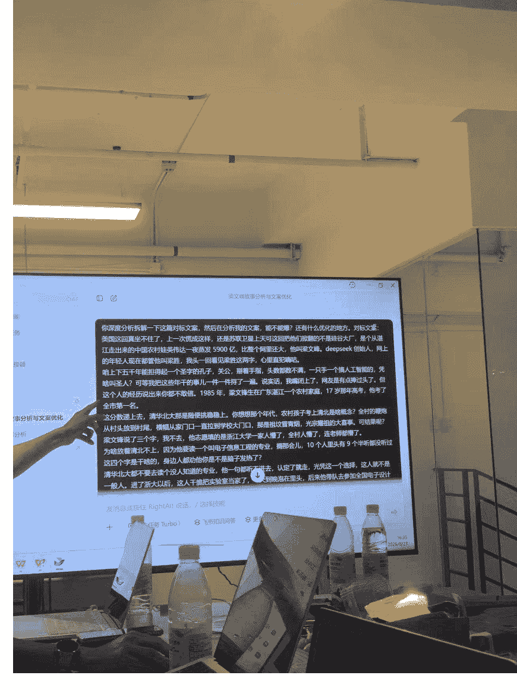
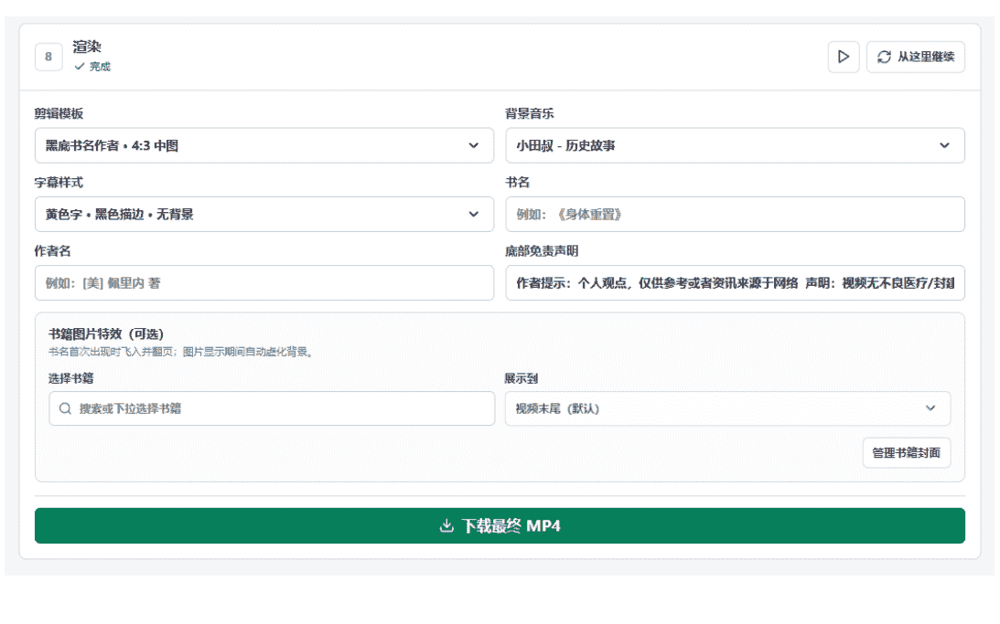
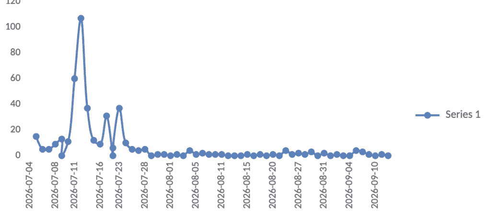
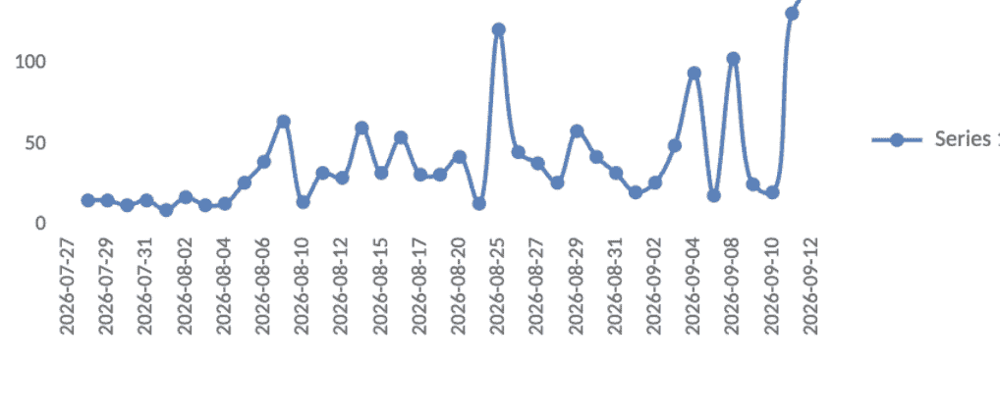

# 从长期零成交，到单日销售额 6000+：我在微信生态卖书，花高价买来 4 个教训

**260923 副业社群精选**

整理：（微信）；首发于精选交流群

> 小懒点评 | 如果你的号已经发了很久仍没有成交，这篇干货值得耐心看。作者的亲身经历是：自己好不容易等来的爆量视频被判违规，随后竟有人拿同一条音频搬去重发，最终做出 10w+ 销售额，反过来证明了内容没问题，问题出在号的承接上。最有参考价值的，是她总结的版本调研四个维度——给老年读者卖书，袖珍本要直接排除，版面尺寸和字体大小比价格更关键。而她最痛的一次教训，是爆量后因为怕违规而不敢用备用号跟进，眼睁睁把一整月的努力让给了别人。

我是龙哥，坐标厦门，目前处于独立工作状态。早年在硅谷做过产品与体验设计，回国后开始尝试短视频方向，如今主要靠在微信生态里卖书赚取成交佣金。

这一路并不顺利：起初我自己琢磨了很久，长期没有订单；后来跟着训练营和教练的线下聚会调整方向，终于做到单日销售额破 6000。期间踩过的坑，大多是用真金白银换来的。

写这篇复盘，是想给刚起步的朋友一些参考。基础操作不展开，下面只聊几个直接影响结果的问题：

- 长期没有成交，怎么找到真正能出量的内容方向？

- 挑书的时候，靠哪些信号判断值不值得做？

- 播放量突然涨起来之后，怎么接住热度、防止被搬运？

- 挂商品时怎么选版本，才能减少退单？

- 怎样把制作流程压缩到最短，稳定产出？

## 一、从零成交到第一次转机

最早我在海外视频平台做过几个月内容，项目已近尾声，没有做出什么水花。今年 3 月，我开始在微信生态里推广图书，方向选了健康类。当时没有参加训练营，只按自学文档操作，结果几乎没有任何交易。

5 月，我慢慢转到历史、人物题材上，总算见到起色。当月销售总额 1.83 万元，订单 261 笔，买家 257 人，平均每单 111.16 元，退单 30 笔；同期买家提交的订单总额约 2.01 万元，实际退款 2369.2 元；提交订单 291 笔，提交人数 281 人。

但这份成绩没有维持太久。6 月开始播放数据不断下滑，我仍然把精力押在旧的历史人物号，以及两个早已停更的健康号上。8 月训练营期间，几个号合计只出了个位数订单。

真正的转折，是训练营结束后去广州参加的那场聚会。

聚会现场，教练先处理了每个人带来的疑惑，再带着大家完整制作了一条视频。我收获最大的一句话，是把手里的旧号全部注销，重新开新号。此前我已有大约八周做不出自然流量，换号之后才发现，获得推荐原来可以这么轻松。

聚会结束没多久，我的新号甚至还没开通商品车，只靠橱窗就已经做到单日销售额 6000+。但那几天同时埋下了一个很大的遗憾。

8 月 30 日至 9 月 30 日的数据：销售额 6383 元，订单 83 笔，买家 83 人，平均客单 167.74 元，退单 15 笔；买家提交的订单总额 7207 元，退款 1324 元，提交人数 92 人。

表面很不错吧？可如果有人告诉你，有两个号靠复制我的音频，合计做出超过 10 万的销售额，你还觉得这是好消息吗？

## 二、最贵的四堂课

### 第一课：爆量之后，我根本没打算接住

那条视频属于健康类，发在一个没有开通商品车的号上。下午发布，次日凌晨播放开始快速上涨，早上 5 点到 10 点卖出 40 多单，随后继续加速，临近中午冲到约 10 万次播放。可刚到 10 万，平台就以“滥用医疗身份背书”为由下架了内容。

我最初的念头是：健康类碰不得，认栽。

结果几小时后，我发现有人直接搬用我的音频，把同一内容重新发布，已经出了一百多单。我立刻举报。次日，对方换了号继续操作，单日卖出 700 多单；还有个号也照搬了两次。两个号使用的是同一 IP，大概率是同一人，估计累计卖出上千单，总销售额破了 10 万。

那阵子我心情低落。但平静之后，这件事反而帮我确认了一个关键判断：别人只复制我的音频就能做起来，说明内容方向没问题，真正拖后腿的是我的号没有接住流量。

复盘下来，我有两个失误。

第一，爆量出现后不敢立刻启用备用号，担心再次触碰规则，于是什么也没做。现在看，这种畏首畏尾才是最贵的情绪。

第二，我完全没有“爆量之后怎么办”的预案。热度来了，却没有明确的承接动作。

如果再给我一次机会，我会把爆量后的 24 小时当成黄金响应期。看到播放突然加速、留言区密集出现“在哪买”的信号，马上做三件事：

1. 启用 3 到 5 个提前养好、且已有商品车权限的备用号同步发布，不要在爆量后才想起注册新号。

2. 同一段音频先在各个号里各存一份，防止被别人抢跑。

3. 主号立刻做同题材的下一条内容，让热度留在自己的矩阵里。

预防盗用和申诉流程也要前置。发布前保留原始素材文件、制作过程中的截图和时间记录；热度起来之后第一时间点亮原创标识；发现被搬运，不能只靠举报，还要按平台申诉流程提交完整证据链。

说到底：创作能力可以慢慢练，但热度来了接不住，一次就能丢掉一整月的心血。情绪归情绪，预案必须提前备好。

### 第二课：只比价格，忘了比版本

5 月电视剧《主角》热播，我很快跟进原著。先做了一条二创视频，又剪了一条关于演员孙浩的内容，两条都有不错的播放。真正出错的地方，是最后的挂链环节。

我最初挂了 99 元版本，后来觉得价格偏高，担心影响成交，就换成 85 元版本。等销量起来才发现，85 元的是袖珍本，开幅小、字迹密，非常不适合老年读者。结果退单率上升，前面累积的热度被大量无效订单消耗掉。

复盘后我意识到，错不在“选了便宜的”，而在“换版本前没有做功课”。我只比了价格，没有比版面尺寸、字体大小、装订方式和出版方。

现在给高龄用户选书，我会固定检查四个维度：

1. **版面尺寸**：16 开、32 开还是袖珍本，给老年读者卖，袖珍本先排除。

2. **字体大小**：看详情页实拍图，确认字是否够大、是否能直接阅读。

3. **装订形式**：精装偏重、偏贵，平装更方便老人翻看。

4. **价格带**：符合目标读者的消费习惯，但不能为了省钱牺牲前两项。

一组话总结：内容题材决定能不能爆，商品版本决定退不退单。两步都得筛，缺一环都是白忙。

### 第三课：习惯闭门造车，成长很慢

刚开始做内容时，我主要靠自学文档和别人的分享，很少主动交流。性格偏内向，总不好意思去打扰优秀的人，只有遇到特别难的问题，才敢向九月老师请教几次，这些帮助我一直记得。

后来读到一位圈友的分享，鼓起勇气加了他的联系方式。他给我的建议只有一句：多找人聊，多去线下走走。也是从那时起，我才真正走出自己的小圈子，参加了线下聚会，也因此等来了下一次增长。

独自研究不是不行，但很容易陷入盲区。别人一句具体提醒，往往比自己折腾几个星期更有效。

### 第四课：被数据起伏吓到，差点放弃

两个新号开局都不错，但所谓的新号红利只持续了大约一周，之后新内容的播放量从几千甚至上万，跌到只剩几百。我又开始焦虑。

萧炎老师一句话点醒我：不是号的问题，是你发得太少。

做线上内容，本来就要接受数据起伏。一个视频没跑起来，不代表号废了。真正的解决方法，是增加号的数量、提高发布频率、多积累样本，而不是被几次低播放击穿心态。

## 三、目前跑通的方法

### 1. 挑书：货源信息 + 独立判断

我现在选书有两条线。

一条线是和货源方保持联系，不要等某本书火了才去问。平时主动打听最近哪些书在跑量、有没有新品；他们日常也经常在动态里晒出新书和热卖书，看到了就尽快跟进。

另一条线是自己判断。我一般不会选从来没有卖出去过的书，一个品长期没有成交验证，本身就说明问题。判断时我主要看四点：

- 题材是否带有大众情绪基础，比如亲情、命运、成长、怀旧；

- 目标读者够不够多，我会优先考虑老年用户、带娃家长、上班族这类大体量人群；

- 价格是否落在目标读者容易冲动购买的区间；

- 平台内有没有同款曾经跑出过订单，一个都没有，就要警惕。

我自己就翻过车：一支原创视频播放接近 20 万，最终却只卖出一单。那支视频的完整观看比例约 6.01%，平均观看时长 123 秒，点赞 1911，转发 1319，评论 81，新增关注 666；商品被展示 108968 次，被点击 522 次，提交订单 0 笔，成交 0 笔。播放证明内容不差，订单证明商品选择和价值表达都出了问题。

当时我选了一本冷门题材的历史书，用知名女皇的故事做开头。观众对故事有兴趣，不代表他们想买这本书。在测试资源有限的情况下，我更愿意先选择已经有成交验证的书，再想办法把内容兴趣接到购买理由上。

### 2. 盯同行：用系统自动收集信号

我搭了一个每天跟踪 40 个头部卖家的数据系统，起因是懒得手动截图填表。做法不算高级：用 Python 脚本在 Mac 上操作 iPhone 镜像，避免调用高成本 API。每天固定时间跑一次，跑数据的同时我还能顺手刷一刷近期热门内容，时间不浪费。结束后，数据会自动同步到飞书表格。

目前表格只保留每天橱窗出单情况，原本也会抓主页展示和橱窗里的选品，后来发现用处有限，就去掉了。

这套系统偶尔能发现小众机会。之前有个号从卖书转到卖足贴，单个视频卖出两千多笔。我顺着这个信号跟进，也出了一些单。这种变化，只盯货源信息很难看到。

真正的判断还得靠人。如果多个号同时打同一个题材，基本说明热门趋势出现了；头部卖家换品、换形式，也是在替大家试错。平时多关注一些号，每天花几分钟刷一刷，就够了。

### 3. 找素材：不靠感觉，靠信号

5 月《主角》热度升高时，我在种草社区刷到演员孙浩的演技片段，留言区大量出现“看哭了”“哭惨了”。我判断这是强情绪素材，马上让 AI 整理资料、写原创文案，很快就做出了一支跑量的内容。

现在我判断一个素材值不值得做，只看三个信号：

- 留言区情绪密度高不高，有没有大量“哭了”“太感动”；

- 播放量是不是还在快速增长，说明热度没有透支；

- 话题是不是正处于发酵期，刚发生不久的内容效率更高。

我也总结出一个组合方式：正在发酵的事件 + 已经被验证过的内容方向。最近健康类的一则热卖内容，就是把某位知名主持人离世这个时事热点，接到原本已经跑通的健康内容上，情绪和时效同时在线。

阿潘老师分享的刷热搜方法也很好用：每天固定时间看一遍微博、头条热搜，把有情绪价值的选题记下来。

找素材不是在等运气，而是在攒信号。看到强情绪内容，判断热度周期，快速做出来，爆量就会从偶然变成概率。

### 4. 生产流程：先够用，再优化

我目前采用部分自动化的生产方式。写稿用豆包的桌面端，把训练营分享的指令做成自定义技能；配音用某个 AI 配音工具；配图用 ChatGPT 在线版；剪辑参考圈友的方案，做了纯脚本驱动的一键流程。

写稿是最关键的一环。我把写稿指令固定成自定义技能后，只需输入 AI 转写出的文字稿，就能得到一版接近成稿的文案，再手动修改不合适的地方、补充细节。

配音有两个容易忽略的坑：AI 写稿容易出现长横线，但配音工具遇到长横线不会停顿，听感很差；年份如果用古式字母写法，也容易读错。所以我在写稿指令里会明确限制：不用长横线，不用古式字母年份。

配图方面，我会固定用同一个 ChatGPT 对话，让它记住我的画面偏好。每次把文稿和需要的画面张数发过去，先让它列出每张画面的描述，再生成图片，一次最多大约 10 张。

剪辑系统虽然不如剪映灵活，但不产生额外费用，胜在稳定够用。

在这个项目里，文案的重要性远高于画面，所以我不追求花哨包装。目前做一支视频仍要 30 分钟左右；我还在继续压缩时间，希望能再省一半，整理成更完整的 SOP，到时候再分享。

## 四、还没解决的问题，以及下一步计划

到目前为止，我已经证明自己能做出有流量的内容，但还没有经营出一个能长期稳定出单的号。

我观察过不少号：有的在现象级爆发后很快就沉默，有的却能在很长一段时间里保持稳定订单。为什么有人成为前者，有人成为后者，是我接下来最想研究的主题。

下一步，我会从零再起一个号，去对标那些出单稳定的号，从选题、内容形式到发布节奏，逐一拆解测试。

也想借此请教前辈们：每个号是不是有自己的生命周期？走完一轮之后，是不是果断舍弃、重新开始更合适？

（示例图占位）

**账号B**

## 五、收束

这一路能走到今天，离不开龙哥老大搭建的龙哥盟，也离不开视频平台航海活动中各位教练与志愿者的投入。

尤其想单独提到萧炎教练。若不是他在广州促成那场面对面交流，后面那次订单集中爆发，或许根本不会发生。

还要记得九月教练：刚开始尝试视频内容、完全找不到方向时，是他的建议帮我理清了思路。

同时，感谢那些持续发布高质量经验帖的朋友。正是借助这些前辈留下的方法，我才少走了许多弯路。

期待下一次再带着新成果与各位见面。

——————分隔符——————

一篇 SOP 看下来，理解文字并不等于能够完成执行。真正开始时，绝大多数人往往连起点都迈不过去。

软件、资料和课程只能算基础配置；拉开差距的，通常是行动速度，以及身处不同圈层所接触到的独家信息。

这里不做空泛讨论，重点研究从机会发现到收益落袋的完整路径，并用人工智能压缩重复劳动。群内目前整理了 1000 多个已经验证过的套利案例。

- 查看社群内的数字资源清单及加入条件：

[https://lazsyo.com/insider/](https://lazsyo.com/insider/)

公众号

懒人搜索

