# 公众号爆文一年变现百万，我的从零到爆规模化实操复盘

# 一、开场白

各位同行大家好，我是去年4月进入赚钱星球的，今年3月又续上了航海家，核心还是绑定赚钱社区。

过去12个月我完成了从零到一再到十的跃迁。起初只是偶然捕捉到一条公众号爆文的风向，赚到第一笔1万块，后来稳定运营千号矩阵，2月份单月营收突破20万，3月份因流量波动做到10万+。

刚开始尝试做爆文的时候，听龙哥提到这个赛道年入百万的大有人在，我心里想如果是我就好了。没想到一年时间，这个设想真的实现了。

下面我把从零起步到规模放大的完整路径，以及当前爆文项目的市场环境，全部摊开讲清楚。

# 二、当前公众号爆文的生态

先把大环境说在前面，省大家绕弯路。

我从去年5月入局公众号爆文，当时恰逢窗口期，账号很容易进池，半个月就拿到首个正反馈，这才坚定了长期深耕。

每个流量周期都有其代表性题材。去年7月是文案鸡汤，8月是城市回忆录，10月是职场体质盘点，12月是职场薪资话题，今年2月则轮到情感叙事。

周期内爆发的赛道，单号日阅读动辄数十万，数据榜单上全是新注册小号。周期一过，哪怕旧话题，基本再难起量。

今年3月后，推荐机制明显调整了。好处是新号进池更快，一周就能启动；坏处是账号生命周期大幅缩短。以前的号能活一个月，现在4-5月的号普遍只有2-5天寿命。期间不少矩阵玩家直接退场。

不过流量很快又在回暖，爆款小号重新冒头。只要不下牌桌，机会依然存在。

所以现在想做高收益，就得在存活窗口期内靠高频发文冲量。

小结：

存活期缩短，策略要转向多更对抗。

不同周期主打赛道不同，要跟着周期选题。

# 三、从零到一的打法

## 3.1 认识公众号这个载体

公众号本质是内容分发平台，相较短视频，它是纯文字，生产门槛更低。经过去年多次改版，平台公域属性越来越强，展现机会增多，这也是爆文项目去年集体爆发的原因之一，是顺势。

变现方式比较多元，有付费阅读、赞赏、流量主广告、商单合作等，最关键的是公众号能无缝沉淀私域，这是其他平台不具备的。

针对爆文项目，核心收入来自流量主，所以重点拆解这个。

流量主包含底部广告和文中插广告两种。底部广告开通后，全站历史文章都会自动带广告。文中广告则需要在发布时手动开启，历史文章无法补加。

因此，开通节点越早越好，几篇试水文后就能提前开通。

小结：

公众号公域化趋势明显，机会窗口仍在。

变现路径多，流量主是基础。

500粉即可开通，建议尽早maifen。

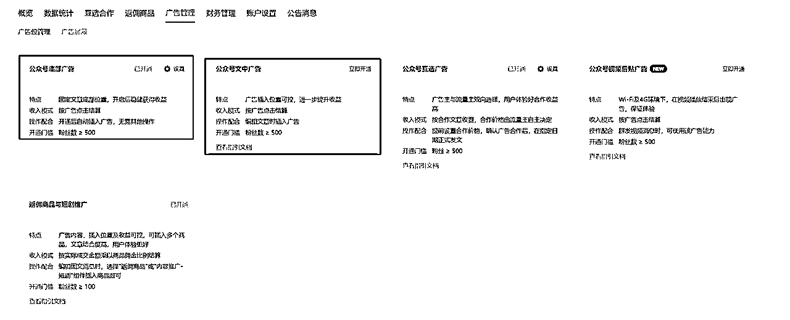

## 3.2 流量来自哪

公众号流量主要分三路：

* 粉丝会话阅读

* 看一看推荐

* 搜一搜搜索

三者是独立的，搜得到不代表会被推，搜不到也不影响被推。

### 3.2.1 粉丝会话阅读

粉丝关注后，群发会推送到订阅号列表。现行机制下，不常读或未星标的号基本不推送。这部分阅读靠粘性，头部作者能到30%+。对于新号，无粉可忽略。

推送入口主要有订阅号消息和看一看更新提醒两种。

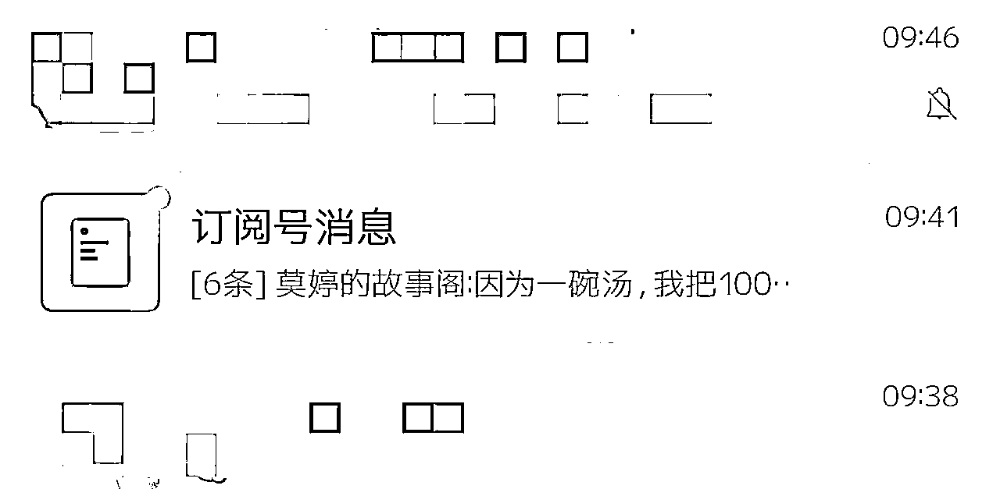

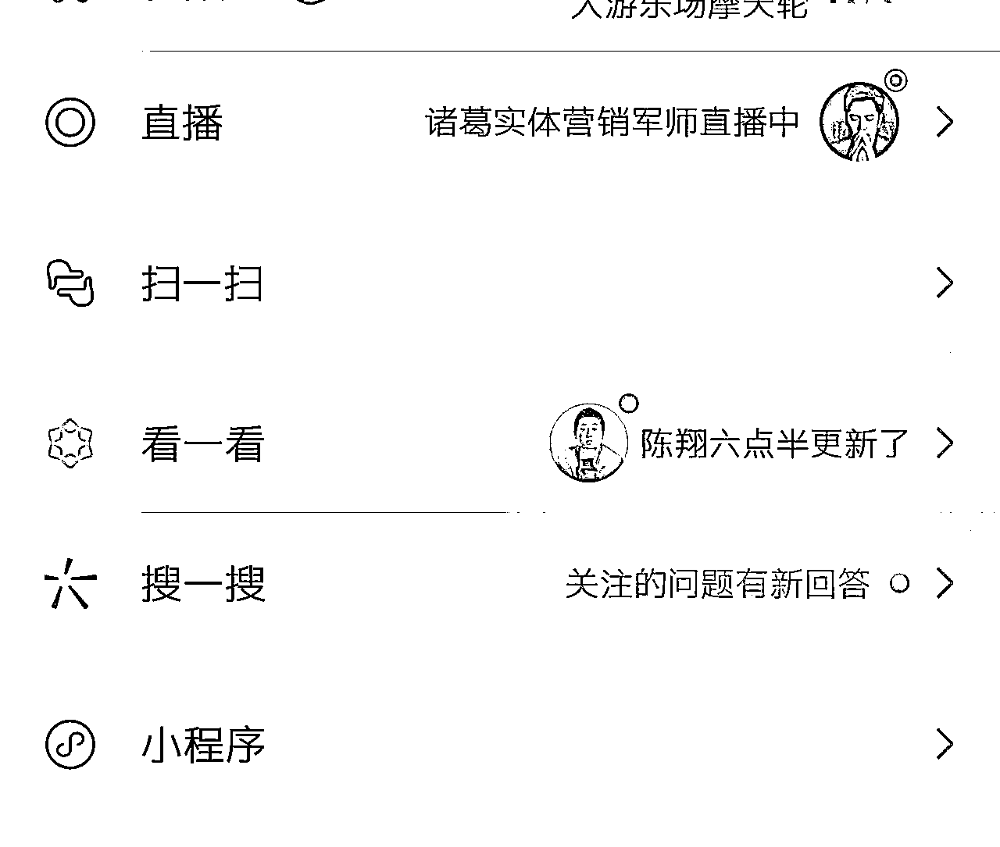

### 3.2.2 看一看推荐

这是我们做流量主的核心来源。

主要入口有三处：

订阅号列表里的看一看版块，展示形式是大图+标题或小图+标题。

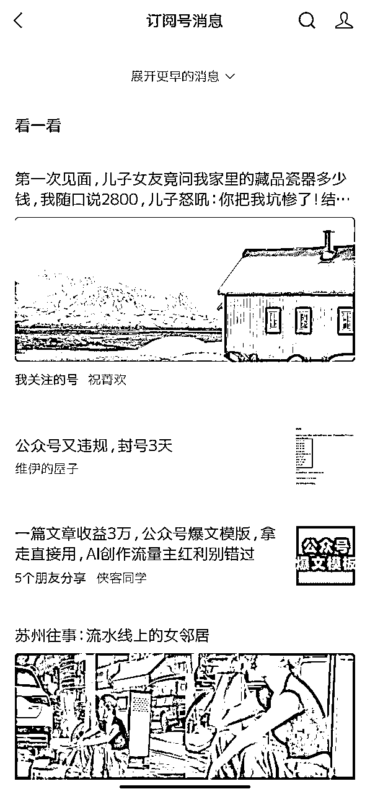

文章底部相关推荐，打开任意文章底部会展示3篇相似内容，展示为小图+标题，说明平台已做标签化精准分发。

发现页的看一看入口，展示形式多样，有长图+标题、方图+标题、3图+标题等。

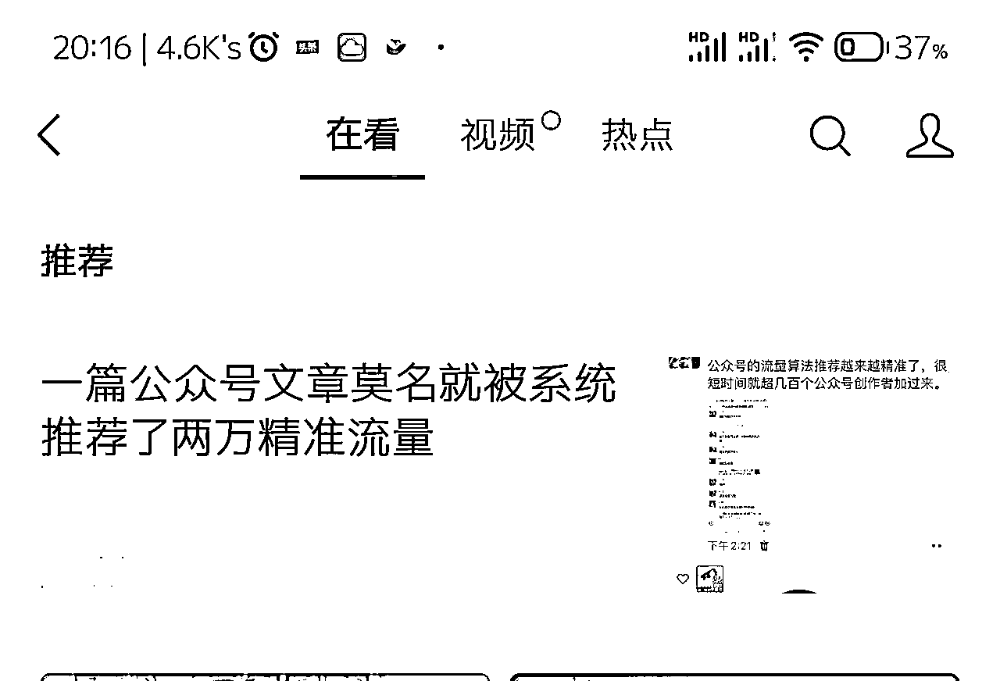

综合来看，三个入口都高度依赖标题，其次是封面。大图和方图并存，但标题所占视觉权重远高于封面。方图本身信息量小，点击决策几乎靠标题。

因此做爆文，标题优先级第一。判断好标题的要素在航海手册里有提到：金钱、数字、差异、悬念、民族、性暗示、死亡、暴力，能在一个标题里叠加越多越好。

能力不足时直接抄标题也是常规操作。公众号对标题重复度容忍度高，只要正文不同即可。

### 3.2.3 搜一搜

靠关键词带来搜索流量，适合做IP或热点引流，对纯流量主变现意义不大，这里不展开。

小结

三大流量入口中，看一看是主力。看一看的三个入口都以标题为核心，所以好标题是拿到流量的前提。标题可以重复，直接参考爆款标题即可。

## 3.3 怎么找爆款标题

找标题最耗精力，我常用三种方法。

### 3.3.1 对标账号抓取

找到一批对标号，抓取近期文章和阅读数据，挑出异常值记录。自己写过RPA程序，把账号导入excel即可自动采集并数字化排序，效率最高。

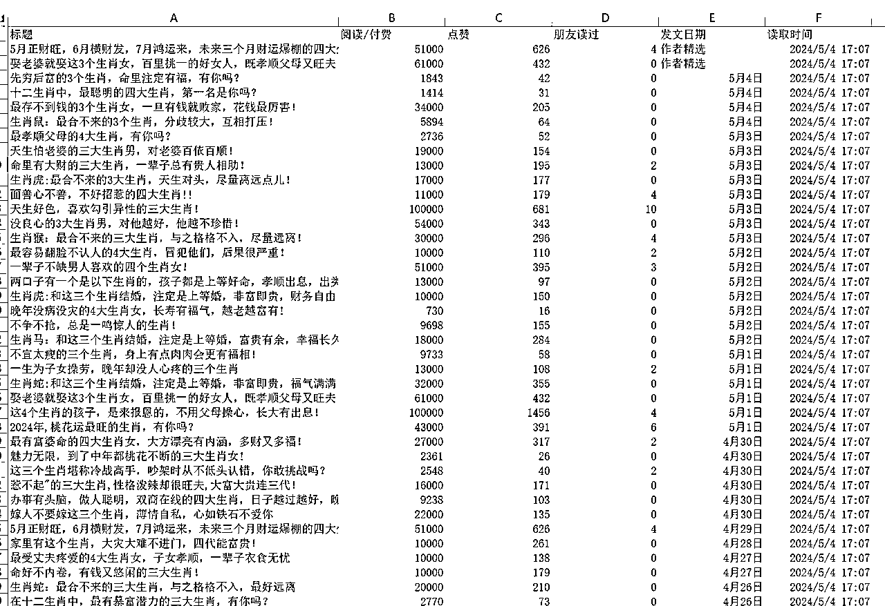

文末可找到下载方式。

### 3.3.2 次幂数据

次幂数据价格偏高，但看公众号趋势很有效。低粉爆文榜能快速看到近3个月的新号和优质文章，也可在热门文章里按主题筛。分类不太准，需要人工复核。

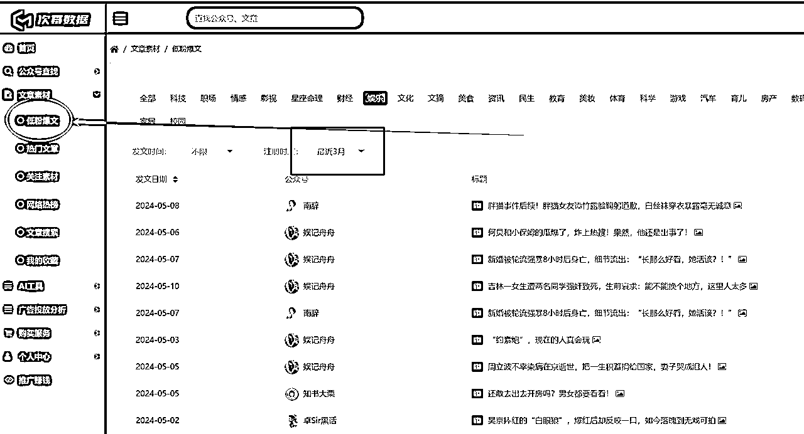

导出不支持，需要RPA，2行代码就能实现。

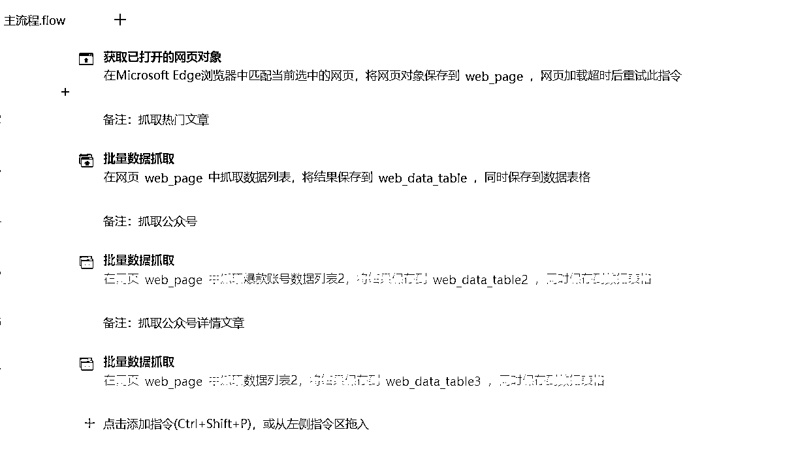

### 3.3.3 易撰

易撰收录头条、大鱼、搜狐等平台文章，没有公众号。不过人性共通，参考价值仍在。需注意各平台对标题重复的容忍度不同。

易撰支持一键导出，方便归档。

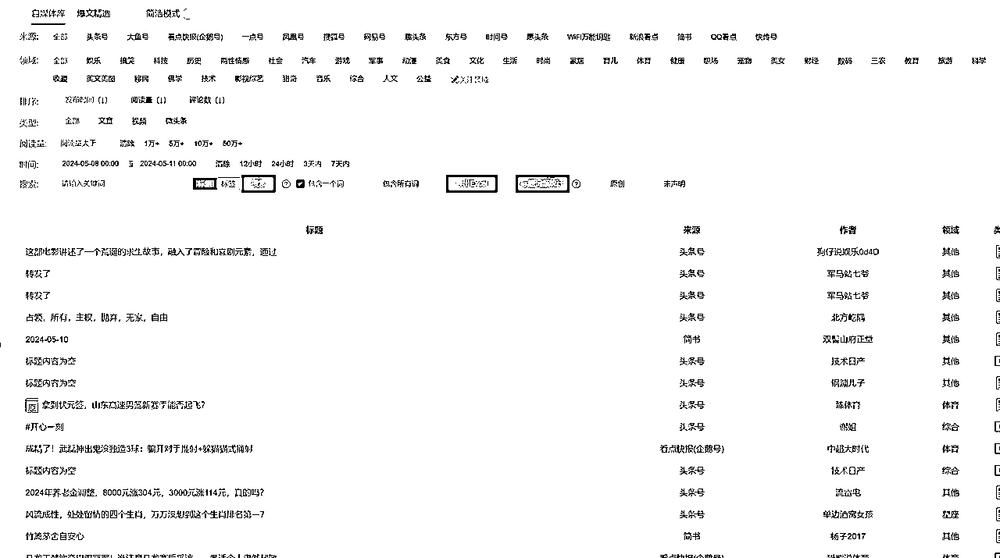

很多人觉得写文难，其实爆文项目最难的是选品，选对题材就像电商选品一样关键。下面我分享如何用一句提示词高仿出整篇文章。

小结

三种找题方法：对标抓取、次幂数据、易撰。优先推荐对标抓取。

## 3.4 如何判断赛道能否起

每个周期都有热门赛道，如前文所述。突发事件也会带动赛道，比如去年河北极端天气，天气预报类内容连续数月爆发；国庆高速视频也曾全网10万+。

大部分人被信息茧房困住，看到的热门不一定是真实热门。

除交流数据外，可用次幂排行做趋势判断。

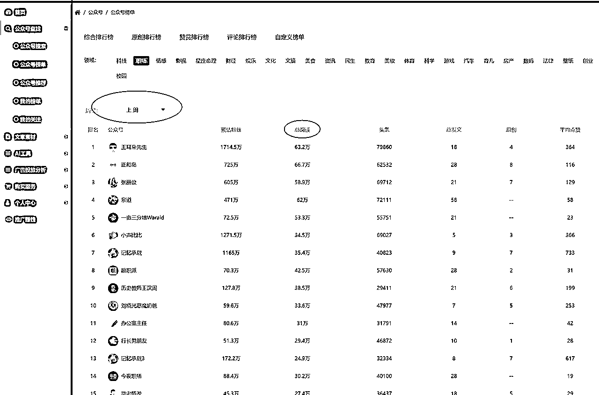

切换不同领域看总阅读，职场类目前明显下滑，一个月前前十都超百万。

重点看两点：

1. 赛道近期的总体阅读量，前50名水位线。

2. 榜单是否频繁变化，小号占比多少。

流量大且小号多，说明赛道当前易起，可直接开工。

## 3.5 一句提示词产出一篇文章

工具先行。AI发布后我测过chatgpt3.5/4.0、new bing、claude1/2/3、gemini、文心一言、讯飞星火、kimi等。中文创作方面claude表现最好。claude2发布后我一直在使用，今年claude3出来后，opus版最强，其次是claude2和sonnet。

我的理解是AI不是死工具，它有学习和模仿能力，把它当成移动助理更合适。

之前用chatgpt3.5想模仿个人风格，把自己的文章喂进去总结风格再写，结果总是跑偏。后来发现直接喂范文更有效。喂一篇优质散文，让它按相似风格再写一篇，结果高度还原。

问题在于空洞描述风格，AI理解会偏差。就像描述一幅画给朋友，永远不如把画直接给他看。所以现在我都用范文+风格要点一起喂，出来的还原度非常高。

实操流程：

找3-5篇代表性范文，合并成一个文件。

让AI分析风格，或自己补充风格要点。

提示词示例：

这是我的几篇文章，请学习风格并模仿创作。

1.语言通俗易懂,避免艰深词汇,表达直白流畅。符合公众号调性,无太多专业术语。大量使用积极朴实的词汇,如“幸福”“成功”“美满”“富贵”“有福”“吉祥”,整体正能量。

2.借助生动比喻和案例,如“福报”“龙年大吉”,提升趣味和可读性。

3.引言先交代生肖文化或性格特点,营造氛围。

4.正文细化到事业、财富、感情、子女、晚年等不同阶段,增加细节感。

5.结尾总结全文,强调最终幸福,强化正能量。

6.结尾附祝福或励志语句,反复点题。

7.融入传统文化元素,如生肖、谚语、祝福语。

8.话题围绕生肖命理,带有浓厚传统文化符号。

围绕话题：XXXXXXXXX

实测效果：

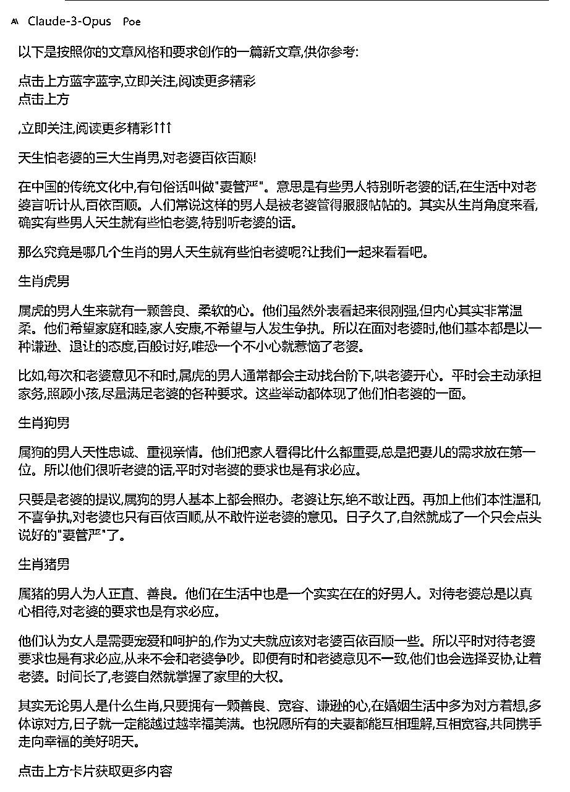

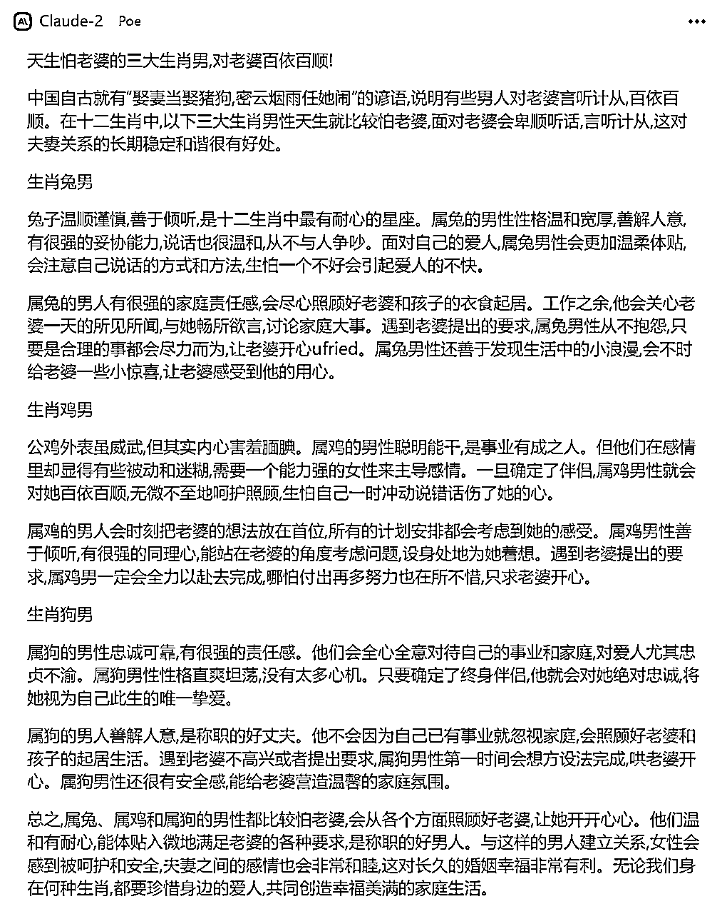

左侧claude3-opus，右侧claude2，提示词一致，opus明显更稳。这样即便提示词不专业，也能出可用稿，且为原创不触发洗稿风险。

新人不会写提示词，用范文喂养法可完全绕过这个痛点，一条标题即可生成一篇文章。

说到底，能把效率拉满的核心就在于这套打法：一行指令就能带出整篇稿子，配合 RPA 真正实现自动化，单人一天撑起几百篇的产量也不是梦。

先聊个总的认知：

用 AI 就得把它当成一个真人同事来用，而不是当成只会复读的机器人。现阶段在中文写作上，claude3-opus 的表现是最让人放心的。AI 学习能力很强，给它一套靠谱的范文，它就能更快get到你的写作意图，文章的可信度自然上去。按这个思路坚持写、坚持发，从零到一的突破其实很快。

公众号这条赛道在 AI 加持后，门槛已被拉得很低，它已经是普通人离变现最近的几个项目之一。现在的问题不再是能不能起盘，而是怎么把规模做大，把收益做厚。

# 四、把规模做大拿收益

想放大无非一个逻辑：账号越多、发文越多。放大路上会碰到一堆卡点，下面把实操坑和解法一次性摊开。

## 4.1 账号批量搞定

先说最基础的——号从哪来。一个人只能实名一个公众号，要做矩阵就必须另辟蹊径，大致有三条路：

1. 动员亲戚朋友注册，注册完把你微信绑成运营者，实际操作都在你手里。

2. 用执照去注册。个体户能绑2个公众号，企业最高能到50个。个体户虽然受一个微信最多5个管理员的限制，但企业号能绕开这个天花板。

3. 走特殊渠道直接买号，有找回风险，这里就不展开了。

补充一个经验：起号成功率上，个人号明显高于企业号，所以能搞个人号就尽量多搞个人号。

注册号最头疼的是邮箱，推荐用2925无限邮箱，一次注册相当于拥有无限邮箱，批量建号不再卡在这。我之前的精华帖里有具体用法。

执照方面，淘宝上搜个体户执照，20-50元就能搞定，看地区，海南的便宜又好注销。也可以在支付宝搜云上公司，9.9起开公司。算总成本，公司还要记账、注销，费用比个体高不少，没必要就先用个体户来过渡。

微信号也要备足，最好是不同实名主体，这样才能绑定更多公众号。微信可以直接买低月租卡，淘宝上有月租19元200G流量的套餐，纯发文需求的甚至能用电信8元卡申请。

设备要跟上。登录这么多号，摩托罗拉手机是目前我用着最稳的，官方原生支持同时开6个微信，测试下来封号率很低。

注册时一定要注意节奏，不要同一时间、同一IP下批量注册。公司和个体户注册的第二个号，系统会提示让你认证，可以用设置里绑定法人跳过认证的办法省下300元认证费（这个技巧在之前的帖子里有讲）。如果是企业号，未来想冲到50个号，就不要跳过，必须正式认证。

按上面这套组合拳，办几个执照、备几十个微信，搞出20个可用公众号完全可行，账号层面的第一步就打通了。

总结：

要做大，矩阵化是底座。拿号主要有三条路：找人代注册、执照注册、特殊渠道购买。邮箱用无限邮箱解决，手机号用低月租卡解决，设备用摩托罗拉多开解决。注册时分散时间、分散IP，别扎堆。

## 4.2 环境隔离

这个坑我踩了很久。去年10月我就感觉到，同个IP下后面注册的号很难活，有的号一个月阅读为零。当时有人说公众号不查IP，20个号以内没事，我就以为是赛道问题换来换去。

到12月还是起不来。我做分成业务时，后台起号率能到60%，而我自己这边的号几乎全军覆没。内容质量、赛道选择都一样，唯一的差别就是环境。之前我用谷歌浏览器的多用户功能，每个用户只登一个号，但本质还是同一台电脑、同一个公网IP。

结合之前做抖音小红书的经验，问题就集中在设备指纹和网络IP。最保险的做法是：每个微信独立环境、独立IP，每个公众号独立环境、独立IP。虽然也可以一个微信绑多个号，但分成那边的案例证明这个不一定致命。

解决思路最终锁定在 指纹浏览器 + 静态IP。动态IP不稳定还容易带污染，静态IP长期看更省心。

国内代理商一个静态IP要三四十块一个月，号多起来很肉疼。后来群里的小伙伴分享了B站用天翼云搭静态IP的教程，一个IP月成本能压到3-5块，成本瞬间降下来。验证有效后，我就从注册那一刻起就给账号固定环境，号活着的这段时间一直用同一个环境，直到号凉。

我用的是hubstudio指纹浏览器，每天送20次免费开环境，多了就开会员，99一个月。

### 4.2.1 谁必须做静态IP

只有1-3个号的朋友可以直接跳过。3个号以上做矩阵，这个环节必须做。

### 4.2.2 怎么拿静态IP

#### 方案一：直接买

网址：https://static.jghttp.com/staticstate/

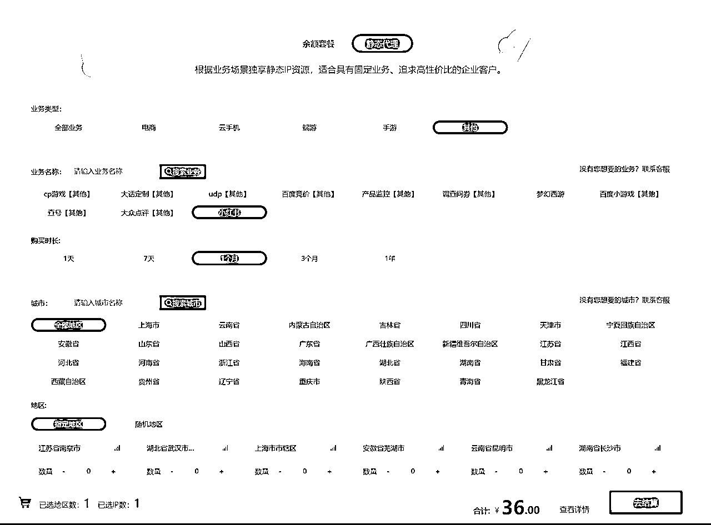

进去后找静态IP购买即可

#### 方案二：自己搭

买的方案一个IP月费36，10个号就是360，成本偏高。自己搭更划算。

搭建视频教程参考B站【24年最新IP搭建教程】。天翼云可去闲鱼找折扣，0.1元搞定开通。

总结：

做矩阵，环境隔离是刚需，平台已经开始查IP了。指纹浏览器 + 静态IP是目前最稳的组合。指纹浏览器我选hubstudio，每天免费20个环境。

## 4.3 内容生产

AI时代，写文章已经不是最难的环节，核心就两个字：质和价。

质量靠模型。想产出80分文章，如果用100分模型，80分的提示词就够了；如果用80分模型，提示词得做到100分，而且AI每次理解会有偏差。结论是：先选好模型。

实测claude一直很稳，所以我们主用claude。

成本上，批量写作有两种：对接API或直接用RPA操作。API成本高，而且当时claude2还没稳定接口，所以我们一直走RPA。

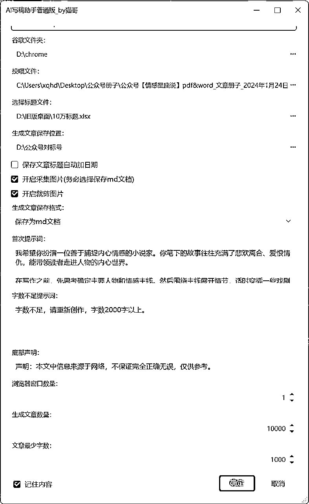

早期我们用claude2的免费额度，一台电脑批量注册大量账号，RPA自动轮询写作保存。9月大封号后损失很大，10月claude加强风控，账号寿命变短。后来转到poe平台，里面集合了claude全系版本，成本极低，后续一直用这个。

现在单机搭配RPA，一天轻松完成500篇创作，成本控制在20元以内。

总结：

RPA能把内容批量产出闭环。poe在成本上比官方更划算。

做到这一步，单人已经可以实现批量放大，但天花板也很明显：

1. 账号获取上限，几十个能做到，上百个就难了

2. 运营人力上限，发文要审稿排版，一个人日管50个号就到极限了

也有好处：

1. 数据完全可控，可以重点养号

2. 结算安全，收款都在自己手里

目前市场上个人做公众号矩阵，大多也是这套打法，上手快、好掌控。跑通后立刻能执行。

下一阶段的跃升是分成计划，能突破单人矩阵的瓶颈，收益再上一个台阶。

为什么我没做产文+发文一体的RPA？因为AI生成内容有不确定性，碰到社会敏感事件容易出现不实信息，一旦爆了风险不可控，而且很多号是亲戚朋友的，必须稳。

最近账号存活周期变短，项目整体承压，有人开始放弃转型，也有人说公众号爆文死了。

正如盗坤说的：悲观者往往正确，我选择乐观前行。图文比短视频更适合我。公众号的整体流量并没有消失，依然有人年入七位数。

能活过三五天的号依然存在，这背后一定有规律可挖。未来公众号一定是卷质量、卷价值、做私域。私域是破局的关键，公众号恰好是离私域最近的阵地。

要把公众号做深做透，比做短视频更难，文字的深度是AI短时间难以替代的。那些老牌大V，一篇付费破万，靠的就是深度。

我会继续深耕这条线。《小米创业思考》里说过，要想成功就保持专注，把一件事做到极致。走过的每一步都算数，现在看似没效果，未来会回馈。

持续深耕，时机到了再聊。

# 五、写在最后

去年加入赚钱是我做过最正确的决定。那一年是我成长最快的一年。我学到很多，也认识了很多同频的朋友。开始做IP，触达自媒体，偶尔也会想，如果当年选的是自媒体而不是软件开发，会不会不一样？如果早点加入赚钱，会不会不一样？

前阵子航海家群里几位圈友说自己以前看盗版赚钱，挺惭愧的，我也看过盗版，后来才明白，盗版和正版是两个世界。

能成事的除了信息，更重要的是人。看盗版永远是观众，永远孤独。你也可以成为主角。

回头看，并不是我多厉害，只是恰好在对的时间抓住了合适的项目。

排版工具下载：https://www.123pan.com/s/KtY7Vv-ZKSzv.html

采集标题数据工具下载：