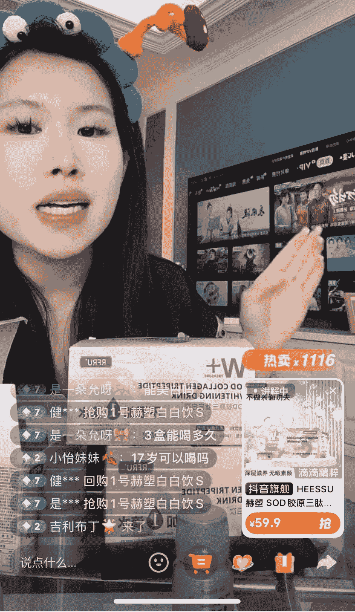
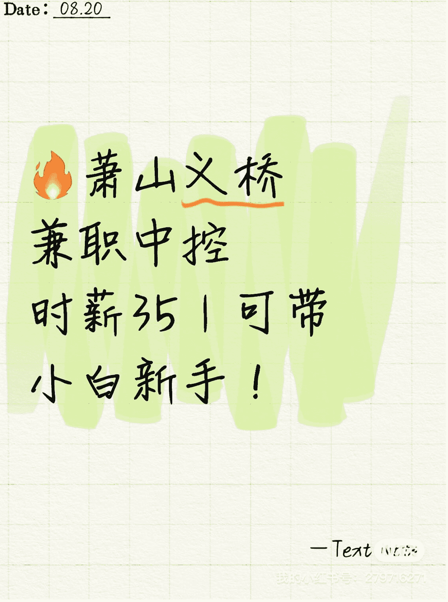

# 夫妻合力做抖音两年：从月入三万到月亏五千，我踩穿的三大坑与收手决定

## 千万级操盘者的一次坦白复盘
## 第一部分 决定关停的全职尝试
我叫知风，1999 年出生，温州籍，自小跟着父母在新疆经商。
2018 年读大学时，淘宝店铺做到月入过万。
2020 至 2024 年专注 CPS 推广，从执行专员做到部门主管。
曾带团队两个月从零起步做到两百万流水。
现供职于一家老字号食品企业担任抖音渠道负责人，去年抖快合计销售额破千万且实现正毛利。
前夜 Kiki 整夜未眠，凌晨六点起床为我煮了碗阳春面。今天，我正式按下我们夫妻全职做抖音带货项目的停止键。
家人多次提醒、身体发出警报，再加上 AI 龙哥给出的意见，我们一致选择撤退。撤退不是认输，是为了活下去。
## 第二部分 高光后进入盐碱地
把这两年由月入上万到利润被耗尽的经过写出来，希望能帮同行避开雷区。
这两年并非全无收获，却也踩坑无数，甚至差点伤到夫妻感情。如果你是以下几类人，建议花十分钟阅读，能为你省下几万元试错成本：
1. 打算拉着伴侣一起做自媒体带货的朋友。我会用亲身教训说明，为什么把另一半当成商业伙伴极易翻车，以及夫妻店该怎样分配收益、沟通分工。
2. 正做抖音 CPS、白牌滋补、纯佣金拉量的自由职业者。我会算一笔账，说明你每天的辛苦劳动，实则在为平台与 MCN 贡献价值。
3. 一边在职一边焦虑副业的打工人。我会以自己主业被副业侵蚀，最后副业还亏损的经历，告诉你主副业精力如何评估投资回报。
该项目始于 2024 年年初，跟随坤哥的训练营启动。后来坤哥与龙哥盟官方合作提供流量，我们属于最早一批做精细化运营的达人。
![bbox=[0.06, 94, 0.84, 493]](img/dd5251b40e7d5664d480adcc1ee97fd5_3_0.png)
目前在赚钱社区里同类项目已鲜少有人坚持，赛道已明显畸形，小体量创作者难以存活。我们能撑到现在，已超过八成同行。
曾有高光期：
2024 年初初步验证模式可行，八月份跑通最小闭环后说服 Kiki 辞职全职投入。
2025 年初升到 L5 等级，素人上限。
“五个女博士”某单品长期位居周榜月榜第一。

也尝试过直播，单场出货破千单，状态非常健康。

### 从零到一的煎熬与期望值博弈
2024 年八月，我们在仍在职时就把最小可行模式跑通了，当月佣金进账五千，才决定放大的。我曾与坤哥聊过，做了一次理性测算：让 Kiki 全职投入即便失败，最坏情况是她回市场找一份六千左右的行政岗位，家庭现金流可以兜底；若成功，每月可多出两三万元进账。下行风险被锁定，上行空间很大，期望值为正，于是推动她离职 All in。
纸面计算无法抵消现实的痛苦。冷启动头三个月，一天仅卖一两单，极度煎熬。那段时间我常去河边看白鹭靠背诵“大鹏一日同风起”“长风破浪会有时”来给自己做心理建设。
靠持续优化人货场与账号权重，熬过量变到质变，最终迎来月入两三万元的顶峰。
转折来自个人矛盾叠加行业佣金普降与冒险尝试白牌直播，收入一路下滑直至被处罚。
### 错过的 2021 红利
我 2021 年在一家品牌方负责达人渠道，品牌投放力度极大。当时佣金约 25%，我们会用两倍 ROI 的广告预算为达人砸几十万元扶起。品牌虽亏钱也要抢占份额。
记得投入二十万千川，把月销一万元的达人做到了四十万，对方过年寄来 188 元大红包。那一刻我算清了账：小达人月赚十万佣金，而我当时淘宝副业月入一万，正谈恋爱无房贷，生活舒适，硬生生错过窗口期。
### 2024 入局时市场已冷
2024 年我们入场时，平台、达人、品牌三方关系已趋于平衡，常规抽佣十个点尚可接受。受大环境影响，新品牌融资收紧，开始精算投产比，佣金被压到 3%-5%。
算一笔绝望账：百万元销售额 → 五万元佣金 → MCN 再抽三成 → 平台各类扣除 → 到手仅剩薄片。这已不是创业，是为生态打工。
巅峰期月销五十万，净利两三万。我们一度认为可持续。2025 年八月佣金跌破万元，短视频已无法支撑，于是八月底转向直播：
白牌滋补品类佣金可达 45%。
自投广告成本约 5%-10%。
剔除成本后理论毛利可超 20%。

当月利润回升至两万元。但公司旺季外派工厂带直播项目，业务被迫中断。白牌生命周期极短，复购差，只能作为过渡。
归来时环境已变：
十月国家开始规范直播电商税收。
白牌需补税。
佣金从 45% 直接砍到 25%。
> **通知消息**
> **时间：** 11:35
> **类型：** 商品橱窗通知
> **详情：** 带货商品佣金率下调通知
> **商家已下调商品【认养一头牛】全脂纯牛奶 200ml×10 盒×3 箱儿童学生营养早餐-sp 8% 的佣金率，调整后的佣金率为 1%，将于 2025-01-1... 全文**
> **通知消息**
> **时间：** 11:16
> **类型：** 商品橱窗通知
> **详情：** 带货商品佣金率下调通知
> **商家已下调商品【认养一头牛】全脂纯牛奶 200ml×10 盒×3 箱儿童学生营养早餐-sp 8% 的佣金率，调整后的佣金率为 1%，将于 2025-01-1... 全文**
> **通知消息**
> **类型：** 巨量千川
> **详情：** 全域推广使用授权申请
致命黑天鹅：2026 年一月被罚五千元，心彻底凉了。
2026 年一月公司旺季结束，业绩超预期三倍，我们重启带货直播，对标一款热卖甜甜圈，纯佣 50%。测算单场破万净利在 10%-20% 区间，认为可行。
按 SOP 操作：先拍引流短视频，再开播验证最小可行。小目标是首场卖出一单即算成功，事实也卖出了，能力无问题。但产品功效强，平台禁止暗示。我们收到风控提示未重视，认为小间一天卖一两单可忽略。
连播三天，第三天直播间被强制关停。五千元保证金被没收，账号封禁三天。

**违规详情表**
| 项目 | 内容 |
| **状态** | 直播违规 已违规 |
| **判罚时间** | 2026/02/04 20:02:48 |
| **违规类型** | 特殊功效虚假 |
| **情节** | 严重 |
| **再次违规处罚** | 直播间商品下架、冻结违规订单成交额 15%、永久关闭商品分享功能、罚没违约金等 |
| **违规单号** | 7602972665825313066 |
| **处罚对象** | 直播间 (ID: 7602969548672781108) |
| **详细违规点** | 您在直播中，明示或暗示商品实际不具有的减肥/壮阳/丰胸/增高功效 |
| **直播时间** | 02/04 19:47:51 ~ 02/04 19:48:51 |
| **处罚结果** | 关闭商品分享功能 3 天 (2026-02-04 20:02:47 至 2026-02-07 20:02:47) |
| **罚没违约金** | 5000 元 (已处罚) |
| **违规依据** | 《创作者【虚假宣传：特殊功效虚假】实施细则》 |
对半年多收益稀薄的账号而言，这笔罚款如同晴天霹雳。眼看年关将至，我强撑着帮 Kiki 重建信心，她哭了一场。年后我们约定：再坚持三个月赚不到钱就解散。
## 第三部分 三大死局深度拆解
### 战术回顾：直播最小可行是如何跑通的
借此补上之前答应鱼丸的复盘。受杨涛观点影响，核心四字：百问百答。
多数人上播紧张念稿。直播间本质是解决痛点。把用户高频问题吃透，像线下导购一样回应，事就成了一半。
冷启动做法：
11. 蹲竞品直播间，记录用户提问高频词。
12. 自播时人少，用几个小号在公屏抛问题。
13. 自然流量进来看到主播专业解答，停留与转化自然提升。
心态 MVP 测试：
每次看到竞品低粉爆款就跟进。为保护 Kiki 的情绪，我们把目标压到最低：一天卖出一单即算胜利。只播一小时，强调就是来聊天。
三月中旬停播两月后复播，照旧卖出千元，验证短直一体底层逻辑有效。但悲凉的是，千元销售额扣完佣金与渠道抽成，仅剩三十元。
抖音已全面短直一体，短视频不爆直播投放就烧不动。门槛极高。战术上的小胜掩盖不了战略利润枯竭，这正是最终止损的导火索。

### 死局一：商业模式有闭环但无复利的搬砖生意
做的滋补保健品类全靠千川打品。不违规卖不动，违规就被罚。去年成绩对今年零帮助，每天从零卷素材，进入死循环。
内耗巨大：一方面白牌佣金高但功效描述游走红线；另一方面我懂品牌逻辑，知道这类无功无过的商品无复购，是消耗流量的单次爆破。缺乏底气时动作会变形。
这让我明白：经营缺乏品牌背书、缺乏复购的白牌，本质是透支心力，无法积累的劣质生意。
品类多为功效导向，涉及瘦身美白肌肤状态等。操作中发现核心矛盾：
14. 商品生命周期差异巨大
a. 大牌如“五个女博士”，周期至少一年。一条爆款可持续出单。拍三十条素材可支撑七八个月，去年的视频今年仍在跑，佣金不高但稳。
b. 白牌周期极短，按周月算。必须持续产素材，强度极大。
15. 业务逻辑风险
a. 白牌佣金高，但不暗示功效难以成交。
b. 暗示自带违规风险。一单收益几元，违规即罚五千，期望为负。

**视频违规详情表**
| 项目 | 内容 |
| **状态** | 视频违规 已违规 |
| **违规时间** | 2024/12/29 19:53:31 |
| **违规类型** | 功效虚假 |
| **违规单号** | 7453799043350724903 |
| **处罚对象** | 短视频 (ID:7453441596441382196) |
| **违规原因** | 您在 2024-12-29 视频画面中，明示或暗示商品具有减肥相关医疗保健功效 |
| **违规位置** | 视频画面 |
| **处罚结果** | 冻结达人佣金 0 元 30 天，视频购物车违规商品下架 |

16. 平台强监管趋势
即便选择低佣投放，白牌头部账号也因违规受牵连，连品牌千川账户都被封。保证金估计也受影响。
17. 内心自我博弈
无数次觉得良心不安，这么贵的无效果商品卖出去不对。但现金流紧张时选择闭眼做，觉得不做别人也会做，不能有道德洁癖。长期左右互搏，人变得扭捏。不如早停。
18. 保底收益断崖式消失
早期有稿费保底，2025 年开年每月稿费约五千，占收入三成，是定海神针。
官方推出星川计划后，单条视频稿费从五百暴跌至五十，安全垫被抽空。收入全部押注纯佣跑量，抗风险能力归零。跑不出量即死路。
! 反思1 模式篇：
依附大平台做生意，切勿把平台补贴或稿费当作常规利润。没有可掌控的复利私域，命脉永远在算法手中。
### 死局二：合伙陷阱，切勿用大厂 KPI 管理伴侣
坦诚错误：
我是理工男理性逻辑主导型，试图把内向情绪主导型的妻子培养成另一个操盘手。能力模型不匹配，沟通成本极高，复盘会变成争吵与内耗。
用冰冷 KPI 要求家人，是操盘手最大的傲慢。我未能给予足够情绪价值与极简 SOP，家庭作坊变成修罗场。夫妻创业失败，百分百是我这个自以为是的男主角管理无能。
理性的人习惯算投入产出、看流程和效率；感性的人更在意态度、情绪与被理解的感觉。两套系统一旦放进同一段关系里，沟通很容易变成高成本消耗。
这次创业让我最深刻的教训是：公司的 KPI、项目管理和绩效考核，绝不能原封不动地搬进婚姻。尤其是夫妻共同做事时，工作关系和亲密关系如果没有清晰边界，项目出了问题，最后往往不是项目本身受损，而是感情先被拖垮。
## 一、别用“合伙人思维”处理简单的劳动力需求
我曾经考虑找一位产品经理一起做小红书项目。杨涛当时提醒我：之所以想找人合伙，本质上是因为你担心风险，所以想找个人一起承担。如果你认定这件事一定赚钱，又怎么会愿意把利润分给别人？
这句话后来套在我和 Kiki 的创业上，尤其刺耳。
很多早期项目，最适合的并不是拉人入股，而是直接购买所需的劳动力。能通过兼职、外包、绩效或一次性费用解决的事情，就不要轻易用股权把别人绑定进来。
夫妻创业更要谨慎。如果没有建立明确的情绪隔离机制——工作时间只讨论工作，下班以后不把项目里的压力和不满带回生活——那么业务上的低效率，迟早会蔓延到婚姻里。
## 二、个人能力离不开平台，操盘手也需要合适的土壤
我曾经在公司负责直播项目，借助供应链、投流预算、客服团队和组织资源，把一个原本被许多机构判定“做不起来”的项目重新跑通。
但同样的经验，放在我们自己的小团队里，却没有顺利复制。
当时 8 月份，我们自己的直播间一场能够卖出约 1000 单，每场利润超过 1000 元。按照当时的模型，直播 3 到 4 个小时，哪怕拿出 200 元找一名兼职主播，也依然有利润空间。于是我就想：既然算得过账，为什么不扩大规模？
问题在于，我们当时过于保守。
明明可以招聘主播，却一直坚持自己上场；原本打算增加中控人员，后来也用插件替代了。我们没有及时扩充人力和优化流程，只是重复一场一场地直播。
当竞争对手察觉到我们的打法后，迅速跟进，流量开始持续被分走。项目 ROI 也从 10 左右下滑到 5。
我们没有趁着流程跑通去做培训、卖项目或包装知识付费，而是继续依靠两个人慢慢熬。结果就是：规模没有增长，优势逐渐消失，利润也不断收缩。
### 为什么同样的打法，公司能做起来，自己做却失败？
后来我甚至怀疑，是不是自己的能力退化了。
但去年 9 月的经历证明，问题并不在于“会不会做”。
我被公司派到一家工厂，全权负责直播项目。这个产品此前交给过很多机构，却一直没有结果，大家纷纷把原因归结为产品、品牌或赛道本身。
我采用的方式，和之前教 Kiki 做直播时完全一致：通过大量问答寻找需求，再用 MVP 快速验证。
结果却完全不同：
- 第一场成交约 150 单；
- 第二场达到 1000 单；
- 第三场突破 5000 单；
- 后续单场销售额甚至做到 5 万。
这个项目还进一步对接了“与辉同行”等头部流量资源，取得了非常亮眼的成绩。
同一个人、同一套方法，为什么在家里亏钱，在公司却能够快速放大？
答案很残酷：很多所谓的个人能力，其实是平台资源映射出来的结果。
在公司，我拥有稳定货源、投流资金、客服承接和团队支持；而在家里，我只有一部手机，以及一个长期承受压力、情绪已经接近透支的伴侣。
此外，小团队做白牌产品，几乎没有抗风险空间。公司试错亏几万元，通常可以被视为测试费用；但个人做低佣金产品，一次违规罚款 5000 元，就可能让几个月的努力全部归零。
所以，操盘手不能只依赖战术勤奋。没有资金池、供应链、团队和稳定系统，个人能力很难长期对抗平台规律。
## 三、这次项目真正带给我的收获
虽然这两年没有赚到预期的大钱，但我确实积累了几项重要能力：理解了抖音业务的底层运转逻辑，强化了数据分析能力，也建立了一套借助 AI 提升效率的工作方式。
### 1. 更懂达人商务与资源匹配
达人合作不是简单地把产品交出去，而是要根据不同达人的风格、受众和内容习惯，调整产品表达、脚本结构以及交付方式。
我过去做品牌方时，就意识到达人之间差异很大。早期合作中，即使对方没有提出明确要求，我也会先根据产品特点设计推广思路，再去匹配达人需求。
这套方法帮助我们获得了较好的初始成绩，也让平台和品牌方更愿意继续配合。
我的优势主要来自三个方面：
- 本身就在行业圈子里，与商务沟通时更容易建立信任；
- 通过线下展会等渠道，可以提前接触新品信息和行业动态；
- 能够快速梳理品牌的产品线，找到更适合推广的核心产品。
去年 7 月参加展会时，我接触到一些白牌品牌，也因此更早了解到部分新品和市场变化。虽然不同产品的品类不同，但推广、选品和放大的底层逻辑往往可以迁移。
### 2. 持续优化拍摄和内容表现
人与人之间的差距，很多时候并不在于起点，而在于是否持续迭代。
Kiki 在这方面做得很好。她没有停留在最初的拍摄状态，而是从场景、灯光、画面质感等细节一点点调整。
也特别感谢狂朝 MCN 的投入。他们陪着我们持续优化拍摄环境，让直播间逐渐具备更强的内容感和平台适配度。
### 3. 学会用 AI 提高业务处理效率
去年 9 月，我们发现网易严选的某个自播账号持续使用我们的爆款视频，并将内容投放到自己的直播间，导致我们的原有视频流量明显下滑。
针对这件事，我们采取了三步处理：
1. 留存并固定侵权证据；
2. 通过正式沟通施加压力；
3. 必要时进入诉讼程序。
一开始，我们考虑使用专业取证服务，但相关费用较高，而且侵权事实非常清晰，对方很难否认。最终我们采用录屏方式完成证据保存。
之后，我借助 AI 整理和优化沟通文本，发送正式律师函，向对方释放明确的专业信号。对方感受到压力后，态度从最初的对抗转为配合。
最终，对方停止了侵权行为，并支付了相应费用。整个过程没有走到诉讼阶段，但这次经历让我意识到：AI 不只是写文案和做表格，也可以帮助个人完成专业沟通、流程梳理和复杂事务推进。
## 四、为什么决定现在停下来？
停止项目并不是因为一时情绪崩溃，而是现金流已经不允许继续拖延。
我们有房贷，家庭现金流本身就比较紧张；即便我在公司完成了超过目标数倍的业绩，薪资也不会因此立即上涨。与此同时，带货项目只要继续维持，每个月还会固定亏损约 3000 元，累计亏损已经达到 3 到 4 万。
继续坚持，并不代表坚持就会变好。有些项目继续投入，只是在延长亏损周期。
因此，我决定把重心重新放回职场，寻找拥有品牌积累、产品利润和资源基础的合作机会。
## 五、给仍在做类似项目的人三条建议
### 1. 没有复利能力的流量，越早止损越好
如果一个产品必须靠擦边暗示功效才能成交，平台规则一调整，收入就大幅下滑；如果去年积累的粉丝，今年无法继续产生价值，那么这更像是一份高级销售工作，而不是一门真正能够积累的生意。
真正值得长期投入的方向，应该具备复购、品牌沉淀或用户资产积累。
### 2. 需要人手，就购买劳动力，不要轻易谈股份
很多人一开始创业，就习惯把亲戚、朋友或伴侣拉进来分股份，认为这样能够共同承担风险。
但如果你真的认定项目一定赚钱，通常不会主动分出股权。股份的背后，往往意味着你在寻找风险共担者。
如果伴侣承担的只是出镜、剪辑、客服等具体工作，就应该按照工作价值支付工资或绩效奖励，而不是用模糊的股份关系，加上冰冷的 KPI 去管理对方。
否则，项目没做大，家庭关系先被消耗掉。
### 3. 不要把 AI 当成魔法，核心是把业务拆清楚
不必因为别人会写代码、会爬虫就产生焦虑。
对大多数业务人员来说，AI 更像一个随时可以调用、不会疲惫的外包团队。关键不在于你会不会复杂指令，而在于能否把需求拆得足够具体。
比如，不要只说“帮我做一个短视频”，而要明确到“我要一个不露脸、时长 27 秒、面向某类人群、突出某个卖点的短视频脚本”。
业务理解越深，任务拆解越清晰，AI 才越能真正变成效率工具。
## 下一步
认清现实后，我准备重新回到职场，并参加杭州赚钱 AI 航海家大会，分享这段经历中用真金白银换来的经验。
目前我正在寻找操盘手、增长负责人等机会，重点关注有品牌沉淀、利润空间较高的消费领域。
如果你手里有产品、有品牌，却缺少流量增长、投放管理、爆款打造和 AI 提效能力，欢迎私信交流。

感谢赚钱提供了持续学习和交流的平台，也感谢龙哥不断推动大家使用 AI 工具。
感谢坤哥和狂朝 MCN 给我们的帮助，感谢北京戴哥的陪伴和经验分享，也感谢青瓜视频戴总给出的建议。
更要感谢 Kiki 一直以来的耐心配合。
最后，感谢你读到这里。我是知风，一个仍在继续前进的人。
很多人看完一篇 SOP，会误以为自己已经掌握了方法。但真正开始执行时，大多数人会在第一步就停下来。
教程和工具只是基础门槛，真正拉开差距的，是马上行动，以及能够接触到高质量圈层信息。
这里不讨论空泛概念，只拆商业闭环，研究 AI 如何提升真实业务效率。系统内已经沉淀了 1000+ 个经过验证的套利实战案例。
👉 查看圈子完整数字资产与加入门槛：

