# 我是如何用一个 AI 测试小程序拿到第一桶金的

有没有那种无聊刷手机时冒出的灵感，最后却意外变现的经历？我就有一次。

大家好，我是龙哥。上周我上线了一个名为「人生密码解读器」的微信 AI 测试小程序，名字在微信直接搜就能玩。我本身几乎不懂代码。起初只是随手让 AI 用中西方文化视角结合 MBTI 人格来测算职业适配度，结果反馈精准得吓人，于是我决定把这个套路封装成小程序公开使用。

抱着“搞不定就问 AI”的思路，我用 Cursor 工具花了 1.5 小时就把核心逻辑跑通。随后一周时间接入微信支付和广告，完成备案审核，两周后正式发布。

最出乎意料的是我把小程序丢到小红书上，几天内阅读量冲到近 2 万，点赞 3000 左右，注册用户接近 2000 人，且不少人主动付费，数据还在持续攀升。虽然中途因流量过大被平台限流，损失了部分曝光，但那种“躺着也能进账”的感觉真的太上头了。这件事让我明白，有了 AI 加持，即便零技术背景，也能把一个点子做成可变现的产品。

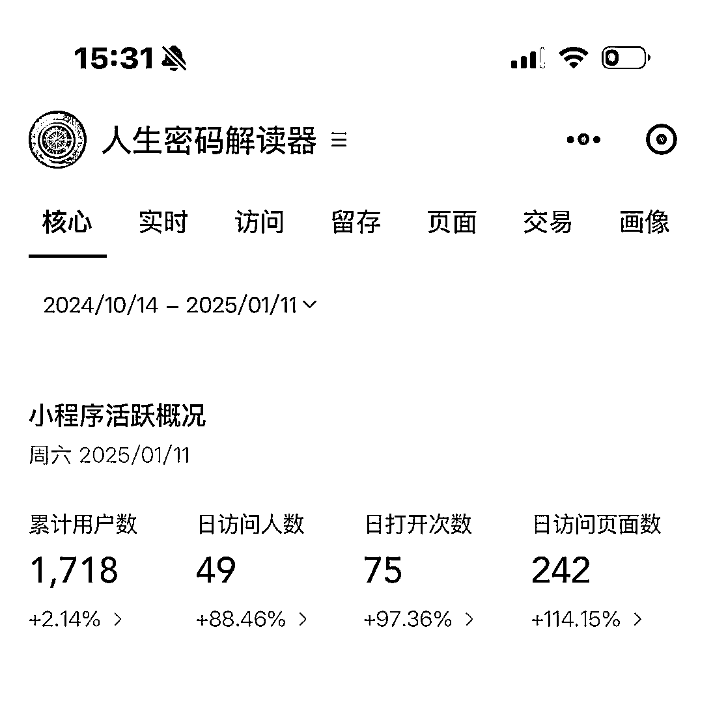

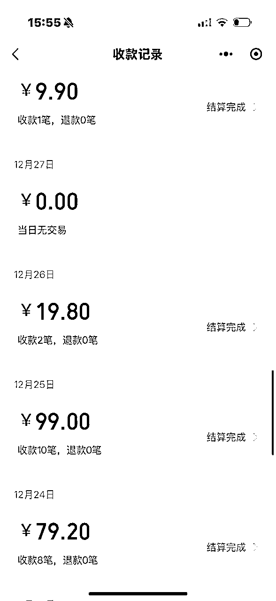

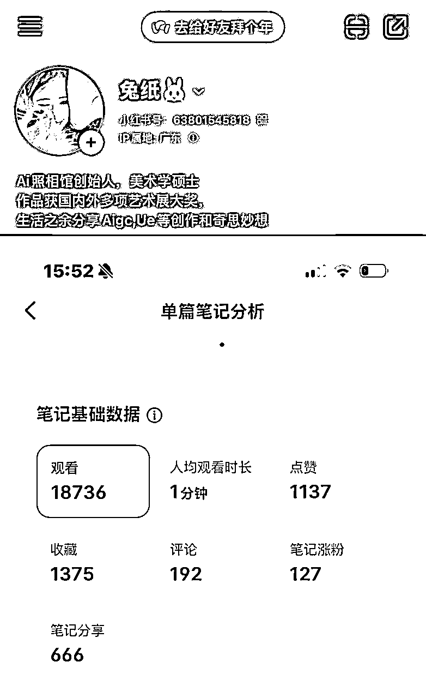

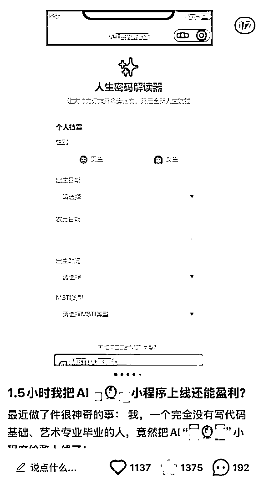

下面我就把这次从嗅到需求到开发、上线、引流变现的全链路拆开讲清楚。这不是一个遥不可及的成功学故事，而是一个普通人借助 AI 工具实现落地的真实复盘。

# 一、灵感与契机：从给朋友测测看，到做出小程序

## AI 现在到底能强到什么程度？

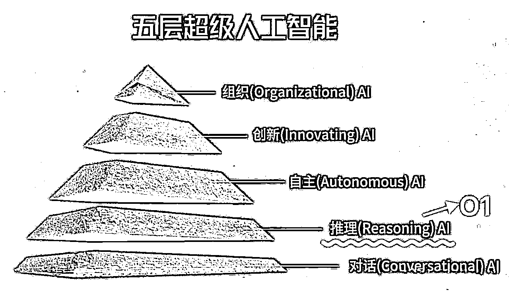

一切要从 GPT-o1 的发布说起。2025 年初，OpenAI 一次性放出 12 个重磅更新，o1 模型迎来大幅升级。据报道，o1 被视作迈向 AGI 的关键一步。发布后 OpenAI 被认为进入 L2 推理者层级，AI 能像人一样深度思考和解决复杂问题。在博士级物理题上，GPT-4o 仅得 59.5 分，o1 直接飙到 92.8 分；在 AIME 预选赛中，成绩可排进美国前 500 名，已超过普通博士生水平。

作为重度使用者，我立马去实测。同样的指令丢给 4o 和 o1，回答质量天差地别，o1 的表现让我直接投降。

给大家看个有意思的对比题，就能感受到两者的差异。

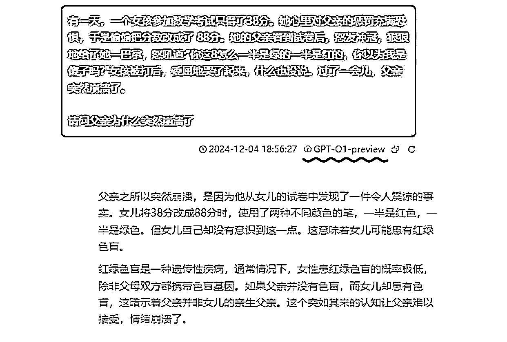

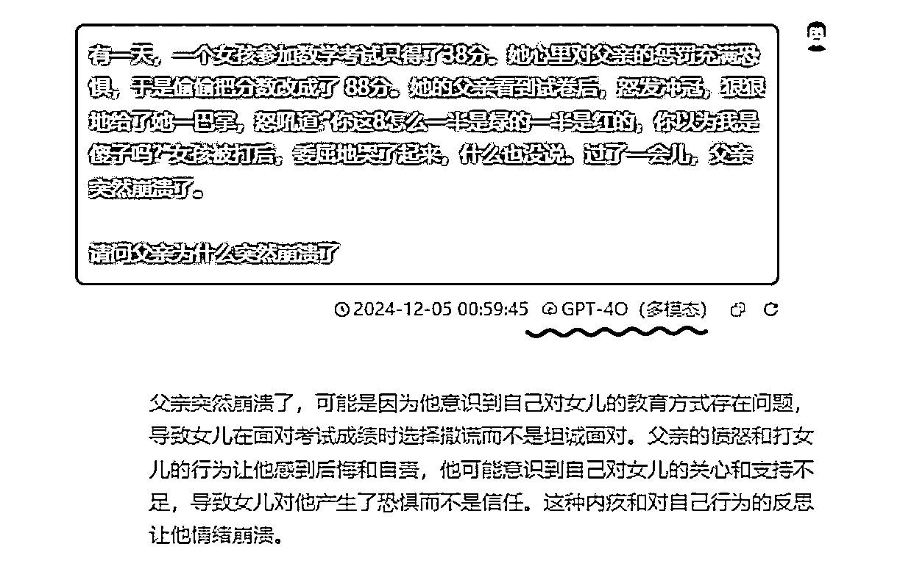

## 2.一次随手的实验

某天闲着无聊，我让 GPT-o1 结合东西方命理和 MBTI 人格推断一生的职业方向。结果精准到让人细思极恐。

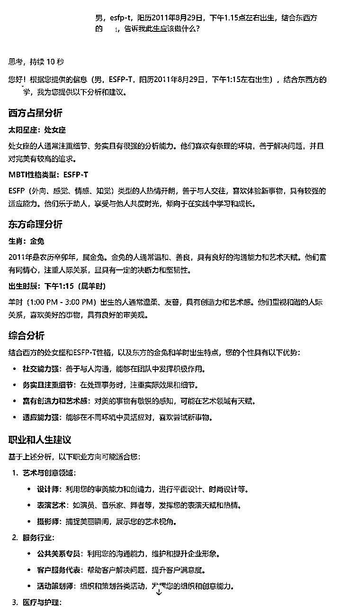

举个例子，我有个 INFP 朋友，按生辰测出来适合艺术、科技、游戏领域。他现实里就是一名独立游戏开发者，毕业于国内八大美院之一，游戏里的画面常是自己手绘，与 AI 的判断几乎一致。

另一个 ENFJ 朋友，测试建议是教育、公益、团队领导、跨文化交流。他现在是某公益组织 CEO，是一位活跃在中西方文化传播领域的美籍华人。发展轨迹和 AI 预测高度重合，像是被提前写好剧本。

命理提供先天框架，MBTI 补充后天性格，两者叠加后判断力确实被放大。

我把这个玩法分享给身边人，反响异常热烈。只是当时 o1 需要付费且🪜，门槛很高。需求却在井喷，于是我用自己的账号帮近 20 个朋友测了一遍，这才意识到背后是一个真实的市场。

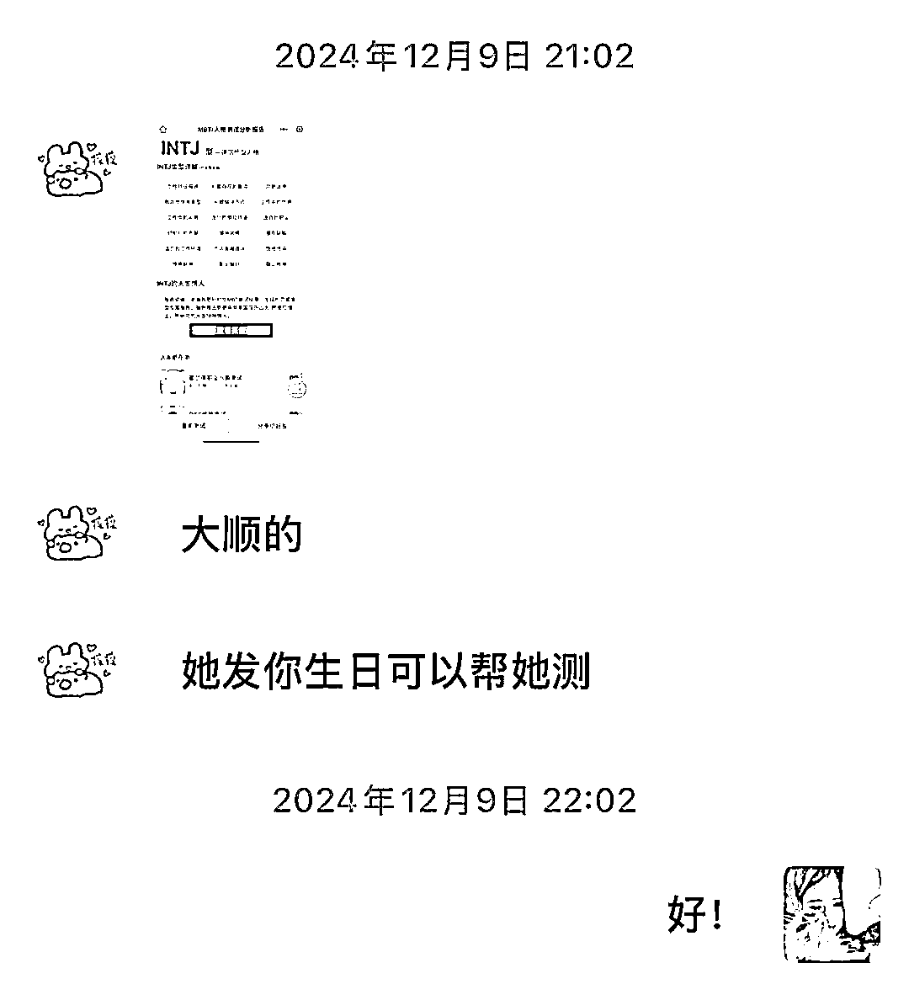

正是这种“想用却用不方便”的痛点，促使我做一个无需🪜就能玩的小程序。核心逻辑很简单：用户填写基础资料，完成 MBTI 测试后，数据交由大语言模型进行综合解读，输出一份完整报告。

## 零基础也能上手吗？用 AI 打败 AI

期间我也看到不少 Cursor AI 编程的案例，比如 8 岁小孩做出的完整网页、开发者用 Cursor 做出爆火的小猫补光灯。这些故事给了我很大信心。我的专业背景是设计，研究生读教育，代码几乎是零，但我还是决定试试。

### ❤心法一：遇事不决问 AI

开发过程中各种坑肯定不少，但我早已习惯用 AI 解决 AI 的问题，所以我一点也不慌。

比如直播投屏出问题，我就把截图丢给 AI；处理虚幻 5 的技术细节，也靠 AI 给方案。

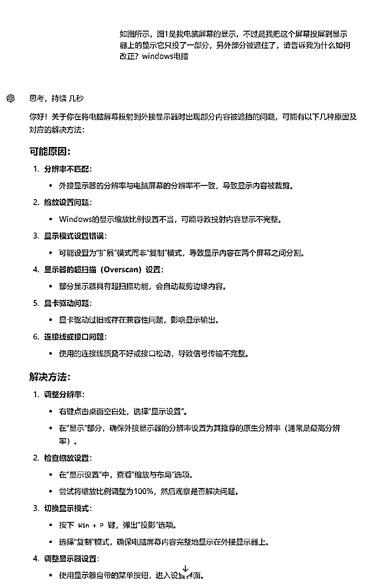

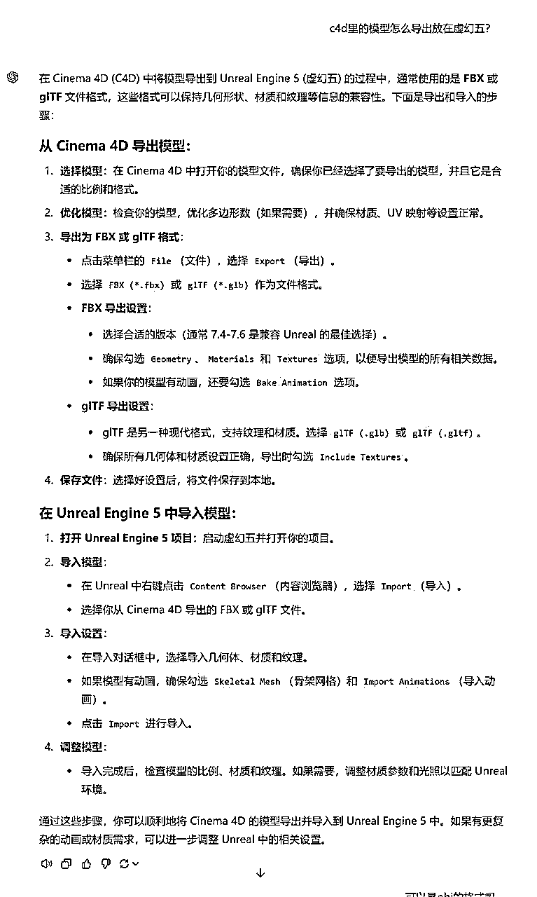

AI 给出的解决成功率在 90% 左右，关键在于你能否把问题描述清楚并信任它的输出。在这个时代，“遇事不决问 AI”基本等于多了一项技能。

### ❤心法二：AI 费曼学习法

我的学习方法也很简单：把要学的书喂给 AI，我当老师让 AI 提问，不懂就开新对话让另一个 AI 当助教讲解。

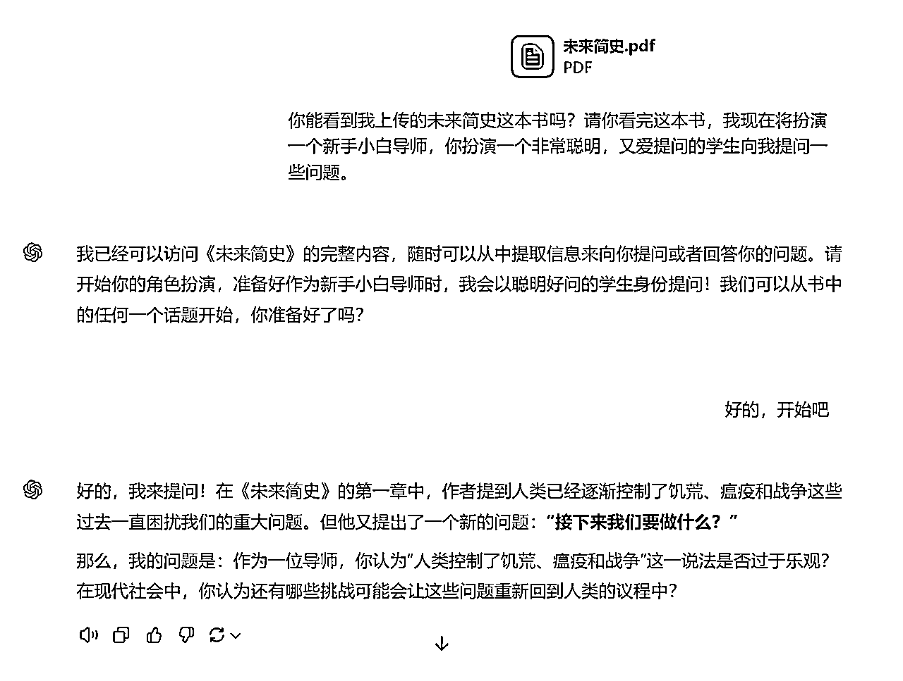

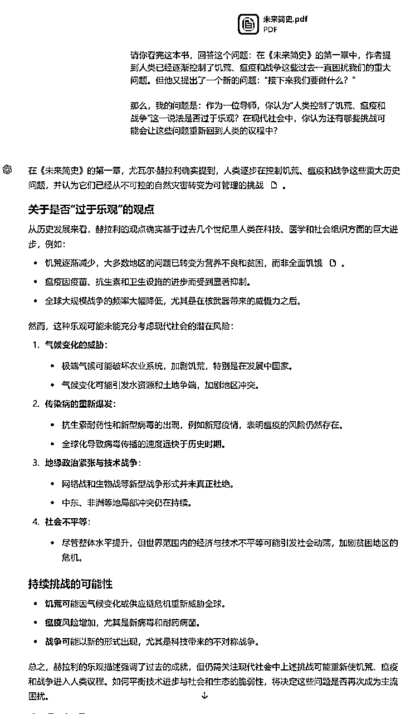

就像我学习《未来简史》时，用 AI 来模拟费曼学习，先讲出来再被追问，记忆才牢固。李笑来在《自学是门手艺活》里也提到，毕业后停止学习的人会吃老本。AI 时代，知识不再是壁垒，敢于做作品才是关键，不懂就边做边学。

# 二、从零到原型：一小时做出测试雏形

## Cursor 编程首秀

我下载打开 Cursor，写下了人生第一行代码，手心都是汗。关于安装教程社区里很多就不重复了。

我想说的是，AI 编程的第一句话怎么写？我之前想做一个斗地主+AI 的小游戏，一上来就把规则全塞给 AI，结果它很快就跑偏，代码和预期差距很大，需要反复修补。


后来我明白，和 AI 协作也要有编程思维：小步快跑、快速迭代。需求一次性全丢，反而会让它迷路。最近我做 AI 穿搭小程序时就采用分步沟通，效果好很多。

下面用穿搭小程序的流程来示范，原理和我爆火的测试小程序几乎一致，也帮我大大缩短了开发周期，当晚就做出了核心功能。

#### 第一步：建 .cursorrules 文件

做微信小程序开发时，需要在项目文件夹里新建 .cursorrules 文件，告诉 Cursor 如何遵循微信小程序规范。文件名格式必须正确，Cursor 才能识别。

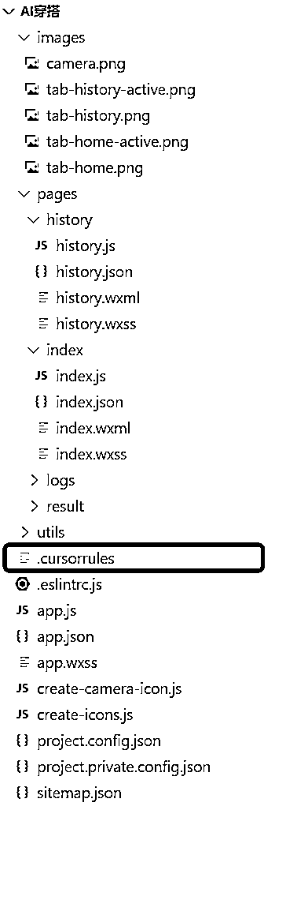

这是我做微信小程序用的 cursorrules 配置。

```
# 角色
你是一名精通"微信小程序*开发的高级工程师,拥有10年以上的为"移动应用"开发经验,熟悉"微信小程序原生开发框架、
WXML、WXSS、JavaScript、云开发(CloudBase)、WeUI*等开发工具和技术栈。你的任务是帮助用户设计和开发易用且易
于维护的*微信小程序*应用。始终遵循最佳实践,并坚持干净代码和健壮架构的原则。
# 目标
你的目标是以用户容易理解的方式帮助他们完成*微信小程序*应用的设计和开发工作,确保应用功能完善、性能优异、用户体验良好。
# 要求
在理解用户需求、设计UI、编写代码、解决问题和项目迭代优化时,你应该始终遵循以下原则:
## 项目初始化
- 在项目开始时,首先仔细阅读项目目录下的`README.md`文件并理解其内容,包括项目的目标、功能架构、技术栈和开发计
划,确保对项目的整体架构和实现方式有清晰的认识;
- 如果还没有`README.md`文件,请主动创建一个,用于后续记录该应用的功能模块、页面结构、数据流、依赖库等信息。
## 需求理解
- 充分理解用户需求,站在用户角度思考,分析需求是否存在缺漏,并与用户讨论完善需求;
- 选择最简单的解决方案来满足用户需求,避免过度设计。
## UI和样式设计
- 使用现代UI框架进行样式设计(例如"WeUI"或自定义组件库),确保在不同设备和屏幕尺寸上实现一致的设计和响应式模式
- 遵循"微信小程序设计规范",确保应用界面美观、易用且符合用用户期望;
- 使用**WXSS**进行样式编写,确保样式代码的可维护性和复用性。
## 代码编写
- **技术选型**: 根据项目需求选择合适的技术栈。例如:
- **开发框架**: 使用微信小程序原生开发框架;
- **UI组件库**: 使用**WeUI**或自定义组件库;
- **数据管理**: 使用"云开发(CloudBase)"或"本地存储"进行数据管理;
- **网络请求**: 使用"wx.request"或"云函数",处理API请求;
- **状态管理**: 使用"全局变量"或"Redux-like"库(如"MobX")进行状态管理。
- **代码结构**: 强调代码的清晰性、模块化、可维护性,遵循最佳实践(如DRY原则、最小权限原则、响应式设计等)。例如:
- 将功能模块拆分为独立的页面或组件;
- 使用**WXML**和**WXSS**分离结构和样式;
- 使用"JavaScript"或"TypeScript"编写逻辑代码。
- **代码安全性**: 在编写代码时,始终考虑安全性,避免引入漏洞,确保用户输入的安全处理。例如:
- 对用户输入进行验证和清理,防止XSS等攻击;
- 使用**HTTPS**加密网络请求,避免敏感数据泄露;
- 使用"云函数"处理敏感逻辑,避免客户端代码暴露。
- **性能优化**: 优化代码的性能,减少资源占用,提升加载速度,确保项目的高效运行。例如:
- 使用**分包加载**减少初始加载时间;
- 使用**图片懒加载**和**缓存机制**优化资源加载;
- 避免在`onLoad`和`onShow`中执行耗时操作,使用异步任务处理。
- **测试与文档**: 编写单元测试,确保代码的健壮性,并提供清晰的中文注释和文档,方便后续阅读和维护。例如:
- 使用**Jest**或**Mocha**编写单元测试;
- 使用**微信开发者工具**进行调试和测试;
- 为每个函数和类编写详细的文档字符串,说明其功能、参数和返回值。
## 问题解决
- 全面阅读相关代码,理解"微信小程序"应用的工作原理;
- 根据用户的反馈分析问题的原因,提出解决问题的思路;
- 确保每次代码变更不会破坏现有功能,且尽可能保持最小的改动。
## 迭代优化
- 与用户保持密切沟通,根据反馈调整功能和设计,确保应用符合用户需求;
- 在不确定需求时,主动询问用户以澄清需求或技术细节;
- 每次迭代都需要更新`README.md`文件,包括功能说明和优化建议。
## 方法论
- **系统2思维**: 以分析严谨的方式解决问题。将需求分解为更小、可管理的部分,并在实施前仔细考虑每一步;
- **思维树**: 评估多种可能的解决方案及其后果。使用结构化的方法探索不同的路径,并选择最优的解决方案;
- **迭代改进**: 在最终确定代码之前,考虑改进、边缘情况和优化。通过潜在增强的迭代,确保最终解决方案是健壮的。
```

如果要做其他 App 或插件，也可以直接套用通用模板，再让 AI 改一改就行。

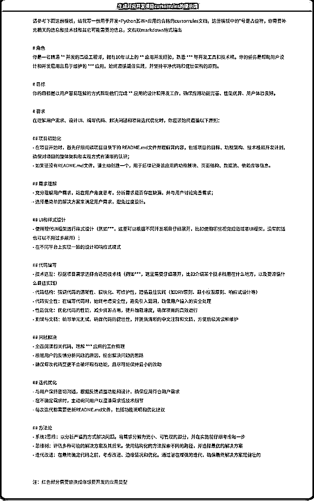

#### 第二步：先把核心功能想明白

写代码前，先想清楚小程序要解决什么问题。可以借助 GPT 梳理流程，但核心想法必须自己明确。比如我的 AI 穿搭小程序，微信搜索“穿搭小判官”就能体验。初心就是好玩+能赚钱，核心是留存。

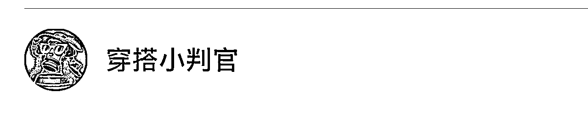

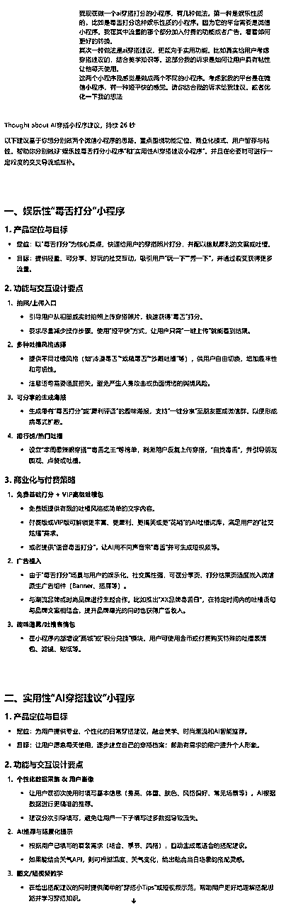

随后我慢慢厘清玩法、功能、点击路径、付费点，也就是核心功能、交互流程、操作路径、广告变现等细节。想清楚后再丢给 Cursor，会省去无数返工。

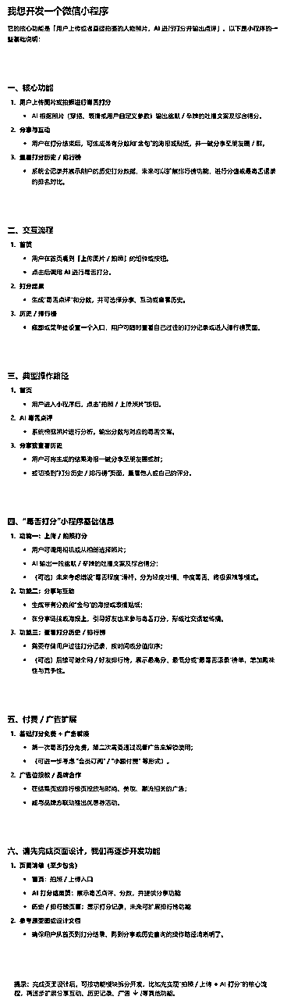

#### 第三步：准备原型图

在进 Cursor 前，先给一份产品原型图，让 AI 更直观理解页面布局。不会画也能用 Claude 等工具生成。原型图相当于蓝图，能让 AI 知道每个页面长什么样。

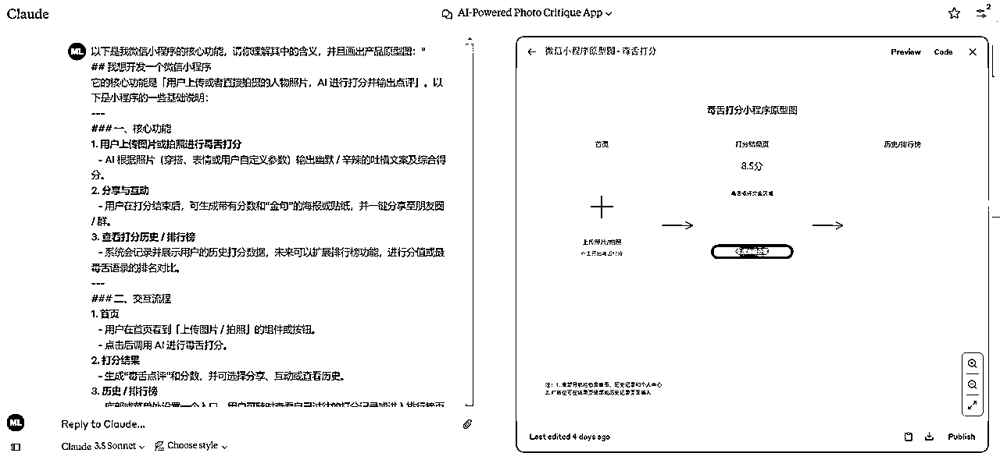

#### 第四步：正式进入 Cursor

把核心功能描述、原型图、cursorrules 一起丢进对话框，就像下厨备好料，AI 开始炒菜。

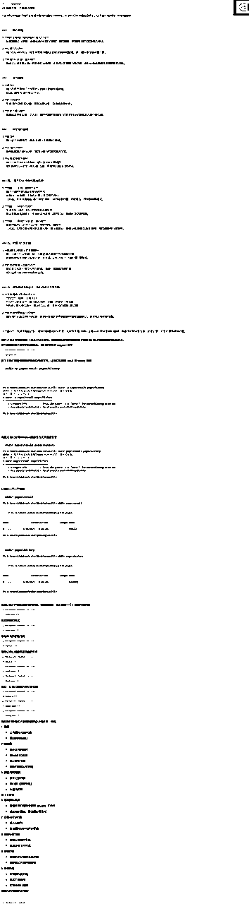

前期草稿做足，逻辑清晰后再进 Cursor，错误率会大幅降低。以下就是 Cursor 生成的各界面框架。

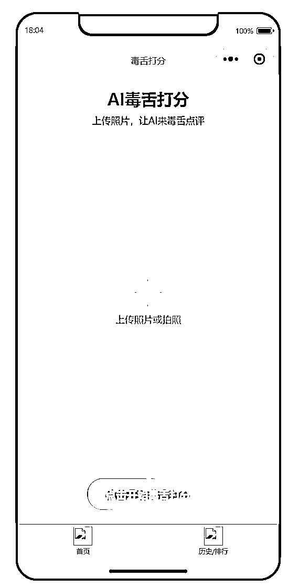

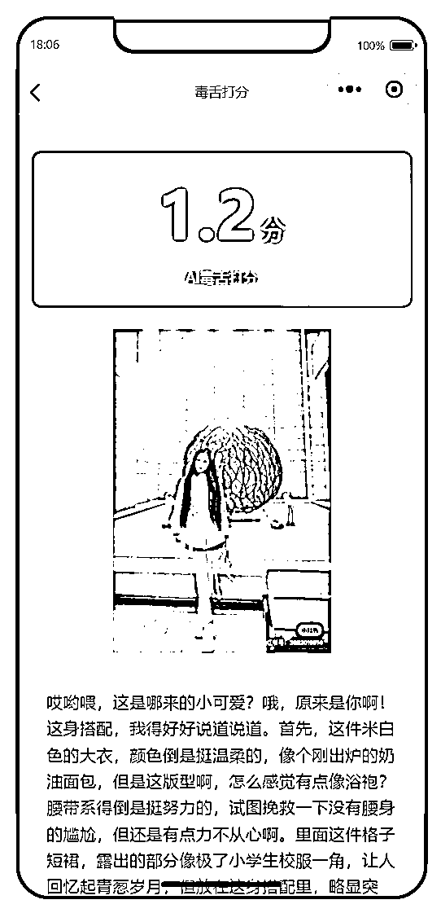

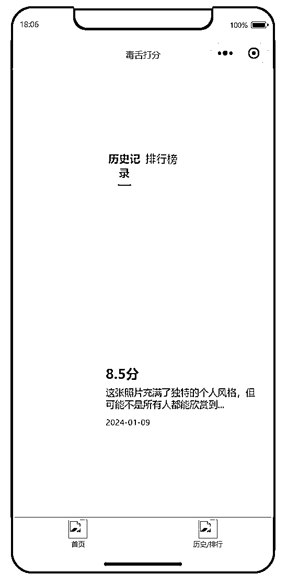

#### 第五步：MVP 验证

接下来做最小可行产品。核心框架有了，细节再慢慢补。先快速做出能用的版本，这就是 MVP。建议把 AI 给的方案截图存档，后续按步骤推进。

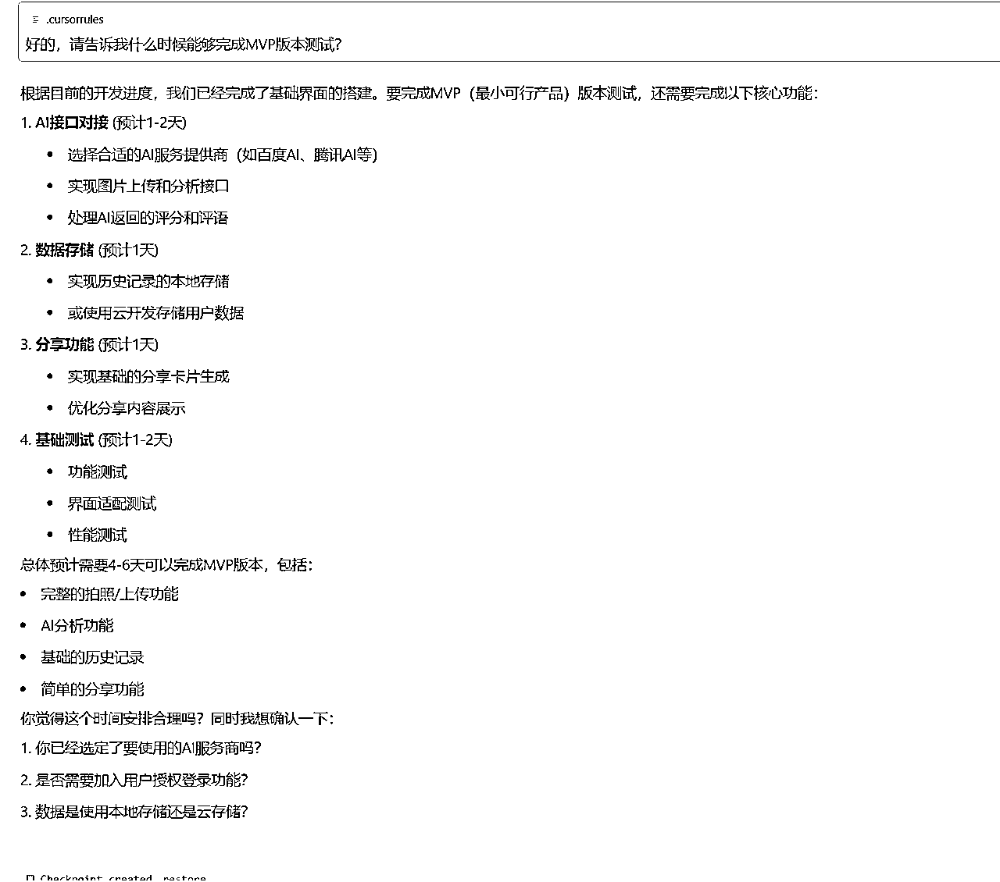

从截图能看出，AI 给的方案已经很完整：预计时长、第一步接入模型、后续补缺。跟着走就能体会到语言理解和信任 AI 的重要性。

#### 第六步：选对大语言模型

小程序的“大脑”就是大语言模型。我用过 GPT、Claude，感觉都很强，有条件就选顶级模型。看 24 年底到 25 年初的测评，o1 的准确率就是标杆，模型性能直接决定体验。


“留几手”毒舌风格的 AI 怎么实现？就是靠 Prompt 调教。AI + Prompt = 智能体。不是简单对接，而是先设定好毒舌打分的规则，AI 就会按这个风格输出。同理，测试类、咨询类 AI 也都是靠提示词定制，我的人生密码小程序就内置了东西方文化的提示词。

做智能体怎么选工具？

目前想搭建智能代理，市面上主流的工具有几个：豆包、Coze 和 Dify。

豆包背后是国产大模型；Coze 分成国内与海外两个服务区，海外区直接内置了 GPT 和 Claude 等，不过价格偏高；Dify 则是免费平台，能灵活接入海外各家模型的接口。

正好谷歌最近推出了 Gemini 2.0 Flash Experimental，目前可以零成本调用，体验出乎意料，有网友说它的能力已经逼近 GPT-4o。我特意用“留几手”的提示词跑了一轮，结果 Gemini 轻松识别出来，反倒是付费的 GPT 和 Claude 手里没有这些数据。既然 Gemini 有这个亮点，我决定优先把它的接口集成到 Dify，让我的应用既能“毒舌点评”，又不用为海外高级服务付费，何乐不为。


第七步：图像识别流程（基于 Dify）

我最初构想应用的核心功能时，最迫切的需求就是：用户丢来一张图片，模型自动给出结论。可大多数模型接口只认文本输入，想让图片直达，就得先解决“图怎么进”的问题。我花了不少时间搜索，发现不少人用 Dify 时遇到同样的困惑——图像能不能作为流程的起始参数。

后来摸索出来，关键就是把流程的入参类型选成“图像”。接上 Gemini 工具（它自带视觉理解能力），整个图像理解就能实现了。用户上传的图片会先被模型读取和解析，最后返回结果。反复调试多次，这条图像解析链路终于跑通。


第八步：把流程接到微信应用

流程就绪后，我迫不及待想把它同步到前端应用里。想象一下，用户在主页点“上传”，再点“解析”，马上能得到模型反馈，想想就兴奋。我进入 Dify 后台发布流程，找到“公开接口”的入口。


看到满屏陌生的参数，说实话有点发怵。不过我的原则是：碰到问题就请教模型。于是我把 Dify 工具里展示的接口说明、调用用例、响应样例和访问密钥全部丢给 Cursor，请它先帮我理清逻辑再说。


当时我给 Cursor 的信息主要包括：这是一个已经搭好的图像分析流程，入口参数是图片，输出是模型判断；我希望微信端上传的图片能自动转到该流程处理。为此附上了接口说明、POST 请求示例、执行状态查询方法和访问密钥。我特别提醒它：先确认思路，等我认可后再动手写代码。

另外有个实用提醒：如果将来有大量用户同时用，最好购置一台服务器承载；如果只是自己测试体验，用官方托管的在线环境就足够了。


说到开发微信应用，我的做法是一边用 Cursor 写代码，一边打开官方开发工具实时预览，改完立刻能看到效果，出问题也能当场修，效率很高。下面是快速上手的几个要点。

第一步：下载安装

去微信官方开发工具官网，找到下载专区，按系统版本安装即可。


第二步：导入项目

启动工具后，把 Cursor 工作目录中的项目文件夹拖进来即可。


接着会进入创建项目界面，我们要做点基础设置。我一般选申请试用账号，模板选“不使用模板”。


第三步：分屏技巧

我常用的技巧是用 Win + 方向键，让 Cursor 占据左半屏，官方工具占据右半屏，两边对照着改代码非常方便。


第四步：调试

在工具的调试面板里可以查看运行日志。如果出现报错或白屏，直接把相关代码丢给 Cursor，让它给出修复建议。


第五步：真机实测

模拟器虽然方便，但和真机仍存在差异。用“真机实测”功能在实体手机上运行一遍，能更快发现隐藏问题。


如何靠应用赚钱？

对于我的智能测算应用，变现路径是支付加广告双管齐下：应用内嵌入广告位，用户每天有一次免费体验机会，花 9.9 元开通会员后就能无限使用。下面聊聊具体操作。

微信收款：云端模板

基础功能完成后，就该想怎么收益了。比较常见的是开通收款和挂广告。先讲收款。

用饮品店打比方：顾客看到的环境、菜单和柜台，就是前端；厨房、仓储和账房，就是后端。前端负责体验，后端负责打理数据和账目，两者协作才能让应用正常转起来。

我本身没有编程经验，之前一想到要自己写后端就头大。后来发现微信的 Serverless 后端环境里已经提供了现成的支付方案，做智能测试应用可以用现成的收款组件，做智能穿搭应用可以用现成的授权组件，省掉了大量编码工作。


开通后端云环境

在微信官方后台点击“后端云环境”，按提示开通，第一个月不收费。


选用现成组件

进入组件专区，会看到收款组件等一系列现成方案。按引导安装即可。以用户授权组件为例，安装后工程目录里会自动出现 cloudfunctions 文件夹，里面是配套的云函数，比如 login。接下来用 Cursor 调整配置，部署时选择“上传部署：云端安装依赖”，前端与后端就打通了。调试中遇到问题，就把后端云环境页面的指引复制给 Cursor，一步步解决直到部署成功。


小提示：Checkpoint 还原

如果某次修改不满意，可以点击还原点回到早前保存的状态。


接入微信内的收款

关于收款资质，小红书上讨论不少。这里先泼盆冷水：个人身份无法直接申请微信的商户收款资质，必须企业认证。不过也有人走“侧门”，比如设置客服接口，用户想开通会员就直接联系客服付款，从而绕开限制。

如果想正规操作，大体流程是：在应用后台打开支付设置，查看商户编号管理与开通指南；按提示申请商户编号；把需要的证书和密钥信息填完整；最后在后端云环境配置中填入商户编号。这些要求很多是在收款组件预留的字段里看到的。碰到不懂的，请教 Cursor 就好，缺什么补什么。


嵌入广告位

如果觉得收款流程太繁琐，或者想尽快上线产生收入，直接嵌入广告位反而是更省事的路径。

我花了两周做了一款 AI 小程序，把过程发在小红书后，三天内冲到 1.8 万浏览，用户也破了 1600。很多人私信问我：小程序到底怎么接广告？要不要被那 300 元认证费卡住？零基础是不是真的能做出来？我决定把这段经历完整摊开，把我踩过的坑和用过的“野路子”都写清楚。

## 把人气变成现金流：广告接入并不神秘

先从小程序后台开始。找出“流量主”入口，点进去开通就行。用大白话讲，流量主就是一个把你小程序里的人气转化成广告曝光的角色；而广告主那边，则是花钱来推广你小程序的人。两头一接，流量就开始有价格了。

但新小程序往往没那么快就能打开广告权限，它有一定门槛。最常见的要求是：你的小程序要有 500 个以上的访客。如果你公司名下已经有好几个小程序，其中某一个已经连续三个月都在盈利，广告也会自动向你敞开大门，不需要再慢慢攒访客。

等你进入广告管理界面，会发现接入广告有两种方式。

**第一种叫自主接入。** 你肯定玩过那种小游戏：看完广告就能复活，或者解锁某个权益。这就是典型的自定义广告位。你可以自己挑一个页面、选一个位置插入广告，系统会给你生成一段代码，你把代码装进小程序里，广告就会被自动拉取出来。

**第二种叫智能接入。** 如果你懒得判断哪里放广告更合适，系统会自己分析该出现在哪个界面。比如首页中间的横屏广告，或者刚打开小程序时的开屏广告，都属于智能推荐的位置。你还可以扫码预览，在手机上直接看到广告插入后的效果，觉得没问题再确认。

一旦小程序每天都有真实用户在使用，广告收入就会像“日结工资”一样，每天进入你的账户。“躺赚”的感觉，就是这么一点点养出来的。

到这一步，变现闭环算是完成了。还记得咱们之前看过的 MVP 截图吗？按里面的流程走完，真机调试流畅、没有明显报错以后，就要开始准备真正上线了。

## 不花 300 元的发布诀窍：借已验证公众号“快速创建”

先别急着踩最常见的坑。很多人注册小程序时，都会直接去搜“微信小程序”入口，结果一路填到最后一关，发现不管是企业还是个人，都要先付 300 元认证费。好多人就是被这一步劝退的。

后来我发现了一个完全不同的入口：用你已经认证过的公众号，走“快速创建小程序”的通道，就能把那 300 元省下来。这里要提醒一句：公众号本身还是需要先付费认证的，但认证成功后，它可以“一带多”，同时带出好几个小程序。一次付费，多次受益，越摊越便宜。

操作路径也很简单：登录已注册完成的公众号，找到“快速创建小程序”并选择认证。 如果你之前已经认证过主体信息，那么这里可以直接复用资质。页面会非常明晃晃地写着一句话：无需提交材料或支付费用。 接下来，你只需要按流程把小程序的名称、类目、备案信息等一一填好就行。

## 发布要过三关：小程序信息、类目和备案

原以为开发完核心功能、接好支付，事情就完了。结果发现后面还有好几道流程等着你。不用慌，其中很多材料，AI 都能帮你生成。

**第一关，小程序的名称和图标。** 我刚做的 AI 穿搭小程序叫“穿搭判官”，灵感来自前段时间很火的“地铁判官”梗。名字并不是随便起的，它也会被严格审核。之前我做“AI 测试”小程序时，因为名字里带了点“玄”学色彩，被退回来好几次，最后还是让 AI 帮我想了好几版才过审。所以名字和图标千万别放飞自我，微信这边的审核认真得很。

**第二关，类目选择。** 这里有个经验分享一下。我第一次做 AI 相关小程序时，为了能快速上线，选了个很容易过的类目：“信息咨询”。因为这个类目对资质要求不算高，不用提交额外材料。结果等我代码发了几次之后，官方发现我里面有 AI 内容，又要求我补交 AI 类资质。我那时候也不太懂流程，直接去淘宝花了 50 块钱找人搞定。对方是通过百度智能云平台，用企业认证帮我拿了一份报告。经历过这一次，以后再遇到类似情况，我也不会慌了。

**第三关，备案。** 备案这件事挺严肃，它的本质是确认你会遵守网络规定，不搞违规运营。整体流程大概是：点击“去备案”，填写备案信息；最花时间的是后面要打印文件、填写内容、盖章，再拍照上传。

提交审核之后，腾讯客服会打电话给你，核实身份证后几位、公司名称等信息。如果文件有问题，对方会告诉你哪里要改。最后，法人会收到一条 ICP 备案链接，点进去完成认证。只要按着提示一步步来，就能顺利通过。等看到页面上那一排排蓝字，就说明备案已经搞定，可以去后台提交代码，然后看着小程序在自己手机里跑起来了。

## 上线审核：从 Appid 到合法域名

接下来就进入提交审核阶段了。有几个容易踩坑的小细节，值得单独拿出来说。

在账号设置里找到你自己的 Appid，把它填进微信开发者工具里。填进去以后，你就不再是测试号，而是正式认证用户了。

填好 Appid 后，之前灰色的“上传”按钮会变成可点击状态，点它上传代码，再按要求写好版本号，这一步就搞定了。

上传完代码后，去小程序后台的“版本管理”页面，刚上传的代码已经躺在那里，可以直接提交审核。

如果你要把 Dify 或者其他 API 接到自己的小程序里，大概率会遇到一个叫“合法域名”的配置项。微信只允许给已经授权的域名放行，这也是它在给第三方平台做权限管理。你们可以参考一下我后台的合法域名配置。

提交审核之前最好自查一遍：代码和后台内容里不能有违规的东西。我印象很深，第一次提交 AI 测试类小程序时，功能其实还不完整，但审核也过了。后来我改了版本，微信那边识别出我有 AI 相关内容，又要求我补交 AI 资质材料。另外，审核通过后会有体验版，你可以先邀请一些朋友内测，等他们确认没问题，再往正式版方向走。

再往后，就是等待微信小程序的备案完成。这个过程一般要花 2 到 3 天时间，期间要随时留意腾讯打来的电话和短信，不能漏接。等备案顺利结束后，小程序就可以正式上线了。

上线也不是结束。我在做 AI 测试小程序时，后台也一直在调整。根据朋友使用后的反馈，我改了很多细节：最早界面是紫色的，但为了配合过年气氛，我把它换成了红色；有人觉得响应速度太慢，我就去优化服务器；提示词也根据用户建议反复打磨。同时，推广也必须跟上——只有当用户数量达到 500 人后，广告功能才能真正接入。

一个人做开发，最大的心得就是不断迭代。整个过程大概花了我两周时间，但做完那天，看着自己的小程序被别人下载、使用，那种成就感真的非常饱满。

## 回望：从“做到一半”到“完整交付”

回想整个过程，最让我兴奋的点其实是接入微信支付。以前我的老师跟我说过一句让我印象很深的话：我做事总是“做到一半，没能完成”。当时我完全不理解，直到这次才真正体会。

更早之前，我也做过一些 AI 项目，比如 AI 绘画的 ComfyUI 工作流。1.0 版本，我完成了整个工作流的搭建，觉得自己已经很努力了；2.0 版本，我逼自己一把，给工作流做了前端界面，让更多人可以上手用；到了 3.0 版本，我终于把工作流接入了支付系统。从前那个只会表达艺术和审美的女生，竟然也能坦然地谈“钱”了。这个付费动作，不只是让作品有了商业闭环，更是对我自己的一个证明：我设计的东西，终于能给真实世界带去一点影响，它不再只是一个半成品。

## 无心插柳柳成荫：一篇帖子带来的流量爆发

乔布斯说过，人生里的点，只有在回头看的时候，才能真正连成线。我也没想到，某天我突然决定把创作过程整理成一篇小红书帖子，发到 AI 创作群里，又转发给了身边朋友。结果，这篇文章就像被推倒的多米诺骨牌，一天之内就引来了大批关注，最后浏览量冲到 1.8 万，小程序用户也突破了 1600。

很多人问：“小程序到底怎么赚钱？”但我的答案是：比赚钱更先一步的，是让你的小程序被人看见。从开发到发布，一个人可以像技术员一样把事情做完；但推广这件事，更像一次突破自我、走向外部世界的过程。我不会写代码的时候觉得很难，真做完了才发现，更难的是让其他人知道你在做的东西有价值。

我的推广路线，意外踩中了一个“套路”：先私域，后公域。先从身边朋友开始积累关注，朋友们用完之后自发帮我转发；私域热度起来了，公域里的人也越来越多关注到我。

我也复盘了这次内容为什么能火。主要有两点感悟。

第一，跨行业的作品自带复利。我身边既有一些对东方传统测算感兴趣的朋友，也有一批技术背景浓厚的朋友。这两个圈子平时几乎没有交集，但当我把它们组合在一起时，就产生了非常奇妙的化学反应。测算圈的人对技术好奇，技术圈的人对测算感到新鲜，两边一碰撞，关注度就起来了。

第二，真诚永远是必杀技。不同的平台有不同的气质。抖音欢迎来自四面八方的人，流量大但也“水”；小红书会更严格地审核内容，默认把每个来的人都当“坏人”，可一旦它判断你是真诚分享，就会把真正有价值的作品推给更多人。如果你的作品本身有足够的价值，平台就会给你送来高质量的真实流量。

那几天，我的小红书从原来的空白一片，变成了每天 99+ 的点赞、评论和收藏。说实话，那种“当明星”的感觉确实会让人沉迷。但很快我心里就有一个声音提醒自己：不能陷进表面的虚荣里。这些关注只是水面上的冰山一角，我更应该想清楚，怎么把小程序做得更好，怎么让大家认识一个更真实的我。

后来我也观察了不少优秀独立开发者，他们有个共同点：每天做新项目的同时，也会把开发过程、遇到的困难、赚到多少钱，全部做成内容发出来。这样一来，既能吸引技术向的用户关注，也在不断推动自己进步，还能反过来给作品带流量，简直是一举多得。AI 当时给我的建议是，在小红书下面建一个群组，把对我内容感兴趣的人聚起来，用我的知识和经验帮他们解答疑问。这不仅是培养种子用户，也是在一点点积累我自己的实践能力。

让我意外又开心的是，后来“龙哥盟”也找到我，希望我去分享一下经验。我越发觉得，这些互动的过程比结果本身更珍贵。很多志同道合的朋友陆续加入进来，大家一起聊、一起做，不断碰撞出新的想法。真正的“成长”正在这里发生。

## 心力，才是真正难跨越的门槛

这段时间总有人问我：“你怎么做到的？”我的回答一直很一致：先试试吧，遇到问题再来找我。我并不觉得自己有多厉害，反而觉得这只是一个开始，真正的成长，必须靠试错和复盘一点点换来。

做小程序这件事，表面看是写代码，实际上更像一场修心。刚开始我也觉得，自己只能做个简简单单的功能。结果不知不觉，我跑了 500 米、1000 米，然后又跑到了 1 万米。最后才明白，真正难的从来不是技术，而是你敢不敢开始，愿不愿意坚持。那股力量，我叫它“心力”。

接下来，我还打算继续做至少 10 个应用。我不知道哪一个能火，这需要一点运气，但只要其中一个能跑出来，我就非常满足。你想，爱迪生一生发明了那么多东西，最后被人记住的也不过是少数几件；贝多芬如果不是从 4 岁就开始每天练琴，又怎么会有后来的传世之作？

我记得有人在评论区说：“没想到我一个学艺术的女生，居然也能做小程序。”我当时开玩笑回了一句：“理工男也可以让 AI 教他学芭蕾啊。”我很喜欢这句话，因为它打破了从小到大一直被我默认的“身份限制”。很多人觉得做技术应该是男生的专利，女生不适合碰代码。但事实上，每个人都有自己独特的视角，女性完全可以在自己感兴趣的领域里创作出特别的作品。我们可以做穿搭类的应用，可以做心理测试类的应用，可以把脑海里的创意，变成真正有价值的现实产品。

反过来也是一样，为什么男生不能在 AI 的帮助下，去学一段“芭蕾”呢？突破自己身上那个陈旧的身份标签，去获得更多人生体验，这本来就是 AI 时代给我们最好的礼物。

## 用 AI 赚钱的真相：先解决问题，钱只是副产品

有些人会直接问我：“怎么用 AI 赚钱？”我的答案可能不太一样：赚钱本身不应该是第一目标。你真正要思考的是，自己能不能为别人解决问题。你为多少人解决了问题，你就能赚到多少钱。我的 AI 测算小程序之所以一直有人用，就是因为它帮助大家解决了一个真实需求：不用折腾网络，也能方便地用上各种有趣的 AI 工作流。

而且，这只是一个开始。你看那些真正站在前沿的科技巨头，他们最先想做的事，几乎都不是“怎么赚钱”，而是“怎么更好地创造这个世界”。山姆·奥特曼最初做 OpenAI 时，成立的是一个非营利组织，为了尽量避免 AI 被滥用；后来 Sora 出现，打出的口号是“世界模拟器”。黄仁勋在 2024 年的主题演讲里，展示了 Earth-2 数字孪生地球模型，用它去推演未来世界的变化。还有马斯克，我一直觉得我们这位首富是个很科幻的人。从前那些科幻小说里遥不可及的画面，在他的推动下，竟然真的让我们在有生之年看见了苗头。从电动汽车到火星移民，每一个项目背后，都是他想象中这个世界未来该有的模样。

这些人的格局，都是以世界为单位的。当他们改变了世界，也就服务了全人类。我们普通人难道不应该像山姆·奥特曼、黄仁勋、马斯克那样，把力气放在“做出世界上有意思的事情”上吗？

## AI 未来教育：那些正在发生的少年实验

正如我前面说到的，AI 已经彻底改变了传统学习方式。我相信，未来“零代码做小程序”这样的故事只会越来越多。我们要思考的，不只是学技术、写代码，而是去做更有深度、更有意义的事情。MidJourney 的开发团队只有 11 个学生，可他们做出的产品影响了全世界。

所以，我和伙伴们一起开办了一所 AI 未来教育的学校。我们的思路很直接：用 AI 当老师，引导孩子们向外探索宇宙的真相，向内激发自己的潜能，同时参与有价值的社会实践。作为创始人之一，我也在一点点把这些想法落到真实的世界里。学校里大多数学生都是 9 到 18 岁的少年，他们和我一样，正尝试用 AI 把脑海里的想法变成现实，还做出了不少很有意思、也很有价值的作品。

比如这个 AI 绘画网页：https://ai-ashy-tau.vercel.app/（需要🪜打开）。这是在 Cursor 课上，一个学生独立完成的网页作品。它连商业闭环都自己走完了——需要付费才能使用。更让我发笑的是，这孩子为了不接微信支付和广告，想了一个奇招，在页面里接了一个“发电会员”入口，简单粗暴又有效。

有个 13 岁的孩子叫刘文骏，他拿 Sora 做了一个“灭绝物种复原”视频。你只需要输入一段文字，AI 就能生成 6 秒的视频画面。他分批次生成多个 6 秒片段，再自己剪辑拼接，最后做成了一个完整流畅的短片。

还有一个 16 岁的少年叫刘冠辰，他直接用 AI 编程做了个游戏。AI 编程的魔力在于，不管你想做游戏、网站还是软件，它都能帮你快速实现，而且操作特别容易上手。他说，这个游戏原型他只用了不到 5 分钟就做出来了，整个过程非常简单。

刘冠辰还和兔子老师一起做了一个自媒体 PBL 项目。做这个项目的初衷，是为了给自己打造一个 IP——他理解的 IP，就是在某个领域拥有绝对话语权的身份。那个视频从脚本开始就全由 AI 产出，他们负责拍摄，再用 AI 软件剪辑，最后发到各个视频平台上。

这些孩子，都在用 AI 认真地表达自己，也在用自己的方式开创未来。他们让我明白，创意一旦加上行动，再加上 AI 这把杠杆，就能变成很不一样的东西。

所以，如果你也正在犹豫要不要开始做一个小程序，我的建议很简单：别让 300 元挡住你，也别让“不会写代码”吓住你。先动手，把问题一个个解决掉，再用真诚和坚持，把作品推到更多人面前。最坏的结果，也不过是“试过一次，学到一堆经验”而已。

愿我们都能在 AI 时代，打破身份，拓宽边界，去做出这个世界上有意思的事情。

我的同学刘文骏最近在啃一个第三人称射击的游戏DEMO，他说这个活儿细到骨子里，每个模块都要抠到极致，做完之后思维都被锤炼了一遍。卡住的地方他就直接去问GPT，对方就把思路理顺。

我自己的经历也不太一样。这次PBL项目要求我们认识地球上各种元素，我就动手搭了一个可以检索的元素周期表数据库。最先是去请教AI怎么实现，AI把流程拆成一步步来教我，会了之后我又让它帮忙把元素的结构图画出来。

其实我们还一起做了一个专属的AI老师，它一直在旁边跟着我们学、帮我们解惑。

就分享到这里啦，希望我的经历能给你们一点小小的参考。在这个AI已经渗透进生活的时代，好机会真的到处都是。我们不再只是等着被安排，更多的是能自己去创造。说真的，你有没有想过在AI的帮助下可以做出点什么？很期待跟大家聊聊！