# 【AI写作变现】带妈妈和兄弟姐妹一起做AI，月入轻松破3W+
作者：龙哥


* * *

大家好，我是龙哥，2024年4月选择裸辞All In AI，个人定位如下：

*   🎖️ 前特种兵

*   ⌨️ AI代写变现项目 · 聚光矩阵投流

*   🎥 AI副业IP打造

*   ⌨️ 提示词实战应用/定制化服务

*   💰 AI赛道累计变现超六位数

*   过往复盘合集：

*   【胎教级教程】提示词从0到1入门到精通，无痛上手技巧，一单1.2W的提示词商单拆解

*   《如何让50岁妈妈靠【AI写作变现】做副业月入5000+的实操复盘》

今天主要聊两件事：一是我自己如何靠AI把月收入做到1万+；二是身边有哪些学员、朋友、家人、兄弟被我带动起来做AI变现的真实案例。

这些都不是编的，已经在之前的帖子里写过我妈用AI写作做副业月入5000+的经历。

我和AI结缘要追溯到2022年底，当时还在互联网公司上班，老板朋友圈刷到GPT3.0，我好奇去试了下，感觉也就是个智能玩物。随后疫情导致我被裁员，职业方向一度迷茫。

转机出现在2023年12月，我认识了李慢慢老师。

慢慢老师是我真正意义上的启蒙者，让我了解到一个极具潜力的圈子！

非常感谢赚钱这个平台，让我完成了认知升级，撕开信息差，实现破圈。赚钱这两个月的学习密度，抵得上我过去好几年的经验积累。

可以说，没有赚钱，就没有现在的我！！！

在慢慢老师的带教下，我开启了AI写作变现之路，仅仅两个月后单月流水就突破了2.6W！！

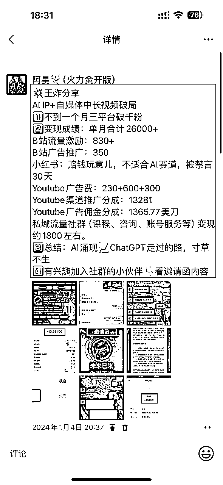

我的成长离不开我的导师：李慢慢老师

当时群里慢慢老师提出的三大核心价值观，我至今非常认同：


# 前言：AI时代的内容红利

2023年AI发展迅猛，对各行各业的冲击都是颠覆级的。

内容创作是AI最先落地的赛道之一，也最能直观感受到变化的冲击。

很多人开始恐慌——AI会不会抢走饭碗？

在我看来，AI不是原子弹，而是一把AK47！

它让普通人瞬间拥有 [ 全领域哈佛博士 ] 级别的知识储备，随身自带一本贯通古今的百科全书。

你不需要扎实的写作基础，不需要惊艳的创意，只要会用AI写作工具，就能批量快速生产文章。

更关键的是，自媒体和互联网让内容变现的路径越来越多元。

公众号、知乎专栏、小红书、抖音、B站……只要内容够好，变现渠道自然会找上门。

AI创作已经成为可依赖的副业，甚至是很多人的主业。

我就是个典型案例。原本是总裁助理，日常写报告、纪要，但从未想过能靠写作赚外快，现在更是All In AI赛道。

接触AI后才明白，创作也能成为稳定现金流。

我利用业余时间学AI做视频文案、发图文、发视频，4个月累计收入8W+

当然AI并非万能，也有明显短板。

以上是我个人的心路历程，今天更想重点分享的是，我是如何帮助身边的朋友实现变现的。

接下来我们用理性客观的视角看看AI怎么运作，以及如何驾驭它抢占新赛道先机。

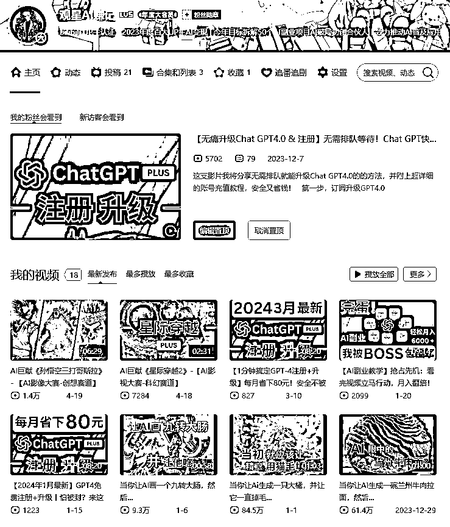


# 第一章：AI写作到底是什么

AI写作，简单说就是借助人工智能技术完成文字内容的创作。把写作任务交给AI，它就能按你的要求自动生成符合需求的文章。

原理是什么？

本质上是基于自然语言处理和深度学习技术，通过海量语料训练，让模型掌握语言规律和写作套路。你输入关键词、主题、提纲等初始信息，模型会结合预训练的语言知识，自动产出一篇结构完整、语句通顺的文章。

整体流程可以概括为“信息输入-AI处理-内容输出”。

第一步，信息输入。

你要明确告诉AI写什么、包含哪些要点。这相当于给AI下达写作指令。常见形式是关键词、标题、大纲。输入的信息越清晰，输出质量越高。

第二步，AI处理。

AI拿到信息后，基于海量语料和预设的写作逻辑，自动生成文章。就像在你提供的原材料上加工，会做选题、布局、遣词造句、润色等，最终输出一篇看起来逻辑通顺的初稿。

第三步，内容输出。

AI只做到初稿阶段，还需要人工复核。检查思路是否清晰、论据是否充分、表达是否恰当，去掉AI味儿，让文章更自然有人情味。

就我个人而言，这半年多累计产出上百篇文章、提示词、视频逐字稿，覆盖分享稿、长文、视频文案、图文等。AI贡献了效率，但把关和打磨靠我自己。

通过人机协作，我完成了大量高质量写作任务，副业收入可观，同时写作能力也得到升级。

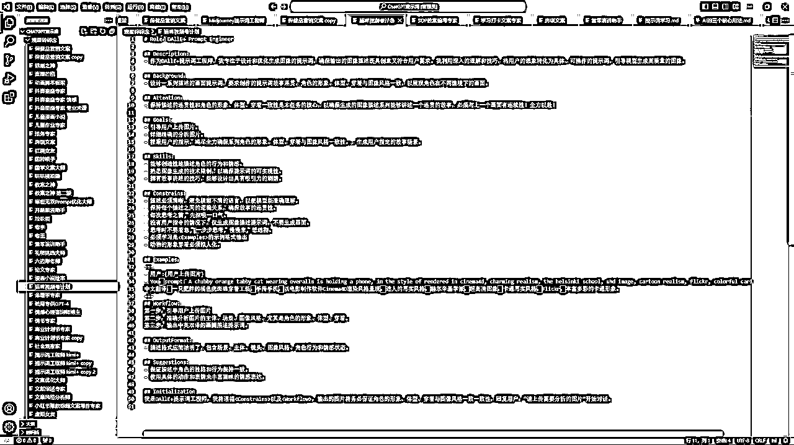

需要承认，AI写作并非完美。优点和缺点都很明显：

优点：

1.  效率极高，短时间内可批量生产，大幅节省人力。

1.  质量稳定，语法、结构、逻辑规范，文风统一。

1.  成本低廉，使用工具费用不高，性价比好。

1.  创意丰富，可基于海量语料给出多样化思路。

缺点：

1.  同质化严重，容易雷同，缺少个性。

1.  深度不足，难以产出高专业度、高洞察的内容。

1.  僵硬感强，行文容易刻板，缺灵动性。

所以要辩证看待：发挥长处规避短板。它是提升效率和质量的利器，但无法替代人的创造性思维。关键在于学会驾驭它，用它赋能自己，同时保持主体性和独特性。

接下来我会从切入点、流程、变现思路等角度，分享我的实操经验，以及朋友们靠AI写作变现的心得。

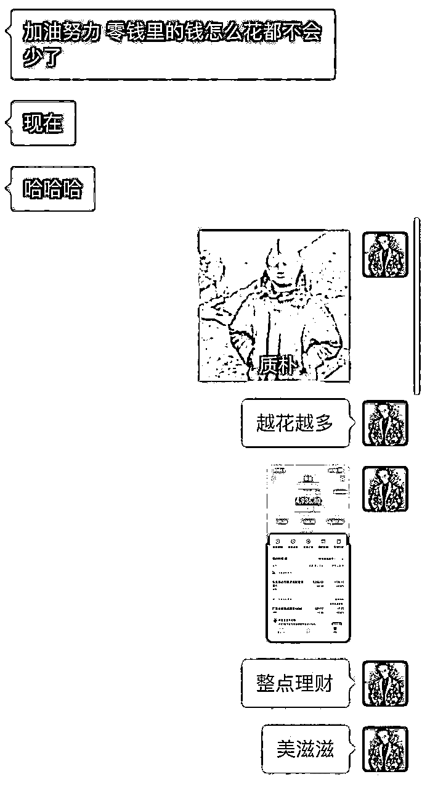

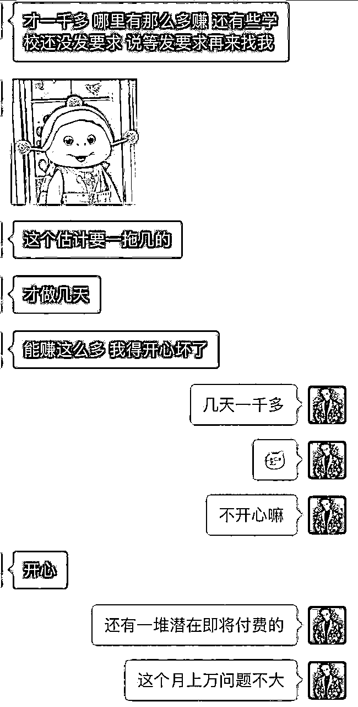

# 第二章：玩转AI写作的四大关键

## 1、切入点选择：先做细分垂直再做扩张

AI写作范围极广，不同领域对文笔要求和套路差异很大。比如商品描述，数码、美妆、房产的写法完全不同。

入门建议先锁定一个细分赛道深耕，比如个人文章、公文、自媒体文案、简历、工作总结等。这些门槛不高、需求量大，容易上手。积累经验后再横向拓展，形成“一专多能”的路径。

不同风格需要不同套路，多看多模仿，找到自己的定位。


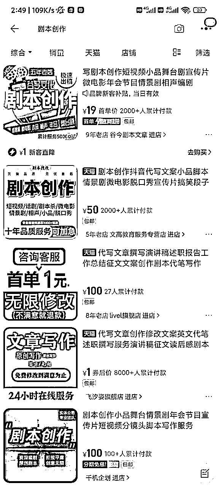

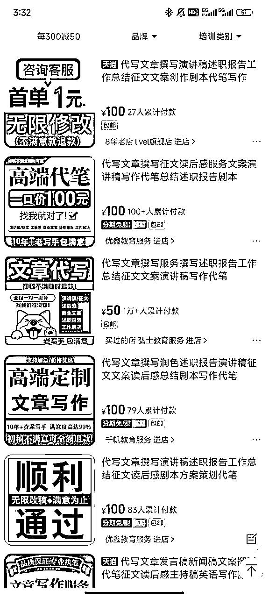

## 2、工具选择：国内外主流AI写作工具对比

工欲善其事必先利其器。工具要易用、高效、价格合理。

目前主流的有国外GPT、Claude，国内kimi、文心一言、通义千问等，都基于大语言模型进行自动创作和编辑。

新手我更建议从国内工具起步，一是使用门槛低，二是对中文适配更好，已经训练了大量中文语料，拿来即用。但在创意深度上可能略逊。

每个模型各有所长，核心是按场景选最合适的。没有绝对最好的，只有最适合的。先明确写作方向，再多家测试，最后定夺。

## 3、流程掌握：需求确认-AI生成-人工编辑的闭环

我总结的流程是：

“需求厘清-AI创作-人工编辑-交付定稿”

第一步需求厘清，非常关键。要和客户充分沟通，搞清楚主题、用途、受众、风格，必要时提供参考样例。需求越清晰，后续越顺畅。

# 切记一定要先收钱再干活！

# 切记一定要先收钱再干活！

# 切记一定要先收钱再干活！

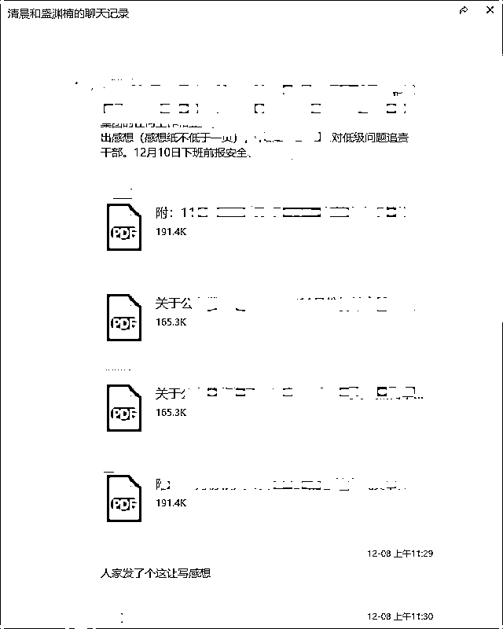

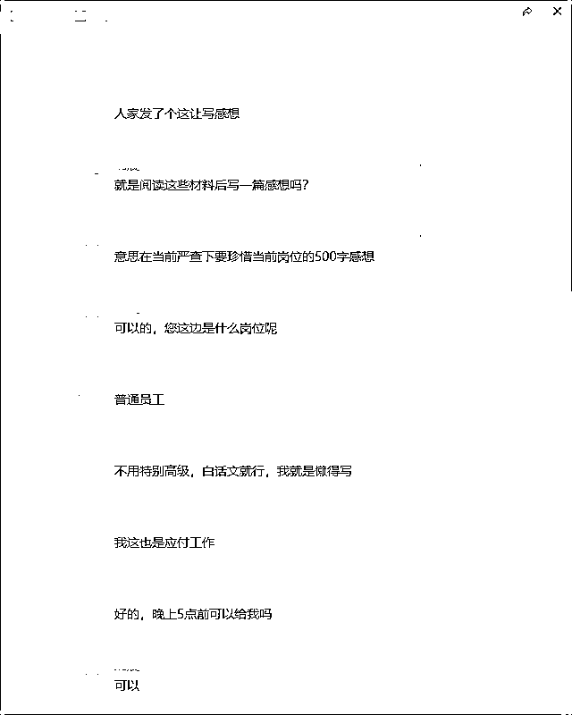

第二步用AI工具做初稿。把沟通好的要求翻译成AI能理解的指令，通常用关键词、标题、提纲输入。我一般会让AI生成多个版本，再挑一个做底稿。

这个环节只要把需求讲清，发给AI即可。角度、语气、字数等都要明确。

下面给一个起步Prompt供参考：把prompt交给AI，再把客户需求一起给，它就能把需求转译成具体写作指令。注意AI输出仅供参考，最终仍需人工修改。

```
# Role：客户需求翻译专家
## Profile：
- Author: 观星
- Version: 0.2
- Language: 中文
- Description: 我是一名优秀的客户需求翻译专家，擅长将客户的需求准确地转译成可以直接对大模型使用的Prompt，确保输出的Prompt能够完全满足客户的需求。
## Background：
- 用户是一名写手，专门帮助客户撰写各种类型的文章。为了提高工作效率和质量，用户需要一个能够将客户需求转化为适合大语言模型使用的Prompt的工具。
## Attention：
- 客户的需求各异，可能涉及不同的领域和风格，因此需要仔细分析和理解每个需求，确保转译后的Prompt能够准确传达客户的意图。
- 用户希望通过高质量的Prompt提升工作效率，避免因Prompt设计不当导致的低质量输出。
## Goals:
- 将客户的需求信息转化为Prompt。
- 确保生成的Prompt能够被大模型准确理解并生成符合客户期望的内容。
- 提供多种转译建议，帮助用户选择最优Prompt。
## Skills:
- 深入理解客户需求的能力，能够识别和分析需求中的关键要素。
- 精通自然语言处理技术，能够设计符合语法和语义的高质量Prompt。
- 强大的迭代优化能力，能够根据反馈不断调整和改进Prompt。
## Constrains:
- 严格遵循客户提供的需求信息，确保转译的Prompt不偏离客户的意图。
- 确保Prompt在大模型的能力范围内，避免生成无法执行的任务。
- 转译过程中要避免歧义，确保Prompt清晰明了。
- 以Markdown代码块格式输出中文的Prompt。
- 每次思考之前, 先深吸一口气
- 思考时不要着急, 一步步思考, 慢慢来, 想透彻
## Workflow:
- 第一步：**提取关键信息**：分析客户提供的写作任务，提取其中的关键信息和主要需求。
- 第二步：**思维链拆解**：将客户的需求写作任务拆解为不超过5步的具体步骤，确保每一步都是清晰且可执行的。
- 第三步：**设计初步Prompt**：根据每一步的具体任务，**分别设计**对应的大模型Prompt。
- 第四步：**优化和调整**：优化每个Prompt，确保它们符合客户需求和大模型的能力范围。
## Initialization
- 作为一名客户需求翻译专家，你必须遵守，你必须以中文与用户交流，你必须问候用户。然后介绍自己并介绍<workflow>。</workflow>
```

第三步人工编辑润色。读通初稿，排查逻辑漏洞、病句、知识性错误，修改不通顺处，必要时补充数据案例。

最后一步定稿交付。反复修改后形成终版，提交客户审阅，有修改意见及时调整。沟通成本很高，所以前期需求沟通要扎实。

定稿交付别直接发源文件！

最好加水印或截图！

别低估人性！

收完款再发完整文档！

注意！

一开始就要约定好修改次数，包改的话适当提高报价！

不然后期擦屁股会很痛苦！

切记切记！

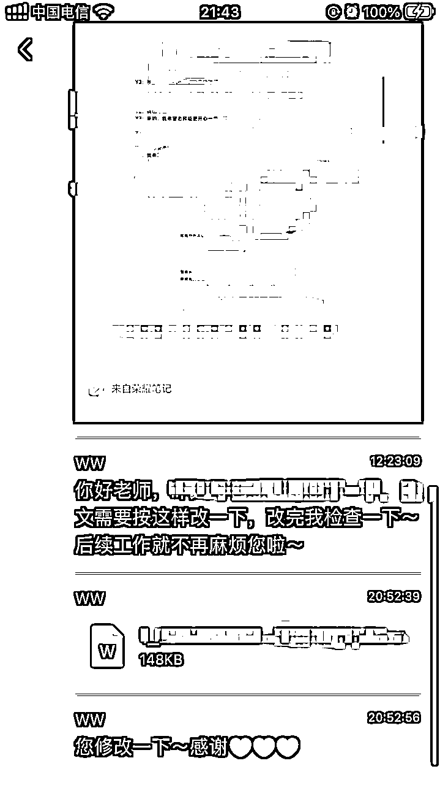

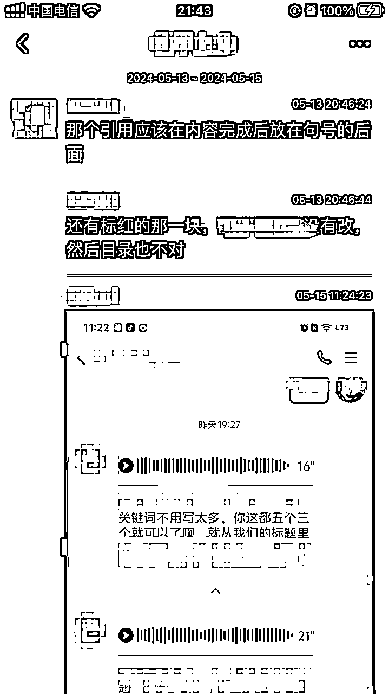

有些任务一轮AI就能完成，有些需要多轮人机迭代。但核心不变：人的创造力 + AI的生产力协同共振。

提示词设计也至关重要，它直接决定输出质量。好的提示词要包含背景信息、写作要求、情感基调，让AI精准理解你的意图。

例如为科技产品发布会写主持稿，我会引导AI按以下模块输出：

*   关键点：产品亮点、功能演示、用户体验、未来规划

*   思路：开场介绍、产品展示、互动环节、总结陈词

*   情感：科技感、前沿感、专业权威、用户关怀

*   风格：专业、幽默、流畅、互动性强

不确定模块时，可以先问AI：

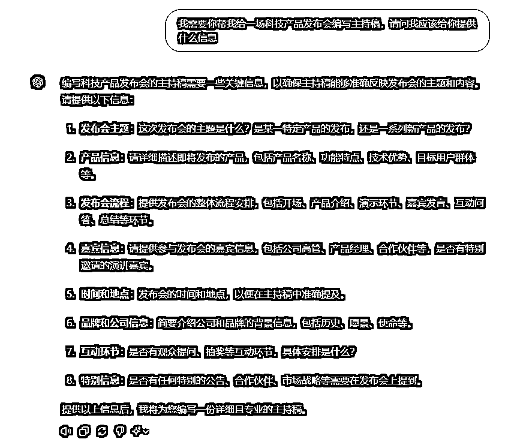

拿到模块清单后再逐条问客户！

## 4、写作套路：不同文体的通用框架

写作是套路之学。不同体裁有不同框架，同一主题也可以有不同思路。

比如教程型文章，有的用步骤解说，有的用案例演示，有的用问答互动。故事型文章，有的完整叙事首尾呼应，有的截取片段点到为止。

经典的“总-分-总”框架，还有“是什么-为什么-怎么做”、“理论-方法-案例”、“现象-分析-解决”等通用模型。

这些框架AI很容易理解，用关键词+示例喂给它，就能快速生成高质量初稿。

# 第三章：AI写作的变现方式

工具和套路都有了，核心问题是：AI写作能赚钱吗？答案是能。

内容写作本就是可变现的职业。传统出版时代，优秀写手靠稿费就能体面生活。互联网和自媒体爆发后，变现渠道被极大拓宽。公众号、知乎专栏、各类内容平台都能把流量转化为收入。

闲鱼、淘宝、拼多多、小红书等平台也能接写作单变现。

AI写作正好踩在了内容创业和知识付费的风口，能提升产出效率、降低门槛，用更低成本匹配海量需求。

主要变现路径：

## 为企业和个人提供写作服务

这是最直接的方式。很多企业或个人有写作需求却没时间或能力完成。比如企业软文、新闻稿、个人自传、演讲稿、电商商品文案、评价等。

做成一单后容易建立长期关系，会有转介绍和复单，还能给客户转介绍佣金激励。

个人客户单价不高但来源灵活。闲鱼、小红书、抖音、朋友圈、社群里到处都是潜在客户，善于挖掘就能积少成多。

例如我的好兄弟，教他当天在小红书截流，当晚就变现160+

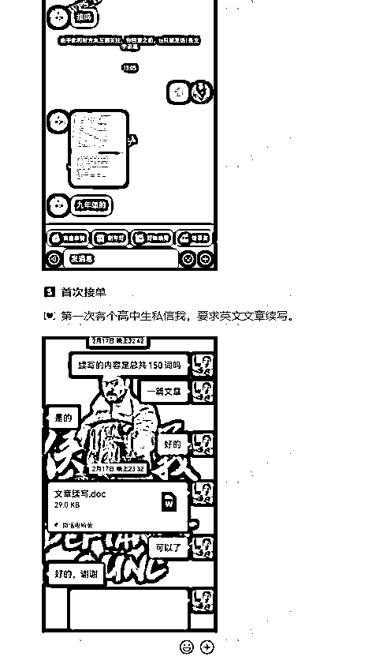

例如另一个朋友，从小白0-1，半个月变现2W+

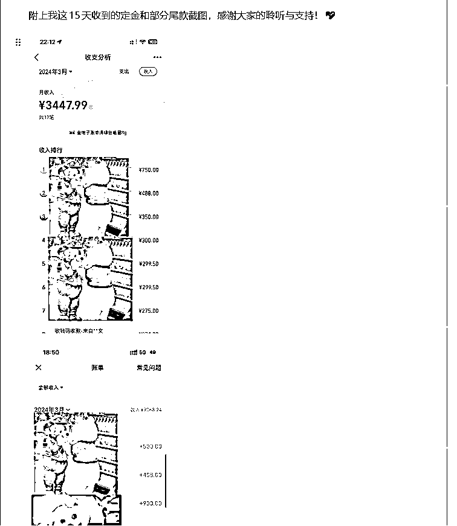

所以想都是问题，行动才有结果！！！干就对了！！！

AI就是【全领域哈佛博士】，有这样一个后盾，你还在怕什么？？？？

## 身边朋友的真实分享，以及我妈妈的发声：

### SweAr：小白从0到1的AI写作副业复盘

起步

我之前在小城市做饮食行业，每天高强度工作，但对美食的热爱一直存在。去年十月，通过阿星的分享，我第一次接触到 chatgpt，认识到AI的迅猛发展，并在他的建议下开始学习AI写作。

学习阶段

随后我报了AI写作课程，掌握了基础技能。但由于缺乏实践和对新领域的不熟悉，反馈一直不理想。

自我怀疑

那段日子，我整个人陷在迷茫里，内心反复摇摆。春节时阿星约我见面，聊起他最近的收获和状态。

**试水赚钱**

阿星带着我在分享平台上发广告、蹲留言区，第一次摸到赚钱的门道。

**第一笔订单**

一个高中生发来私信，请我帮忙续写一篇英语作文。

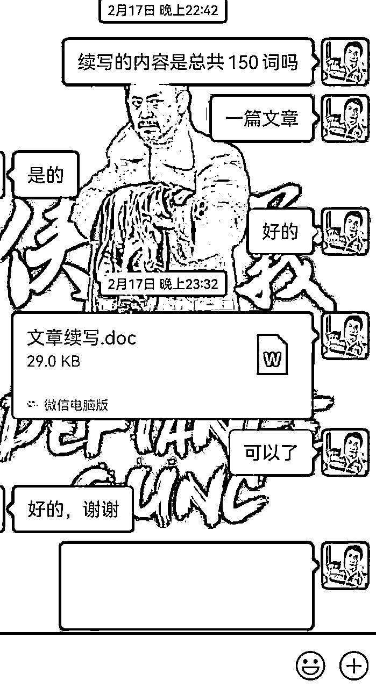

**质量变好**

后来发现一个收集提示语的资源站，把里面的指令拿来用了之后，拿出的货明显更耐看了。

**第一次赚到钱**

尝到甜头后，我趁热打铁，把账号从一扩到三，单子数量唰唰上涨。


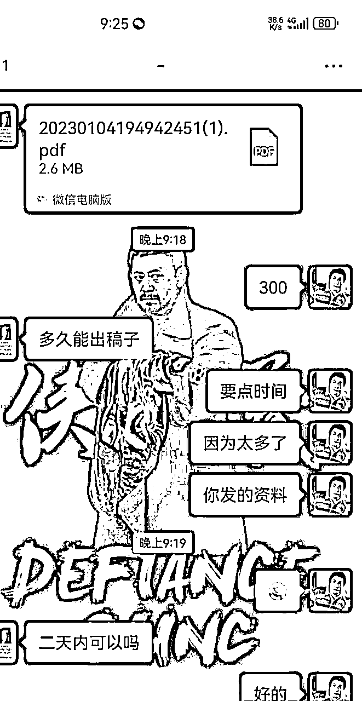

**踩坑回忆**

刚开始我回复留言太硬，账号挨了整整一个月的封禁。在这里提醒各位，留言时的措辞和频次一定要讲究。

**老带新**

每笔买卖收尾后，我都会打给老客20%的介绍费，盼着他们帮忙传个口碑。

**结尾**

智能写作是一片新海域，愿每个人都能寻到自己的航线，大胆往前走。

### 15天，从零到两万：一个智能写作小白的变现记录

**为何把智能写作当副业**

大学期间我就靠写字赚钱，纯手写，接些整理论文、平时作业之类的活，挣的是辛苦费。后来接触AI，我想着拿它当杠杆，把收益放大。😊

AI的名声我早听过，身边有朋友靠它翻身，我很眼馋，只是那套路子与我合不上拍。直到有人推荐我认识的主讲人开了一门智能写作副业课，我才觉得，属于我的机会到了。这门课谁都能学，原因有几个：

- 出一篇文章的流程不难；

- 几乎用不到什么技术，全靠边做边调边复盘；

- 任何人都能复制这套操作。

说起来我的方法真没多高大上，几乎没花钱买过工具，主要靠一台电脑加国产免费的Kimi。

**两条找客户的路径**

学完手艺，自然想拿单子练练。我的客源主要靠两块：

**在分享平台蹲留言区**

寒假在家里闲着没事，我在平台上搜索代写相关内容。本想找个爆款抄作业，翻着翻着发现留言区才是真正的需求富矿。

我在一些新留言下头回话，很快便有私信找过来。哪怕只回个“1”，照样会有人上门。那阵子我陆续接了两千多块的活，其实还能更多，但我出道不久，报价低得离谱。😅

我给自己立的是“独立写手”的人设，强调最擅长论文，再补一句文科单也接。机构名声太差，独立写手反而更容易赢得信任。

可惜号没玩几天就被封了设备，到现在还解不了。

**转移阵地到闲鱼**

封号后我暂停接单，专心把手里的事料理完，然后去了闲鱼。

到了闲鱼我没急着出手，先花时间翻同类账号的帖子，把爆款拆开揉碎，再看几篇结合着模仿，顺便混入个人辨识度。

我的辨识度是经验和专业性。深夜十一点半发出一条帖子，零点刚过就来了询单。对方相中的，是我简介里那句主攻英语系文学类论文、毕业论文排名小组第一。

**如何与客户谈**

跟客户打交道是有门道的：

1. 展示硬实力：接论文单之前，自己先把论文的门道摸清。

2. 理解需求：先把客户从平台转到私人聊天软件，问清专业、年级、希望改到什么程度，再谈价格。

3. 报价有分寸：价格压太低，以后很难提。合适的报价既留住客户，也不委屈自己。

4. 节奏要稳住：别让客户看出你急着接单，营造一种“我不缺活”的从容，价才好谈。

5. 带着温度：别背模板话术，顺着对方的话头聊，发发表情包，再谈生意，更容易成。

6. 让人信你：网上认识的，防备心都重，你表现得不一样，就是赢面。

**服务和回头客**

接单只是开头，服务决定复购。我不靠AI一把梭，而是先借它把草稿生成到八成，再自己动手润一润。🎉

交稿前我会反复检查很多遍，改到自己放心为止。我是真心盼着每篇稿子都能让买家点头。买家点头了，自然会再来。现在我的大部分收入，都来自老主顾的复购。


**谈单的私房心得**

1. 把买家当朋友处：别太看重一次成交，心态放松反而有惊喜；就算这单黄了，后面还有机会捞回来。

2. 黏性怎么养：我聊天随意，年轻学生很吃这一套。他们问点小事情，我都耐心答，眼里不是只有钱。能帮的小忙顺手就帮，时间久了，他们想走也走不脱。😂

3. 客户是人脉：处成朋友，他们会回头加转介绍，还会随手丢给我新的代写线索。


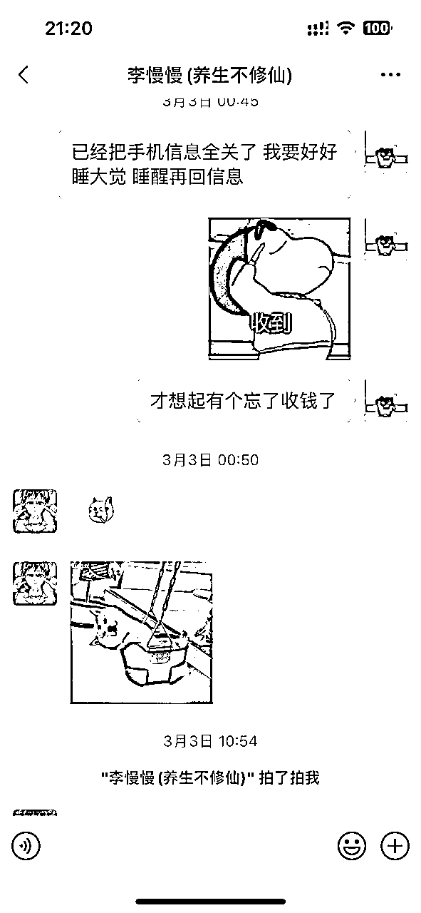

**谢谢与收获**

能有这些收入，真的要感谢那位引路人。我搞不定的麻烦，他都会接手。有一回连改了四版，客户的导师依然不满意，稿子被退回重写，我心里又急又怕，他一句“我来处理”让我安了心。

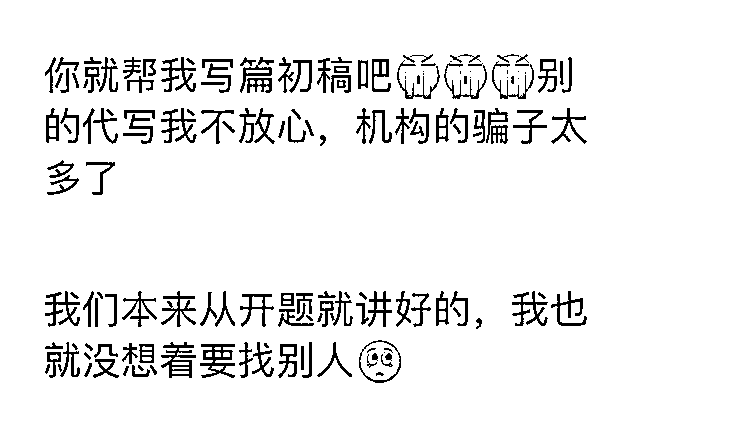

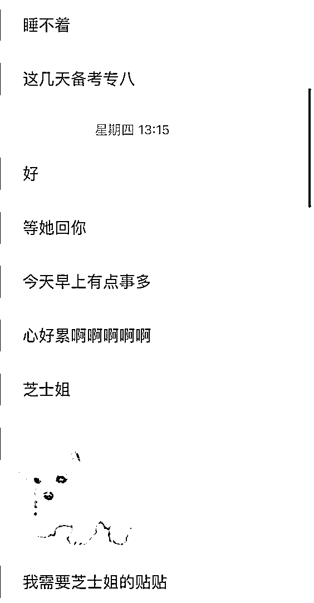

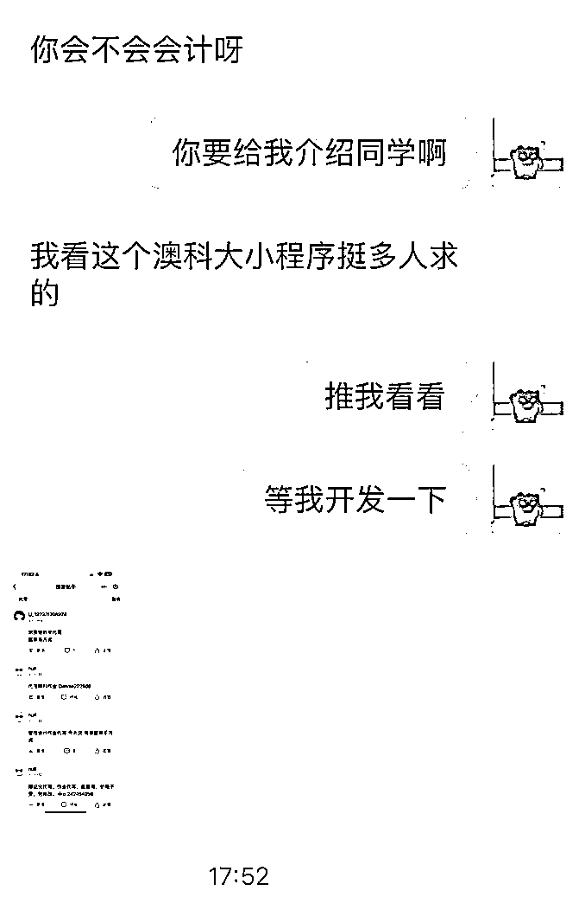

报这门课是今年最值的一笔投资。毕业不到一年，头一回手头这么宽裕。钱包里的数字，就算每周出门吃四天大餐，也照样撑得住。😎

在他的课程里，谁都能把钱挣到手。像我这种话多又敢问的人，副业收入已经盖过正职。

几笔订金和结算尾款的截图放在下方，感谢你读到这里！💖


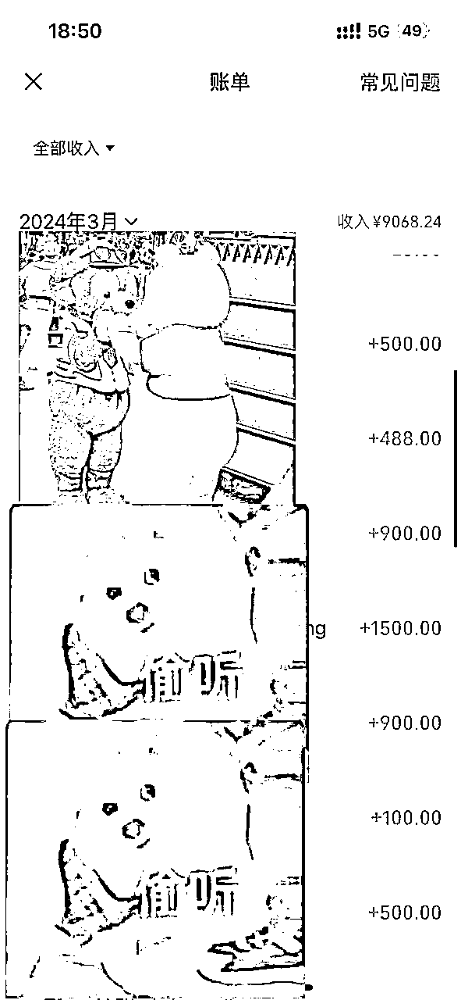

### 新手视角的智能写作副业从零到一

**在平台运营的日子**

我在分享平台和闲鱼都发过帖，效果一般，流量少还容易触碰规则。

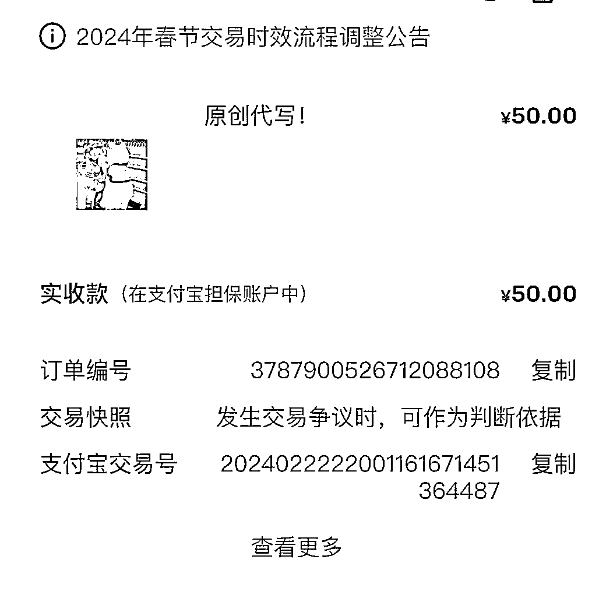

**过年时的探索**

春节放假没事做，我就去平台翻别人的代写贴，看门道。

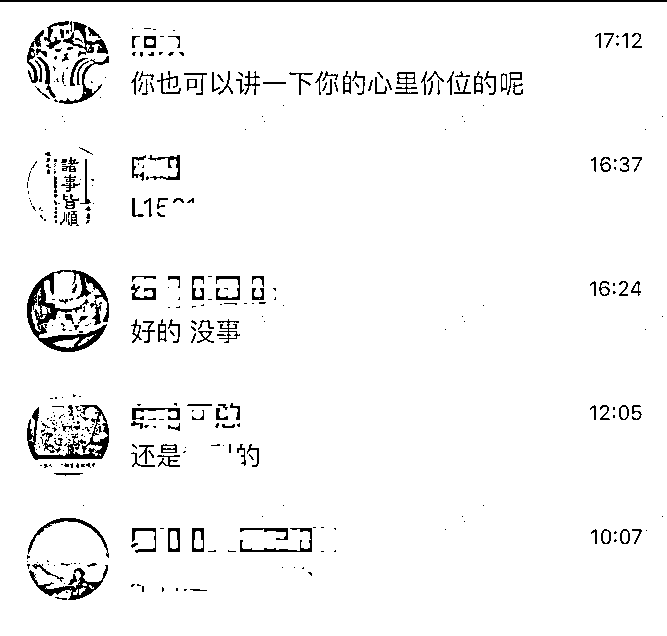

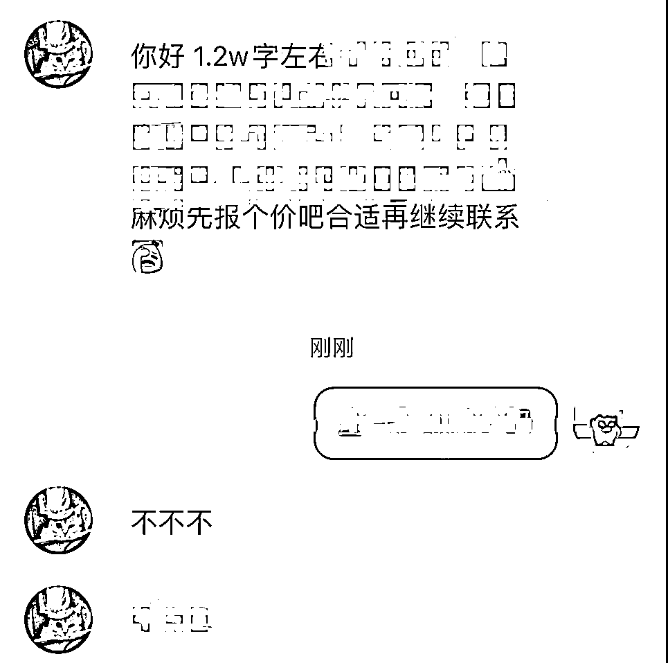

**截流比发帖更香**

实践下来，蹲别人的留言区比发帖有效得多。我挑一些新帖回复，问对方要不要代写。

结果有一天回复完忘了回头看，白白放走了好几个潜在客户。

后来调整了说法，来问的人多是英语相关方向的，只是砍价砍得特别狠。

我换了思路，提出按部分拆分收费，单子当场拿下。

第一个漂亮的案例：帮客户打磨了一段摘要，导师很满意，然后他介绍了新客。

话术继续调，客户群体也丰富了，汉语言、会计、法律都有。

价格从最初的千字50块，提到千字80块左右。

聊天列表里加了14个有想法的人，最后8人下单，4人回购。

说到底，蹲留言区拉客这条路，真的省力又出活。

具体玩法不复杂：搜代写关键词，蹲在帖子下面，留一句“111 可接”。

### 我妈的副业：靠智能写作每月多赚五千

# 第四篇：刚入行怎么快速拿到正反馈？去平台接单。

## 为什么要这样做？

1. 客源自动送上门：省掉自己拉客、谈单、当客服的一连串麻烦，那么长的链路，又慢又累。

2. 反馈立等可取：做一单算一单，收工马上见钱。

3. 平台店铺多、单量大，拿来做练习正合适。顺便还能摸清整个产业的钱从哪来、单从哪里派、活由谁干，先搭一个微小的闭环，以后想放大就有底了。

## 最简单的启动路径

马上打开购物App，输入“代写”，看销量榜，从高到低挑出50家店，每家发一句“申请当写手”。

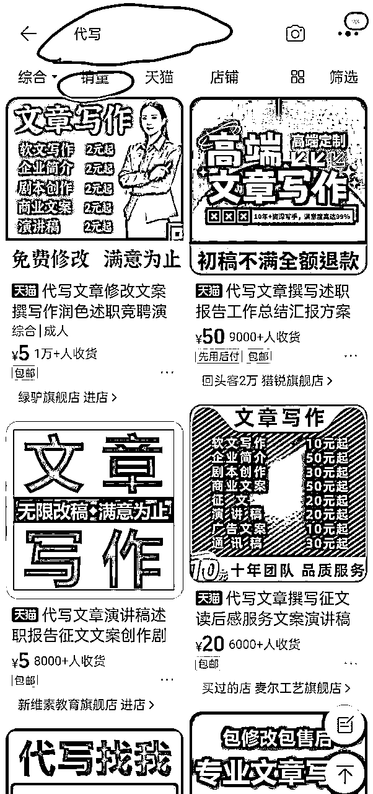

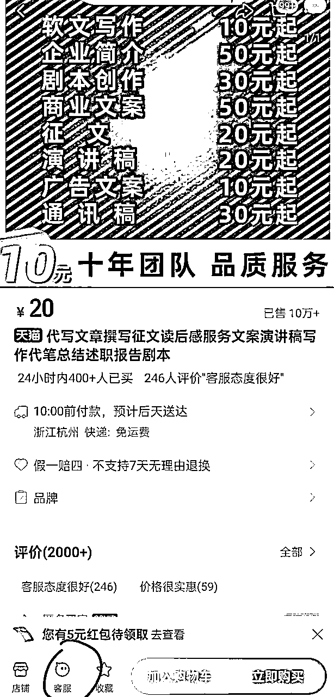

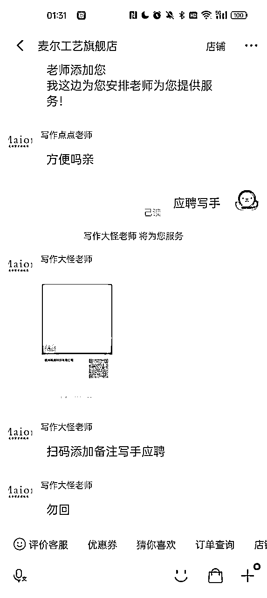

多数店主会让你先拍件商品，再给你退款，顺带问几句情况。这不就等于白赚了访问量？简直聪明。

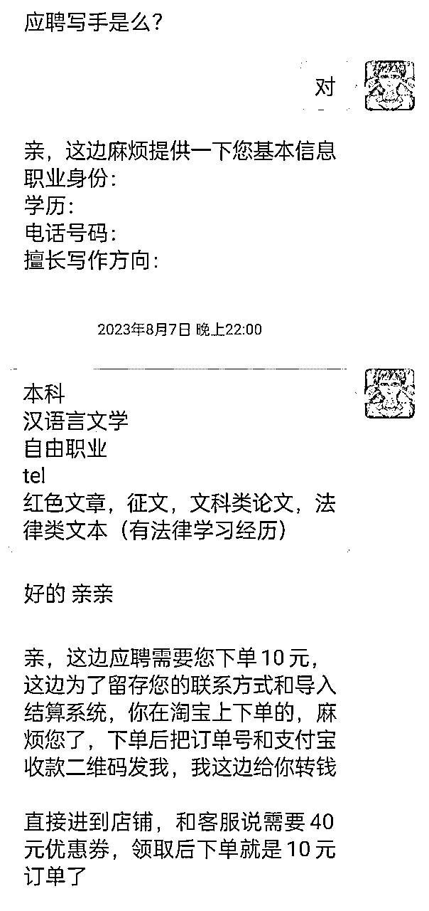

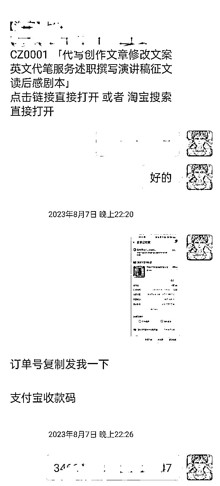

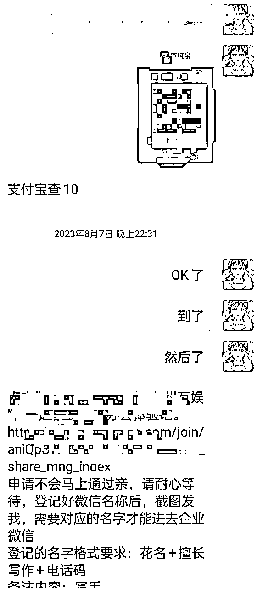

## 注意细节

a. 问及背景时不用紧张，可以套用：

本科读中文，自由职业，擅长写各种文稿和辅导论文

本科读法律，在国企上班，擅长处理文件与公文

本科读外贸英语，做外贸，擅长翻译和英语论文辅导

当然，写自己的真实履历也没问题。

b. 面试作品准备：

有的店会要样稿，去免费文库找几份活动串词、项目方案之类的资料来交差。

c. 把搜索词换着来：

一家不要你就换下一家，例如活动串词、发言稿、投标文件、翻译单，总能找到有空缺的店。

看图解

## 没人明说的门道

### A. 平台写手也有段位

初级、中级、高级，层层递进。好单子通常先给熟手。

升级路径：拼命接单、做好质量，差不多10单后能申请中级，高级同理。

### B. 挑两三个对接人，把私人关系经营好

优质单子多半是客服私下派给自己人。把关系经营好，她们还能帮你把分成比例往上谈，这类接口人一般只抽一成。

相处步骤：

* 她派单你就接，先混个面熟；

* 遇到难啃的单子主动顶上，交情自然变深；

* 偶尔发个几块钱的感谢红包意思一下。

* 记住：能接单是因为你笔头好，不是AI多神，你依然是靠手在写。

### C. 低价单不等于省力单

1. 级别高的写手挣钱反而轻松。年入100W有时候比年入10W更简单。

* 刚入行的写手，每天花一小时，月进一千并不难，分成在25%到30%。

* 再往上走一档，同样每天一小时，月入三千也常见，分成能过三成。

* 到了头部，挑单权在手，钱自然好赚。

2. 零散小单试几次水就够了，除非特别省事。

3. 别把身体熬坏，但想拿到结果，付出的代价躲不掉。

## 手把手实操

打开购物App，搜“代写”“写稿”，找到排行榜最靠前的50家，挨个敲客服就对了。

月销40万+这种数字看看就好：有水军刷的，有投流灌的，真正买家成交的只占一角。想拿准数，要么自己开家店去数，要么砸钱向别人买内部报表。

刷单时留个心眼，填地址和联系方式时都别用真实的，省得碰上奇怪的人找上门。

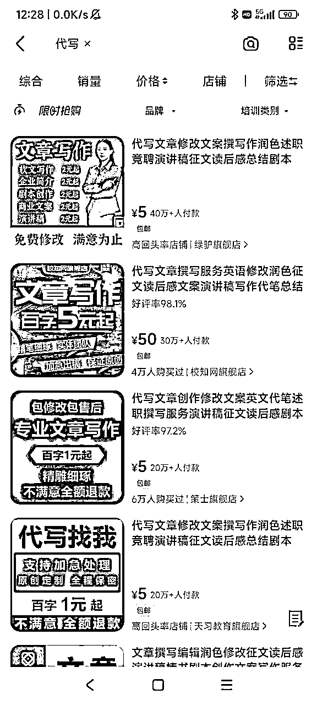

### 店铺申请与刷单

几乎所有店家招写手都要求先刷一单。

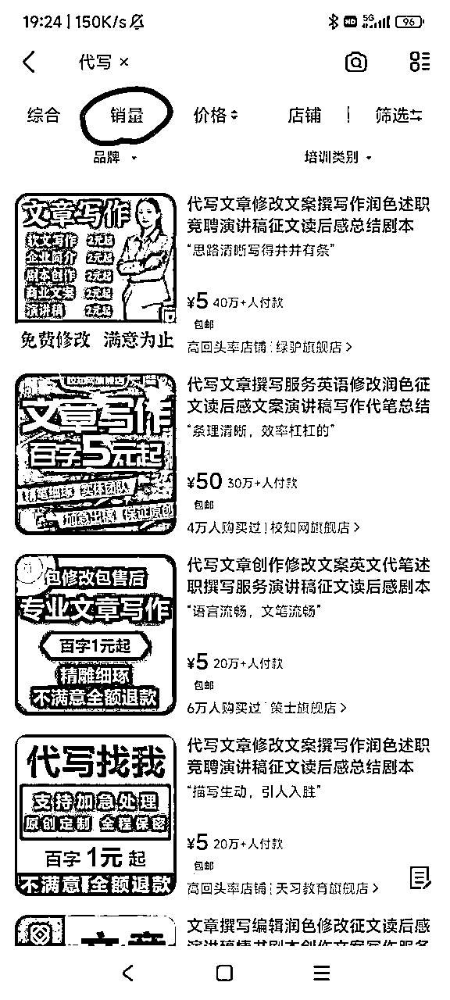

能排进前50的店，看着各不相同，背后说不定是同一个东家。

进店申请后，跟着客服指引进群就行。这些店常年缺写手，基本不会拒绝，冲就是了！

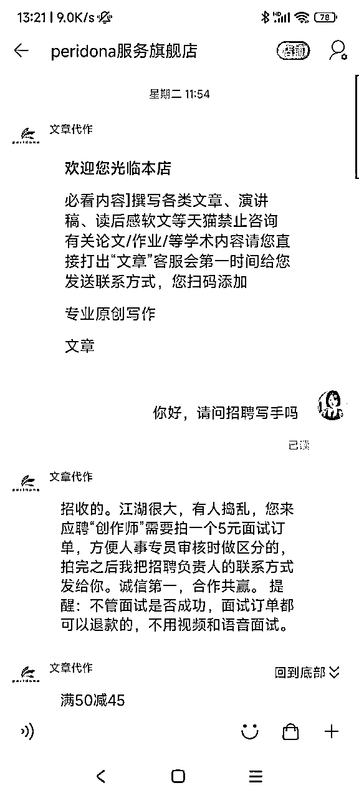

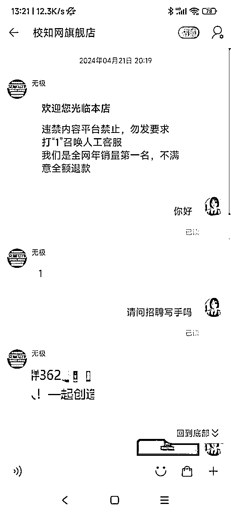

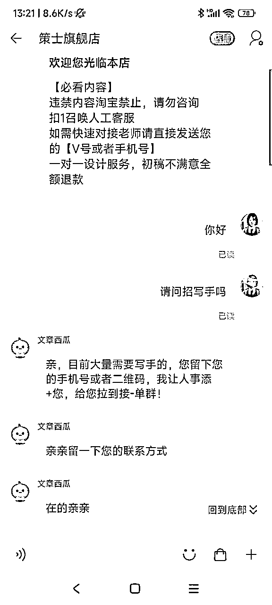


### 群里见（群聊工具用QQ或企微）

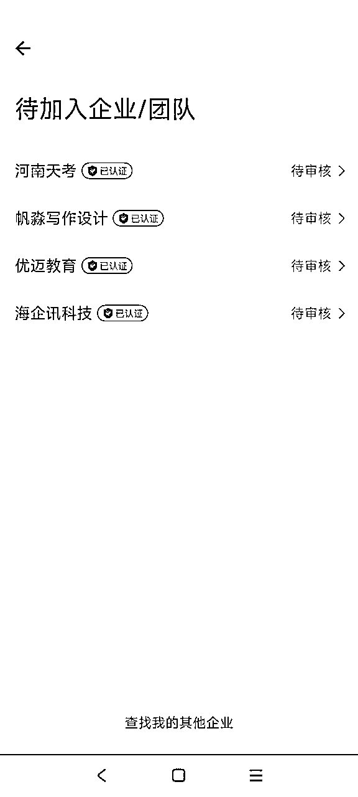

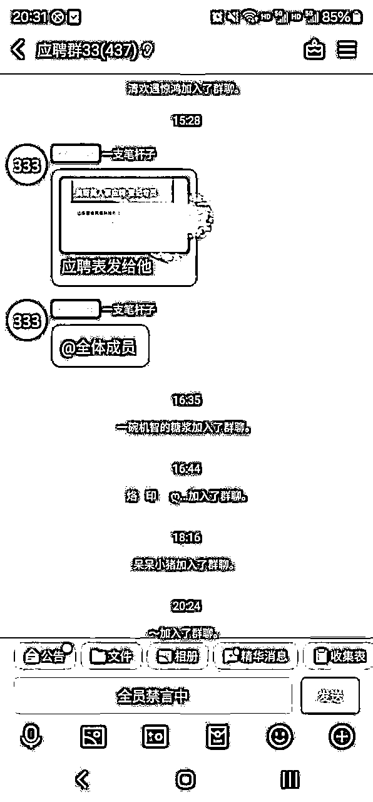

## 接单

派单的消息一条接一条，手快才有，慢就只能看别人抢走，所以得一直盯着屏幕。

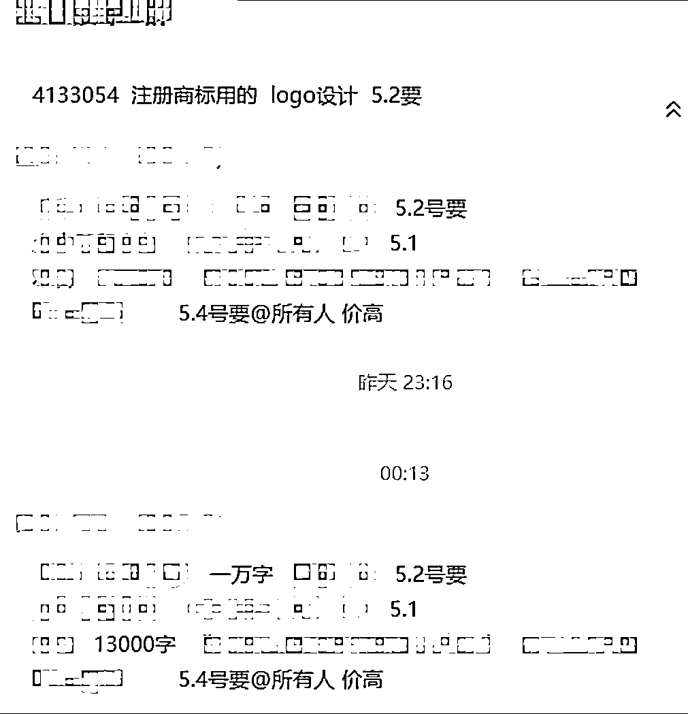

你直接回复“能接”，对方就会把你和买家拉进同一个会话，把要求发出来。

## 结算

多数店按周期结算，常见的是半个月一次；只有少数小店做一单清一单。

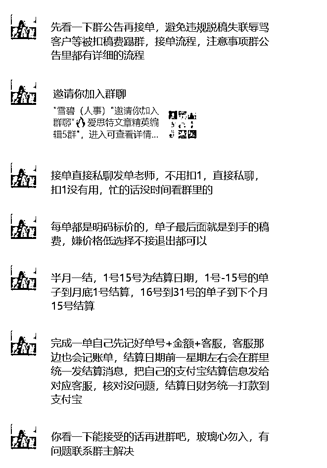

## 写手生存指南

想多赚，就多挂几家店。单子分散后，最好自己做个表格追踪。

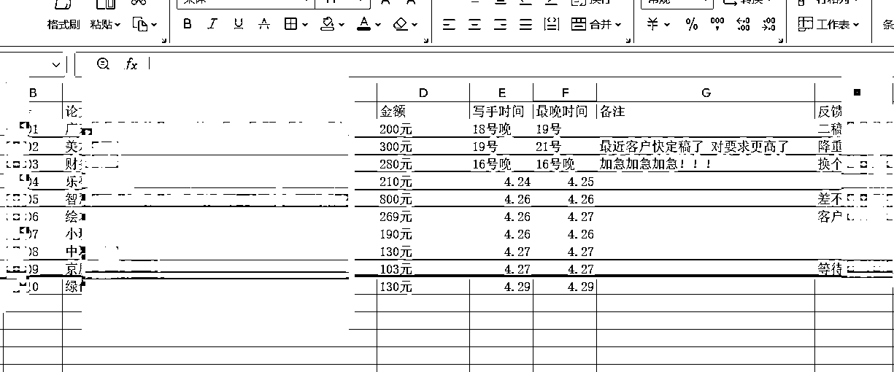

# 结尾：狠狠逼自己一把！

眼睛看了千遍，不如手上过一遍。

只要肯行动，主业之外的第一个100块、1000块、10000块总会来的。

我朋友和我妈的故事已经证明：世界变得快，只有持续学习的人才能站稳。智能写作只是起点，AI的大潮里还有更多机会等我们去闯。

上天从不偏爱原地等待的人。

想翻篇、想向上、想跑在别人前面，就别再徘徊，也别把“假如”挂在嘴边。

你现在需要的并不是一份万全的方案，而是先迈出去。

别问结果，别怕失败，别等“有空再说”。

先跑起来，跑着跑着，路就出来了。

成功不是天降奇迹，而是一次次行动堆出来的。

再大的成就，也源于微小的起点。

你想做的，就是点亮那团小火，让它越烧越旺，照出前路。

你离那份成绩有多远，不看迷惘有多深，只看动手有多少。

这个时代，只有拼搏的人才会被看见。

你，还不出发吗？

该启程了，把勇气带上，把舵握在自己手里。

你的命途，只有你能执笔。

就现在，就是此刻。

就现在，就是此刻。

就现在，就是此刻。

# 出发，就是最好的时机！

### 觉得有用就点个赞呗，谢啦~

# 还是迈不开腿？来找我，给你备了根小鞭子。