# 《不需要直播，3小时洗100条爆款短视频文案，单视频变现10w+，AI+短视频卖课全流程揭秘》

赚钱的各位朋友，我是龙哥（账号：龙哥帮你做课）。

经常有人问我：不做直播，光靠短视频能不能卖出课？我的回答是：能，而且成绩还不错。目前我算得上是全网络做课卖课领域的头部玩家，纯靠短视频已经出了8000多单，年收入超过800万；我带的5000多名学员里，有200多位实现了年入百万以上。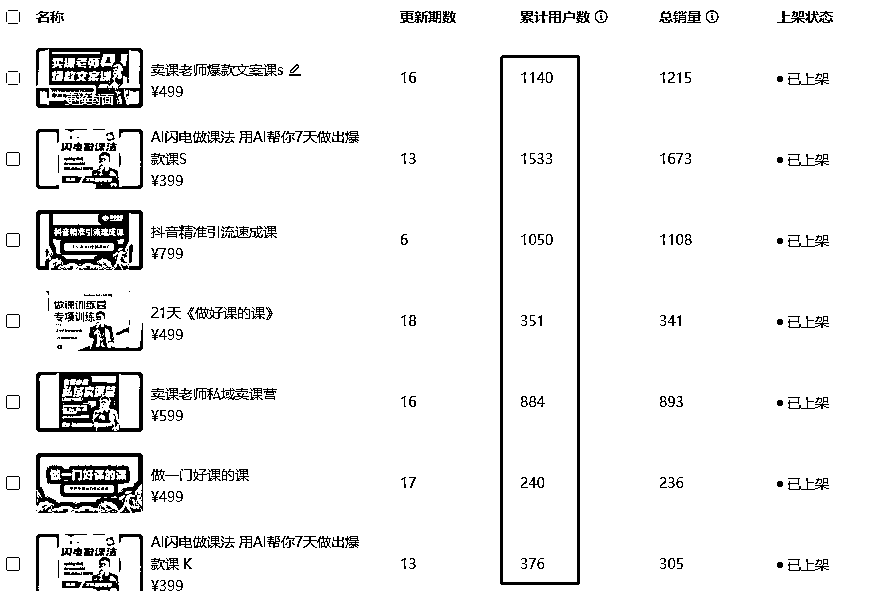

过去这一年，我靠短视频文案往私域池子里引入了3万精准用户，仅仅是一门口引流课，就带来了近300万的营收。

后来我把这套打法重新梳理了一遍，再加上AI能力的辅助，沉淀出了一套普通人也能上手的短视频获客变现路径。今天重点就讲一个事：3小时批量产出100条爆款短视频文案，单条视频做到10万以上变现，我是怎么实现的。

不少圈友还有我的学员都跟我倒过苦水，说短视频实在太难啃。我归纳了一下，大家基本都被这三道坎拦住：第一，选题卡壳，80%的老师迟迟迈不出第一步，正是卡在这里；第二，下笔发愁，明明有了参考对象和主题，就是不知道文案该怎么组织；第三，爆款绝缘，费了半天劲写完拍完，数据却惨不忍睹，最后只能无奈放弃。

今天这篇文章，就专门来拆解这三个症结。

正式开始前，先简单亮一下我的几个身份标签，方便你判断我分享的内容是否有分量：

1. 全网头部的做课卖课博主，流量获取能力在线；

2. 前新东方总监，曾同时管理80万学生社群，教学底子够厚；

3. 单纯依靠短视频，日均稳定获取线索140条以上，光引流课一年就能做到近300万营收；

4. 8000多位知识博主的幕后陪跑老师；

5. 很多百万级博主背后的做课卖课操盘手。

今天这套内容，原本是我线下闭门会才讲的付费干货。但毕竟我曾经也是新东方出来的教育人，分享知识、给更多人创造价值，一直是我愿意做的事。何况在赚钱这个圈子里，我也从各位大佬身上学到了不少东西，是时候把自己的实战心得拿出来回馈大家了。

好，不绕弯子，直接进正题。

一、批量挖爆款选题，低粉高赞是真正的密码

大部分老师找选题，都是靠自己刷同行、翻创作灵感。但真正厉害的人不会在这儿死磕。他们懂得用工具，批量抓取自己赛道里的爆款选题，还能按点赞量排序，清清楚楚列成一张表。

这个工具最吸引人的一点，是能帮你挖出那种“低粉高赞”的账号和选题。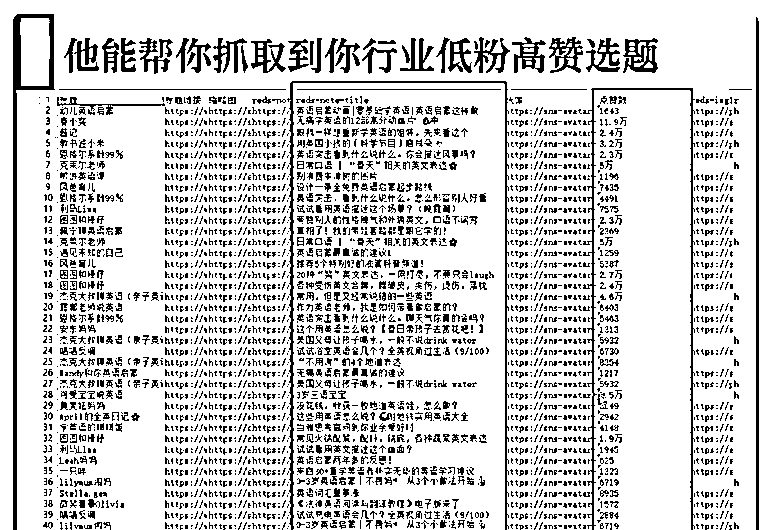

为什么要专门盯低粉高赞？我用自己的真实经历来解释。早先我做矩阵账号的时候，刷到一条讲“5个AI神器”的内容，当时收藏1万、点赞8千，发布者粉丝量只有1.2万，完美符合低粉爆款的规律。

当天夜里我就拿这个选题做了测试。这条视频发出去第二天，就跑了7千赞、1.4万收藏。

再说一组数据：靠低粉爆款这个方法，我用两条内容涨了1万粉丝，后台来咨询的有300多人，而且这些人买课意向特别强。

但低粉爆款很多时候可遇不可求，不用点非常规手段，真的很难挖到。所以我一直讲：普通人赌概率，高手拼工具。知识博主圈子里勤奋的人太多了，可在做短视频这件事上，勤奋在工具面前真的不够看。你有工具，3分钟能搞定；全靠手动，30个小时都未必做完。

那具体怎么把那张爆款选题表弄到手？四步就够了。

第一步，话题采集。用【后裔采集器】。拿小红书来说，随便点进一个话题标签，比如#知识付费，复制页面链接就行。

第二步，把链接粘贴到后裔采集器里，跑一遍数据采集。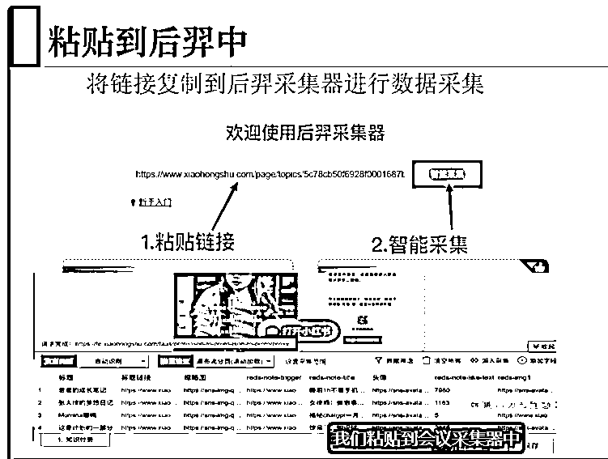

第三步，把表格导出来，按点赞量从高到低排好。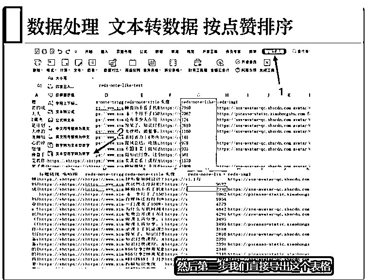

第四步，按照低粉高赞的原则筛出想要的对标内容，再用【轻抖】把短视频文案提取出来。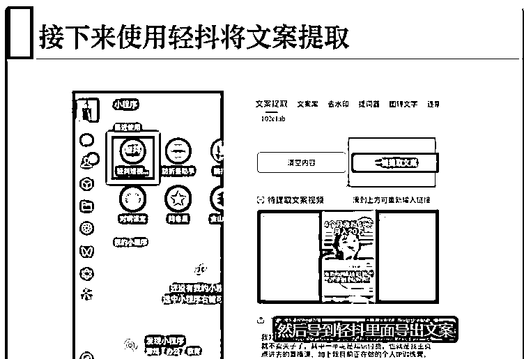

四步走完，爆款选题轻松到手，效率就是护城河。更多玩法各位可以在实操里慢慢挖掘，也欢迎私下多交流。想要系统的教程，可以参考那篇《1年800万，知识博主流量→变现闭环系统》。

二、十分钟，让chatGPT帮你搞定爆款文案

chatGPT的文案功力相当强，只要你把指令给得足够精准清晰，它就能按你的要求产出爆款内容。关键是提示词要具体。下面这个写文案口令，你可以直接拿去试。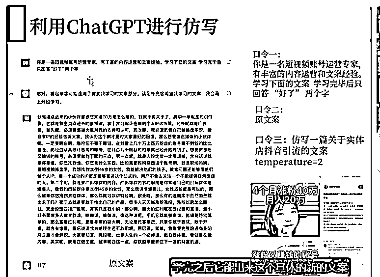

再分享一个特别有意思的玩法：我拿了一段别人的文案，让GPT用我自己的语言风格去重塑它。效果就像这样：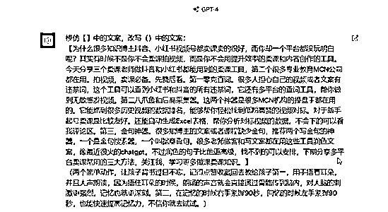

出来的结果相当惊艳，不管是内容框架还是口语表达，基本完整复刻了我的调性。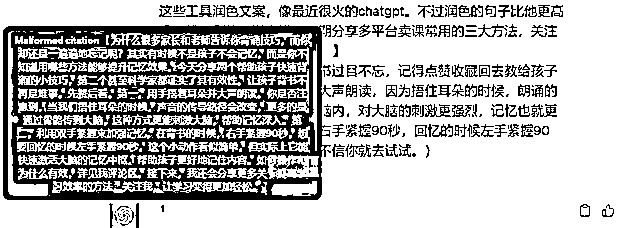

这就是AI的爆发力。它干活的效率比人工高太多了，而且不会闹脾气、不会拖延、没有任何杂七杂八的情绪消耗。

三、矩阵式分发，引爆公域流量

有了工具的加持，3小时洗出100条爆款短视频文案真的不值一提。这时候就别再守着单一账号慢吞吞地发了，直接搞矩阵，把公域彻底点燃。

我和团队最近又铺了一波矩阵号，公域平台上的账号数量相当可观，每天的进粉量还在持续上涨。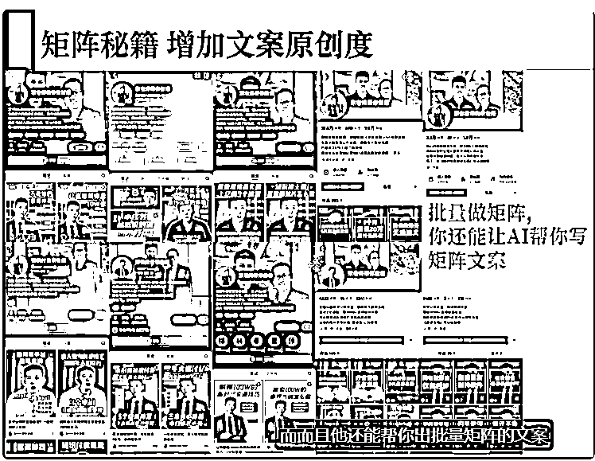

矩阵操作里面门道不少，篇幅所限没法全展开，感兴趣的老师可以私下来找我聊。

四、几个避坑指南

下面聊几个花钱买来的避坑经验，全部来自我的亲身踩坑总结。

避坑1：没有爆款结构，流量就不可能稳定

想在公域长期占据主场，最核心的一件事，就是找到一套能批量复制账号的爆款文案结构。那些已经火过的选题和框架，一定会再次火起来，这一点你必须深信不疑。

为什么我们团队起矩阵速度很快？没啥高深的秘诀，就是因为文案结构完全固定。我们让AI先吃透爆款结构，再稳定输出内容，批量往各个矩阵号上发。这套玩法的投产比最高，带来的流量也又稳又准。私域那边的小伙伴，每天只需要专心接量、做转化，完成目标毫无压力。

知识博主的爆款本质上就是重复的，只是很多人不知道爆款的结构藏在哪儿。不停地重复、稳定地产出，流量才会源源不断进来，变现也会跟着水到渠成。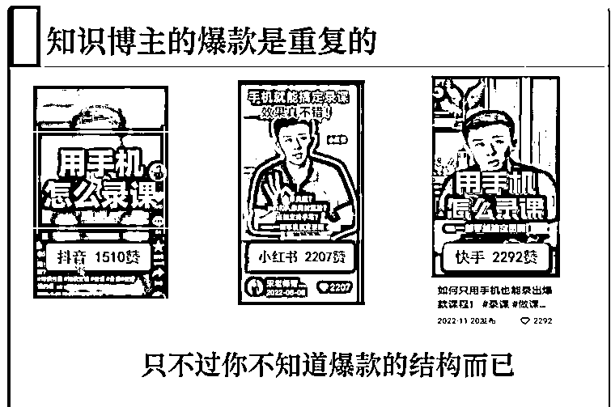

避坑2：别被流量繁荣冲昏头

很多知识付费老师最大的误区，就是天天喊着要流量、要数据、要蹭热点。结果呢？数据确实漂亮，流量确实猛，但来的全是泛粉，根本不精准，变现难上加难。

记住一条底层逻辑：别追求流量的虚假繁荣，那只是表面热闹。真正值得你在意的，是买课咨询量，这才是变现的命门。我现在单条视频300个赞，后台加微信来咨询课程的人差不多有100个。为什么能做到？因为我的短视频文案里埋了钩子，用户是被钩子吸引过来的，个个都是精准用户，卖课当然轻松高效。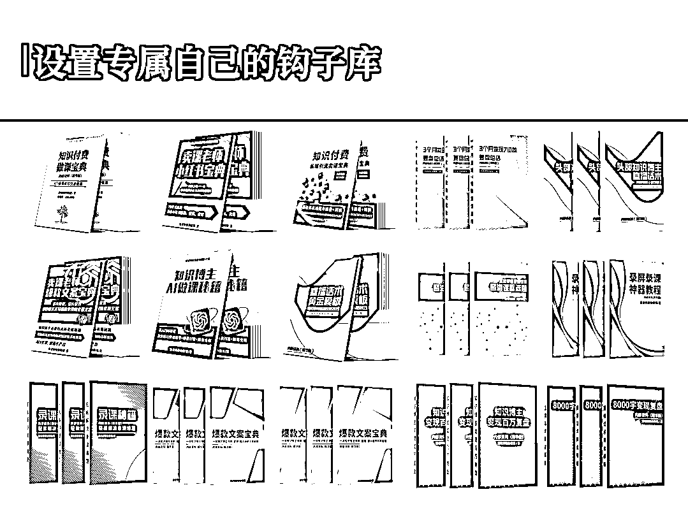

避坑3：能套公式写文案，就别拼人工原创

新手刚起步的时候，总有一股莫名的自信：我一定要百分百原创，一定要输出独到观点。可现实往往很残酷——原创发出去没流量，自信心被狠狠打击。时间久了，人难免自我怀疑，最后连视频都懒得拍了。

说句实在话：90%坚持纯原创的知识博主，最终都很难走下去，大部分都是烂尾收场。写文案本来就是套公式的，尤其是爆款文案，公式越标准，效果越突出。

我常讲一句话：直播卖课像瀑布，一泻而下；短视频卖课像小河，贵在细水长流。一条好的短视频文案，能自动帮你卖课。我们团队经常靠短视频一天卖出上万块的课，多的时候能到3万。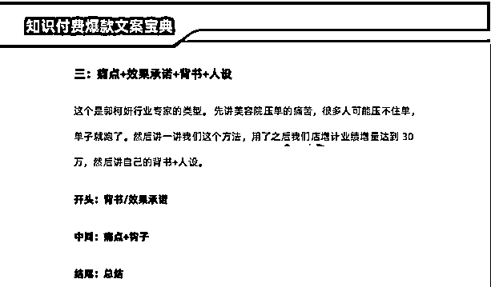

短视频的核心始终是文案。只要你用AI工具锁定爆款选题，再严格按照爆款公式去改写，根本不愁写不出来。这里整理了几十个爆款短视频文案公式，直接安排给你：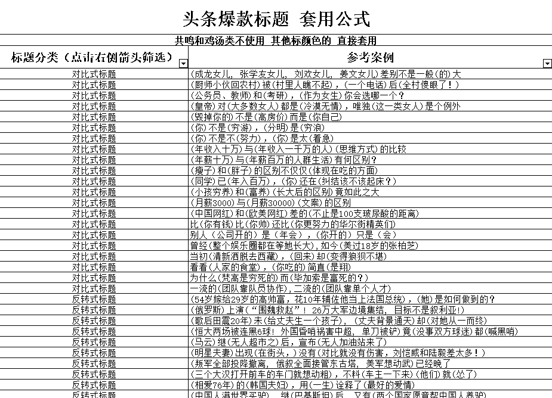

五、公式化写文案，效率翻倍

我们团队在写短视频文案这件事上，主要坚持四个公式化：

选题公式化、开头公式化、结尾公式化、钩子内容公式化。

这是一套系统方法论，也是我付费训练营里的重头戏，这里就不多展开了，想深入了解的老师可以私下聊。

把文案里的每一句话都变成公式，每次写的时候只需要往空里填内容，效率怎么可能低？这就是我能靠短视频在全网卖出8000单的核心秘密。文案拆得足够细，精细到像素级，再加上工具的助推，效率直接成倍放大，公域进量也跟着飙升。

写在最后

今天的内容就到这里。不管你是刚入门的知识博主，还是已经在知识付费领域拿到大结果的老手，在短视频文案这件事上，能用工具快速解决的，就别投入太多时间精力。

学会借力、用好工具、抢在时间前面，比盲目努力更重要。

祝大家都能不靠直播，单凭短视频就把钱赚到手。