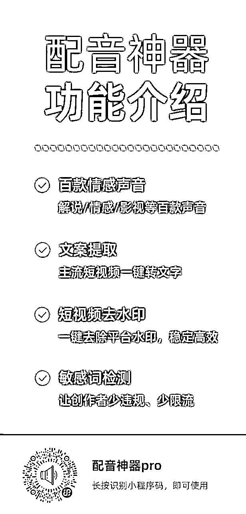
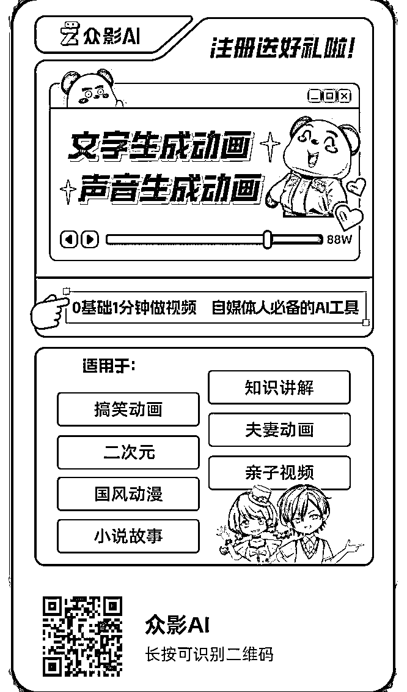
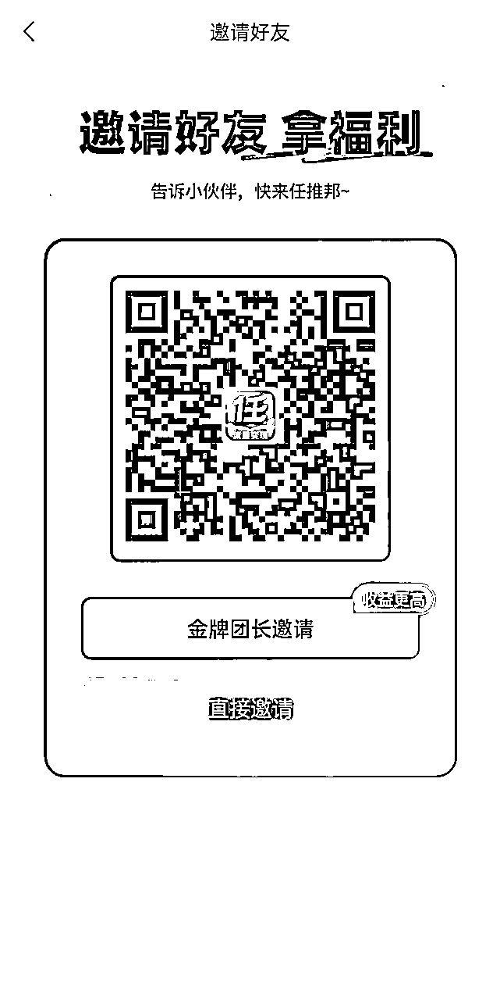
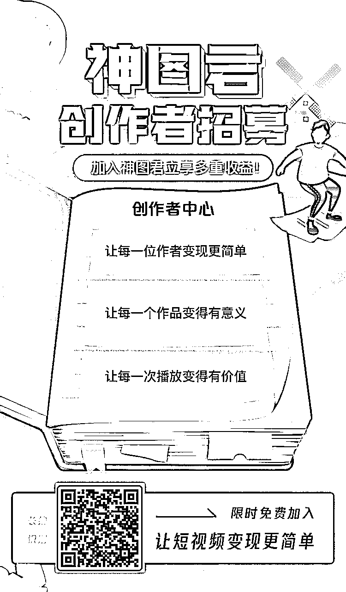
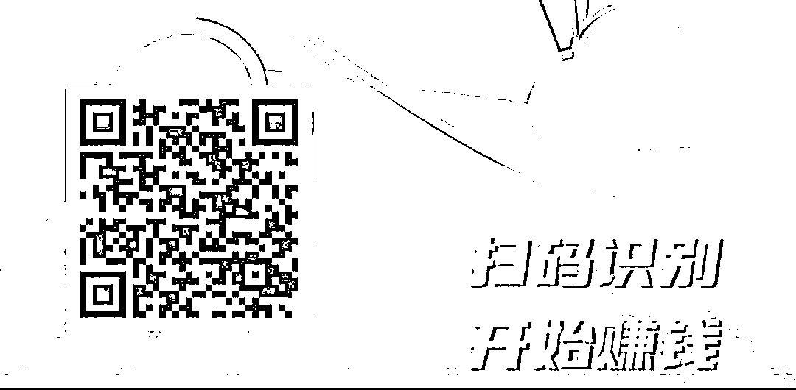
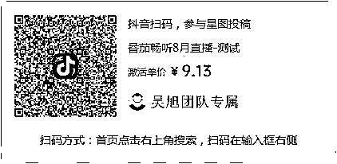
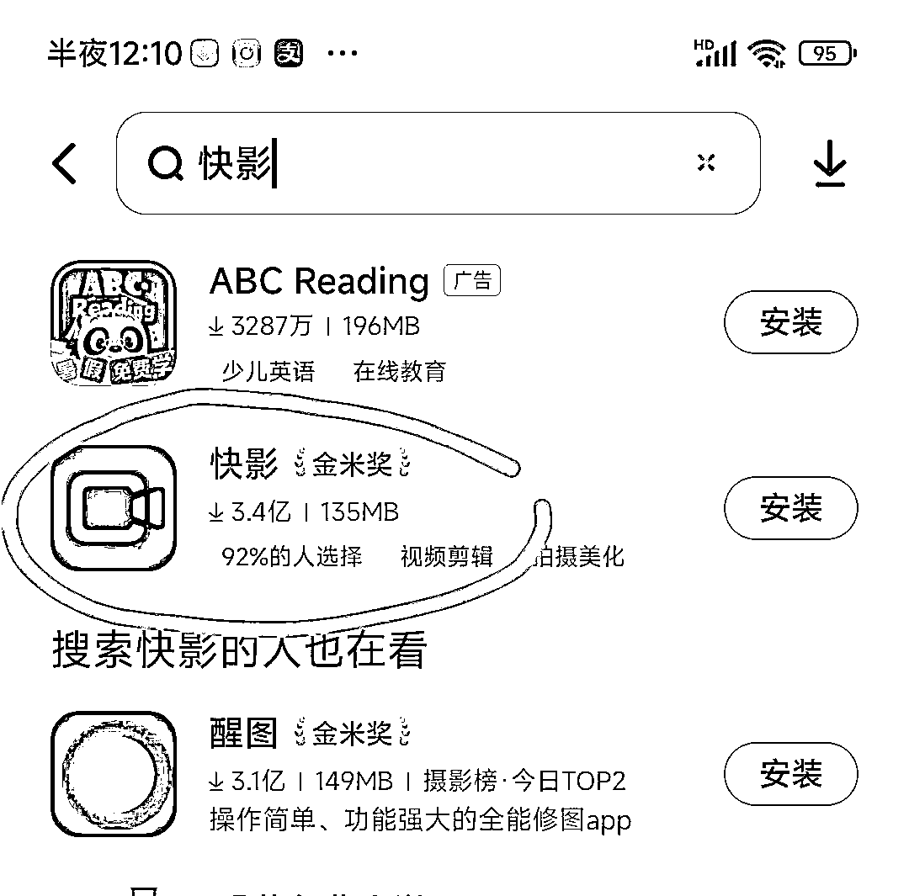
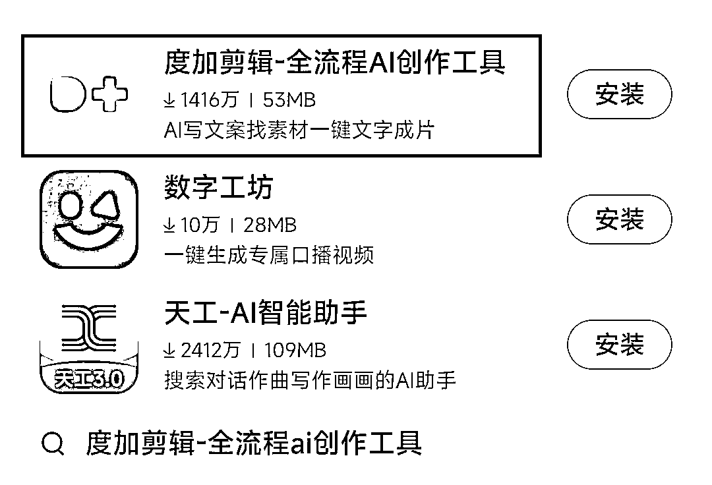

# 【吴旭】互联网工具资料宝库合集

吴旭的这份资料库，做新媒体和副业的朋友应该都不陌生。文档在飞书上持续更新，内容越攒越多，从小说推广素材到各类智能生成应用，从账号冷启动教程到网盘资源包，基本覆盖了内容创作的完整链条。这篇文章把其中真正常用的部分重新梳理出来，方便你按需取用。

完整资料库入口：https://a5yo5lvdaa.feishu.cn/docx/WjvCdVSyToDLQuxeOgvcYnG0nqe

主理人吴旭，订阅号“吴旭笔记”。

因为文档体量很大，建议直接检索：打开飞书文档后，点页面顶部的“...”菜单，选择“查找/替换”功能，输入目标词即可快速跳转到对应区块，比自己翻快得多。

一、小说推广素材合集

这套资源在库里最常用，百度云和夸克都放了完整合集，另外还单独拆出了两个热点品类：跑酷、修牛马蹄。

- 合集（百度云）：https://pan.baidu.com/s/1w6pa5pN4by6lIq0daL-bmQ?pwd=ryv3 密码：ryv3

- 合集（夸克）：https://pan.quark.cn/s/a40494989e85

- 跑酷单份：https://pan.baidu.com/s/1hk_S7wv0w7RZuKN4hwQ8lQ?pwd=8xmu 密码：8xmu

- 修牛马蹄单份：https://pan.baidu.com/s/1quWq2HNAyt37DfslvJ08NA?pwd=jogk 密码：jogk

文件总数比较多，网盘单次保存有数量限制，建议打开子文件夹分几批转存；非会员按需保存即可，别直接在线预览。

二、常用智能应用清单

文档里反复出现的几款应用，按用途整理如下：

- 问答、写作、答题：KIMI，地址 https://kimi.moonshot.cn/

- 国内可免费使用的对话模型：智谱清言，地址 https://chatglm.cn/

- 图片生成、美女类视频：即梦AI，地址 https://jimeng.jianying.com/ai-tool/

- 视频生成：可灵AI，地址 https://klingai.kuaishou.com/

- 数字人口播：腾讯智影，地址 https://zenvideo.qq.com/

- 短剧自动剪辑：https://aic.oceanengine.com/login

- 爆文生成：https://ai.kezhan365.com/

- 在线绘画：https://app.recraft.ai/projects

- 声音克隆：https://kevinwang676-gpt-sovits-trilingual.hf.space/

- 古诗词题材配音（含童声）：

- 儿童故事动画：应用商店下载“秒剪”

- 视频生成入口：微信搜“魔法画师”，从公众号菜单进入

- 沙雕动画制作：

想做动漫类内容的话，可以试试这条链路：用 KIMI 生成镜头脚本，再用即梦出图、可灵出片。文档里“橘猫做饭”那套完整指令词就是现成案例。

三、账号冷启动与变现权限

抖音：粉丝做到 1000 后，才能解锁短剧分成的开通资格和橱窗带货功能。吴旭本人录制了实操视频，跟着步骤做就行。

小红书：养号、注册店铺、商品上架的教程都收在文档里；粉丝满 1000 后，还能申请商单。

快手：无人直播剧玩法，文档里有配套教程，案例显示 24 小时收益 4800+，附剧集资源和磁力聚星强开方法。

四、推广入口汇总

有流量不知道怎么变现的，看这部分：

- 剪映拉新：

- 即梦AI推广：

- 红包封面推广：

- 直播间挂载番茄畅听组件（50粉门槛）：

- 小说推广合作：微信搜“力推”

- 低价开通会员：http://11560.96km.cc/，复制链接到浏览器访问

五、实战玩法与案例复盘

- 头条号 AI 写作：日入 400+ 的完整复盘，附 5 月爆文选题：https://pan.baidu.com/s/1TcFTKQ-mWoHZ5p-YpN90aA?pwd=v606 密码：v606

- 头条爆文库：https://www.kdocs.cn/l/ccdsQTSjvrTy

- 起号带货宝：单条视频卖出 37 万件商品，利润超 74 万

- 抖音带货 60 万案例：吴旭的独家实操，从涨粉到开权限都在里面

- 短剧解说稿：用“美册”一键生成

- 百家号视频去重与搬运：完整流程在文档里

六、素材与工具补充

- 剪辑教学视频，附带情感类素材：https://pan.baidu.com/s/1wXiPrbCa7TB6b0F1D3CNvg?pwd=xsa9 密码：xsa9；素材：https://pan.baidu.com/s/1IgNqNHFHwhkDEG4qOZN2ag?pwd=7yai 密码：7yai

- 旧版剪映安装包：https://pan.baidu.com/s/1ZhpTLiRpjE07QMMQwCcYyQ?pwd=cnbs 密码：cnbs

- 视频去重软件 crvideomate：https://pan.baidu.com/s/10j3i1g1asBvCzjxJOfN7kg?pwd=6pgi 密码：6pgi

- IDM 视频下载插件：https://pan.baidu.com/s/1UNxbG8XJzoMeqTmuATsvqw?pwd=vs58 密码：vs58

- 直播间背景视频：https://pan.baidu.com/s/19NLODjKlKdMtVo3tNiht6g?pwd=pz8g 密码：pz8g

- 悟空游戏相关：夸克有单机版+修复工具：https://pan.quark.cn/s/71723096a34c；直播用的软件和素材在百度云：https://pan.baidu.com/s/1YG9O0g0yGnLX4P1F8ecBYQ?pwd=1855 密码：1855

- 片源站点：https://www.btnull.org/

- 游戏加速器推广合作：申请表单和素材都在文档里

- 老照片修复入口：（应用商店装“快影”）

- “度加”剪辑入口：

模板和指令类内容：

- 绿书风格图文背景模板，文档里有多期

- 小红书版式 50 套

- 春节对联版式：剪映“剪同款”里搜“对联模板可改文字”

- 橘猫做饭全套指令词

- 玄幻短剧镜头脚本（深海文明题材，开头强冲突）

- 夫妻对话指令词（要求有槽点、有意思）

这份资料库还在持续补充中，建议把飞书文档收藏好，后面会不断有新增内容。

450个搞钱项目合集，真正能直接上手的入口我都给你挑出来了。这波干货偏“信息差”玩法，适合想搞副业又不知道从哪下手的人。先收藏，再慢慢研究。

一、闲鱼相关的工具和教程

闲鱼是不少人的副业第一站，这几个资源建议先存：

- 闲鱼官方管理工具“鱼店长”：

https://www.agiso.com/product/yudz

- 闲鱼店群管理工具“鱼管家”：

https://www.goofish.pro/login

- 闲鱼虚拟产品必备操作文档：

https://doc.weixin.qq.com/doc/w3_AeEAfQZVAL4lTVXjwxVRWCFlvJyKL?scode=AHgAEAfnACkjnQ6Spd

二、平台变现类文档

这几份企微文档都是别人整理好的操作入口，点开就能看：

- 小红书换绑接码平台：

https://doc.weixin.qq.com/doc/w3_AeEAfQZVAL4UzTzIxBQRUGd2k2v10?scode=AHgAEAfnACkZuwg1mB

- 大羊毛入口及操作流程：

https://doc.weixin.qq.com/doc/w3_AeEAfQZVAL4369n1repTqegzcB6SZ?scode=AHgAEAfnACkdtHPSdX

- 抖音卖电影票授权渠道：

https://doc.weixin.qq.com/doc/w3_AeEAfQZVAL4GFIfdQtTROS9pzSoVo?scode=AHgAEAfnACkHWmAHoY

- 爱奇艺低价会员渠道：

三、小说推文渠道

做小说推文的朋友，这两个小程序直接去微信里搜：

- 力推小程序：微信搜索“力推小程序”就能找到。

- 右豹小程序：微信搜索“右豹”，注册登录后有详细授权教程。注册邀请码：124284，别填漏了。

四、无限邮箱 / 临时邮箱工具集合

做矩阵号、批量注册账号的时候，这些邮箱工具特别好用，合集里也一并打包了：

- Heygen地址：

https://app.heygen.com/home

- 5日邮箱：

https://yopmail.com/zh/

- 24小时邮箱：

http://24mail.chacuo.net/

- 24小时邮箱：

https://tempmail.altmails.com/

- 10分钟邮箱：

https://www.lbzyw.xyz

- 60分钟邮箱：

https://www.guerrillamail.com/zh/

- 10分钟邮箱：

https://linshiyouxiang.net/

- 10分钟邮箱：

https://temp-mail.org/zh/

- 10分钟邮箱：

https://10minutemail.net/m/?lang=zh-cn

- 10分钟邮箱：

https://10minemail.com/zh/

- 一次性邮箱：

https://www.mohmal.com/zh

五、视频去重技术文档

做视频搬运或混剪的，这一份必须存。从一级去重到五级去重的方法都写在里面了：

https://doc.weixin.qq.com/doc/w3_AeEAfQZVAL4iVDmuGJ8Qo2f5Jua8n?scode=AHgAEAfnACkDrmeQE2

这套资源里既有官方工具，也有野路子操作，建议按需自取。很多项目的核心就是信息差，趁还没太多人知道，先研究起来，行动起来才有可能赚到钱。