# 《跟着航海找痛点，用 Cursor 拼出一个游戏站 iframe 抓取神器》

大家好，我是这期 Web 编程航海的参与者。入圈三年有余，长文还是头一回发出来。今天这篇就是想把自己踩过的坑和做出来的东西分享给同一条船上的伙伴们，少说废话，直接上干货。

# 一，工具长啥样能干嘛

https://gamingtoolshub.top/ 这是我在本次航海里做的第二件作品。说白了就是一个抓源小助手，能帮你从别的游戏站点页面里扒出 iframe、embed，或者藏在名为 game_url 的 JSON 里的真实游戏源地址。

可采集的站点清单我整理在了飞书文档里。不同站点的反爬策略不一样，有的页面是动态渲染的，有的国内根本打不开，需要单独写逻辑。所以如果你们也在做游戏站出海，欢迎一起补充站点，我来把功能补全。目前支持的功能点有：

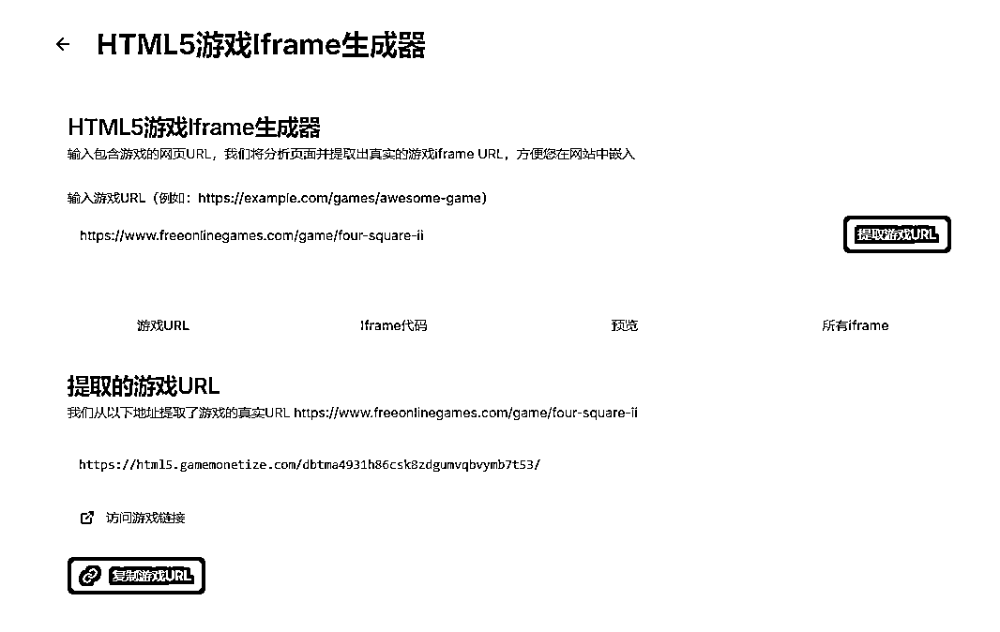

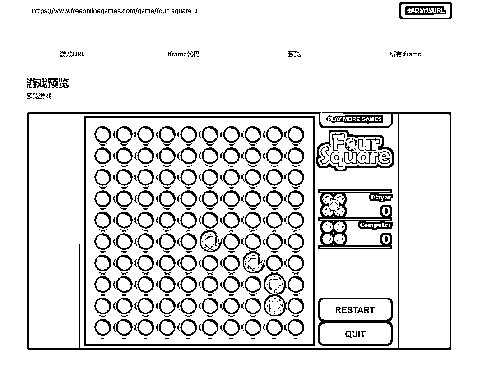

顺带做了个小功能，能直接拿到游戏封面图的可用 src 链接，避免你直接搬图结果显示裂开。

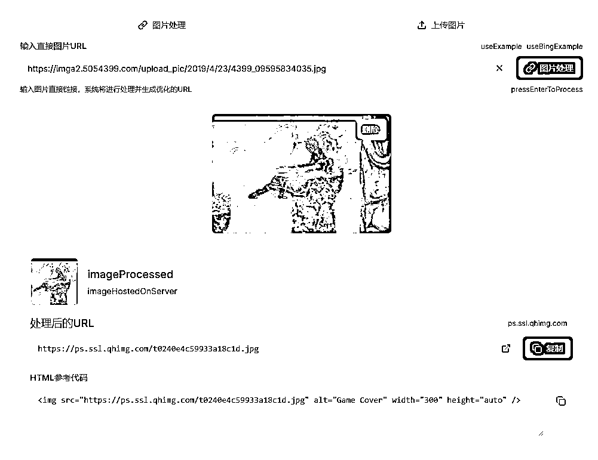

今天群里就有伙伴反馈效果不错，很有成就感：

# 二，这个工具是怎么冒出来的

参加航海的都知道，航海手册第一课就是先把自己的游戏站搭起来。我也是照着手册一步步走，上线了自己的站点，第一道坎就卡在了找游戏源。看到一个喜欢的游戏，想搬到自己站上，结果找 iframe 找得头都大了。

大家都知道要找 iframe，但真上手才知道多费劲。当时我编程水平也就 for、while 能写写，完全没做过网站，本来没打算做抓取工具，想着先把 Cursor 熟练再说。

于是我先花了大概 5 天做了航海的第一款练习作，一款在线图像增强工具。起因很简单，我喜欢摄影，朋友里也有玩摄影的，聊天时发现大家对快速美化有需求，就拿来练手。效果大概像下面这样：

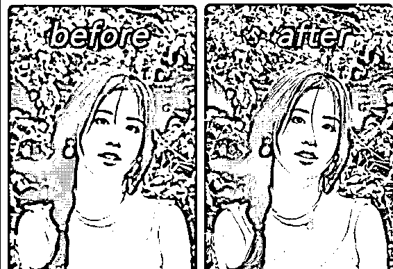

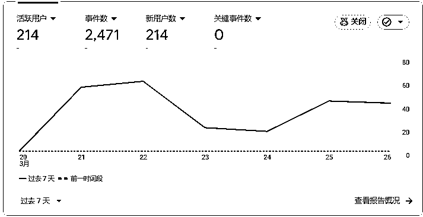

市面上类似工具不少，但能和朋友圈结合起来玩也有点意思。ps：第一款工具的流量后来发给朋友，她说要转给所有找她拍照的模特。

关键不在于工具本身，而是这个过程让我明白大家基本都是用最基础的 HTML、CSS、JavaScript 组合实现，而 bolt.new 给我生成的初版却是 Next.js 框架。当时我完全不懂，但页面颜值太高舍不得扔。结果发现因为路由和静态构建的问题一直部署不上线。

从那之后我就开始啃 Next.js 基础、API 调用、反爬虫思路、Worker 代理、微信屏蔽申诉流程等等。每个卡点都得耗很久，但这些经验后来都成了做抓取工具的底子。我觉得选个难一点的技术栈虽然问题更多，但进步速度会快很多。

后来每天刷航海群，总能看到有人问“怎么搞到游戏 iframe”。直播时也有人反复提这个问题。虽然有人已经意识到这块需求了，但一直没人填上。我开始觉得自己学的东西大概能试试，于是用一天时间把这个抓取工具搭出来了。

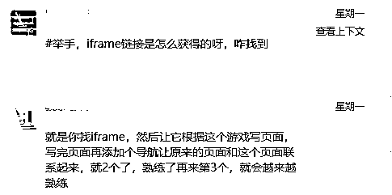

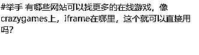

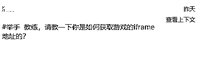

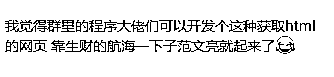

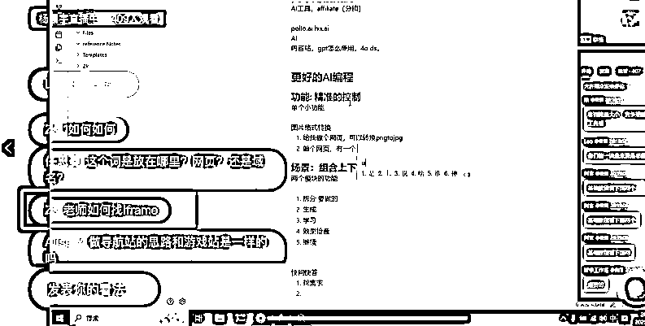

图片 src 的功能也是从群里的闲聊里捕捉到的：

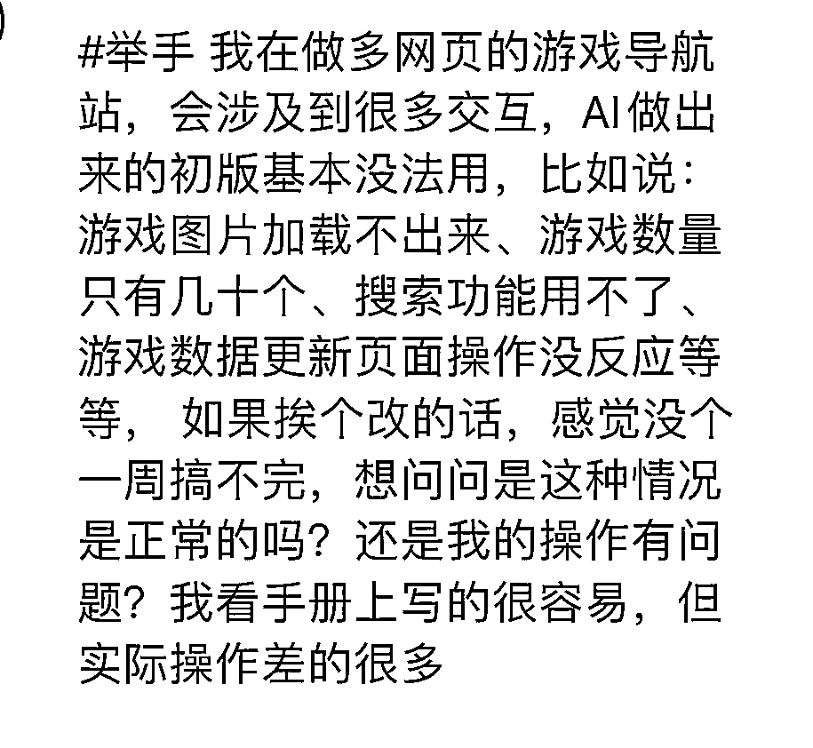

# 三，小白如何用 Cursor 复刻这种工具

我现在也只是入门水平，下面是我做 Web 工具的大致套路，仅供参考：

1. 先和 DeepSeek 捋需求。把我想做的东西跟他聊一下，聊透后再让他扮演顶级 UI/UX 设计师，给我一份给 Bolt.new 的精准提示词。

2. 把提示词丢给 Bolt.new，让它用 Next.js 生成页面。下载代码后用 Cursor 打开。

3. 终端跑 npm install，再 npm run dev，就能看到刚在 Bolt 上预览的界面了。

4. 很重要的一点是先搞懂项目结构。我常用的开场白是：你是一名资深程序员，请全面梳理项目代码，告诉我每个文件的作用，我是编程小白越详细越好，用中文说明。每次开新 chat 做新功能，第一句话就用它。

5. 搞清楚结构后，就知道哪个 UI 组件对应哪个文件。加功能时最好 @ 对应的文件。UI 改动和功能开发最好分开走，别让 AI 同时改两边，容易乱。

6. 功能实现需要一点基础概念。比如直接让 Cursor “帮我找 iframe”，十有八九找不到或不准。你得告诉他用正则，有些站源在 embed 里，有些藏在 JSON 字符串里。你最好自己先看源码找规律，截图给 AI 看它才明白。这一环节我常靠豆包语音问基础概念，比如 TypeScript 和 JavaScript 区别、Next.js 核心关键词等。

7. 功能和界面都成型后就是部署。我一般用 Vercel，对 Next.js 支持友好。会让 Cursor 检查是否遗漏配置文件，确认无误后上传即可。

tips：截图给 AI 看问题效率很高。简单常识性问题优先用豆包语音问，比文字问 DeepSeek 快很多。

# 四，收尾和下一步打算

上面就是我做这个抓取工具的起因和过程，希望能帮到还在一个个手动找 iframe 的伙伴们省点时间。

如果后续你也在做游戏站，或是有想加入的源站、别的抓取需求，都可以在评论区留言，我把站点清单和逻辑一起完善起来。虽然技术还有限，但会尽量满足。

Cursor 确实很强，但还是建议花时间打好代码基础，不然很多事还是无从下手。现在工具还不够完美，后面还想继续学推广、SEO、需求挖掘等。希望航海期间能和大家一起精进，航海结束时都能拿出一个自己满意的作品。