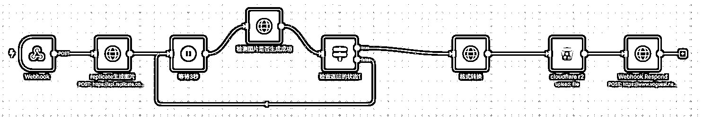
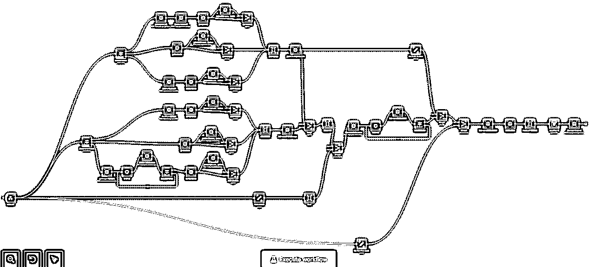
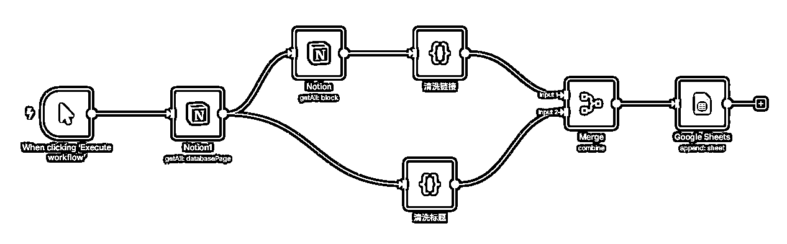
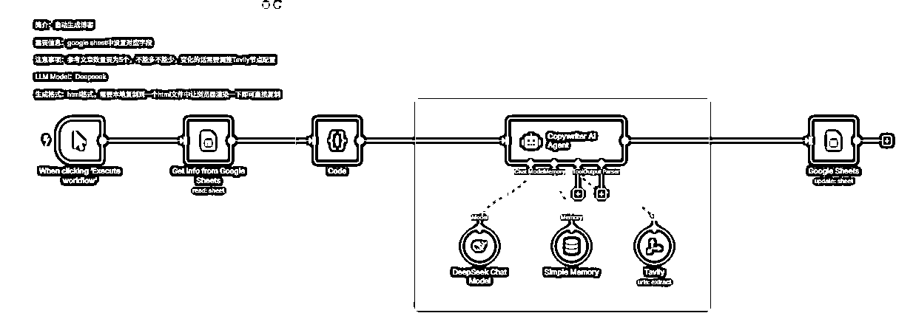
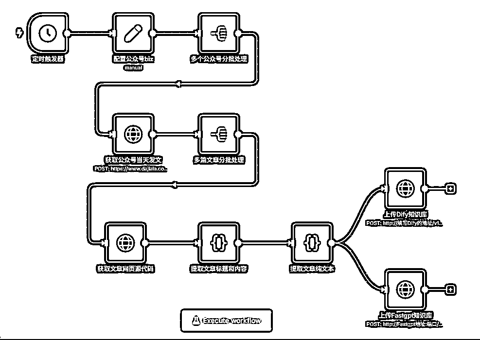
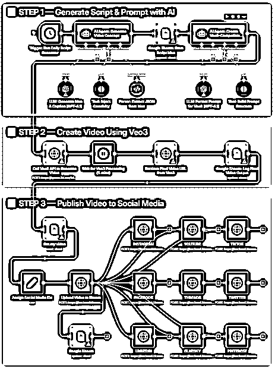
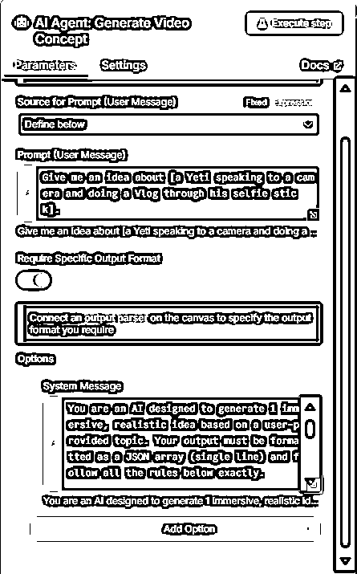
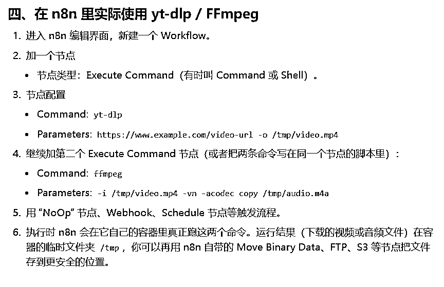
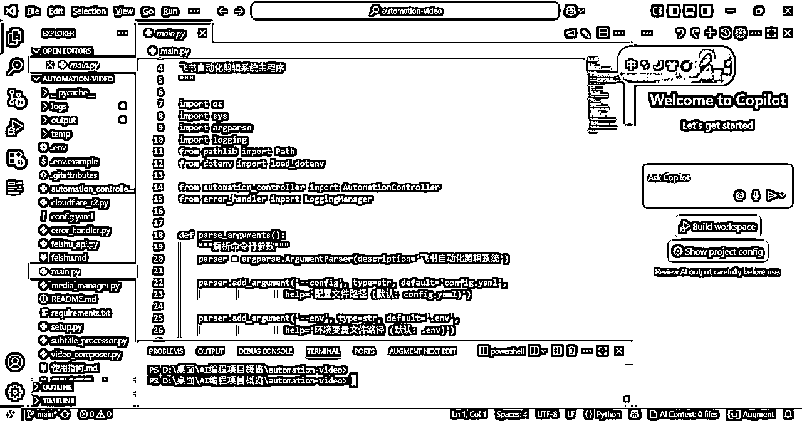

# 0-1 入门 n8n ，一文了解当下最火的自动化工作流平台
最近总有人问：n8n到底是个什么神奇工具，怎么一下子火起来了？其实我前段时间在杭州SCAI做了一场关于n8n工作流的内部分享，当时以为大家都会，没想到很多朋友还是有疑问。所以今天干脆把这段时间对n8n的理解认真梳理一遍，给刚入门的新手一个比较完整的认识。
一、n8n到底是什么？
一句话概括：n8n是一款自动化工作流平台，而且同时具备开源性、低代码属性。拆开来看，其实就是四个关键词：
- 开源：你可以自己本地部署，也可以放云端，基本上不需要额外掏授权费；相比Coze这类闭源产品，它背后有大量开发者持续做社区建设，氛围更开放，遇到奇奇怪怪的bug也更容易找到解决方案。
- 低代码：基本不用懂技术，个别代码节点让AI帮忙写就行，门槛很低。
- 自动化：定时触发、自动处理、批量处理都不在话下；只要对方开放API，基本都能接进来。
- 工作流：以流程节点为核心，更看重逻辑而不是技术。能把业务逻辑想清楚，就能把流程搭出来。
如果让我下个定义，我会说n8n是一个“高逻辑、低代码”的后端搭建平台。那些重复、机械的批量操作，甚至绝大多数AI应用的后端，基本都能用它完成。拿我自己打比方，除了数据库这种硬骨头之外，其余后端功能比如爬虫、生图、生视频、内容二创、内容上传、自动发邮件营销，我都在n8n里跑通过。
二、和Coze比起来，n8n强在哪？
市面上跟n8n对标的还有Dify、Zapier、Make等，但国内用户最熟悉的应该还是字节的Coze，我就重点拿它说。
Coze的优势很直观：部署完可以快速发布到多个平台，跟国内生态的连接特别紧密，比如各种小红书、抖音的内容二创智能体就很好用；插件库丰富，加上和飞书多维表格的联动，能落地很多场景。但它毕竟是闭源平台，更新和修bug完全取决于字节的节奏，我曾经就踩过Coze内部Python库定义错误的坑。它还不太支持海外的各种模型，某些场景下模型能力会偏弱，虽然可以用HTTP节点硬撑一下，但用起来总觉得不够顺滑，Agent相关能力也比较有限。
再来看n8n，我的实际感受是：界面更舒服，节点迭代速度很快，案例一大堆；只要掌握逻辑和API节点的布置，各种功能都能快速复刻出来，组合的想象空间更大，跟外部程序对接也更丝滑。
几个维度简单对比一下：
- 后端能力：n8n可以作为API或MCP嵌入到其他程序，也能配合开源项目一起跑；Coze虽然能作为API，但实现起来比较复杂，可扩展性也一般。
- 数据库对接：n8n自带飞书多维表格、Google Sheet、Notion等节点，还支持连各类向量数据库的API；Coze跟飞书多维表格的配合极其顺滑，其他数据库理论上能用API接，但实际案例很少。
- 开源性：n8n完全开源，可以本地或云端部署，社区非常活跃；Coze是闭源的，能力高度依赖字节，当然对99%的用户来说这个影响不大。
- 部署上线速度：n8n只能作为后端使用，没有前端界面；Coze可以很快上线带前端的智能体和小程序。
前期使用的话，我觉得两者没有本质区别，但n8n的上限明显更高，体验也更舒服。我在n8n里搭后端流程基本一路通畅；Coze就得在火山引擎、火山方舟、飞书开放平台、Coze之间来回折腾，很麻烦。目前我手里还有几个依赖多维表格联动的Coze工作流在跑，但后续大概率也会搬到n8n上——毕竟n8n在6月更新了飞书和微信公众号节点，对国内生态的友好度又上了一个台阶。
三、n8n实际能做什么？看这几个案例就懂了
3.1 最简单但最经典：API请求与异步轮询
这个场景通常用于AI网站的API套壳和数据存储。整个流程说起来很直白：
- webhook：负责接收程序发来的HTTP请求，作为工作流的启动开关；
- replicate生成图片：通过HTTP请求节点调用API出图；
- 检测图片是否生成：继续用HTTP请求节点做异步轮询，确认任务有没有完成；
- 检查返回状态：用IF节点判断结果；
- 格式转换：再做一次HTTP请求，把生成的视频转成适合长期存储的格式；
- Cloudflare R2：通过S3存储桶节点把视频放入云存储。

3.2 复杂版API请求与异步轮询
这个是我觉得n8n特别强的地方：面对复杂API，请求和响应的逻辑依然非常清晰。小白只要看懂上面那个简单版，跟着复刻这个复杂版基本没有压力。核心节点跟简单版一致，只是额外加了几个数据处理节点：
- Switch：做条件筛选；
- Set：负责信息储存和传递；
- Merge：做信息合并；
- Code：可以写代码处理特定任务，不写也行，全部丢给AI，我本人一行代码都没写过。
用这些节点有个万能公式：问AI“在n8n里实现X功能要用什么节点”→找到节点→截图问AI“这个节点怎么配置”→执行测试→如果报错就把错误日志贴给AI分析解决。

3.3 每天都能用上的自动化触发与写作
我的场景是：在手机里刷到一篇不错的公众号或博客文章，直接转发给“黑猩猩随手记”这个微信客服机器人（免费的，别人开发的，也可以自己搭），它会先把内容存进Notion。我目前会在Notion里手动把内容复制到新表里（黑猩猩那张表触发不了，本来可以塞进自动化流程，但对我来说提效不大，所以选择手动粘贴）。后面就是两个工作流接力：第一个把Notion里的信息同步到Google Sheets；第二个用n8n基于Sheets里的内容自动二创公众号文章。其实同步和二创这两步完全可以合并成一个工作流，我暂时还没集成到一起。
节点方面：
- When clicking是手动点击触发，测试阶段很方便；想自动跑也可以换成Notion或Google Sheets的trigger，检测到新增/更新按行处理即可。
- Agent节点相当于一个智能体，里面的chat model是大脑，目前用的主要是海外模型，国内的话就DeepSeek，需要官方API key；它还能挂辅助节点，比如记忆存储、网页搜索、固定输出格式等。
- Tavily是一个需要额外下载的搜索节点，能实现指定网页搜索和延伸搜索。我主要用定向搜索来投喂参考文章，你也可以换成Perplexity之类的节点。

3.4 公众号监控与信息筛选
如果你需要盯住指定微信公众号，每天定时抓取它更新的内容，这个工作流就正合适。核心是配置公众号爬取API。同理，小红书、抖音、TikTok、X、YouTube都有对应爬虫，有些是官方提供的，有些是个人写的；有的是API，有的是开源项目，但基本都能在n8n里实现。说白了，你完全可以用n8n搭一个只属于你自己的信息筛选平台。具体实现代码可以到公众号“袋鼠帝AI客栈”里翻一翻。

3.5 从0到1：AI视频自动化生成与上传
这个工作流讲的是：每天定时触发，AI先自动生成一个视频创意，输出环境prompt、创意idea、视频prompt、字幕等，再把信息存下来；接着AI根据这些提示词生成视频；最后完成存储和自动分发。每个节点其实前面都见过了，核心思路就是一条流水线。
按这个方案，你可以稳定批量产出60分的视频。想更进一步，可以把更多精力放到提示词优化、对标筛选和选题上；每个环节还可以插入人工干预来提升质量，从大规模60分做到高效产出80、90分。海外YouTube、TikTok、X、Facebook基本都有官方API，可以自动发布；国内的小红书、公众号也有非官方方案，自己上网搜一下就能找到。理论上，从选题、创作到分发，全自动内容工厂是可以通过n8n搭出来的。在n8n官方模板库里可以找到现成代码。

3.6 更复杂的AI视频自动化与剪辑
现在我自己的视频剪辑工作流，用的是Coze+飞书多维表格+本地ffmpeg的组合，后续准备整套搬上n8n，主要是Coze里充的钱还没用完，先消化一下再迁。为什么说n8n能接住这套流程？
- 内容批量生成：前面的几个工作流已经能实现批量提示词、图片、音频、字幕、短视频的生成，真正缺的只有剪辑环节。
- 集成剪辑：我现在是在飞书多维表格里批量生成字幕、音频、图片，再通过API把数据导出到本地，用本地ffmpeg脚本批量处理，完成后上传云存储，最后把链接写回飞书对应列。人工干预只有两步：喂初始文案，启动本地脚本。
- n8n在线剪辑：你可以在部署n8n的同时，把其他Github开源项目（比如ffmpeg）也部署好，然后在n8n里直接调用。这样的话，在线视频设计、生成、剪辑、上传就能一体化完成，非常适合做视频处理工具的后端。
当然，这里头还有很多内容质量和技术细节问题，我只想说明一点：这是可行的，而且小白通过一段时间学习就能掌握，并不涉及什么高深技术。

3.7 企业端的线索获取
最后看一个B端场景：获取潜在客户线索。这是一个典型的爬虫+信息搜集+处理+筛选案例，核心节点是Scrape（信息抓取）和Crawl（信息爬虫），能够抓取指定关键词类目的公司信息并完成初步整理。
有意思的是，这个用例里只有两个核心节点是新的，其他节点我们全都见过了。说白了，只要你把业务逻辑拆清楚，然后问AI用什么节点或哪些节点组合能实现，就能很快搭出来。去看X、YouTube上那些n8n博主，本质上都是把几个新出的官方节点或者社区开发者贡献的节点组合成新功能，底层逻辑完全没变，一通百通。所以用好n8n，真正重要的不是节点或者平台本身，而是你对业务逻辑的理解。
四、怎么把n8n跑起来？
n8n有四种主流使用方式：
1. 官网使用：注册后免费试用14天，之后最低24美元/月。想多薅几天羊毛，可以开多个邮箱试试。
2. 云托管：云平台已经帮你部署好了，买来直接用，最低5美元；个别平台甚至可以白嫖，条件是GitHub注册满半年。
3. 本地部署：需要懂一点容器知识，用Docker部署在本地，并暴露公网给程序调用。
4. 云端部署：自己买服务器，部署开源的n8n，主要成本就是服务器费用。
我给新手的建议是：先去官网试用，14天如果觉得顺手，就切到云托管；对小白来说，云托管的并发量已经足够用了。等以后用户量真的大了，再考虑买服务器做云端部署。云托管一般每月5美元就足够，用户量大了再补钱升级。ClawCloud还有每月5美元的羊毛可以薅——GitHub注册超过半年的用户就能享受，四舍五入等于免费。
五、可以用AI帮你搭n8n吗？
n8n的工作流本质上是JSON文件，所以我们能看到很多模板可以通过下载JSON后直接导入。AI也很擅长理解JSON，所以用“vibe coding”的思路来搭n8n完全可行。比如用Cursor、Claude先把JSON文件写出来，再一键导入n8n，初始节点就自动生成好了。
但我个人不太建议这么做。n8n本身已经是极简的低代码平台了，亲手搭建节点的过程，同时也是加深业务理解、完善业务建设的过程；用AI帮忙生成工作流，提升的效率其实并没有那么明显。除非你已经对流程非常熟、对节点也很熟，那用AI提速完全OK；否则我更推荐从头到尾自己亲手搭一遍。
六、学习资料自取
最后，把我整理的一些n8n相关资料分享出来：
- 赚钱的n8n相关帖子
- n8n自动化剪辑思路：https://poe.com/chat/loh4ox79tpg1rg5num
- n8n+飞书自动化：https://mp.weixin.qq.com/s/NpXu6lNRhhYd5JUyhH7X0g
- 袋鼠帝AI客栈n8n合集：https://mp.weixin.qq.com/mp/appmsgalbum?__biz=MzkwMzE4NjU5NA==&action=getalbum&album_id=3931445404583133190&scene=126&sessionid=408581405#wechat_redirect
- YouTube上的n8n博主：https://www.youtube.com/@AI-GPTWorkshop
- n8n官方模板库：
- Github开源n8n模板库：
希望这篇能让你对n8n有一个更完整的了解。如果你也想把重复劳动交给自动化，不妨从今天开始搭一个属于自己的工作流。