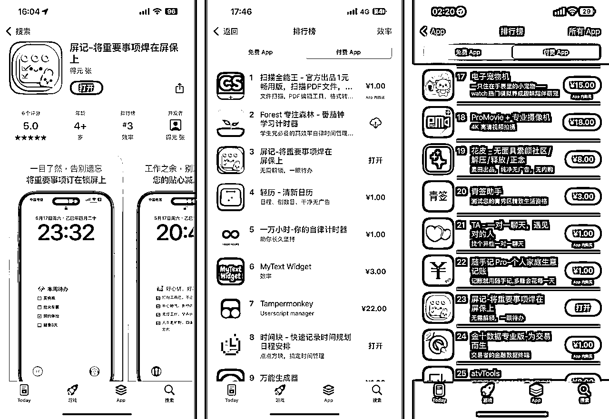
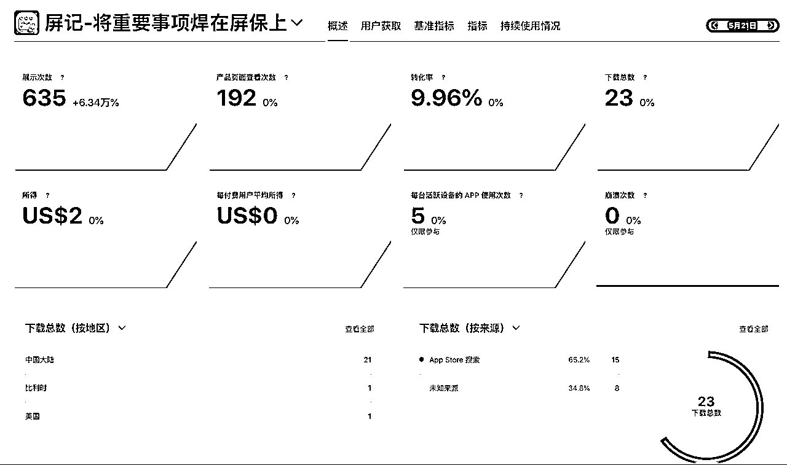
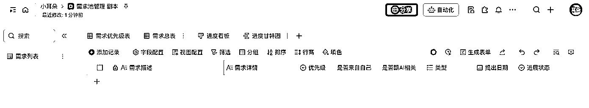
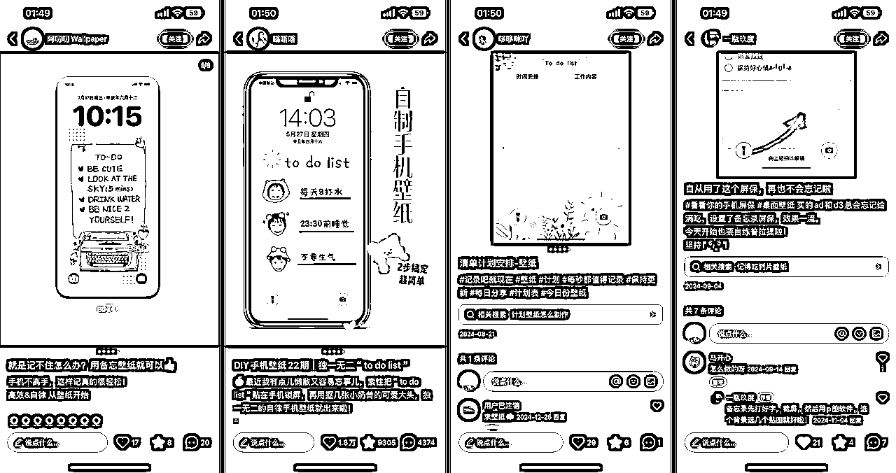
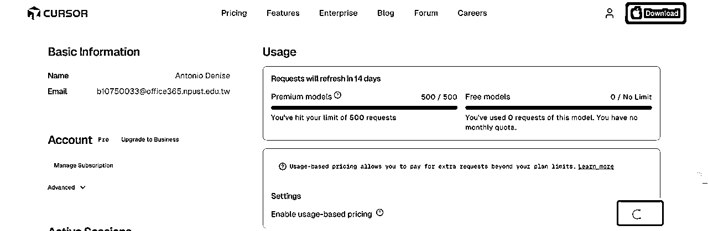
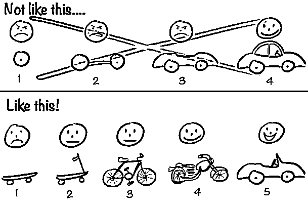
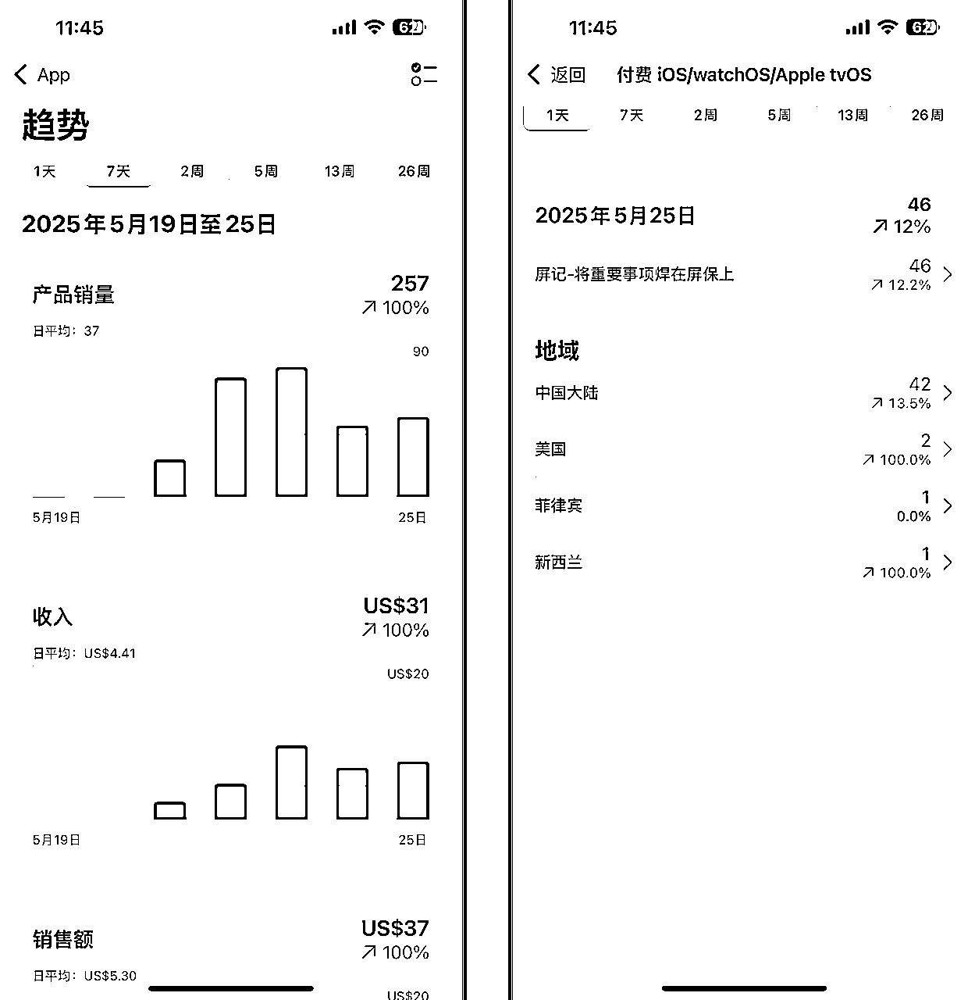
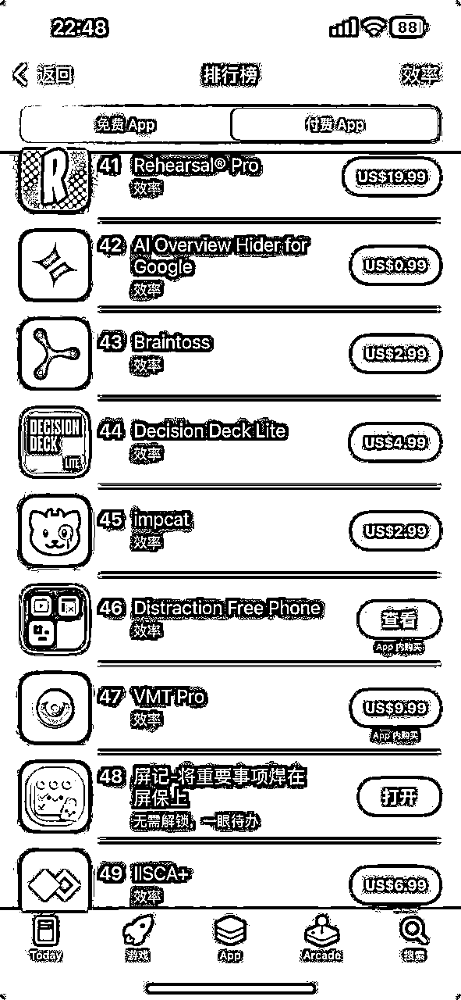
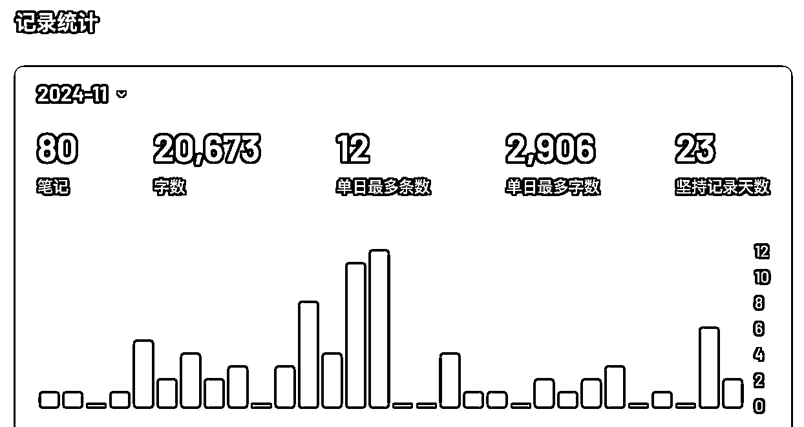
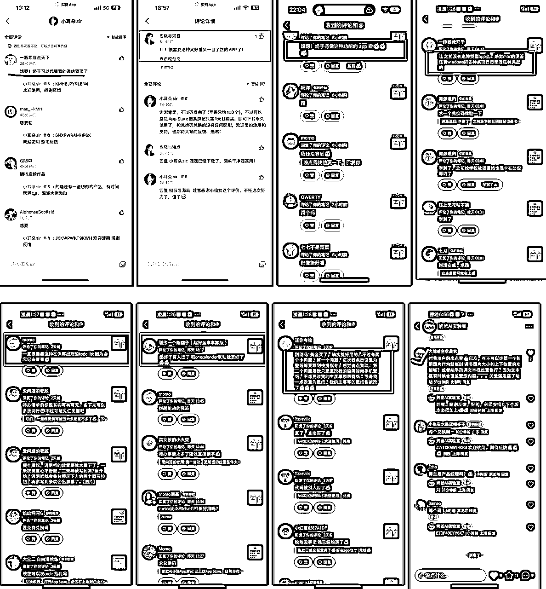

# 0代码冲上付费榜Top3：一位产品经理的完整复盘与新人避坑指南
作者：龙哥

## 一、先说结论：不会写代码，也可能做出产品

如果你最近一直在关注 AI 编程，可能会有一个疑问：

> 不懂代码、没有推广资源，真的能独立做出一款 App，并且冲进 App Store 付费榜吗？

我的答案是：可以。

我用 Cursor 从创建项目到提交上架，确实没有亲手写过一行代码。更意外的是，产品上线当天便进入了 App Store“效率”分类付费榜前 25，第二天冲到第 4，随后连续两天保持在第 3 名。

当时排在前面的，是扫描全能王和 Forest 专注森林。前者是总榜第一，后者是总榜第六。屏记能在一个分类榜单里和它们并列，已经远远超出了我最初的预期。

这篇文章主要分享四件事：

1. 没有代码基础，如何做出并上架一款 App；

2. 屏记从上线到冲进付费榜 Top3 的真实数据与过程；

3. Cursor、Xcode 实操中的重点问题和避坑经验；

4. 一个普通人如何找到产品方向，并在 AI 时代开始行动。



## 二、先介绍一下我自己

我坐标上海，有 8 年产品经理经历，但过去从来没有真正写过代码。屏记是我的第一款 App。

此前，我主要在国内语音直播、社交和商业化业务中工作，也做过视频号、小红书和抖音账号。其中视频号粉丝超过 10 万，小红书有两个 1000+粉丝账号，抖音有一个 1000 粉丝账号。

我加入赚钱大约半年，目前正在全职创业，接下来会重点尝试出海 Web 产品。一路走过来，新人容易踩到的坑，基本都亲自踩了一遍。

所以这篇文章不会把自己包装成“技术高手”，更多是一个普通产品经理的真实记录。

## 三、0代码到底能不能做 App？

### 3.1 我是真的没有写代码吗？

是的。

从创建项目、设计页面、调试功能，到最终提交 App Store，我没有手动敲过一行代码。

原本我以为，这种事情在 AI 编程时代已经很常见了。但实际情况并不是这样。小红书上有人质疑，过去的互联网同事也会问：

> 你上架苹果，应该遇到很多技术问题吧？

但就我的经历来说，上架反而是最容易的部分之一。

这让我意识到，我们很容易被周围的信息环境限制判断。很多人会提前想象一堆困难，然后因为这些“想象中的问题”迟迟不敢开始。

尤其是在 AI 技术快速发展的今天，过去的经验并不一定仍然适用。很多所谓的“过来人建议”，可能已经跟不上现实变化。

### 3.2 适不适合一上来就0代码？

这要看你的起点和目标。

如果你只是想体验一次产品开发，比如做一个简单网页、计算器、记事本，或者完成一个小工具，那么完全可以直接借助 AI 开始。即使完全不懂代码，也能获得非常明显的正反馈。

但另一类人需要谨慎。

他们可能一直因为不会代码而没有做产品，突然听到“AI 可以帮你写 App”，于是直接选择一个复杂项目，想一步到位。

这类人很容易在中途卡住，最后得出一个结论：

> AI 编程也不过如此。

甚至还会去评论区告诉别人，AI 写代码根本不实用。

我自己的经历，大致可以分成几个阶段。

#### 第一阶段：给自己定了一个不太现实的目标

确定产品想法后，我给自己定下了一个计划：

> 一周之内完成 App。

现在回头看，这个目标明显过于乐观。

光是注册苹果开发者账号、完成基础配置、安装 Cursor、熟悉开发界面和运行方式，就花了 1 到 2 天。

#### 第二阶段：补 Cursor 基础

虽然不会代码，但我知道至少要懂 Cursor 的基本操作。

于是我把赚钱中关于 Cursor 的热门内容基本看了一遍，包括：

- Rules 的使用；

- 如何让 AI 生成原型和 PRD；

- 记忆库、版本管理；

- 不同模型和版本之间的差异；

- 如何让 AI 更稳定地执行任务。

这一阶段同样花了大约 1 到 2 天。

#### 第三阶段：经历“无限续杯”的弯路

很多新人一开始并没有付费使用工具的习惯，我也一样。

当时网上流行一些 Cursor 的免费额度技巧，我也花时间尝试过。后来看到大家讨论 Cursor“变笨”“降智”，我意识到，账号或设备可能已经被系统限制。

作为一个互联网从业者，我也明白一个道理：如果付费能节省大量时间，就不应该为了省一点工具费用，把时间浪费在反复试错上。

于是我直接开通会员，开始正式开发。

#### 第四阶段：先完成界面

我之前已经自己做了一份产品原型，因此先把原型交给 Cursor，再让它进一步整理成 PRD，然后生成界面。

这个过程总体比较顺利。

真正让我崩溃的，是第一个 App 完成界面之后。

### 3.3 第一次绝望：App 首次启动白屏十几秒

我用 iPhone 13 Pro Max 测试时，App 安装完成后首次启动非常慢，白屏时间甚至达到 10 到 20 秒。

这当然无法接受。

我不断询问 AI，也尝试使用 Xcode 的 Debug View Hierarchy 查看视图层级。Cursor 一开始把问题归因于页面结构复杂、性能开销过大，建议我重构。

我折腾了很久，最后甚至放弃了第一个项目，重新换了一个产品方向。

直到后来，我新建了一个只有 Hello World 的测试 App，依然出现相同问题，才终于意识到：这并不是我的代码或页面结构导致的。

### 3.4 真正难熬的是“改了半天却没有进展”

开发过程中，我多次遇到这样的场景：

- Cursor 改了半天，问题依然存在；

- 修改一个地方，又引发另外几个错误；

- AI 不断给出建议，但项目始终没有明显进展；

- 自己完全不懂底层原理，不知道应该继续还是推倒重来。

这种状态往往会持续半天，甚至更久。

很多新人就是在这一阶段放弃的。

我之所以坚持下来，一方面是因为我对产品本身有信心，另一方面也逐渐开始理解 AI 正在修改什么。虽然我依然不会写代码，但我会尝试追问：

- 这个问题的源头是什么？

- 当前修改会影响哪些模块？

- 是局部问题，还是项目结构问题？

- 这个方案是在解决根因，还是暂时绕开错误？

当你开始从抽象层面理解项目，而不是无条件接受 AI 的每次建议，效率会明显提升。

最终，我花了一个多星期熟悉 Cursor，并用两周左右完成了第二款 App。

所以，所谓“0代码开发”并不是没有成本，而是把代码成本转移成了学习成本、沟通成本和排错时间。

如果你真的想长期做 App，我建议先花一天补一些最基础的技术知识。B 站入门教程、AI 老师、简单的项目结构介绍，都足够你建立初步认知。

不用成为程序员，但至少要知道 AI 大概在修改什么。

## 四、没有推广，为什么也能冲进付费榜？

### 4.1 上线第一天只有23个下载

屏记上线第一天，核心数据里最关键的一项是：

> 总下载量：23。

但就在这一天，它进入了 App Store“效率”分类付费榜第 25 名。

这意味着，很多人以为需要大量投放、社交媒体推广或资源渠道，实际上并不一定。

我上线当天只告诉了几个朋友，这些下载量基本可以忽略不计。最大的原因，很可能是苹果对新上架 App 存在一定程度的流量扶持或观察期曝光。

这就是一个非常典型的信息差。

很多互联网从业者会默认：没有推广就不可能有排名。但在 App Store 的分类榜单中，新产品只要在短时间内获得一定下载和付费行为，就有机会迅速获得榜单位置。

当然，不同分类的竞争强度不同，具体门槛也会变化。但“少量下载即可进入分类榜前列”这个现象，确实值得新人了解。

后续屏记继续向上爬升：

- 上线当天：进入“效率”分类付费榜 Top25；

- 第二天：冲到第 4；

- 随后：连续两天保持第 3；

- 付费总榜：最高进入前 23。

这也解释了为什么我会把屏记称为“它”，而不是单纯把它看作一组代码。

看着它从刚上线时的无人问津，到在榜单上慢慢向上移动，会产生一种很奇妙的感觉。它像一个刚刚走上赛场的新选手，在和成熟产品竞争，也逐渐拥有了自己的生命力。



## 五、屏记为什么能被做出来？

### 5.1 动机决定你能不能坚持到最后

很多人做产品的起点是：

> 最近 AI 很火，我也想试试。

这种动机通常不够强。

如果产品遇到复杂问题，或者连续几天都没有进展，很容易停下来。真正能支撑你走完开发、上架和推广过程的，往往是一个足够明确、足够强烈的理由。

我做屏记，主要有两个原因。

第一，我认为在 AI 时代，开发 App 正在逐渐成为一种新的生活技能。

生活中仍然存在很多细小、具体、尚未被充分满足的需求。它们可能不会成为一个巨大的市场，但对一部分人来说非常重要。

未来，做一款小产品可能会像今天做短视频一样普遍。并不是每个人做的视频都会爆，但每个人都有机会表达自己，也有机会解决一个小问题。

第二，我相信屏记确实能够帮助一部分人。

它未必会成为一个拥有千万用户的产品，但只要有人真的需要它，就足以让我在开发过程中继续坚持。

这也是我熬过多次想放弃时刻的重要原因。

AI 会降低开发门槛，但不会替你完成判断、选择和坚持。

## 六、如何发现真正值得做的需求？

### 6.1 先从自己的问题开始

对于新人来说，寻找产品方向可以先记住三个原则。

#### 原则一：优先解决自己遇到的问题

如果你自己每天都遇到某个麻烦，通常比凭空想象一个市场更可靠。

因为你能清楚描述：

- 问题发生在什么场景；

- 当前解决方案哪里不方便；

- 你愿意为它付出什么成本；

- 其他人可能遇到哪些类似问题。

#### 原则二：研究成熟产品，但不要只会照抄

发现市场上已经有竞品，并不代表没有机会。

真正应该思考的是：

- 我能否做得更简单？

- 能否降低价格？

- 能否让体验更顺畅？

- 能否服务更细分的人群？

- 能否解决竞品长期忽略的痛点？

#### 原则三：套用需求分析公式

可以反复问自己一句话：

> 什么人，在什么场景下，愿意花多少钱，解决什么问题？

这句话能帮助你从“我觉得这个想法不错”，走向更具体的产品判断。

### 6.2 屏记的需求是怎样出现的？

有一次看涛哥直播，有人提问：

> 行动力差怎么办？

涛哥当时说，很多时候不是没有目标，而是缺少外部驱动力。随后他拿起手机解释，自己会把待办事项放在锁屏上。一天解锁很多次，就会被迫看到很多次，借助外部提醒弥补自驱力不足。

这个场景让我产生了兴趣。

我随后在小红书上搜索类似产品，确实存在一些锁屏待办工具，但它们普遍存在两类问题：

- 功能太复杂；

- 价格相对较高。

于是我意识到，这可能是一个值得尝试的切入口。

### 6.3 两个培养产品敏感度的方法

#### 方法一：长期维护需求池

平时遇到任何不方便、反复出现、需要手动解决的问题，都可以先记录下来。

不要急着判断它是不是好需求，先积累，再定期整理。

需求池可以记录：

- 问题来源；

- 使用场景；

- 目标用户；

- 当前解决方式；

- 现有产品；

- 用户抱怨；

- 可能的收费方式；

- 自己是否愿意使用。



#### 方法二：经常查看榜单

榜单可以帮助你了解哪些问题正在被用户付费解决，也能观察产品的功能组合、价格和分类变化。

例如可以查看：

https://appfigures.com/top-apps/ios-app-store/united-states/iphone/top-overall

长期观察之后，你会发现很多所谓的新点子，其实都可以从已有产品中拆解、重组和改良。

## 七、发现竞品，不代表你的想法失败了

### 7.1 普通人想到的需求，大概率已经有人做过

作为普通创业者，我们想到的需求，很多已经存在于市场中。

如果你搜索不到类似产品，通常只有两种可能：

1. 你还没有找到；

2. 这个需求只是想象出来的，并没有真实用户。

所以，当你搜索到竞品时，不应该立刻失望。

相反，这通常说明你已经完成了最重要的一步：发现了一个真实存在的需求。

### 7.2 成熟竞品反而是学习资料

竞品可以帮助你快速获得很多信息：

- 它服务什么用户；

- 用户为什么选择它；

- 用户最不满意什么；

- 哪些功能被频繁使用；

- 哪些功能只是装饰；

- 它的价格和商业模式如何；

- 用户评论中有哪些高频抱怨。

如果是安卓产品，还可以让 AI 辅助分析安装包，从技术架构和功能实现角度了解它是如何完成的，再结合自己的定位重新设计。

成熟产品替你验证了市场，也替你踩过很多坑。

### 7.3 先做MVP，再用低价切入

你不需要一开始就做一个功能齐全的“大而全”产品。

可以先实现最核心的一个功能，做出 MVP，然后用竞品十分之一左右的价格进入市场。

如果产品确实能够解决问题，再逐步增加功能、优化体验、提高价格。

与此同时，还可以直接进入竞品用户聚集的渠道，观察他们的反馈和抱怨，从中寻找突破口。

“所有工具都值得被 AI 重新做一遍”，这句话可以作为产品判断中的一个提醒。

## 八、低成本验证需求的几种方式

### 8.1 应用市场与第三方工具

先围绕用户问题收集关键词，再去应用市场、产品数据库和第三方工具里搜索。

重点不是看有没有同类产品，而是看：

- 同类产品数量；

- 评分和评论；

- 用户抱怨点；

- 价格差异；

- 是否存在细分人群没有被满足。

### 8.2 在闲鱼或 Fiverr 上试水

国内可以通过闲鱼，海外可以通过 Fiverr，用较低成本测试是否有人愿意为你的解决方案付费。

先不要急着开发完整产品，可以用人工服务、半自动流程或简单原型完成交付。

只要有人愿意咨询、下单或持续追问，就说明需求可能比想象中更真实。

HeyGen 早期通过 Fiverr 验证市场的案例，也说明了一个道理：验证不一定要从复杂开发开始。

### 8.3 用小红书观察用户行为

小红书不仅适合推广，也适合做需求调研。

可以尝试：

- 搜索核心关键词；

- 查看相关笔记和评论；

- 通过评论区寻找用户抱怨；

- 观察用户是否在分享自己的替代方案；

- 记录大家用什么笨办法解决问题。

其中一个很有价值的信号，是用户自制的“手工 App”。

所谓手工 App，就是用户没有真正的工具，只能通过非常原始、低效、麻烦的方式完成某件事。

这类方案看起来不专业，却往往代表着强需求。

屏记最初就是从许多类似的“手工解决方案”中获得信心的。



如果搜索和观察还不够，可以主动发帖测试。

比如发布一条内容：

> 求推荐一个锁屏待办 App，本人是重度拖延症。

接下来观察评论区是否有人推荐产品、询问功能，或者表达同样的困扰。

如果你已经做出了高保真原型，还可以以“产品预发布”的形式发布内容，提前收集种子用户。新账号往往也有一定的初始流量扶持。

### 8.4 让身边人参与验证

家人、朋友和朋友圈同样可以用来测试需求。

不过要注意，熟人可能因为不想让你失望而给出过于积极的反馈。

因此不要只问：

> 你觉得这个产品怎么样？

更应该观察他们是否愿意：

- 主动使用；

- 留下联系方式；

- 加入测试；

- 转发给别人；

- 付出时间或金钱。

真实行动通常比口头认可更有参考价值。

如果是做海外市场，可以把小红书替换为：

- X；

- Facebook；

- GitHub；

- Reddit。

验证逻辑并没有改变。

## 九、Xcode新手最容易遇到的问题

我也是第一次使用 Xcode，以下经验不一定适用于所有项目，但对刚开始做 iOS App 的人应该比较有帮助。

其他常见问题，可以结合航海教程和 AI 一起解决：

https://scys.com/view/docx/YP5odm6E9oZ356xv9e8cKVfmn9b

### 9.1 首次启动白屏很久，不一定是你的代码有问题

这是我整个开发过程中踩得最深的坑。

当时反复排查了三四天，问 AI、问身边的人都没得到有效答案，甚至还因此暂停了另一款 Demo。

典型表现是：

- 项目功能还很少；

- 安装后第一次打开非常慢；

- 黑屏或白屏持续十几秒；

- 看起来像是应用卡死。

如果你在 iPhone 13 Pro Max 等设备上遇到类似情况，不要立刻认定是页面结构或业务代码的问题。

这可能与本地设备运行环境有关。

我后来发现，最终从 App Store 下载的安装包并没有同样的问题。因此，在没有进一步证据之前，不要因为本地测试设备的异常表现，轻易推翻整个项目。

### 9.2 Xcode打包与连接方式

Xcode 常见的设备连接方式主要有两种：

- USB 数据线；

- 无线局域网。

使用数据线时，尽量选择质量可靠的线材，不要为了省几十元购买过于廉价的产品。稳定的连接能明显减少调试过程中的额外问题。

无线方式更方便，但有一个容易忽略的步骤：

第一次连接时，需要先通过 USB 将 iPhone 与 Mac 配对。完成后，才能在 `Manage Run Destinations...` 中开启无线连接。

之后手机和 Mac 处于同一 Wi-Fi 环境，就可以进行无线运行和测试。

## 十、Cursor新手避坑与实用技巧

下面这些经验不仅适用于 iOS，也适用于其他 AI 辅助开发项目。

### 10.1 不要过度依赖 Restore Checkpoint

Cursor 提供了 `restore checkpoint`，但它不能替代真正的版本备份。

我遇到过多次恢复成功但项目状态不完整的情况，例如：

- 文件丢失；

- 修改没有完全撤销；

- 部分代码已经回退，另一部分却仍然保留；

- 项目结构出现混乱。

所以，每完成一个重要阶段，都应该主动备份。

如果暂时不会 GitHub，也不用复杂化，直接复制整个项目文件夹，按照时间节点保存多个版本即可。

简单、笨拙，但非常可靠。

### 10.2 不要一次性给AI塞太多任务

很多新人会觉得 Cursor 很聪明，于是一次提出大量需求：

> 把登录、支付、数据库、动画和会员系统一起完成。

Cursor 通常不会直接拒绝，而是会尝试迎合。但你很可能无法控制这种复杂修改，最终导致：

- 编译错误增加；

- 项目结构被改乱；

- AI 不断修复自己制造的问题；

- 原本的开发主线逐渐偏移。

更稳妥的方式是：

1. 先让 AI 分析整体任务；

2. 把任务拆成清晰的小步骤；

3. 将计划保存到项目中的某个文件；

4. 每次只执行一个阶段；

5. 定期让 AI 更新完成进度和待办事项。

把 AI 当作执行能力很强的助手，而不是可以一次性接管整个项目的工程团队。

### 10.3 编译错误是新手的高频拦路虎

刚开始开发时，经常会遇到各种编译问题。

其中最常见的一类，是组件、类型和依赖关系相关的错误，例如：

- `Cannot find type 'XXX' in scope`

- `Ambiguous use of 'XXX'`

- `No such module 'XXX'`

对于熟悉项目结构的人来说，这些错误并不难定位。但新手往往不知道：

- 文件应该放在哪里；

- 类型在哪个模块中声明；

- 依赖关系如何建立；

- 为什么同一个名称会产生冲突；

- 修改一个组件为什么会影响其他页面。

这也是为什么，我建议新人至少学习一些基础知识。

你不需要马上掌握完整开发体系，但应该知道项目由哪些部分组成、文件之间如何引用、组件和模块分别负责什么。

我自己也整理过相关 Rules，并在实际使用中获得了比较明显的帮助。如果你有更好的处理方法，也欢迎一起补充。

## 十一、最后想说：AI降低了门槛，但没有取消门槛

这次经历给我最大的收获，并不是屏记赚了多少钱，也不只是它进入了 App Store 付费榜 Top3。

更重要的是，我亲自验证了一件事：

> 普通人完全可以借助 AI，把一个具体想法做成真正可用的产品。

但这并不意味着“完全不用学习”。

AI 能帮你写代码、搭页面、查错误，却无法替你完成：

- 需求判断；

- 用户验证；

- 产品取舍；

- 逻辑思考；

- 坚持推进；

- 面对不确定性的心理建设。

如果你只是因为看到别人用 AI 做出 App，就临时起意跟风，遇到困难时很容易放弃。

但如果你真的有一个长期困扰自己的问题，或者相信某一类用户确实需要一个更好的解决方案，那么现在就是一个值得开始的时间点。

不要先问自己：

> 我会不会写代码？

不妨先问：

> 我能不能找到一个真实问题，并愿意持续把它解决下去？

因为在 AI 时代，真正稀缺的可能不再是写代码的能力，而是发现问题、理解用户、做出判断，以及把事情坚持完成的能力。

```
# iOS项目编译错误防范规则
## 1\. 项目结构规则
- **文件完整性检查**：每次引用新组件前，确保该组件文件已创建并添加到正确目录
- **模块化开发**：功能相关的组件和模型放在同一目录下，降低跨模块依赖复杂度
- **导入语句集中管理**：在每个文件顶部集中声明所有导入，避免散落在代码中
- **使用工作空间视图**：定期检查项目文件结构，确保物理文件结构与代码引用结构一致
## 2\. 依赖管理规则
- **条件编译规范化**：所有平台特定代码必须包含在`#if canImport(UIKit)`等条件块中
- **依赖前置声明**：当一个组件依赖另一个组件时，先确保被依赖组件已实现
- **避免循环引用**：设计时避免组件间形成循环依赖
- **统一导入次序**：先导入系统框架，再导入自定义模块
## 3\. 类型安全规则
- **类型前置定义**：先定义数据模型和接口，再实现使用它们的视图
- **扩展方法集中化**：所有扩展方法（如Color扩展）放在单独的`Extensions.swift`文件中
- **避免隐式类型推断**：显式声明变量类型，减少编译器推断错误
- **枚举类型完备性**：使用枚举时确保处理所有可能的case，避免运行时异常
## 4\. 开发流程规则
- **增量编译原则**：每添加一个新组件或修改关键功能后立即编译验证
- **组件独立测试**：新组件开发时使用SwiftUI预览功能独立测试
- **错误优先修复**：发现编译错误立即修复，不累积错误
- **引用前实现**：先实现被引用的组件，再实现引用它的组件
## 5\. 跨平台兼容规则
- **平台特定API隔离**：将iOS特定API隔离在条件编译块中
- **备用实现提供**：为平台特定功能提供通用备选实现
- **优雅降级机制**：设计功能时考虑在不同平台上如何降级实现
- **避免硬编码依赖**：不要假设特定平台API必定可用
## 6\. 代码审查规则
- **编译前检查清单**：大型更改提交前执行检查清单验证
- **依赖图审查**：定期审查组件依赖关系，简化过度复杂的依赖
- **代码重构优先级**：识别并重构高风险区域（多平台代码、条件编译复杂区域）
- **注释关键依赖**：在关键依赖处添加明确注释，说明依赖关系
遵循这些规则，可以显著减少编译错误，提高开发效率，让你的iOS开发过程更加顺畅。
```

对于刚开始使用 Cursor 的人来说，最容易遇到的一类问题，就是明明只改了一个局部，却突然引发编译报错。可以试试下面这套 rules，我个人实践后，确实能明显减少类似问题。

```
# 最小侵入原则
- 直接在主视图中添加功能，不创建新文件
- 不依赖现有的viewModel结构
- 将壁纸设置功能单独实现为独立的扩展
# 经验教训应用
1\. **先修复再添加**：在添加新功能前，确保项目基础结构完整、无编译错误
2\. **分步验证**：每个修改步骤后都要验证编译状态
3\. **最小可行路径**：寻找修改成本最低的实现路径
4\. **分离关注点**：新功能尽量独立，减少对现有代码的依赖
5\. **备份先行**：大型修改前先备份项目，以便快速回退
# 分阶段实现策略
- 第一阶段：只添加UI元素，不实现功能
- 第二阶段：在确认项目结构问题解决后再添加功能逻辑
# 独立功能管理
- 考虑创建简单的状态管理而非依赖复杂的ViewModel
- 使用UserDefaults而非Core Data来存储简单的状态标记
```

##### 坑 4：费用问题

新手使用快速请求时，次数往往消耗得特别快。如果你比较在意使用成本，一定要检查并关闭下面的自动付费选项。否则，快速请求额度用完后，系统可能仍会继续自动扣款。



#### 3.5.2 给新手的实用技巧

##### 技巧 1：开发一个 App 的基本顺序

如果完全没有经验，建议按照下面的流程推进：

1. 先把产品原型和 PRD 做出来。觉得画原型太麻烦，也可以直接让 Cursor 协助完成。不过我个人更习惯自己画，速度反而更快，具体可以根据自身情况选择。这里推荐参考：https://scys.com/articleDetail/xq_topic/1524252825882182，感谢 @沐之 大佬带来的启发。

2. 把原型和 PRD 交给 Cursor，让它先完成首页框架以及基础布局。

3. 继续补齐页面功能和页面之间的跳转关系。

4. 在功能可用的基础上，逐步优化视觉界面与交互体验。

5. 最后进行测试、排查问题并持续调优。

##### 技巧 2：建立“记忆银行”

如果你是新手，可以尝试使用记忆银行的方法。这里直接分享一份来自 @阿杰 大佬的内容。

##### 技巧 3：固定提问结构

当一个问题反复处理仍然没有解决时，可以把下面这段要求一次性发给 Cursor。这个方法被很多人验证过，实际效果确实不错：

1. 先把问题完整、准确地描述出来。

2. 说明自己最终想达到什么结果。

3. 先让 Cursor 讲清楚它对当前问题或需求的理解。

4. 让它分析这类问题通常可能由哪些原因造成。

5. 结合已有信息，列出可行方案，并明确给出它最推荐、最可靠、最容易落地的一种。

##### 技巧 4：尽量把需求说准确

没有技术基础并不可怕，但你需要在表达上投入更多精力。尽可能用简洁、明确的语言，把问题和目标讲清楚。正如小排老师所说，这其实很考验语文功底。

##### 技巧 5：合理利用回退功能

新手通常很难判断 Cursor 提供的多个方案哪个最终效果更好。此时可以按照推荐顺序，利用 restore checkpoint 一个个尝试，过程有点像 AI 绘图时不断抽卡，总能找到更合适的结果。

##### 技巧 6：主动配合测试

Cursor 虽然能够通过运行终端、执行编译等方式完成一定程度的自检，但遇到比较顽固的问题，还是需要人机配合。你可以这样询问：

* “为了更准确地定位问题，你需要我执行哪些具体测试或输入哪些内容？”

* “哪些日志、报错信息或操作步骤能够帮助你分析？”

* “我应该如何配合测试，才能更快找到 bug 的根源？”

* “如果需要复现这个问题，我具体应该怎么操作？”

##### 技巧 7：别在模型选择上反复纠结

对于新手来说，没必要不停更换模型。一般情况下，直接使用最新的 Claude 4.0，并开启 thinking 模式即可。只有面对非常简单的需求或问题时，才需要考虑其他选择。

##### 技巧 8：不要放弃独立思考

代码能力暂时不足，并不意味着要无条件接受 Cursor 的每一个建议。真正重要的是逐渐培养深入分析和抽象问题的能力。

比如我在做“屏记”时，曾遇到待办事项文字无法和前面的复选框完全对齐的问题。Cursor 尝试修改了很多次都没有解决，后来我换了一种表达方式：

“可以把文字部分理解成一个独立的透明容器，只要让这个容器的垂直中心与复选框中心对齐即可。”

这样一来，Cursor 很快就完成了调整。

### 3.6 新人应该如何确定 MVP？

#### 1. 先建立正确认知

MVP 几乎是做产品、做项目时最重要的原则之一，另一个经常被提到的概念是 PMF。如今，MVP 已经不只是产品方法论，也逐渐成为做事方式。

但这里有个容易被忽略的问题：面对同一个产品想法，经验丰富的人往往能够比新人更快完成最小可行版本并上线。因此，新人真正需要思考的是——怎样定义适合自己的 MVP。



#### 2. MVP 的核心，是先验证而不是先完美

允许第一版存在不足，尽快发布并验证需求。落地时可以注意以下几点：

1. 能删掉的功能就删掉，不能删除的就做简化，无法简化的就考虑合并。

例如，“屏记”完全可以增加一个根据待办清单自动提醒的功能，这会让产品更实用，但也意味着开发工作量至少增加一倍。

2. 产品初期，功能优先于视觉。

做过互联网产品的人都知道，很多知名 App 的首个版本并不精致，甚至可以说有些粗糙。但只要核心功能能解决问题，用户依然可以正常使用。

3. 克制不断打磨的冲动。

可以把功能分成“必须具备”和“有了更好”两类。很多人，尤其是像我一样偏完美主义、甚至有点 J 人属性的人，很容易陷入无休止优化。要持续提醒自己：当前目标是尽快上线，而不是一次性做到无可挑剔。

### 3.7 冷启动与推广

在产品冷启动和推广方面，我本身也算新人。不过这次的结果还算不错：截至 5 月 26 日，小红书涨粉约 600，即刻涨粉约 150。可能也和我之前运营过小红书、视频号有关。

#### 3.7.1 选择多个渠道同步发布

几个主要平台可以按照下面的优先级使用：

**小红书、即刻、朋友圈、视频号、抖音**

1. **小红书**

重点投入小红书。可以借助家人的手机，用不同账号和身份发布内容。实际测试下来，女友身份和男闺蜜身份的流量表现还不错。小红书对新用户发布的内容通常会有一定流量倾斜。

但要注意，发帖时不要使用过于直白的推广 App 话术，否则可能被限流，平台一般也会发出提示。

2. **即刻**

这两年即刻在年轻人中的活跃度又有所回升，而且平台上还有专门的“产品发布会”主题板块，适合发布产品动态。

3. **朋友圈**

除了自己发布，如果能请一些身处互联网圈、朋友圈影响力较强的朋友帮忙转发，效果往往会更好。

4. **视频号与抖音**

有精力就同步更新，没有精力也不用强求，优先保证核心渠道。

#### 3.7.2 冷启动中的两个关键流量点

1. 仅仅因为产品好用、用户想尝试，往往还不足以形成传播。可以增加一个促销码作为推动力。

无论是买断制 App，还是订阅制 App，通常都可以设置促销码。它一方面满足了用户“占到便宜”的心理，另一方面也会制造一定的稀缺感和紧迫感。

2. 对我来说，冷启动最有效的两个抓手就是“上榜宣传”和“促销码”。对于新手而言，把这两件事做好，通常就能获得一个不算差的起点。

3. “屏记”的 100 个免费兑换码，第二天就全部发完了。由于 App 售价只有 1 元，扣除苹果 30% 的分成后，相当于花 70 元完成了一次产品冷启动。

#### 3.7.3 不同阶段该做什么

1. **上线前预热**

App 正式上线前，就可以在小红书提前发布内容。利用产品截图、效果图等素材，围绕用户痛点设计不同主题，并尝试用多个账号发布。同时建立小红书群组，提前沉淀第一批种子用户。

2. **上线当天冲榜**

看过前面“没有推广基础也能冲上付费榜”的朋友，应该还记得，“屏记”上线当天在自然状态下冲到了第 25 名。这里说的是付费产品，订阅制产品不完全适用同一套方法。

如果当天没有成功上榜，可以请朋友帮忙下载，必要时发一些红包，通常很快就能把基础数据做起来。

3. **第一阶段：围绕榜单传播**

只要进入付费榜，就可以进入下面这套循环：

1. 在各个平台发布第一篇上榜截图或排名内容。

2. 榜单截图本身比较容易吸引流量。

3. 流量带来第一批下载。

4. 下载量增加后，排名继续上升。

5. 再同步发布新的排名变化。

6. 反复循环，逐步放大效果。

4. **第二阶段：发布真正有价值的内容**

当排名相对稳定后，可以开始分享开发心得、实战经验和方法总结。相比单纯宣传，这类内容更容易给用户带来实际价值，也会形成第二轮传播。

5. **第三阶段：分享收益情况**

收益数据能够满足围观者的好奇心，也有助于进一步扩大传播。

6. **适当进行付费推广**

小红书上通常总会有一两篇笔记的数据明显优于其他内容。如果你对产品有信心，可以直接使用薯条推广。对个人开发者来说，这可能是比较方便、直接且有效的方式。

### 3.8 “屏记”的数据表现

这组数据可能并不亮眼，大家见笑了。但整体结果其实符合我的预期：售价只有 1 元的产品，本来就不是以盈利为主要目标。

我对这个结果已经非常满意了。毕竟这是我跟着航海活动完成的第一个 App，主要目的就是学习、积累经验、完整跑通流程。最终能取得这样的成绩，已经算是意外收获。

下面是核心数据，其中还没有统计另外 100 个促销码带来的销售量，大家可以作为参考。



### 3.9 如果再做一次，我会怎样调整？

#### 我会优先做多语言版本

主要有两个原因：

* 一方面，苹果通常会对刚上架的新产品给予一定的流量扶持；另一方面，小红书在海外华人群体中也有较高的使用率。因此，在小红书发布的内容，有机会间接带动海外华人所在国家的榜单排名。

例如美国区最低价格是 1 美元，而且用户付费意愿相对更高。

* “屏记”在美国分类付费榜中的自然排名如下：



#### 我会针对华人用户所在国家做 ASO

想象一下，在没有语言本地化、也没有进行 ASO 优化的情况下，“屏记”仍然进入了美国分类榜前 50 名。如果进一步做好 ASO，我认为冲进前 10 也并非没有可能。

新手不要一听到 ASO 就觉得复杂。简单理解，它的核心就是围绕关键词进行布局，重点在于选词和堆叠关键词。具体可以参考 @黑帽子教练 最近发布的文章：https://scys.com/articleDetail/xq_topic/4845511422822828

#### 我会提前补一点 iOS 基础

* 我确实高估了 AI 的能力。原本计划一周完成的事情，最后拖了两个多星期。期间经常出现忙了很久却几乎没有进展的情况，这其实很普遍。

原因在于，如果你完全不了解 AI 正在做什么，甚至连基本的开发方向都判断不了，那么它偶尔偷懒或走偏时，你也很难及时发现。

* 如果能提前花一两天了解一些基础知识，整体效率大概率会提升很多。事实证明，磨刀并不会耽误砍柴，反而能让后面的工作更顺畅。

#### 我会从开发第一天就开始预热

如果不想错过早期流量，就不要等产品完成后才开始宣传。开发启动的第一天，就可以同步在各个平台发布内容。具体的发布方式，前面已经提到。

#### 我会把“屏记”改成订阅制，并且主攻海外市场

理由很直接：尽量做更接近收入的事情。

以这次“屏记”的结果来看，平均每天收入大约 100 元。虽然我从一开始就没打算靠它赚很多钱，但从项目经营的角度看，既然已经投入了同样的时间和注意力，就应该更靠近商业化目标。

#### 备案可以暂缓

如果你和我一样，并不是把 iOS App 当作主业，只是利用业余时间进行探索，那么可以先不急着备案。

理论上确实存在被下架的风险，但实际概率并不高。即使真的遇到下架，联系苹果并提交保证说明，通常也还有处理空间。这样可以节省资金、精力和时间。

#### 多向有经验的人请教

很多新人可能和我一样，不想麻烦别人，遇到问题宁愿自己硬扛。

但我在开发过程中遇到过不少 AI 无法及时解决的问题，也因此浪费了很多时间。由于技术基础不足，甚至不知道应该如何提问。

如果你认识做过 iOS 开发的朋友，赚钱里也有很多这样的圈友，完全可以通过鱼丸联系。需要注意的是，提问前要先自己梳理清楚：遇到了什么问题、已经尝试过哪些方法、希望得到怎样的结果。必要时发个红包表示感谢，往往更容易建立长期互助关系。

时间永远是最昂贵的成本。

## 四、心路历程

在工作满十年的时候，我主动离开了职场。这个时间点只是巧合，并不是提前策划好的结果。

工作期间，我越来越明显地感受到，职场会让人逐渐麻木，最后习惯于维持现状。我很早就接触到了赚钱，也在其中看见了另一种人生可能。就像那句话说的：“我已经看过大海，就无法假装自己从未见过。”

加入赚钱半年多以来，我一路摸索，也深知一个普通人想离开原有舒适区、进入正向循环有多难。所以，我把这部分经历写下来，希望能给同样在路上的人提供一点参考。

### 离开职场，我后悔了吗？

不后悔。

这半年多的时间里，几乎没有收入，甚至说出来可能会被大家笑话。但我获得了非常大的精神和认知收获。我有时甚至觉得，过去十年像是生活在一个封闭、被提前设定好的世界里。

所以我非常认真地建议职场人：只要客观条件允许，都应该想办法给自己留出半年到一年的时间。

去尝试一些从未做过的事，去真实体验不同的生活，也去认真思考自己究竟想要什么。也许，人生的转折点就会从这段时间开始。

很多人在多年“三点一线”、按月领取固定收入的生活中，逐渐失去了质疑和独立判断的能力。在我看来，这并不是夸张，而是一种非常真实的状态。

### 我是怎样走出迷茫的？

最初几个月，我经历了一段非常难熬的“断奶期”。

那时我急于找到项目，常常陷入焦虑和迷茫。晚上站在阳台上和自己对话，凌晨三四点仍然睡不着，甚至一度差点重新回到职场。

我也曾向赚钱里的大佬请教，但心里很清楚，有些问题最终只能自己想明白，别人无法替你完成这个过程。

后来，我靠两件事慢慢熬了过来。

第一件事，是通过写作和自己进行诚实对话。

我不断追问自己：

- 我真正想要的是什么？

- 我现在能做什么？

- 哪些事情应该先做，哪些事情可以后做？

这些问题看起来并不复杂，但我花了很长时间才逐渐回答清楚。那一两个月，我在 flomo 里的笔记经常一写就是几万字。



我逐渐意识到，如果每天的经历和行动都和普通人的典型日常没有区别，那我凭什么期待自己拥有不同的想法，做出不同的选择？

脑海里始终有一个声音在提醒我：无论分析得多么严密，现有的信息仍然不足以支撑我做出准确判断。

于是，我做了第二件事——用最笨、也最扎实的方式，集中补充认知。

我大量阅读赚钱中的认知类文章，以及那些经历与我相似的圈友分享。站着看、坐着看、带娃散步时看，能看就看。

那段时间，我能清晰感受到自己的视野和认知正在发生变化。虽然现金流依然没有改善，但焦虑感开始逐渐减轻。

### 我的状态是怎样慢慢改变的？

在持续输入和不断自我探索的过程中，我一点点拨开了迷雾，方向变得清晰，内心也第一次拥有了以前没有过的踏实感和信心。

我不再像过去那样急于求成，因为我已经做好了用十年、二十年，甚至更长时间去积累的准备。

稳定现金流依旧没有出现，但我的行动开始更稳，心态也变得更加从容。人的成长往往是从内部开始的：内心先发生变化，才会形成更好的状态，最终反映到具体行动上。

比如，如果把时间拨回半年以前，我大概率没有能力完成一个 iOS App。

### 这是属于普通人的好时代

每个时代都有自己的难题，但如果你愿意主动拥抱变化，那么现在很可能就是人类历史上最适合普通人创造机会的时期。

互联网已经把人与世界连接起来，AI 也正在推动新一轮变革。一个普通人的影响力，第一次可以被放大到如此程度。

前几天，我看了巴菲特在 2025 年股东大会上回答一位年轻人“如何走出低谷”的片段。老先生的大意是：你以为的低谷，未必真的有那么严重。你出生在一个不错的时代，不要反复为难自己，也不要给自己增加额外负担。把眼前的事情做好，时间自然会给出答案。

确实如此。

当过去圈子里的人还在感叹环境艰难时，我已经看见了另一幅完全不同的图景。

感谢那个半年前，愿意挣扎着跳出舒适区的自己。

如果没有那次选择，我也不会遇见后来这些可爱的人，以及那些能够温暖内心的经历。



这是我在赚钱写下的第一篇长文，但我相信不会是最后一篇。未来还会有第二篇、第三篇……

如果你能耐心读到这里，我由衷地感谢你。也相信，只要持续行动、持续积累，你一定会赚钱不断！

感谢赚钱，让我们一起龙哥盟！✌️