# 2024年杀出重围的AI爆款：Cal AI是如何做到的

前几篇拆解被推上精华后，我整个人被推着继续冲。今天就聊一个2024年在美国市场彻底火起来的AI应用——Cal AI。学霸的作业还是要抄的，重点拆它的赚钱逻辑和流量打法。

先给没用过的小伙伴补个背景。Cal AI是一款靠AI做热量管理的工具，用户拍张照片或者扫一下条形码，系统就能自动识别食物里的蛋白、碳水、脂肪，给出卡路里估算，帮助控体重。团队只有3个人，创始人之一的Zach Yadegari当时年仅17岁。2024年4月上线，半年内下载量就破了百万。

产品核心功能围绕四个点做：

*   一拍即析：拍照或扫码就能拆解营养成分，不用手动查表。

*   个性化方案：首次使用会问生活习惯和健身目标，之后生成专属饮食运动计划。

*   进度可视化：支持周月年维度复盘，自动总结成果并提示改进点。

*   人工校对：AI识别不准时用户可手动改，确保数据可信。

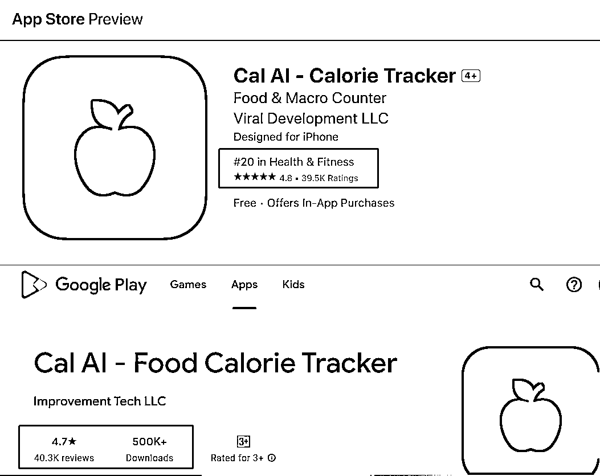

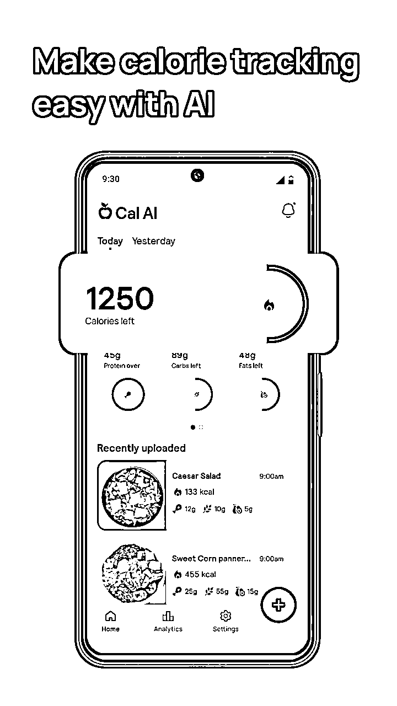

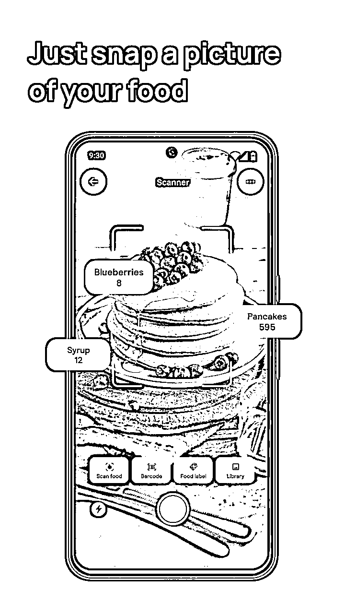

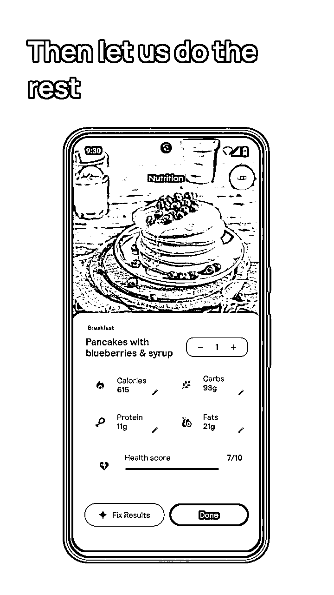

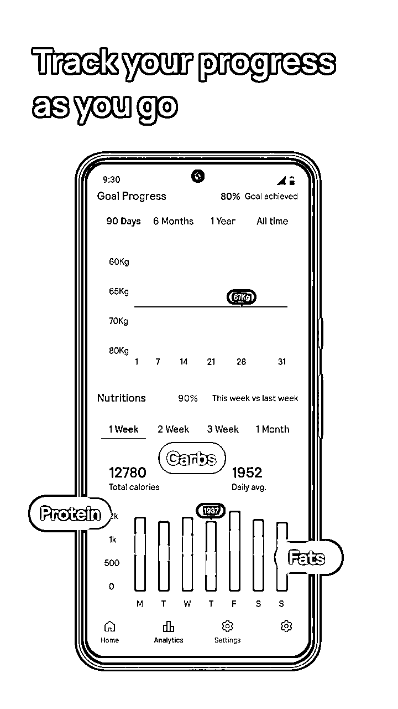

# 钱从哪来

坊间对Cal AI的营收众说纷纭，但创始人Zach Yadegari自己在Twitter上公开了App Store后台，还在YouTube访谈里现场展示：光是10月份就做到114万美元。完整访谈可看《The 17-Year-Old Who Built a $1.12M/Month Ai App | Zach Yadegari》。

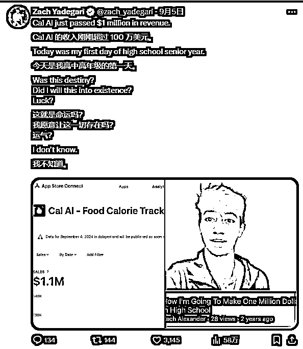

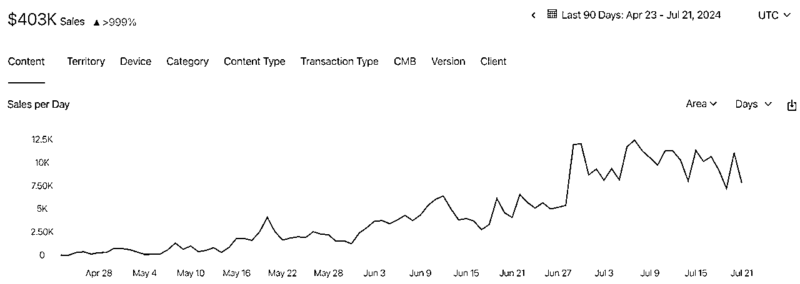

为了交叉验证，我用Sensor Tower查了公开估算数据。免费版能看到苹果和安卓商店的基础指标，11月预计下载约50万，收入约84万美元，明显苹果端贡献更大。

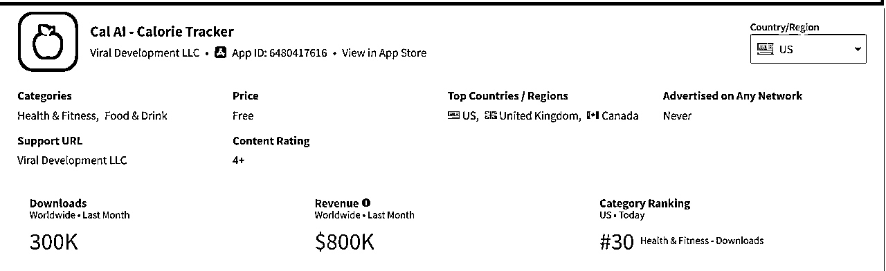

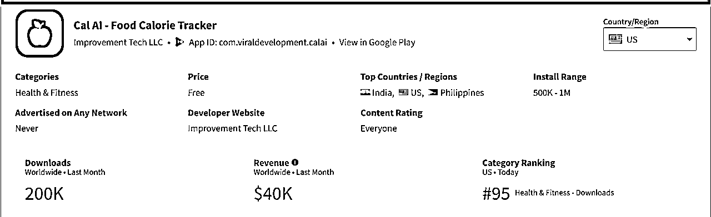

随后我又在闲鱼花了10块钱让同行代查了苹果商店的更细数据：收入、下载、月活、日活。

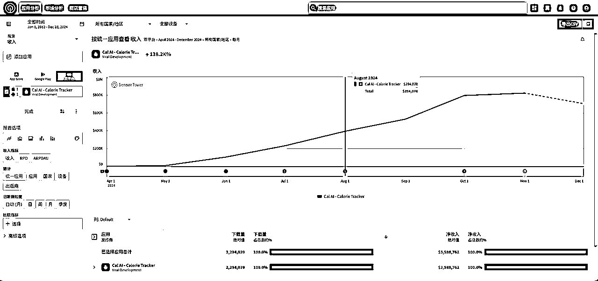

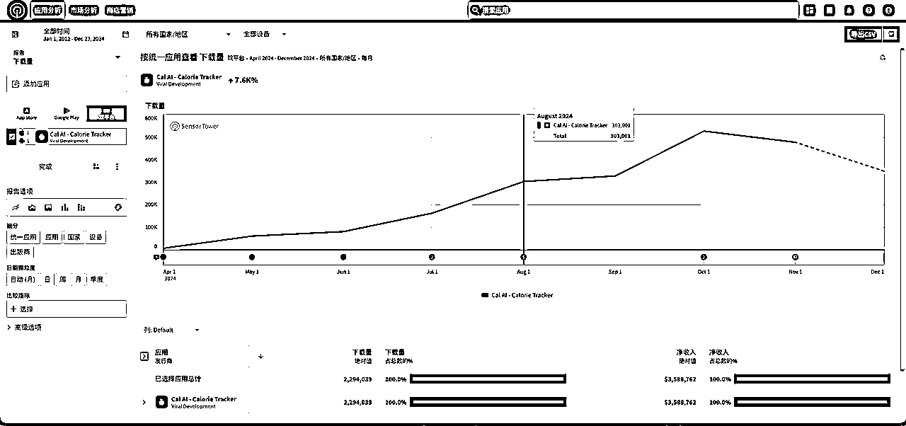

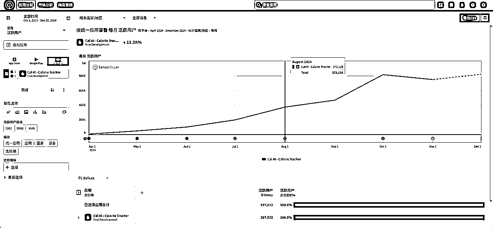

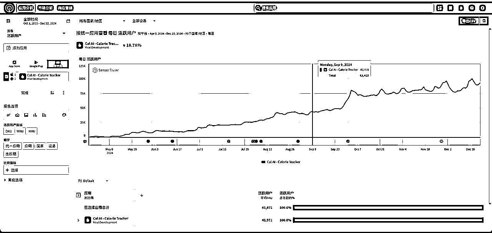

Sensor Tower的估算和创始人自曝有差异，也正常。应用商店数据不对外公开，Sensor Tower只能基于样本和算法推算，而且只统计应用内支付，不算广告、品牌合作等外部收入。把误差和外部收入算上，月入逼近百万是合理的。

据福布斯11月报道，团队已扩充到17人，年化经常性收入ARR已达1200万美元。注：ARR是Annual Recurring Revenue年化经常性收入的缩写，用来衡量订阅类产品的稳定收入，只算可预期的订阅流水，不含一次性或广告收入，多用于判断长期造血能力。

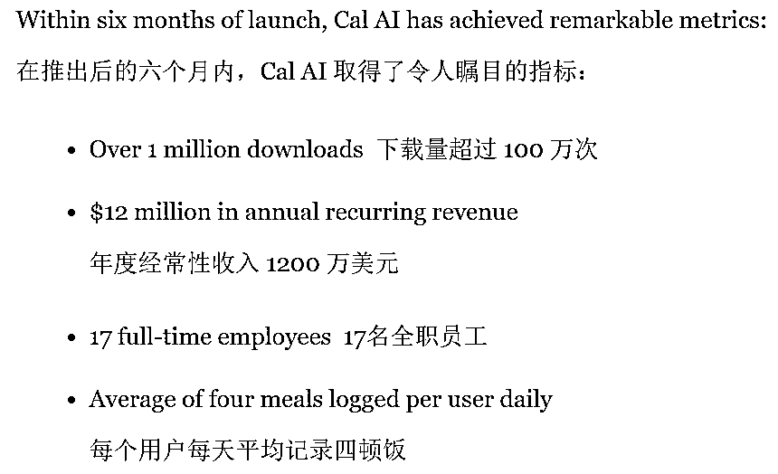

# 流量怎么来的

## 营销打法

访谈里Zach坦白，核心是红人营销Influencer Marketing，战场基本在TikTok。和近150位博主保持稳定合作，每月持续出片，单条合作费用从100美元到10万美元不等。他的具体做法是：

1.  找人：推广初期他自己开小号刷健康健身内容，用算法反向找相关博主。筛选标准看互动率、观众参与度、评论质量。上线第一天就开始在TikTok发声，他本人也拍视频，还养了一批矩阵号：主号发官方宣传，小号去网红评论区互动引流。

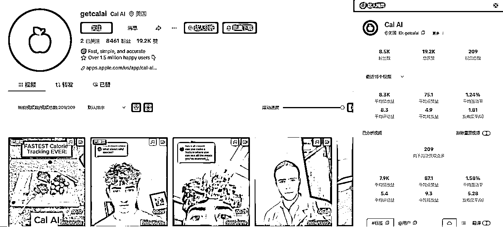

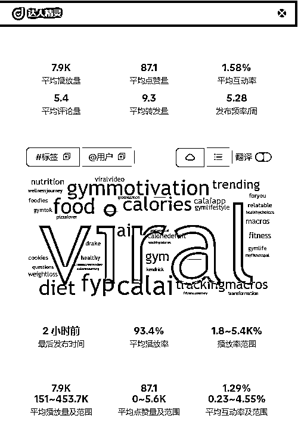

1.  沟通：绕开MCN，直接私信博主，100条私信大概能换回1-2个有效回复。用月度套餐锁价，比如每月4条，降低单价。根据博主的历史观看和互动估算CPM再谈价。

1.  付费逻辑：用CPM对RPM做利润测算。举例：博主一条平均5万播放，CPM按2美元算，费用100美元。若该视频带来的RPM是5美元，就能产生250美元收益，成本可控。

1.  内容要求：强调场景化植入，而不是硬广。比如“每日饮食vlog”里自然展示使用过程。评论区做二次种草，主动回复“这是什么App”，引导下载。固定置顶品牌评论，保持曝光。

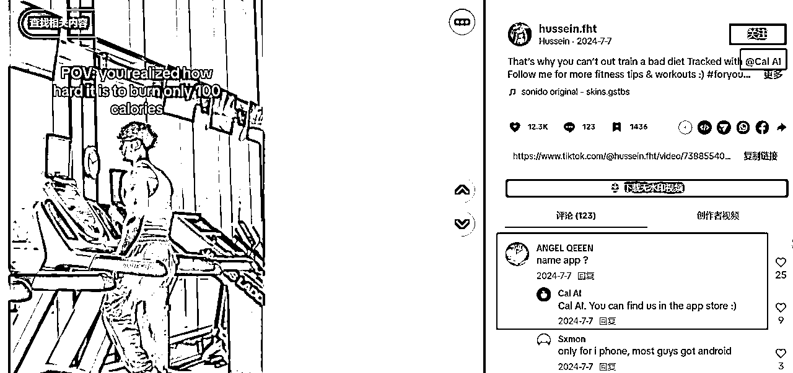

1.  用数据回看：自建一套追踪工具，对比视频发布后的下载曲线和收入变化，算清每个网红的真实转化率，持续优化投放。Zach还说未来想把这套工具卖给其他广告主。

1.  复用内容：把网红视频收回来由官方账号二次发布，隔几个月再发一次。不同博主的内容还会剪辑后投放到Meta等平台做付费广告。

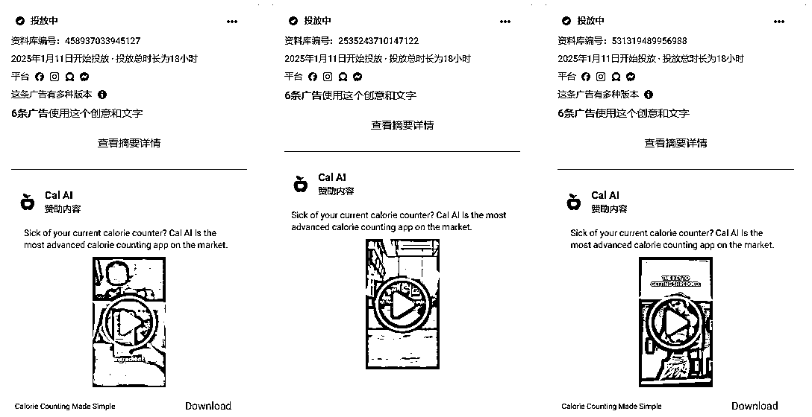

## TikTok搜索流观察

TikTok的推荐流很难精确统计，所以我只抓了搜索流“cal ai”的相关视频，用达人精灵和影刀RPA收集。剔除无关后，总播放量已破亿级，这只是关键词抓取的部分，实际铺量只会更大。总结出几条规律：

①爆款标题范式

*   功能型：突出“秒记录”、“简单易用”，如Track your calories、Cal AI makes tracking easy。

*   成效型：强调使用结果，如Lost over 130lbs、Best way to lose weight。

*   情绪型：用惊喜、感激的情绪词，如Thank god for this app😭、Literally just take a picture😭。

*   好奇型：设问或反常识，如Why AI Calorie tracking apps are bogus。

*   简洁型：标题短平快，直接@官方账号引导点击。

②红人布局

目标是全球，合作博主遍布美国、欧洲、中东，语言有西语、阿拉伯语等。德国和中东已经出现本土模仿产品，未来多语言版本概率很大。头部博主会深度绑定，比如粉丝200万的alim_kh0就合作了8条视频，12月集中发3条，贡献了约5000万播放。

③官方矩阵化

仅搜索视频里就能数出11个带Cal AI头像和名称的账号：getcalai、cal.ai.app、cal.ai0、app.calai、cal.ai4、try.cal.ai、cal.aiapp、trycalai、thecalai.app、cal.ai0、app_calai。内容分两类：复刻网红爆款、团队真人出镜拍摄。好处在于省钱、可控转化、放大声量。官方视频标题直接带产品名，文案统一为“一句话卖点+搜索指引”，比如“Take a Picture, Track your calories👇👇👇Search “Cal Ai” on the App Store”，相当于在商场门口大喊下载。

# 创始人背后的故事

因为Cal AI，17岁的Zach被贴上天才标签，其实他早就不是新手。他的创业线远比想象早。

7岁时沉迷游戏，为做自己的游戏报名编程夏令营，整天啃YouTube教程。12岁第一个游戏就上架商店。

13岁做了一个叫Totally Science的游戏聚合网站，打着教育名义绕过校园网封锁，让学生上课也能玩游戏。年收入一度到6万美元，两年后在Flippa以10万美元卖掉。

高中时和朋友做了叫Grindclock的闹钟App，用David Goggins式的激情语音叫人起床，初期两万下载，增长很快停滞，团队转赛道。

那段时间他自己去健身增肌，每天要记卡路里，但MyFitnessPal操作太繁琐，三天就卸载。恰逢ChatGPT爆火，他开始思考AI能否把卡路里追踪变得更简单，于是Cal AI应运而生。

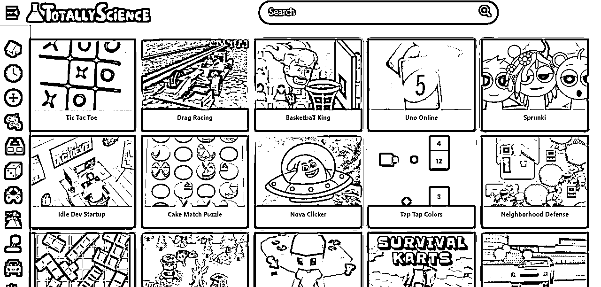

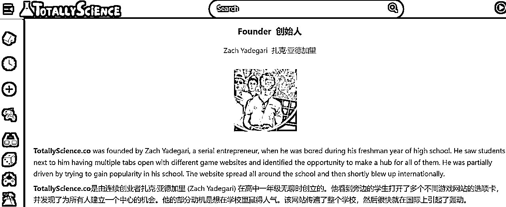

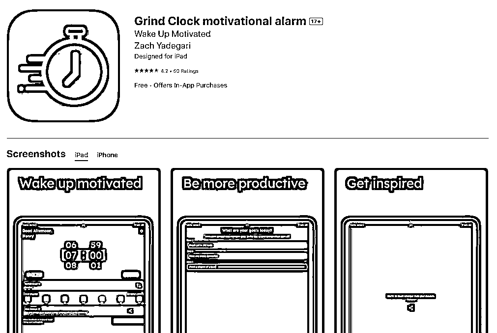

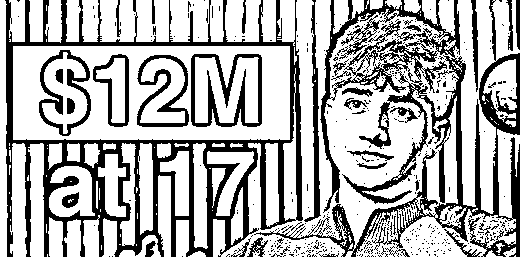