# 22小时从0到1上线AI工具站，拿下黑客松二等奖的实战拆解

嗨，我是PeterZEN。这是我头一次参加Hackathon，过程很满，感触也很深。

6月28到29日，我参加了由哥飞 x Same.new x PayPal联合举办的黑客松。现场超过300人，150多支队伍。我们临时组建的小队用AI工具站的方案，最终拿到了二等奖。接下来复盘一下整个实操经过，以及这次活动的收获。

比赛从28号晚上8点开跑，29号15点到18点提交作品。

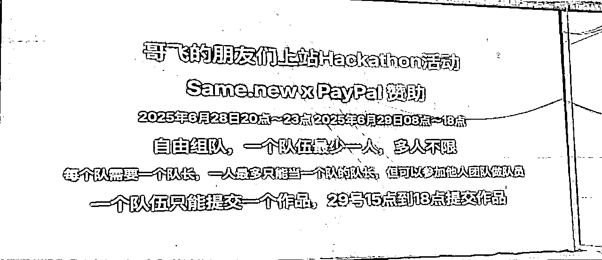

团队是临时搭起来的。我认识一个产品经理和一个后端开发，就直接拉来组队。好在三个人都上过站，基本流程都清楚。

起初我们想同时冲三条线，提高中奖率，后面只聚焦做了一个站点。但最后的效果比预期要好。

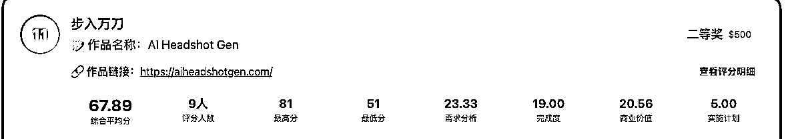

# 1. 找点子：4小时

需求的挖掘方法有很多：

a) 从社媒和社区里找痛点。小红书上就有用户在找P图换背景的方案。

b) 用关键词词根去探需求。通过谷歌趋势、Semrush、Similarweb来找搜索机会。

c) 从自身使用场景出发，盘点自己长期积累的需求。

d) 把大站点的细分功能拆出来单独做。

e) 看榜单平台。Toolify、Product Hunt这类榜单，还有模型平台上的新模型，都是idea来源。

f）关注社媒头部博主...

我们手上很快积累了几个方向。做哪个呢？

白天Same.new联合创始人John Yang的分享给了我们启发，他们当年花了三天从上百个idea里筛，最后才做出了Same.new。

# 2. 锁定需求与核心词：2小时

手上idea不少，筛选标准是什么？

因为赛程紧，必须尽快做出能用的完整产品。所以技术实现要轻量，不能过度设计，产品形态最好是大家都熟悉的站点类型。

基于过往经验，我们都做过网站，也都做过AI生图站。于是把赛道定在AI图像生成类。

同一个需求，C端和B端完全不一样，为了求快，我们选了C端用户。

再看需求体量和变现潜力。通过核心关键词在趋势、Similarweb上的搜索量，结合客单价等数据粗估商业价值。毕竟做站的落脚点是变现。

起先找需求很发懵，后来思路逐渐清晰。

按上述标准筛下来，最后锁定AI换背景的方向。

但换背景只是结果，真正的场景是什么？人群是谁？这就得把一个宽泛的功能拆成具体的用户场景。受小排老师影响，我会一直问自己：

什么人？

在什么场景下使用？

愿意付多少？

解决了什么痛点？

我直接跟GPT语音聊，把问题抛过去。表述越具体，GPT给的场景和画像就越扎实。聊了几轮后，得到多个可用的应用场景。

从大盘的换背景收敛到垂直场景，我们最终选择服务职场人群，用AI快速生成正装证件照，不用出门也能搞定。既省时间又省钱。这个需求老牌且已被验证用户愿意付费，随着AI效果提升，现在体验更好。

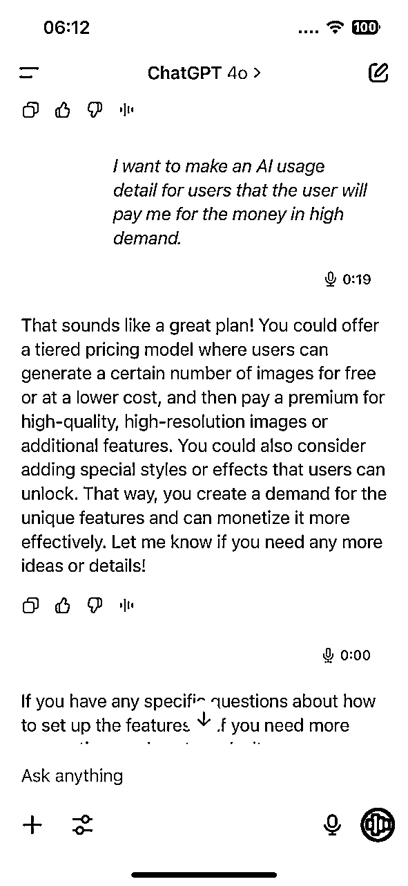

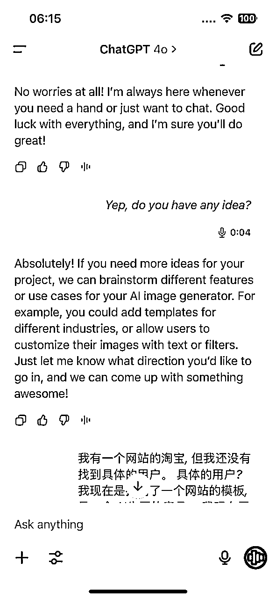

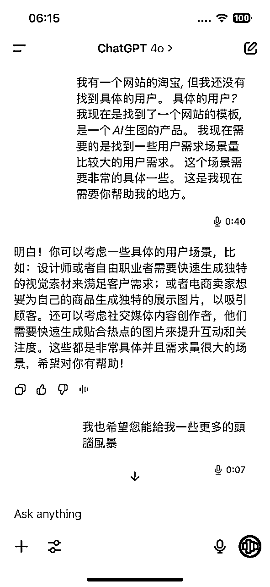

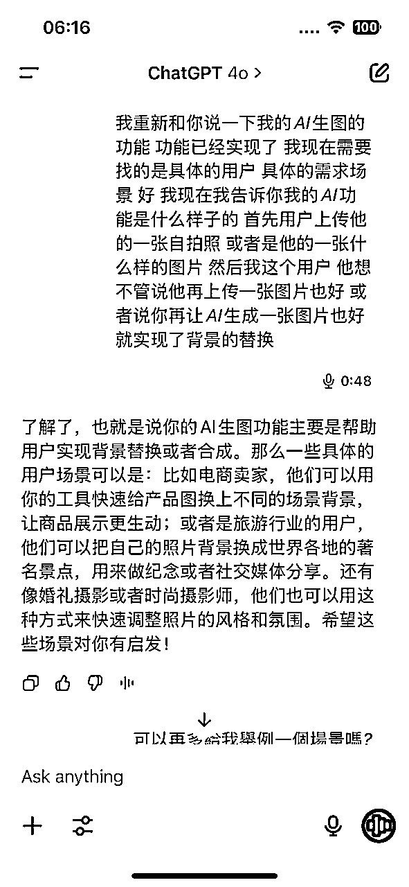

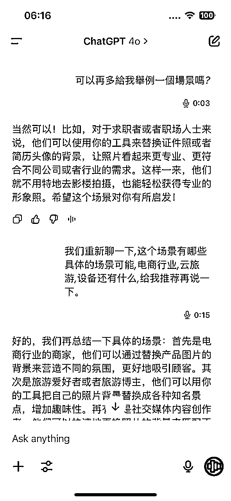

方向定了，核心关键词怎么选？

GPT给的方向感还不够准，我上网去看了几个竞品站，才确定下来要做的核心词：AI Headshot Generator。趋势整体平稳，有缓慢上行。

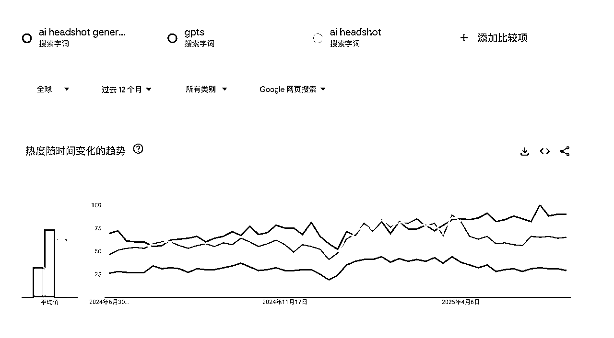

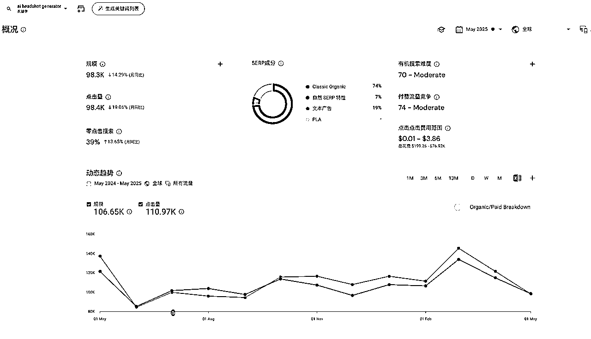

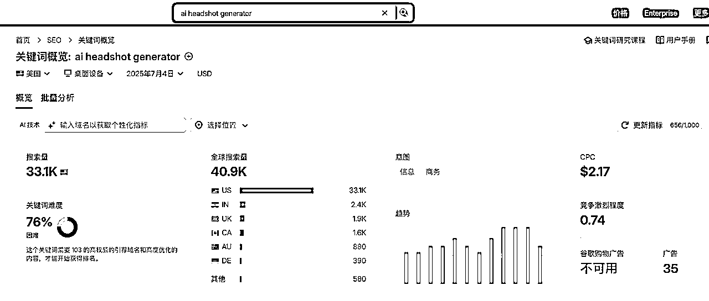

这个词体量不算大，竞争也激烈，但具备商业价值，可靠订阅收费。再加上比赛时间有限，不是追求完美点子，而是先把能做出来的做出手。

# 3. 站点规划与落地：9小时

## 技术栈

网站代码：之前做过生图站，直接复用已有代码。

AI能力：Flux刚出新模型，测了下效果不错，就用Replicate上的flux konext pro。采用Prompt as a service，提示词内置，效果稳定。

数据库：Supabase。

登录：接入Google。

部署：GitHub + Vercel + Cloudflare。

域名：用query查，Spaceship买。

## 内容规划

围绕核心词AI headshot generator，用谷歌下拉、相关搜索、Similarweb、Semrush收集长尾词，再让AI做内容架构。

每个页面的SEO细节都提前规划：Title、description、H1-H3、关键词密度、canonical、字数等。

页面越多，被搜到的机会越大。

## 结构与版式

页面规划：

*   首页：同时是落地页也是工具页，内容型工具站

*   博客

*   合规页：about us、privacy、terms、refund等

*   产品介绍落地页

结构：

*   首页：

*   header：logo、品牌名、菜单、多语言、明暗模式、登录

*   hero：H1标题、CTA按钮、功能演示

*   Function：功能说明

*   Feature：产品卖点

*   Showcase：案例展示

*   How to：三步上手

*   Pricing：价格表，同时强调权益

*   Testimonial：用户评价，先用AI生成，后期换真实

*   FAQ：常见问题

*   Blog list：文章列表

*   Footer：品牌logo、一句话介绍、社媒链接、邮箱、导航、版权

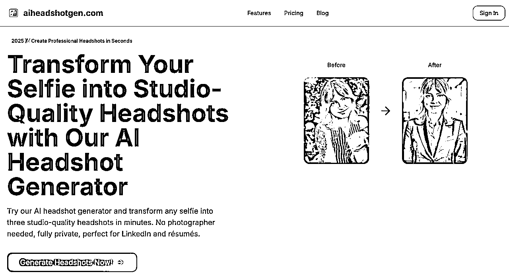

这是我们Hero区的截图。

*   博客页：

*   列表页含摘要介绍

*   详情页图文结合

待优化：面包屑导航、博客内容排版。

## 交互设计

核心理念：把复杂留给后台，把简单留给用户。

交互组件采用经典左右分栏：左侧操作区，右侧结果区。很多图片站都这么做，原因很合理，我们直接沿用。

用户上传照片→选择风格→选择比例→生成。右侧即时呈现结果并可下载。

整体走极简风格，不折叠选项，所有控制项一屏可见，减少操作步骤。

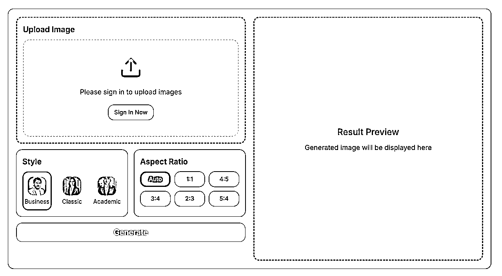

# 4. 优化思路与后续计划

不少SEO规划已经列好，但赛程内没来得及执行，后面需要补上。

产品功能目前仅能用，离让用户付费还差一口气，要找到真正的付费点。

技术层面，加载速度偏慢，图片用的是PNG，体积大，后续可换成WebP。

内页要补足，尤其是博客，围绕核心词延展内容，并考虑新增工具页。

流量方面：多发外链、提交导航站、做社媒内容营销：Twitter、Instagram、Pinterest、Reddit、TikTok、YouTube，也可考虑投放。

# 5. 感悟与思考

1. 普通人即便不会写代码，只要用好工具，也能做出让人惊艳的站点。现场有选手两小时内用Same.new搭出好看的页面。AI时代，技术门槛大幅下降，关键是好点子+落地的执行力。idea to business 需要走完整套流程。

2. 在满足需求的前提下，颜值就是转化。站点好看，各项指标都会提升，变现概率更高。甚至有些功能未完全实现，但因审美在线也拿了奖。

3. 现在一个人借助AI就能完成前端+后端+产品的工作，传统的分工协作模式是否还合理？我们三个人用了9小时，别人两三个小时就上线了。组织方式不能沿用过去的前后端严格分离，效率太低。AI时代，一个人就能扛完整条线。

4. 比赛从来不是绝对公平。每个人的起点、资源、牌面都不同。有懂需求的产品经理，有上手快的开发者，有提前囤好idea的人，有带模板的人。想在AI浪潮里胜出，就要发挥自己的优势，打好手里的牌。

5. 不少SEO规划写好了但没做完，后面一定要补齐。

6. GitHub协作不够熟。比赛总时长22小时，找idea 4小时，开发9小时，剩下大量时间耗在修bug和解决代码冲突上。第一次多人共用GitHub，冲突处理花了很久。

7. 理想和现实总有差距，能做的就是立刻行动。想法很美好，执行很粗糙，那就干吧，先把现实版做出来。

获奖站点榜单后续可以去看，学习别人的优化手感。

往期帖子：

Crazy Cattle 3D游戏站复盘与感悟

出海游戏站玩法及挖掘潜力游戏方法

游戏网站如何获取更多游戏？7招助你拓展游戏库