# 23天从0到$513 MRR：我如何用AI搭出一套可复制的App上架与变现SOP
> 核心洞察：产品从0到1的速度不再是瓶颈，能否把找需求、做开发、做增长变成可复用的流水线，才是关键。
大家好，我是linyy。受飞掌柜邀请，航海期间做一次复盘。赚钱里从0到1的故事看过无数，两年前我始终没动手。今年清空过去，all in AI App赛道。我有研发背景但多年没写代码，客户端对我来说几乎是白纸，可以把我当成一个纯新人看待。
航海的目标很简单：从零起步，把两款App送上App Store，并拿到首批订阅收入。
## 一、航海成果
6月2日启动开发，约一周内两款产品均通过审核上线。持续迭代后，RevenueCat数据显示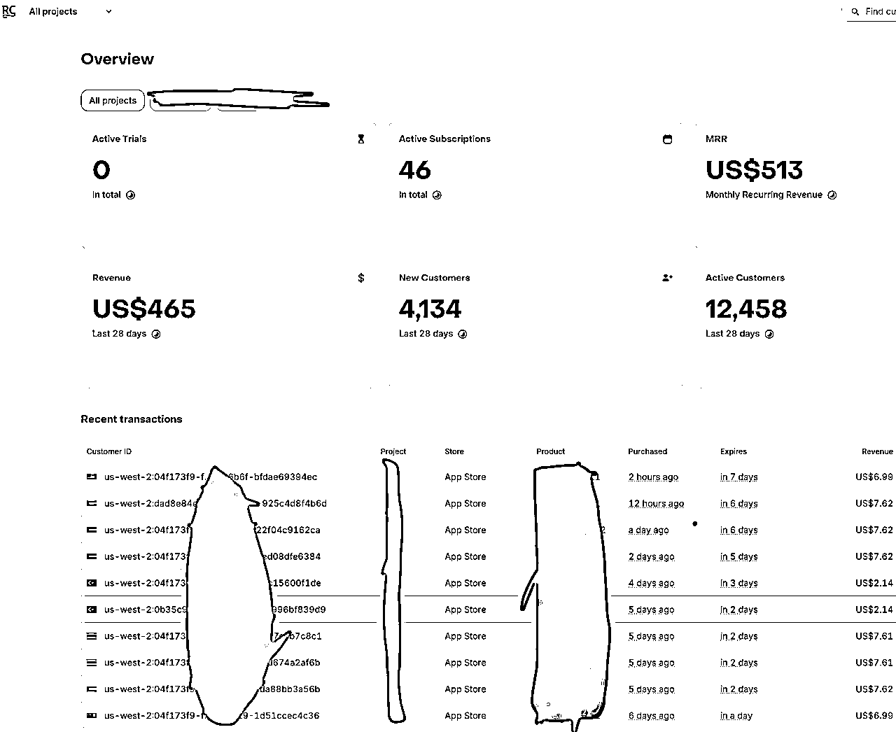：
* 月度经常性收入 MRR：$513
* 新增用户：4134
* 活跃用户：12458
* 付费订阅用户：46
数字不大，但它证明了一个判断：当下用AI能力做产品已不算难，真正的壁垒是能否围绕产品构建一套可复制、可迭代的全生命周期方法论。
开航时我没有立刻写代码，而是先花时间搭建系统。整体框架如下图所示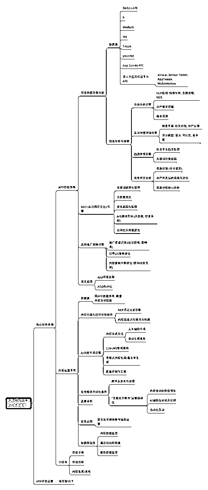：
系统拆成三个自用版模块：需求情报系统、开发交付系统、内容增长系统。
## 二、需求情报系统：用AI当导航雷达找机会
第一步永远是找一个真实且愿意付费的需求。为此我搭建了一个7×24小时自动化的情报雷达，流程是采集→清洗→分析。
### 多源采集
数据源分两类。
社媒侧：Reddit、Medium、X、TikTok、YouTube。
Reddit里 r/AppIdeas、r/SideProject、r/Software 等板块是需求富矿。我关注用户用大白话吐槽的 “I hate when…”、渴望的 “I wish there was…”、以及临时拼凑的 workaround。这些比成熟点子更真实。
X/TikTok/YouTube 则追踪科技KOL、效率博主、AI创作者，看他们在讨论什么新技术、新产品，以及评论区里用户的真实提问和反馈，用于捕捉趋势。
采集方式：Reddit和X用官方API写脚本合规拉取；TikTok类平台用Python Scrapy定制爬虫定向抓热门话题与评论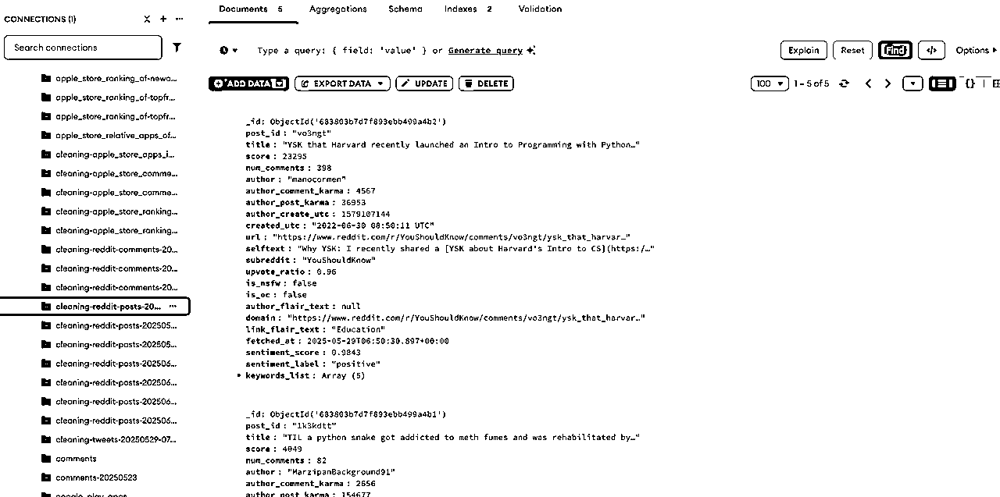。为可视化进度，我还做了个飞书机器人监控任务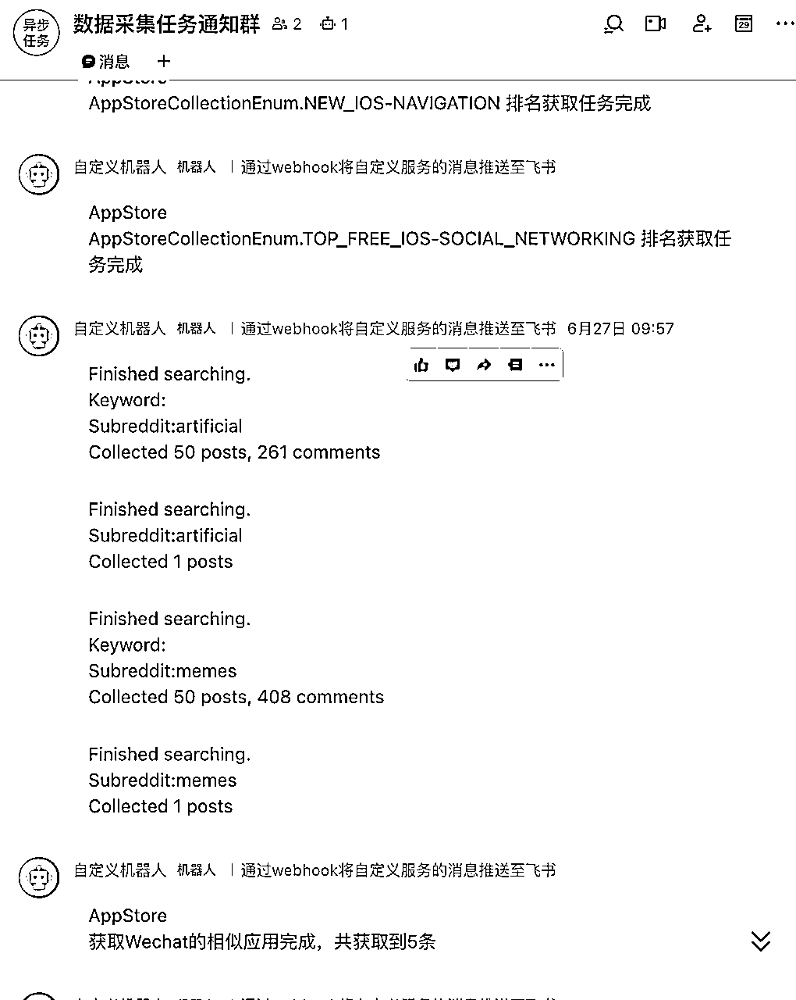。
专业侧：Poe等AI应用平台、七麦/data.ai等第三方数据平台、App Store/Google Play本身。
在AI平台拆解头部产品的功能、Prompt设计、交互和用户反馈，获取灵感。
在应用商店侧，我更关注评论、更新记录、定价逻辑：
比如对caiai的评论抓取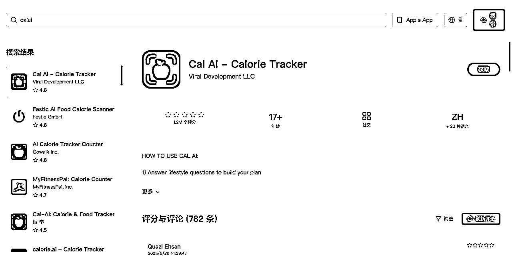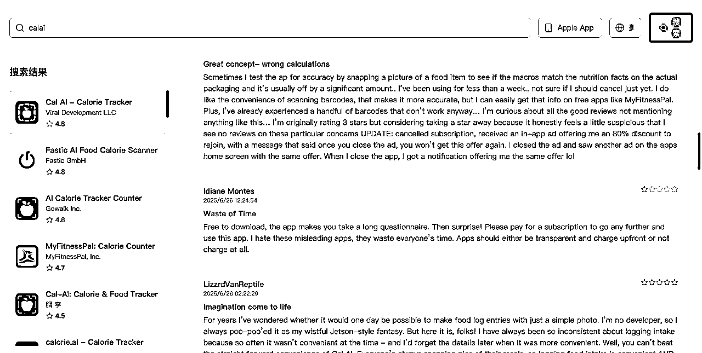，可筛选1星差评深入研究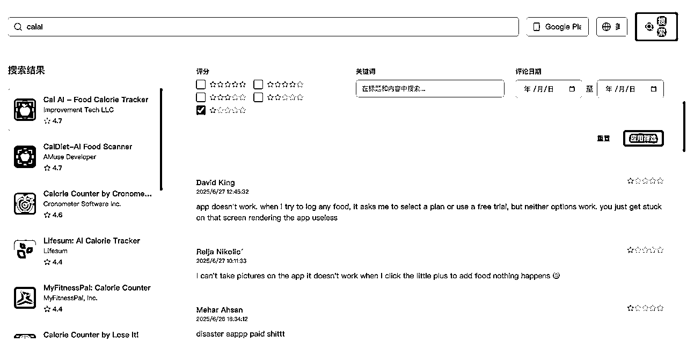；
版本更新能反推产品战略；
定价是订阅/买断/消耗，背后的商业逻辑是什么。
采集通过官方/第三方API批量拉取应用与评论，爬虫定期抓取版本与定价，沉淀动态竞品档案。
### 自动化清洗
原始数据像矿石，需要提纯：
去重去噪，剔除广告和机器人；
多语言统一翻译成中英文；
按来源、时间、关键词打标签入库，结构化存储。
### 智能化提炼
核心在NLP分析：
用户需求挖掘：对数万至数十万条评论做关键词提取与聚类，比如 summary、transcribe、workflow 等高频词聚集，识别群体性痛点；做情感分析聚焦负面反馈，找到真实不满。
竞品洞察：自动生成功能矩阵与迭代时间线，一眼看出优劣势与战略动向，找空白。
可行性评估：通过关键词热度、搜索量、同类下载基数预估市场规模；对照赛道定价验证付费意愿与模式接受度。
最终会输出一份《产品情报需求机会评估报告》，明确方向价值、市场容量与切入点。我用的自动化处理管道是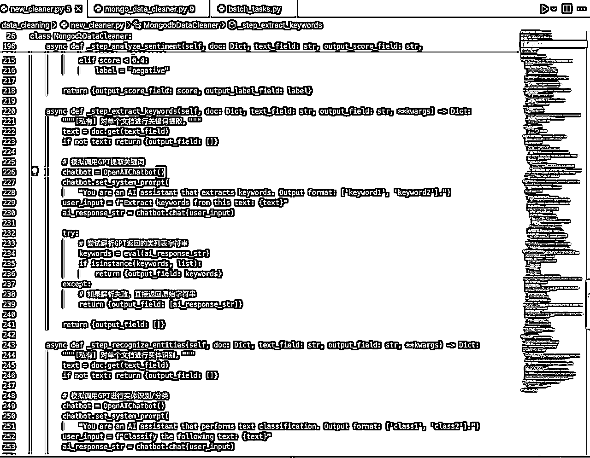，基于Gemini 2.5 Pro生成的调研报告见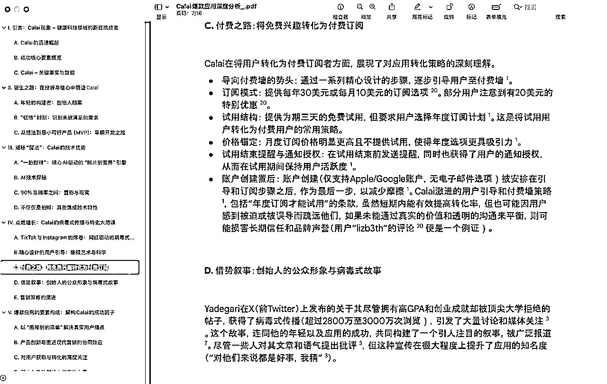，并可生成网页概览阅读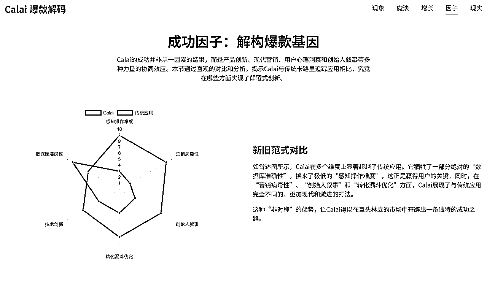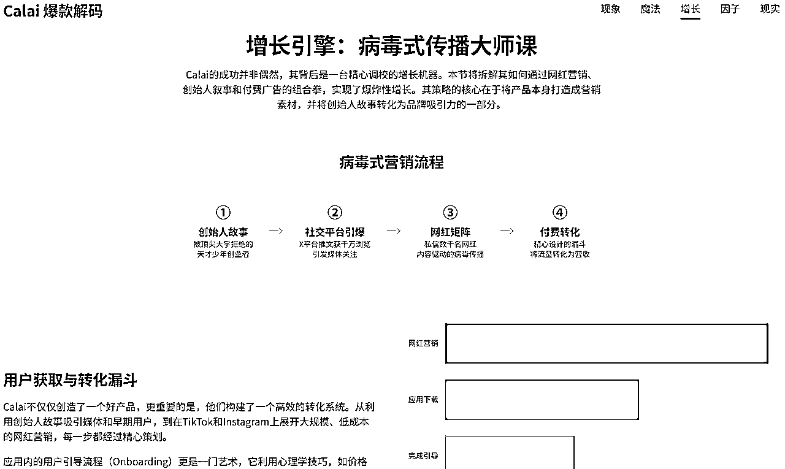。
## 三、开发交付系统：人做决策，AI做执行
目标是思考由人负责，执行交给AI。
工具选择：起初用Cursor，使用体验不错，但高频请求时速率受限浪费时间；后来换到Cline，成本略高但效率跃升。近期测试Gemini CLI，虽有小bug但体验很好，每天1000次Gemini 2.5 Pro免费额度很香。
需求文档→设计图：先把功能整理成Markdown，再用Cline调用Gemini 2.5 Pro生成UI设计图，基本可直接进入开发。
设计图→代码：用Cline配合Claude 4 Sonnet编码。关键是把需求拆细，按模块、页面、功能点提问，不要一次性把项目丢进去。AI是程序员，不是项目经理。
变现设计：开发同步考虑商业化。采用订阅+免费试用，核心AIGC生成、高级分析等功能需订阅解锁，驱动转化。
## 四、内容增长系统：低成本冷启动与持续拉新
上线只是开始。我用AI搭建内容增长闭环：自动化生产内容→承接流量→导向App转化。
ASO高度自动化：基于GPT-4.1构建系统，可批量生成App Store Connect信息并自动优化关键词与文案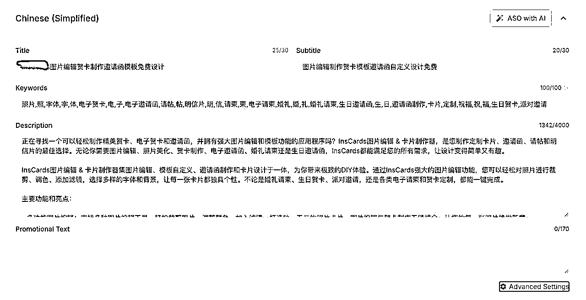。
NLP需求分析：复用对App Store评论和社媒讨论的分析，提取高频词与核心诉求，指引内容方向。
AI内容生产：
LLM负责干货，比如围绕核心功能写科普、使用教程、X推文；
AIGC负责视觉，比如Midjourney/GPT o3做配图，Pika/Sora做短视频。
社交媒体自动化：用工具将内容定时定量发布到X、Instagram等，AI机器人做基础评论互动维持热度。
流量承接与转化：所有外部内容指向下载页或落地页，App内以优质体验与清晰付费引导完成转化与留存。
## 五、复盘心得
1. 系统大于技巧。零散方法会让人疲于奔命，自动化系统才能持续产生动能。
2. AI是杠杆不是魔法。它能放大执行，但清晰的需求与逻辑仍是核心能力。
3. 初期不做万能App。先聚焦一个点打透。
4. 拥抱付费工具。时间成本最高，值得的效率工具应果断付费。
5. 盯住核心指标。留存率、付费转化率、LTV等数据驱动迭代。
以上是我从0到1构建系统的实操路径，希望对在路上的你有启发。有问题欢迎交流，一起探索一起赚钱。