# 300人投锚要求更新后，我把月入7万的AI协作团队搭建方式公开了
作者：龙哥

大家好，我是龙哥，2004年生，现在在杭州做全职创业，主攻个人与业务的AI化落地。

2026年6月参加完广东航海家大会后的两个多月时间里，我用Codex累计跑了260多亿Token，把生活管理、内容生产、业务运转逐步改成AI协同形态，最终形成现在这套Agent员工体系。

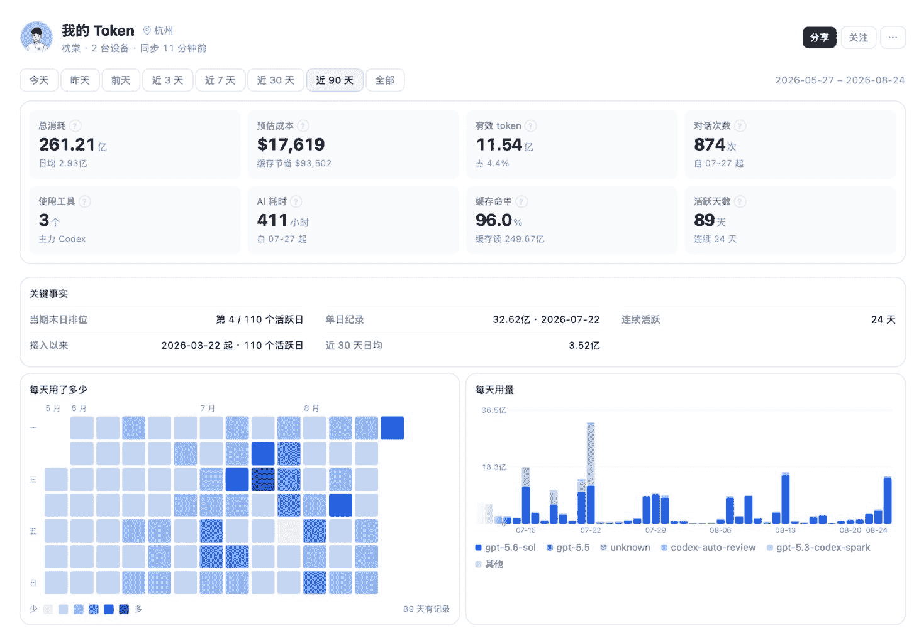

先说一个前提：

“Agent员工”只是一个说法，真正有价值的是它能不能帮你省时间、降心力，并给出可以验证的实际产出。

在生活层面，我已为减重规划、旅行安排、目标拆解、OKR执行分别做了工具和助手。过去需要靠记忆、排程、对比和反复决策的事，现在可以交给AI参与处理，日常消耗明显下降。

在业务层面，我的核心路径是通过公众号引流、沉淀私域、销售知识付费产品。于是选题、朋友圈文案、成交通知、产品设计、海报制作等环节，都逐步接入了AI。

这段期间产出多篇表现不错的内容，上个月营收做到7万元。

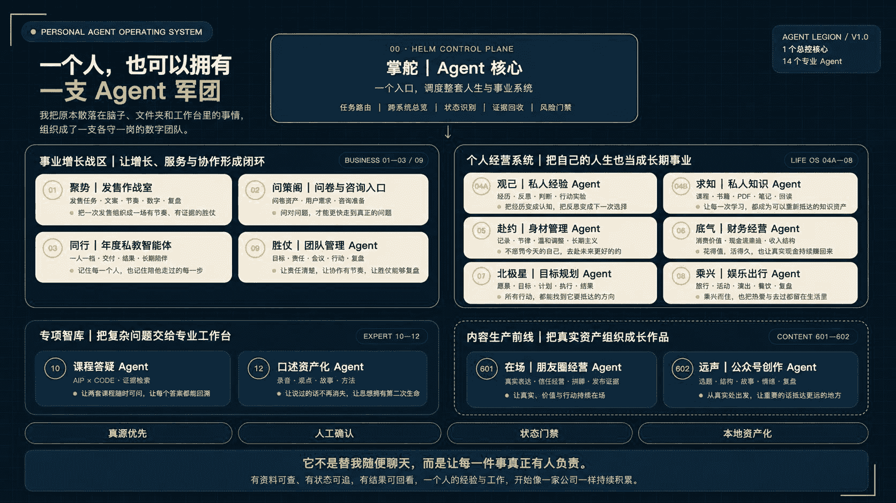

当然，这并非全靠AI。

更准确的描述是，AI让我更稳定地把事情做对，并把大量内容类工作的耗时压到原来三到二分之一左右。

此前我写过《从AI新手到12个Agent员工，我的60天150亿Token系统升级记》。

当时承诺点赞投锚达到一定数量就公开搭建思路，最终有300多位读者投锚催更。

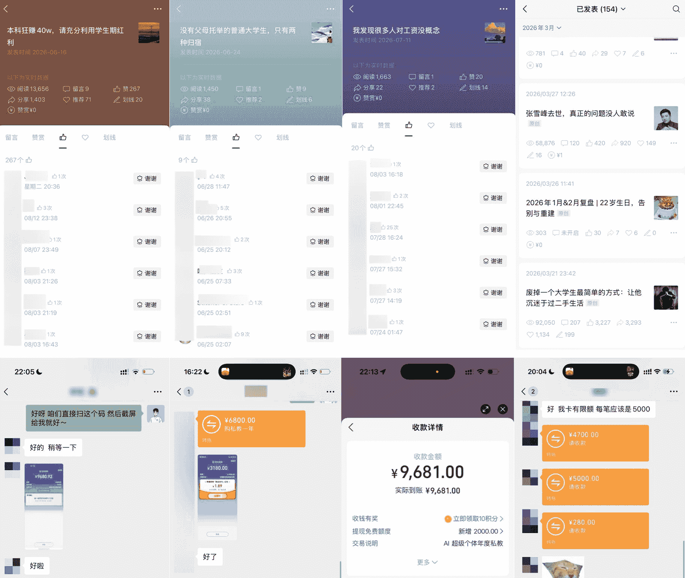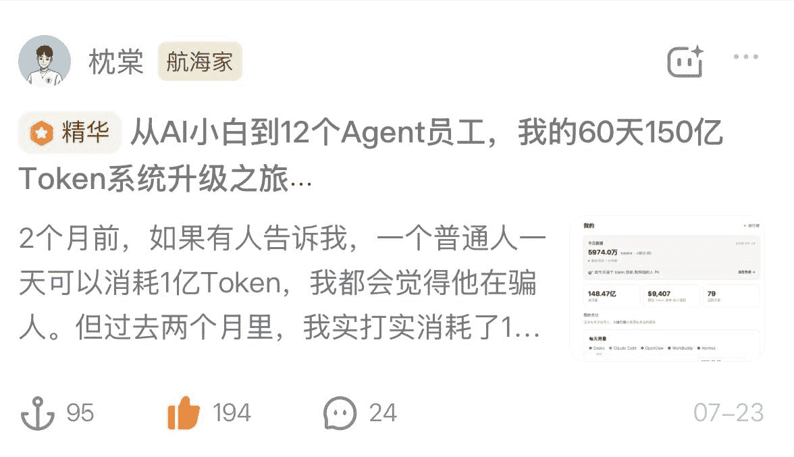

为了兑现承诺，我用了一个月时间重梳理这套方法。从整体框架、步骤拆分到提示词、案例和操作细节，反复推敲修改，才整理成现在这篇约3.8万字的实操稿。

接下来我会完整复盘这支Agent团队是怎么一步步建立起来的。

它不等同于装更多工具，也不等于把网上流行的Agent全搬过来。

核心在于把具体场景、业务资料、可复用技能、使用入口和结果反馈串成一条可持续运行的链路。

你需要搞清楚：

- 每个模块解决什么痛点；

- 它们如何相互配合；

- 怎么从一个小任务开始逐层搭建；

- 如何把这套系统用在工作和生活里。

若最终不能带来可感知的效率或收益，再多的学习也只是停留在纸面。

全文分为三部分：

一、为什么值得建立Agent员工体系？

二、如何用五步完成搭建？

1. 拆解业务，锁定提效点

2. 收集资料，搭建第二大脑

3. 固化Skill，让方法可重复

4. 设计入口与流程，让Agent进入工作

5. 回收反馈，让系统持续进化

三、附教程、提示词与代码。

开始。

# 一、为什么要从对话式工具升级到Agent员工？

## 1. 目标不是用上AI，而是让AI改变结果

我研究时间管理、目标动机七年。

这些年越来越清晰：想完成一件事，首先要明确方向和投入理由。

所以在动工前，必须先回答：我们希望它替我们解决哪类问题？

很多人会说：AI是新生产力，我必须跟上。

但“用上AI”本身不是终点。

如果只是聊天、查资料、偶尔生成一段文字，ChatGPT、豆包这类对话产品已足够。

那为什么还要研究Codex、Hermes、飞书CLI、Obsidian？为什么还要整理资料、写Skill、配流程，把零散组件连起来？

因为我们想要的不是偶尔的帮助，而是让AI进入完整业务中，持续承担一部分工作。

也就是：

- 能调取任务相关的资料；

- 遵循已验证有效的方法；

- 按明确步骤执行；

- 持续交付相对稳定的结果。

AI的价值可以总结为一句话：用更低投入，换取更高、更快、更稳定的产出。

而单纯的对话AI，通常有三类结构性限制。

## 2. 对话工具的三大短板

### 第一类限制：上下文难长期清晰保留

这是最直观的痛点。

你在一个窗口说明身份、受众、产品、表达要求，换到另一个窗口，又要重讲一遍。

每次启动新任务，都得重新粘贴背景、旧稿、资料和限制。

更麻烦的是，AI不仅会忘，还会混。

同时运营多个项目、多个身份时，A项目的受众、产品、语气可能被错带到B项目。

所以第一项问题不是记性差，而是缺少一套边界清晰、随时可调取的外部资料体系。

### 第二类限制：偶尔惊艳，难持续达标

相同指令、同个任务，今天的成品和昨天的差距可能很大。

写公众号时，有时开头很有张力，有时像没有温度的研究报告；逻辑完整，却缺乏阅读吸引力。

最难管理的是，它并非完全不会，而是有时特别会。

这会让你无法预判下一次质量，也很难放心交付关键工作。

第二项障碍是：能偶出高质量，但缺乏稳定复现机制。

### 第三类限制：始终需要人推着走

聊天式工具基本是“你发一步，它做一步”。

让它找资料才找，列框架才列，继续才继续。

过程中你仍要守在屏幕前：下指令、等返回、复制，再搬到别的工具。

表面是AI在干活，实质你从亲自执行变成了持续发号施令。

而且这些能力基本锁在对话窗口。你必须主动打开、找到会话、说明下一步。

它很难像真员工那样，在固定时间或事件触发后自动启动，并把结果送到你日常使用的协作平台或通讯工具里。

## 3. 知识库、Skill、Agent各自解决什么？

要解决上述问题，可从三个方向入手。

第一，给AI准备可持续调用的知识资料。

把个人经历、产品信息、客户画像、成功案例、工作方法与判断标准沉淀下来，让它每次执行都能找到依据。

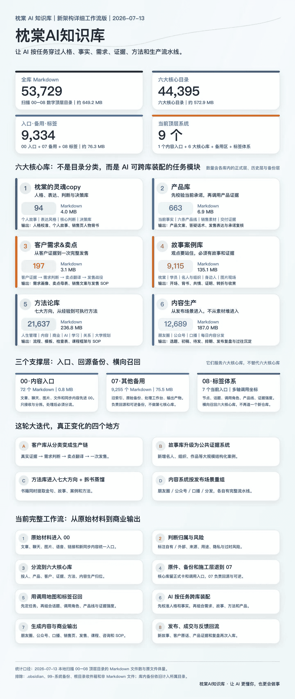

第二，把成熟做法提炼成Skill。

不要只说“写篇文章”，而要说明先做什么、依据什么判断、哪些环节易错、什么结果算合格。

这样优秀经验才不会停留在一次性口头指令里。

第三，把知识与Skill放进明确的流程和使用入口。

通过工作台、自动化或协作工具，让AI不再只是等待提问，而是能真正参与日常任务。

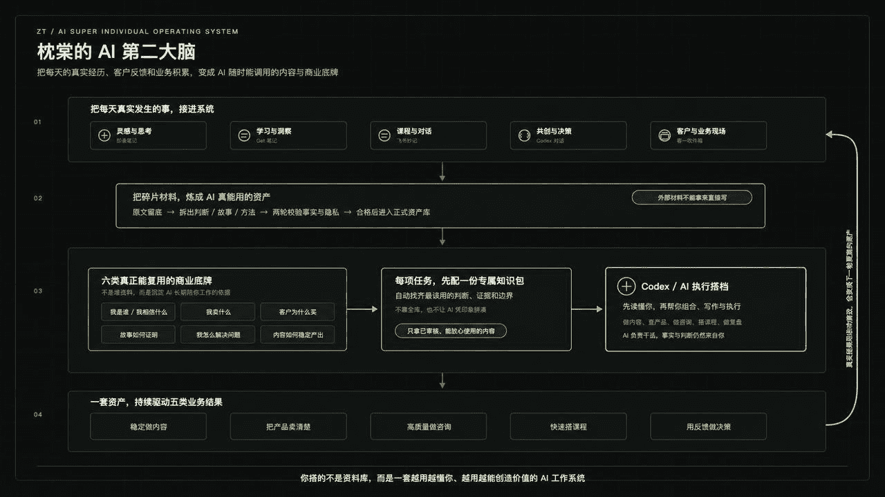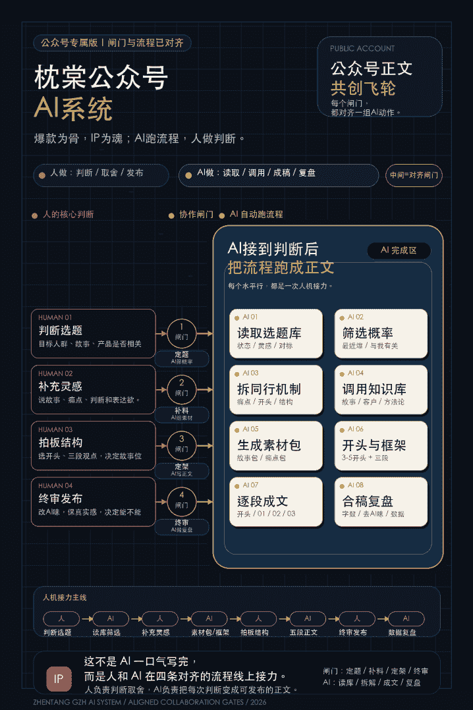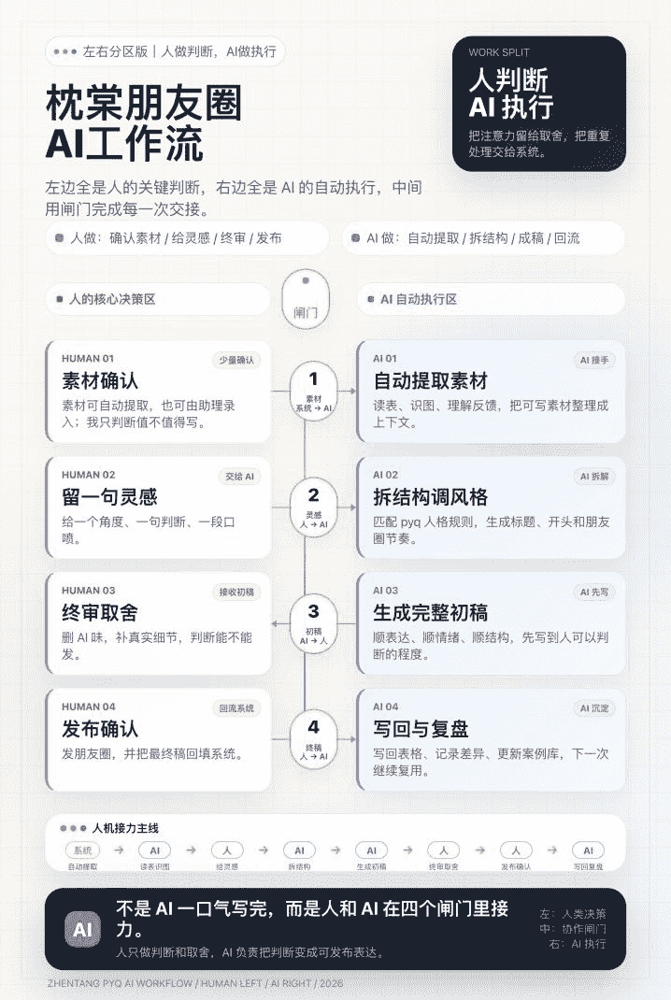

可以这样理解：

知识库提供背景，让AI认识你和业务；

Skill提供方法，让AI知道怎么完成任务；

Agent和交互流程承接执行，让能力进入真实工作。

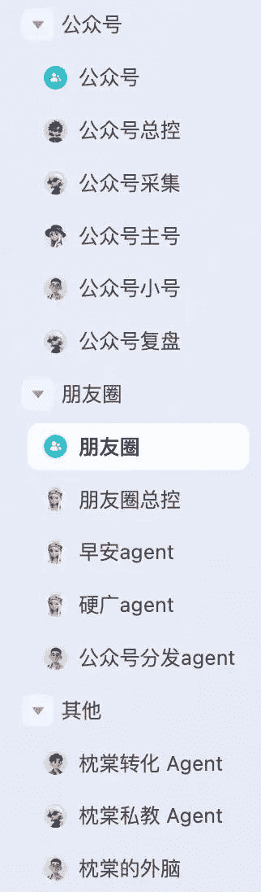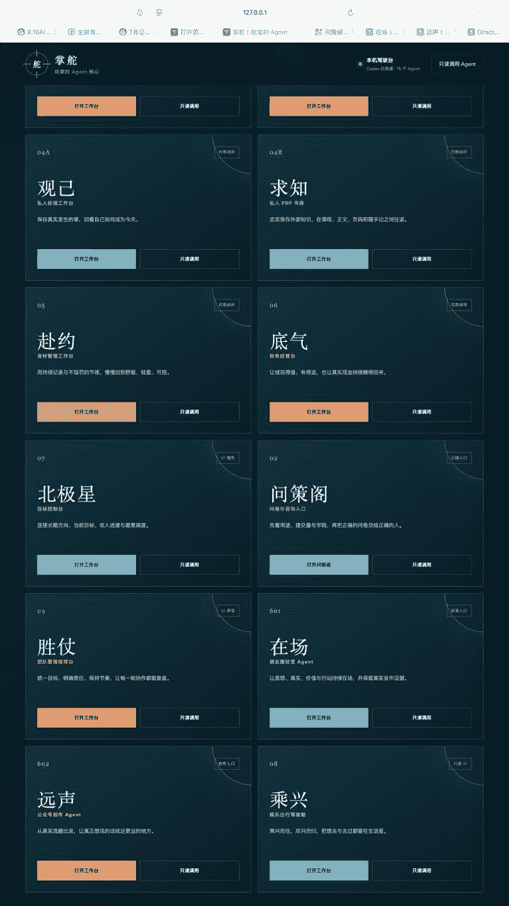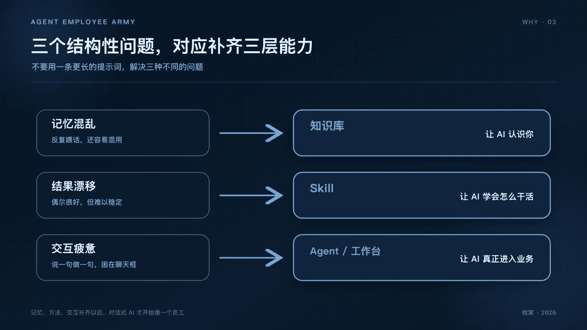

所以，从对话式AI走向Agent员工，并不是换更强的模型，而是把一个只会回应的助手，训练成了解业务、掌握方法、能按流程执行的协作者。

下面按五个环节拆解搭建过程：

环节一：梳理业务，找出值得提效的任务。先确定Agent服务哪项工作，避免为用AI而用AI。

环节二：收集资料，建立第二大脑。把任务所需的经历、产品、客户、案例、历史内容和判断依据整理出来。

环节三：提炼Skill，建立稳定方法。将已验证的步骤、标准和经验写成可复用规范。

环节四：设计使用方式，搭出Agent员工。把知识与技能接入工作台、飞书等真实场景，让AI参与任务流转。

环节五：让反馈回流到系统。将使用数据、人工调整、用户反应和最终业务结果回收到资料与Skill中，持续改进体系。

# 二、如何搭出自己的Agent员工体系？

## Step 1：先拆业务，再决定AI做什么

理解了升级理由后，新的问题出现：我该先做哪个Agent？

不少人学习AI时缺少落点。

他们先问：Codex怎么入门？Claude Code有哪些Skill？怎么设计整套Agent团队？

这些问题没错，但还要追问：你希望它具体解决哪项工作？最终要多出什么？是多一篇内容、一份表格、一套方案，还是多成交一个客户？

很多时候答案不清晰。

于是学习变成工具收集：今天看教程，明天装插件，后天从GitHub搬热门Skill；一会儿想做内容助手，一会儿研究电商自动化，看到别人做的工作台又想重做。

折腾很久，配置越来越多，能持续创造价值的却很少。

根本原因是起点放在“别人用什么”，而不是“我的业务里有哪些真实任务”。

没有具体任务，就没有可验收的结果；没有结果，就没有时间、数据、用户、收入层面的反馈；缺少反馈，系统就无法改良。

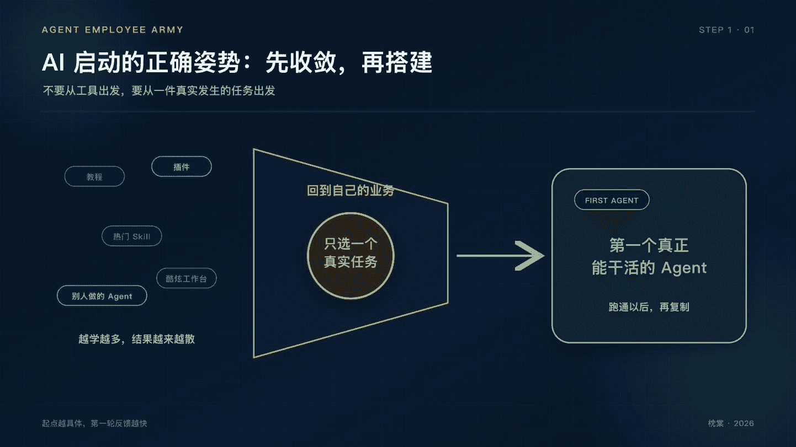

所以启动时，不要先开Codex，也不要急着写Skill。

更合适的顺序是：先回到工作中，挑一个值得长期优化的任务，集中资源把第一个Agent做成可用版本。等它在真实场景跑通，再把经验迁移到其它工作。

## 2. 第一个场景应满足哪些条件？

我通常用四个标准筛选起点。

### 条件一：出现频率足够高

优先考虑反复处理的工作。

理想是一周至少三次；若任务本身频次低，也最好每月能遇到三次左右。

因为Agent不是配置完就结束。它需要在反复使用中暴露问题，再据此调整。

任务出现越频繁，你越快获得有效反馈，也越容易短期内优化完毕。

### 条件二：最终有清晰的电子化成果

文章、PPT、表格、报告、方案、脚本、图片、问卷、会议纪要，都是合适对象。

共同点是：完成与否可以被直接查看和验收。

例如，“帮助公司经营变好”范围太大，不适合作为初始任务。

如果改成：“每周一读取已确认的经营数据，生成三页周报，并提出三个需负责人决策的问题。”目标就清晰了，AI也知道交付物。

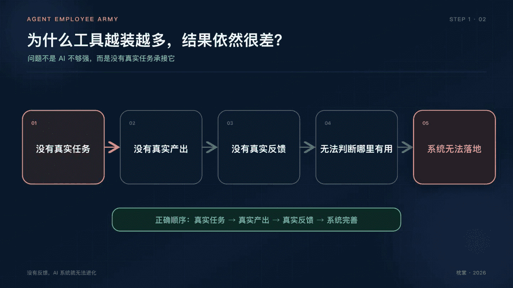

### 条件三：与重要结果相关，且能获得外部验证

最好选择和收入、效率、质量、风险或用户体验直接相关的工作。

比如：内容发布后有没有阅读和转发；客户是否回复；方案能否通过；设计稿是否被采用；一次任务究竟节省多少时间。

这些都是可观察的反馈。

只有把结果放回现实，你才能判断Agent是否发挥作用，以及下一轮应优先修改哪部分。

### 条件四：你本人已做熟，能识别优劣

这一点尤其关键。

如果你自己不清楚什么叫优秀，就很难判断AI交付的内容是否合格。

Agent初期建设，本质是把你已验证的经验和判断标准整理成机器可执行的形式。

因此第一个场景最好选择：你做过很多次；手里有历史样本；知道常见错误；能判断哪些结果值得保留；清楚何时需要推倒重来。

先让AI复刻你已掌握的能力，再考虑让它拓展到陌生领域。

因为AI会放大原有能力，也会放大原有漏洞。

综合来看，适合起点的任务通常具备四个特点：出现频繁、交付明确、结果重要且可验证、本人足够熟悉。

四项不必全部满足，但满足越多，成功概率越高。

## 3. 我为什么先从公众号内容开始？

按上述标准，我的第一个重点场景是公众号内容生产。

它高度匹配筛选条件。

### 高频出现

我每周至少要完成三篇公众号。

这意味着系统可以快速经历“使用—发现问题—调整—再验证”的循环。

若某项工作一个月才发生一次，很多缺陷要很久后才暴露，前期不适合投入大量精力做复杂系统。

公众号则不同：本周发现的问题，下周就能继续测试。

### 成果边界清楚

最终成果是一篇完整文章。

从主题选择、标题设计、开场、结构，到正文、配图和排版，都可以保存、比较和复盘。

而且每个阶段都有独立结果：选题是一项成果；框架是一项成果；初稿是一项成果；配图与排版又是另一项成果。

因此一旦最终效果不理想，可以进一步定位是哪一步出偏差。

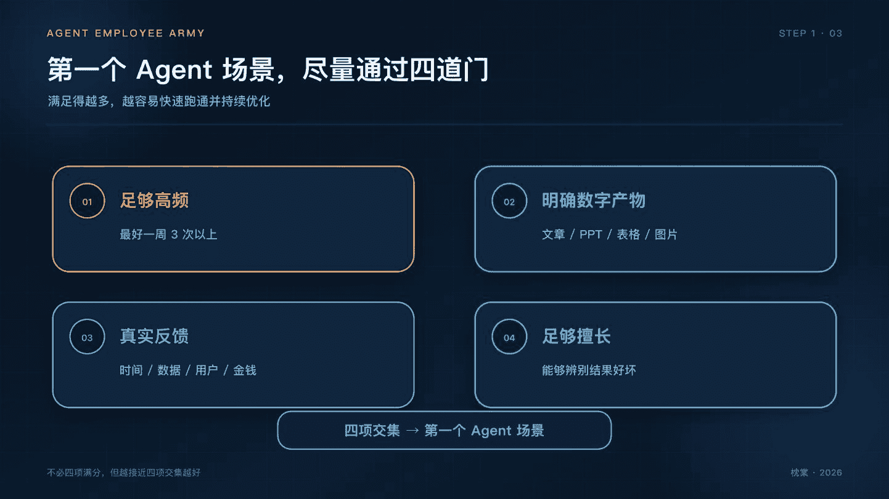

### 重要且能及时看到反馈

公众号不是练习AI的玩具，而是我获取流量和客户的重要渠道。

文章发布后，可观察阅读、点赞、转发、私信、成交以及收入变化。

所以系统有没有改善，不需要凭感觉判断，而可以从几个维度观察：写作时间是否缩短；内容质量是否更稳定；流量是否增长；新增客户是否增加；收入是否变化。

### 我本身具备判断能力

我已长期写公众号，也曾通过它获得流量、客户与收入。

一篇稿件摆面前时，我大致能判断问题在哪。

我知道哪些主题虽易获浏览，却难吸引付费用户；也清楚一篇稿件在什么状态下值得打磨，什么情况下最好直接重做。

正因为我能说明“哪里不行、原因是什么、下一次怎么调”，AI才有机会逐渐接近我的工作标准。

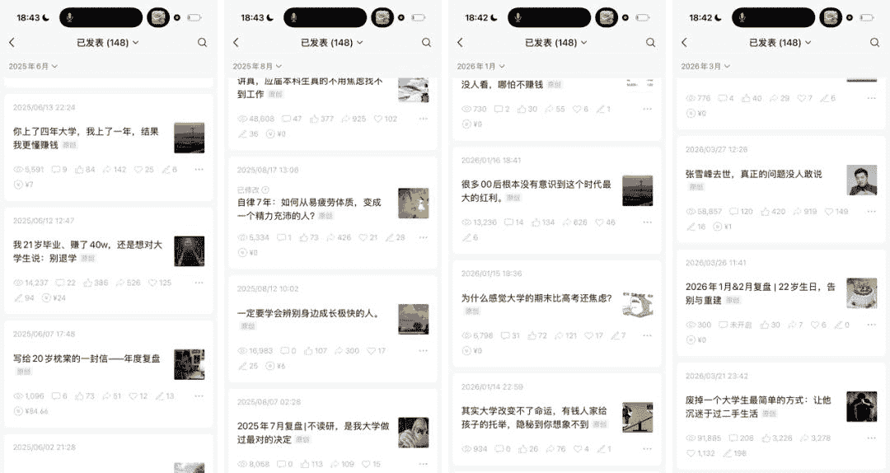

所以我没有从完全陌生的领域切入，而是先让AI学习并放大我已跑通的内容能力。

后续的知识库、Skill、Agent以及反馈机制，也都是在这个真实业务里逐步形成的。

这并不意味着每个人都该从公众号开始。

比如前段时间，我为一位负责社群运营的学员规划AI方向时，选择的起点是活动视觉设计。

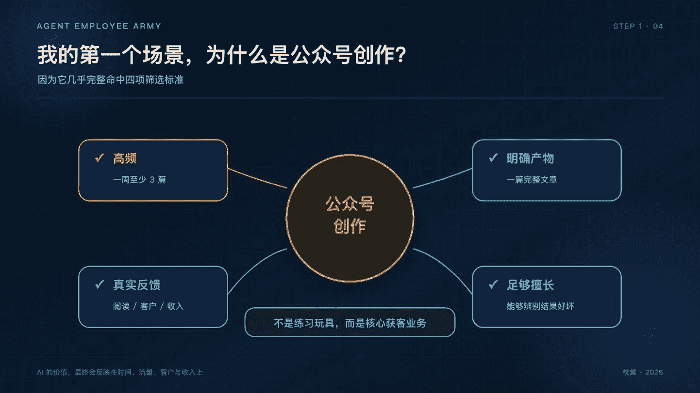

原因很简单：她经常需要制作活动海报和传播素材，任务结束后有明确的图片成果，而且她长期负责相关工作，能快速判断设计是否可用。

因此我们没有一开始就规划庞大体系，而是先处理一个边界清晰的问题：如何把已确认的文字内容，稳定转化为一张可直接使用的宣传图片？

我从内容创作切入，她从视觉制作切入，表面是两类工作，底层判断一致：出现频率较高；有清晰的最终成果；能获得真实反馈；执行者本人懂得判断质量。

所以不必追着别人正在搭什么Agent。

真正值得先交给AI的，是你自己工作中那项反复出现、结果明确，而且你最有把握判断质量的任务。

很多人跑来问我：想让 AI 真正上手干活，落脚点究竟在哪？

我的答案始终是：先别折腾工具，先圈定一件足够具体的正事。

这件事一旦有了轮廓，后面搭素材库、写脚本、做 Agent 才有了地基。而 Agent 的第一份“岗位合同”，也是在这一刻悄悄签下的。

我向来坚持的原则是：一个明确的活儿，就配一个专门的 Agent。

拿我自己举例——更新公众号，就设一个公众号 Agent；做活动海报，就设一个海报 Agent。它到底扛什么指标、最终交出什么成品，先把这些钉死。再往后，素材、脚本、交互方式，全都顺着这个岗位往外长。

走到这一步，组建 AI 团队才算真正推开了大门。

## 第二步：收数据，搭一个“外置大脑”

### 1. 素材库，说白了就是 AI 的记忆中枢

前面已经锁定了一个值得提效的场景，也知道了第一个 Agent 该往哪个方向使劲。

那动手做素材库之前，其实只需想明白一个问题：

要端稳这件事，AI 必须掌握哪些信息？

注意，先后顺序非常关键。

别急着先攒一堆资料、再琢磨这些资料有啥用——那到头来多半是白费功夫。正确的做法是反向推：先把事情框定，再顺着事情去圈知识。

因为素材库从来不是为了“囤东西”才存在的。

它存在的唯一理由，就是帮我们把事办成。事情要求 AI 懂什么，AI 需要懂什么，才决定素材库里该收什么。

还是用我的公众号来打比方。

我盼着的，是让 AI 能把公众号做得更好。

所以我就从目标一路倒着推：

想把文章写到位，它得清楚我是谁、我卖什么、客户关心什么；得知道我有哪些亲历故事和打法、过去发过哪些稿子，以及我个人觉得一篇文章好不好的标尺。

这些信息，过去一直散在我的脑壳里、聊天记录里、飞书、微信和电脑硬盘里。

于是第二步要做的事就清晰了：

把真正管用的信息挑出来、理干净，变成 AI 随时能翻的素材库。

这个素材库，我更爱把它称作——这件事的“外置大脑”。

因为它装着的，说白了就是我对这件事的全部底细：我懂什么、踩过什么坑、存过哪些料、总结过什么招、怎么分辨好坏。

站在 AI 那头，它会从这个库里找线索、读上下文、完成任务。

站在我这头，它等于把我脑子里的私货——经验、直觉、偏好——全都搬了出来，变成一份看得见摸得着的家底。

所以，光看公众号创作这件事：

这个素材库既是 AI 写文章时借力的头，也是我自己关于公众号创作的随身智库。这正是我管这一步叫“数据采集，搭外置大脑”的原因。

### 一个好的素材库，到底该长成什么样？

既然素材库是冲着办事去的，那它的好坏就只有一个衡量标准：

它存的资料有多少，不重要；重要的是它能不能让 AI 把活儿干得更漂亮。

所以素材库绝对忌讳“多多益善”。

我见过太多人的做法是这样的：“把电脑里的 PDF、聊天记录、文章、课程一股脑丢进去，让 AI 自己翻。”

可这么干，早就跑偏了。

明明只需要 100 份材料，你硬塞给 AI 10000 份，那多出来的 9900 份不是资源，而是干扰。所以素材库的头一件事，一定是围着任务做减法：有用的，留下；没用的，扔掉。

但就算你最后留下的 100 份全都跟任务沾边，要是它们乱七八糟地堆在那儿，AI 照样玩不转。

大概率卡在两个坑里。

第一，内容太多，它不晓得往哪儿翻，一个个找又慢，只能瞎编个答案来搪塞你。第二，内容太杂，就算翻到了，它也不清楚哪个可信、哪个该用，只好硬着头皮混在一起。结果常常是：

每份材料单拎出来都没毛病，可 AI 把它们拼一块儿，反倒得出个错误结论。

所以，记住这句话：

素材库最要紧的从来不是“装得多”，而是“理得顺”。

让 AI 用的时候：找得着、挑得准、使得对。

想做到这一步，其实方法很朴素——把素材库的一级、二级目录设计得明明白白。每一个文件夹都得能回答：它为什么成立？该放哪些内容？哪些内容坚决不能进？AI 在什么场景下该来翻它？

要是我们自己都支支吾吾答不上来，那 AI 就更摸不着头脑了。

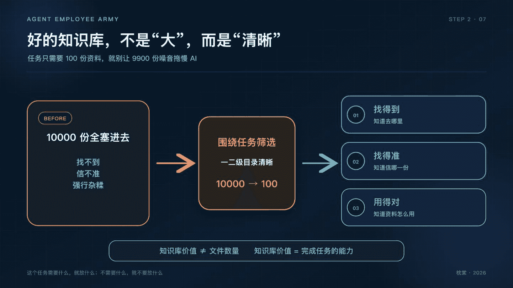

因此，一个真正能打的素材库，绝不是把你的硬盘原样复制一份丢给 AI。

而是：把你脑里原本看不见摸不着的业务脉络、一手材料、判断标尺，拆成一个个条理清晰的抽屉，让 AI 随取随用，成为一套它能持续读懂的“外置大脑”。

接下来，我直接拿自己的公众号素材库开刀，给大家看看我是怎么摆布这套目录的。

### 3. 我的 AI 公众号素材库

上面已经反复说过：素材库不是用来收藏的，是用来干活的。

于是我就绕着公众号创作这件事，把那些长期要反复翻的资料，归成了五个大类：

- 01｜枕棠的灵魂 Copy

- 02｜产品库

- 03｜客户需求与卖点

- 04｜故事案例库

- 05｜方法论库

然后另外隔出一个：

- 602｜公众号原创

专门用来承接实际的生产流水线。

乍一看，这几个抽屉好像只是在“整理资料”。但你往里琢磨，就会发现每一个抽屉都在回答公众号创作里的一个真问题。

**01｜枕棠的灵魂 Copy**：管的是“这篇文章究竟是替谁写的？”

这抽屉里存的是跟我这个 IP 绑定的长期消息——我的故事、我的坐标、我说话的调子、我常蹦出来的句子。它们合起来就为一个最根上的问题做注脚：AI 到底是替谁在提笔？

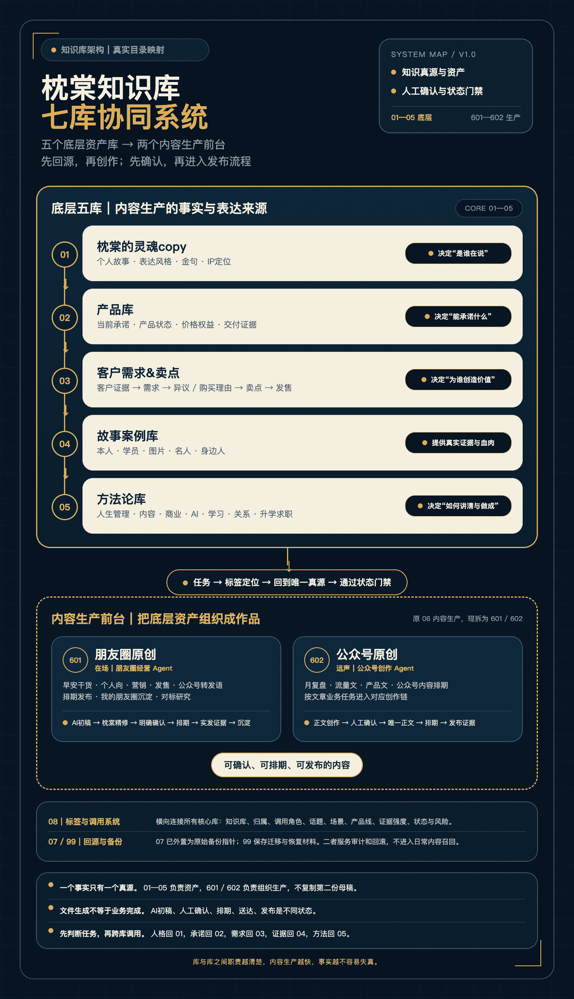

比如说，一篇文章聊到了我的创业经历，AI 心里得有数，哪些事属于我的商业主线；好比稿子写到结尾要收束观点，它可以来这儿翻我过去真说过的金句和判断；再比如成稿以后想去掉那股 AI 腔，也能翻我的表达习惯找感觉。

这个抽屉定的，是一篇文章最里层的：身份、叙事和语气。

**02｜产品库**：管的是“文章最后要拿什么来换钱？”

我所有的产品都在这个抽屉里——正在卖的、已经下架的、还在打磨的，一个不少。

公众号本来就是我的获客和成交入口，那一旦动了卖货的念头，就得把产品底细摸清楚。比如海报长什么样、价格怎么定、交付截图有没有、用户反馈怎么说，全都收好。这么一来，要写销售朋友圈或者推文，能直接调素材，别提多顺手了。

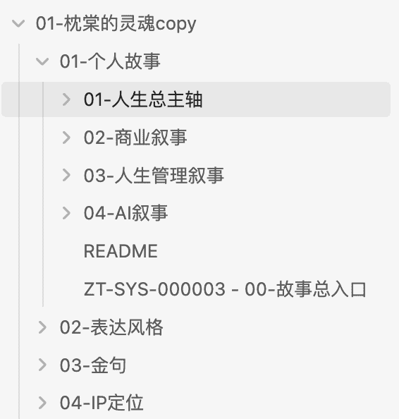

**03｜客户需求与卖点**：管的是“这篇文章到底是写给谁看的？”

如果说产品库解决的是“我手里有什么可以卖”，那客户需求与卖点库回答的则是天平的另一端：客户凭什么买单？这里装的是真实成交过程里沉淀下来的记录和分析——咨询对话、下单理由、没成交的缘由、常被问到的顾虑、值得深挖的客户样本，还有从这些一手材料里提炼出的客户画像、需求分层和卖点清单。

往后我定选题、拟标题、写开头，或者是推新品的时候。

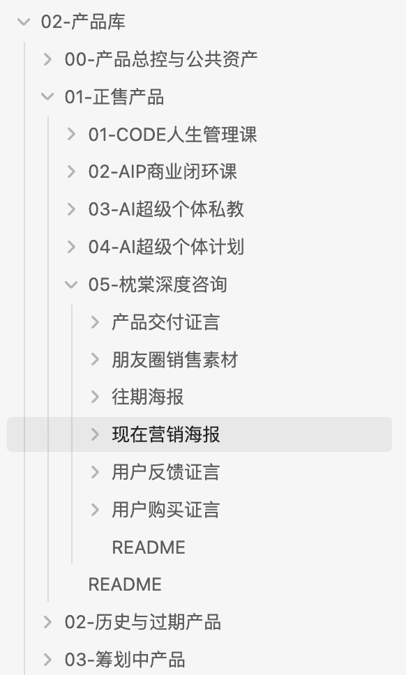

一旦觉得拿不准读者到底想要什么，我就会让 AI 先回到这个库里去翻真凭实据。

**04｜故事案例库**：管的是“文章拿什么来服人？”

如果一篇公众号要撑起高客单转化，那光靠信息准确远远不够，还得有足够的个人色彩。而个人色彩很大程度上，就藏在那些真实发生过的段子里。

所以我特意弄了一个故事素材柜。

这里有我自己的故事、学员的经历、名人的轶事（纳瓦尔、乔布斯），还有我身边朋友的片段。我自己的部分还会再往下拆：读书、职场、创业、理财、人生管理、AI 提效、高光时刻、低谷学费……

这么一来，我写东西的时候，AI 就能按主题去认领合适的故事，拿真实经历去做有力的证据。

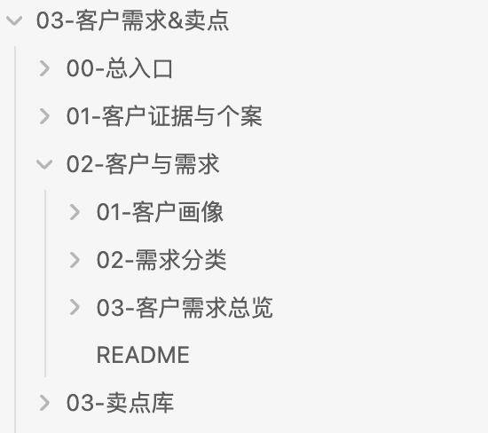

**05｜方法论库**：管的是“文章到底能给人留下什么？”

公众号不能只会煽情，也不能只会讲故事。

一篇真正有嚼头的文章，最后总得甩给读者一点让人眼前一亮的见解，和一套真能落地的手法。

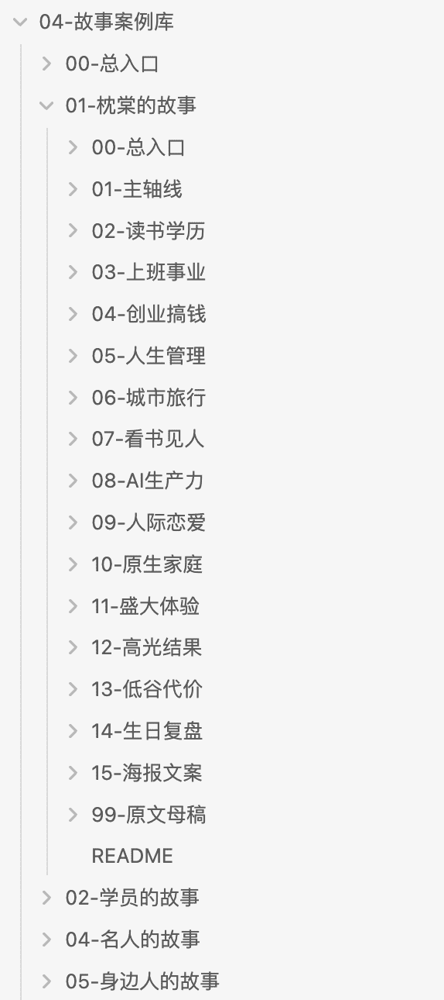

所以这个抽屉存的是我在人生管理、商业、写作、AI、学习这些领域里，日积月累攒下的打法和判断。

AI 一碰到需要方法论的地方，就会自动来这儿调我的那套东西，然后再揉进文章。

这样一来，AI 就不会每次临时去网上东拼西凑一套“看着像那么回事但跟我八竿子打不着”的方案了。

**602｜公众号原创**

前头那五个抽屉，更像公众号的长期粮仓。

而 602，才是真正开火做饭的地方。

我眼下要重点做的公众号，大致分三类：

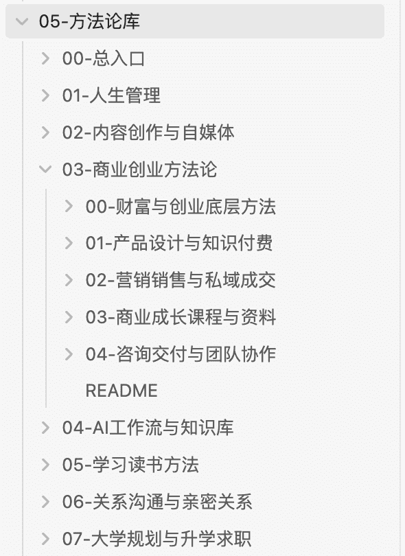

月度复盘、产品软文、流量爆款，每一类都有自己独立的生产文件夹。

里面存着对应的流程手册，以及一篇文章从：选题 → AI 起草 → 人工打磨 → 最终推送 的全套来龙去脉。

真正动笔的时候，AI 会在 602 里顺着对应的公众号脚本，把前面各个抽屉里的料调出来，一步一步攒成最后的成品。

所以你看：

我的公众号素材库，并不是几个井水不犯河水的文件堆。

它骨子里是一套围绕着“把公众号做好”这个目标，倒推出来的分工系统。

01｜枕棠的灵魂 Copy，回答的是：这个稿子背后站着谁？

02｜产品库，回答的是：我手里有什乜可以出手？

03｜客户需求与卖点，回答的是：这稿子给谁看？人家在意什么？

04｜故事案例库，回答的是：拿什么真实经历来撑腰？

05｜方法论库，回答的是：面对这个问题，我到底有什么独到的见地和解法？

602｜公众号原创，则负责把这些素材真正捏合在一起，顺着创作流程在这个工区里一步一步变成终稿。

所以说，素材库的目录结构，不是为了“摊开来好看”。

而是为了搭一个好用的外置大脑——让 AI 办差的时候，每个需求都能找到对应的抽屉。AI 清楚自己该在什么时候去哪儿、为什么去那儿。这就是我前面反复念的那句：找得着、挑得准、使得对。

### 4. 从零开始，怎么搭你的第一版素材库？

上面给你看的，是我现在跑得比较顺的一套素材库。

但如果你才刚起步，我可不建议你照抄我的目录。

因为每个人手里的活儿都不一样，需要的原料也天差地别。

我的产品库、客户需求库、故事案例库，都是从“公众号创作”这棵树上一点点长出来的。

你要是做海报、做 PPT、做公司汇报，直接把我这套拿过去，反倒又踩了我们一直在躲的那个坑：

素材库，是跟着任务走的。

所以第一版素材库，根本不必追求大而全。

只要绕着 Step 1 选中的那个真任务，先给 AI 拼一个“刚好能转起来的小脑袋”。

我自己摸索出一套几乎放之四海皆准的起步框架：

- 01｜任务 DNA

- 02｜任务标准

- 03｜任务资产

- 04｜任务工作区

一个一个来看。

**01｜任务 DNA**：什么东西决定了这是“你的活儿”，而不是别人的？

任务 DNA 的核心就一个词：独一份。

把那些只有你、只有你的 IP、只有你们公司才有的东西装进去。

同样让 AI 写一篇公众号，凭什么是“你的公众号”，而不是旁人的？同样让 AI 做一张海报，凭啥一眼看上去就像你们家的，而不是随便哪家的？靠的就是任务 DNA。

比如做公众号，你可以把个人履历、IP 定位、主打观点、内容禁区、以前的爆款、你的文风统统放进去。

比如做公司海报，你可以把品牌定位、Logo、标准色、字体规则、视觉风格，还有最能代表公司的几套老设计放进去。

这些东西是你每次交代 AI 干活时都要唠唠叨叨说一遍的，而且天底下只有你说得出来。

**02｜任务标准**：干到什么份上，才算达标？

弄明白了“像谁”，紧接着的问题就是：

做成什么样，才算成了？

所以任务标准里，装的是你对终局的要求。

这里头，既可以放明文写好的规矩，也可以直接扔真实的好例子和坏例子。

比如做公众号，你可以写清楚你理想中的文章长度、段落节奏、整体观感，再放上你最得意的那几篇、圈里让你服气的东西，以及让你看不上的反面教材。然后跟 AI 交代：这篇牛在哪儿？那篇烂在哪儿？什么标题你愿意点？什么措辞一看就有 AI 味？

把终局的标准一点点磨清楚。

做海报也是同理。你可以放以前最中意的几张作品、行业里特别出彩的设计、还有你觉得上不了台面的反例。再把尺寸、信息层级、字体、交付格式这些硬性条款一并写明白。

因为很多时候，我们很难凭空说清楚“什么叫好”。但把好的和烂的摆一块，AI 反而一看就懂。

一句话总结：规则负责告诉 AI“好”的定义，正反案例负责让 AI 亲眼见到“好”的样子。

**03｜任务资产**：还有哪些外挂，能让 AI 把这活儿干得更漂亮？

如果说任务 DNA 管的是“哪些东西只属于我”，那任务资产管的就是“还有哪些东西能借来一用，把活做漂亮”。

比如写公众号，除了表达风格、IP 定位这类 DNA，你还可以把垂直社区里的精华帖、跟定位有关的好书好课、纳瓦尔和乔布斯这类名人的故事都塞进去。只要真能让文章更有劲儿，统统收编为任务资产。

做海报也一样。除了 Logo、品牌色这些 DNA，你还能继续往里加优秀设计案例、设计思路、字体包、图标、图片、行业灵感，以及各种拿来就能用的视觉素材。

它们不一定归你独有，甚至放之四海皆可用。但只要它们真能帮 AI 把这事办得更漂亮，就能成为你的任务资产。

**04｜任务工作区**：这事到底咋干，现在干到哪一步了？

最后一块，是任务工作区。

这个文件夹，我建议直接劈成两半：

**01**｜**SOP**

**02**｜任务生产记录

前半部分 SOP，存的是这件事具体怎么落地的操作手册，也就是下一大节要说的那个 **Skill**。

后半部分则是任务生产记录。每一次真实任务从头到尾的痕迹都存在这儿：原始素材 → **AI** 生成的初稿 → **人工**修改 → **终版** → **发布**/交付 → **复盘**。这样一来，回过头查问题出在哪一环，就一目了然了。

顺便说一句，AI 初稿和人工终稿之间的差别，本身就是特别值钱的数据。后面写 **Skill**、升级整套 Agent 系统的时候，全都还要接着用。

到了这儿，你的第一版素材库其实已经搭完了：

任务 **DNA**：让 AI 知道，哪些东西只有我拿得出手。

任务标准：让 AI 知道，做成什么样才算过关。

任务资产：让 AI 知道，还有哪些好东西可以借力。

任务工作区：让 AI 知道，这件事怎么一步步推进，以及每一回是怎么做出来的。

要是还觉得抽象，我举个好玩点的例子。

比方说，你要替公司安排一回重要的客户饭局，这件事完全也可以建一套素材库。

任务 **DNA** 里，放进只属于你们公司的情报：王总不碰辣、李总不吃海鲜、张总对粤菜情有独钟；谁和谁交情深、以前招待他们是什么排面、公司请客有哪些讲究。这些信息外人不可能知道。

任务标准里，写清楚：人均预算卡在多少、距离别超过多远、需不需要包间、环境和服务的底线是什么，以及过去那几次宾主尽欢的饭局到底赢在哪儿。

任务资产里，塞满杭州的餐厅清单、各家评价、招牌菜、停车攻略、商务宴请的讲究、酒水搭配的建议，凡是能让这顿饭更体面的资料全算。

任务工作区里，就真刀真枪地把这顿饭往前推：定时间人数 → 选餐厅 → 拿方案 → 人肉确认 → 下单订座 → 记下最后的反馈。

你会发现一个有意思的事：

写公众号、做海报、请客户吃饭，这仨事表面风马牛不相及，但背后素材库的逻辑骨架是同一个。

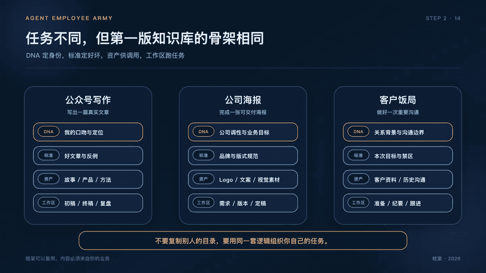

先跟 AI 交代清楚什么叫“你专属的”；再让它明白什么叫“好”；接着塞给它一堆趁手的材料；最后让每一回真刀真枪的任务都在一个清清楚楚的工区里走一遍。

这就是你的第一版素材库，一个 AI 最趁手的外置大脑。

好了，素材库就位之后，我们终于能腾出手来做 Skill，让 AI 正式下场干活了。

## 第三步：Skill 固化，把结果焊死

### 1. Skill ，就是递给 AI 的一本“奶茶操作手册”

前头我们已经把素材库给 AI 铺好了。

它心里开始有数：我是谁、我手里攒了什么、什么结果够得上好。

但“心里有数”不代表它会干活，更不代表它每次都能端出同样水准的东西。

要说稳定输出，咱们先看看人类是怎么做到稳定输出的。

奶茶店的新人，几乎用不着培训几个月，很快就能独立站台，而且每一杯的味道都大差不差。

凭啥？就凭他们手上有一套清清楚楚的 SOP。

加多少糖、加多少冰、头一步干啥、第二步干啥、第三步干啥……只要照着这个流程走，结果就不会跑偏。

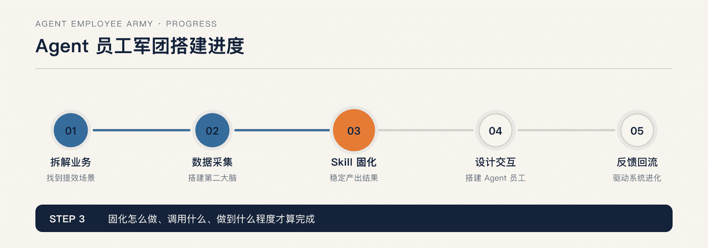

那要让 AI 也稳定发挥呢？

也简单——给 AI 也写一套 SOP 就行了。

而写给 AI 看的这份 SOP，就是常说的 **Skill**。

它会明确地指挥 AI：先做哪一步、再做哪一步、然后做哪一步……让 AI 顺着一套稳当的流程往前走，最终稳稳当当地交出合格的结果。

### 2. 一份好 Skill ，要满足哪些条件？

那好 Skill 到底该怎么写？

说到底，就盯住三个问题。

第一，怎么做。也就是这件事分成哪几个环节，每个环节的先后顺序是什么。

第二，用什么。每一步得调动哪些东西——可能是素材库里的资料，可能是某个外部工具，也可能是上一步刚做出来的半成品。

第三，怎样算好。也就是每一步做到什么份上才算合格，才敢进入下一步。

还是拿最家常的例子说事儿：西红柿炒鸡蛋。

如果让你把这道菜写成一份 Skill，绝对不能就扔一句：“给我做份好吃的西红柿炒鸡蛋。”就完事。

你得把整个流程拆开，并且每一步都交代清楚：怎么做、用什么、怎样算好。

第一步，备料切菜。

怎么做：把西红柿洗干净切成块，鸡蛋磕进碗里打散。

用什么：西红柿、鸡蛋、菜刀、砧板、碗和筷子。

怎样算好：西红柿块大小差不多，蛋液打得均匀，看不见成块的蛋清。

第二步，先炒鸡蛋。

怎么做：锅烧热再倒油，放进蛋液，等底部凝住以后快速扒拉。

用什么：蛋液、食用油、锅铲。

怎样算好：蛋液基本凝固、颜色金黄、口感还嫩，不能炒老了。好，先盛到碗里。

第三步，炒西红柿。

怎么做：锅里重新起一点油，把西红柿倒进去翻炒。

用什么：西红柿、食用油、锅和锅铲。

怎样算好：西红柿开始变软、出汤，但还能看到一块一块的形状。

你看，就这么一步一步拆开、写透，一份 AI 能照着做的 Skill 就立住了。等我们把一套又一套这样的 Skill 填进那些文件夹时，一支真正能稳定输出的 AI 队伍，也就这么成型了。

从一个具体的小任务启程，以终为始地把外置大脑搭出来，再用 SOP 把流程固化成肌肉记忆——这，就是从 0 到 1 搭建 AI 军团的全部底牌。

先讲个下厨的场景。

一盘番茄炒蛋，前面几步都完成了，最后要把煎好的蛋重新倒进锅里，跟番茄混合。

操作动作：把蛋块回锅，与番茄同炒，撒盐调味，快速翻动。

所需材料：预先煎好的蛋块、番茄、调味料、一口炒锅、一把铲子。

完成标准：蛋块和番茄互相裹上味道，整体口味均匀，番茄有汤汁但没彻底烂掉，这时就能关火装盘。

这件事的启示是：真正能让人照做的SOP，不会只列一、二、三，而是每个环节都写清三件事——操作动作、所需材料、完成标准。三件事缺一样，执行就容易走样。

动作不明确，机器就没法判断该运行什么；材料不明确，机器就没法确定该提取哪些信息和工具；标准不明确，机器就没有停下来的依据。

给AI写技能包，说到底也是这个道理：把原本靠经验和手感才能完成的活儿，拆成机器能读懂、能执行、能自我检查的标准流程。

但现实里，很多工作不像番茄炒蛋这样步骤分明。拿我自己的内容创作来说，怎么给AI设计技能包？

### 3. 我的技能包：公号九维拆解法

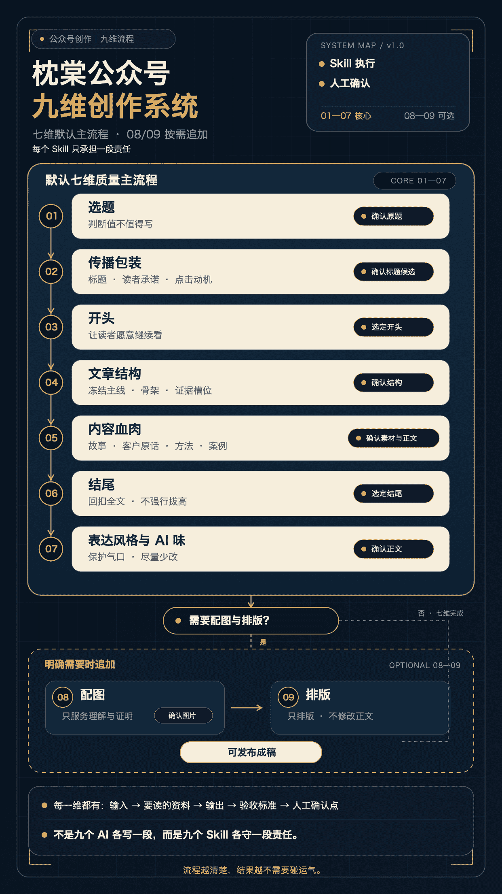

先从我最熟悉的公号写起。

早期我搭好资料库后，AI直接读资料替我写，但我很快发现情况不对：

一些灵感和判断必须我亲自指路，它才能找得准，而且经常调错对象，反而加重我的负担。若我完全不提，文章就会空洞，既无个人经历，也无方法沉淀。

后来我想明白，只有资料库不够，还得给整个创作流程设计一套完整的技能包。我把流程拆成了九个维度，就是现在的「公号九维拆解法」。

**01**｜选题

要回答的问题：这篇写什么。最终锁定一个垂直人群精准、有爆款潜质、还能带来流量和转化的主题。

**02**｜传播包装

要回答的问题：怎么让读者愿意点进来。产出正题、副题与分享语，加强扩散效果。

**03**｜开头

要回答的问题：点进来之后，凭什么让人继续读。抓住黄金一百字，让开头既能衔接标题，又能牢牢钩住注意力。

**04**｜文章结构

要回答的问题：全文怎么搭骨架。确定核心观点和段落次序，让内容层层推进，叙事始终咬住一条主线。

**05**｜内容血肉

要回答的问题：具体段落填什么。根据当前情境，从资料库中调取合适的故事、案例、用户需求、产品与我的方法论，把骨架填充到位。

**06**｜结尾

要回答的问题：怎么收得好。回到主线，留下清晰的结论或恰到好处的升华，同时引导点赞、评论、添加好友等动作。

**07**｜语气与去除机器腔

要回答的问题：怎么让文章不像产出物而像人写的。通过用词替换、句式变换、风格校准，让成稿更像逐字写出来的。

**08**｜图示

要回答的问题：怎么让阅读更舒服。自动判断适合插图的位置，生成金句海报、结构示意图等视觉元素放进文中。这篇文章里的不少图，就是用它生成的。

**09**｜排版

要回答的问题：怎么让成品可直接发布。按MD格式输出，把大标题分层、加粗、划线都处理好，复制进草稿箱就能发。

于是结论变得清楚：这套系统真正做的，是把“帮我写一篇好的公号文章”这类模糊要求，拆成九个更具体、更好执行的小任务。

九个任务各有明确的交付物和验收标准。选题不对，回炉选题；开头留不住人，重写开头；结构混乱，重排文章结构；内容单薄，补足血肉；口吻不像我，回到第七个环节；标题与正文接不上，重新做传播包装。

这样一来，AI不再靠运气偶尔写好，而是持续稳定地产出合格结果。

为什么能做到？因为我把过程中可能使AI偏离轨道的变量都列了出来并加以约束。每个环节的动作、所需资料、完成标准，都事先存进了技能包。AI无需每次猜测我的意图，也无需即兴发挥，沿着设定好的流程走就行。

变量界定越清楚，控制条件越具体，结果就越稳。这正是一份合格技能包该有的形态。

### 4. 怎么打造自己的技能包

搞清楚技能包的含义之后，紧接着要解决另一个问题：如何形成专属技能包？

其一：先找现成的技能包

其实，我们现在需要的大多数产物，网上已经有人做过。AI最大的好处是：

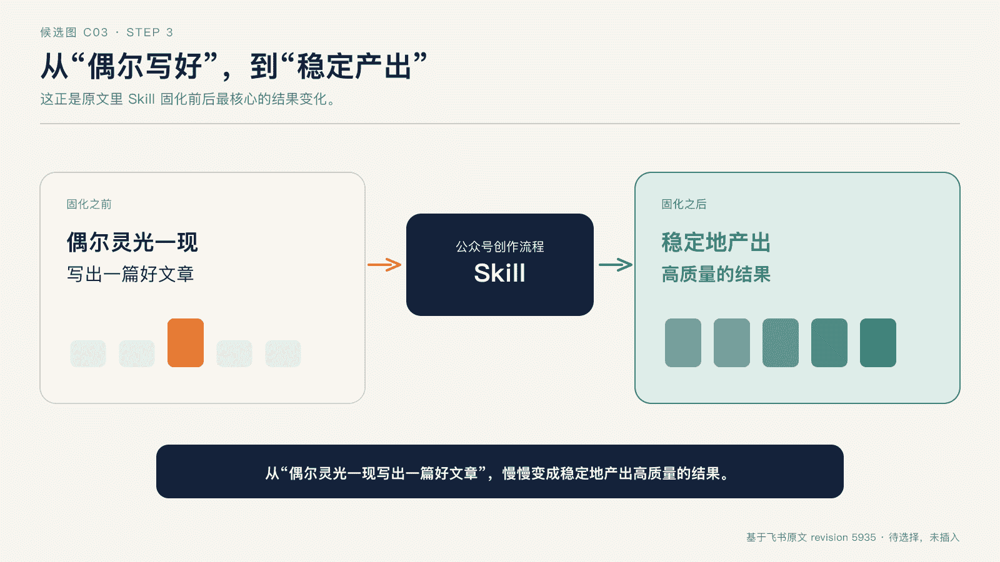

过去我们只能复制认知，现在连结果也能直接复制。别人写好的技能包，我们拿过来就能用。

怎么找？主要有两条路。

一条是去GitHub搜现成的技能包、Prompt模板和流程样例。

比如我最早做的“去除机器腔”方案，参考了业内一位博主关于写作与去机器化的思路。现在做海报的技能包，最初也是从GitHub找到的。甚至不用费劲，直接交给AI去检索。

另一条，是直接找到这个领域里你认可的高手，花钱买对方的方法与手册，甚至是封装好的技能包。我自己为了琢磨内容变现的整个链路，付了不少学费，累计到六位数。

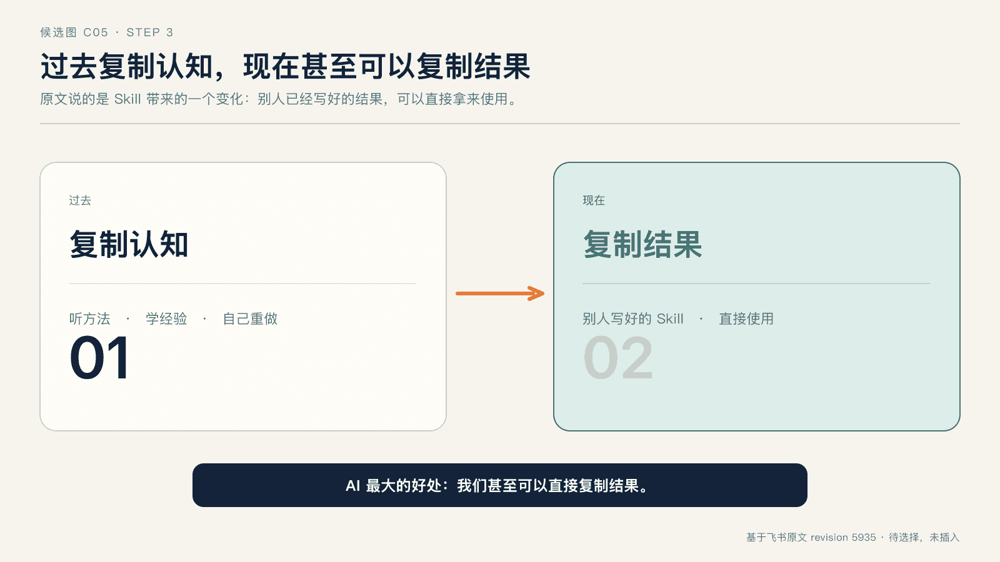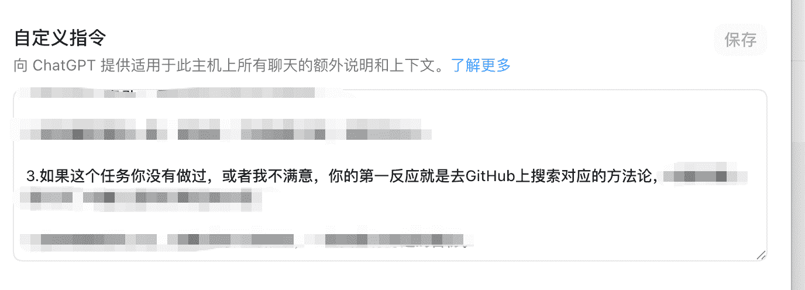

包括这套公号九维拆解法，目前也会直接交给付费学员使用。

核心就一句话：别把时间花在重新造轮子上。世界上已经有太多被验证过的成熟方案。

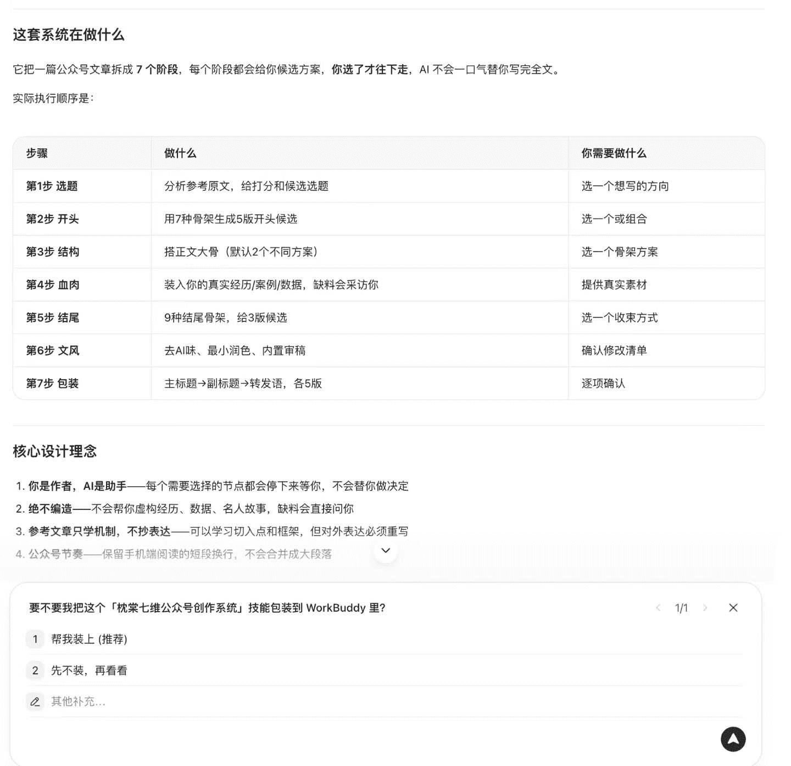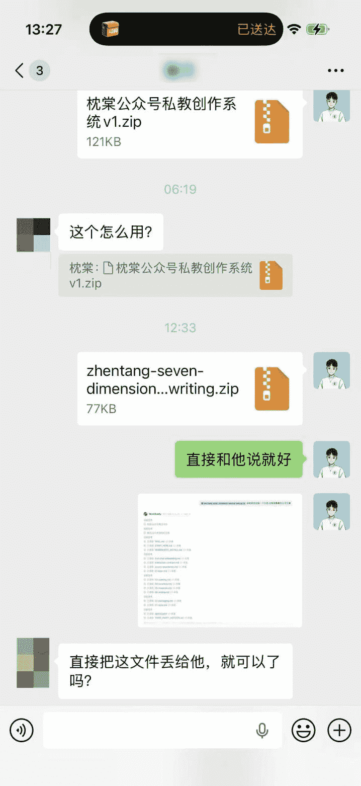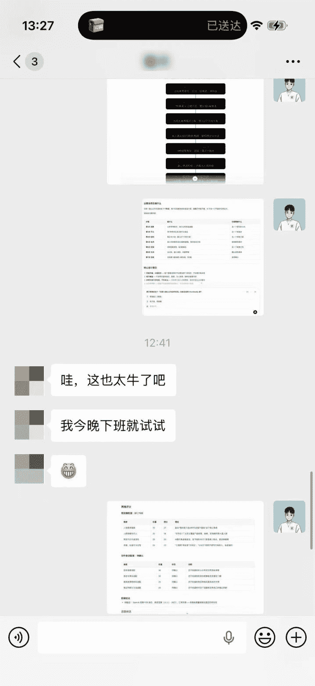

能找到就直接拿来用，能站在别人肩膀上就不要一切推倒重来。

其二：把外来工具调成自己的

抄一套方案，并不等于拿到结果。

因为使用环境不可能一模一样，照搬必然失灵。正确做法是：用自己手头实际项目去试。试完看看顺手之处与别扭之处，直接动手改。

也可以把个人经验同步给模型，让它结合这些判断继续调整。之后反复跑、反复看、反复改，直到满意。

比如最初拿到那套去机器腔的方案，我没全盘照用。随便挑一篇自己的文章试跑，等模型改完，我再一字一句比对：哪些修饰我能接受，哪些改动反而丢了我的味道。然后把我喜欢的和反对的都反馈给系统，让它记住这些偏好，继续修订方案。

这种调校的流程，说白了就是反复跑：执行、看表现、人工调、改方案、重新跑。

最后一步：把方案固定成技能包

当一套流程跑通之后，下一步是把它固化，让它以后能反复使用。

可以复制下面这段指令发给GPT，让它帮你把流程整理成一个可复用的技能包：

请回顾这次完成任务的整个过程，把它整理成一份能反复调用的技能包。一、以实际步骤为准，不要补加我们没做过的动作；每步都写清：这个环节具体要做什么、先后来序如何；需要调动哪些资料、案例、工具或前一步的产出；做到什么程度才叫完成，才能继续走。同时标出容易犯的错、必须由人确认的节点，以及绝对不能做的事。二、梳理完毕，请调起技能包创建工具，把这条已验证的SOP固化为技能包。记住：固化的是方法，不是这一次的结果，以后遇到同类任务即可复用。完成之后告诉我：这个技能包的用途、适用时机和存放位置。

往后即可按需调取。

走到这里，我们已经完成了关键的两层：资料库解决的是模型的认知来源，技能包解决的是模型的动作方法。

如果按前面的方法一步步搭好，你现在应该已经能让AI稳定地产出一个具体结果了。可能是一篇文章，也可能是海报、演示文稿、社交动态，或者任何你最初选定的目标。

但还剩最后一个问题：就算AI懂了知识、也会干活，很多时候我们还是要回到某个AI平台，亲手键入“开始”“继续”“下一步”。

所以，需要把前面验证过的资料库和技能包再往前推一步，封装成数字员工与操控台，让它们真正落到日常里。

## 第4阶段：改造交互方式，组建数字员工队伍

### 1. 让AI走进日常

前三步做完，AI已经有两样核心基础：资料库和技能包。在AI平台上把活儿派下去，它已经能交出相当稳定的结果。

但如果每次开工前，还得跑到那个输入框里敲一堆命令，那只是把原来的体力劳动，换成了动嘴遥控AI的重复劳动。

AI要真正落地，不该是天天让人去迁就它。

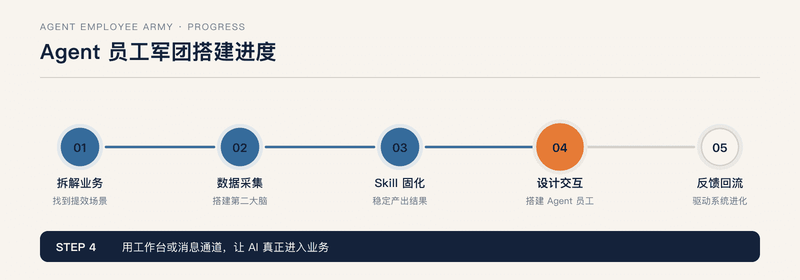

而是改变方向：AI来适应人，融入我们原有的工作节奏。

平时我们最熟悉的交互方式无非两种：其一是像App和网页那样点选操作；其二是像聊天软件那样你来我往发消息。

所以我也把AI的入口做成了两种：操控台和数字员工。

### 2. 操控台：所需即所点

第一个形态，是一块看起来像普通工具软件的操控台。

道理很简单。没人会打开一个聊天界面，逐条输入指令，而是打开App，点几下、搜一下、筛一筛，结果就出来了。

操控台的本质，就是把已经验证过的资料库和技能包，封装成一个更像普通软件的页面。你不需要背指令，也不需要关心系统内部接了哪个方案，需要什么就点什么。

我已经做了不少操控台，覆盖生活的许多角落。下面挑两个例子讲清楚。

其中之一叫知识采编台。

我平时会积累大量会议录音、语音转写记录和口述内容。以前这类素材录完就躺在文件夹里吃灰。知识采编台会把它们一步步整理成：音频原稿→可读草稿→观点/方法/故事/案例/选题。

目前里面存了273份转写记录、254份可按需调阅的草稿。打开操控台，我可以直接搜索某份记录，看原文、看整理稿，再逐条确认AI抽取出的要点。原本散落各处的口述素材，就这样变成了一套能持续使用的资料库。

另一个叫“在场”，是专门处理社交动态的操控台。

它负责把前面确认好的素材、观点和故事，加工成社交动态。我可以选择不同形态，比如晨间知识短评、个人感悟、营销文案、发售公告、公号转发语等，然后投入素材，让它调用对应资料库和技能包生成内容。生成后，我在操控台里完成修改、确认和后续处理。

可以看到，操控台没有给AI增添新本领，干活的底层仍然是资料库+技能包，它只负责给这些能力披一层更顺手的界面。

过去是在AI平台上一行一行指定该读什么、该调什么、进入哪个环节；现在这些都被按钮吸收了。我不需要专门研究怎么和AI对话，像打开一个普通App那样就能用上它的能力。

哪怕我平时也写程序，依然觉得这种体验很爽。过去做一个小工具，怎么也得一周；现在借助AI，很多操控台一两个小时就能成型。

### 3. 数字员工：自己干活，主动交差

操控台更像一个App，需要时我主动点开；数字员工更像一个真人同事——不用我出手召唤，该干活的时候它自己启动，调用后台资料库和技能包，完成后把结果发到我的工作消息里。

目前，在写文章和做咨询这两块，我配了大约12个这样的数字员工。

公号方向有：公号总控、公号采集、公号主号、公号小号、公号复盘；个人动态方向有：动态总控、晨间助手、硬广助手、公号分发助手等。

举两个例子。

其中一个叫公号助理。它每天帮我盯外部动向：同行发了什么，行业发生了什么。早上它会扫一遍我关注的同类账号，把新发布的文章汇总、梳理，浓缩成一份动态简报发到聊天工具。我起床扫一眼，选题就有了。

另一个是晨间助手。它负责稳定生产我的晨间动态。它会读取我过去发过的动态、公号内容、语音和书籍资料，调用对应的技能包，提前给出几版候选项。我确认后排好时间，到点它就把定稿推到聊天工具里，我复制一下就能发。

数字员工同样没有给AI增强能力，底层依靠的还是资料库+技能包。差别在于：操控台把能力做成了页面，数字员工把能力做成了聊天工具里的机器人。它会每天自动开工，把结果主动送过来，我收到后随时回一句，就能继续往下走。

把数字员工接到聊天软件里还有额外好处：不用电脑的时候，用手机也能发消息给它。我交代任务，它在后台调取资料库和技能包处理，再把结果传回来。

所以第4阶段的思路很清楚：操控台，是把AI的本事做成我主动打开的工具；数字员工，是把AI的本事做成会主动干活的“同事”。两者看起来不同，内核却一样——资料库负责供给认知，技能包负责供给能力，操控台和数字员工负责让这些能力真正走进工作和生活。

到了这一步，AI不再是一个需要我反复点开的输入框，而是融进了我本来就在用的工作方式。需要时我打开操控台直接操作；不需要时，数字员工自己干活。

这才是我想要的——AI自然地长在日常生活里。

别急着收工，第一版往往漏洞很多。

系统越用越好使的秘诀在最后一步：

**第5阶段：收集反馈，倒逼系统升级**

四步完成后，我们有了一台能运转的内容机器：场景→资料库→技能包→数字员工与交互。

但这时候，它只是第一版。很多问题，只有真正用起来才会暴露：哪里不够好？为什么不够好？下次该改哪里？

第5阶段要做的事很简单：把实际应用里得到的意见收拢起来，回头调整前面的每一层。

我关心的反馈有两种：一种来自人工，一种来自数据。

### 1. 人改了什么，系统要读懂

先说人工的：我会继续手动修改AI交上来的成果。

还是拿公号举例。AI写完初稿后，我会继续做人工精修，然后把修改前后的版本丢给AI作差异分析：我动了哪里？为什么动？病根在哪个环节？

如果写到我的经历、产品资料或客户需求时有偏差，多半是第二步的资料库出了漏洞：要么缺，要么旧，要么不准。

如果资料齐全，但模型总是选不对调用时机，结构、口吻、步骤频繁出错，问题就在技能包身上。

如果产出没毛病，但使用体验很糟，比如该自动跑的时候没反应、结果送达的位置不对、要重复操作，那么问题出在数字员工和交互设计上。

因此，每次动手改稿，价值重点不在修补文本，而在追问：为什么这一回又要我来修？想改好系统，该动哪一层？把这些答案存回系统，才能逐步养出成熟的数字员工。

### 2. 数据怎么说，系统怎么调

另一种是现实世界给出的数据信号。

自我感觉良好没有用，关键看数据是否支撑。

还是拿公号来举例。

文章推送上线后，我的第一反应不是庆祝，而是开数据面板。

浏览量、互动量、传播量、粉丝增量、是否带来私信咨询、是否产生合作或成交……这些真实回声我都会一笔记下。

盯数据本身不是目的，把数据交给系统复盘才是。

我会把这些从真实世界跑回来的数字原封不动递给模型，让它帮我拆解：这次为什么火了，下一次为什么沉了？哪些选题方向、标题写法、开头钩子、整体结构在市场上站住了脚？

当某种标题范式、内容框架或表达习惯连续多次都跑出稳定高点，我就会把这条被市场反复验证过的经验抽出来，固化进技能库里。

于是真实数据的价值就显出来了——它不是一句“我感觉还不错”。

而是把外部世界的反馈再送回内部，让模型从结果倒推规律，再用规律去修正前面搭建的整套流程。

一边是我用主观校准在告诉系统“我的审美和标准是什么”；另一边是市场用点击和转化在告诉系统“什么真正管用”。两路信号同时回流，整套智能体才越跑越准。

这两类回路，最终都指向同一个操作：溯源。

找到问题卡在哪个环节，就只改那一个环节。

最开始的需求和目标就没对齐？回到第一阶段的场景定义。

模型缺料、用错料、用的是旧料？回到第二阶段的知识库。

料是齐的，但调用不顺、流程跑偏、交付不稳？回到第三阶段的技能固化。

能力已经够用，但触发、确认、推送这些交互总卡壳？回到第四阶段的智能体封装与交互。

换句话说，第五步并不是另起炉灶。

它更像是整套工作的造血机制。

人工校准让模型更懂我的偏好，市场反馈让模型更懂真实用户的反应。两股力量持续灌回前四步，哪里薄弱就补哪里。于是从场景定位、知识沉淀、技能固化、智能体封装，到反馈、定位、迭代，系统才真正转成闭环。

到这一步，我的机器人同事军团才算活起来。每次完成一次真实任务，它就多一分理解；每次迭代，都比上一次更懂我，也更懂业务。

说点心里话。

这篇长文写了一个多月，近三万八千字，我把自己这段时间搭建智能体团队的来龙去脉基本都摊开了。

如果只能留下一个核心，我想说的是：AI 的意义永远不是表演技术，而是产生真实变化。

不是你装了多少插件、积累了多少技能包、搭了多少个机器人，也不是你的面板看起来多炫酷、自动化链路多复杂。

关键在于：它有没有帮你省时间、降心耗、让交付更稳，甚至真的多拿下一些结果。

我把知识库、技能包、工作台、AI同事都拿出来分享，并不是要大家照抄一套“我的系统”。

我的业务、产品、习惯、工作方式都只属于我。

真正可以迁移的，是那条路径：从一个真实任务出发。

先想清要解决什么问题，再为完成这件事搭建所需知识库，把已经跑通的方法沉淀为技能，再挑选最顺手的形态封装成工作台或AI同事，最后持续把人工修正和真实数据喂回来，让系统自进化。

所以不妨把智能体军团当成一个长期的目标。

先挑一件你每天或每周都在循环做的事，认真交给AI跑通。让它为你省下一个小时、少一次重复劳动、多交付一次成果，甚至带来一笔额外收入。

当第一个AI同事真正创造价值，当你切实感受到时代红利的提升时，第二、第三、第四个自然会跟着长出来。

坦白说，三万八千字写下的AI魅力，可能远不及它真实魅力的万分之一。真正的魅力，只有当你亲手把它落到自己的工作和生活、拿到可验证结果的那一刻才会显现——也是在那一刻，改变的齿轮才开始转动。

一句话收尾：何以AI，唯有落地。

正文到此结束。

如果这篇文章对你有用，欢迎点赞投锚，在评论区留下收获与反馈。有任何疑问也欢迎留言，我看到会回复。你的支持是我持续输出的最大动力。

另外，我现在在杭州全职创业，常在活动和联合办公露面。如果你对AI有新的想法，欢迎来交流。最后，感谢你一路看到这里，一起龙哥盟！

接下来是附录：三份可直接使用的提示词。

正文讲清楚了搭建智能体团队的完整思路，这里不再重复方法论，只保留三份能直接出成果的提示词：为AI搭建首版知识库、将知识库与技能封装成AI同事、把高频流程做成AI工作台。

使用建议：不要一次性把三份都塞给AI。先锁定你此刻最急需解决的问题，把对应的提示词原样发给Codex。

提示词汇总一键复制版：

7xok9scdx95nuJ?from=from_copylink

附录 01｜首版知识库搭建

附录 02｜首版 AI 同事搭建

附录 03｜首版 AI 工作台搭建

————分割线————

看完SOP，你可能觉得自己懂了。但90%的人实操第一步就会卡住。

工具和教程只是入门门槛，真正的门槛是立刻行动和信息圈层。

我们不谈空话，只做商业闭环拆解与AI效率压榨。内部已沉淀1000+跑通的套利实战案例。

👉 查看圈子数字资产与加入门槛：

