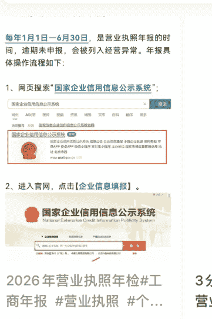
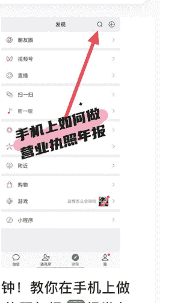
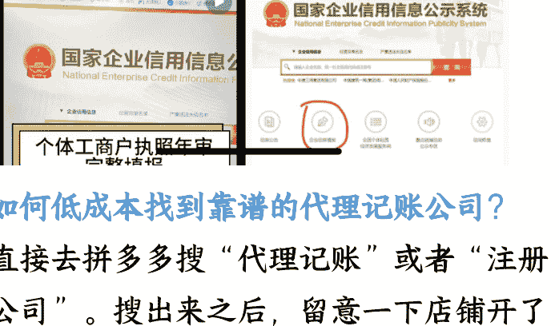
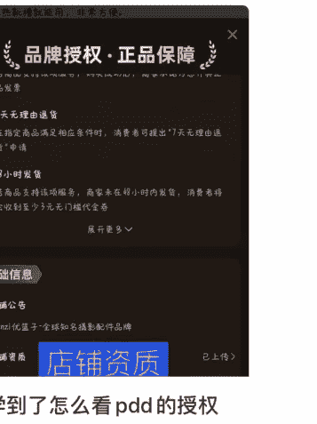
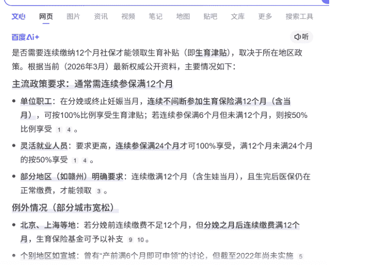

# 6年“轻启动”实操：我不靠烧钱也能做成事，而且从未欠过债
作者：龙哥

各位朋友，我叫珍妮。最近几位朋友看完我请菲籍员工的帖子后，感慨我把成本控制得太狠了；也有人说，要是早知道供应链可以按这个思路筛选，过去能多赚不少。于是不少人跑来私下问我到底怎么做到的。

那今天我就摊开来聊一聊：过去6年，我是怎么用很小的预算把事情做起来，并且从头到尾没让自己背债。

先交代背景。我2022年才算是正式单干成功，但早在2020年，我已经稀里糊涂地组了个小团队在跑业务，只是当时没意识到，那就是自己做主。6年下来，我的启动预算始终压得很低，账目也一直很稳。

我一开始连公司要有哪些部门都不清楚，因为没在互联网大厂待过。以前我靠教雅思写作为生，上午8点到12点讲课，午餐随便对付两口，再换地铁去下一处教学点，午后两点到六点继续上课，晚上7点半还要赶去学生家里补到9点半，回家接着批改机构学员发来的作文。偶尔被排到托福课，凌晨4点半就要起来写教案，六点动身，骑单车再转地铁。

路上补觉，我琢磨出一个闹钟分段法：先算好离中转站还有几分钟，比如15分钟，就设三个闹钟，分别在10分钟、12分钟、13分钟后响，前10分钟安心睡，后面被连续叫醒，保证不会坐过站。

就靠这个笨办法，我攒下15万，然后去深圳大学做交换生半年，再去法国南特商学院读半年，读了个商科，一年就毕业了。

在这个社群的一次线下活动上，大家说我台上台下判若两人。其实原因很简单：我是龙哥，一上台就自动切换成讲课模式，因为课讲不好会遭学员投诉；走下台，我就回到那个喜欢安静的自己。

今天我准备聊四块内容：第一，我的启动成本为什么能压到这么低，具体走哪些渠道；第二，带团队时，我用了哪些合同和招数；第三，留学领域这么挤，我怎么防同行使绊子，同时避免吃官司；第四，我之所以能“不动则已，一动就成，且不欠钱”，前提到底是什么。

顺便说一句，从留学行业出来的操盘手，去做任何领域的线上拉新，基本是碾压式的存在。

为了让心里有谱，先把今天的框架铺出来：底层逻辑；启动期的执照、年检、代账和场地；团队搭建与招聘；手机账号、工具资源和薪酬会议；产品宣传手册；合同与法律风控；恶意竞争和纠纷处理；人脉外援；最后是总结、致谢和过往文章索引。部分细节今天只给线索，后续单独成文。

先说我自己的经历。最初靠每月1500元的海外远程员工，我在留学领域同时跑自营和代运营，两年流水做到2700万，其中自己操盘的部分超过260万；后来接过代运营项目，又帮上海一位房产老板卖掉近亿的物业；也在这个圈子遇到很多贵人。后来留学行业越来越挤，房产回款又慢，2025年我通过代运营和私教，认真看了二十多位老板的项目，摸清了他们背后的实际利润、拉新成本和进去的门槛。看完一圈，我决定继续留在留学和房产。因为任何赛道都会卷，再冷门的市场一年内也会变红，不如去选一个利润空间更高的地方拼。

这些年，我没从家里拿过钱，也没有欠债。家里始终是正向流入，不需要我倒贴。我的核心打法只有两条：信息差和培训。教培出身让我特别擅长带新人。基础一般的人，我能带到60分甚至70分；底子稍好一点的，我能带到80分，再让他去教后来的人。别人月薪1-2万才能请到的人才，我花1000-2500块就能培养出来。

团队跑起来后，我带着他们去给甲方做项目，由甲方付款。这个过程中，我既看清了对方所在行业的成本结构，也在实战里挑出了能干的人。一旦发现行业有前景，我就和技术方一起合伙，和甲方深度绑定，等于让甲方出钱、我出力，把生意做起来。

另外，我对省钱有执念。可能因为从前没什么钱，所以我干活效率高，也知道哪些地方没必要花。

最根本的认知是：不管你在什么岗位，都要拿出老板心态，主动替团队省成本、攒资源、创造利润。当你真这么想，很多人会愿意给你钱和机会，你就能用小成本把事做成，不需要欠债。

再说注册。

第一个问题：什么时候去办执照？我的建议是，业务没跑完10个完整周期之前，先别折腾。什么时候需要？当你只能招实习生，尤其想招大学生时，就需要执照，因为这样才能给人家开实习背书。你在背书里多写几句好话，学生拿到履历加分，你得到能干的人，双赢。我当时就是为了这个才去办的公司，不然个体执照就够了。

怎么办？在拼多多找代办，搜“执照代办”就行。经济下行，这类服务很便宜。我在深圳把执照办下来，一年1700元，挂靠地址、代账、开票、社保管理都打包了；当然也有两三千一年的，预算松紧随意。

第二个问题：什么时候用个体执照？如果你只是想要平台的蓝V认证，个体执照就够了，注册在海南最合适。我当年在拼多多花60元办的，听说现在降到45元了。为什么绕这一圈？因为找别人代认证，一次要600元；自己办个体执照，四五十元就能拿下来，而且以后每年能继续用。再加上平台每年600元的蓝V年费，两种方案一算：没个体执照的话一年1200元，有的话一年645元。

第三个问题：注册地选本地还是外地？看用途。只为了过平台审核、走个流程，注册在海南就行。

第四个问题：个体执照每年要年检吗？要，但很简单。每年上半年做年度申报，在App里搜“个体户年报教程”，照着点就行。不想动手，就到大学生兼职群花5元找人代办，手上有8张执照才40元。要是把这事外包给外部中介，一张可能收几百。当然，自己几分钟也能搞定。

申报窗口是每年1月1日到6月30日。错过了，执照会被列入经营异常名单，以后贷款、竞标都会受影响，想移出还得交罚款。手机或电脑都可以操作。

这里有三分钟教你用手机做年报的教程，可以参考。

第五个问题：怎么找可靠的代账？还是在拼多多上搜，但搜“代账”就可以，重点看店铺经营了多少年。想避开坑，就找平台有官方认证的店，最好带购物补贴标识，通常会有质量赔付保障。

刚起步时，业务基本没发生，报表大多是空的，代账没必要选贵的。等生意做大，再换要求更严格的服务商也不迟，那时候我一般让朋友推荐。

代账公司除了做账、报税，通常还能保管税控盘、代办社保。我在长沙做项目时，执照办下来第一件事就是给自己交社保，因为生育津贴要求分娩前连续缴满12个月。我提前半年到一年把公司注册好、社保交上，生娃完全按计划走。后来定居深圳，我又在那边注册公司，把社保关系迁了过去。

再说场地。要不要租固定空间？我建议能不租就不租，装修更别急着砸钱。如果你会引流，可以把客户线索导到别人的门店，临时借场地用，给点费用就行。我一直居家工作，从没租过办公室。我不喜欢打卡，午休时也不想趴着睡，只想躺床上。居家做项目，初期成本就是水电网这些基本开销，未来我大概率也不会租线下空间。

这个平台在杭州和深圳设有共享工位，算成员福利。那边牛人很多，能学到不少实战经验。我2025年能接触到很多一手信息，就是因为在共享工位那边认识的朋友同步给我。想提高消息灵通度，这里值得考虑。杭州那边的主要信息枢纽是这几位：易芝、杨l、陈l、郭震林，建议都加上微信。

客户提出要来现场看看怎么办？我一般直接说，我没有实体场地。对方一定要看，就临时租个共享工位，或者约出来见面吃饭。我不吹嘘自己有多大的公司。客户想看公司，本质上是想确认人和团队靠不靠谱。只要你能拿出过往案例、客户口碑和沟通中的专业表现，信任问题一样能解决。以后就算业务大到必须有线下场地，我也不会自己掏钱，而是以技术资源做合伙，用对方现成的空间。

团队方面，怎么低价招人和带人，我之前两篇长文写得很细，这里不重复，链接放这：

《创业初期，如何从0到1搭建线上合作团队（国内外通用版）》

https://scys.com/articleDetail/xq_topic/l4588482548482152

《6年雇菲律宾人实操：如何在出海业务中线上低成本招聘（含转账公式和避坑清单）》

https://scys.com/articleDetail/xq_topic/l4588482882251222

手机不够用怎么办？我的团队买设备只买新的，单价1000元以上。二手只用家人替换下来的，不会特意批量买旧机。因为卡机会误事，客户线索一下子涌进来的时候，手机一卡就麻烦了。我们曾经花400元买过二手iPhone，又花700元买过新红米，运营的同学真被卡哭了。

账号不够用怎么办？早期我从以前教过的学生手里收号。我教过雅思、带过初中英语班，也当过班主任，学生们比较信我，愿意转给我，我都会签好合同。后来业务稳了，团队能赚到钱，平时我再备点小礼物、逢年过节发红包，成员们自然会自己去想办法解决账号，我最后只需签一份账号所有权确认文件。如果他们身边亲友的号都收完了，就去找职业号贩子，具体可以看后面5.3部分。

工具方面，我经常要给团队录一些教学短片，或者发布重要通知。用飞书自带的会议功能，免费时长耗尽后要开会员，不太划算。我更建议用腾讯的会议软件来录，成本低很多。那内存不够了怎么办？

腾讯会议默认的录制空间就那么点，想要更多容量，有个取巧的法子：去闲鱼翻“腾讯会议录制扩容 20G”，有人专门卖这个教程——教你怎么申请一个团队版工作号，配额直接多出 20G。往后开完会，录像不用费劲导出再传网盘，文件待在会议账号里，想调就调。

这套账号也有短板：只要参会者超过两个人，录制时间就会被限制在 40 分钟上下，到点就自动掐断。要想录得久，差不多 35 分钟的时候先关掉会议、换个房间重新开。

## 公司到底要不要给员工配 GPT、Gemini？

腾讯会议扩容 20GB，永久有效，用 自己账号超简单正规操作！

现在 GPT、Gemini 的热度确实高，不少大厂都是全员配齐。但我们的团队，没有这个安排。

原因有几点。

第一，这俩都是海外产品，用之前先得教员工怎么绕网络封锁；

第二，账号出问题、被风控了，还得专人去处理，这些都是隐性管理开销，我不想把精力花在这上面。

更核心的一点，从我们团队做线上获客的体感来说：

只要内部沉淀的知识库足够厚实，不管用的是 GPT、Gemini，还是 DeepSeek、豆包，结果拉不开差距。

我们现在日常跑的就是 DeepSeek，获客效果已经够用了。

但这有个前提——知识库必须够硬。光是博士留学这一条线，我们就往库里塞了 2.4 万份文档。

而且这套库放在了腾讯 IMA 上，成员直接就能用，根本不用教谁去🪜、去折腾 Gemini。

### 为什么敢这么定？

因为愿意花心思把工具玩透的，大多是自己干活的超级个体、高管或者老板。一个人就是一支队伍，折腾这些能立刻换成收益。

但一家中大型公司，没那个条件给每个员工都配上海外大模型；员工里面，也不是个个都想研究这些。

这个世界的分布本来就符合二八定律：

- 有一批人冲劲很足，丢个工具给他，能玩出各种花样

- 有一批人相对本分，把分内的事情做扎实就满意了

- 还有一批人属于那种坐等投喂的——你递到嘴边他才吃，不递就饿着

你给一个坐等投喂的人，硬塞一套顶级装备，基本等于白花钱。

因为哪怕 GPT/Gemini 全套给他备齐，他还是那个状态：不想碰、不会碰、懒得多碰。

装备再高级，架不住人不动。

与其把钱撒在这些低回报的配置上，不如踏踏实实去搞【知识库建设、流程优化】这些能让所有人受益的事。

## 付费服务怎么买更省钱

碰到这类要花钱的服务，我一般先上闲鱼和拼多多搜一圈——价格差得不是一点半点。

比方说你要看蝉妈妈的数据、新红的数据，或者想搞个临时账号用用，这俩平台上基本都有卖的。

十来块就能解决的事，没必要掏几百块。

西班牙磕 CP 的海豹 鱼小铺

交易成功

新红数据会员豪华版企业版

时长：日卡

描述不符全额退

更多

联系卖家

查看评价

再次购买

x***8 鱼小铺

交易成功

金山毒霸会员一天 1 小时 c 盘清理 vip...

时间：1 小时

10 分钟发货 描述不符全额退

更多

联系卖家

再次购买

去评价

客服宝独家 鱼小铺

交易成功

【自动发货】轻抖手机电脑个人终...

选项：日租 (电脑网页端会员一天)

10 分钟发货

更多

联系卖家

查看评价

mm 熏拟>

蝉妈妈企业版会员 VIP 时天月直播视频达人商品妈妈蝉数据分析

已 5 星好评

蝉妈妈企业版会员 (试用 1/小时) 电脑端

实付：¥5.8 (免运费)

世镶通讯专营店>

Canva 可画会员高级版国内国际 PRO 永久设计 VIP 海报主图 PPT...

交易成功

永久高级版

实付：¥14.76 (免运费)

卓盛数娱专营店>

【限时特惠】百度文库会员周卡百度文库 vip 会员/7 天/30 天专享下载

充值到账

VIP 会员，3 天

实付：¥6.88 (免运费)

## 飞书使用经验和避坑指南

### 企业账号必须挂在公司名下

我们公司内部的资料，一部分放腾讯 IMA，另一部分会同步到飞书上。这里有个建议给各位老板：

公司主体去注册一个飞书企业账号，把重要信息都存在里面，员工要加入就扫码进来，千万别让员工拿个人的飞书号来协作。

这样设置完，员工哪天要走，你在后台把他状态一改，他在职期间写的所有文档就自动归到公司名下，啥也带不走。

反过来说，要是图省事让员工用私人号写文档，那他一离职，内容全部跟着人走——文档所有权根本不在你手里。到时候再让人家传回来，又得掏钱又得说好话，又费劲又憋屈。

### 飞书 AI 问答怎么用起来

为了把培训成本压下来，我在飞书上搞了一个 AI 问答知识库。

进去之后，左边红色图标那边点开，创建一个自己的知识库，平时攒下来的经验、话术、SOP 统统丢进去就行。

有个坑得提醒：团队扩到大概十人规模的时候，你可能会撞见一个怪事——自己亲手建的知识库，自己居然看不见了。

别急着怀疑操作。

这个功能还在飞书的内测阶段，权限有时会被系统莫名收走。

处理办法也很直白：找飞书客服反馈问题，这么一弄就能联系到负责这块的人，加个好友，把需求讲清楚，对方帮你重新开一下权限，马上恢复正常。

付费学员的权益保住了，他们也拿到了能快速复制的方法。

举个实际场景：团队不知道稿子怎么写，就去飞书问答里搜，结果如下：

留学行业获客，想要写素人文，应该注意什么呢> 开启知识库新对话 >

> 留学行业获客，想要写素人文，应该注意什么？具体步骤是？

已完成深度思考

留学行业写素人文获客需注意的要点及具体步骤如下：

## 一、素人文写作需注意的核心要点

+   1.人设真实：避免机构感，强化“同行者”属性

素人号需模拟真实留学生的生活状态，通过真人露脸图片 (避免网图或挡脸照)、多元化主页内容 (分享学习、生活日常、工具推荐等，而非仅推广留学) 降低用户戒备心。例如:

- 主页应展示“多维度的你”:如分享读博技巧、近期看的书、参与的活动，而非只发留学内容 (参考资料 4);

- 用真人露脸图片：同一账号的图片需为同一人，避免网图 (参考资料 4 中的 (图 1)、(图 2))。

图 1

图 2

+   2.语言习惯：模仿留学生“黑话”，增强共鸣

接着，团队里的人，根据免费版的内容，去找到“对应的文档日期”，再去付费版里查看更多细节即可。

比如下方红圈部分，每个文档前面都标有日期，所以我们内部团队只要找到具体的文档，就能根据日期去检索了。

留学行业获客，想要写素人文，应该注意什么呢> 开启知识库新对话 >

提示词需包含“模拟留学生的说话习惯”“用 BG 代替院校背景”“分享真实的申博经历”(参考资料 1 中的表格对比);

可参考“的高端素人文提示词”(参考资料 3 中的内容)。

+   4.第四步：小范围测试——优化内容效果

将生成的文案在小范围平台发布，测试:

- 内容的获客率 (如评论区求联系方式的数量);

- 用户的共鸣度 (如评论内容是否符合预期);

- 根据测试结果调整提示词或内容方向 (参考资料 3 中的内容)。

+   5.第五步：迭代优化——批量生产“精准获客”内容

当小范围测试通过后，可通过自动洗稿、自动配图、自动发布实现半自动化生产 (参考资料 3 中的内容);同时，持续收集用户反馈，优化素材库和提示词 (参考资料 11 中的内容)。

以上步骤结合了留学行业的具体场景，通过“真实人设 + 真实语言 + 真实内容”,提升素人文的获客效率。

+   为你找到 13 篇参考资料

1. 回 25 年 12 月 10 日 - 素人文人设，要怎么确定素材和选题才能真的获客？【所有赛道老板】必看 -(以博士留学赛道为例) 2026-1-29

2. 回 深度拆解 23 个细节：为什么别人抄爆款能来客资，你抄爆款就来不了客资？以实操小红书 10 个行业为例 2026-3-2

3. 回 26 年 1 月 8 日&1 月 9 日：【所有赛道必看】AI 自动获客的 SOP 是怎么搭建的？内部团队的知识库又怎么分类？(以红海赛道 - 博士留学为例) 2026-1-29

4. 回 25 年 12 月 8 日 - 都 25 年了，哪种素人文是正确写法，哪种是错误写法？-含生成素人文封面副图的方法 2026-1-29

基于当前知识库提问

### 薪资激励：怎么设计才能不养闲人？

销售岗和交付岗的薪资其实好算，业绩是看得见的。难的是运营端——要盯着市场行情、客单价、引流效率这些变量，才能决定一个客资怎么报价、怎么考核。

今天就聊聊我们内部对薪资激励的底层思考。这条路，我们踩过的坑不少。

#### 一个违背直觉的结论：穷的时候招来的人，反而最强

回看创业到现在用各种渠道招来的人，有个特别有意思的现象：

最没钱那段日子招进来的人，整体水平反而是最高的。当时招聘写得明明白白：做这件事就 10 块、40 块——钱确实少，但我们提供内部培训和实习证明。

结果呢，被吸引来的根本不在乎钱，自身有两把刷子，就是想来攒点经验、学点东西。这些人活儿干得漂亮，还能给公司带来不小的产出。

后来手里宽裕了，觉得亏待了老员工，想把福利往上提一提。招人时也重点讲收入情况、每天干什么活能拿多少、待遇多么好、时不时还有礼品什么的。

结果呢？招来的人毛病反而变多了——他们一开始就知道这里待遇好，是奔着“舒服过日子”来的。干起活来要你盯、催着走，管理成本暴涨，反而不如没钱那会儿拉来的人。

更离谱的是，拿老员工和新人一比，那些不图钱、不图待遇进来的，干活明显比后来的新人强。

我们甚至观察到一个现象：一个兼职能干翻三个全职。

说白了，一个真正有本事、把主业经营得很好的人，副业也不会差。你给他一个兼职，他对待这份活儿的认真程度，超过那些把这当主业的人。

人嘛，多少有点贪心。你要是给他一个清闲的主业，他闲下来当然会琢磨自己的副业，心思反而不在你这边。

所以不如干脆招一个本来就有主业、来你这儿做副业的人——这种人对你这边反而更上心。

再说我打工多年、也创业多年，带过中国人也带过外国人，把打工人粗略分了一下：

1. 主业在你这儿干，也特别拼，想往上走的人。

这类人，公司管理层有空位就升了。

没空位，就跳槽了。

没空位又没跳槽呢？说明他自己也算明白了：去外面也拿不到更好的条件。

这种人要么开始摸鱼，要么在做好主业的空当搞副业，说不定副业干得比主业还猛。

2. 主业在你这儿干，但对升职加薪没啥执念。工作太清闲，没有把时间全部买下来。

这种人就会呈现两种状态：

A) 主业混着，副业也不碰，纯粹找个班上。

B) 主业混着，副业活得风生水起。有人副业都已经做到开公司了。

这些观察能推出什么呢？

如果公司管理层没有晋升坑位，或者给不出足够的回报，那些卖力干活的人心态就会散，要么走人，要么把精力挪去搞副业。

如果公司活太少太轻松，本来就想混日子的人就会心安理得地养老，甚至把公司当成一个兜底，转身忙自己的事业去了。

所以，对一家公司而言，全职还是兼职根本不是重点，重点是：

A) 公司是不是正处在上升期？能不能预留一些管理岗，给那些干活积极、能出成绩的人？

B) 如果公司不在上升期，那工作量饱和不饱和？是不是太闲了让大家集体养老？如果已经有一堆人在养老，管理层有没有及时调整？

这两个问题不解决，老板迟早会看到一个场面：

你的全职员工，把你给的岗位当副业干，把自己的副业当主业拼。

所以老板真正该干的：

A）带着公司不断往前走，让所有人知道：在这儿努力，是【有机会进管理层】的。

#### 薪资激励的底层逻辑：只奖励我们想“长择”的人

什么是长择？长择就是结婚，不是谈恋爱那种短暂的泡沫——可以理解成一个男人真心想娶这个女人过一辈子，而不是先处着看看。

我们对待运营团队也是这个态度：

要么不招，招进来就做好了长择的准备。

但如果他跳出长择体系了——活干得不行、整天负能量——那就自动淘汰，公司不养闲人。

最好的待遇、最丰厚的资源，都倾斜给那些我们愿意长择的人。

下面这个思路，是留学行业一位拿到过很好业绩的管理层、赚钱圈友晚照给我的建议。

#### 案例一：养号笔记怎么结算？

养号笔记，基本各行各业的账号运营都需要用到，用来把账号权重慢慢养起来。

最早我创业那会儿，养号笔记按一篇一篇结账，比如 10 块一篇。

结果就有人专挑这类笔记写，写完也没产出，纯粹为了换那十几块钱。

这就很像是：我把对方当长择对象，人家只把我当短择——就想随便处两天。

后来规则改掉了：写养号笔记不再按篇给钱，改成按“养号成功”来算。

所谓成功，就是账号养好之后，归公司所有，并签署账号归属协议。

因为真心想长择的人，根本不会计较一篇十几块的稿费，他在意的是怎么把养号成本帮你降下来。

再拿写稿打个比方：

- 素人人设类的铺垫笔记：XX 元/篇

- 专门用来转化引流客资的笔记：XX 元/篇

这些都是晚照给我的建议。

#### 再加一道阶梯奖励：

当月发满 XX 篇，所有单篇费用统一提高 XX 元。单价上去了，大家自然会卯着劲冲月产量。

我们敢这么玩，是因为：

内部的知识库早就建好了，操作路径是：先用 AI 出一版草稿，再人工过一遍改一轮，出稿速度和过去那种死磕培训的玩法根本不是一个量级。

又因为有人工改写这一环，来的客资比全 AI 直出的更精准。

#### 分阶段考核

- 刚上手的新人：不卡客资数、签约数、爆款数，只管笔记数量——先把量堆起来。（前提是我们事先做过行业调研，确认了这套获客打法成立，才让大家铺量跑的。）

- 跑顺之后：开始看“笔记数和总客资的比例”或者“笔记数和精准客资的比例”，通过这些判断对方有没有在内容质量上使劲。

这里还牵扯到一个所有靠运营拓客的老板都会头痛的薪资设计问题：

有的公司，线上运营拓客拆成两队人马：

第一队：每天写笔记、回客资。

第二队：啥也不干，专门去截别人的客资。

这两队人有时候会打起来，因为第二队抢了第一队的客源。

那这时薪资怎么定？

答案很明确：截流那帮人，单个客资的提成，绝不能比写笔记这帮人拿到的单个客资提成高。

背后的道理：

截流的人是在消耗流量，不生产任何内容，也不给公司留下护城河。互联网的流量就这么多，只会越来越卷，光靠截流是攒不下壁垒的。

做截流的人，你可以想象成夜店里认识的女朋友。漂亮、迷人、带出去有面子，你愿意给她花钱，但你不会想跟她结婚。

真正在生产内容的人呢？论客资数量，可能一时间还比不过做截流的，但你必须奖励这些内容创作者。

因为他们在做素人种草号的时候，每做出一个账号，就是给公司垒了一堵墙，都是你的护城河。在越来越卷的红海拼杀里，能陪你走到最后的，只有这样的人。

所以，【持续生产内容】的人，就像【跟你一起创业、白手起家的老婆】，你的身家都是留给她的。当老板的，得多奖励这些站在公司长期利益上替你拼命的人。

#### 让 AI 来帮忙做制度设计

底层逻辑想通了，后面的事就简单了。

把薪资制度的初稿，加上你所有的顾虑，一股脑丢给 DeepSeek，让它帮你生成一套健全的制度。

也可以让它再进一步：“帮我校验一下——一个员工在每个月达到哪些条件时，分别能拿多少钱？这套激励制度对他好的影响是什么、不好的影响是什么？”

这就是站在员工的角度，把账给他算明白：什么样的表现拿什么样的钱，制度的保护在哪里，触碰哪条线会有哪些代价。奖惩边界一目了然，员工心里有数。

关于薪资怎么定，背后还有很多细节没展开。

比如管理层的工资和基层的工资怎么拉开？

不同的定薪方式吸引来的分别是什么人？

后面有机会，我再单独拿一篇出来聊。

### 会议到底该不该开？

我们内部基本不开会，次数少得可怜。

除非是那种技术性的问题，靠飞书文档实在说不清，才会开个腾讯会议聊一下。除此之外，能不开就不开。

理由很简单：对认知水平高的人来说，开会是一种效率很低的沟通方式。这种人讨厌画饼，也烦透了把时间耗在没什么营养的会议上。

我观察下来，老板热衷于开会无非两种心态：

1. 想让大家各抒己见，听一听对公司、对业务的看法。

可事实是，员工就是来打工的，真有什么高见的人，早就私下去找领导聊过了——能被看见的人，不需要等开会在那儿发光。

那种平时跟领导话都不怎么说的人，你也别想着他能开会时突然给你掏出什么干货来。天天让全员在会议上“畅所欲言”的，最后听到的基本全是恭维话。

我以前在教培机构上班时，有一回领导让一百来号人轮流发言，从头听到尾，内容全是一个调调的马屁。打那以后我就彻底看明白了：真有想法的人，压根不需要你在会上逼他张嘴。

这篇内容里的每一手经验，都是拿真金白银换来的，信息密度很高。我会按主题拆开讲，尽量一次讲透。

先说团队管理这件事。

很多初创期的负责人，容易陷入一种误区：手里资源不多，就靠打鸡血、灌鸡汤来稳住人，尤其是那些阅历浅、缺乏辨别力的对象，更容易被这套话术裹挟。

但咱们这边从来不搞这种操作。我们不做情绪绑架，也不用口号拿捏任何人。招人的标准只有一条：这个人有没有独立思考的能力？是不是别人说什么就信什么？如果是后者，不好意思，不适合我们。

再来说说，为什么我们这儿几乎不开会？

真正的答案不在于流程设计，而在于管理层始终泡在最前线，用眼睛看问题。

我一直有个很固执的看法：所有真相都不是问出来的，是观察出来的。

就拿感情里的情形来说，有人总爱追问对方“你到底爱不爱我”，对方答得再干脆，这种话又有什么分量？一个人待你是不是真心，得靠用心感受、靠实际相处来判断，而不是听几句漂亮话就上了头。

管理上的逻辑也一样。我不太依赖下属主动跑过来汇报——因为很多问题，在他开口之前，我就已经在数据、状态和现场里摸清楚了。

比如团队里有些人特别健谈，嘴上讲得天花乱坠，落实到执行层面却很平淡；也有些人平时话不多，甚至显得有点闷，但交付的成果始终让人放心。

在我们这儿，嘴上功夫好换不来任何额外红利。你说得再好听，我最后只看你拿出的东西。结果过硬，才是唯一的通行证。

拿获客文案来说，这行我做了这么多年，到现在还是会定期抽检。为什么不每天盯？因为单日样本太稀薄，看不出真实规律。等样本攒到足够量，问题才会自己冒出来，那时候观察才有意义。

我从来不等员工来找我汇报。他手里的信息撑不起全局视角，等他终于来开口，问题大概率已经发酵了，业务数据说不定已经在往下滑。

一个老板如果对业务细节不敏感、对市场变化没感知，企业是做不长的。

所以我养成了自己的工作方式：主动跑到一线去观察。团队成员状态对不对？稿件的获客表现行不行？内容出了什么偏差？他在哪些环节需要支援？这些判断全部由我自己收集，然后再主动找他聊，不需要他反过来找我。

这样一来，会议的频率被压缩到极低。平时有事，几条微信消息就说完了；真正需要坐下来的，只有那种得同步技术细节、现场动手操作的场合。

另外还有两个专题这次实在写不完了，一个是低成本搭内部获客素材库，一个是把员工培训的实操流程拆开讲，下次尽量单独补上。

接下来聊产品和营销。

很多刚起步的公司，特别爱做那种装帧精美的宣传册，像对待艺术品一样打磨。

但客户不会因为你册子做得精致，就对你多几分信任。

我们早期也走过这条路——很久以前找人设计过一张海报，后来再也没用过。因为随手发几条社交动态、在平台上晒几个客户的真实反馈，效果比那张海报强太多。

公众号里还专门摆了一面“客户证言墙”，把好评全部贴出来。客户下单之前拿不定主意，我们就把这面墙推给他看，比任何册子都有说服力。

至于产品画册，后来基本不再发给客户。那么长一串PDF，发过去也没人有耐心看。

我们的替代方案是：把客户可能问的问题提前全部整理好，有人来咨询时，直接用微信里预设好的回复话术发过去，省时省力。

这里我有个观察：很多老板创业失败，是因为产品根本没在市场上验证过，只是自己一时兴起想做，就先往册子和海报上砸钱。最后东西卖不动，包装全浪费了。

这完全就是舍本逐末。

正确的节奏应该是，先用一段纯文字说明或一份飞书在线文档去推——发发动态、发发平台帖子，看能不能产生真实订单。等生意真的跑起来了，再考虑做画册。

否则，那笔钱就是白白烧掉。

小企业真的不需要那些厚重的宣传物料。愿意花时间翻精美册子的客户，多半是奔着大公司去的，未必看得上我们。而我们服务的小客户，做决策时也根本不会在乎册子好不好看。

低成本营销这块，我能聊的实在太多，够我按月给赚钱供稿一篇了，剩下的下次找机会细说。

下面进法律和风控。

先讲账号产权协议。做引流绕不开各种社交账号和微信号，这类资产的归属必须提前锁死。这个协议我们也是慢慢摸索出来的。

最早的时候，直接上网搜个模板下来，自己改两笔就让员工签了。后来公司规范了一些，我把需求丢给AI改造一版，自己再做润色，最后到电商平台花五十块钱找律师把个关。整个流程轻量得很。

很多人创业有个毛病：把简单的事想得过于复杂。一提到律师，就觉得没几百上千块下不来。

实际上现在法律服务的行情也卷，平台上很多经营多年的老店，五十块就能帮你核一份合同。多搜那种年头长、口碑稳的店，能省不少钱。

顺带说一句，创业那会儿我还招到过一位浙大法学本科的姑娘，英语专八优秀水平，不是刚好及格那种。她专业能力非常扎实，家里还有顶尖律所的关系，帮不少朋友处理过法律难题。要是平台上的律师搞不定，可以找我拿她的微信做付费咨询，人很好，收费也公道。

再讲远程签约。以前我完全没意识到线上签约可以这么简单，一直觉得流程沉重、成本很高。

旧的模式是：打印合同→盖公章→扫描文件→发给对方→对方签完回传→存档，中间步骤极其繁琐。

后来接触到线上签署小程序，才发现不仅便宜，操作也友好：把合同传上去，人脸识别一下，确认签署，再转发给另一方，对方签完就结束了。

头一回用的时候不太熟练，白白浪费了10份签署名额。后来学会省钱了，去二手平台低价收名额，根本不用自己充会员。

平时要出合同时怎么低成本制作？上面也说了，先把需求讲清楚让AI起稿，自己改一遍，再交给平台律师过目。成本低、效率高，保障也到位。

怎么防止被员工或客户告上法庭？答案特别朴素：平时把人做好，把事做对。对员工不欺骗、不画饼、不赖账，没人会无缘无故想跟你对簿公堂。把客户的每项交付都落地，对方遇到问题积极帮忙扛，客户自然也不会起告你的心思。

我见过的那些被员工起诉的老板，几乎找不出谁是彻底清白的。

我自己没被员工告过，但差一点被客户告了。

那年我们帮一位留学生做论文润色和查重，结果他的文章被Turnitin的比对库收录了——原因不好判断，可能是程序故障，也可能是负责中文沟通的同事上传后没有及时清理，总之文章进了库。最后这位同学查重率飙到100%，被学校认定为抄袭，直接挂科。

我们立刻道歉、积极善后，但对方情绪完全失控，当场放话：如果因为这门课被退学，要我赔30万学费，还特意强调自己是法律专业的。

那是2023年，我家孩子还没满半岁。当夜我彻夜未眠，脑子里反复计算着他若真被退学会造成多大的损失。我当时甚至做好了准备：真到那一步就赔钱，然后彻底转行，再也不碰润色这行了。

第二天我自己精神状态很差，但更让我担心的是负责那个学生的同事。她原本是公立学校的老师，为人温柔踏实，在团队兼职很久了。她自责得不行，一边道歉一边提出自己掏几万块补偿。可她那点月收入根本凑不出这个数，我不可能让她出钱，更不能让她被拖上法庭。我跟她说，不用出面，该配合时配合就行，剩下的事我来顶。

我当天就起草了一份润色机构的说明函，付加急费请菲律宾的同事帮忙打磨措辞。定稿后紧急盖章，做成扫描版，从公司邮箱同时发给了学生的班主任和校方。邮件里附上润色全程记录和所有文档，还特意在查重报告截图中圈出上传时间节点，用完整的时间链证明这位学生没有主观抄袭。

此外，我给他全额退了款，又额外转了几百块红包。

后来的走向还算幸运，学校给了他补考机会，他顺利通过，我也远离了一场三十万的索赔危机。

那如果被同行诽谤或者恶意举报，怎么低成本处理？

如果是诽谤，比如有人在平台上给你泼脏水，就把那些帖子全部截图，丢给DeepSeek分析，说明你想达到的目的——比如“怎样做才能让这些攻击内容被下架”，让它给你一份具体操作方案。

如果是大规模抹黑，就做一份律师函样式的文件，加上对方微信，正告他：再不住手就发函，早前有人这么操作过，已然收到了传票。

如果警告无效，就去电商平台花几百块委托律师发正式函件，把起诉手续走起来，然后把递法院的凭证发给对方，附一句：等着收传票吧，败诉后记得报销我的律师费。

但有一种特殊情况：有些留学行业的同行老板早就移民美国了，发律师函吓不到他们。这种局面只能用更硬核的方式反弹回去，把他打到不敢再来。

以上三种路子，我全都亲手验证过。

再说账号被恶意举报。2022到2023年，留学圈的对手长期潜伏在我们的通讯动态周围，反复举报销售号、举报群聊。很多时候上午刚解封，下午群聊又没了；刚让助理发几条广告，再次被封。平台笔记也频繁遭遇投诉。

最烦的是，你根本锁定不了是哪个竞对在背后做的。

那时候我就自己开始测试举报的生效逻辑。当时ChatGPT还没普及，一切只能靠手动摸索。等我成功端掉几个对手的帖子后，我把整套操作写成了教程，雇大学生兼职，也教家里长辈帮忙操作。

那段时间，长辈们空闲下来就坐在那边替团队举报同业。

可能有人问：连对方是谁都不知道，怎么举报？我的回答是：不需要知道。直接无差别处理，只要不是自家账号，全部举报。对方想置我于死地，我就十倍奉还。他出六十分的阴招，我就用一百分的力量砸回去，砸到他胆寒为止。

这轮行动结束后，环境忽然安静了。再也没有人来找麻烦——因为他们自己先忙着保命了。

冤冤相报何时了。

我不主动打别人，

但如果别人给我来阴招，

我就发射原子弹。

> “真理，在大炮射程范围之内。”

同行主动恶心我，我就会让他都来不及跟我讲文明讲道德。

接下来分享一段和创业无关的往事。

我19岁那年，家里给刚装修好的房子网购了茶几。正好赶上年终大促，我们想着发货慢也正常，就没催。结果过了十来天查物流，发现店家压根没发货。对方承诺补发，我们又信了。又等了三十来天，依然音讯全无，此时订单已经显示自动确认收货——再仔细看，商家填的是假物流单号。

因为系统自动打款，平台那边没法维权，店家也装死不回话。

我致电12315，又找了本地媒体，得到的答复都是：先拿到厂家地址和电话才能介入。可厂址根本查不到。

后来有位朋友出了个主意，注册一个新号，冒充有意实地考察的合作方。厂家一听有生意上门，立刻把地址和电话发了过来。我马上拿着这些信息去投诉，茶几最后如期送到。

还有个小插曲。家里曾在长沙某商户充过值，后来我们搬到深圳，想退掉剩余的充值款，却发现既没加过老板微信，商家也从地图应用上彻底消失了。那笔钱将近两千块。

我不死心，打开两款电子地图来回翻，最终在某张街景图里找到了门店玻璃门上印着的电话。我装作回头客打过去，说今天想过去消费，问要不要预约。老板说可以，不过店已经搬了。我顺势问新地址，又提出加个微信方便联系，他爽快给了。

通过微信，我以核对余额为由，问清楚家里两张卡里一共还剩多少钱。过了半个月，我跟老板说家人已经搬去外地，没法继续消费了，想申请退款，还主动提出可以扣手续费。对方嘴上答应得好好的，却开始玩拖延，拖了三十来天没动静。

到那时候我明白了，这人根本不吃软的那套，必须亮出锋刃。说句实话，创业之前我性子太软；被社会打磨过几百次之后，出手速度快得连自己都吃惊。如果还保留一丝多余的仁慈，根本活不到今天。这里想对所有女性创业者说一句：尽早把无谓的“心软”戒掉。

我翻出一张律师函范本和微信聊天记录，告诉她：早前某位拒退款项的商户，现在已经收到法院传票了。

她立刻开始卖惨，说生意难做、家里人生了重病，微信里实在没有余额。我回她：这套对我没用。员工找我借钱的次数太多了，我早就免疫了。你家的事是你家的事，你只对自己的家庭负责。我是你的顾客，不是你的慈善方，没义务供养你的家属。

最后她发现卖惨无效，又担心真收到传票，只好乖乖退款。我收下钱，顺手回了个笑脸表情包，说了句谢谢。

遇到麻烦的时候，要学会切换角色，别一直困在同一种身份里想问题。

以及，不要相信卖惨的人。

生活靠的是日复一日的扎实经营，不是出了事才匆忙补救，更不是吞了客户的钱再表演痛苦。这种行为的本质就是没有责任感。没有责任感的人做生意，翻车是迟早的事。

那如果合作方给你带来很大的负面效应，该怎么处理？

负面效应可以有很多种：有人不断踩你边界、占你便宜，还想拉你入坑；有人常年混日子、好吃懒做，还多吃多占；有人拖欠你的佣金，还要搅乱你的资源；还有一些男人，一边拿你的资源、打你的招牌，一边破坏客户对你的信任，试图把你的顾客变成他自己的。这里特意说明：不是搞性别对立，但商业场上的确如此，女性很少会用这种手段，男性这样操作的比例明显更高。

遇到这些情况，记住一条铁律：要面子就保不住里子，要里子就得放下所谓的面子。

想拿回里子，最佳方式是私下联系对方，不管是走法律途径还是直接谈判。想要面子，一有摩擦就去公域曝光，结果只会失去旁观者的支持——因为其他人会担心，日后一旦与你发生冲突，自己也会被你推到聚光灯下。

人微言轻的时候，别在公开场合说太多话，因为没人信你。有了影响力，更要慎重言行，公域是放大镜，一句错话就可能惹祸上身。

该私聊的事，不放在公开渠道展开；该教训的人，关起门来让他知道厉害。私下已经骂过，就不必再去公域骂一遍。

我自己私下也会反击。得罪了我，我一定不会客气，无论正面硬碰还是阴阳怪气，都做得出来。

我从来不敢自称道德模范。面对恶人，我拔刀的速度很快，绝不拖泥带水。

我信任别人的成本很低，离开别人的成本也很低。每个刚走近我的人，我都会先按满分100给他打90分，当作对方是善意的。但一旦发现他搞事情、带来负面影响，我就会默默扣分，扣到60分以下，直接让这个人从我的世界退场。有时候对方被我疏远了，还不知道自己为什么被拉黑。

下半场聊聊怎么找靠谱的外援。

先说程序员。你能遇到靠谱的开发，关键取决于你是不是带着“长期相处”的预期去对待他。

举个简单的例子：某项开发任务的市场行情是1000块，如果我们愿意直接付1200甚至1500，平时还给他介绍新客户，他自然愿意跟我们建立更深的连接。等团队遇到棘手的需求，他会更主动地花心思去解决。

反过来，对方报价1000我们只给1000，那就是纯公事公办。以后公司有问题，他也是按合同办事，不会多给一句建议，更不会替你想更多。

所以我一直坚持找那么一两个固定的技术搭档。比如有位老搭档一泽，多年配合下来，多数开发工作都交给他。因为关系处得深，很多别的工程师懒得深想的问题，他会主动拆解并给出方案。我们在客户获取上的几次关键跃升，离不开这种超越本分的协作。

要是当初只图便宜找个低价外包，价格确实诱人，但也别指望什么交情。等出了问题，我又不太懂技术、描述不清需求，对方只会照着字面干活，甚至可能反过来坑你。

然后是平台官方的对接人。不管做哪个平台，都应该认识几位官方的人，而且要选响应积极、态度好的那种，这样花钱才花得值，而不是掏了钱还惹一肚子气。

我们早期做平台业务时，对接过一位广告投放专员，态度特别嚣张，后来直接换了。现在一直合作的是一位叫芒果的伙伴，是社群里的朋友易寒介绍的。易寒原本是高校里在编的老师，辞职去新西兰开旅行社，生意做得相当好。

如果你还没加芒果的微信，建议赶紧加。很多同行找她处理投流、账号解封、内容恢复之类的问题，普遍反馈她从不摆谱，收了钱也会持续跟进、积极解决，不会转身就不管。

想联系芒果，可以找我、找易寒，或者问问身边的圈友。基本上人人都有她的联系方式——她都快成我们这个小圈子的吉祥物了。

号商、设备租赁、网络配置、企业/机构认证这些资源，是旅游服务领域一位叫晓言的姑娘引荐的。她业务做得很好，专门拉了个群，把自己常用的号商、设备商、服务商都放进去，方便大家自由对接。现在群里已经有一百多号人了。因为群里全是老板和核心决策人，服务商在他们面前自然不敢怠慢，解决问题也积极得多。

认证这块，我们主要找的是当年做房产项目时一位圈友碧琳推荐的服务商。碧琳现在也在旅游服务领域，不管是我们这边还是她那边，很多特殊资质认证都找这个人。跟我接触过的其他服务商相比，这家的价格更合理，响应速度也更快。

这篇长文先到这里。以上经验条条都可以对照着用，该避的坑避开，该省的钱省下，希望对你有一点帮助。

先补充一个真实情况：有圈友曾把客户介绍给某认证服务商，后来客户遭到了对方责骂。基于这样的反馈，我不替任何机构背书。若你已有可靠渠道，按自己的判断选择即可；如果暂时找不到合适的人选，可以向我索要联系方式。

## 创业之前，先把基础打牢

回头看，我能做到准备充分后再开局、开局后快速盈利，而且不靠借债支撑，关键在于两件事：

其一，动手前尽可能深入目标行业，接触不同职能的工作，把一线经验积累起来。

其二，正式开始后，减少不必要的脑补，抓住重点稳步推进。先筑牢基础、积累资源，时机合适再扩大声势。

只有经验和认知打底，所谓“别把事情想得太复杂”才不是空喊口号；缺少行业了解，轻率上阵只是在用乐观掩盖准备不足。

想学习如何守财、稳步经营，我推荐两本书：

- 9. 《保富法》——作者：龙哥

- 10. 《财神文化》——作者：龙哥

它们谈到的，是财富如何积累与守护。

做事还得留有调整空间：路径走不通，就另寻办法；合作对象不合适，就重新选择；方案效果不好，就及时修正。提前做准备当然重要，但也要相信遇到难题时仍能找到出口。

凡事只顾预演，可能迟迟不行动；一味等待机会自来，也可能误入僵局。我的做法是把准备和执行分开：

- 开始前，估算投入、积累资源、反复验证；

- 进行中，果断行动，及时调整，主动寻找突破口。

规划时留余地，执行时不莽撞；目标可以看远，行动先落在眼前。我不是一味求稳的人，也不会拿冒险当勇气。

## 业务没跑通，先别忙着研究精力管理

有些人刚起步就开始学如何安排精力。我个人认为，这通常不是最优先的问题。

如果创业初期总在消耗自己，往往是业务迟迟没有形成正向循环。此时继续硬撑，可能只是把亏损拖得更久。更务实的做法，是回到线下工作，在目标行业里接触不同岗位，观察客户需求、企业运作、同行策略和产品销售方式，先弄清行业真实情况。

当业务真正忙起来，待处理的事项会不断涌来，经营者自然会在实际压力中摸索出安排时间和体力的方式。等到模式已经跑顺、团队可以承担日常运转，并准备进一步扩张时，再系统学习精力管理，才更有用。

如果业务尚未验证、身边也没有团队，光靠管理精力的方法，很难消除根源于业务不顺的焦虑。

接下来分享我的经历：我并非一开始就贸然行动，而是先做了多年准备。注册公司后，业务很快产生了利润，也没有靠负债硬撑。

## 先进入行业，把经验一点点攒起来

想进入哪个领域，先去相关公司工作，再通过主业和额外实践补齐短板。

我在2022年能够较快进入留学服务领域，背后是从2015年开始持续积累：

- 2015年：为翻译《经济学人》的团队提供无偿协助，了解行业运作；

- 2015—2016年：备考英语专业八级，补足专业资质；

- 2016—2017年：学习翻译和雅思，夯实业务技能；

- 2016—2018年：白天在乡镇单位上班，晚上运营公众号、写知乎内容、做斗鱼直播，练习内容创作和副业执行；

- 2018—2019年：在培训机构担任雅思助教及写作老师，课余另做工作攒留学费用，从中了解客户难题、行业收益和人际网络；

- 2019—2020年：赴海外学习国际管理与市场营销，同时组建菲律宾团队，积累跨国视野、供应资源和管理经验。

留学期间，课堂上的理论我都会联系培训行业的实际情况来理解，并记录在印象笔记里。班上同学来自十多个国家，有些课程作业我排在第三，前两名是外国同学。

2018到2020年，我常和客户、同事一起吃饭，碰到他们需要帮忙的地方，也会主动搭把手。刚换到一家培训公司做雅思老师，就赶上年会节目缺演员，要演太监。我女扮男装上场，还把《燃烧我的卡路里》的舞蹈拆成火柴人图，回家照着练会，不能让市场部门的节目掉链子。

照片里穿蓝衣服、演太监的就是我。

这类主动承担的经历，让我较早得到管理层关注，开始参加公司的一些重要会议。那时我23岁，是参会员工中年纪最小的。

我很清楚，管理者通常没有余力手把手培养新人，公司招我来是解决实际问题的，不是把我当作储备干部慢慢带。于是，我选择用更高的标准要求自己，提前学习管理者的视角。

做助教时，我会主动辅导公司里的学生，不把职责局限在助教范围，而是尝试站在经营者和管理者的角度理解问题。工作群里发布的资料，即便与我的岗位无关，我也会留存、认真阅读。

后来，我真的走上了创业这条路。

## 用三个月检验模式，而不是用几年硬扛

如果一个项目具备成立的条件，通常在头一到三个月就能看到可行性信号。若三个月过去仍没有进展，可能说明能力、资源或流程还有缺口，只是经营者暂时没察觉。此时继续投入，损失也可能随之增加。

与其耗上两三年试错，不如先回到职场，通过岗位实践补课，至少不必持续承担创业成本。没有本金、流程也未验证时，更不要轻易借钱开局。经济环境变化后，依靠贷款赌未来的做法风险很高。

我在2021年10月注册翻译公司，12月实现盈利，当月净利润为2万元；2022年1月，净利润达到6万元。

速度之所以快，是因为此前的积累已经逐渐齐备：

- 客户需求：做雅思教学、修改学生作文，以及为留学生代写机构担任优秀写手时获得；

- 行业收益情况：通过观察公司的经营、销售和市场部门而了解；

- 人际资源：来自帮助同事与客户、与他们交流相处，以及主动承担工作的过程；

- 供应支持：留学期间搭建的菲律宾团队。

受雇工作的那些年，我把这些经验逐步组合起来，为日后独立经营做准备。

## 岗位学透了，就争取新的历练

我的职场策略是：把手头工作研究明白后，尝试申请新的岗位；若单位不提供机会，就寻找能接触其他工作的地方。

我最快的一次转职，发生在入职四个半月后。最初我做了一个月雅思助教，之后实际承担雅思教学，但薪酬仍按每小时60元结算，公司还打算让我管理全部助教。

这与我希望成为正式教师的方向不同。工作四个半月时，我提出调整薪酬，并申请转到写作教师岗位。双方对薪资条件未能达成一致，原公司的留学生客户和同事很快把我介绍给了另一家机构。

一位留学生客户骑电动车送我去面试，还提前向对方校长提起我。后来校长告诉我，那位学生当面称赞了我的工作表现，我也因此顺利入职新公司。

补充一点：这位学生和新机构创始人的孩子是同班同学。

## 先在心里预演想要的生活

我习惯先构想未来，再努力把它变成现实。

2020年，我一边做生意，一边拿着每月3000元的雅思兼职收入去相亲。支撑我的，是这样一幅未来图景：

> “我收入稳定，有自己的事业和家庭，有伴侣，也有两个孩子。”

现实却是，那年年初我刚结束一段感情。那段关系让我觉得自己的计划被打乱了；好在25岁时分开，而不是拖到30岁才结束。

2020年夏天回国后，我开始相亲，也刻意不考虑同行。我的顾虑是，如果整个行业遇到困难，夫妻都在同一赛道，家庭收入可能一起受到冲击。

当时我独自在长沙生活，还没有认识现在的丈夫。我给自己买了四套餐具，挑了喜欢的颜色，想象未来的家庭生活和事业状态。

每次见面前，我会用玉米夹整理头发、搭配饰品，让自己看起来精神得体。对方请我吃饭，我就请他喝奶茶，尽量让交往保持平等，不让对方单方面承担花销。

那时我单身，月收入3000元，存款还不到两万元，但外人很难看出来。

相亲不到六次，我便遇到了现在的丈夫。我们2021年结婚，2023年有了孩子。

想过什么样的日子，可以先在心里描绘出来。收入暂时不高，也别因此认定自己只能过匮乏的生活。

后来，我成为了女老板。我的第一个孩子如今已经三岁。

## 事先设好止损线，也要留好退路

我曾给自己设定过明确期限：如果到2022年6月仍看不到创业的积极信号——那一年我27岁——就立刻准备考编，回到体制内工作。

无论如何，我希望最迟30岁前回去。即使从乡镇教师做起，也可以接受。

如果从2015年到2021年准备了那么久，仍然无法把项目做起来，那就该正视现实：也许我不适合独立创业，长期留在私企也未必适合自己。考取稳定岗位，利用下班时间做副业，也是一种选择。

能保住本金、不欠债，就是留住了再出发的可能。

若项目迟迟没有起色，说明能力或经验仍有不足。应该针对缺口补课：换岗位了解行业，多和客户交流，而不是继续靠亏损换信心。

一位我很敬重的前辈曾对我说：

> “到了35岁，要像一个男人那样对自己负责；30岁开始这么做，人生会更好；25岁就开始，会有更大的收获。所谓‘像男人一样’，不是只顾挣钱干活，也包括懂得分享。”

我很庆幸自己较早理解了这番话。

今年我30岁，孩子三岁，生活已经接近自己想要的样子。今后的每一步，我都希望在现有基础上有所提升，也愿意为下一代创造更好的起点。

我认为，女性经营者不该把性别当作获取额外好处的筹码。愿意承担责任、持续投入，也懂得分享，才能让事业和生活走得更扎实。

我从创业开始，就没有动用家里的钱。我的理想由我自己负责，不该让家人拿出多年积攒的钱，陪我押注不确定的未来。

家人有自己的生活与兴趣，他们辛苦赚来的钱，应当由他们支配。我挣到的钱也属于家庭，但我不会把已经积累下来的资金随意拿去追逐新的机会。对我来说，赚钱并存下来，同样是经营成果。

我希望自己能改善家人的生活条件，而不是让他们一起承受创业时起伏不定的风险。

我对创业本身并没有执念。即使到了四五十岁，发现项目难以为继、开始亏损，我也可以转去做清洁工作，或者到超市上班。真走到那一步，我仍会认真把事情做好，争取成为团队里表现出色的人。

别人怎么称呼我并不重要，收入是否落袋、能不能留下来才重要。只要有稳定收入并且能储蓄，人生就不必非要走创业这一条路。

## 致谢

一路走来，我的合作伙伴——无论是客户、管理岗位上的同事，还是负责一线拓展的操盘伙伴——都是在赚钱结识的。

我通过在赚钱发布内容，遇到了这些重要伙伴。大家也可以多分享自己的经验，说不定某位平时不发言的高手看见后，就会主动联系你。

感谢赚钱，感谢这段相遇。这里汇聚了许多创业者和优秀人才，也让我认识了许多值得信赖的伙伴。

谢谢所有同行者，也谢谢赚钱的圈友们！

## ——分割线——

看完这份流程，你或许觉得已经掌握了要领；可真正开始执行时，不少人还是会在起点停住。

工具和教程并非最难复制的部分，真正拉开差距的，是能否马上行动，以及能否接触到更有价值的信息与人脉。

这里聚焦商业模式拆解和AI工具提效，不做空谈。社群目前整理了1000多个已经验证的套利实践案例。

⚠️ 查看社群近期实操记录：

认可这些内容、也准备亲自参与实践的话，可以扫码添加我的微信。

