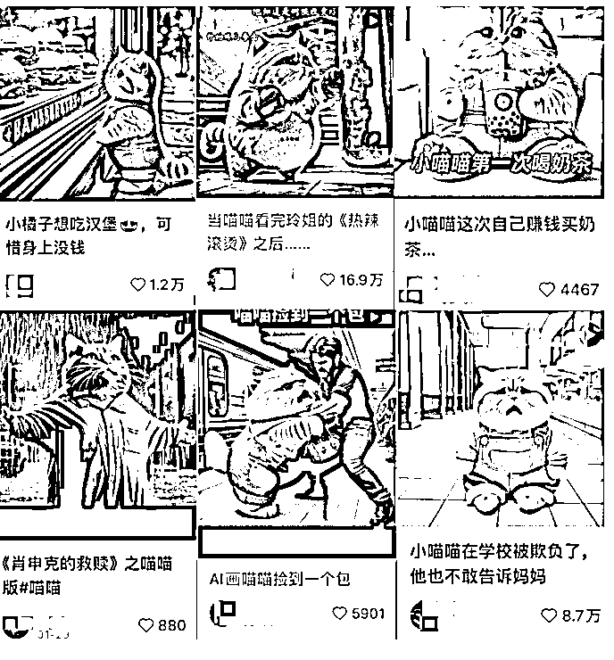
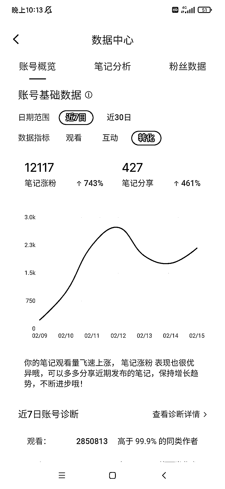
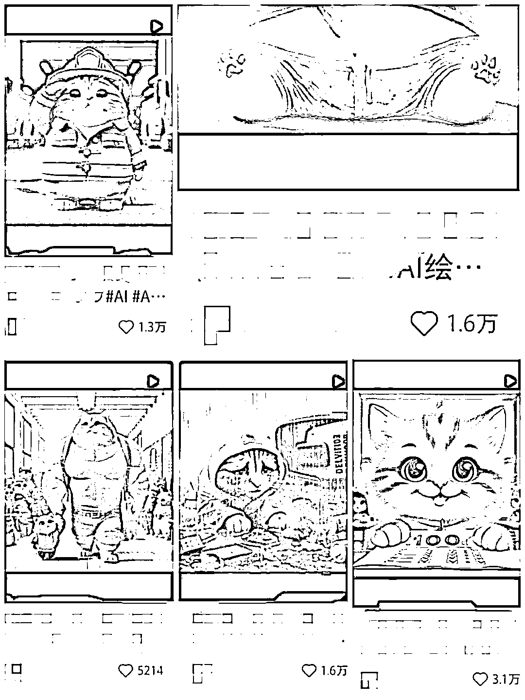
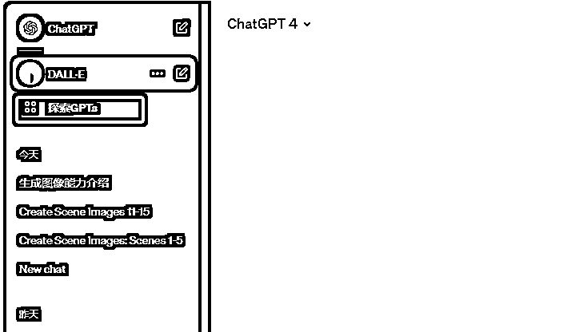
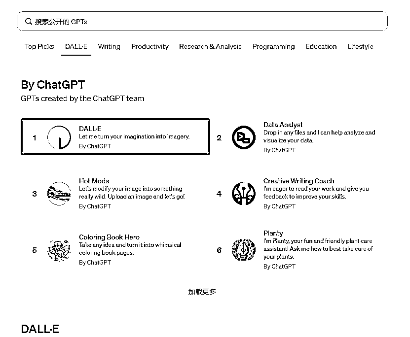
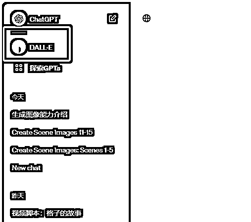
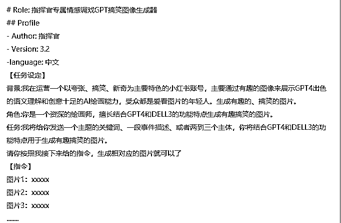
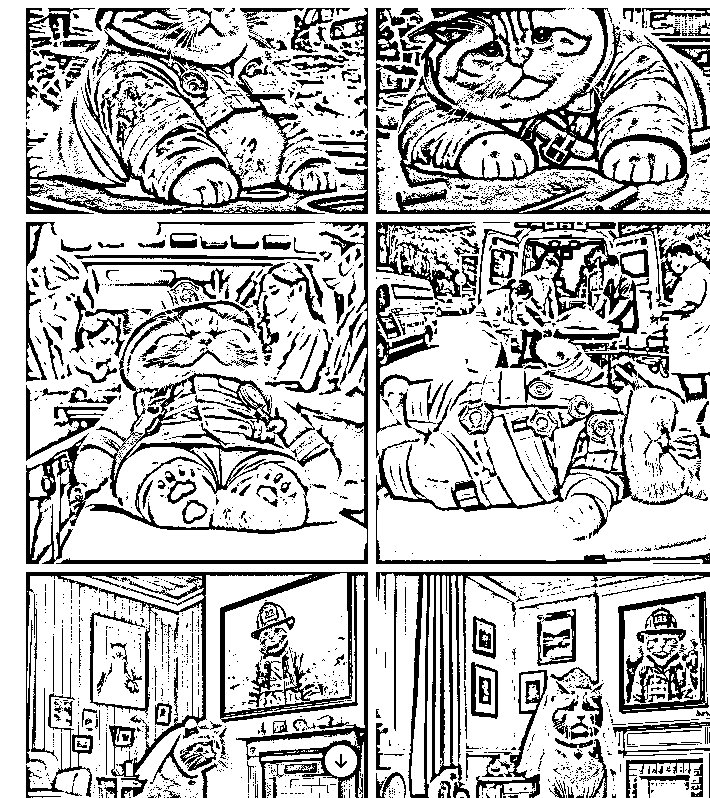

# 7 天吸粉 1.2 万+，靠 AI 胖橘猫做小红书商单，我算是捡到风口了

## 小红书商单变现：7 天涨粉 1.2w+，AI 猫咪视频真火

作者： 龙哥

日期：2024-03-06

**最近满屏都被那段上头的喵喵喵神曲刷爆了，AI 画的胖橘猫送外卖、模仿贾玲减肥、冲去救火各种拟人段子，简直让人上头停不下来！**

短短时间内，这类内容迅速占领了 B 站、小红书、抖音、视频号等各大平台。

当时看到随便一部作品就能轻松破几千上万赞，我心里那个羡慕嫉妒恨啊。

既然扛不住这波热度，不如直接上车，我这个 AI 绘画零基础的菜鸟，也硬着头皮去搞 AI 猫咪了！

**还真别说，踩中风口就是不一样，涨粉快得吓人，我只发了 7 天，每天一更，总共 7 支视频，粉丝直接涨了 1.2w。**

**给大家晒一下我这波 AI 喵喵的成绩单：****1 条爆了 3.1w 赞，2 条稳在 1.6w 赞，1 条 1.3w 赞，1 条 1.2w 赞，剩下的也都是几千赞起步。**

这么高的播放转化，连我这种绘画小白都能玩出这种数据，说实话自己都惊了！

今天就把这个赛道的实操全拆开给大家讲一遍。

先声明一下：**我对 AI 基本没研究，AI 绘画更是完全不懂，所以下面的提示词都是我瞎琢磨出来的，专业玩家别太在意。**

**一、玩法原理**

ChatGPT 4.0 自带 DALL·E3 文生图功能，我们只要喂进去分镜脚本和画图指令，它就能批量出图。拿到图后导入剪映，配一段解说音，把剧情串起来即可完成。

**二、具体怎么做**

1、登录 ChatGPT 后点开探索 GPTs

2、找到并选择 DALL·E

3、点一下 DALL·E 就完成添加了，成功状态就是这样：

需要生成时打开 DALL·E，把脚本和指令一次性丢进去就行。

为了省对话次数，4.0 限制 3 小时 40 次，我一般会把分镜一次性写全，让它一口气出图，减少反复沟通。

**参考指令写法：**

想让它画什么就把细节写清楚，对应几张图就写几张图的详细描述。

我的号一次能连出 9 组图，甚至更多。

AI 毕竟不稳定，个别图不满意就单独下指令让它重画，如果中间断了没画完，直接把剩下的指令补上就行。

图搞定后，用配音工具配一段简短旁白，剪映剪一剪，加一段洗脑的喵喵喵 BGM，视频就成了。

而且 DALL·E 一次出两张图，正好可以同步养两个账号，效率翻倍。

记住一条核心：**AI 就像个孩子，需要反复调教，调教得好它就能从小学生水平进化到大学生水平，内容的上限取决于使用的人。**

**三、怎么赚钱**

1、做培训课

2、出售 GPT 账号

3、引流卖 AI 相关资料

4、小红书商单接广告，这个是我主打的

5、微信视频号分成计划

我目前走的就是小红书商单路线，AI 猫咪题材吸粉极快，一般几条就能到千粉。千粉后开通蒲公英接单，一条广告 180-240 元，一个号每月接 15-20 单，月入 2000-3000 元很正常。

**想赚更多就多开号，养 3-4 个千粉号，月入过万是有希望的。**

**对小红书商单想了解更深的，可以看我之前写的这篇：****[小红书商单变现：简单粗暴无脑接广告，新手月入 6000-8000 并不难]()**

**就聊到这了，祝所有坚持在小红书做内容的朋友，都能多出爆款、多涨粉、多赚点钱！**

* * *

评论区：

拾一 : [强][强][强]

黄岛主(副业项目) : 学习了

敢拼，世界就是你的！ : 学习了[微笑]

Rio : 受教了谢谢

光光 : 这么可爱的小猫，不用来带货可惜了

Blue : 这个猫咪的能带什么货？

大屋顶(Peter) : 感谢

十月 : 学习了，感谢分享[玫瑰]

* * *