# AI产品从0到1上线后，怎么把运营做起来？

# 一、内容概述

在上篇复盘里，我讲了自己一个编程小白如何7天把第一个海外AI产品从零搭起来的故事。

最近在深海圈里看到不少伙伴也走完了0-1这一步，于是大家都在问：产品上线后该怎么养？网站要如何持续跑下去？流量从哪里来？

这篇复盘就把我产品上线第一个月，也就是25年6月的实操运营和学习心得梳理出来，给同样处在海外AI产品起步期的朋友做个参考。

先说个简单的进度更新，我把原站https://www.babypodcast.pro/搬迁到了https://www.vogueai.net，并新增了两个子工具页面，同时新上了另一个站点。上个月老站带来1笔续费，99.9美元/月；新站带来2笔付费，19.9美元/月，合计进账约140美元。

下面进入我6月份工作的详细拆解：

```
整理上站SOP：上站流程标准化，主要涉及On-Page SEO优化和PR信息标准化整理
自建模板-前端功能模块化：登录、支付等功能模块化，功能集成&性能优化模块化
自建模板-后端n8n工作流学习：n8n调用API（简易与复杂），n8n类agent应用实现，n8n全自动化社媒内容生成&发布框架
整理品牌站&关键词工具站模板：为什么要做品牌站？为什么要做关键词工具站？
外链清单建设与维护：什么是外链？外链有什么作用？外链哪几种类型？怎么找外链？怎么积累自己的外链库？
```

最后会分享下这一个月的处境感悟，以及接下来在产品和运营上的规划方向。

# 二、自我介绍

这段内容沿用上篇经验贴，方便新来的朋友快速了解背景，速读可直接跳到第三部分

我原本在投资行业工作，今年2月嗅到AI的机会就辞职All in。细分赛道太多，试过AI写作、AI自媒体，始终没找到最舒服的切口，直到3月加入赚钱的航海，方向感才变清晰。

做投研时我尽调过国内几家头部大模型公司，但离开平台后总觉得大模型离大众很远。直到最近才意识到AI应用在普通人侧的爆发势能。刘小排老师在《海外AI产品深海圈航海手册》里说过一句话我很认同：

“有人说，所有的产品，都可以用 AI 重新做一遍，我深以为然”。在AI编程工具快速迭代的背景下，普通人独立做一个AI产品已经变得可行。

3-5月期间我零散做了5、6个网站，基本都是html游戏站和个人博客的重复尝试，跟我心里的产品形态差距很大。看到赚钱SCAI实验室招募我就报名了，这个决定后来证明非常对。

5月18日我启动第一个全链路产品开发，包含登录注册和支付，5月24日完成上线，0-1跑通后不久就拿到第一笔99美元订阅，第一次赚到美元。之后的一个月重点就放在了“上线后怎么运营”上，收获很大，现在整理出来分享。

# 三、25年6月运营与学习复盘

## 3.1 上站SOP的沉淀

对我们大多数人来说，一次性做出完美产品基本不现实。更合理的打法是：不断挖掘需求、捕捉关键词，快速做站测试。没有标准流程，每次都会从零手忙脚乱。所以沉淀一套自己的上站SOP非常关键。下面是我现用的上站核心SOP，核心目标是完成On-Page SEO优化

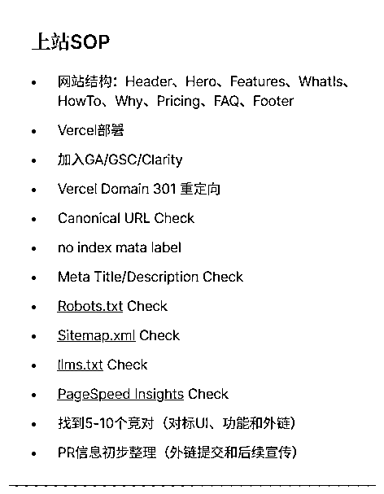

下面逐项解释每个环节的逻辑和做法：

*   网站结构：清晰的页面结构相当于给Google爬虫画路线图，能让它更快理解站点主题和重点内容，从而给予更好排名。

*   Vercel部署：Next.js项目尤其是新手，Vercel依然是首选，上手快部署顺畅（我自己开了会员所以用得更狠）。也可以根据需要换平台，比如航海手册里提到的Dokploy。

*   网站分析：GA/GSC/Clarity这三件套是基础。GA看流量来源和数量，GSC看搜索表现，Clarity看用户行为录屏。新站上线就埋好，完整记录从0到1的增长轨迹，价值很大。

*   Canonical URL Check：这和301重定向解决的是同一个问题：权重分散。站点可能出现多个URL指向同一内容，例如带www和不带www。Canonical标签就是告诉搜索引擎：“这些是同一页，请把权重集中到指定版本”。能有效避免权重流失。

*   no index mata label：站内总有些不想被收录的页面，比如协议页、隐私页、测试页。加上no index标签就是明确告知Google忽略，这能防止低价值页面稀释核心页面的SEO表现。

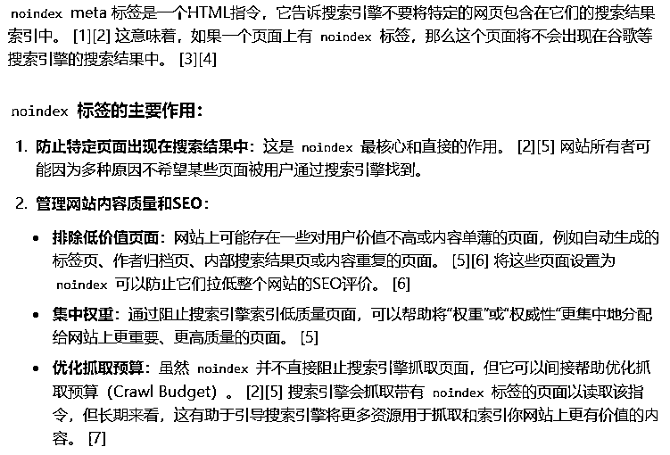

*   Meta Title/Description Check：On-Page SEO的基础动作。推荐用AITDK插件辅助。它会按最佳实践给出建议，例如标题长度、描述吸引力、H1/H2结构、关键词密度等，这些细节直接影响搜索结果的点击率。（插件地址：https://aitdk.com/）

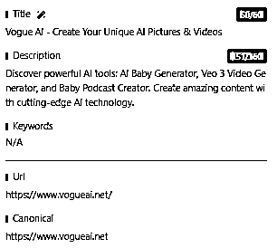

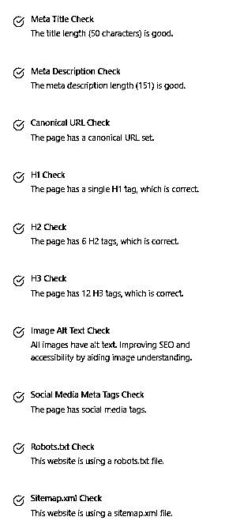

*   Robots.txt/Sitemap.xml/llms.txt Check：这三份文件相当于给搜索引擎的访问规范。Robots.txt说明可爬不可爬，Sitemap.xml提供站点地图方便高效抓取，llms.txt是针对AI大模型爬虫的规则。直接在cursor里让它解读并根据项目代码生成即可。

*   PageSpeed Insights Check：没人愿意等慢网站。用Google PageSpeed Insights诊断性能并给出优化建议，按建议调整能明显提升体验。（地址：https://pagespeed.web.dev/）

*   找到5-10个竞对（对标UI、功能和外链）：这个不用多说，就是找到功能相似的站点，全方位拆解首页内容、付费引导、功能实现、交互细节、已发外链、最新功能、上线方式等，建议定期追踪竞对的迭代。

*   PR信息初步整理（外链提交和后续宣传）：准备把产品提交到导航站或做宣传时，会反复填写标准信息。我的做法是提前建一个PR资料库。先模拟一次Product Hunt提交，整理出它需要的信息，然后统一存档需要时复制即可。通常需要：Name、URL、Tagline、Elevator Pitch、Long Description、Use case、Core Features、Maker's Comment、Logo、Screenshot。图片用站内截图即可，logo建议准备png/jpg和ico，某些导航站对格式有要求。

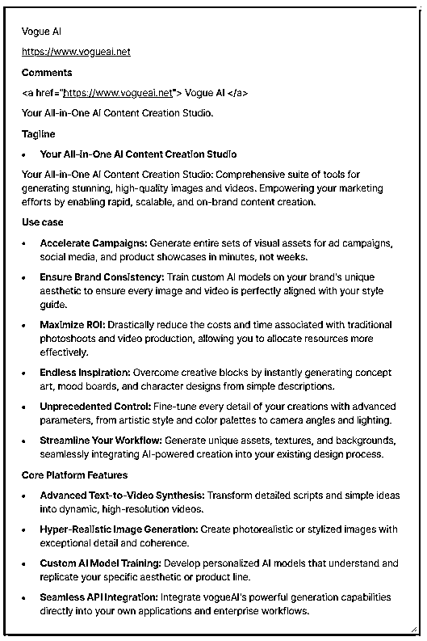

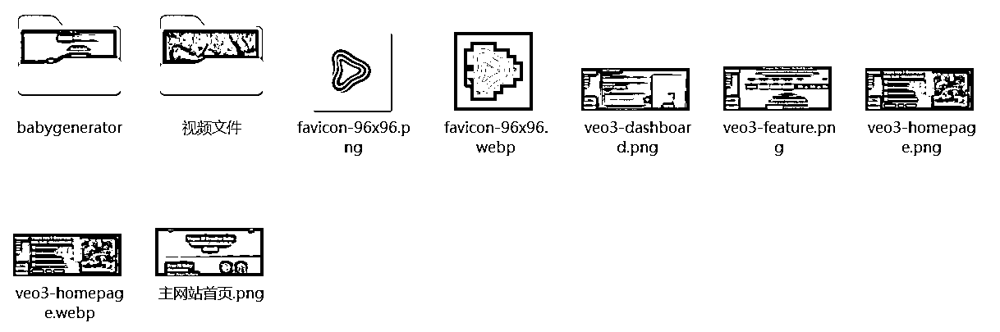

## 3.2 前端功能模块化与自建模板

登录注册、积分系统、支付流程这些功能跑通后，沉淀为可复用模块，对后面做站帮助巨大，也是积累个人模板库的过程。下次做站直接拿来用，开发效率大幅提升。

我的方法是，每完成一个大模块，比如支付，就让AI做一次复盘，输出一份专属说明文档。文档包含：

*   涉及了哪些文件？

*   每个文件的核心职责？

*   关键逻辑是什么？

*   复用到新项目时需要改哪些配置，比如API Key？

把所有模块整理完一套模板就算成型了。这个过程中我踩了不少坑，比如多语言支持、登录后回跳初始URL等还没完全解决。我也让AI把失败经验记录下来，后续优化时直接喂给AI避坑。

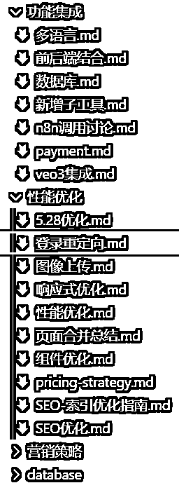

以支付模块为例，这份说明文档就相当于新项目的支付集成说明书。即使直接git clone整个项目，这份文档也能让AI快速理解配置并修改。其他模块同理。（可以参考shipany的官方文档，思路很像，既是复盘也是学习手册）

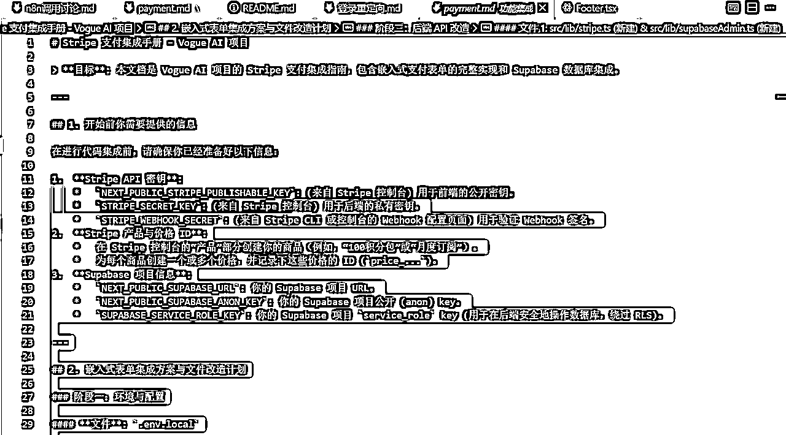

## 3.3 后端n8n工作流的学习

之前分享过我站的n8n工作流，有伙伴反馈有点复杂，这里复盘一下我的主要用法。

### 3.3.1 直接API请求与响应

这是最简单的api调用并返回webhook响应的流程，代码里也能实现，区别是减少了API路由数量。用n8n的话，代码里只需要最开始的webhook接收和最后的webhook回调两个路由：

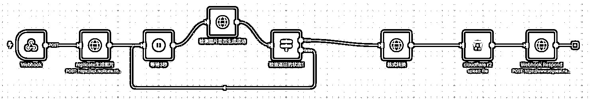

节点构成：Webhook节点接收前端请求，HTTP Request节点调用外部API。只需阅读官方文档，按要求配置参数和格式即可。n8n里可将上一个节点的输出值拖拽到下一个节点作为输入，实现自动化。

key/value解释：键和值。比如响应里传了一个request id，值为7890，request id是键，7890是值。n8n支持通过拖拽传递同一个键到不同工作流，值可以是7890/7891/7892等。

### 3.3.2 复杂API请求与响应

这是n8n的强项，复杂逻辑一目了然。虽然代码也能实现，但小白调试困难，基本依赖AI找问题。n8n能清晰看到哪个节点出了问题，便于掌控后端功能。

在简单调用的基础上加入数据处理工序，比如存储、筛选、清洗。常用节点是Code、Switch、Set、Merge。通用打法：

问AI（在n8n中实现X功能需要什么节点？）-> 找到节点 -> 截图问AI（如何配置？）-> 测试 -> 报错则粘贴日志问AI分析并解决

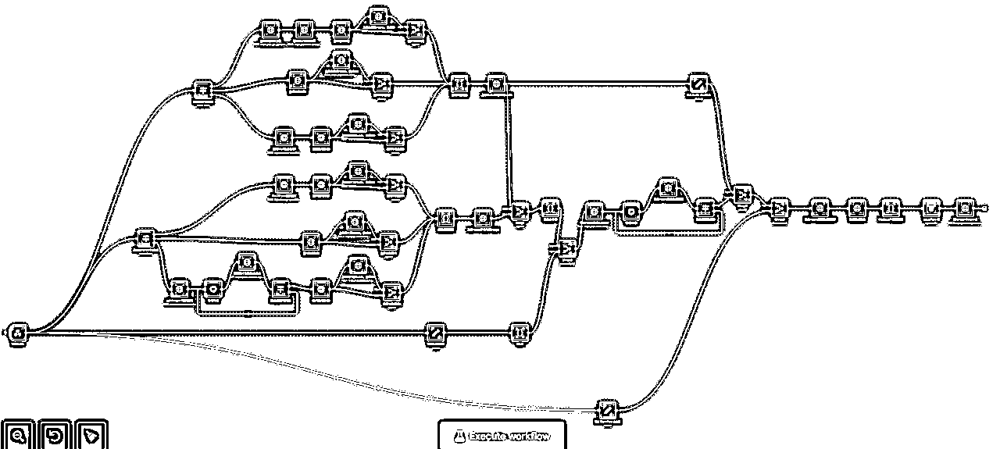

### 3.3.3 n8n实现简单的agent操作

这是一个自动化生成SEO博客的工作流。根据参考文章生成新文章，n8n可把流程自动化。Google Sheets里配置好基础信息后，输入新主题即可一键生成，20个主题可一次生成20篇。

chat model充当大脑，可加记忆存储、网页搜索、格式处理等辅助节点，比如Tavily节点实现定向搜索和延伸搜索，我主要用定向搜索投喂固定参考文章。还能加图像分析等，大家可以深入探索。

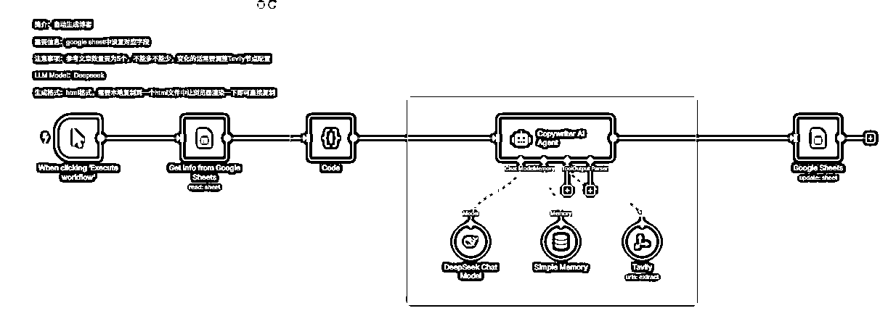

很多人会说，这功能用大模型加影刀也能自动化，有什么区别？区别在进阶用法。

#### 3.3.3.1 自动化触发

可设置触发器，比如Google Sheets新增一行主题时自动执行工作流生成文章。

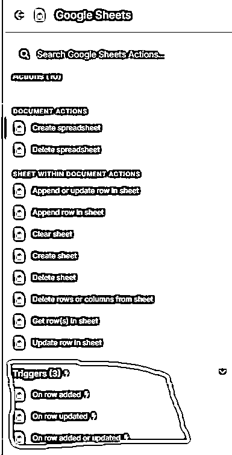

#### 3.3.3.2 多应用联动（Web、Mobile）

可把Google Sheets连到Notion，再连到微信。当手机转发一篇公众号文章时，自动同步到Notion、自动分析、自动改写并更新到Google Sheets。也可以不经过Sheets直接写入Notion，我个人更习惯用Sheets处理数据。

微信转发公众号文章的环节需要微信客服机器人，付费可用flomo，免费可用黑猩猩随手记，缺点是电脑端不支持、手机端信息无法置顶。

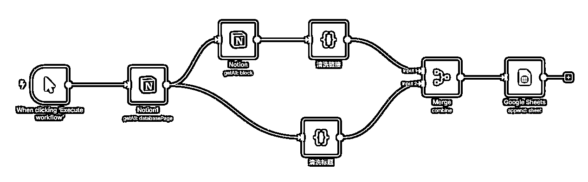

#### 3.3.3.3 多Agent协作

n8n不仅能调用一个agent，还能设计多Agent流水线。比如Agent 1写稿，Agent 2打分优化，Agent 3检测重复率，Agent 4降重。

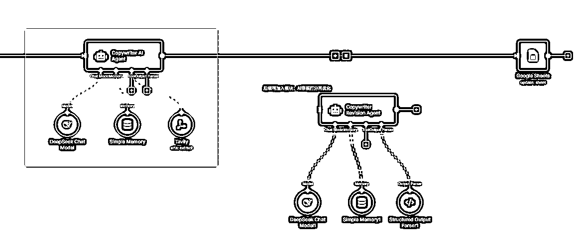

#### 3.3.3.4 n8n进行信息监控和筛选

可在工作流前端加入信息搜集和筛选，实现自动化选题，通过agent完成全自动化内容创作。自媒体平台信息爬取大多有接口，实现自动化监控和采集完全可行。

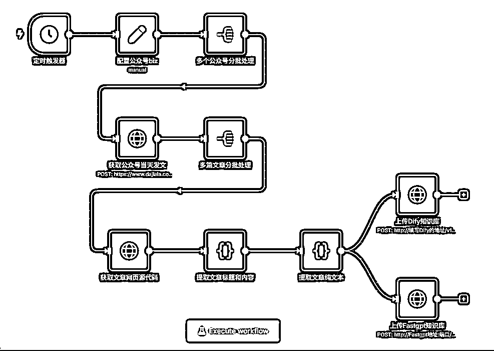

参考代码示例，大家可关注公众号“袋鼠帝AI客栈”，n8n拆解做得非常好：

#### 3.3.3.5 n8n一键全网发布

海外社交平台如YouTube/TikTok/X/Facebook大多提供官方API，支持自动发布。国内小红书、公众号等也有非官方方案，可自行搜索。

理论上可搭建从选题、创作到分发的全自动化内容工厂。

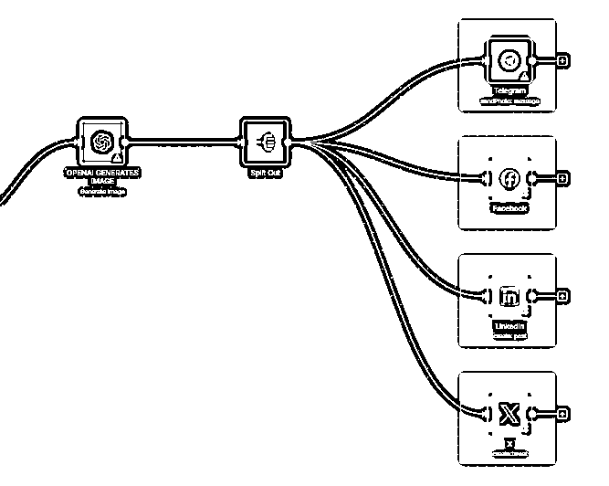

上述进阶框架我大部分已搭好雏形，但还没完全完善。一是为了时间分配，重心仍在网站上；二是全自动化投入产出比还没到最佳，目前以半自动化为主，争取下个月把全自动化框架搭建起来。

想找现成模板可去n8n官方社区，案例很多，基本我提到的都有模板，爬取和发布接口需自行寻找，Github有很多开源项目，也有商业API。（https://n8n.io/workflows/）

接下来一个月我会继续深耕n8n，后续有需求再出细化帖子。

### 3.3.4 品牌站与关键词工具站模板整理

大家可能会问，什么是品牌站、什么是关键词工具站？为什么要做这两个？

我简单说下这一个月的理解：

```
首先品牌站肯定是更有利于传播的，后续的社媒和红人营销可以很好的打造用户心智，一旦你的产品被赋予了品牌，上限也更高。比如Pixverse（拍我AI），它就是经典例子，根本不做SEO，起量主要靠社媒和红人营销，你要营销品牌词大家才能认识你，持续的使用你的产品。
这种品牌站一般是高举高打的路子，融资→研发→投流→跑用户数据、跑roi→融资，往复循环，上限更高，缺点是门槛也高不适合我们小白操作，初期起步流量很难获得。
当你的网站越做越大品牌站就是一个必须的趋势了。
```

```
关键词工具站呢就是围绕一个关键词，比如ai kiss，我就做一个ai kiss generator，域名和所有内容设计都围绕一个关键词，这种关键词工具站优点是在同等情况下具备更强的关键词竞争力，因为大家想搜索ai kiss的时候，一个叫aikiss.com就会被谷歌认为更加匹配用户的需求
关键词工具站也是最适合我们新手起步去做去竞争谷歌排名的类型，更容易起量，但缺点就在于这种站不适合进行社媒和红人的爆发式营销&自传播，不太好建立品牌心智，基本流量主要靠谷歌SEO还有定向精准人群的广告投流，如果后续这个关键词的搜索量逐步下滑，你的网站流量肯定会受到较大的影响，最经典的例子是ghibli，大家可以搜搜几个知名的ghibli关键词站最近几个月的流量趋势，一目了然。（当然头部的ghibli站几个月可以挣十几万刀甚至更多，即使下滑也很香）
```

基于这个判断，我目前是品牌站和关键词工具站双布局。老站迁移到品牌站，同时基于新关键词和需求持续开发关键词工具站。

3.2和3.3这两块打通之后，做独立站或工具站的都能明显感受到，批量开子页面、快速搭新站的能力大大增强，整个后续运营节奏可以被提上一个台阶。所以，我有句肺腑之言：模板库一定要自己建，越早越好。

### 外链这件事，值得好好聊聊

网站上线后，最现实的一个问题摆在面前：流量去哪找？梳理下来，流量基本来自三条线——搜索引擎自然流量、社媒运营、红人合作。

社媒和红人这块我自己还在摸索，今天集中聊聊SEO。说白了，SEO是围绕Google搜索结果做文章，目标是让我们的页面在相关词条下尽量往前排。比如搜“vogueai”这种品牌词，我的页面希望能在第一页露脸——但这种词搜索量很有限。真正有含金量的是那些自带大流量的热词，像“veo3”、“seedance”。如果你的页面在这些词下冲进搜索结果首页，几乎等于每天白拿一波免费的自然流量。

#### 怎么判断一个词值不值得做？

最直观的判断方法，我个人推荐用Google Trends，习惯拿“gpts”这种流量相对稳定的词当参照系，它基本稳定在每天五六千的搜索量，拿它去横向估算你想做的词有多少人搜，心里就有底了。

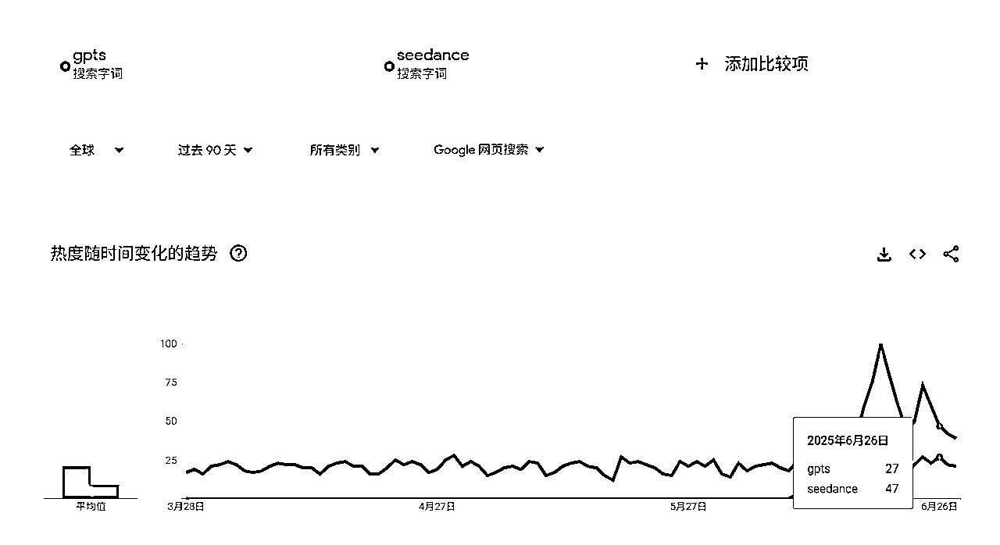

接着再用关键词难度工具去评估下竞争强度，看大概需要多少条外链才有机会挤进前排（外链是什么，下面会细说）。推荐用ahrefs的难度查询工具，这也是做竞品调研时顺手能用的利器。

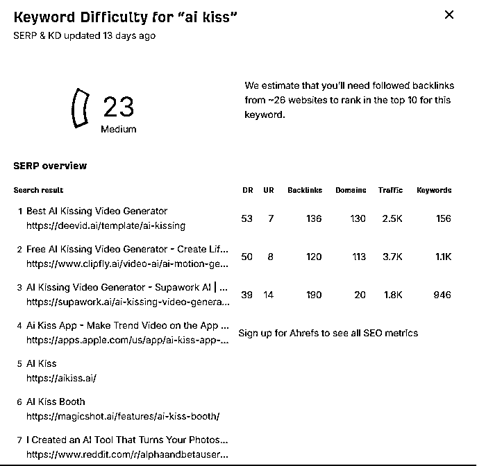

#### 权重怎么往上提？

知道词有量有难度之后，下一步就是想办法推高自己页面的权重，让它在搜索结果里稳定站在第一页。Google排名的底层逻辑，核心看三件事：站内SEO优化、真实用户行为表现、以及外链质量。

*   站内SEO优化：之前在“上站SOP”里提到的一系列检查项都属于这一类，归根结底是让Google能顺畅地读懂你页面里写的是什么，内容结构清晰可解析。

*   用户行为：说白了就是看真实用户进来后，停留了多久、多大比例直接跳出。这背后其实折射出你的产品是否契合需求、交互体验有没有做好。

*   外链建设：外链的定义很直白——其他网站上能出现我们网站的入口链接，别人点一下就能跳过来。在这里有个朴素的道理：一个权威站点的推荐，价值可能碾压一堆不知名小站。就像你朋友帮你推荐一个人，和雷军帮你推荐一个人，那说服力能一样吗？所以发外链这事，要找高DR的网站去发力。

查DR值用ahrefs的免费工具就能查。

Example：toolify

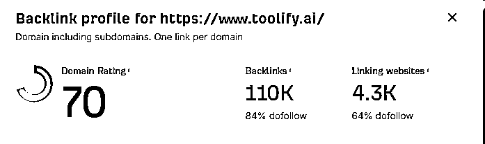

说实话，前两块工作（站内优化和产品体验）能做出的差异化空间有限，虽然也非常重要，千万别轻视。但真正拉开DR差距的，其实是外链建设。外链数量越多、来源越硬，自身权重明显水涨船高，搜索结果排名也能逐步前移，流量自然就跟着来了。Google SEO不像社媒那样有爆发力，但它的特点是细水长流，稳中有升——它是海外获取流量的地基，值得你花时间慢慢打磨，绝不会白费。

当然，靠精准客群口碑、自传播型产品、以及社媒爆款来拉动增长确实是更理想化的营销境界，但SEO本质上就是流量这块基石。先把地基打牢了，再去触碰更进阶的打法，整个基本盘才算扎实。

#### 外链的几个主流玩法

**第一类：导航站**

AI工具类产品，第一站几乎都打在导航站上。原因是它们给的大多是dofollow外链，对权重拉动最猛。（顺嘴提一句，外链有dofollow和nofollow两种区分，细节可以交给AI解释，直观理解就是推荐意愿的强弱——前者是“强烈推荐”，后者顶多算“我们认识”。）

导航站里免费和付费并存。付费的如toolify、taaft这类高权重大站，能在起步期迅速帮你冲权重和排名，效果相当直接，但价格也摆在明面上，我记得提交一次99刀。免费站通常要等审核、或者延迟上线，有些还要求互换外链。话虽如此，它们依然是冷启动阶段的重要阵地。个人建议每个人都要整理一份自己的AI导航站清单，网站一上线就能马上铺开去投，效率会高很多。

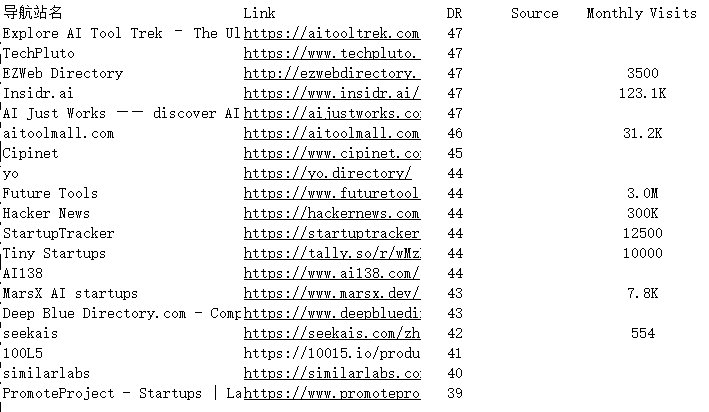

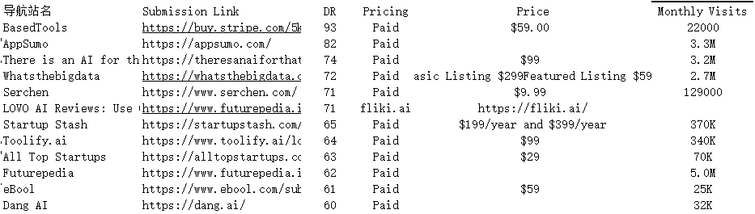

**第二类：博客评论**

玩法比较轻巧。老外写博客的氛围很浓，找那种开放评论的博客站点，用一段自然不生硬的内容，把自家产品介绍和链接巧妙融进去。这种外链一般是nofollow的，但胜在博客站权重通常不低，推荐力度弱一点也依然值得做。这块已经有半自动化的工具可以辅助批量操作，感兴趣可以自己找找。

**第三类：SEO博文**

这里说的不是发评论，而是自己写文章，发到substack、medium这类博客平台上，把产品和链接编织进内容里。这类外链大多为dofollow（具体看平台），效果更好，但制作成本也水涨船高。所以，如果能搭建一条自动生成博客文章的流水线，对整体效率的提升会非常可观。

除此之外，还有一些钻空子的“野路子”也相当有效，比如creem的profile页、stripe的气候页面之类的。只要能在任何一个站点上留下你的网站链接，理论上都算一条外链。更妙的是，如果你能精准找到目标用户扎堆的地方，一边发链一边把用户也带回来——这才是比单纯找高DR网站更香的操作。

#### 外链库怎么积累？可持续循环

**第一步：去问AI**

让AI先列一批影响力比较大的导航站，再配合自己去网上搜，这类整理帖在即刻、微信公众号、Google上随手一抓一大把，我下面也贴了一些。把这些信息清洗分类，一个个去投递提交，在这个过程中记录哪些要钱、哪些要互换、哪些要审核、哪些延迟展示，分类归档之后，你就有了自己的第一批外链库底子。

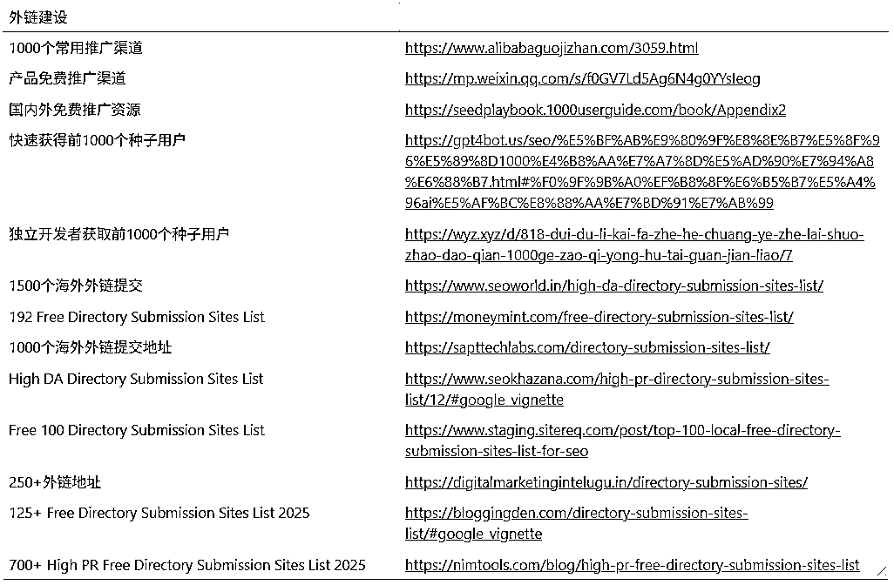

**第二步：进入循环——从竞品身上“薅”外链**

*   先选一个头部导航站，比如Toolify；

*   在上面找个跟你产品定位相近的站点；

*   把这个站点链接丢进ahrefs的外链检查工具里；

*   系统会列出所有给该站点挂链的网站列表；

*   挨个筛选排查，看看哪些外链自己也有机会去投；

*   能发的，收进外链库；发不了的，跳过看下一个；

*   这套节奏跑起来，理论上你的外链资源是打不完的。

顺便分享两个ahrefs免费SEO工具的总整理帖（来自哥飞）：

https://mp.weixin.qq.com/s/ZoLAZoiKUphLUR8YFLajcQ

https://mp.weixin.qq.com/s/YgvPDIpThc1Tw2svk2EScA

发外链这件事，本质上是磨功夫、耗耐性，没什么捷径。你天天发，反馈就会天天来，虽然不会有爆发式的惊喜，但胜在稳定，时间拉得越长，你构筑的护城河就越深。

我自己这一个月，从第一条外链开始发，慢慢积累到现在手里大概有300条。质量参差不齐，有不少高DR的站点投了也白投——要么直接拒，要么延迟到三个月甚至半年才给展示。这对新站起步的影响是实打实的。所以，高质量外链库越早建越好，持续运转起来，对后面的SEO才真正有用。

### 一些关于行业和心态的思考

**聊聊行业**

前几天看到龙哥回答一个挺有意思的问题：有人问，Web出海现在热度那么高，但真正三个月内做出成绩的人却寥寥无几——三个月才拿几十美金，不少人大半年零出单，这种投入产出比到底有什么意义？如果去做小红书虚拟电商，选品对路，一两周就能见收益，为什么还要看好Web出海，甚至专门请刘小排老师来带队？

这问题挺有共鸣的。我身边很多来SCAI实验室的朋友，并不是走投无路，而是看到了更大的可能性，愿意为这份可能性，熬过几个月甚至更久的低收入期。某种意义上，这种“敢等”的能力，本身就是这个行业的门槛。你说，敢做这种决定的人很少，这算不算就成为了壁垒？

再从产业链的角度来看：越靠近上游，价值水位越高。AI行业的最上游是算力、是IDC——为什么英伟达能一枝独秀？因为它死死握着算力这个最大的端口；Google、微软这些巨头为什么都在重金砸数据中心？因为基础设施建好了，下游才有故事可讲。再往下才是AI通用大模型，DeepSeek为什么能刷屏？因为它证明了国内在大模型这条赛道上可以达到世界级水平。再往下是垂直大模型、API调用，然后才轮到AI工具层——那最底层用这些工具的是谁？是终端的C端和B端用户。

换个角度想：当你能熟练驾驭AI工具去构建和落地产品，你可以直接把东西卖给小红书虚拟电商的商家，也可以定向为他们开发适配的解决方案。虚拟电商不一定非得用AI，但用AI去提效这件事几乎没什么争议——比如产品图用AI辅助设计，引流环节用AI搭个客服机器人，批量写笔记、管后台，哪一步不能省力？

这也是我坚定认为AI产品是个巨大机会的原因。它的形态远不止网站这一种——网站只是因为门槛最低、上手最容易，才成了大多数人的入口。但就算你完全不做站、不做App，只把AI用在某个具体行业里去打磨一个提效工具，那也能惠及电商、内容、短视频等几乎所有领域——这可能是对普通人来说，真正意义上的最大机会。哪怕钻研了半年没赚到什么钱，你实打实学到了搭建产品的能力，这些努力绝不会被辜负。在相同的投入下，选一个有前景的赛道，长期回报一定更可观——钱只是结果之一，你会发现连小红书官方都在推自家的AI产品了，这本身就是风向。

趋势已经很明显了，不需要你再花时间去判断。全世界最聪明的人已经用脚投过票了，你要做的只是相信这个方向，跟着走，把纠结的时间留给亲手去做，时间会给出公正的答案。

**聊聊心态**

说真的，这阵子我心态没什么起伏，每天都是做事、复盘、吃饭、睡觉，循环往复，偶尔抽空刷个视频喝上两杯放松一下。但前两天读了一生荣禄（百万哥）的精华帖，一下给我点燃了：

> 当我不断向世界发声呐喊，世界也开始回应我。

> 我知道，有些选择注定不轻松，但我更怕的，是不选，会后悔一辈子。

> 我愿尽全力，换我们少一点遗憾。

> 我知道，以我的基础，这条路并不轻松。但不试试，怎么知道自己不行？

> 现在的我，也许还不够强，但我相信——未来的我，一定行，一定行！

> 选择永远大于努力。方向对了，努力才有意义。

读完有一种澎湃感从字缝里溢出来。我始终觉得，为了一件事矢志不渝的那种信念感，才是人和人之间差距最大的一个变量。认知可以补、执行力可以练、资源可以攒、信息可以查，但那种不管不顾往前冲的坚韧和拼劲，反而最珍贵、最难复制。

我顺手把这段话收藏进了自己的金句库，翻找时又看到了之前存过的一句话：“朝生暮死朝闻道”，一瞬间那股原始的触动又涌了出来。我们常常以为放弃些什么，就一定能换来什么，但人生没那么简单，没有必然的因果，但不去试，怎么知道值不值？

人生不长，想做的事就赶紧去做，不要被任何人、任何框架困住。

命运给我一个秋天，我就灿烂一整个秋天。

命运给我一个清晨，我就把那一刻辉耀到极致。

不需要被理解，因为你并不知道这将会是怎样的人生。

往前行！

世间有蜉蝣，朝生而暮死。

朝生暮死朝闻道！

### 后面的规划

- **自动化小红书内容流**：参考航海手册里的自动化流程，搭一套图文生成的自动化管线，后续按需加信息爬取和自动发布功能，重点保证出图质量。优先级：☆☆☆☆☆

- **自动化视频生产链**：参考自动化航海手册和YPP手册，搭建视频自动化生成工作流，评估加自动上传，重心在营销物料的制作和数字人播报上，品质优先。优先级：☆☆☆☆☆

- **持续发现新需求**：保持对外部机会的敏锐度，不断去挖掘新场景，纳入产品迭代。优先级：☆☆☆☆

- **外链清单滚动维护**：不建好就停，持续筛选、更新、祛重，保证外链库质量越来越高。优先级：☆☆☆☆

- **打磨产品可用性与性能**：循环迭代，提高整体使用体验。优先级：☆☆☆☆

- **信息自动抓取与过滤**：用Folo搭起日常信息自动收集机制，再通过n8n给这个信息流加过滤模块，做到每日高效摄入。优先级：☆☆☆

- **竞品监控机制完善**：当前以手动为主，后续视情况再加自动化手段，同时对竞对的功能更新、外链布局、营销动态做持续追踪。优先级：☆☆