# AI树苗种子带货，一个很适合新人上手的AI变现玩法

最近刷短视频，你大概率见过一类画面：蓝莓被按进泥土，嫩芽快速破土、长叶、开花，最后结出满盆果子，旁白顺带一句“在家也能种出新鲜蓝莓”。这类视频看起来像实拍，其实是AI生成的带货素材。而且现在正赶上3-5月的花果树苗旺季，需求正盛，很多账号靠这波流量把橱窗转化跑得很漂亮。


我是龙哥，这两年一直在小红书、视频号、快手这类平台做带货，属于天天泡在一线的实操党。3月中旬我们开始进场测试，在抖音、快手、视频号同步发内容，结果很有意思：有的号流量精准到爆，有的号泛得离谱。互联网流量本来就带概率，泛粉严重的号，我们就用付费投放把人群重新拉正。每个账号一天安排一到三条视频，内容能获得正常推荐的话，通常三四天就会产生订单。跑了十来天，各平台陆续开始有转化。你可以先看看当时刷到的类似内容：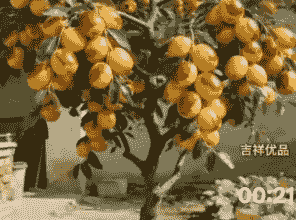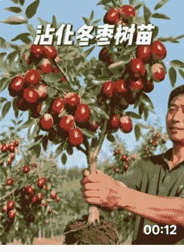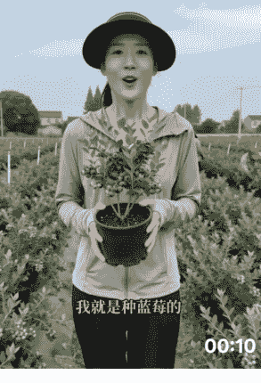

这个项目为什么能卷？关键有三点：一是时令恰好，3-5月本来就是花果树苗的旺春季；二是AI提示词独立生成，每条视频都有天然原创性，不怕查重；三是平台推荐和电商转化逻辑都对得上，所以流量和销量都不会太差。

直接上数据，这是我们两个平台的部分结果：

一个平台成交3770.8元、475单，预计佣金826.6元；另一个平台成交2408.56元、83单，预计佣金1008.66元。金额不算夸张，但足以证明整个流程能跑通。后台截图也放在下面：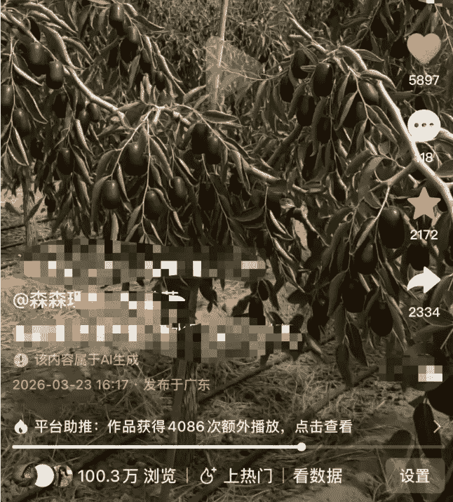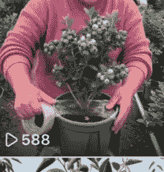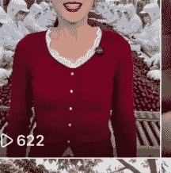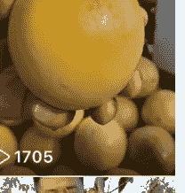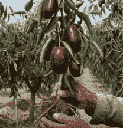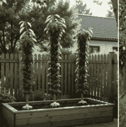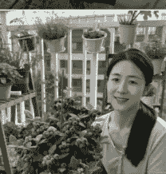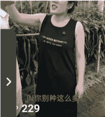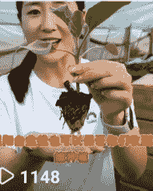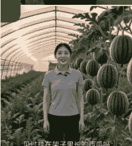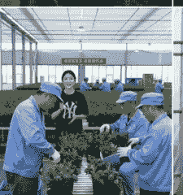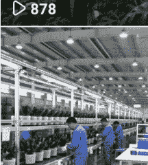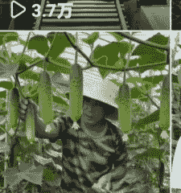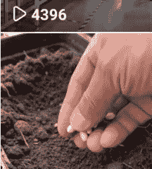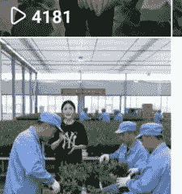

说白了，玩法一句话就能讲清：用豆包、GPT、Gemini这类AI模型生成提示词，喂给Seedance产出原创树苗种子视频，发布到短视频平台带货赚佣金。如果素材跑出稳定流量，还能自己开店做后端产品，不必只盯着佣金。

下面直接把视频号的操作流程摊开讲。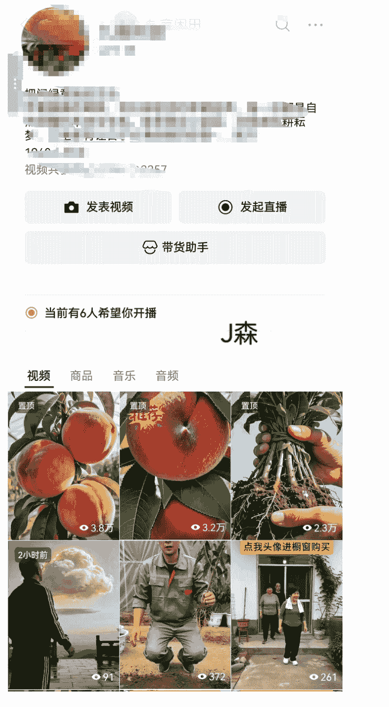

视频号是新人最友好的平台，0粉就能发作品，不过要做带货，需要实名认证并开通橱窗交保证金。重点是：一定要用新号跑流，老号基本没推荐。如果老号注销后界面出现“立即注销”的小字，也可以直接清掉重来。要在短视频里挂购物车，粉丝数得先到1000；想直播带货，得凑够100个有效粉。实名认证后交100元保证金，就能正常发带货素材了。

1000粉怎么凑？两种思路。第一种是花钱涨粉，效率和体力都最省。涨粉前先拿手机拍一段7秒以上的特效自拍，或者录个养眼的风景实拍，测测基础流量。如果新号能跑到几百播放，说明账号正常，这时候再上付费涨粉，钱才不会白花。第二种是免费互粉，耗时2-3天。别私聊互粉，也别加互粉群，直接去平台搜“互关互粉”或“互粉”，在热门视频评论区手动互关，操作不难，耐心就行。

素材从哪里来？最直接的路径是去抖音搜索“树苗种子”“蓝莓树苗”“冰糖脆枣树苗”这类关键词，找到同行的爆款视频。选对标时记住三个数：账号粉丝1万以下、发布时间一周内（最好别超过半个月）、点赞量1000-1万。这种视频就是已经被验证过的爆款，照着抄最稳。搜索截图可以参考：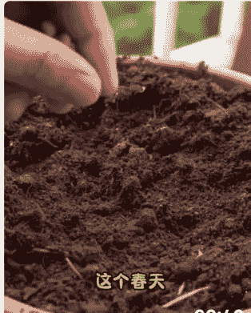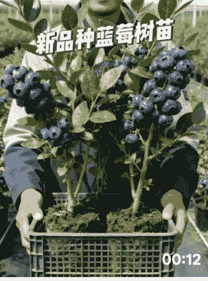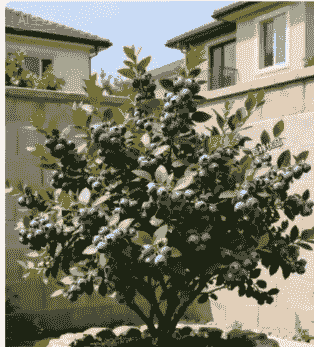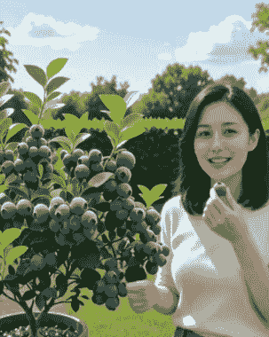

确定对标后，复制视频链接，到微信搜“皮皮去水印新”小程序，把素材下载下来，720p就够用了。因为平台上的视频有创作者保护，直接保存往往不行，所以需要这个去水印步骤。如果以后这个工具失效，搜“去水印”也能找到其他替代。下载后注意看链接格式，必须是以“https://www.douyin.com/加后缀”的形式才对。去水印的过程截图都放这里：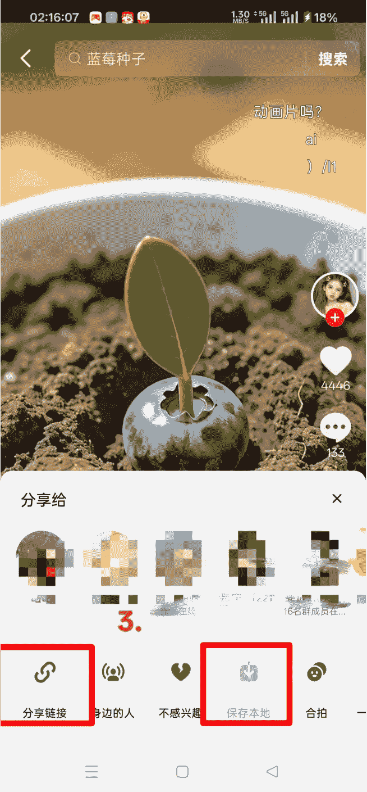

拿到参考素材后，把它喂给Gemini，让AI反推提示词。我常用Gemini，因为它给出的提示词生成效果更稳；豆包、DeepSeek、GPT、Grok、Claude也都能用，关键是找到适合自己的。

想让AI尽量还原原视频，提示词就要给足细节。时长、台词、画面风格、声音、时间轴都要写清楚，最好明确要求“每个时间点的台词和动作必须对齐”，不然很容易得到画面和声音对不上的废片。我给AI的引导词大致是这样：把原素材上传，告诉它“请生成一段完整提示词，投喂给视频生成模型后，能还原出内容一致、有声音、台词节奏一致的视频，原视频12秒，生成结果控制在10秒，每个时间点保持一致”。AI会自己拆出画面风格、音频设置、分镜时间轴，返回完整可用的提示词。更省事的做法是把原素材直接丢给它做视频分析，让它复刻分镜。不过这种简单引导有时候会丢失台词风格等细节，生成前最好手动检查并修改。

提示词跑完，直接投喂给Seedance 2.0。目前我用过的模型里，它的拟真度最惊艳。豆包一个账号一天只有两条素材额度，用完可以多绑几个抖音号继续跑。建议白天生成，一条素材约2-3分钟；晚上排队人太多，一条可能要等几十分钟。云雀每天送基础额度，速度也比较慢，等熟练出单后，可以充云雀会员加额度提速，花钱换效率，在跑量阶段很划算。这是我的提示词参考：

整套流程已经公开，感兴趣的新人完全可以照着跑。趁着树苗旺季还没过去，抓紧动手才是关键。

```
00:00 - 00:03 | 播种与发芽
画面：特写镜头。一只手将一颗新鲜蓝莓按入白色花盆的黑色土壤中。蓝莓顶部迅速长出一点绿色嫩芽。
台词：“在家也能种出新鲜蓝莓，从种子到果实，只需一个花盆”
00:03 - 00:05 | 嫩芽生长
画面：镜头拉近。嫩芽快速向上生长，展开两片鲜艳的绿色小叶子。
台词：“第一周嫩芽破土而出”
00:05 - 00:07 | 开花期
画面：镜头拉远。小芽长成一棵带枝干的微型蓝莓树，枝头开满倒钟形的白色小花。背景为模糊的中式庭院。
台词：“第三个月，白色小花悄然绽放”
00:07 - 00:10 | 结果期
画面：白色小花脱落，原位置长出的一大串饱满、带有白霜的成熟蓝莓果实，压弯枝条。
台词：“第四个月，果实逐渐成熟”。
```

本次调用 Seedance 2.0 Fast 通用视频模型进行生成，单条消耗 2 点视频生成额度，预计等待时长 1-3 分钟。生成完毕后会第一时间通知你，今日剩余额度 8 次。

本次调用 Seedance 2.0 Fast 通用视频模型进行生成，单条消耗 2 点视频生成额度，预计等待时长 1-3 分钟。生成完毕后会第一时间通知你，今日剩余额度 8 次。

| 帮我生成一个视频：【基础设置】总时长：10 秒 画...

视频已生成完成。


拥有 Gemini pro 订阅的用户也可尝试 Veo 模型，画面真实度更高，上架后流量表现也较好：

## Veo 模型简介与示例视频

帮我生成视频，相关提示词如下：【基础设置】...

视频正在合成中，可能需要数分钟，请稍后返回查看进度。

正在生成视频...

该步骤大约需要 1-2 分钟

## 向 Gemini 提问

帮我生成视频，相关提示词如下：

【基础设置】...

视频已就绪！

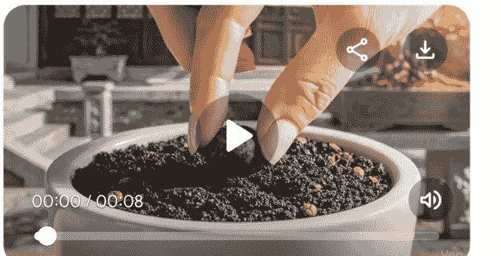

### 目前在各平台走量的几类爆款脚本方向：

- 1. 以果苗打包出售为核心，用农场主视角配合乡间、牧场等场景营造氛围，增强信任感从而获得自然推流：

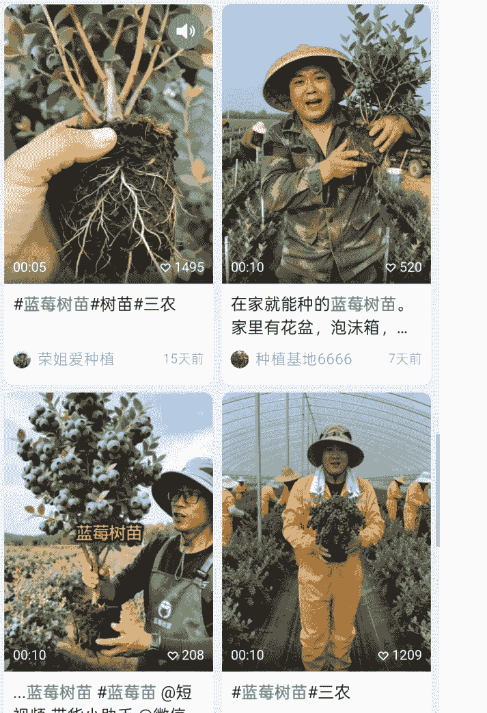

- 2. 以种子开花结果为视觉钩子，AI 生成的水果素材色彩更鲜艳，更容易吃到流量：

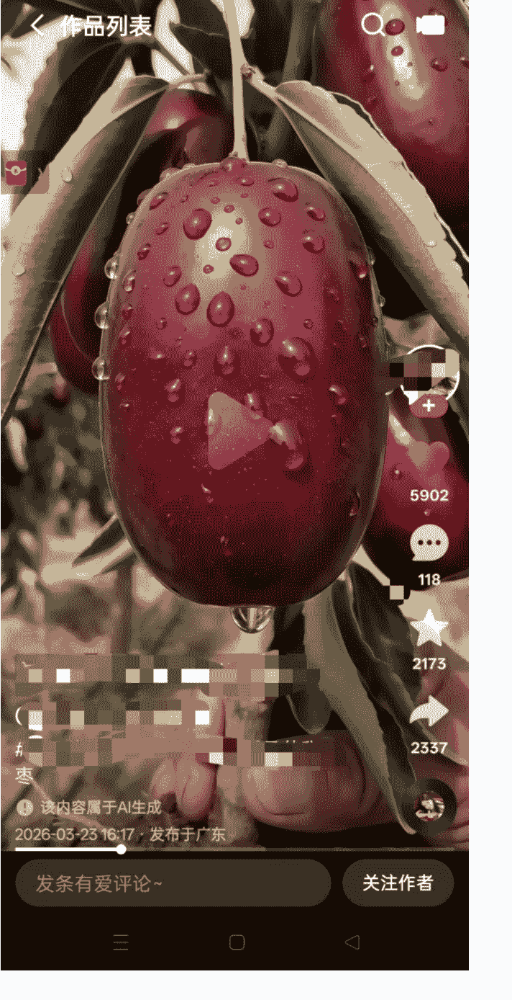

将视频素材导出后喂给 AI 进行拆解，让其输出可用的提示词，再自行调整。提炼爆款结构后替换为原创素材即可复刻。

#### 2. 视频发布、推流、直播承接转化流程：

#### 手机端路径：

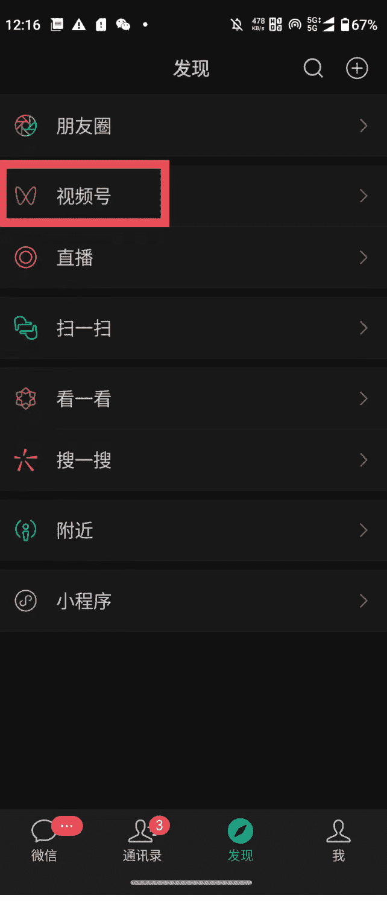

若找不到入口，打开微信，

点击「我」>「设置」>「通用」>「发现页管理」>「视频号」>「在发现页中显示该功能」

电脑端路径：

https://channels.weixin.gg.com/login.html 用微信扫码登录即可，需手机摄像头扫码。

视频号建议每日发布 1-2 条，保持稳定更新即可获得基础推荐。当单条起量至数万播放时可直接开播承接。短视频本身不挂商品，保持纯推流，开播时再完成转化。自播可行则自播，不行则找代播。直播画面较简易，可绿幕真人，也可放置 AI 生成的产品图口播即可：例如先用 AI 生成一张图，直播时直接承接即可成交：

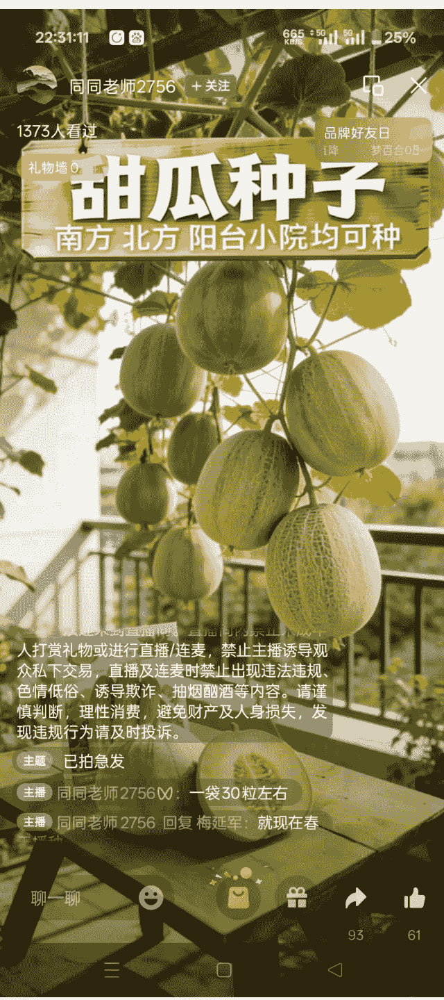

#### 3. 发布时间：

视频号机制较特殊，无需养号，新号直接发，老号反而易无量，

建议从下午开始投放，夜间转化最佳，视频号的违规可基本忽略，直接发布即可。

同一账号可再次发布已发过的视频，

不同账号若直接搬运未做去重则易无流量。

发布 2 小时后观察数据，分三种情形，

- 1. 若单条播放为 0 或个位数，

说明去重未做好，或时长过短，或运气不佳，需重新处理。

- 2. 若单条播放数百，

说明账号正常，素材存在问题

可更换同款素材不同版本再发，也可换品发布，每隔一小时发一条，

- 3. 若单条播放数千，

可尝试开播测试转化，并将播放最高的视频原样再次发布，每一小时发一条，

连续发布播放最高版本三次，若三次均未破万，

则更换同品不同提示词的版本发布，或直接换品发布，

一旦破万，则持续投喂该爆款版本，直至不再破万再更换。

## 三、抖音实操：

抖音是主流短视频带货的核心阵地，一条视频爆了，后端收益一日可达数千。

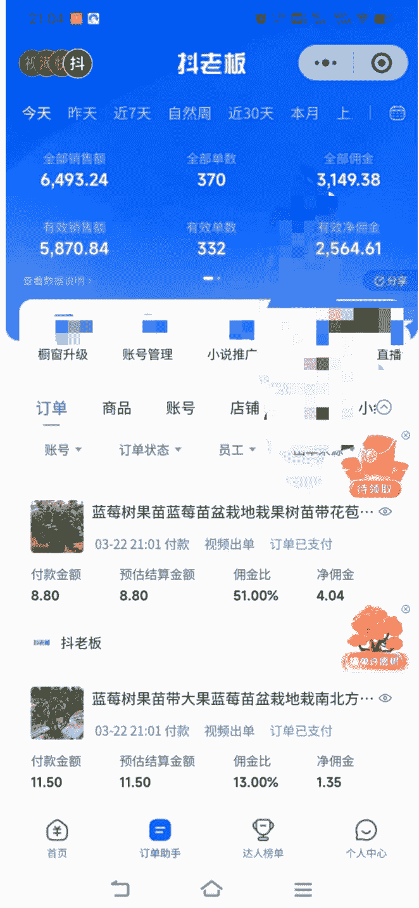

### 抖老板

今天 昨天 近 7 天 自然周 近 30 天 本月 上月

全部销售额 23,491.71

全部单数 1,687

全部佣金 8,364.02

有效销售额 20,341.12

有效单数 1,467

有效净佣金 6,538.67

| 项目 | 内容 |

| 橱窗升级 | - |

| 账号管理 | - |

| 小说推广 | - |

| 直播 | - |

| # 订单 | - |

| 商品 | - |

| 账号 | - |

| 店铺 | - |

蓝莓树果苗蓝莓苗盆栽地栽果树苗带花苞…

03-22 21:05 付款 视频出单 订单已支付

| 项目 | 金额 |

| 付款金额 | 32.80 |

| 预估结算金额 | 32.80 |

| 佣金比 | 51.00% |

| 净佣金 | 15.06 |

抖老板

蓝莓树果苗蓝莓苗盆栽地栽果树苗带花苞…

03-22 21:01 付款 视频出单 订单已支付

| 项目 | 金额 |

| 付款金额 | 8.80 |

| 预估结算金额 | 8.80 |

| 佣金比 | 51.00% |

| 净佣金 | 4.04 |

| 项目 | 内容 |

| # 首页 | - |

| # 订单助手 | - |

| # 达人榜单 | - |

| # 个人中心 | - |

### 概览 内容 商品 橱窗 市场

实时 昨日 近 7 日 近 30 日 自然日

### 核心数据 03 月 21 日

切换为联盟数据

| 指标 | 今日 | 昨日 |

| 成交金额 | ¥3297.13 | 6979.71 |

| 成交订单数 | 222 | 518 |

| 成交人数 | 215 | 509 |

| 预估佣金收入 | ¥1357.67 | 2134.81 |

| 结算佣金收入 | ¥0 | 0 |

| 退款金额 | ¥489.3 | 943.26 |

查看趋势

图文投稿流量来了

分享关于买买买的一切 去投稿

### 视频 橱窗 直播 图文

| 项目 | 数值 |

| 成交金额 | ¥3198.36 |

| 成交订单数 | 216 |

| 视频分析 | - |

### 首页 选品 消息 数据

40/53


抖音带货门槛较高但跑量强：

- 1、需 500 个有效粉丝，实名并非必须

- 2、建议至少运营 3 个号以上，

- 3、老号抗封能力更强

### 新号前三天需养号并涨粉，发布自然风景照可获得自然推送即可上手。

5 个号以内使用同一 WiFi 发布无问题，一个手机切勿登录过多账号，

最好做到一机一号：

频繁切换账号易触发实名校验，必须实名才可继续。实名权重高则无碍。

### 1. 达到 500 粉后挂车：

- 1 直接付费涨粉，效率最高

涨粉前，先发一条 7 秒以上的特效自拍或精美实拍风景，

观察播放是否超 300，低于则养一日再试，

超过 300 即可开始付费冲粉。

- 2 免费互粉，需 2~3 天

勿私聊互粉，勿加群互粉，

在抖音搜索互关互关粉，或搜索互粉

评论区大量互粉需求，

1) 复制他人评论去评论区回复，或发布“捡我”等话语，后加表情

2) 关注评论区数分钟前的人，通常会回关：


在抖音搜索互关互关粉直播间，或搜索互粉直播间，随便进入一个，评论区皆为互粉需求，

1) 同样复制评论区内容，主动评论 + 主动关注，

2) 进入刚评论的人主页，查看其粉丝列表，再去关注，通常也会回关。

### 2. 发布时间：

抖音每日发布 2-3 条精致作品即可，不可连发，间隔半小时测试。最佳时段为下午至夜间，用户下班后刷量较大。

- 3. 同一商品可测 2-3 条视频，测试完毕未破万则换品

- 4. 视频一旦破万，则将播放最佳的提示词原样，用 Seedance 重新生成原创素材再次发布，持续引流。

### 3. 引导转化：

可在配音结尾添加引导，例如“左下方小黄车直接打包带走”。评论区置顶引导词也能提升转化。

多参考同行评论区及素材设置，优秀同行即为老师

选品尽量挑选半月内出现的新素材，过久参考价值低。

抖音推流主要靠自然流，提示词引导精准转化不差。可适当投放随心推提升下单率。

每日发 1-3 条即可，每条模板不要长期重复，适时更换提示词或更换树苗品类，避免被判定同质化限流。对精细化运营要求较高。

账号不幸被扣分限流时，可为抖音小店达人充值数元随心推即可解除。

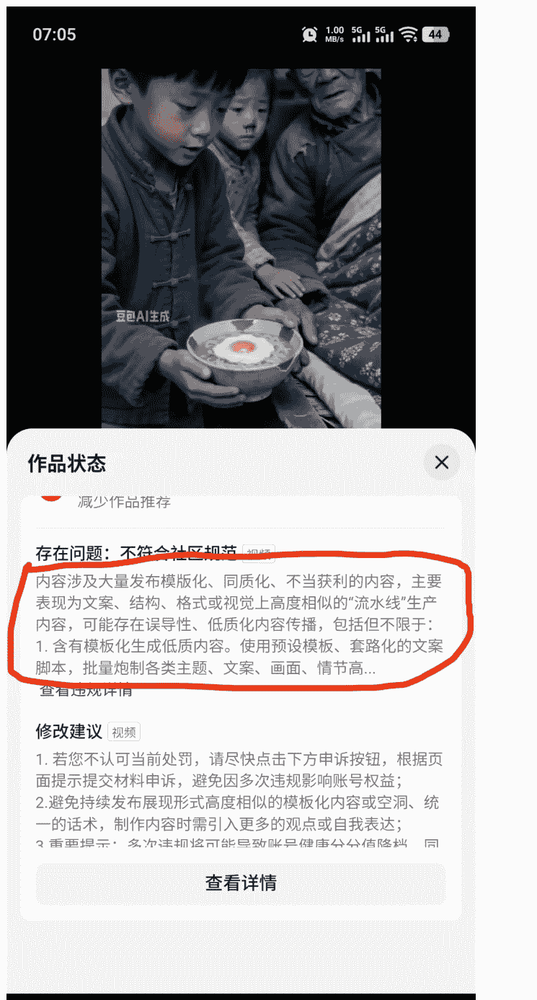

下方为随心推投流教程，通常投放数元后平台不再违规扣分：

## 四、快手实操：

快手操作门槛低，0 粉可挂车，无需实名，可不绑手机号，拥有微信 QQ 微博账号即可注册，可多号操作，但同一设备勿同时登录过多，最好一机一号，避免触发实名激活。账号

快手与其他平台相似，每日稳定更新 2-3 条素材即可。快手机制为坚持越久权重越高，作品质量高时新号也会给予数千基础曝光：

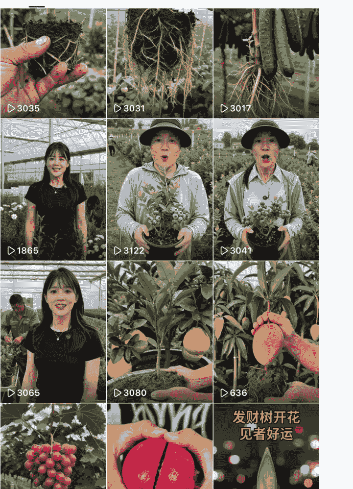

快手禁止重复发布相同素材，无原创度的同框素材会被限流进入黑屋。因此同一个爆款要么剪辑处理，要么用相同提示词让 Seedance 重新复刻一版裂变流量。

账号跑通后，可选择开通达人或开小店挂链接承接。但未实名未绑手机号的账号若要开店或开达人，需实名或用营业执照关联实名。建议用营业执照认证，货款可提现至营业执照名下，且实名号会不定期二次验证，避免本人不在时无法复核。

快手视频推流后自然流也会上升，爆后流量偏泛。若播放至数千至一两万但转化差，可通过投放粉条或全站推广引入精准流量，提升单量：

快手小店达人开通及投放全流程在过往《快手好物全站微投流挂车，正反馈变现极快且持久稳定的新流量入口玩法》中有详细说明，可参考：

> 《快手好物全站微投流挂车，正反馈变现极快且持久稳定的新流量入口玩法》

详尽到极限。

## 五、扩号与多平台分发

抖音与视频号对实名有强制要求，快手成本最低可免实名免绑手机号，营业执照认证后即可挂车分发。对抖音与视频号的策略，建议人均 2-3 号走精品路线，视频号用新号发布，基础推荐量较大；抖音最好找私人老号，权重高爆率更大。

### 辅助号注册：

一个手机号可同时创建两个抖音号，进入「我」>「右上角」>「设置」>「切换账号」，创建新账号，选择辅助创建，一个月以上的号才有该选项，若无则跳过

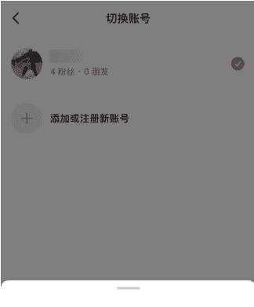

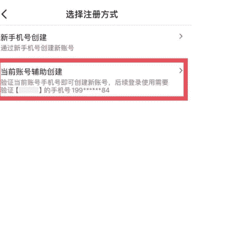

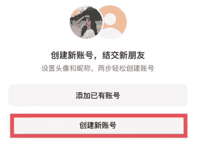

快手账号成本低，账号越多起号概率越高，测试效率也更快。

测试时注意一机一号隔离，避免触发激活。被激活的号必须实名提权才能解开，通常因频繁操作被系统判定，正常操作基本不会触发。若一人无法管理过多号，则先用 2-3 个号跑通。

## 六、数据与转化查询：

将账号绑定至抖老板、小店或达人后台，后续各平台数据转化会集中展示：

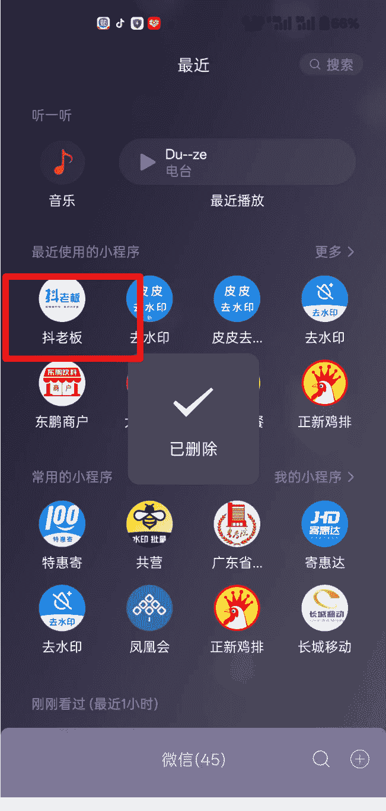

接下来的一个多月仍是春季树苗种植旺季，9-11 月还有第二波种植旺季。你学会用 AI 提示词生产带货素材并跑通运营流程后，该思路同样可迁移至其他产品变现。

树苗种植旺季

综合 视频 用户 商品 直播

### AI 生成回答

“绿化苗木旺季来临”指绿化苗木市场需求与成交量进入全年高峰期，通常伴随价格上浮与交易活跃。主要由气候与市场需求决定，全年有两波高峰：

- 1. 春季旺季（3 月 -5 月）：全年最核心的销售旺季，占比超 60%。气温回升、土壤解冻，是植树造林与绿化工程的黄金期，成活率高，市政、地产项目集中开工，需求旺盛，家庭园艺需求亦随之上涨。

- 2. 秋季旺季（9 月 -11 月）：次要旺季。天气转凉蒸腾减弱，移植成活率仍高，部分未完工工程会赶在土地上冻前集中采购，形成“小旺季”。部分苗木价格相对春季更友好，也吸引采购。

以上为实战复盘，纯手写，若觉得有用欢迎为星球点赞，感谢！

AI 时代已开启，祝大家借助 AI 跑通项目闭环实现变现。

## ——————分割线——————

读完这份 SOP，会觉得已懂。但 90% 的人实操第一步即卡住。

工具与教程仅为基础壁垒，真正的壁垒是“立刻执行”与“圈层信息差”。

我们不谈空话，只拆商业闭环与 AI 效率的压榨。内部已沉淀 1000+ 跑通的套利实战案例。

🔖 查看圈子数字资产与入群门槛：


