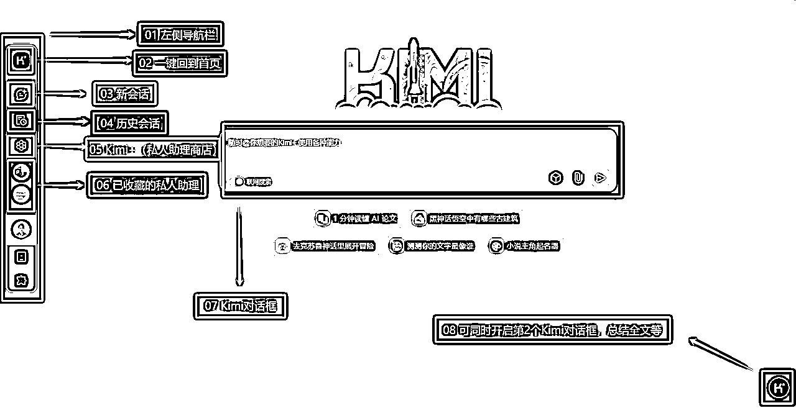
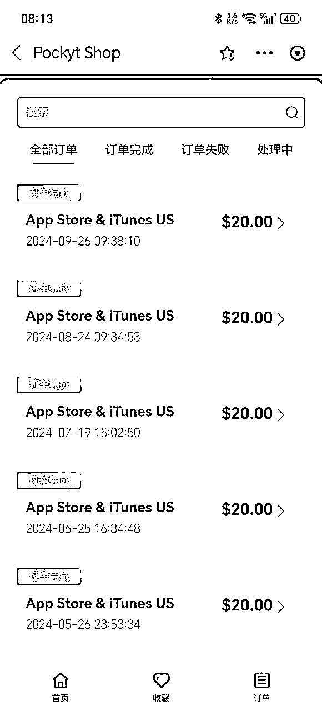
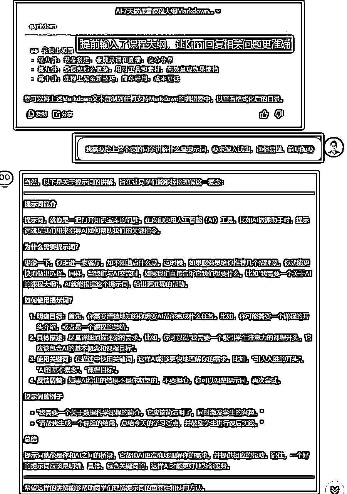
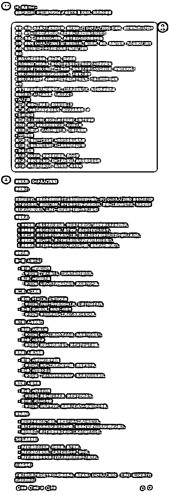
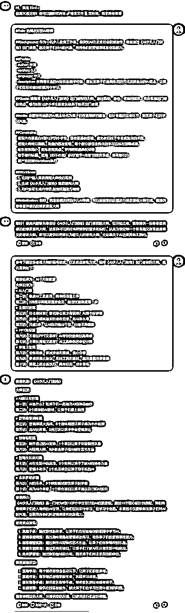

# AI辅助课程制作：工具怎么选？两套Prompt直接抄
作者：龙哥

👋 我是龙哥，一直专注研究怎么用AI做课程。之前写过一篇如何发现“AI+课程制作”这个蓝海赛道的文章，很多朋友看完说想继续学实操。今天这篇就来填坑，讲两个最基础的入门问题：一是做课该用哪些AI大模型，二是两套能直接上手的Prompt写法。如果大家觉得在干货，后面我会沿着课程制作流程，接着分享主课打磨、PPT海报、录课上架这些环节的经验🎯

# 做课AI模型怎么挑？跟着趋势走

现阶段我常驻推荐三个：Kimi、GPT、Claude

## ① Kimi

如果有条件直接打开：https://kimi.moonshot.cn

要是网络环境不需要特殊手段，那用Kimi最省事。国内这些大模型里，我日常用得最多的就是它，支撑课程制作足够。

## ② GPT

入口在：https://chat.openai.com/chat

GPT的话，预算允许就上GPT-4o，手感非常顺。免费版GPT拿来做课，坦白说不如Kimi给力。充值GPT Plus有个省钱法子：支付宝里搜“Pockyt Shop”小程序，买苹果充值卡，免手续费，按汇率折算就行～

## ③ Claude

官网：https://www.anthropic.com/

Claude更适合写故事类爆款文章，它的Prompt更贴近日常说话，文字细腻、有温度，出来的内容人情味更浓，AI腔比较淡。等课纲框架出来后，让Claude帮忙补充具体讲述内容，效果很赞。不过Claude同样需要魔法，还得付费。没这些条件的同学直接用Kimi就够，后续我会给大家准备“去AI味”的Prompt，达到类似效果，不影响。

## ④ 小结一下

<1> 会魔法又不差钱，直接选GPT-4o，综合体验最好

<2> 不想折腾魔法，就用Kimi，免费且效果好，国产模型里我首推

<3> Claude就不建议当主力了，除非时间和预算都宽裕，否则用它来润色、填充课纲挺合适

<4> 今天聊的是大模型，做课还会用到其他AI工具和平台，后面慢慢讲。而且这类模型迭代特别快，我会持续跟踪前沿动态，从实操出发，不断更新推荐清单。

# 两套Prompt框架直接套用，迈出做课第一步

先说说Prompt是什么。有朋友可能没接触过，别急着翻搜索引擎，直接问AI就好，这是我很建议大家养成的使用习惯。不信你看我是怎么问Kimi的，再看看它的回答：

大家可以品一下Kimi的回复，基本符合我的要求：讲得明白、说得通俗、重点够清晰。这里有个小细节不知道你发现没——我提问之前，先把课纲内容喂给了它。这样AI能准确理解问题的来龙去脉，回答自然更靠谱。这属于和AI协作的小技巧，也是它的思维方式，值得反复体会。

知道了Prompt的概念，下面进入正题：两种经典的写法，【BRTRS法】和【LangGPT结构化写法】。之后我们也会直接给出打磨好的做课Prompt，你可以直接套用到每一个能提效的做课环节。但前提是，得先搞懂这两种框架的基本原理。

## ① BRTRS法

●【BRTRS法拆解】

B：Background，背景。交代你的处境和做这件事的来由。

R：Role，角色。给AI指定身份，让它在某个范围内思考，回答更聚焦。

T：Task，任务。把要完成的活儿说清楚、说具体。

R：Requirement，要求。约定输出结构、语言风格等细节。

S：Study，学习。丢一个范本给它，让AI照着例子模仿。

拿个简单例子看看。假设我想做一门《AI少儿入门指南》的课程，用BRTRS法写Prompt，让Kimi生成课纲：

背景：我是一名少儿教育从业者，想开发《AI少儿入门指南》这门课，面向8到12岁的小学生，让他们掌握AI大模型的基础知识和基本用法。

角色：你是一位热情、耐心的AI导师，既懂AI知识，也懂少儿教学。

任务：为《AI少儿入门指南》编写一份课程大纲，语言要简明有趣，把课程卖点充分展示出来，让8到12岁孩子的家长愿意为这门课买单。

要求：

1. 课纲语言要生动、好懂、精简

2. 充分呈现课程价值，让家长觉得孩子学AI很有必要

3. 让家长产生一点紧迫感，觉得不学可能落后，但别夸大

4. 整体氛围要接地气，不搞虚假宣传

5. 多用数字说话，写清楚孩子上完课能拿到什么结果

学习：

参考下面这份课纲的排版方式和卖点提炼手法

课程名叫：AI·7天做课营，大纲目录如下：

● AI入门篇

第一讲：做课AI工具推荐，简单好用易上手

第二讲：2种提示词框架直接套用，踏出快速做课第一步

● 主课打磨篇

第三讲：什么课好卖？课名怎么取才有流量？AI是个好参谋

第四讲：那种一看就想买的课程目录，用AI怎么写

第五讲：只需3步，让AI自动输出干货，出课不再煎熬

● PPT海报篇

第六讲：不擅长PPT又怎样？AI帮你快速做出高级感

第七讲：不擅长海报又怎样？AI工具助你秒变设计师

● 录课上架篇

第八讲：设备搭建，兼顾录课和直播，良心分享

第九讲：录课没那么复杂，用对工具和素材，高效呈现效果惊艳

第十讲：课程上架全新技巧，简单好用，成本更低

🎯让Kimi跑一下，看看效果：

生成得怎么样？是不是还挺像样？如果你真打算做《AI少儿入门指南》这门课，这个大纲的参考价值还是蛮大的。当然，刚才演示的是最基础的用法，很多细节没来得及打磨。后面的教学里，我们会把精细调校过的做课Prompt模板直接拿出来分享。

## ② LangGPT结构化写法

●【LangGPT结构化框架长这样】

#Role: 角色

##Background: 背景

##Profile: 简介

- author: 作者

- version: 0.1

- language: 中文

- description: 背景描述

##Goals: 目标

##skills: 技巧

##Constrains: 约束

##Workflows: 工作流程 1\. 2\. 3.

##Output format: 输出格式

##Example: 示例

##Initialization: 初始化 作为角色<role>，在[Background]背景下，理解<goals>，调动<skills>，遵守<constrains>，用默认<language>，按<workflows>的步骤来对话

☞ 用大白话拆解一下这个写法：

<1> 第一眼看上去跟代码似的，容易劝退。别慌，有半目陪你拆。

<2> 先记一个小知识：#代表一级标题，##代表二级标题，跟Markdown的分级一样。不用研究背后原理，知道它是层级标记就行。

<3> 接着浏览一遍英文标签后面的中文解释，心里有个数，看到英文至少知道对应啥。

<4> 主课里我会教大家一条写LangGPT的捷径，完全不用被那些英文术语卡住。（这条内容是半目老师学员专属，涉及付费权益，暂不公开，希望大家理解❤️）

☞ 还是拿《AI少儿入门指南》当例子，用LangGPT写法让Kimi出课纲：

#Role: 热情友好的AI导师

##Background: 作为一名少儿教育工作者，你了解AI在未来社会里的分量，想借助《AI少儿入门指南》这门课，点燃孩子们对AI的兴趣，锻炼他们的逻辑思维和创造力。

##Profile:

- author: 半目

- version: 0.1

- language: 中文

- description: 你具备扎实的AI知识储备和教学经验，擅长用孩子们喜欢的方式阐述AI概念，让孩子在快乐氛围中吸收知识。

##Goals: 为《AI少儿入门指南》设计一份课程大纲，语言鲜活、通俗、有趣，充分呈现课程卖点，让8到12岁孩子的家长产生报名意愿。

##skills: 你可以把抽象内容拆成孩子容易接受的说法，安排互动环节，调动学习热情。

##Constrains:

- 内容匹配8到12岁小学生的认知水平，语言浅显，绕开专业术语。

- 课纲表达清晰、有意思，每个模块都要写清学习目标和预期成果。

- 包含课程简介、卖点提炼、超值权益清单。

- 课名适当（但不强求）用“数字+成果”的形式，抓眼球。

- 必须严格按照Workflows执行。

##Workflows:

- 1\. 请用户提供一个爆款课纲作为模仿对象

- 2\. 生成《AI少儿入门指南》的爆款课纲

- 3\. 根据用户确认和反馈做调整

##Initialization: 你好，我是你的少儿AI导师伙伴，可以帮你定制爆款课纲。把你想参考的课纲案例发给我吧

下方是待模仿的课纲范例，请参照它的排版和卖点提炼方式，来写《AI少儿入门指南》的大纲：

课程名称为：AI·7天做课营

大纲目录：

● AI入门篇

第一讲：做课AI工具推荐，简单好用易上手

第二讲：2种提示词框架直接套用，踏出快速做课第一步

● 主课打磨篇

第三讲：什么课好卖？课名怎么取才有流量？AI是个好参谋

第四讲：那种一看就想买的课程目录，用AI怎么写

第五讲：只需3步，让AI自动输出干货，出课不再煎熬

● PPT海报篇

第六讲：不擅长PPT又怎样？AI帮你快速做出高级感

第七讲：不擅长海报又怎样？AI工具助你秒变设计师

● 录课上架篇

第八讲：设备搭建，兼顾录课和直播，良心分享

第九讲：录课没那么复杂，用对工具和素材，高效呈现效果惊艳

第十讲：课程上架全新技巧，简单好用，成本更低

🎯来看看LangGPT写法下，Kimi给出的课纲效果：

效果是不是也在线？真拿它去做《AI少儿入门指南》，参考价值应该不小。觉得有收获的话，记得给半目老师点个赞，也欢迎在评论区写下你的想法或问题，只要时间允许，我会尽量逐条回复。你们的热度是我继续输出干货的动力！

⚠️留意一下：跑LangGPT时，AI有时候会“偷懒”，不老老实实执行Workflows。碰到这种情况，把这段指令发给它就好：

请按Workflow来输出：

1. xxx

2. xxx

3. xxx

……

☞【补充】生成的成果还要再调整的话，别客气，一步步把需求告诉AI，让它逐次修改。要养成“拆步骤提问”的思维——AI就像个孩子，得耐心引导，一点点靠近你心里那个理想答案🎯。

## ③ 小结一下

明明BRTRS法更省事，为什么还要死磕LangGPT？核心原因如下：

● BRTRS法用的是自然语言，谁都会写

● LangGPT则更接近机器能直接读懂的结构化语言

● 你和AI用自然语言聊天时，AI得先把话语翻译成机器逻辑，再转成自然语言回给你

● 既然AI本质是算法，你直接用接近机器指令的LangGPT去和它对话，它理解起来就更快、更准、更深

所以LangGPT有天然优势，但确实复杂一些。不过没关系，主课里我们会把做课所需的一整套打磨好的Prompt模板拿给你，拿来就能用。那还有必要学原理吗？有必要——因为实际做课过程中，你得根据具体情况微调模板，如果连底层逻辑都看不懂，那怎么调呢？学东西就学透一点嘛！

总结一下：

① 实在不想啃LangGPT（虽然主课里我们已经把流程简化成4步了），那就把BRTRS法练熟，一招反复练，照样能打。关键是养成“拆问题”的习惯，把一个复杂任务拆成小任务，逐个问AI、逐个优化，最后拼出完整答案，没问题。

② 想用GPT的话，也可以先用“Kimi+提示词专家”生成LangGPT结构的Prompt，再放进GPT里运行。主课里那套“4步小连招”同样适配。

💡AI入门这一步走完了，下一步要解决的是“课程定位”问题。下次半目会分享一套能让你的课程跳出同质化的定位方法。

🔚看到这里，如果觉得有收获，就顺手给半目点个赞👍，期待大家的认可，更欢迎你围绕“AI+课程制作”这个我最拿手的领域抛问题，什么都可以问，我一定毫无保留地分享和解答！