# API_KEY 的防线不够厚：一次被绕过认证疯狂刷量的实战止损记录
最近群里又有人反馈，站点被绕过前端校验，直接狂怼上游接口导致费用暴涨。
我自己也刚经历过一模一样的事，索性把当时排查和加固的全过程整理出来，给大家参考避坑。
攻击发生后我第一时间对全站做了体检，补上了多层防护。主要是认证机制重构，再叠加 Vercel KV 与 Upstash 的全局限流，对 IP 和单个账号的调用频率做硬控。
文末附上了我完整的加固执行日志，希望对正在做同类项目的朋友有用。
## 一、怎么被盯上的
站点刚有点流量，就在 9 月 10 日凌晨 8 点左右开始不对劲。日志显示一分钟内涌入数千次请求，对方直接绕开了我的前端鉴权逻辑，不断消耗上游 API 的额度。还好当时我是按日充值积分，并没有造成长期累积亏损。
我是怎么察觉异常的？
每天醒来先看积分余额成了习惯。那天一打开后台，昨晚刚充值的积分直接归零。诡异的是，自己的数据库里没有任何消费记录，上游 API 那边却明明白白显示被调用了。
第一反应是 KEY 泄露。先自己人工排查，再让 AI 帮忙扫一遍，也请了技术朋友一起看，都没找到 API_KEY 暴露的痕迹。
为了验证，我做了两轮测试：
1. 再次充入一千积分，结果不到两分钟又被吃光。
2. 怀疑是密钥问题，我把全部 KEY 撤回，重新部署新密钥。上线瞬间上游日志里仍有上千条请求在跑，赶紧把 KEY 再撤掉才止住出血。
继续追踪后，在 Vercel 的访问日志里看到了大量以毫秒级频率发起的错误请求。
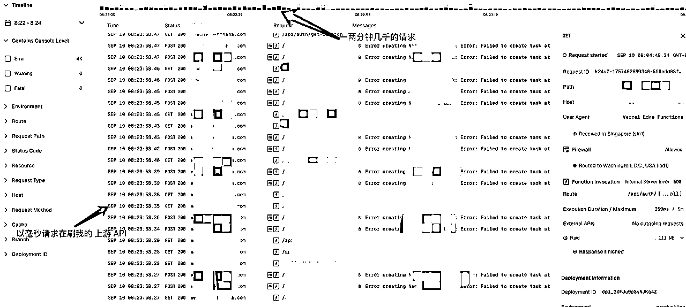
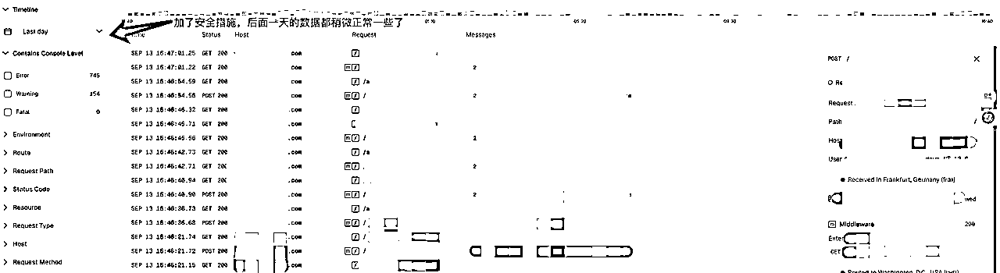
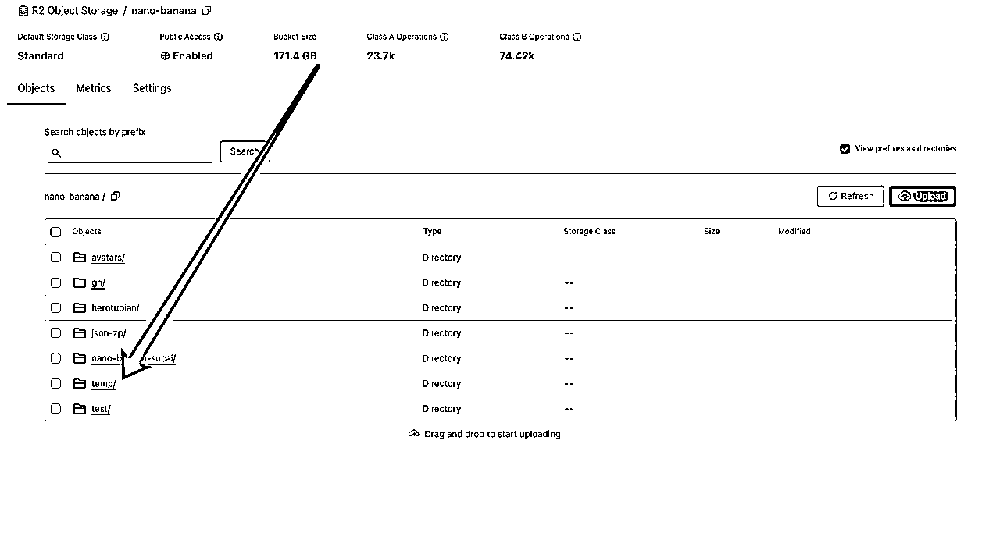
基本可以确定是被恶意攻击，于是把这些异常日志丢给 AI 做解读。
## 二、漏洞在哪，以及怎么补
下面是当时我和 AI 排查对话的要点整理：
根因判断是前端签名与鉴权做得太薄弱，攻击者直接跳过前端扣费流程，直连后端消耗上游资源。
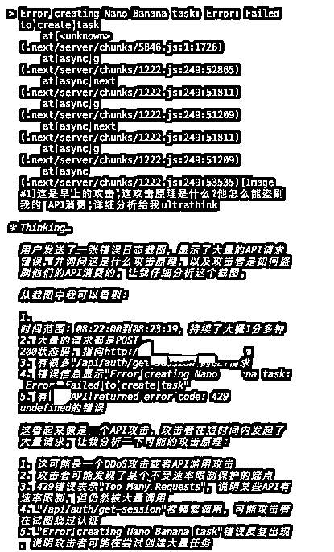
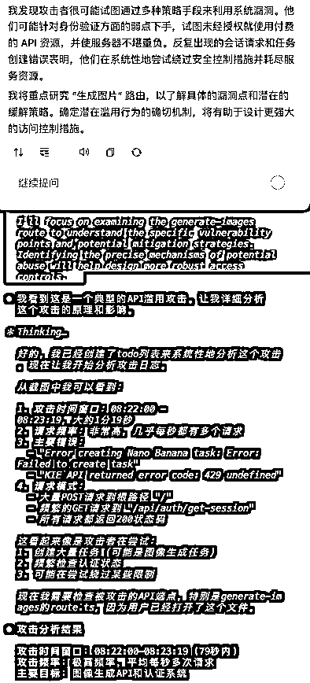
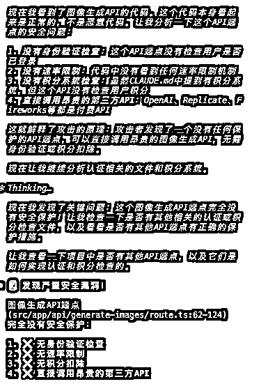
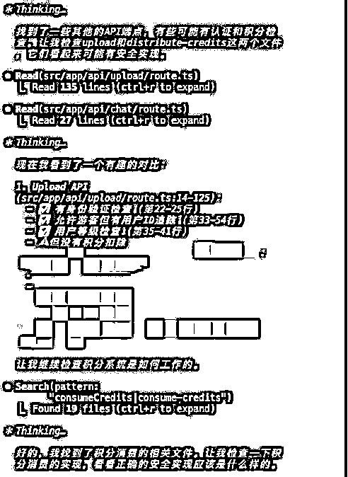
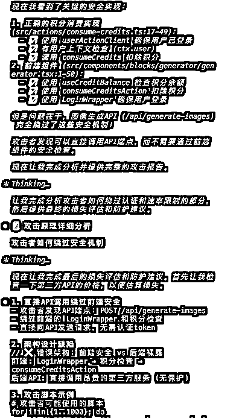
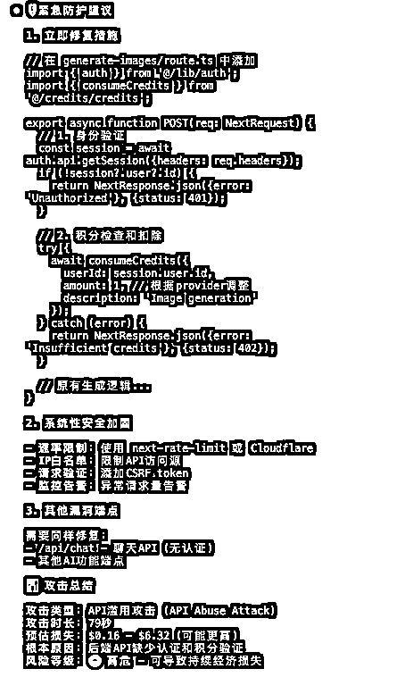

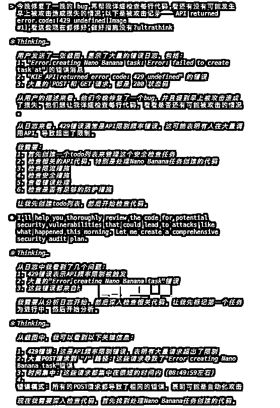
## 三、代码层面的修复与认证强化
修复思路是把关键校验全部收敛到服务端，并且让每一笔消费都可追溯、可防重放。
流程变为：登录的真实账号 → 账号余额充足 → 每次消费必须绑定唯一的任务 ID，数据库层面用唯一约束拦截重复提交。
按照这个思路，攻击者原来的几条路径都被堵死：
1. 直接调用接口创建任务 → 被 attestation 校验拦截
2. 试图绕过前端扣费 → 服务端强制校验扣费凭证
3. 重放旧请求 → 交易绑定机制让重复使用失效
4. 高频刷量 → 限流机制直接返回 429
5. 越权查询他人任务 → 任务归属校验拦截
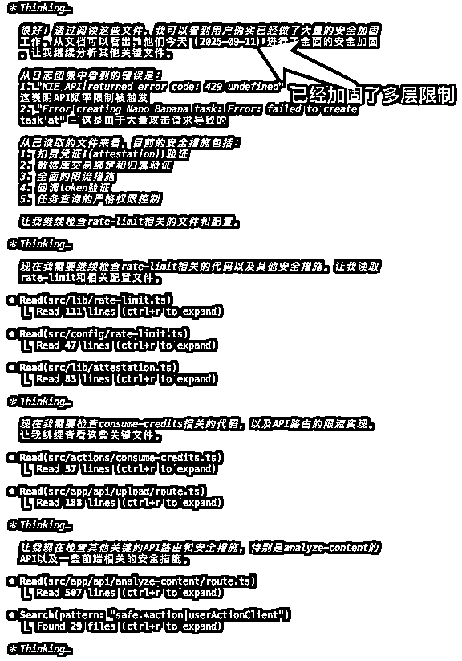
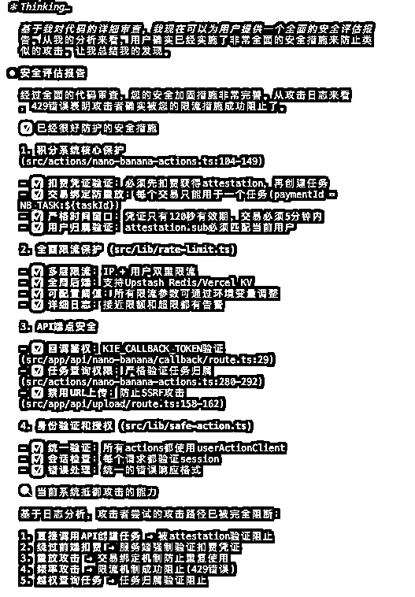
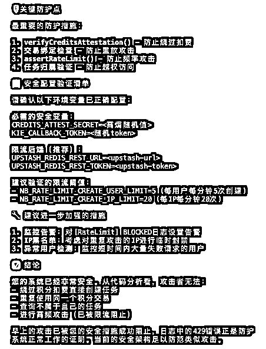
## 四、再叠一层基础设施限流
代码修复后，我又在 Vercel 层面加了 KV 与 Upstash 的全局限流，分别限制 IP 维度与单个用户维度的调用频率，阈值可以按业务自行调参。
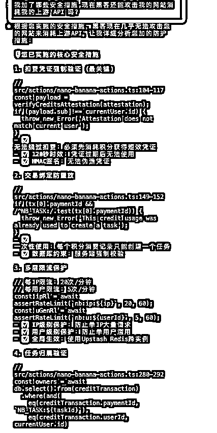
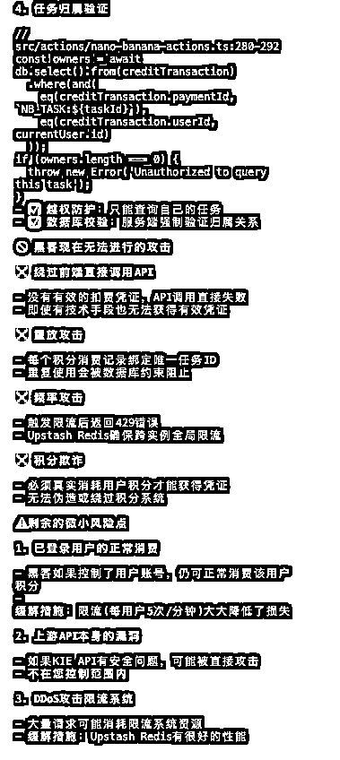
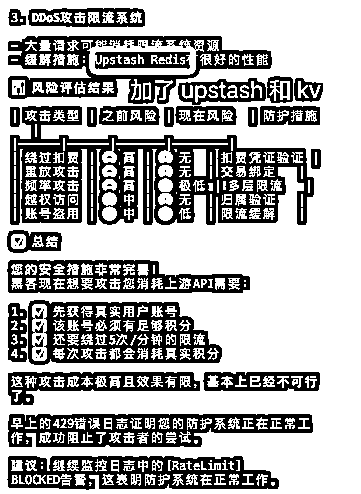
KV 和 Upstash 是什么、怎么用，可以让 AI 快速带你入门。我目前用的是免费额度，触发量很小，短期完全够用。
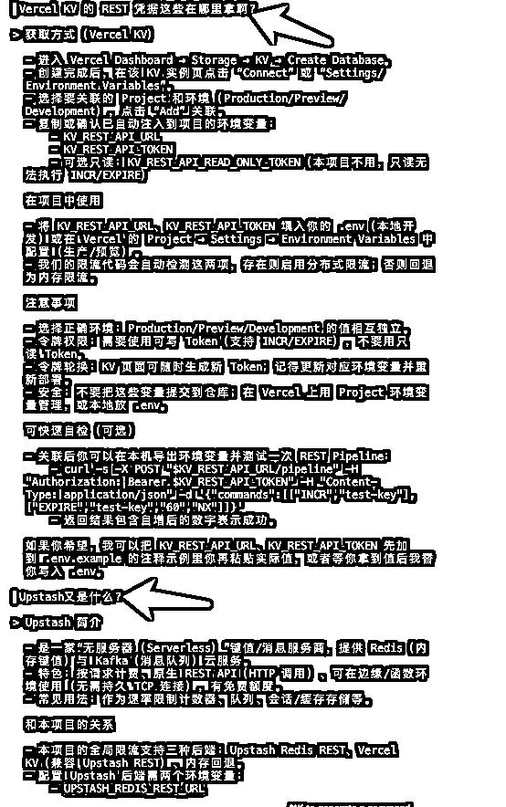
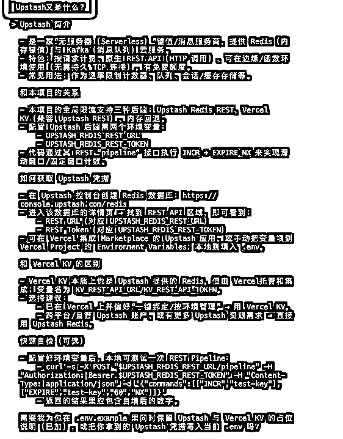
我的部署环境是 Vercel，都是在 Vercel Storage 里绑定连接。当时情况紧急，没截太多图，有需要自行部署的朋友可以让 AI 指导具体绑定步骤。
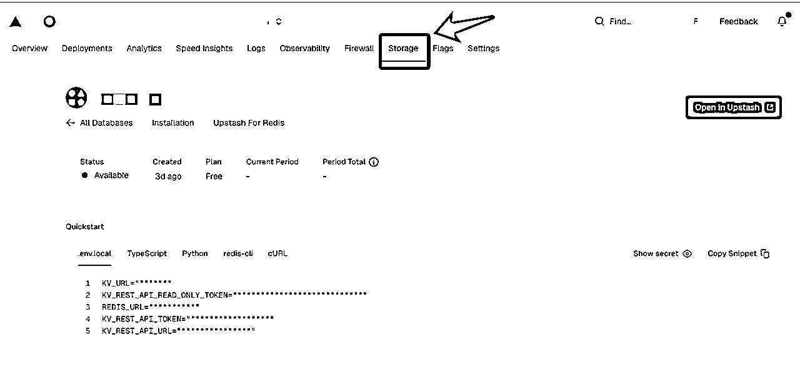
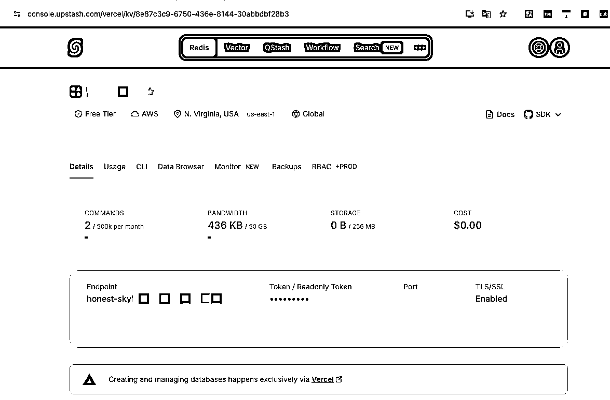
## 五、复盘与提醒
吃一堑长一智，踩过的坑反而成了地图。这次幸亏发现及时，损失可控。把经验分享出来，就是希望圈内朋友能提前布防。
另外一个小建议：能不公开直接变现的核心站点就别随意曝光，降低被瞄准概率。保持学习和交流即可。以上为个人实战总结，仅供参考。