# Anthropic 官方指南：想让 AI 更好用，先别急着加戏
你好，我是龙哥。最近我去翻了 Anthropic 发布的报告，官方给出的结论有点反直觉：
想让 AI 真正帮你干活，关键不是把功能堆到满，而是学会“少管闲事”。
在过去一年的大规模实践中，Anthropic 反复验证出一个结论——表现最稳的 Agent，大多是拆成小模块的简约设计，而不是层层嵌套的复杂架构。
技术圈有时候就是这么拧巴：越想在每个环节加码，最后反而容易被自己绊倒。
整份报告的核心思路，其实就这一句话：
### 一条被反复验证的方法论
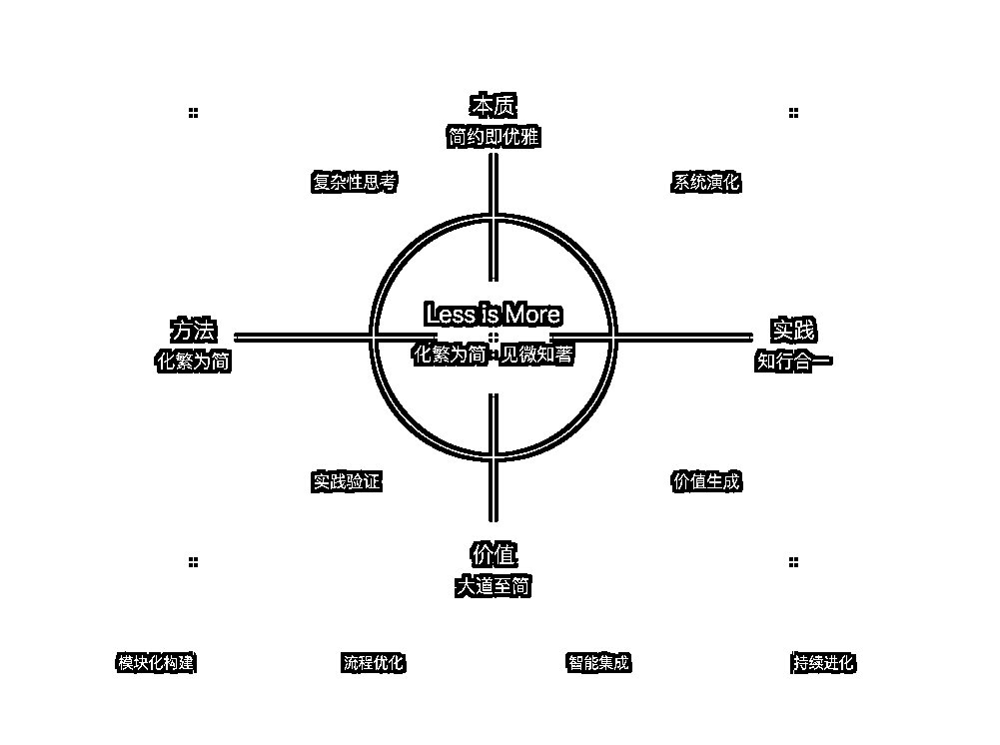
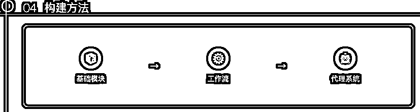
下面是我在 AI 辅助下重新梳理的通俗版本。
* * *
### 全篇的论证逻辑
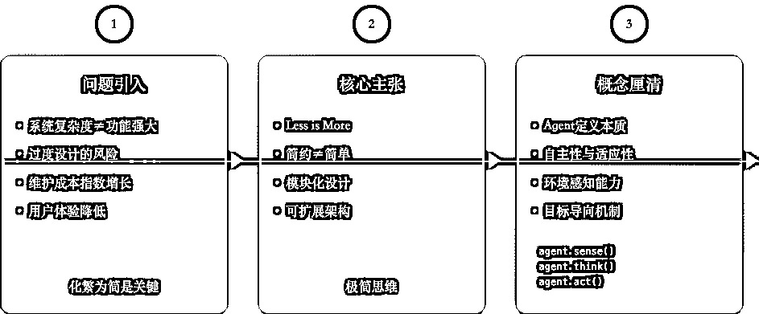
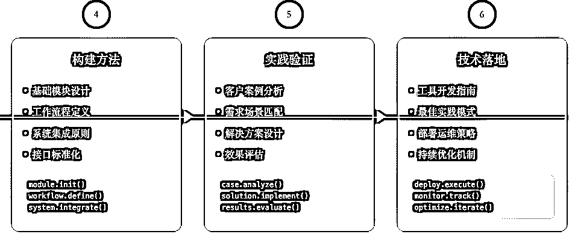
* * *
### 解读一：Agent 到底是什么
#### 原文
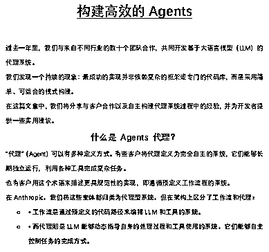
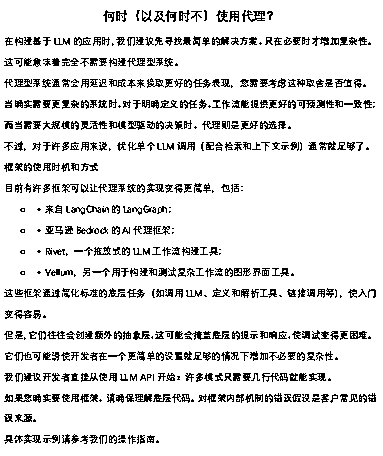
#### 说人话
**实例一：准备晚餐**
先看高配路线：
- 购齐整套专业厨具
- 手机上装了三个菜谱软件
- 调味料备了十几种
- 菜单一口气排到七道菜
结果：
- 操作台堆满器物，转个身都难
- 三个小时才勉强收尾
- 有两道菜差点烧干
- 最终大家一起吃冷饭
再看极简路线：
- 一口煎锅走天下
- 只挑两样核心食材
- 调味料只用三款
- 一门心思端上一道菜
结果：
- 全程不慌不忙
- 半小时内开饭
- 口味恰到好处
- 菜上桌还冒着热气
**实例二：拼乐高**
高配方案——入手一套自动化积木套装：
- 安装指引厚到跟字典似的
- 零件数量多到能铺满一桌
- 动其中一块，整台设备就可能罢工
低配方案——随手拿基础积木搭个造型：
- 结构一看就懂
- 反复拆改也没有压力
Anthropic 想传递的态度很直接：用 AI 做事的正确姿势，不是把场面弄得很隆重，而是尽量少绕弯子。
#### Agent 可以理解成什么
说得直白些，Agent 就是一位被授权“自己开工”的数字助理。
给它一个任务目标，它就能自己安排步骤：
- 处理来信
- 归档文档
- 生成代码
- 查资料并汇总成汇报
#### 两类最常见的形态
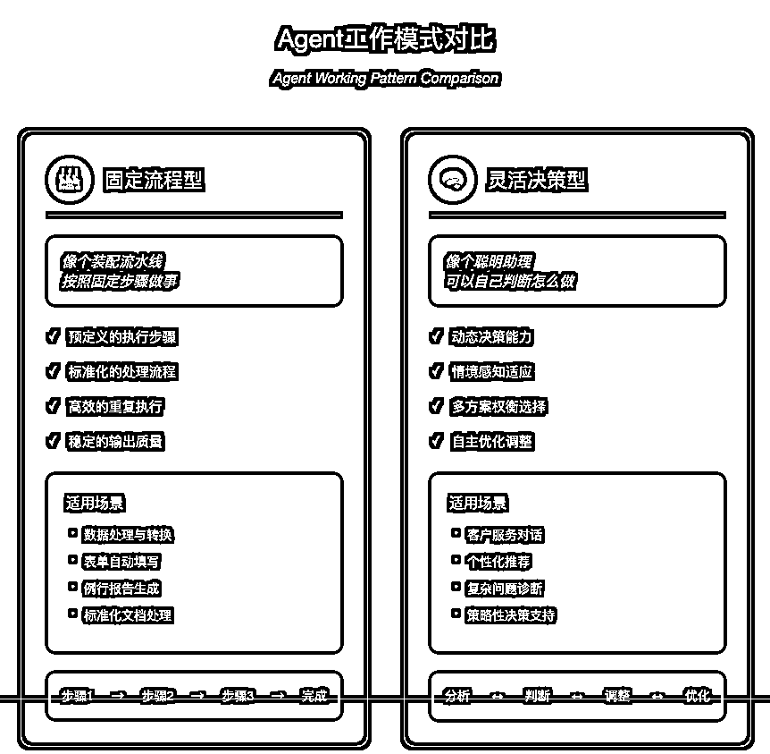
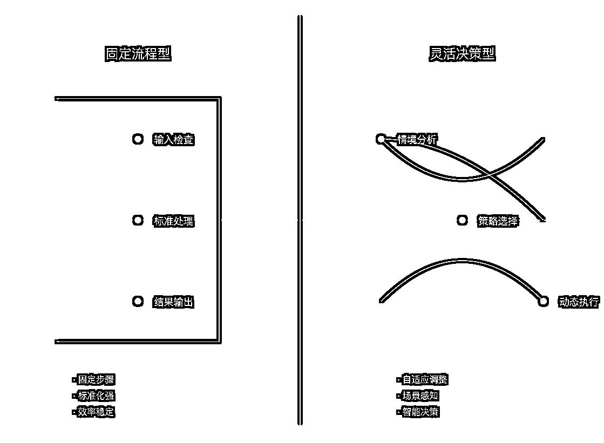
#### 动手前，先问自己一个问题
这件事真的需要动用 Agent 吗？
很多工作，你用一段清晰的提示词，加上几次简单确认就能完成，没必要专门搭一套系统。
#### 由此得到的启发
**胆子可以大一点，别被框架唬住**
```
你不需要懂编程
就像用微信，
不需要懂代码一样
```
**从最小可行方案起步**
```
先学会写好提示词
这是最重要的基础
```
**一步一个脚印去升级**
```
- 先掌握基础对话
- 再学习任务设计
- 最后尝试流程优化
```
#### 给 AI 玩家的一些建议
```
1\. 专注提示词质量
而不是复杂技术
2\. 理解基础概念
不用钻研技术细节
3\. 多做实际尝试
从实践中学习
```
**来一个具体场景**
```
不要这样：
"我要用最新的Agent框架
来实现自动化办公"
而是这样：
"让我先把基础对话学好，
写出清晰的提示词，
一步步提升效果"
```
**最值得记住的一句话**
```
简单 > 复杂
实用 > 完美
循序渐进 > 一步到位
```
不要把精力耗在底层原理上。
你需要专注三件事：
- 怎么把需求描述得精准
- 怎么让 AI 按你的思路去推进
- 怎么判断产出能不能直接使用
这正是 Anthropic 想强调的：一辆车好不好，看的不是引擎盖下有多少管线，而是开着顺不顺手。
* * *
### 解读二：给 Agent 打好地基
#### 原文
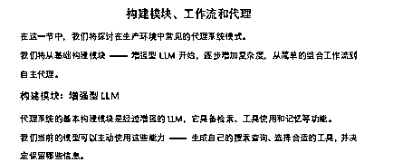
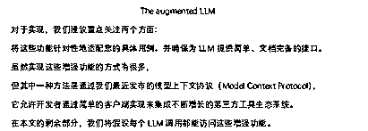
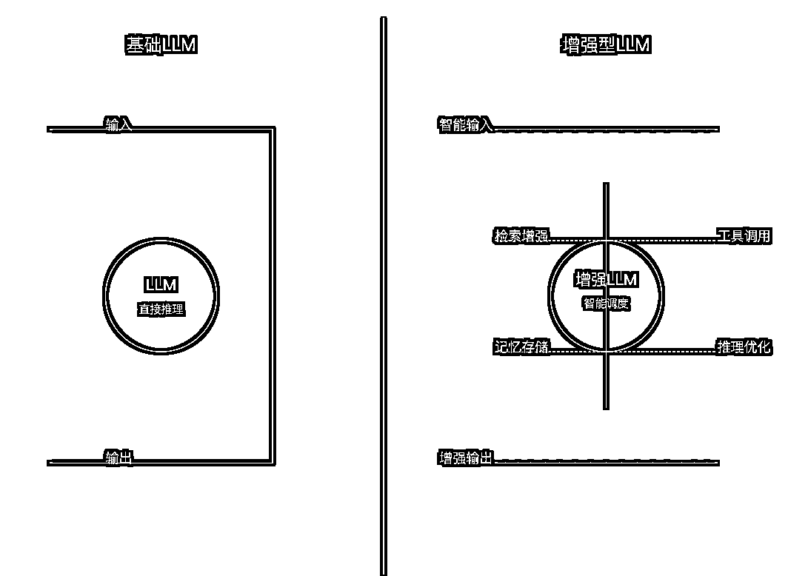
#### 说人话
你可以把 Agent 的构建过程理解成带新人：先教会基本技能，再给工具，最后放手让它独立作业。
**初始技能点**
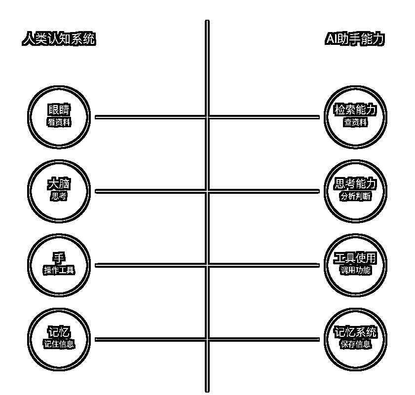
```
就像人类需要：
- 眼睛(看资料)
- 大脑(思考)
- 手(操作工具)
- 记忆(记住重要信息)
AI助手也需要：
- 检索能力(查资料)
- 思考能力(分析判断)
- 工具使用(调用功能)
- 记忆系统(保存信息)
```
**工作方式**
```
1\. 主动学习
- 知道该查什么
- 会用对的工具
- 记住重要内容
2\. 独立判断
- 不用事事请示
- 懂得灵活处理
- 记录关键信息
```
**设计上的关键**
```
不用关心技术细节
只需要知道：
1\. 目的很简单
让AI更懂你的需求
2\. 方法很直接
给AI合适的工具
3\. 效果很实用
AI能自主完成任务
```
**普通版与增强版对比**
左列是未做增强的 AI，右列是接上工具集之后的 AI：
```
你："帮我查下最近的AI新闻"
AI："抱歉，我不能上网查询"
```
```
你："帮我查下最近的AI新闻"
AI：
- 自动搜索新闻
- 总结重要内容
- 保存关键信息
- 使用合适工具
```
**从实用角度看**
```
1\. 清楚表达需求
告诉AI你要什么
2\. 了解AI能力
知道它能做什么
3\. 合理安排任务
不要期待太复杂
```
**一个比较好懂的类比**
```
基础版：
只会简单对话
增强版：
- 会查资料
- 会用工具
- 会记笔记
- 会主动思考
```
这就像给 AI 外接了一整套装备：原本它只会对话，现在它还能查资料、调软件、读文档。你能通过自然语言，让它完成一系列实际动作。
**给玩家的实操建议：**
先弄明白 AI 天生就会做什么；
再扔给它一些小目标，让它在安全区里练手；
最后再慢慢加压，试着挑战更复杂的任务。
**一句话要领：**
我们不是要打造一台炫技机器，而是要培养一个懂你习惯、能替你扛事的伙伴。
* * *
### 五种协作模式：接力、分流、并发、调度、闭环
#### 原文
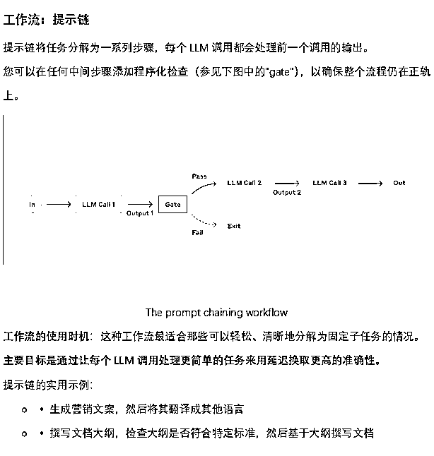
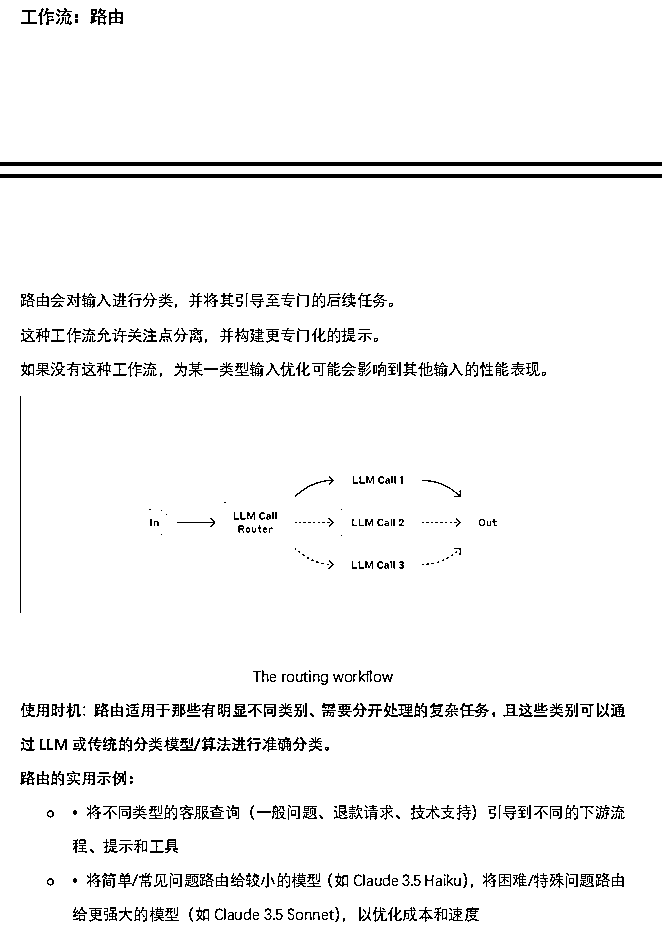
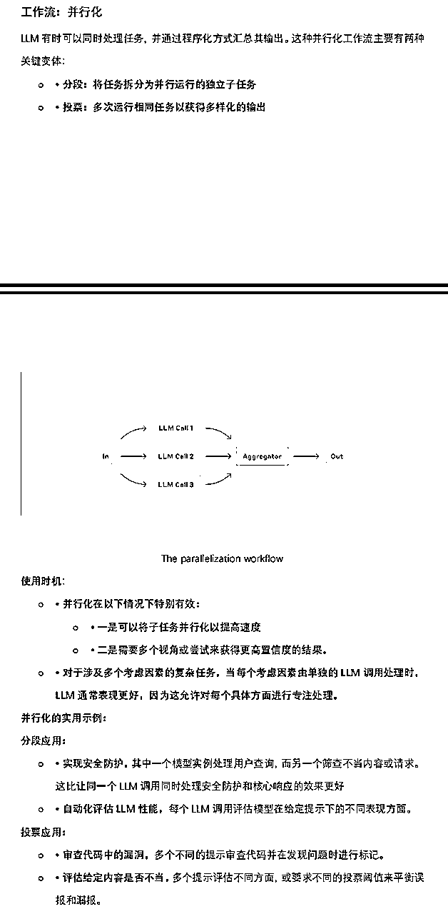
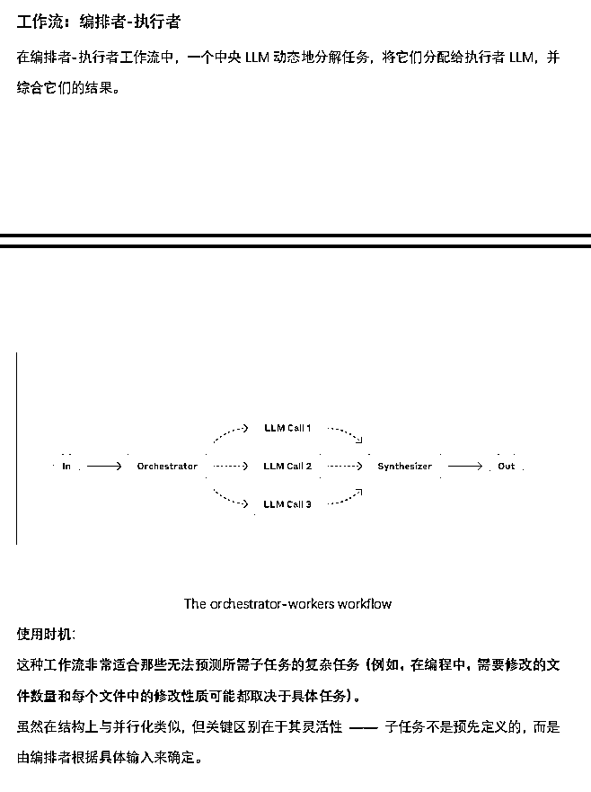
#### 说人话
这五种模式，可以对应一个小部门里的不同分工。
**模式一：接力链**
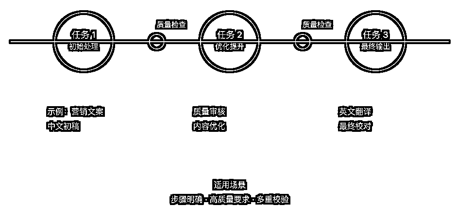
好比田径接力赛，每一棒都有明确任务：
- A 完成阶段性输出
- B 接着处理
- C 再做汇聚
```
例子：写营销文案
第一棒：写中文初稿
第二棒：检查质量
第三棒：翻译成英文
```
用在哪里？凡是步骤之间有先后依赖关系的任务，都适合。
```
- 任务步骤明确
- 每步都要检查
- 需要高准确度
```
**模式二：智能分流**
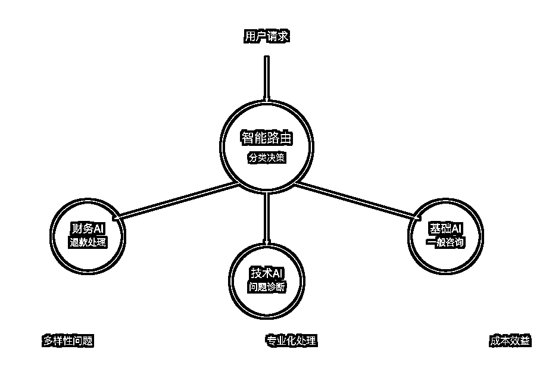
好比酒店前台，先判断来客是什么类型，再领到对应的楼层或柜台。
```
例子：客服系统
- 退款问题→财务AI
- 技术问题→技术AI
- 普通咨询→基础AI
```
用在哪里？不同类型的问题需要不同处理通道的时候。
```
- 问题类型多样
- 需要专业处理
- 要控制成本
```
**模式三：并发并行**
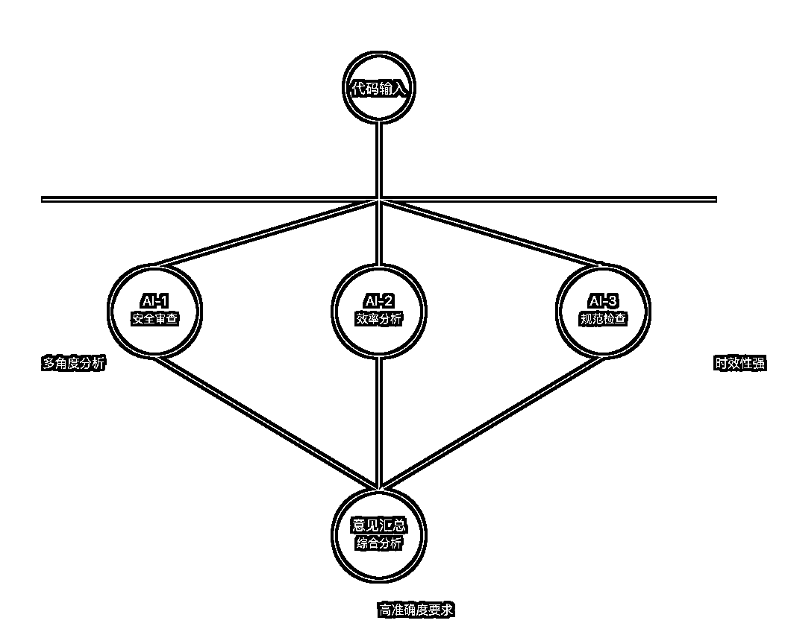
好比同时开几个小组做交叉评审，一个任务拆成多块，多个视角同时往前推。
```
例子：代码审查
- AI-1检查安全性
- AI-2检查效率
- AI-3检查规范
最后汇总意见
```
用在哪里？任务量比较大，需要快速产出覆盖大部分情况的草稿时。
```
- 需要多角度看问题
- 时间很紧急
- 要求高准确度
```
**模式四：中央调度**
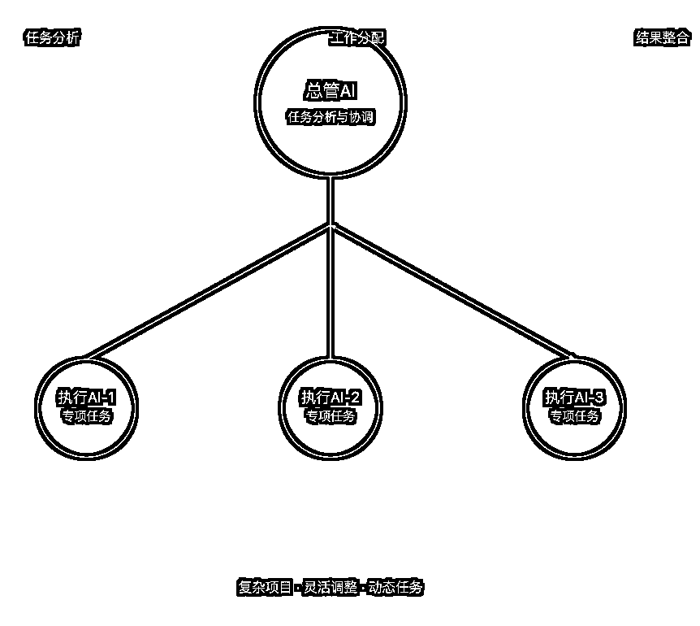
好比项目负责人把任务拆解开，分派给不同组员，再统一收回成果。
```
例子：编程项目
总管AI：
- 分析整体任务
- 分配具体工作
- 整合所有结果
执行AI：
- 专注单个任务
- 报告完成情况
```
用在哪里？需要多角色配合、由中心节点做统筹汇总的场景。
```
- 复杂项目
- 需要灵活调整
- 任务不固定
```
**模式五：评审循环**
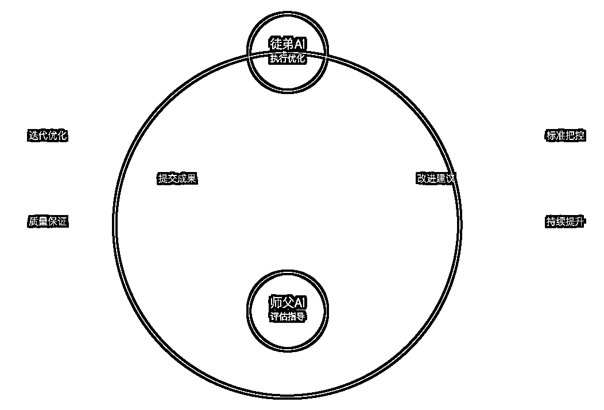
好比老手带新人：新人先出初稿，老手给批注，新人再按批注修改，如此反复。
```
例子：写文章
徒弟AI：写初稿
师父AI：提供修改建议
徒弟AI：改进完善
循环直到满意
```
用在哪里？对交付质量有较高要求、可以接受多轮打磨的内容。
```
- 需要高质量
- 可以反复优化
- 有明确标准
```
#### 怎么选出最合适的那一款
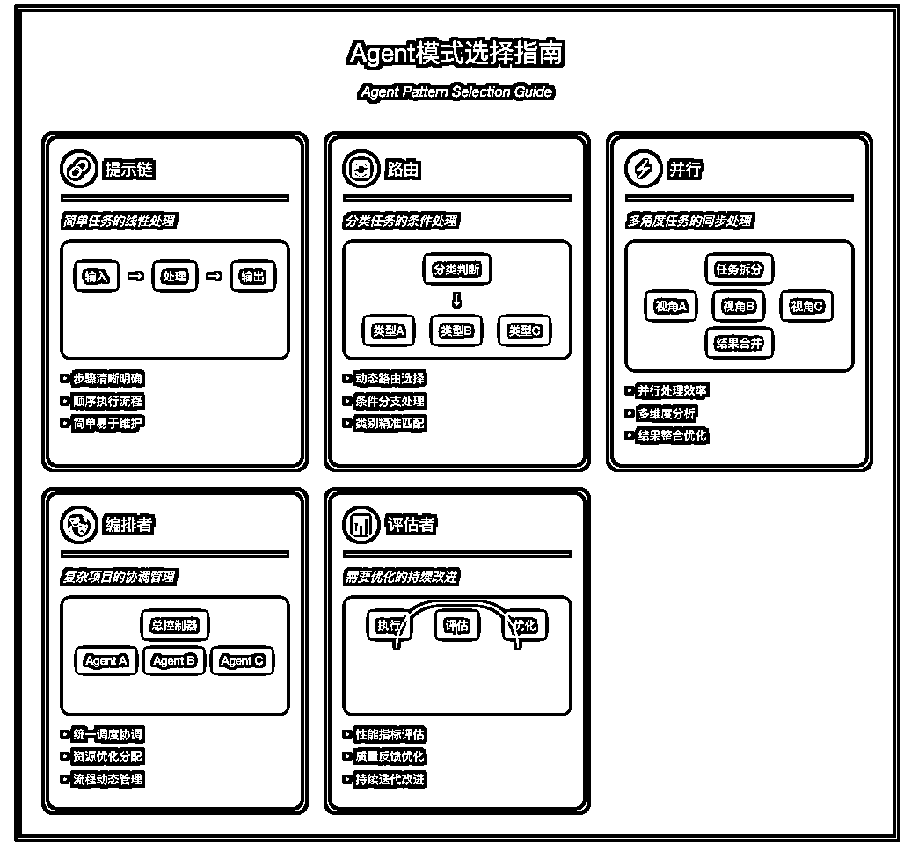
```
简单任务：用提示链
分类任务：用路由
多角度任务：用并行
复杂项目：用编排者
需要优化：用评估者
```
#### 实践过程中有什么要注意的
```
- 从简单开始
- 逐步加复杂度
- 多测试效果
```
#### 特别提醒
```
- 不是越复杂越好
- 要符合实际需求
- 考虑成本效益
```
#### 最容易上手的用法
```
写文章：提示链
客服：路由分配
代码审查：并行
大项目：编排者
内容优化：评估者
```
* * *
### 进阶话题：Agent 的完全体长什么样
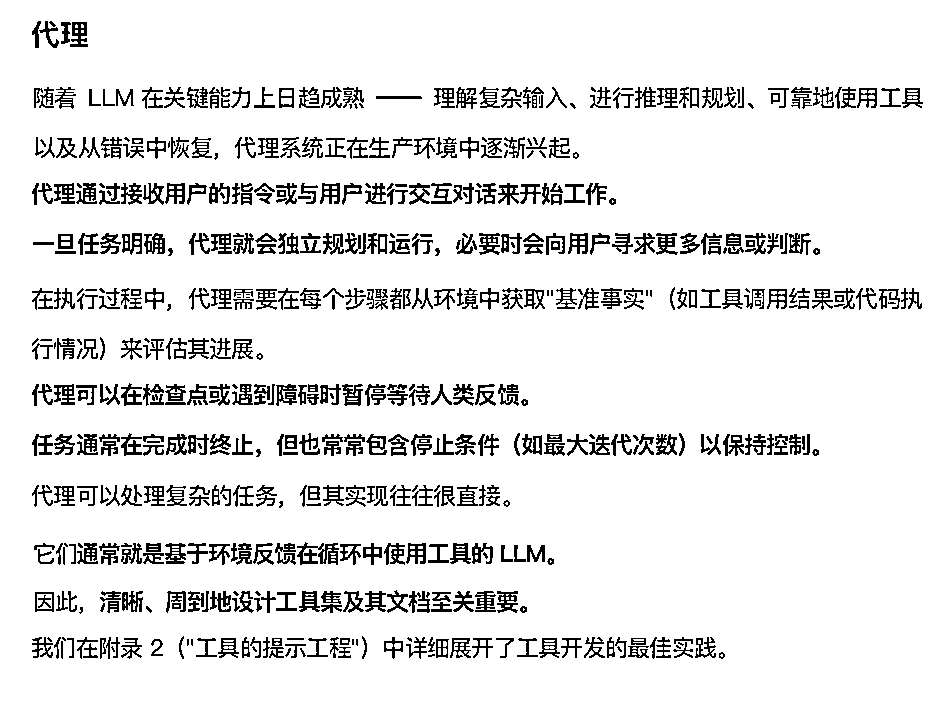
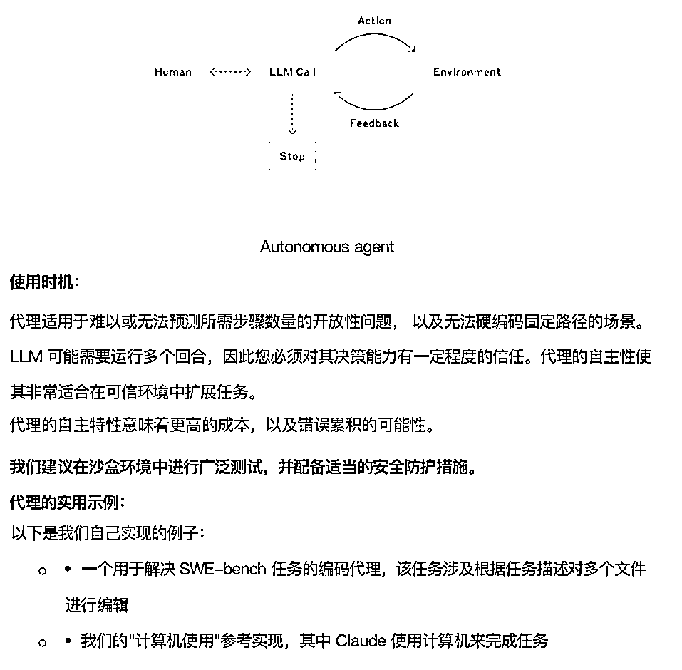
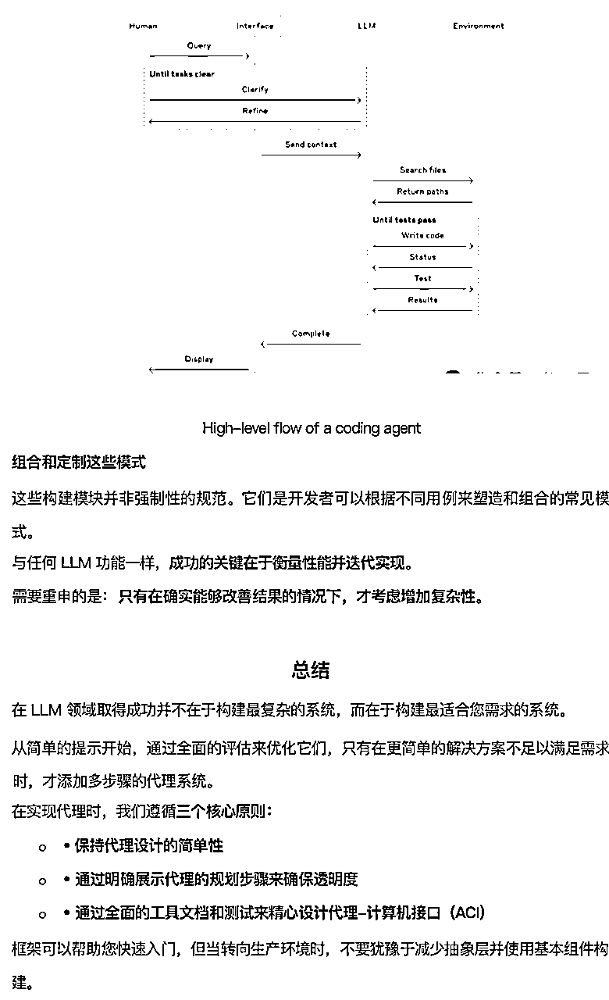
#### 说人话
到了这个层级，Agent 已经可以独立执行一整条任务链，并根据反馈不断调整自己的动作。你可以把它当成一位全权负责的远程管家。
**运行方式**
```
就像一个独立员工：
1\. 接收任务
2\. 自主规划
3\. 独立执行
4\. 遇到问题会请示
5\. 完成后汇报
```
**更直观的类比**

```
普通AI：
像个听命令的机器人
按固定步骤执行
代理AI：
像个聪明的助手
- 会思考怎么做
- 会使用工具
- 会请教问题
- 会调整方案
```
**一个具体案例**
以代码生成工具为例：
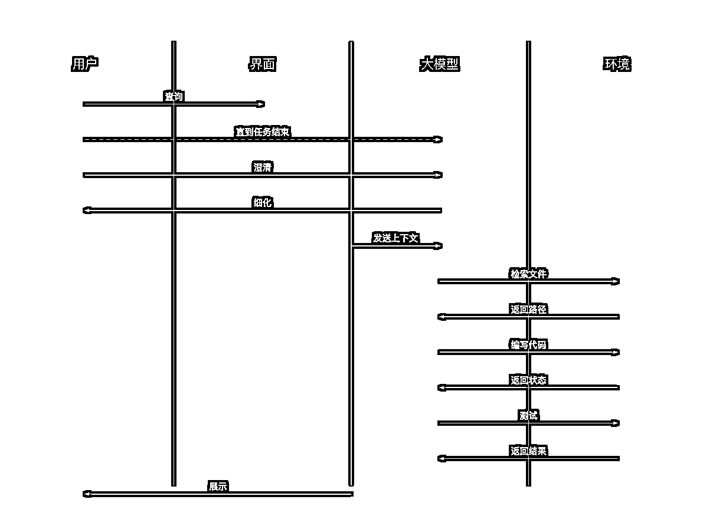
```
任务：修改代码bug
工作过程：
1\. 分析问题
2\. 查看相关文件
3\. 设计解决方案
4\. 测试修改效果
5\. 如有问题就调整
```
**这套系统有几处亮点**
- 自主性：不需要你每一步都给指令 ```
- 自己做决定
- 自己找工具
- 自己解决问题
```
- 自我迭代：能根据执行结果修正下一步 ```
- 知道什么时候该问人
- 了解自己能力边界
- 会总结经验教训
```
- 安全边界：遇到越界或异常时会主动停下 ```
- 有最大执行次数
- 重要决定需确认
- 可随时暂停
```
#### 什么时候值得用
最匹配的情况：
```
- 开放性问题
- 步骤不固定
- 需要灵活应对
```
不建议硬上的情况：
```
- 高风险任务
- 零容错要求
- 严格时间限制
```
#### 给新手的建议
```
1\. 先在安全环境测试
比如：模拟环境
2\. 从小任务开始
比如：简单文件整理
3\. 渐进式增加难度
比如：逐步加复杂任务
```
#### 两个不得不防的坑
成本支出：
```
- 运行时间长
- 资源消耗大
- 需要权衡收益
```
错误处理：
```
- 可能累积错误
- 需要及时纠正
- 要有备用方案
```
#### 不同复杂度任务的选用参考
轻量任务：
```
- 文件整理
- 信息汇总
- 基础数据分析
```
重度任务：
```
- 代码开发
- 项目管理
- 研究分析
```
* * *
### 最后
Anthropic 这份指南真正的落脚点，是一个我们常挂在嘴边又常常做不到的道理：少即是多。
不是每件事都必须上重武器。
多数日常问题，轻量工具完全能搞定。
许多看着难啃的硬骨头，拆开以后往往只需要三步。
一根绳子不必装定位器，一把剪刀也不用联网。
在你不需要的地方做加法，反而会拖住自己。
克制，是更高级的聪明。
好用，才是第一原则。