# ChatGPT任务指令万能模板：简单好用的BRTR原则(学习AI必备教程)
你有没有过这样的体验？
刷到别人用ChatGPT写方案、做PPT、写小红书文案，效率高得飞起，自己也兴冲冲打开对话框，结果输入一句“帮我写一篇文案”，等来的却是连自己都看不下去的AI味十足、空洞无物的大白话。
问题出在哪里？不是你不行，而是你根本“没把话说清楚”。
ChatGPT就像一个全能的实习生，智商没得说，但它不了解你、不懂你的行业，更不知道你想要什么样的结果。你不把背景交代清楚、不把角色定清楚、不把任务说清楚、不把要求列清楚，它就只能凭感觉“自由发挥”。
很多AI高手早就在用的方法，其实就藏在日常人与人之间的沟通里。
你可以回想一下：
在家时，你是不是通常会说——今天外面热得不像话，我嗓子都冒烟了（交代背景），老公（定义角色），你下班带个西瓜回来呗（派任务），挑无籽的，别买太大的，三斤左右就行，顺手让摊主挑个甜的（提要求）。
在公司也一样——
七夕活动马上要上了，需要一波公众号推广拉新（背景），小陈（角色），你来写这篇推文（任务），五六百字就行，把预约权益写清楚，风格活泼一点，明天下午3点前给初稿（要求）。
发现没有？一个能被顺利执行的指令，无非包含四样东西：背景、角色、任务、要求。
这就是“BRTR”原则——一套给ChatGPT派活的万能指令框架。
- 说背景（Background）：把你为什么做这件事、当前遇到的问题、自己的想法讲清楚；
- 定角色（Role）：给AI一个身份，比如“资深营养师”“顶级商业顾问”“小红书爆款操盘手”，让它在某个领域里思考；
- 派任务（Task）：简明扼要地告诉它该做什么、主题是什么、目标是什么；
- 提要求（Request）：字数、风格、结构、格式、参考案例、流程步骤……凡是你能想到的约束，都给它列上。
这套框架就好比给接班的人写交接文档，交代得越清楚，对方干得就越稳。
我拿“制订ChatGPT学习计划”来举个例子吧——
背景里我注明了自己没有技术底子，于是它在课程设计时，会特意把“计算机科学基础”补进来；要求的环节我跟它讲“先列大纲，再按章节展开”，它也乖乖照做。
你看，它其实不是理解力不行，是得看你怎么说。
当然，BRTR里的要素不一定要全都上，完全可以按需拼装：
简单任务，只要“任务+要求”甚至光一个“任务”就够；常规操作，用“背景+任务+要求”的BTR就很好使；想要更专业领域的回答，用“角色+任务+要求”的RTR模式也能打得通。
写指令时，格式上也不用太拘束——你可以像发微信一样自由表达，也可以加上“背景：”“角色：”“任务：”“要求：”这种前缀，更稳的建议是分模块写，用【】，一目了然，方便后续修改。
要素挑选方面，内容标准、参考示例、输出格式、流程规则这四点，是让输出质量拉开差距的关键。
比如让它写小红书文案，你可以要求它“口语化、多用emoji、分点罗列、带标签、不超过500字”；让它写标题，直接把爆款标题的方法丢给它当参考，它学起来特别快；让它输出表格、Markdown、JSON，只要说清楚，它都能照做；需要它分步骤陪你互动，比如“你先问我主题，我告诉你后再出5个标题，我选定一个你再开写”，它就能按流程走得不差分毫。
当然，如果你是资深玩家，完全可以让ChatGPT自己生成指令——我用这套BRTR原则做了一个“ChatGPT指令生成器”，你只管填场景，它一键帮你把指令模板搭好，省心省力。适合入门时参考，具体场景还是得自己微调打磨。
访问地址：https://ai.gptprompts.com.cn
再提醒一句：GPT-3.5和GPT-4.0的能力差距还是挺大的，任务重要、要求高，建议直接上4.0。
归根结底，BRTR这套方法不只是一个提示词模板，它更像一种思考习惯——是在逼你自己把事情想明白：我为什么要做这件事？我期待什么结果？我给的条件够不够？想明白了，说清楚了，AI自然能交出让你满意的活儿。
做完这些事，你可能会发现，问题已解决了一半。

我是台风，一名AI魔法师，也是《ChatGPT产品商业俱乐部》的创始人，公众号矩阵粉丝接近两万。曾做过腾讯员工、电商创业公司产品合伙人，后来放弃几百万的股份，全职投入AI赛道。
我做过几款小有名气的应用，比如AI佛祖、AI律所，日访问量上万，也吸引过王小川等圈内大咖和投资人的注意；参与过多本AI行业书籍的案例编写；目前是龙哥盟GPT航海教练，也是肖厂长AI提示词高手联盟成员。
如果你对ChatGPT产品应用实战感兴趣，或者有商用部署、企业培训方面的需求，欢迎来聊聊。
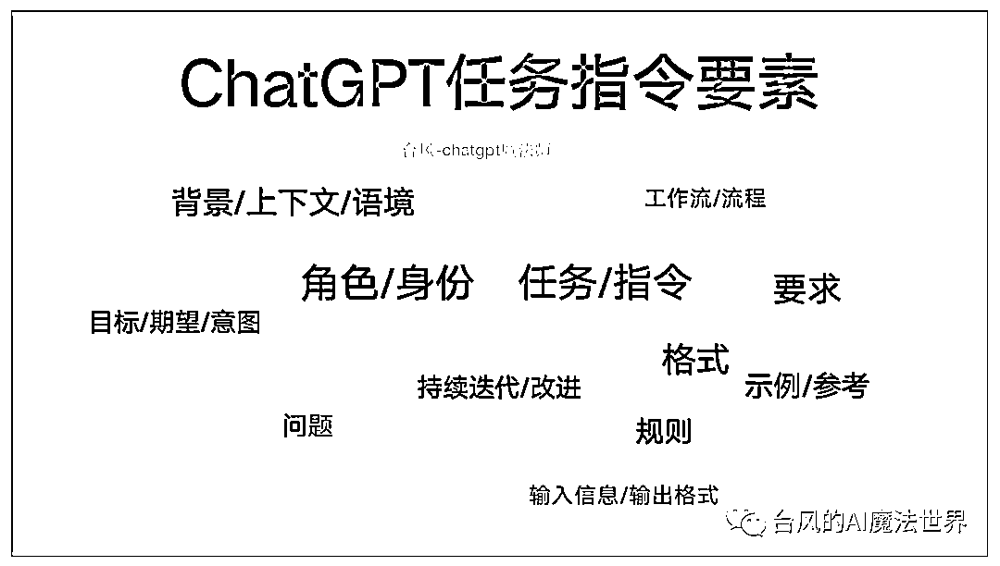
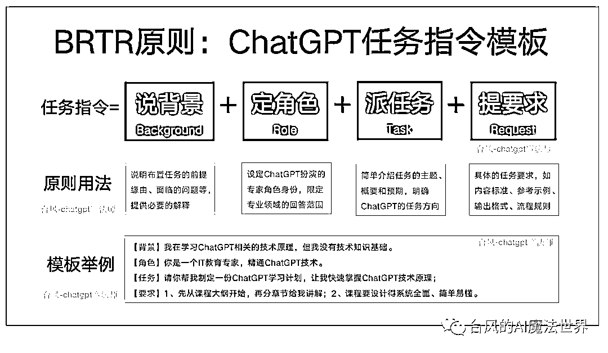
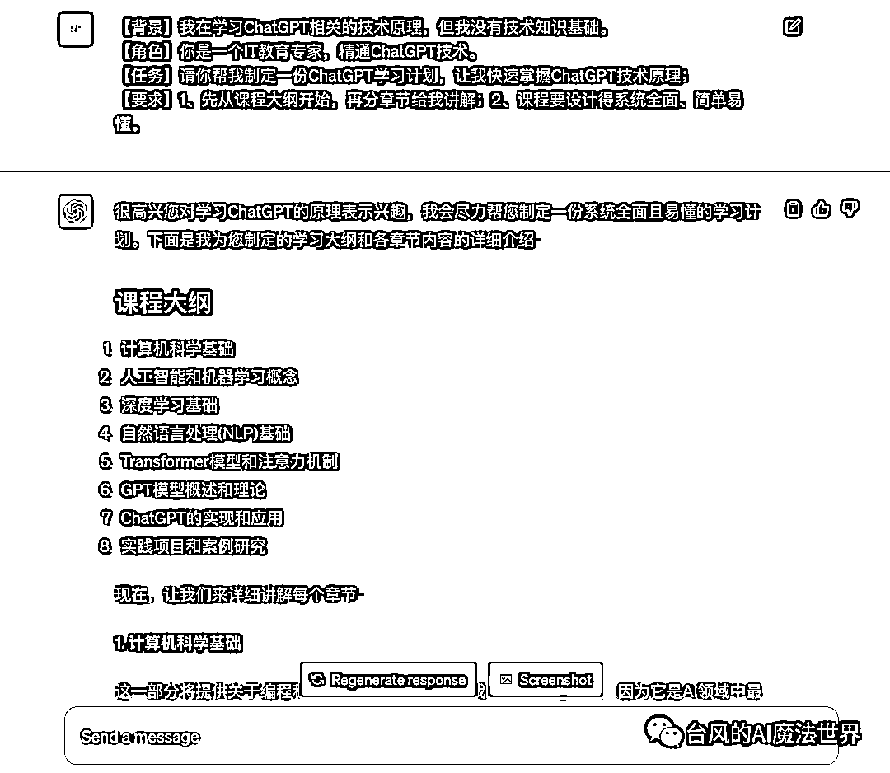
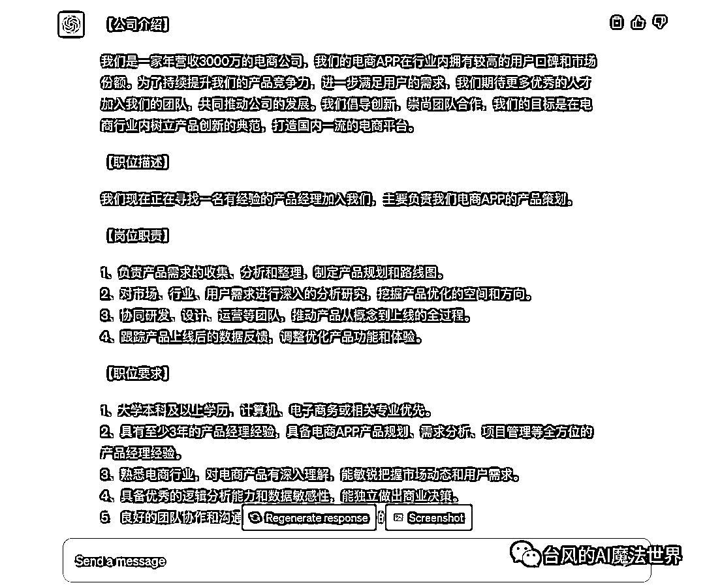
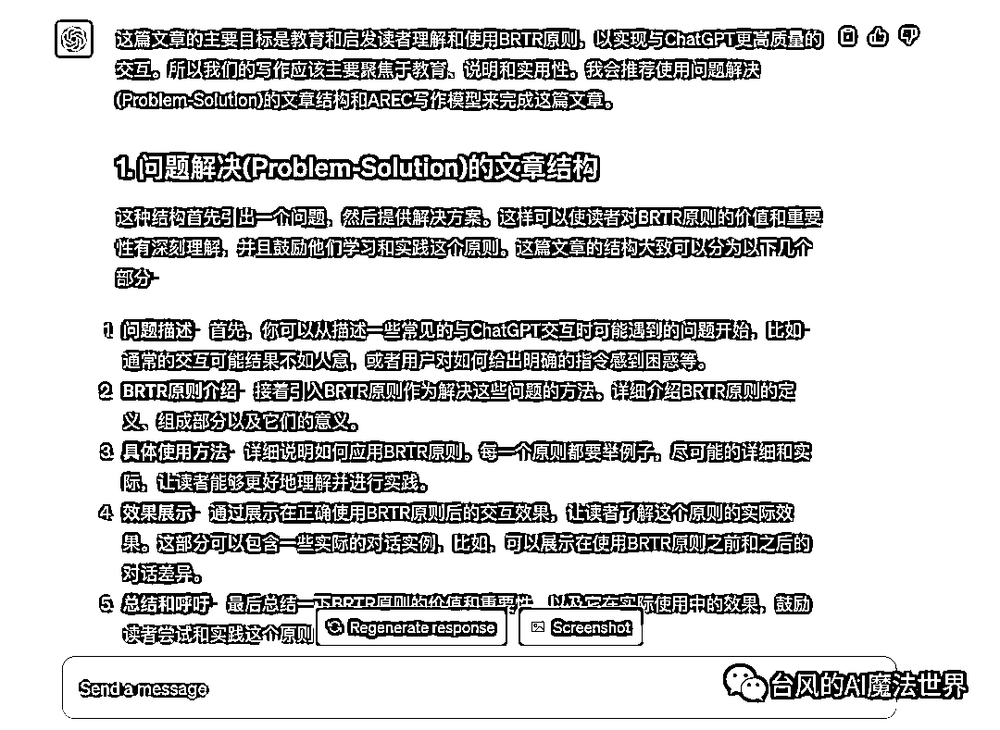
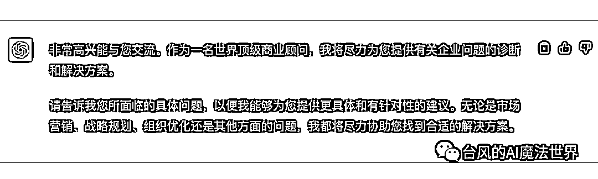
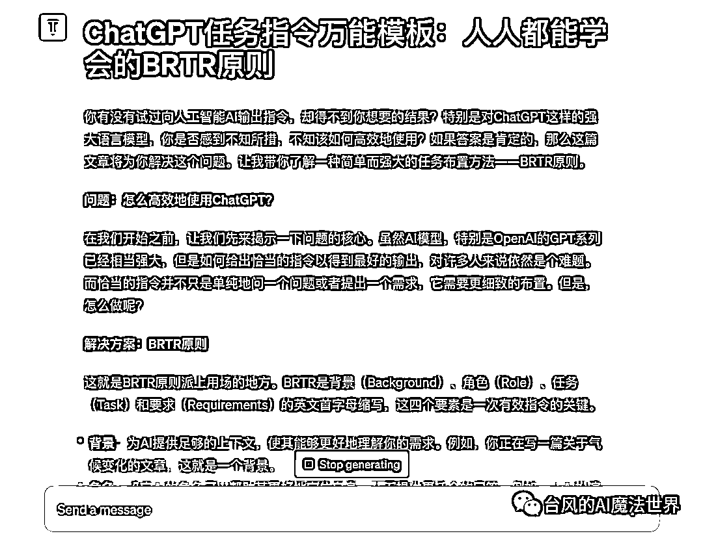
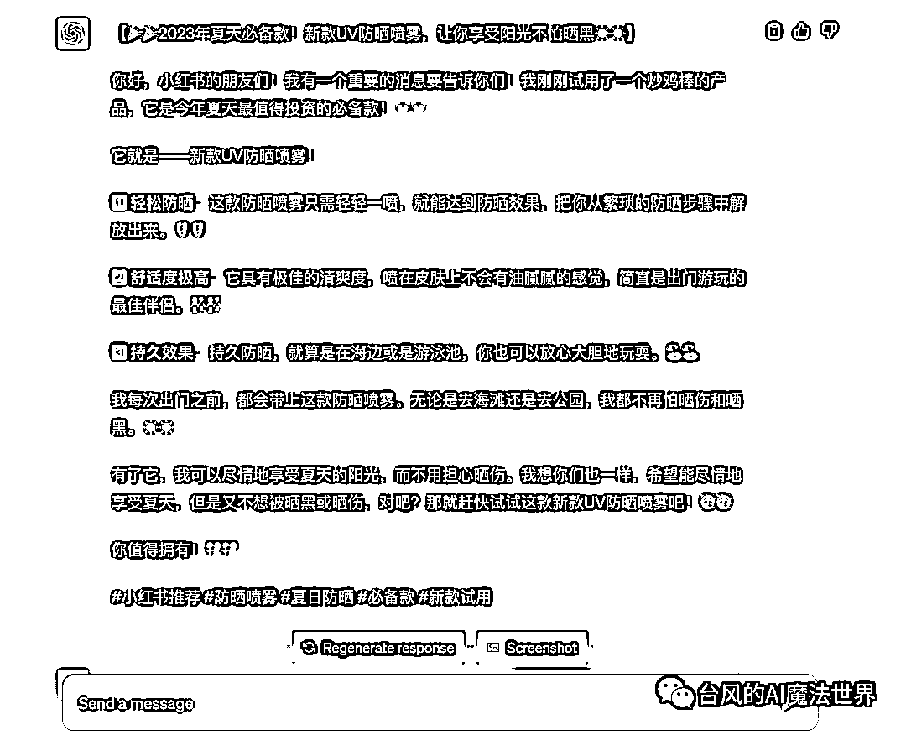
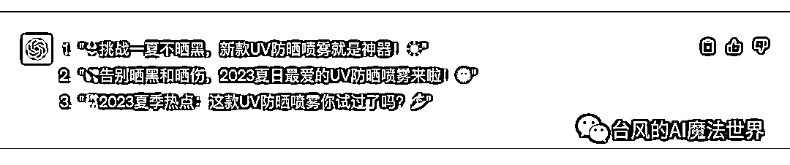
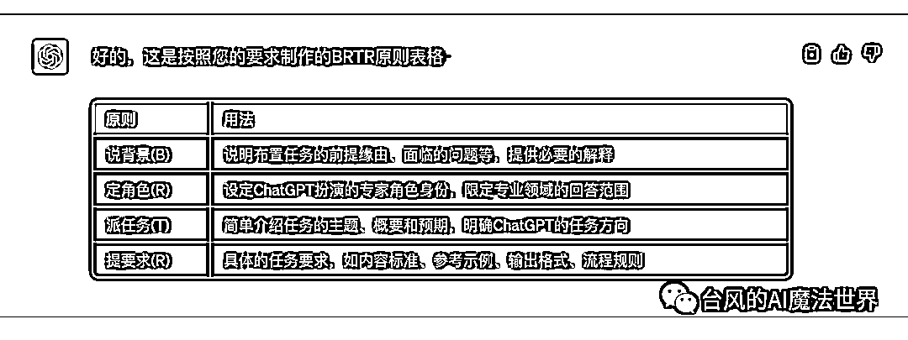
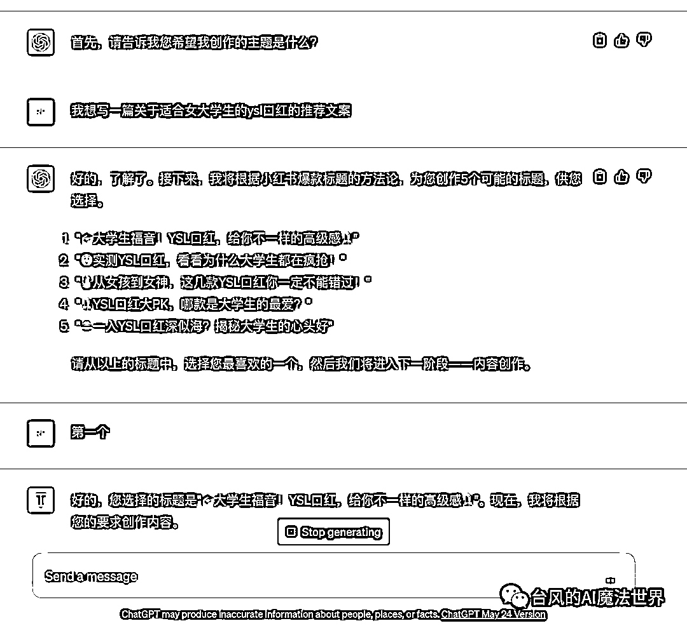
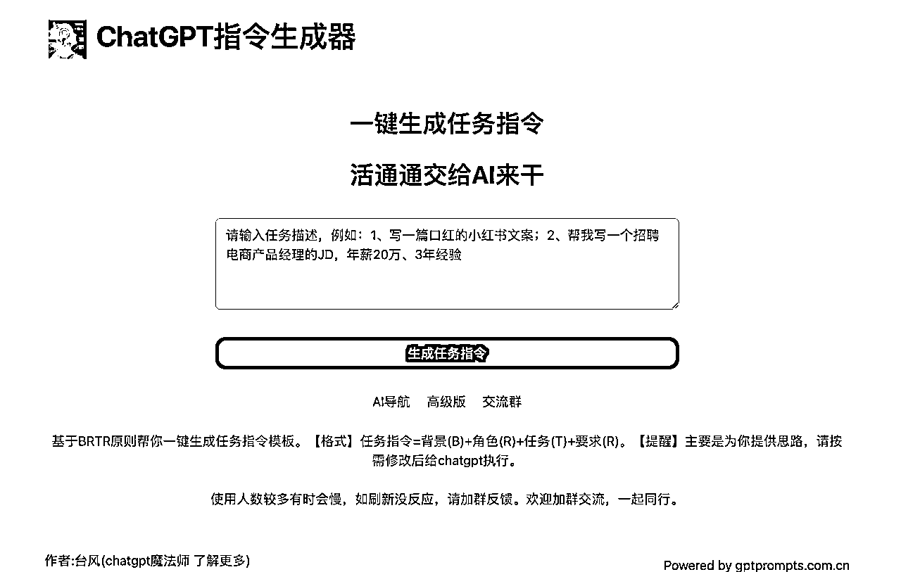