# Claude Code 实战上手指南
# 安装与启动 Claude Code
这一节会手把手带你把 Claude Code 装好并跑起来，几分钟内就能开启 AI 编程体验。
## Claude Code 的四种接入方式
方案一：官方正版渠道
*   优点：
*   功能最完整： 所有能力都能直接用，体验最纯粹。
*   缺点：
*   网络门槛高： 国内环境直连官方服务，通常需要处理网络连通问题。
*   套餐价格偏高： 入门20刀套餐无法调用 opus4 模型，处理复杂项目半小时左右费用就会耗尽，需要等待配额恢复。
* * *
方案二：Claude Code + Kimi V2 / 智谱 GLM4.5
属于“平替”玩法，通过改写环境变量把 Claude Code 的后端切换到 Kimi V2 模型。
*   优点：
*   上手极快： 只需要配置几个环境变量，不用动源码，操作很省心。
k imuV2配置：
```
export ANTHROPIC_BASE_URL="https://api.kimi.com/v1/anthropic"
export ANTHROPIC_API_KEY="sk-your-kimi-key"
# 然后再启动 claude
claude
```
智谱GLM4.5配置：
```
export ANTHROPIC_BASE_URL=https://open.bigmodel.cn/api/anthropic
export ANTHROPIC_AUTH_TOKEN="your bigmodel API keys"
# 然后再启动 claude
claude
```
功能兼容度不错： IDE 集成、代码编辑、Git 操作等核心功能基本可用。
*   缺点：
*   计划模式失效： Claude Code 的 Plan 模式在该方案下无法使用。
*   能力有落差： 实测开发水平大约只有 claude4 模型 70% 左右。
*   使用成本： Kimi 开发者平台需要充值 50 元起用，复杂项目消耗会比较快。
* * *
方案三：Claude Code + 第三方镜像站
市场上存在一些服务商，他们用自有高额度官方账号搭建镜像中转，用户借助其通道使用 Claude Code。
*   优点：
*   即装即用： 安装后登录即可，配置工作量小。
*   网络更通畅： 规避了直连官方的网络障碍。
*   缺点：
*   稳定性存疑： 镜像站使用的 200 刀账号存在被封风险，服务可能不稳定。
* * *
方案四：魔改源码 + 任意 API
*   优点：
*   极致自由： 可以接入 GPT-4、Gemini、Kimi、DeepSeek 等任意厂商 API，自由对比不同模型在 Claude Code 中的表现。
*   缺点：
*   门槛很高： 需要具备编程和调试能力，并且愿意花时间去折腾源码。
## 安装 Claude Code
### 第一步：打开终端
我们后续所有操作都要在“终端”里完成。
1.  Windows 用户：
1.  同时按下 Win + R 打开“运行”窗口。
1.  输入 powershell 回车，进入 PowerShell 窗口。
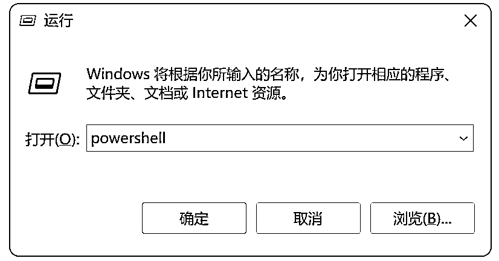
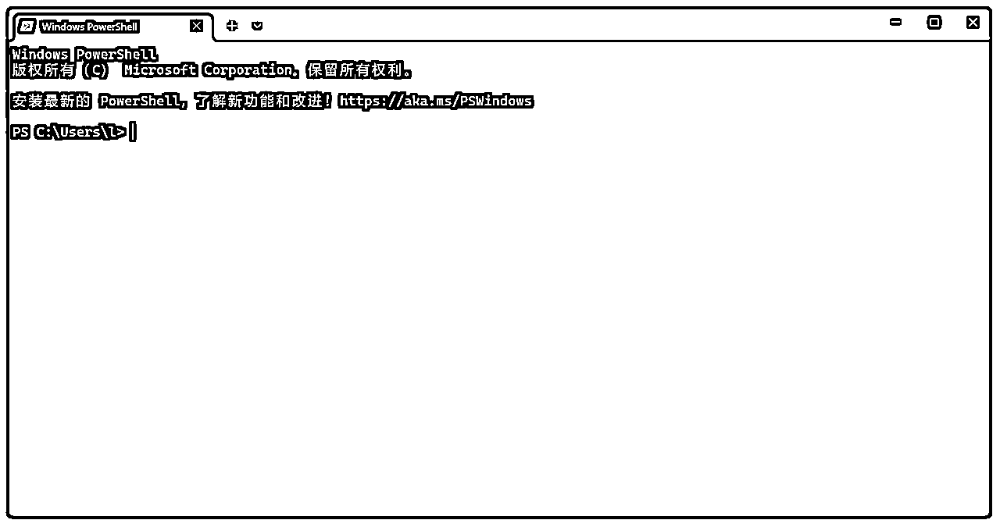
1.  macOS 用户：
1.  同时按下 Command ⌘ + 空格键，调出 Spotlight 搜索框。
1.  输入 Terminal。
1.  在结果中点击“终端”打开。
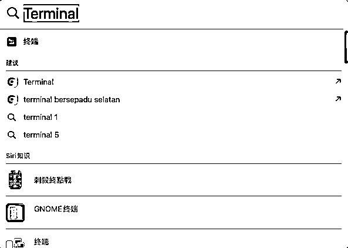
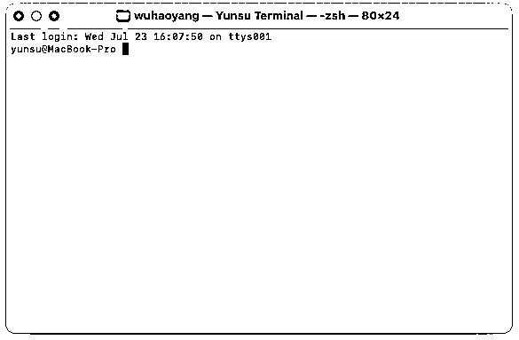
### 第二步：准备运行环境 Node.js
Claude Code 运行在 Node.js 这个平台上，必须先确保平台可用。
1.  检查版本
打开终端，执行命令后回车：
```
node -v
```
1.  判断结果
*   若显示版本号 >= v18.x.x，例如 v22.17.0，说明环境已就绪，可直接跳到 1.3 节。
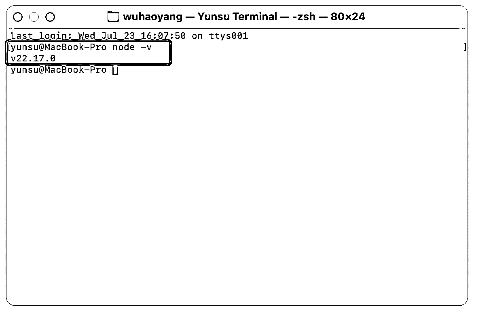
*   若提示 command not found 或版本低于 v18，请按下面步骤安装。
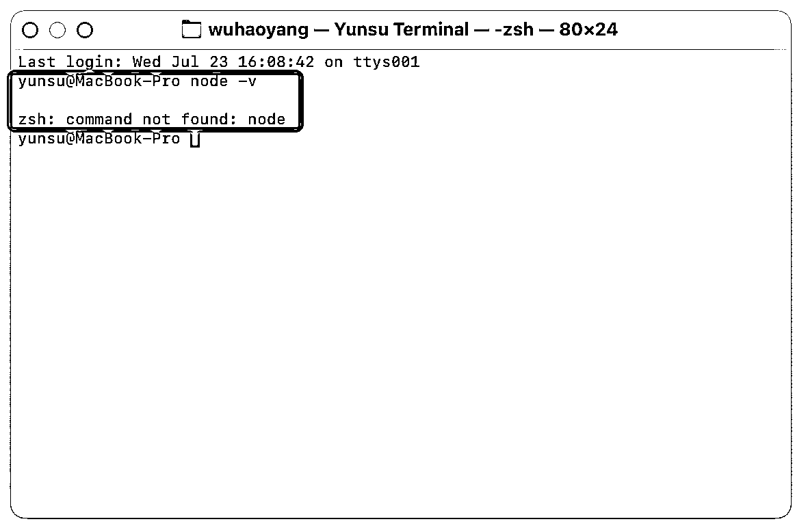
1.  安装流程
1.  访问官网： 在浏览器打开 Node.js 官方网站 https://nodejs.org/
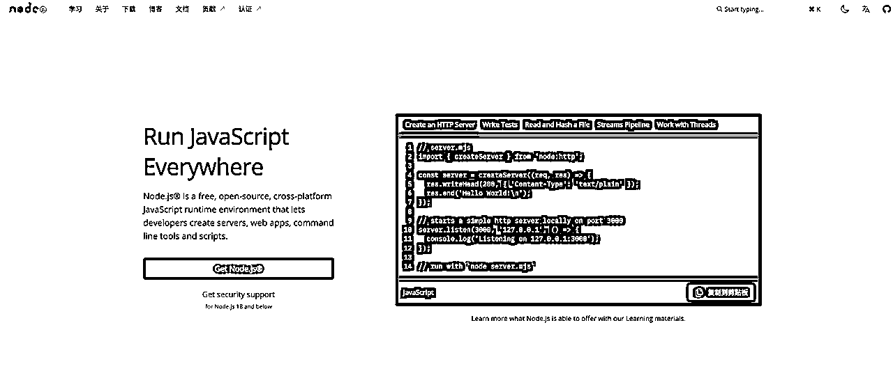
1.  下载包： 点击“GET Node.js”按钮，选择带有 LTS 标识的安装包下载。
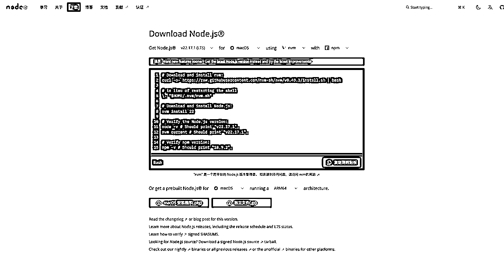
1.  运行安装： 双击下载文件，按普通软件安装流程一路下一步即可，保持默认设置。
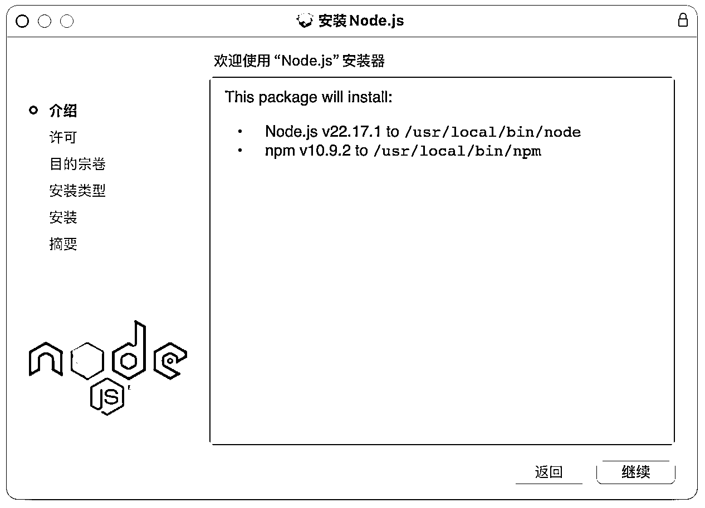
1.  验证安装：
*   完全关闭并重新打开终端，这一步很重要！！！
*   再次执行 node -v 回车。
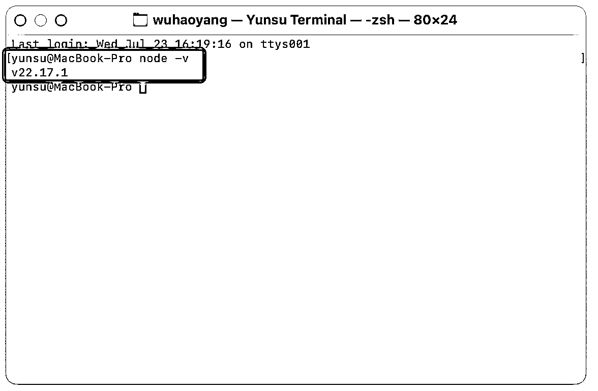
*   若能看到 v18 及以上版本号，说明底层环境搭建成功。
### 第三步：安装 Claude Code
1.  执行安装命令
在终端输入下方命令，回车执行：
```
npm install -g @anthropic-ai/claude-code
```
1.  等待完成
安装会从网络拉取文件，耗时取决于网速，几十秒到数分钟不等。终端回到命令提示符即代表安装完成。

若出现报错，可把终端内容复制给 ChatGPT 让它协助排查：
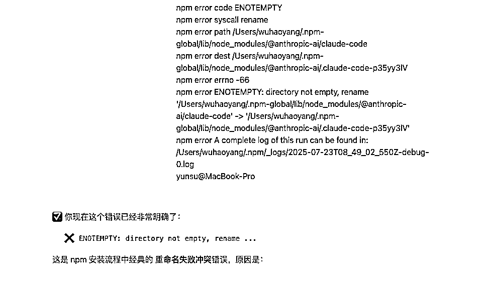
1.  安装校验
执行帮助命令确认安装是否成功：
```
claude -h
```
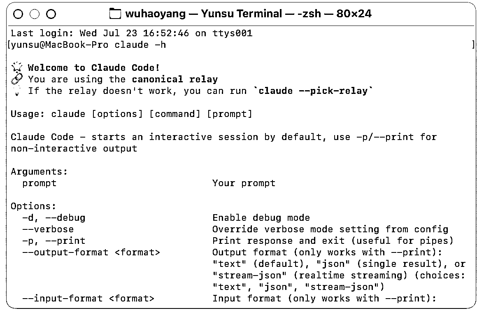
若输出一长串 Claude Code 用法说明而非 command not found，则说明 AI 编程助手已成功部署到本地。
## 启动 Claude Code
启动前先把项目文件夹定位好。
1.  输入 cd
*   打开终端，输入 cd 后加一个空格。
*   输入后不要按回车！！！
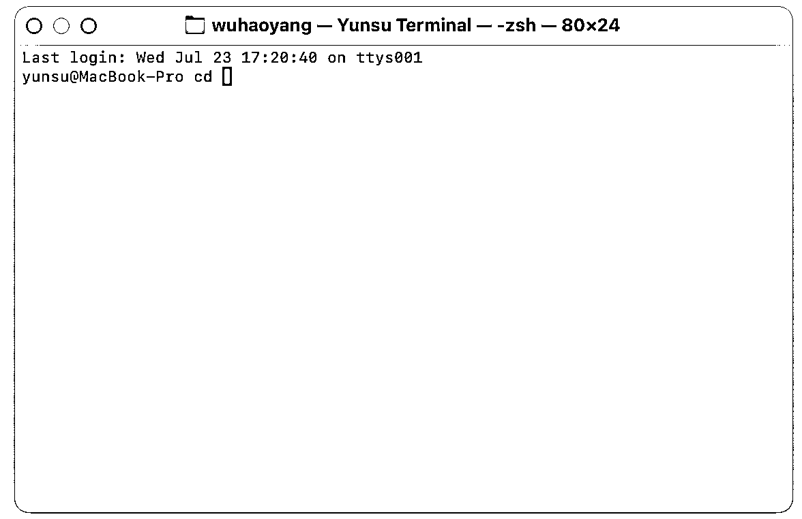
1.  定位项目文件夹
*   在桌面或文件管理器中，找到存放代码的项目目录，只需看到文件夹图标即可。
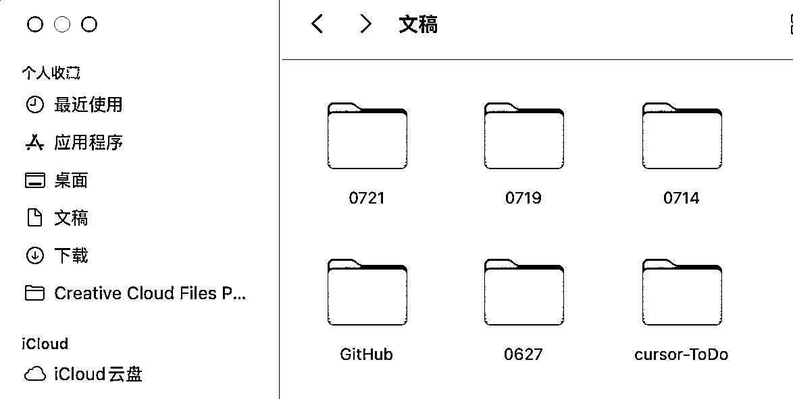
1.  拖拽定位
*   将文件夹直接拖拽到终端窗口。
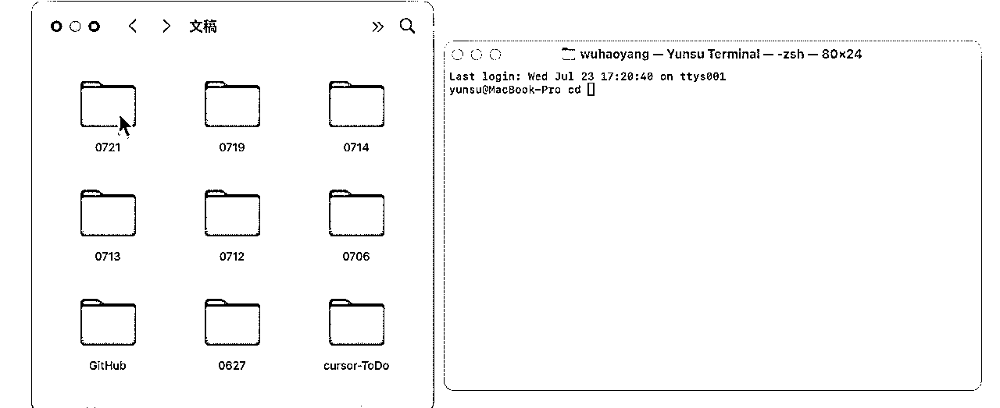
*   会自动在 cd 后面补全路径。
*   回车进入该目录。
1.  启动 Claude Code
*   在终端输入 claude 回车启动
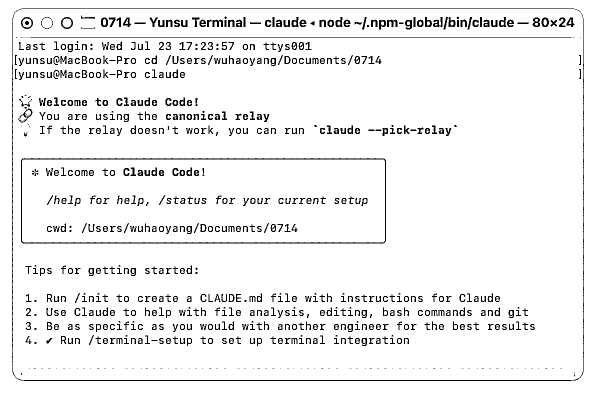
# Claude Code 指令速查手册
本章整理了 Claude Code 的常用指令，帮助你快速掌握操作方式。
## 核心对话控制
这些指令构成了与 Claude 流畅对话的骨架，负责会话的开启、延续、转换和收尾。
### 1. /help - 在线说明书
*   核心作用： 忘记指令时立刻调出。
*   功能说明： 输入 /help 回车，Claude Code 会列出所有可用斜杠指令及简要描述，是最可靠的入口帮助。
*   适用场景：
*   初次上手，想了解全部能力。
*   想用某个功能但记不住指令名。
*   示例：
```
> /help
# Claude会输出所有可用指令的列表：
# /add-dir - Add a new working directory
# /clear   - Clear conversation history and free up context
# /compact - Clear conversation history but keep a summary in context.
# ...
```
### 2. /clear - 清空上下文
*   核心作用： 一键擦除当前聊天记录，开启全新话题。
*   功能说明： 执行后当前会话的所有上下文都会被彻底清除，Claude 会完全忘记之前的对话。
*   适用场景：
*   切换到完全无关的新任务。
*   对话混乱、回答跑偏，需要重来。
*   示例：
```
# 你正在和Claude讨论一个CSS问题
> 把这个按钮的边框改成圆角吧。
> /clear
# (终端屏幕被清空，就像刚启动一样)
# 现在你可以开始一个全新的任务
> 帮我解释一下什么是 "git rebase"
```
### 3. /compact - 智能压缩总结
*   核心作用： 让 Claude 自己写“会议纪要”后丢弃细节。
*   功能说明： 这是 /clear 的进阶版。执行时会先让 AI 总结当前对话的核心要点保留下来，再清除具体细节。可用 /compact [自定义总结要求] 来指定总结方式。
*   适用场景：
*   长任务分阶段，进入下一阶段前做收敛。
*   上下文接近上限但不想完全丢失进度。
*   示例：
```
# 你和Claude刚刚确定了一个新功能的设计方案
> 好的，我们就用Redis缓存热门数据，缓存时间设定为5分钟。
# 现在要开始写代码了，先压缩一下上下文
> /compact
# Claude会输出一段总结：
# 好的，我已将我们的讨论压缩。要点：我们将为热门数据添加一个缓存层，
# 使用Redis实现，缓存有效期为5分钟。
# 现在，我们可以继续了。
# 此时，对话的细节被清除了，但核心结论被保留了下来。
> 现在，帮我编写实现这个Redis缓存的Python代码。
```
### 4. /resume - 恢复历史会话
*   核心作用： 加载之前的存档，续写未完成的工作。
*   功能说明： 执行 /resume 会弹出交互列表供你选择要恢复的对话。启动时用 claude -c 或 claude --continue 可快速恢复最近一次会话。
*   适用场景：
*   昨天的功能没做完，今天继续。
*   误关终端，想找回之前的对话。
*   示例：
```
> /resume
# 终端会出现一个可交互的列表，用方向键 ↑↓ 选择，回车确认
#
# Select a conversation to resume:
# > 1\. 2025-07-08 10:30 - "修复登录页面的CSS Bug" (5 messages)
#   2\. 2025-07-07 15:00 - "为用户模块添加数据库迁移" (28 messages)
#   3\. 2025-07-07 09:12 - "这个项目是做什么的？" (12 messages)
#
# (按回车后，选中的对话历史会完整加载进来)
```
### 5. /exit 或 /quit - 安全退出
*   核心作用： 结束会话，返回终端。
*   功能说明： 执行后 Claude Code 会完全退出到普通终端，也可用 Ctrl+D 快捷键达到同样效果。
*   适用场景：
*   当日工作结束。
*   暂时离开，需要关闭 AI 会话。
*   示例：
```
> /exit
# (Claude Code 程序退出)
# 你回到了你电脑的常规命令行
your-computer:~/your-project$
```
## 状态与诊断
这一组指令相当于仪表盘和自检系统，让你随时掌握 Claude 的运行状态。
### 1. /status - 实时体检报告
*   核心作用： 一目了然查看当前核心状态。
*   功能说明： 输出 Claude Code 版本、AI 模型、登录账号、API 连通性、IDE 集成等状态快照。
*   适用场景：
*   响应变慢，想排查网络问题。
*   确认当前是否在使用 Opus 模型。
*   检查 IDE 是否成功连接。
*   示例：
```
> /status
# Claude会输出一份详细的状态报告：
# Version: 1.7.0
# Model: claude-3-sonnet-20240229
# Account: user-xxxx@anthropic.com
#
# API Connectivity:
#   - Anthropic API: Connected
#
# Tool Statuses:
#   - IDE Integration (VSCode): Connected
#   - MCP Servers: 0 connected
```
### 2. /cost - 会话花费账单
*   核心作用： 查看本次聊天花了多少钱。
*   功能说明： 显示从启动或上次 /clear 以来累计的 token 消耗及美元估算，是成本管控工具。
*   注意： 退出或执行 /clear 后数据会重置。
*   适用场景：
*   复杂多轮对话后评估成本。
*   对比不同任务类型的开销。
*   示例：
```
> /cost
# Claude会输出本次会话的成本统计：
# Session Cost:
#   - Input Tokens: 12,345
#   - Output Tokens: 8,765
#   - Total Cost: ~$0.05 USD
```
### 3. /doctor - 一键系统自检
*   核心作用： 遇到异常时让 Claude 自己查病。
*   功能说明： 深度检查安装环境健康度，包括文件权限、依赖项、路径配置等，定位难以解释的错误。
*   适用场景：
*   启动失败或频繁崩溃。
*   文件操作等指令反复报错。
*   Node.js 等系统环境变更后验证兼容性。
*   示例：
```
> /doctor
# Claude会进行一系列的检查并输出结果：
# ✅ Node.js version check passed.
# ✅ Global npm package permissions look good.
# ✅ Configuration files found and readable.
# ✅ API connection successful.
#
# All systems healthy!
```
### 4. /release-notes - 版本更新日志
*   核心作用： 查看最近更新了什么。
*   功能说明： 显示最新版本的更新内容，包括 Bug 修复和新增功能或指令。
*   适用场景：
*   看到自动更新提示，想了解改动。
*   判断期待的功能是否已发布。
*   示例：
```
> /release-notes
# Claude会显示最新的更新日志：
# # Version 1.7.0 (2025-07-08)
#
# ## ✨ New Features
# - Added the /pr-comments command to fetch GitHub PR comments.
#
# ## 🐛 Bug Fixes
# - Fixed an issue where /compact would fail on very long conversations.
#
```
## 告别“金鱼脑”，打造 AI 的超级工作台
用过太多聊天机器人，是不是总觉得它们“转身就忘”？仿佛只有七秒钟的记忆，关上对话窗口，一切归零。但真正的效率工具，应该拥有可塑的“长期记忆”和拓展的“认知边界”。下面这套指令，就是你用来调教 AI 心智、定制专属工作流的魔法钥匙。
### 一、 记忆与视野：给 AI 植入“项目灵魂”
**1. /memory —— 开启 AI 的“项目备忘录”**
简单来说，这个指令就是让你直接翻阅并编辑 AI 的随身笔记本。每个项目都可以拥有一份专属的 `CLAUDE.md` 文件，它如同 AI 对这个项目的“定盘星”，记录着代码风格、惯用命令乃至整体架构。执行 `/memory`，系统会用你电脑上的默认编辑器打开这份文件，你可以随时增删改查。
**何时用它？**
- 当 AI 的代码风格总与团队规范格格不入时，你可以将“务必使用 4 空格缩进”等铁律写进去。
- 遇到“严禁直接操作生产数据库”这类需要时刻铭记的红线，必须让它刻骨铭心。
**操作示例：**
```
> /memory
# (这会调用你的系统编辑器，比如 VS Code 或 Vim, 打开 CLAUDE.md 文件)
#
# 你可以在文件里写入：
# ---
# # 本项目编码规范
#
# - 所有 Python 函数都必须有类型提示 (Type Hints)。
# - commit message 必须遵循 Conventional Commits 格式。
# - 运行测试的命令是 `pytest`。
# ---
# (保存并关闭文件后，Claude 在后续对话中就会遵循这些规则)
```
**2. /init —— 让 AI 撰写“入职手册”**
倘若你的项目还是一片空白，尚未创建 `CLAUDE.md` 文件，这个指令就是你的得力助手。它会指使 AI 全面扫描项目源码，自主分析并生成一份包含项目概述、技术栈、核心文件等维度的“入职手册”草稿。对于任何新项目而言，这无疑是一个绝佳的开端。
**何时用它？**
- 首次为陌生的项目装配 Claude Code 时。
- 想快速创建一个团队可共享的基础 AI 指导文件。
**操作示例：**
```
# 在一个新项目中
> /init
# Claude会分析一会，然后告诉你：
# ✅ Successfully created a CLAUDE.md file for this project.
# It includes a project overview, file structure, and key dependencies.
# I recommend committing this file to your repository for your team to use.
# You can edit it any time with the /memory command.
```
**3. /add-dir —— 扩展 AI 的“认知边界”**
默认状态下，AI 只能访问你启动它时的那个文件夹及其子目录。而 `/add-dir` 指令可以临时授予它访问你电脑上其他目录的权限。当你的工作流涉及跨项目引用时，这项功能便显得格外重要。请注意，此授权仅在当前会话内有效，退出或执行 `/clear` 后便会失效。
**何时用它？**
- 开发前端时，需要参考另一个目录下后端项目的 API 文档。
- 让 AI 对比分析两个完全不同项目文件夹之间的差异。
**操作示例：**
```
# 你当前在 /path/to/frontend-project
> /add-dir ../backend-project/src/api
# Claude会回应：
# ✅ Directory '../backend-project/src/api' has been added to the context.
# I can now access files within it for this session.
# 现在你可以让它读取那个文件夹里的内容了
> 帮我看一下 `../backend-project/src/api/user.py` 文件里定义了哪些用户相关的接口。
```
### 二、 权限与配置：成为 AI 的“安全总控”
掌握了以下指令，你就能从普通用户进阶为能定义 AI 行为边界的“配置大师”。
**1. /config —— 打开“总控设置”面板**
这是一个全屏的交互式菜单，用于调整 Claude 的各项杂项设置，包括**主题颜色**、**默认模型**（默认 Sonnet 或更强的 Opus）、是否开启 **Vim 模式** 等高级选项。
**何时用它？**
- 觉得默认的亮色主题太刺眼，想换成护眼的暗色系。
- 希望每次启动时都固定使用特定模型。
- 作为 Vim 重度用户，希望全程使用 Vim 键位操作。
**操作示例：**
```
> /config
# 终端会进入一个全屏菜单界面，类似这样：
#
# Claude Code Configuration
#
# General:
#   Theme Color: [ dark | light | light-daltonized | ... ]
#   Vim Mode by default: [ true | false ]
#
# Model:
#   Default Model: [ claude-3-sonnet-xxxx | claude-3-opus-xxxx ]
#
# (使用方向键和回车进行选择和修改，按 Esc 退出)
```
**2. /permissions —— 划定 AI 的“安全准则”**
这是 Claude Code 安全体系的核心。通过交互式面板，你可以管理“允许规则”和“拒绝规则”。被允许的操作（如运行某个 npm 命令）将不再需要逐次确认；而被拒绝的操作（如 `rm -rf`）则会被彻底封禁。**最重要的原则是：“拒绝”的优先级永远高于“允许”。**
**何时用它？**
- 不想每次跑测试都手动输“y”确认，想把 `npm test` 加入白名单。
- 出于安全考量，想永久禁用 `curl` 或 `wget` 这类网络下载命令。
- 允许 AI 读取文件，但严禁它修改 `src/config/production.json` 这个关键配置。
**操作示例：**
```
> /permissions
# 终端会进入一个权限管理界面：
#
# Tool Permissions
#
# Allow Rules (no approval needed):
#   - Bash(npm test)
#   - Read(src/components/**)
#
# Deny Rules (always blocked):
#   - Bash(git push --force)
#   - Write(src/config/production.json)
#
# (你可以通过菜单添加、编辑、删除这些规则)
```
**3. /model —— 按需切换 AI“引擎”**
Claude 的多个模型（如 Sonnet 和 Opus）在速度、智能和成本上各有侧重。`/model` 指令允许你在当前会话临时切换模型，以适应当下的任务需求。注意，这仅影响当前会话，若要永久更改，请使用 `/config`。
**何时用它？**
- 日常问答用快速的 Sonnet，遇到棘手的架构设计时，临时切换到更聪明的 Opus 以获得更佳方案。
- 想测试不同模型对同一问题的回答效果。
**操作示例：**
```
> /model
# Claude会列出可用的模型让你选择：
# Select a model for this session:
# > 1\. claude-3-5-sonnet-20240620 (recommended, fast)
#   2\. claude-3-opus-20240229 (most powerful)
#   3\. claude-3-haiku-20240307 (fastest)
# (选择后，本次会话的后续对话将使用新模型)
# You are now using claude-3-opus-20240229 for this session.
```
### 三、 工作流集成：打通 AI 的“任督二脉”
优秀的工具不应是孤岛，下面的指令将把 AI 无缝融入到你的日常开发之中。
**1. /ide —— 与编辑器“心念相通”**
这是 Claude Code 的王牌功能之一。通过在 IDE（如 VS Code / JetBrains）内置终端启动或连接，你可以解锁强大的联动能力：
- **上下文共享**：你在 IDE 中选中的代码、打开的文件，AI 都能看到。
- **变更预览**：AI 的修改可直接在 Diff 视图清晰展示，而非终端中的枯燥文本。
- **错误捕获**：IDE 的语法错误或警告会自动同步给 AI，让它未卜先知地修复。
**何时用它？**
- 在 VS Code 中选中一段复杂函数，对终端里的 AI 说：“帮我重构这段代码”。
- 面对 AI 的大量修改，想用熟悉的 Diff 视图逐行确认。
**操作示例：**
```
# (首先，强烈建议在 VS Code 或 JetBrains 的内置终端里启动 Claude Code)
# 如果你是在外部终端启动的，可以用这个指令连接：
> /ide
# Claude会尝试连接到你正在运行的编辑器：
# ✅ Successfully connected to Visual Studio Code.
# I can now see your active editor context and show diffs in the IDE.
# (连接后，当你让 Claude 修改代码时)
> 帮我把 user.ts 里的 email 字段改成可选的。
# Claude 不仅会告诉你怎么改，你的 VS Code 还会自动弹出一个 diff 预览窗口。
```
**2. /install-github-app —— 召唤“GitHub 智能助理”**
该指令会引导你一次性将 “Claude” GitHub App 安装到指定仓库。此后，你就可以在 PR 和 Issue 的评论区通过 `@claude` 来召唤它。
- 在 PR 中评论 `@claude review this PR`，进行 AI 代码审查。
- 在 Issue 下评论 `@claude please implement this feature`，AI 会自动创建包含实现的 PR。
**操作示例：**
```
# 在你的项目终端里运行
> /install-github-app
# Claude会引导你完成安装过程：
# This command will guide you through installing the Claude GitHub App.
# 1\. Please open this URL in your browser to install the app:
#    https://github.com/apps/claude/installations/new
# 2\. Select the repository you want to install it on.
# 3\. Once installed, I'll be ready to help in your PRs and Issues!
#
# (安装后，你就可以去 GitHub 上召唤它了)
```
**3. /review —— 提交前的“质量守门员”**
在写码完毕、准备 `git commit` 前，执行 `/review`。AI 会自动执行 `git diff`，分析你所有未提交的改动，从代码质量、潜在 Bug、风格规范等多维度给出详细审查建议。
**何时用它？**
- 作为提交前的最后一道防线，让 AI 帮你找出疏忽。
- 对自己的代码不够自信，想听听“第二意见”。
**操作示例：**
```
# 你刚刚修改了几个文件
> /review
# Claude会分析你的改动并给出反馈：
# Sure, I've reviewed your changes. Here are my thoughts:
#
# ### In `src/components/Login.tsx`:
# - **Suggestion:** The `handleLogin` function has some duplicated logic.
#   You could extract the validation part into a separate helper function.
# - **Question:** I noticed you added a new state `isLoading`. Did you remember
#   to handle the UI display for this state?
#
# ### In `api/routes.py`:
# - **Nitpick:** There's a small typo in a comment on line 42.
#
# Overall, the logic looks solid. Addressing these points would make it even better.
```
**4. /pr-comments —— 集中处理“人类反馈”**
当同事在你的 PR 上留下大量评论，无需在网页和代码间切换。使用 `/pr-comments [PR编号或URL]`，AI 会将所有评论和相关代码片段一次性陈列在终端里，让你能够集中处理。
**何时用它？**
- PR 收到大量评审意见，希望在一个地方集中查看和回复。
- 让 AI 帮你总结所有收到的反馈，并基于这些反馈修改代码。
**操作示例：**
```
# 假设你的 PR 编号是 123
> /pr-comments 123
# Claude会去拉取评论并展示：
# Fetching comments for Pull Request #123...
#
# ---
# **User: "colleague-name"** commented on `src/utils/auth.js`:
# ```javascript
# >  const token = jwt.sign({ id: user.id }, SECRET_KEY);
# ```
# > This token doesn't have an expiration time. We should add an `expiresIn` field.
# ---
# **User: "another-colleague"** commented on `README.md`:
# > Could you add a note about the new environment variable needed for this feature?
#
# (看完后，你可以直接让 Claude 根据这些评论修改代码)
> 好的，根据第一条评论，给JWT加上24小时的过期时间。
```
### 四、 账户与系统管理：做好“幕后工作”
这些指令不常用，但在处理账户切换或系统问题时不可或缺。
**1. /login —— 切换登录账户**
执行该指令会退出当前登录，并重新触发登录流程，允许你切换到另一个拥有不同权限或订阅的账户。
**使用场景：**
Claude Code 的隐藏能力往往被低估。除了对话式编程，它还配备了不少能显著提速的命令。下面就来逐项拆解这些命令，并带你认识 Subagents 与一套实操性很强的开发路径。
先解决账号切换问题。若你手上有“个人”和“办公”两套 Anthropic 身份，在工具内来回切换是常有的事；还有一种情况是认证已过期或失效，必须再次登录才能继续。碰到这类局面，可以用下面这条命令。```
> /login
# Claude会提示你即将开始登录流程：
# You are about to log in and create a new API key.
# This will replace your existing authentication.
#
# Please press Enter to open your browser and log in to your Anthropic account.
# (按下回车后，会打开浏览器让你完成登录)
```
## /logout：退出并清理凭据
作用很明确：退出当前账号，抹掉本机保留的登录凭据。登出之后，如果不重新认证，凡是依赖 API 连接的能力都会无法使用。
适合哪些情境？
- 在多人共用的电脑上工作完毕，希望把账号痕迹彻底清走。
- 遇到反复出现的认证异常，想先把认证信息全部重置再试。
对应示例：```
> /logout
# Claude会确认登出操作：
# Are you sure you want to log out? This will remove your local credentials. (y/N)
> y
# ✅ You have been logged out.
```
## /upgrade：前往订阅升级入口
这是一条“直达链路”命令。执行后会给出一个链接，并打开浏览器，将你带到 Anthropic 的套餐调整页面。例如想把额度上限调高，或者希望使用更强的模型能力，就会需要它。
典型场景：
- 当前方案的调用限额已经影响体验，想更换到更宽松的档位。
- 需要 Opus 级别的能力，但该能力只在高级方案中提供。
对应示例：```
> /upgrade
# Claude会给出一个链接：
# To upgrade your plan for higher rate limits and more Opus usage,
# please visit: https://console.anthropic.com/settings/plans
```
## /migrate-installer：把安装方式从“全局”迁移到“项目级”
这条命令面向编码人员，作用是调整 Claude Code 的安装位置。日常我们会用 npm install -g 把工具装到系统环境；但在多人协作时，为了让所有参与者使用同一个版本，通常要将其作为 devDependencies 装进项目。该命令正好完成这一转换。
何时使用：
- 团队希望把 Claude Code 写进 package.json，从而统一版本、集中管理。
对应示例：```
> /migrate-installer
# Claude会解释将要发生什么，并请求确认：
# This will migrate your Claude Code installation from a global npm package
# to a local dependency in this project's package.json.
# Are you sure you want to continue? (y/N)
> y
# (迁移过程会自动执行)
# ✅ Migration complete. Claude Code is now managed in your package.json.
```
## 把 Claude Code 玩得更“野”
接下来的命令，适合那些不满足于默认状态、爱琢磨底层能力的人。它们相当于给工具加装更强动力，也能让你的工作方式更自由。
### /hooks：定义触发脚本
你可以定义某些条件，让 Claude 在特定动作的前后，运行你配置好的脚本。比如“凡是修改了 .js 文件，就立刻执行 prettier”。团队约定的最佳实践，也因此能被固化成流程。
实际用法：
- 代码格式统一：Claude 完成改动后执行 eslint --fix，或用 black 处理 Python 代码。
- 消息提醒：当 Claude 发出确认请求时，除了终端提示，还可通过脚本推送飞书、Slack 等渠道的通知。
- 敏感信息检查：在代码进入版本库之前，做一次密钥或凭据扫描。
对应示例：```
> /hooks
# 这会打开一个交互式菜单，让你为不同的“事件”（如 PreToolUse, PostToolUse）
# 设置匹配规则（Matcher）和要执行的命令（Hook）。
#
# 例如，你可以设置一个 Hook：
# Event: PostToolUse (工具使用后)
# Matcher: Write|Edit (匹配写入或编辑工具)
# Hook Command: npx prettier --write $(jq -r .tool_input.file_path)
# (这个例子会在 Claude 写入或编辑文件后，自动对该文件运行 Prettier)
```
### /mcp：接入更多外部资源
MCP（Model Context Protocol）能帮助 Claude 连接外部服务。与 hooks 改变“行为”不同，它改变的是“能力范围”。通过 MCP，第三方服务——比如 Jira、数据存储、代码托管平台——可以被包装成 Claude 可直接调用的工具。这样一来，Claude 便不再局限于项目文件，还能读取工单、数据表 schema 等。
例如，接上数据源后可以对 Claude 说：“帮我拉一下最近注册的 5 位用户”；连接 Jira 后则可以说：“把 TICKET-123 这一单标记为完成”。
对应示例：```
# (首先需要通过命令行配置好 MCP 服务器)
> /mcp
# 这会打开一个管理面板，显示已连接的 MCP 服务器及其状态
#
# MCP Server Status:
#   - a_local_postgres_db: ✅ Connected
#   - company_jira_api: ⚠️ Requires Authentication
#
# (连接成功后，你就可以使用这些外部工具了)
> @a_local_postgres_db:schema://public.users 帮我看看这张表的结构
```
### /vim：用熟悉的键位编辑内容
启用后，输入区域即可在 INSERT 和 NORMAL 两种模式中切换。习惯 Vim 的人可以直接用 h、j、k、l 移动，用 dd 删整行，用 cw 改单词。想让这种模式成为默认，则到 /config 中设定即可。
适合什么样的人？
- 已经离不开 Vim 操作逻辑的熟练用户。
- 需要输入大段命令或代码片段，觉得常规输入比较累的人。
对应示例：```
> /vim
# Claude会提示你模式已切换
# ✅ Vim mode enabled. Press 'i' to insert, 'Esc' to exit insert mode.
# (现在你的输入框就变成了一个迷你 Vim 编辑器)
```
## Subagents：给自己组建一支“AI 小队”
如果你希望 AI 不仅能聊天，还能分工协作，Subagents 会很有帮助。你可以把主 Claude 当成统筹全盘的项目负责人，而 Subagent 则是被“特聘”来处理单一领域的专职角色。每一个 Subagent 都带有自己独立的对话背景、专用工具集和运行说明，处理其职责范围内的事务会更快更稳。
适用时机：
- 存在重复性高、领域性强的工作，例如代码评审、缺陷修复、自动化测试。
- 希望某些固定流程能由 AI 自动完成。
它带来的好处主要有：
- 全局对话保持清爽。和专职角色讨论的再细，也不会污染主会话的重点。
- 产出品质更容易保证。可以给专职角色提供厚厚的规范文档，要求它照章办事。
- 可复用性高。本次项目建好的角色，之后还能继续使用，也能与同事共享。
### /agents：统一管理入口
/agents 是管理所有 Subagent 的控制面板。你可以查看现有角色、新建角色、修改角色的运行说明或工具权限，也可以把不再需要的角色删除。
什么时候打开它？
- 想摸清当前项目到底有哪些智能体。
- 想新增一个解决特定问题的角色。
- 想调整某个角色的能力边界和可用工具。
对应示例：```
> /agents
```
```
# Claude会列出你当前的专家团队：
#
# Agents
# 2 agents
#
# > Create new agent
#
# Project agents (.claude/agents)
# code-reviewer
#
# Built-in agents (always available)
# general-purpose
```
### 动手做一个 code-reviewer 角色
下面以最常见的代码评审角色为例，走一遍完整创建过程。
1. 先输入 /agents，然后回车。
2. 用上下左右键聚焦到 Create new agent，再按回车。
3. 在创建范围中，保留默认的 Project（…），表示该角色只对当前项目生效。
4. 在创建方式中，保留 Generate with Claude（推荐）这一选项，让 Claude 帮助生成配置。
5. 当提示 Describe what this agent should do... 时，用大白话写下需求即可。可直接套用这句：
“一个代码审查员，帮我检查代码里的BUG和代码风格问题。在我写完新代码之后，就应该使用它。”
6. 随后出现的“选择工具”“选择颜色”“确认并保存”等步骤，不必修改任何项目，连续按三次回车接受默认。
7. 看到 Created agent: code-reviewer 字样，就表示创建已经完成。
### 如何调度你的 Subagent
调度方式有两种。
第一种是自然触发。你只需正常地表述请求，比如：“我刚刚写好了一个登录功能，你帮我看看代码写得怎么样？” Claude 会判断是否需要调用 code-reviewer。这种方式的优点是自然，但它不保证每次都能触发。
第二种是手动指定。通过一个大于号 > 直接点名，该指令会让 Claude 立刻照做。示例如下：
```
> Use the code-reviewer agent to check my recent changes.
```
遇到这样的写法，Claude 会立刻把 code-reviewer 找过来处理。
## 一套五步实操流程
最后，分享一套我常用的五步式做法，并用“提示词管理助手”这个项目做演示，看看 Claude Code 如何被真正用起来。
总体顺序是：先建立项目文档，再写 PRD，接着做实施规划，然后进入编码，最后做回归测试与问题修复。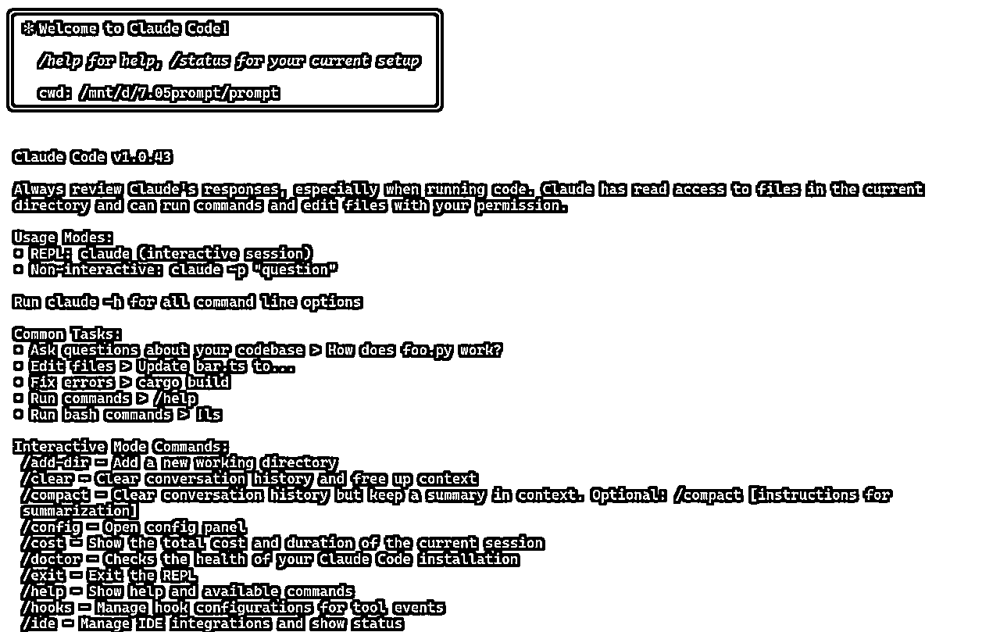
### 第 1 步：生成项目文档
进入项目后，第一件事是让 Claude 产出项目文档。用到的命令是 /init，它会自行扫描项目并生成 claude.md。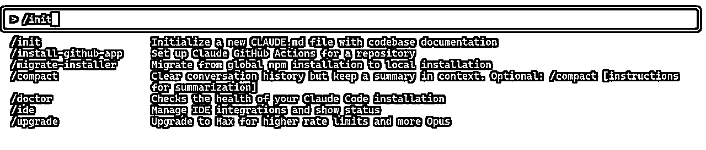
这份文档的颗粒度往往让人惊喜。模块的主要结构会被逐项拆解，各个目录的用途与路径也会被记录下来。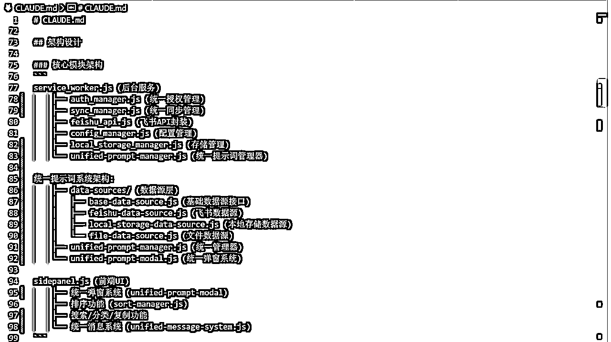
claude.md 对所有会话都生效，地位类似 Cursor 的规则文件。它存在的意义是给模型提供更充足的背景信息，让后续改动更切合实际。此外，/init 的用途并不限于首次初始化；每次完成一个版本，再运行一次 /init，它也会把新增内容并入 claude.md。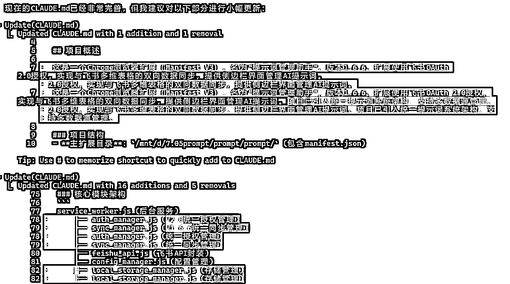
我个人的工作习惯是：每完成一个迭代，先推一次 GitHub，再执行 /init。
### 第 2 步：整理 PRD
关于 PRD 的提示词和范例，我在“小白AI编程指南”里已经写过，此处不再重复。这里我更想聊的是，如何与 Claude 高效地敲定需求。
有了 claude.md 之后，Claude 已经掌握项目的主要架构、文件布局和模块分工，因此讨论需求会非常顺利。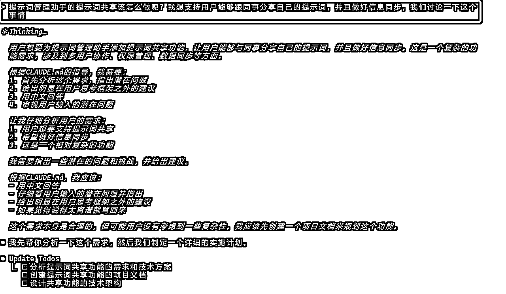
比如图中标红的内容就是我的新需求。模型会先参考 claude.md，再通读一遍整体代码，然后给出自己的分析。这种讨论方式非常贴近真实的开发协同，且能很快得到可执行的结论。
它会先给出提醒，再列出几条由浅入深的路径；最后综合权衡后，建议从第一个方案起步，并把背后的逻辑讲清楚。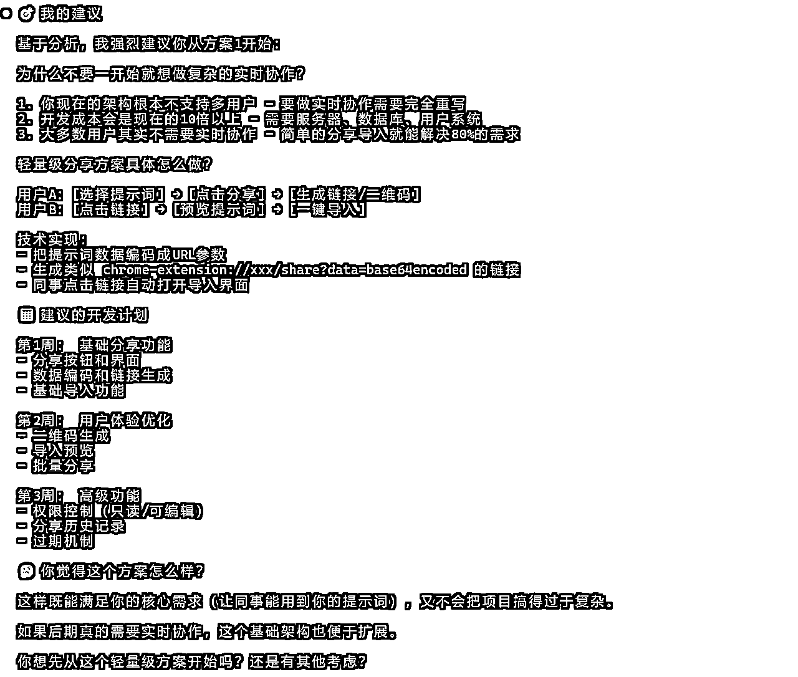
我认为需求讨论能这么顺畅，核心原因还是模型对项目理解得足够到位。
### 第 3 步：制定实施计划
Claude Code 共有三种工作形态：default、plan、Auto-accept。日常对话一般在 default 下进行；按 shift+tab 可以切换形态。当界面左下角出现 plan 字样时，就是进入了以规划为主的模式。
我们围绕前面提到的第一个方案，切到该模式来制作实施计划。
进入规划后，它会先把现有代码库完整读一遍，确保对现状心中有数。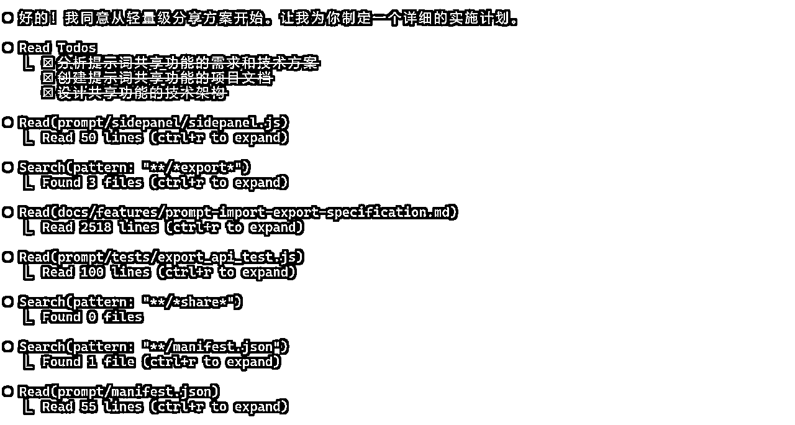
之后，它会输出一份分步骤的实施计划。
这份计划看完后，我心里会踏实很多，因为它把相关点都考虑到了。若愿意采纳，就回 yes；若还有异议，就回 no，继续调整。
### 第 4 步：编码执行
计划确认后，就可以进入编码阶段。这个步骤基本可以“离手”，让模型连续执行，完成后再切回来查看即可。
期间几乎不需要逐个点击确认，模型会自行完成大部分工作，人类只需要在事后进行验证和反馈。
### 第 5 步：回归与反馈
最后是测试与问题跟进。有一点要留意：Claude Code 运行在终端中，无法通过截图交流。为了让反馈更有效，请尽量用文字把现象、报错和复现步骤写清楚。
在使用Claude Code反馈bug时，我总觉得有点不顺手——截图得先存好，再通过@文件名的方式发给AI，才能让它看到故障现象，多了一道手续。

但如果你把上面五个步骤完整过一遍，应该就会认同我的判断：Claude Code让编程这门手艺的效率直接翻了一倍。原因在于，Claude Code为AI提供了更大的上下文承载量。我正是借助这点，把人与AI之间的协作路径重新梳理了一遍，才换来质变般的产出提升。
说到底，在AI浪潮已至的当下，最重要的本事不是写代码，而是懂得如何与AI并肩工作。
顺便分享一个优质学习入口：Claude Code官方和吴恩达老师的公开课，地址在这——https://learn.deeplearning.ai/courses/claude-code-a-highly-agentic-coding-assistant/lesson/66b35/introduction
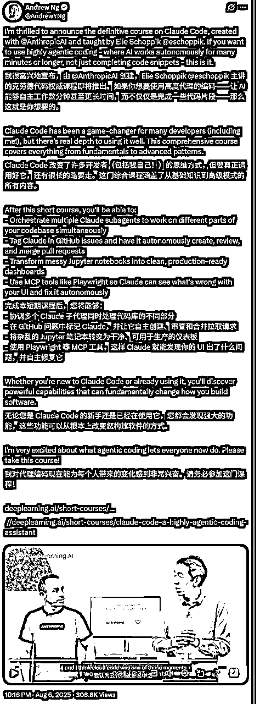