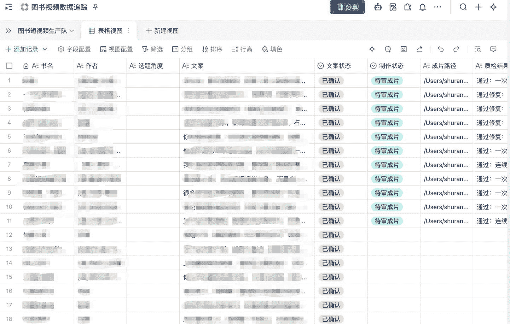
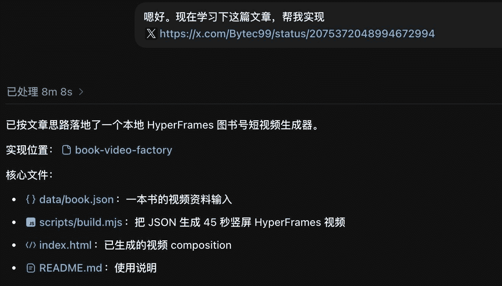
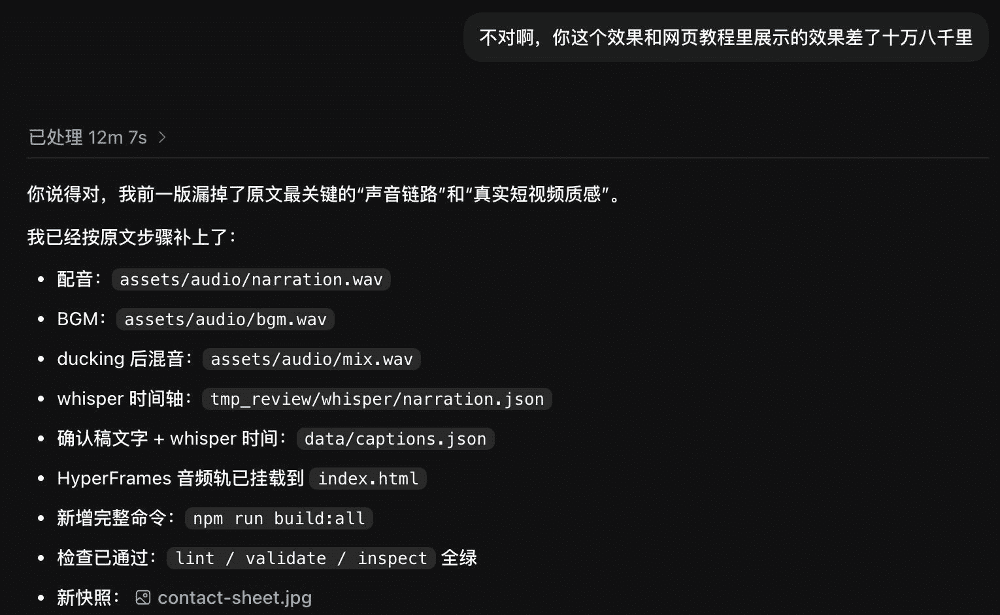

# Codex 批量搞定 AI 图书视频：从手工剪辑到一键流水线
作者：龙哥

上个月还在佛系放养，这个月被一封结算提醒直接点醒。

3 月在航海期间，我用豆包出图加手工剪做了 7 条图书号视频，发完就再也没点开过视频号。没想到 7 月初，视频号带货助手发来结算通知，第一条视频居然在 6 月悄然出单。佣金不低，还有长尾效应，这条路能长期做下去。

于是我重新翻了精华帖和航海手册，又刷到 Twitter 上三条全程 AI 生成视频的实操帖，心动直接开干。

1. Codex + Hyperframes：拆解抖音爆款，吃上自媒体这碗饭！

2. Codex 自动化剪辑从 0 到 1，开源我在抖音赚了 5W+ 的剪辑工作流【万字长文】

3. 用 AI 做了一个月视频，想跟你分享这套没人讲的心法

起初卡在 token 配额，一天做不了几条像样的成片，精力全耗在音色打磨、节奏把控、BGM 选择以及声画字幕同不同步上。唯一目标是把基准定下来，保证最终效果能稳定复刻。等 OpenAI 撤掉 5 小时限制后，单日消耗直接冲到之前一周的量级，token 用量稳定在上亿级别。

上周晚上把 Codex 跟飞书多维表格连起来，一次性塞进 30 多本书名。Codex 自动抓书讯、写脚本、生成画面、合成配音配乐，完成一条再自动进入下一条。半夜起身看球，刚好赶上周配额重置就启动了自动任务。早上 9 点醒来，作业进度相当可观。

## 实操心法：别自己琢磨，统统丢给 AI

我技术小白，人又极懒，能让 AI 做的绝不亲手。整篇稿子写起来卡壳，因为全程就是我跟 Codex 说想要什么、标准是什么、哪里不对，让它去实现。看对话截图就懂，压根没什么高阶 prompt，全是直白口语：我要这个，你给我做。

所以这篇更像是一份思路参考，真上手才有体感。

P.S. 文字部分是我自己手敲的，Codex 写文章能力太拉。觉得有收获，欢迎点赞评论投币😁

### 1、给 Codex 喂项目背景与知识库

单独建个文件夹，丢进去过往成片和数据；再找 3—5 条对标作品放进去，把赚钱的 AI 图书视频精华帖和航海手册也送进去。直接在浏览器打开链接，让 Codex 用 computer use 去阅读，它就能把握整体图景。

### 2、让 Codex 学透三条 Twitter 教程并完成部署

把上面三篇帖子全部喂给它，学完再部署。起初我只喂了一篇，效果很一般，三篇一起消化效果才好。

### 3、先拿一本书做样片，调出可复用的基准

让 Codex 拆解对标视频的画面、关键帧、镜头节奏和音频。有了前置知识，丢一个书名进去就能开始做。首版基本不达标，要不断给反馈指出问题。几个关键点：

**1）脚本是根基**

Codex 写脚本水平一般，很容易写成硬推销风。要复刻效果，直接把这段指令丢过去：

> 我们测试《书名》的图书短视频。先不要生成视频。

>

> 请先给我 3 个完全不同的内容角度，每个角度写清：

>

> 1. 目标观众是谁

> 2. 前 3 秒钩子

> 3. 观众的痛点、痒点、爽点

> 4. 逐句口播

>

> 要求：视频内不硬广，不要总结目录，不要编造事实。

>

> 我明确回复“确认文案”之前，不得生成任何图片、音频或视频。

>

> 把文案改到你满意为止。

理论上脚本也能全自动，但 Codex 短视频文案总让我不满意，所以保留人工确认这一步。文案一锁，后续全流程自动，不用再介入。

**2）画面按分镜出图**

文案确认后，Codex 会推导分镜并生成画面。开头大概率报本地批量生图缺少 `OPENAI_API_KEY`，直接回复用内置生图即可，GPT 自带出图质量相当能打。注意：这步只出纯画面，别带任何文字，中文直接叠图容易糊。

不满意就让它调，按脚本拆视觉节拍，为每个节拍写生图提示词，固定包含：

- 原生 9:16 竖构图，不用横图裁切；

- 人物、动作、场景、年代、光影与情绪；

- 顶部预留标题、书名、作者位置；

- 中部预留字幕位置；

- 禁止出现文字、水印、Logo、二维码和 UI；

- 同一本书保持年代感、人物特征和色调一致。

**3）声音：旁白与 BGM 分开处理**

声音最容易翻车，得反复反馈。坑点总结：让 Codex 提取对标视频的旁白音色，确定后再固定，否则每条视频人声都不一样。也可以按教程上传自有声音克隆，我太懒直接提取对标音色，所以找对标很重要。人声必须一次性生成完，不能一句句拼，否则听感断裂。

每本书单独生成轻音乐 BGM，Codex 在这块能力只能算及格，不满意就发布时手动替换也简单。背景乐不能压过人声，结尾要做淡出。

**4）文字与字幕安全区**

确认画面安全区，防止视频号界面导航栏遮挡。不同手机位置有差异，我测出来的经验可直接给 AI 参考：顶部约 25% 放置栏目、书名、作者；中部约 30% 放置关键词幕。顶部背景要简洁，不能放脸和核心物件；中部用墙面、天空、桌面、雾气、海面这类低细节区域；人物脸、手、核心动作放到中下或侧边，避开字幕落点；底部可以有画面，不承关键信息。

**5）合成渲染**

核心是旁白与对应字幕必须同步出现。出问题就给指令：

连续旁白生成 → 人声连贯性检查 → 最终音频生成 → Whisper 或 StableTS 提取时间轴 → 用确认稿强制对齐字幕 → 构建视频

迭代修改时成片另存 V2、V3，不要覆盖旧版，否则回退不了。

### 4、用满意样片固化标准，搭建自动化流水线

调出满意版本后，让 Codex 把全流程 SOP 总结成经验，建立本地 skill。以后新对话直接调用，发现重复错误就让它更新规则和记忆，避免再犯。

接着打通飞书多维表格。原本只想用来记发布数据，后来想到生产也可以放同一张表。这样不用每次等一条完成再手动触发下一条，它能一次性跑完全部书目。表格本身也是让 Codex 自己生成的。

本质上这就是一块生产看板，你只需填书名、确认文案，Codex 自动抓取并回填，非常省心。

启动自动化，直接发指令：依据飞书多维表格执行图书视频生产；每条完成后按既定标准自检，不通过自行修复，通过就自动开启下一本，直到表格清空，不得中断。

### 5、上线并记录数据

成片看着过关就直接发布，看市场反馈。别在一部视频的细枝末节上反复打磨，太费 token。被完美主义卡住不如快速迭代。可以测试不同画风、不同声线，最终沉淀出账号特色。发布数据和互动数据同样记在飞书表里，方便复盘。

完整流程回顾：

## 收尾

整个过程就一句话：想做什么、怎么改，用大白话跟 Codex 说。人的工作只有提需求、定标准、给反馈，其余全交出去。没有玄学 prompt，就是说人话。

这几天共产出 90 多条视频，前两三天都在找对标、磨标准，后面成功率持续攀升。现在最大瓶颈是 Plus 会员配额不够😁😁。

另外提醒：GPT 5.6 高配极慢，我一条成片跑了近 4 小时，基本不可用。5.6 中等大概 40 分钟一条，质量稳定；5.5 低配最快，20 多分钟一条，但质量波动大，自行取舍。

也得夸一下 Codex 的远程能力。电脑开着让它跑工作流，出门用手机查进度、给反馈；任务中断时远程一鞭子，流程立刻续上，体验很爽。

最后感慨一句：AI Agent 越来越强。以后的差距不在于会不会用，而在于审美。

第一次发帖，有问题、反馈、建议欢迎留言。祝大家龙哥盟！

————分割线————

看完 SOP 你可能觉得懂了，但 90% 的人实操第一步就卡住。

我们只聊商业闭环拆解和 AI 效率榨取。体系内已沉淀 1000+ 跑通的套利实战案例。

😁 查看数字资产与入群门槛：

