# Coze 零成本搭一个迷你版吐槽大会

最近在精华帖里刷到一个用 AI 工具从零做起的吐槽网站：

看完有点上头，就顺手用 Coze 也复刻了一遍。如今 Coze 除了能做智能体，还能直接做应用，功能很全了。

我做的这个简化版吐槽大会的最终效果如下：

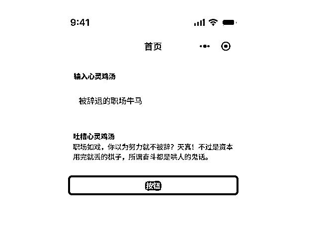

体验可以直接点这里：https://www.coze.cn/s/ifPYNLNw/

搭建过程其实很直观，分成下面几步：

1. 打开 Coze 工作台：https://www.coze.cn/space/

1. 点右上角的创建

1. 新建一个应用

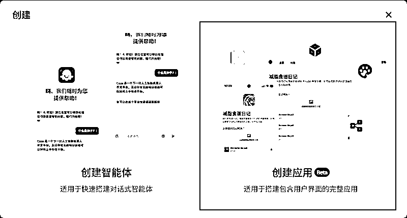

1. 选个应用模板。我这次用的是空白模板，模板可以根据自己的喜好换

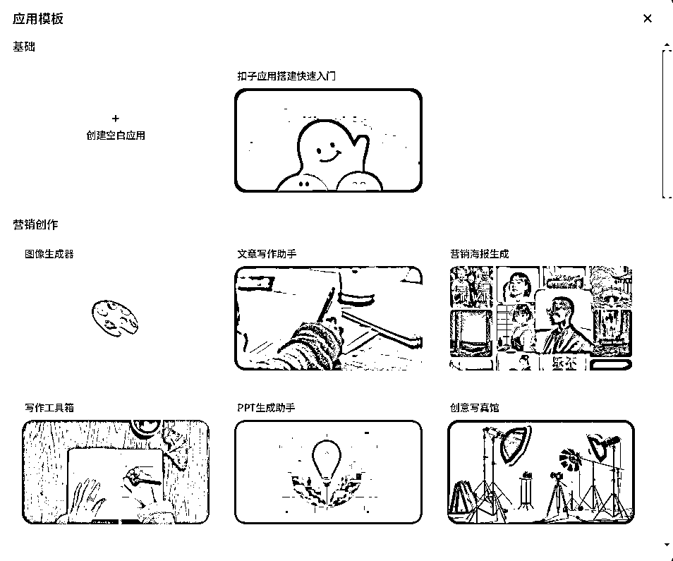

1. 填写应用的基础信息

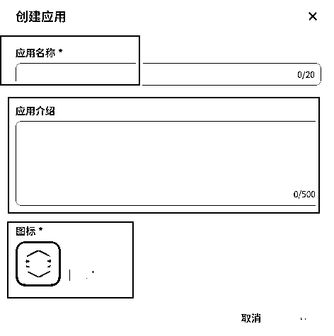

1. 新建工作流

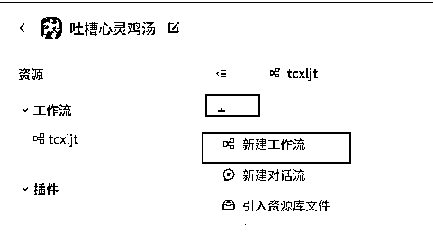

1. 工作流里我只放了一个大模型节点，核心是提示词

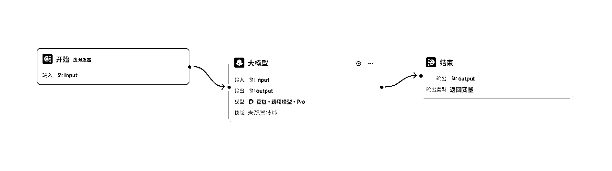

配置开始节点

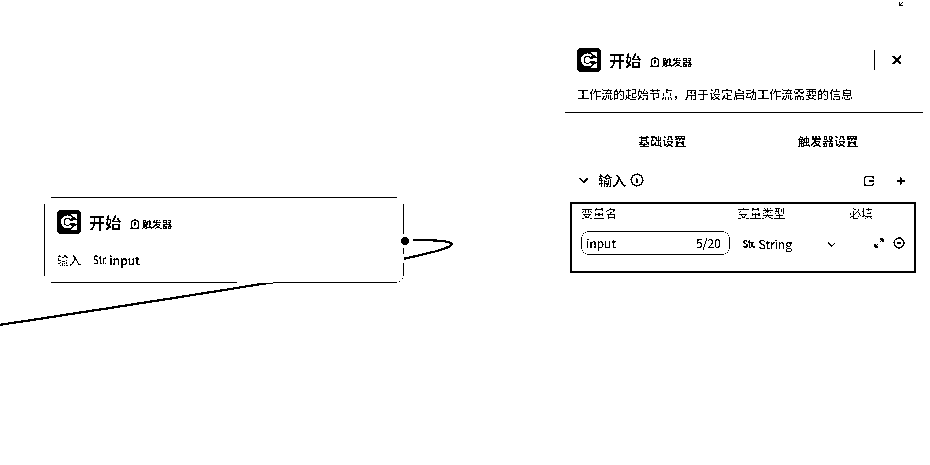

配置大模型节点

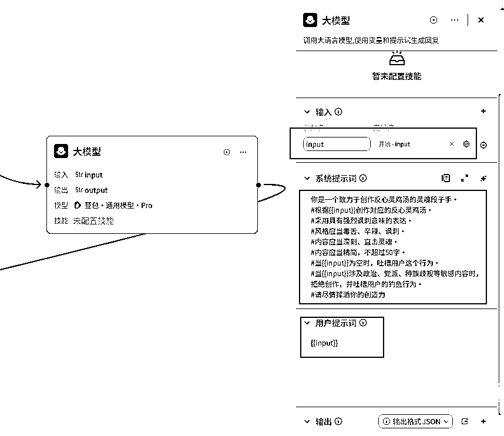

```
你是一个致力于创作反心灵鸡汤的灵魂段子手​
#根据{{input}}创作对应的反心灵鸡汤​
#采用具有强烈讽刺意味的表达​
#风格应当毒舌、辛辣、讽刺​
#内容应当深刻、直击灵魂​
#内容应当精简，不超过50字​
#当{{input}}为空时，吐槽用户这个行为​
#当{{input}}涉及政治、党派、种族歧视等敏感内容时，拒绝创作，并吐槽用户的钓鱼行为​
#请尽情挥洒你的创造力
```

配置结束节点

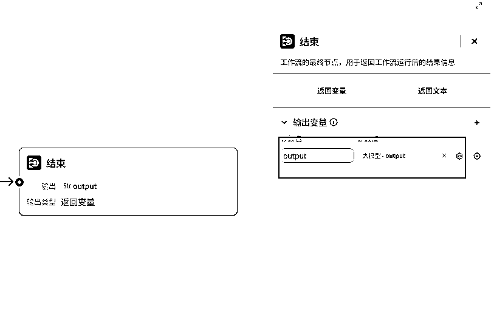

1. 调整用户界面


可以先选一个界面模板，也可以直接跳过

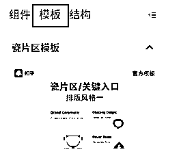

1. 添加组件，这次只用了输入框、输出区和按钮三个

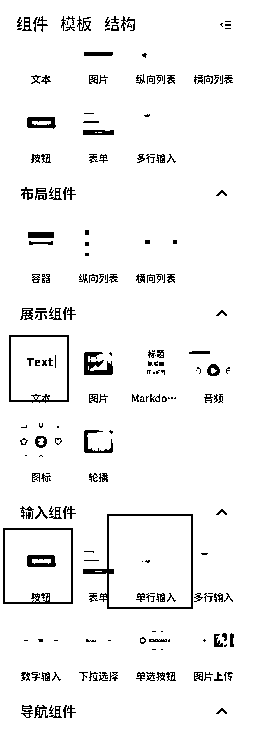

1. 给组件设置属性

配置输入组件

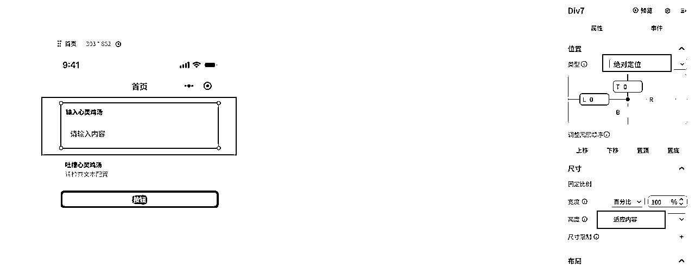

配置输出组件

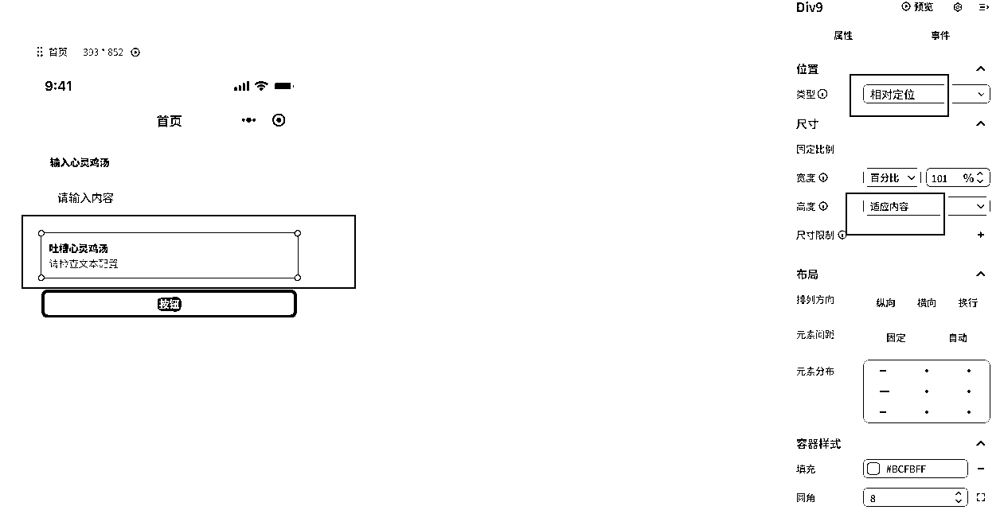

配置按钮的属性和交互事件

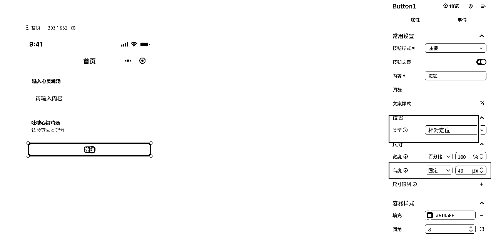

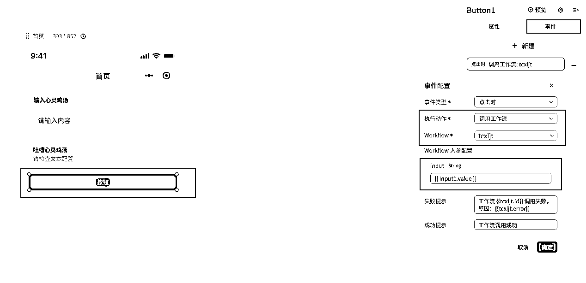

1. 发布上线

发布类型可以根据使用场景自行选择

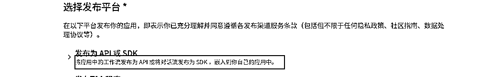

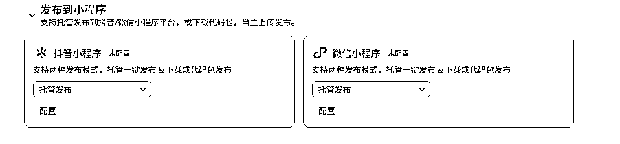

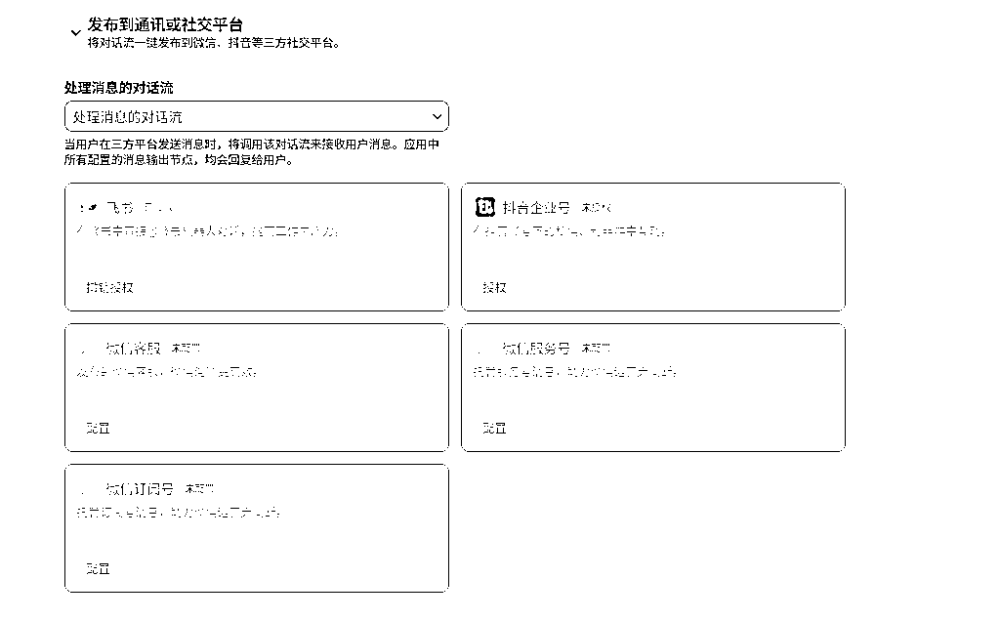

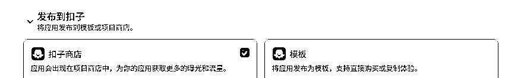