# Cursor 在实际项目中的使用经验分享
最近后台收到不少朋友问：AI 编程工具到底值不值得重度投入？今天我想抛开那些“小白三分钟做个游戏”的故事，从一个写了很多年代码的程序员视角，聊聊我日常怎么用 Cursor 维护项目、迭代功能。
先说下我的背景：我叫大铭，一直在写程序，现在在月嫂母婴护理行业创业，早年用信息化工具玩过这个领域，现在打算靠 AI 再来一次。这段时间 AI 工具爆发，我的效率确实被大幅拉高了——单说编码这件事，体感至少是以前的三倍。最初用的是 ChatGPT，之后试过 Copilot，也折腾过不少别的，现在彻底切换到了 Cursor。深度用了两个多星期就买了 Pro，如今每月 500 次的 fast 额度已经耗尽，算是重度用户了。
所以这篇分享，不聊概念，只讲我怎么在真实项目里用 Cursor。
## 一、真实项目不是“写完就丢”的小玩具
网上那些“产品经理用 Cursor 做了一个贪吃蛇”“小姑娘零代码写了小游戏”的故事，说实话打动不了我。和很多有经验的开发者聊过，大家普遍认为：Cursor 确实是个好东西，一旦用上就很难回去，但没传的那么神。
为什么？因为真实项目不是一次性作品。做一个贪吃蛇，写完可能再也不会打开。可我们日常维护的代码库，会一直处于“被持续打开、不断修改”的状态。那种让他从头生成一个新项目的兴奋感，最多撑第一天，甚至半天，之后根本不会这样用——毕竟我不可能天天开新项目。
再看看代码量。用代码量衡量工作深度有点片面，但对比还是有的。100 行代码不一定比 300 行差，可如果拿 100 行和 10000 行比，差别就出来了。网上大多数 Cursor 案例的 code base 基本见不到 1000 行以上。而我现在用 AI 重做一个月嫂 CRM 系统，刚起了个头：月嫂库没建完，履约任务做了一小部分，客户信息只写了一点，后面还有合同、产品点评一大堆功能。就在这种情况下，代码文件已经有 140 多个，总代码量接近一万行。而目前完成的模块只占 20% 左右，也就是说最终要形成一个五万行左右的项目，才勉强算第一个可用版本。
到这个规模，你还能说“啥也不管，让 Cursor 自己干”吗？这恐怕就是真实工作和网上演示案例最大的差距。
## 二、真正写代码时，很少有人从零开始
以我最近写的月嫂 CRM 为例。我想用 Java 但不想碰 Spring，最后选了 Micronaut 这个框架。检查之后发现它自带非常完整的脚手架生成器（https://micronaut.io/launch/）。
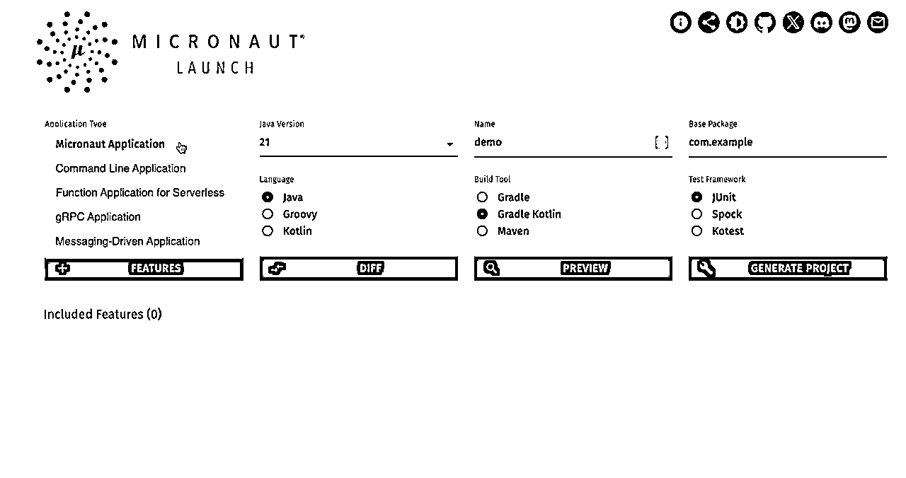
比如用 Java 21，项目名 ShengCai，包名 com.shengcai：
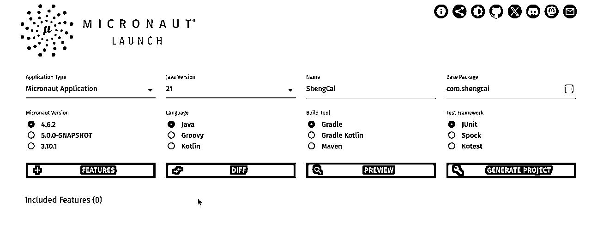
在 FEATURES 里勾选需要的支持：OpenAPI、Swagger、JPA 数据库、Redis……大体框架就出来了。点 generate project 再下载，本地就多了一个目录。

用 Cursor 打开 ShengCai 文件夹，会发现里面已经有不少替你写好的代码。也就是说，接下来所有编程都建立在这个框架之上，根本不是从零开始。
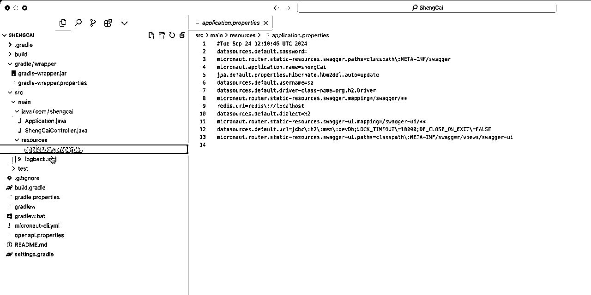
前端也一样。比如 Flowbite 这类工具会提供起步代码（https://flowbite.com/docs/getting-started/vue/），不用自己从空白文件写。
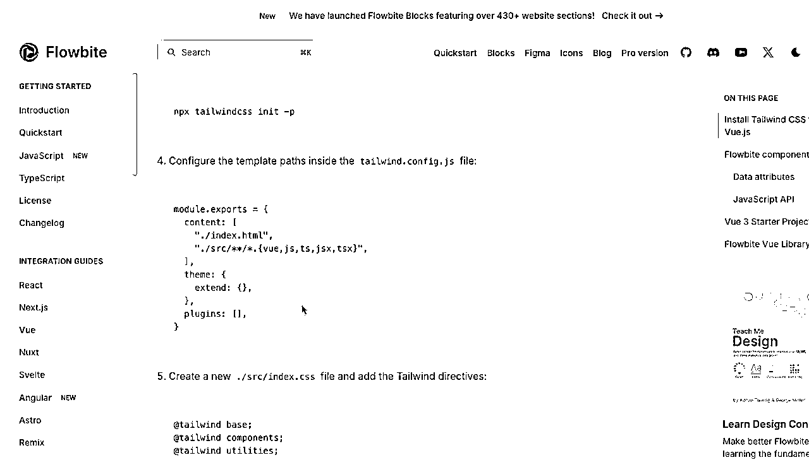
再比如要写一个浏览器插件，很多人第一反应是在 Cursor 对话框里输“这是一个 Chrome 插件”。而我通常会先去 GitHub 找一个 VUE 的 Chrome extension template，下载解压，然后在 Cursor 里 open folder，打开就发现里面已经有很多代码了。
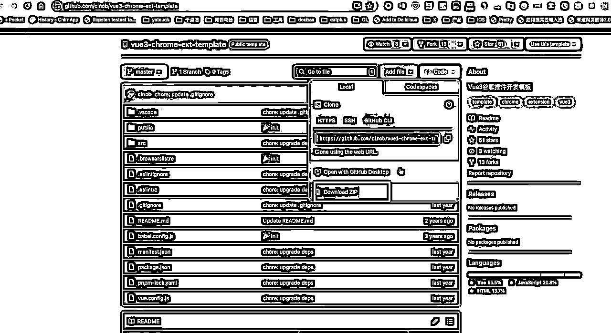
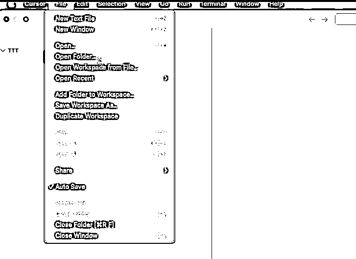
为什么要这么干？因为这样做等于提前给 Cursor 做了很多限定，告诉它不用重复造轮子。更重要的是，我先让它帮忙整理文件结构，然后我再有针对性地改。具体步骤是：先 @Codebase 让它 review 整个代码库，告诉我这是干嘛的、核心文件是哪些；然后我根据整理结果做定点修改。
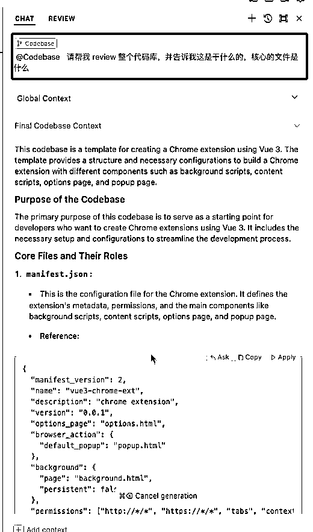
比如 manifest_version 现在是 2，但 Chrome 已经到 version 3 了，我就把相关代码复制到对话框，让它“帮我改成版本 3”，它就会只改这一部分。
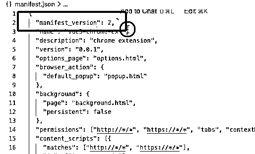
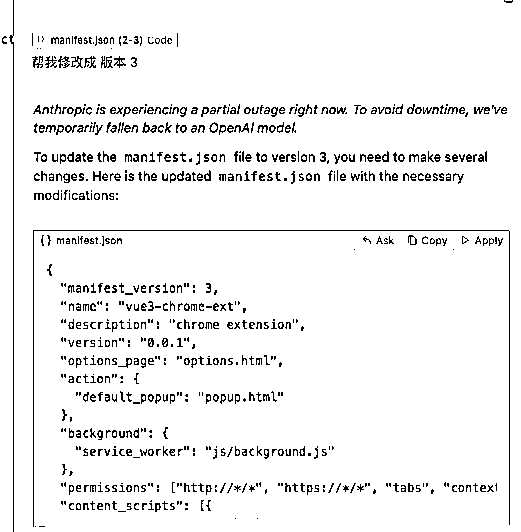
这才是我正常的工作流——不是从 0 开始。大家以后做项目，至少从框架层面看，网上一定有模板或脚手架，直接去找就行。如果是老项目，同样先让 Cursor 把代码读一遍，再去做后续修改。
还有一点很重要：编程这件事，限定是关键。粗分前端后端，后端有 Java、Go、Python 各种语言，每种语言都有类似的能力；前端语言只有 JavaScript 和 TypeScript，但框架极多，有纯前端、有 client render、server render，还有 Next.js 这种看上去是前端实际也能写服务端的。如果你不做任何限制，Cursor 会按它认为主流的方式生成代码，但那未必是你想要的。
举个典型例子：我想用 Java 写一个服务端接口，不限定的话，9×9 会选 Spring——因为它太流行了。可我不喜欢 Spring，启动一个简单服务快则 40 多秒，慢则一分钟多，这时间我忍不了。所以我必须告诉它：用 Micronaut。这时候脚手架代码就特别方便，所有配置文件该放哪都规规矩矩，用起来很舒服。
哪怕你是小白，我也建议去 GitHub 找模板。排在前面的基本都是主流语言、主流框架的示例，学习资料也相对完善。
## 三、Cursor 的几个核心功能
### 1. 交互方式：DIFF patch 才是灵魂
先澄清一个概念：Cursor 不是 IDE 插件，IDE 是 Cursor 的插件。我翻过 Cursor 团队的所有博客和创始人访谈，最关键的一点是：他们直接 fork 了微软的 VS Code，然后在上面做修改。所以它和 Copilot 这类工具最大的区别在交互模式——Copilot 只能针对光标位置往后生成代码，只有这一种模式；Cursor 是针对整个文件。
具体区别在哪？比如我在 Controller 里打出“inj”，下方灰字就会提示 inject，按一下 Tab 生成，同时上方也会出现一个 Tab 标记。
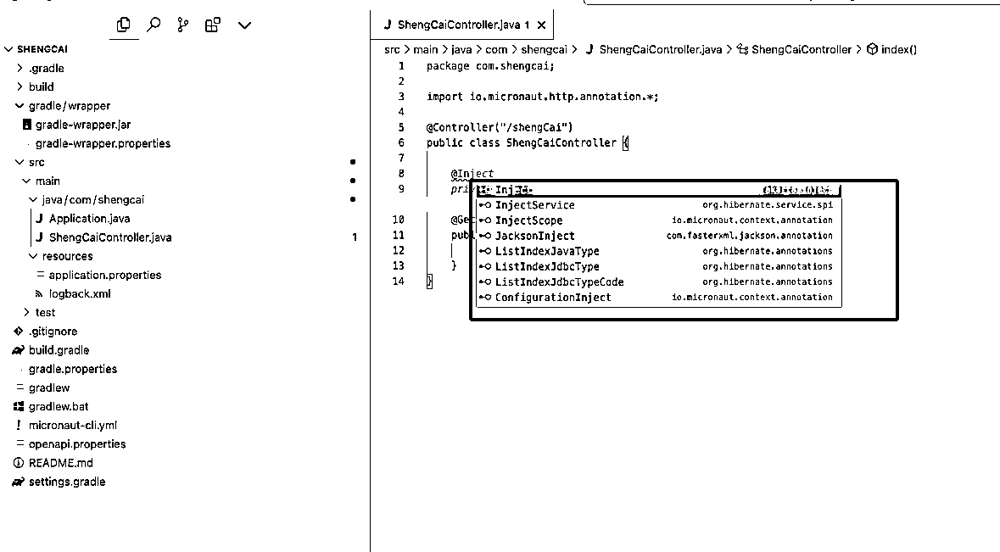
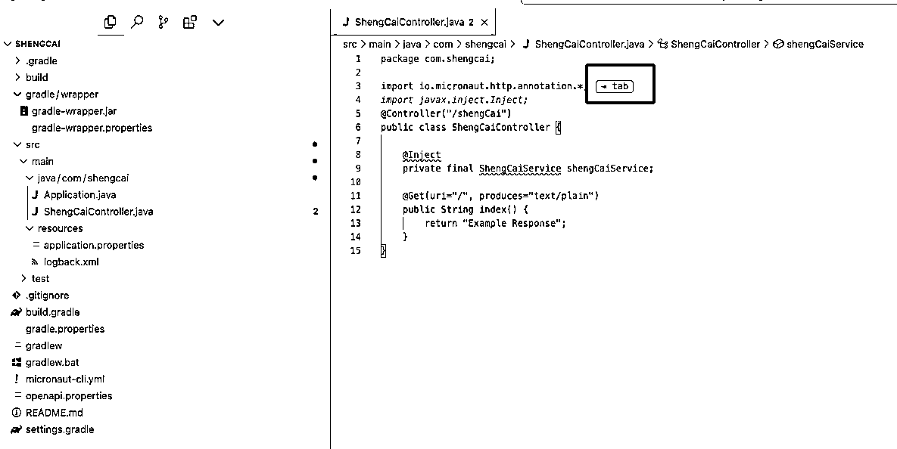
再点一下 Tab，光标跳回上面，那段灰色内容也被生成了。
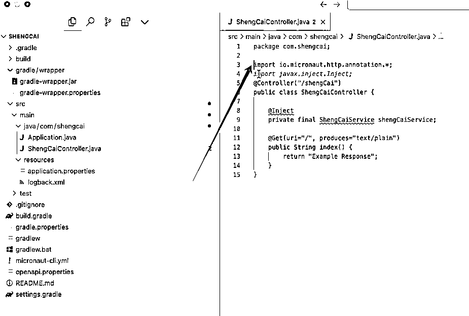
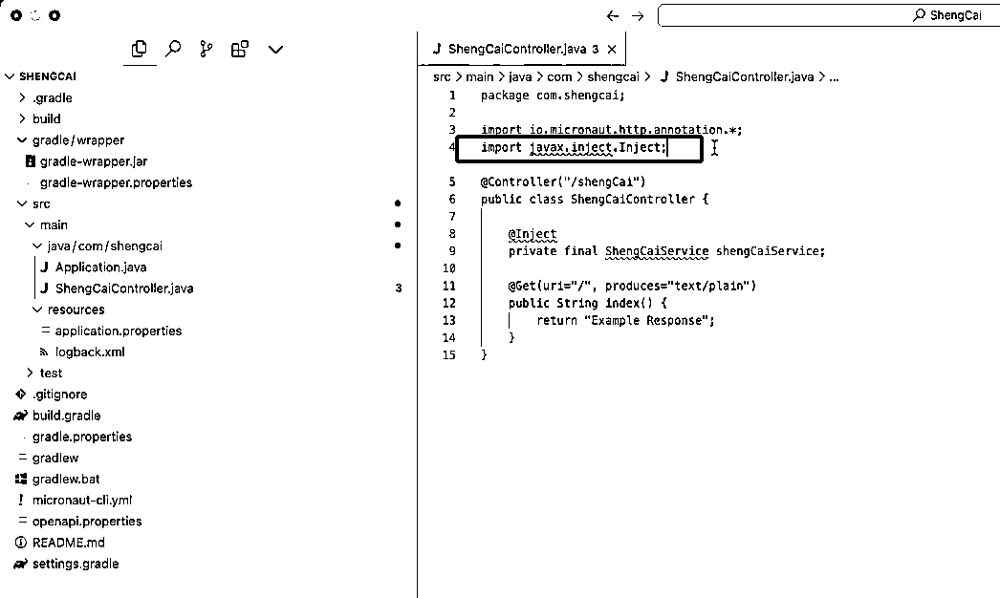
这种交互方式 VS Code 做不到，因为它只能从光标位置向后追加字符，无法在整个文件里跳转，所以只能 append；Cursor 则是 DIFF patch 模式，能隔行插入修改。比如我在配置文件里把鼠标放在 hbm2ddl 位置，告诉它“帮我做一个 MySQL 数据库连接，用户名密码都是 root”。
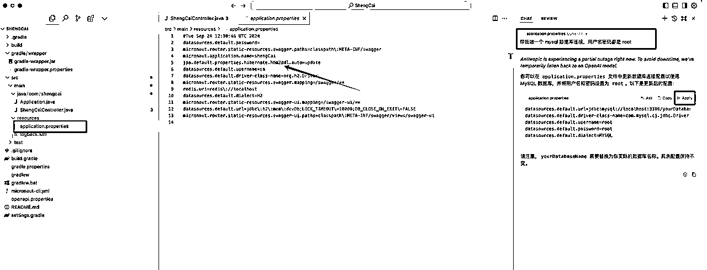
生成之后对应代码段右上角会有 apply，点开后能看到它是隔行插入的，我只要逐个 accept 就行。
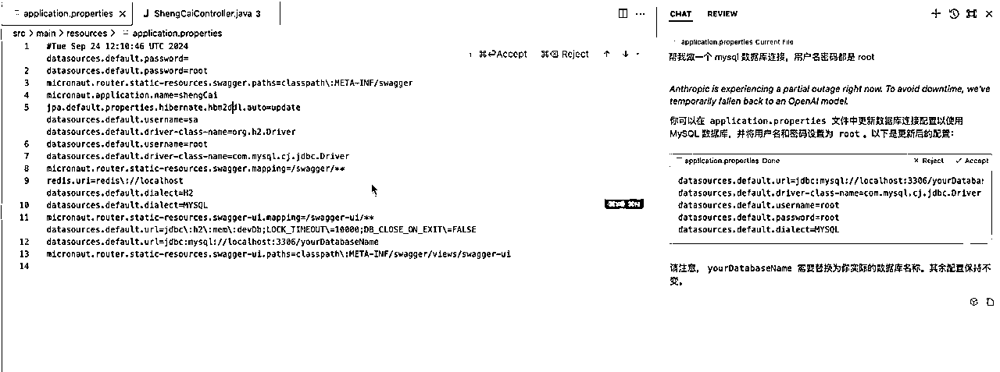
这事 Copilot 就做不到。同样改数据库连接为 sqlite、本地文件 a.db，它生成得挺好，但没有 DIFF patch 方式，直接插入整个文件就乱了。
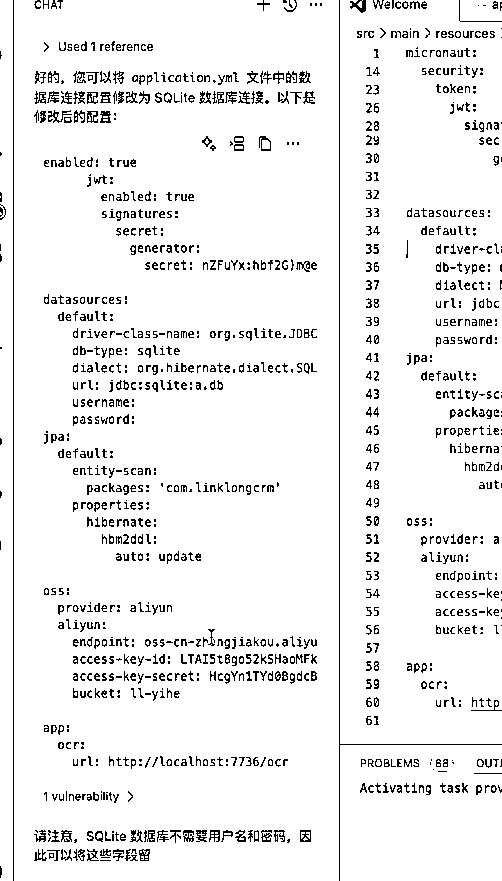
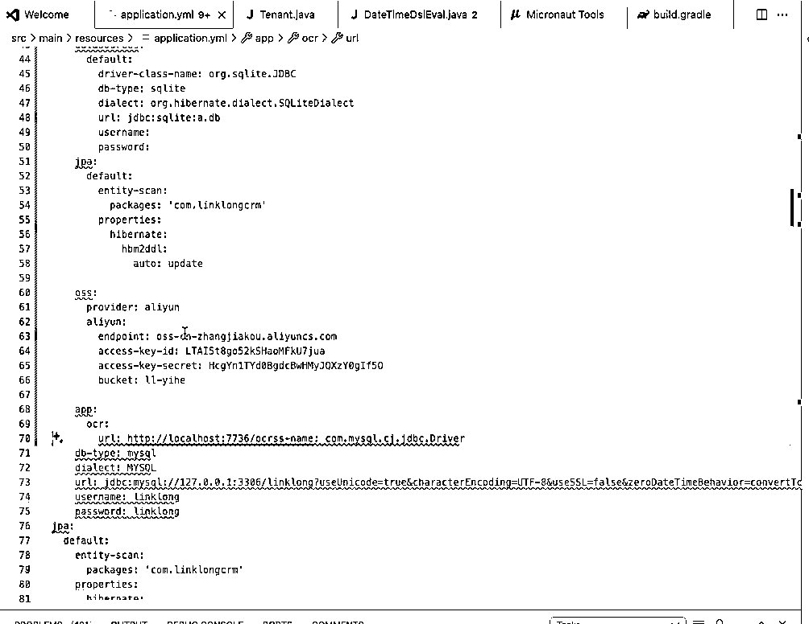
如果不插入呢？只能全部复制粘贴，可文件一长根本没法用。所以还是得像以前一样，一段一段手动替换。仅这一项功能，Cursor 相对其他 IDE 就能带来至少 10% 的效率提升。
顺着想，AI 时代到来后，只要我们确定了一个 target（对编码来说可能是某个文件、目录或整个 code base），是不是就能颠覆很多传统的、习以为常的工具？我认为有这个可能。
### 2. 文档功能：解决大模型知识过期问题
这是我目前维护的一堆文档：
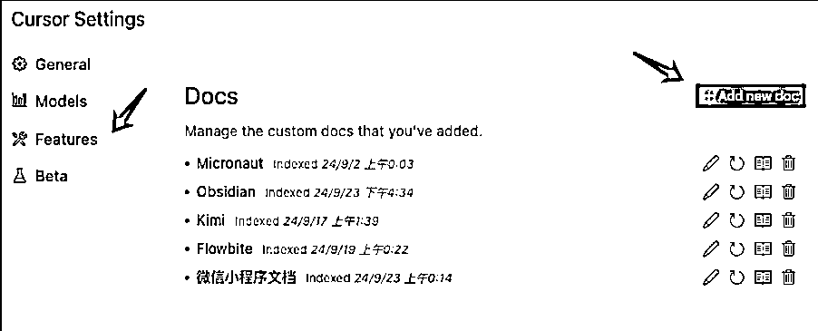
大模型语料库更新往往不及时。比如 Claude 的知识库截止到 2023 年底，如果你开发需要一些常用文档，就会发现它给的信息严重陈旧。像 Micronaut、Flowbite、微信小程序这些，去官网看版本迭代非常快，所以 Claude 给出的代码经常是错的。
怎么解决？Cursor 自带一个小爬虫，可以在 Features 里通过添加文档的方式把官网文档抓进来，之后调用文档就能获得更准确的代码。
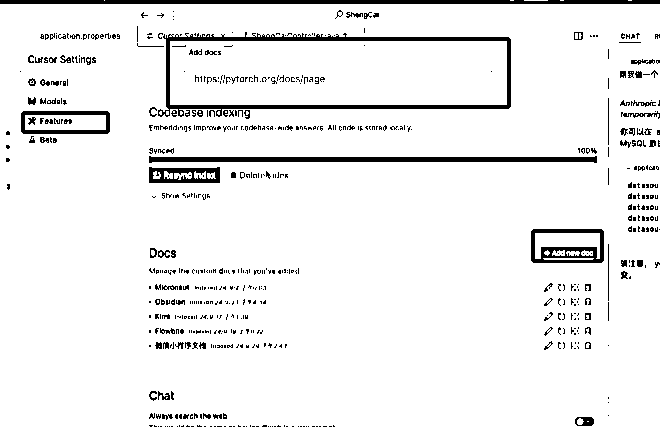
还是以项目为例。做一个用户登录功能，选中文件输入“帮我生成用户登录的 Controller，使用 JWT”，确实会生成不少代码，但细看会发现很多问题——比如右边红框里不是 javax.inject，而是……
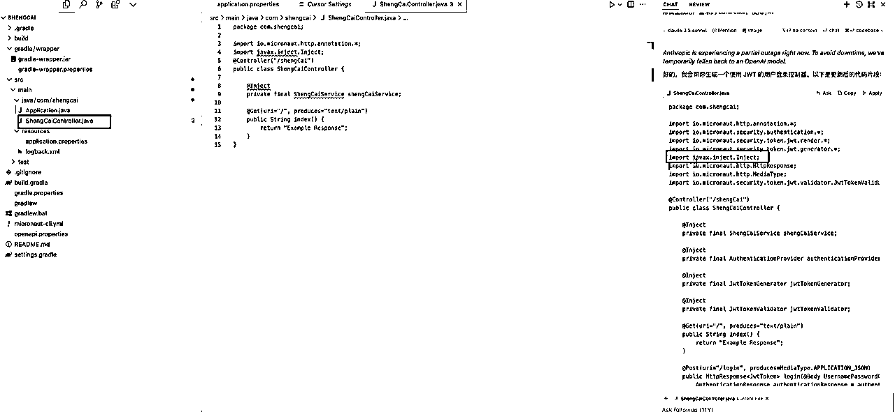
这时候补充提示词：“帮我生成用户登录的 Controller，使用 JWT @Micronaut，阅读最新的文档，使用最新的 API”，生成准确率立刻大幅提升。
这就是文档的用法。有时候 Cursor 会自己去看，有时候你可以主动让它看。一些特别小众的库可能没有文档或很难被收录，那就自己做一个。甚至你们内部文档也可以交给这个爬虫。当然，Cursor 的爬虫能力比不上 Google，但处理静态文档这类简单场景非常好用。
### 3. Composer：我把它当骨架生成器
@Time 的直播里讲了很多，我这里只说说我的习惯差异。Composer 以整个 code base 为基础，可以一次性处理多个文件。但对我来说，当代码复杂到一定程度，Composer 基本只能生成简单代码。
比如我现在的 CRM 项目里，涉及客户、出院记录、月嫂、服务总线，基础模块还有阿里云、附件、JWT、OCR……代码库复杂到这个程度，我的新代码得和已有代码交叉调用，Composer 生成的代码很难一次完成，甚至几轮都搞不定。
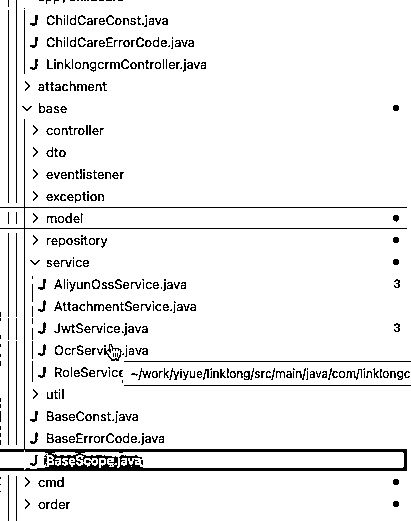
所以我的用法是：让 Composer 当骨架代码生成器，它只负责搭架子。骨架生成完，我进入对应代码文件，选中某一部分，点击 add to chat，继续后续对话。
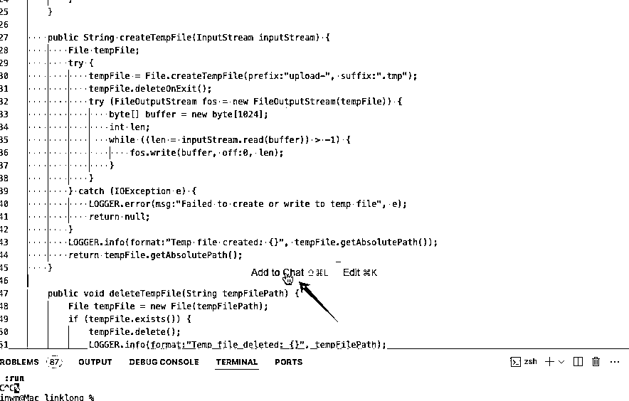
对我个人而言，最常用的其实是 Chat 模式，Composer 更多用在单一功能起步阶段，之后再慢慢改。
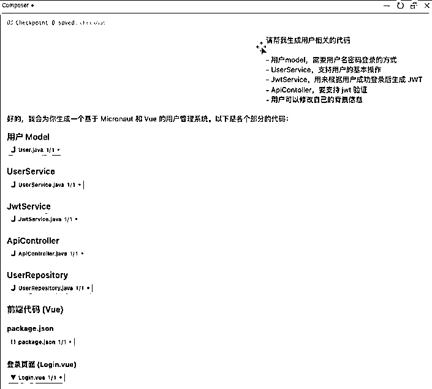
大概就是这样。简单总结：真正干活的时候，给 Cursor 一个不跑偏的框架、一份能读懂已有代码的上下文、一个需要它精准修改的小目标，它就能发挥出很大的价值。至于那些“一句话生成完整应用”的神话，听听就好——现实项目里，还是得一步步来。
你有没有发现，当代码量堆到一定程度后，Cursor的真正角色就变了——不是它在替你开飞机，而是你在给它下指令。这个阶段，你开始对代码产生“控制欲”，想要精细地插手每一行逻辑。而坦白讲，一旦走到这一步，Compose那种大包大揽式的操作，对我来说存在感就开始变得稀薄了。
### 聊聊我最常用的Chat
Chat是我几乎离不开的功能，但想用好它，有两个关键习惯：
**第一：把需求掰开揉碎了说清楚**
**第二：记得把相关文件@进来**
我做过一个叫CHATFRIEND的“嘴替”项目，有意思的是这个项目的后端代码（CHATFRIEND）全是Java写成，而前端（CHATFRIEND-FE）又全是VUE的天下。为了让两边代码不乱串门，我干脆把它们彻底拆成两个独立的仓库——后端只做后端的事，前端只管前端的活。
怎么在这种隔离状态下让Cursor高效干活？举个真实的例子：
在后端仓库里，我提交一个需求：“请生成一个用户登录API，用户通过手机号+验证码访问 /api/v1/user/login”。
注意，我会特意在后端这边强调“前端那边我已经搞定了，你只需要出后端接口代码”。
但转头，我又会把一模一样的文案丢给前端仓库，只是稍稍变个说法：“后端我已经完成了，帮我实现登录界面——输入手机号、点击按钮获取验证码、按钮还得有60秒倒计时效果。”
你看，两头我都没写，但Cursor都觉得自己只需要干一半的活，于是两条流水线同时开动，最后再互相验证，效率简直起飞。
但这里有个极大的坑：**你必须给出极其精准的控制**。比如我随手提了一句“需要Post接口”，Cursor竟然给我吐了一段TypeScript代码，但我整个项目都是Java啊！问题出在哪？没交代清楚语言环境。所以后来我补了一句“是Java API Controller”，重新生成的结果就靠谱多了，连package路径都给你分得明明白白。
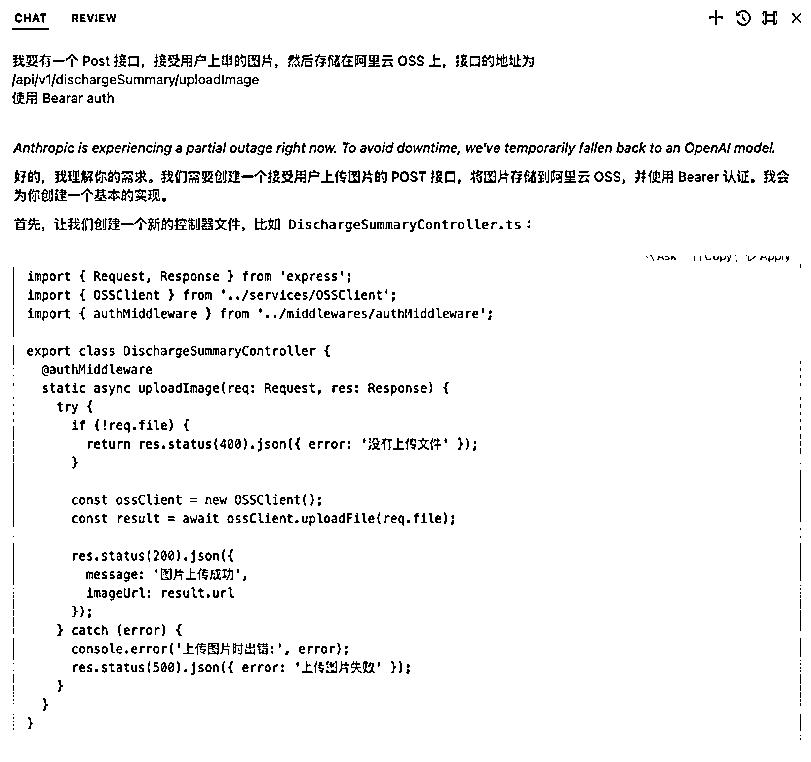
所以总结一句经验：如果你在完全没有脚手架、没有已有代码兜底的情况下给Cursor下达任务，它生成出来的东西很可能不是你真正想要的。
### 怎么让Cursor帮着找错？
我找错有一个懒方法——但代价是fast队列会用得很凶。
流程很简单：看到报错后，我直接点上方的“Add to Chat”，把报错丢进对话框，然后下一步就是——只打一个问号“？”。
就这么简单，什么上下文都不用写。Cursor会自动分析这段代码是干什么的、用在哪、为什么会报错。然后给出修改方案，我点“Apply”→“Accept”，跑一下验证就完事。这个流程度，不管是运行时报错还是编译期错误，基本上能救我80%的日常烦恼。
但得有个心理准备：逻辑复杂的东西就不灵了。越复杂，越需要你亲自上手介入。
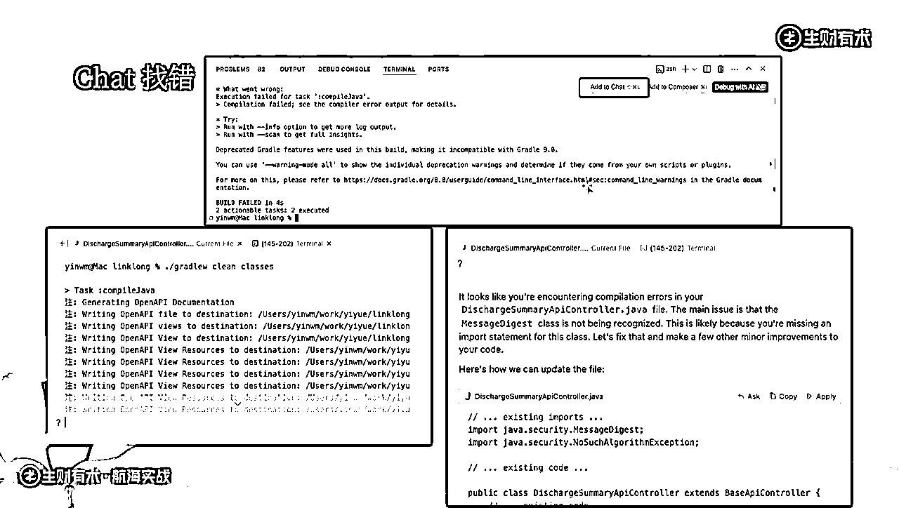
### 活用@功能
「@」是我用得最舒服的一个功能。你可以像这样打开某个文件夹，它能引导你选择要对哪些文件或内容做分析。
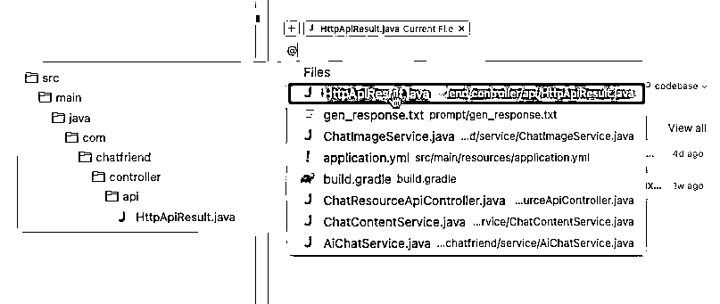
我比较常用的做法是，直接下一则指令：“用户要手机号验证码登录，请把相关代码补到 @NannyService.java 里”。如果当前不在选定的界面里，点一下红框位置，再选“Apply”就能锁定目标。
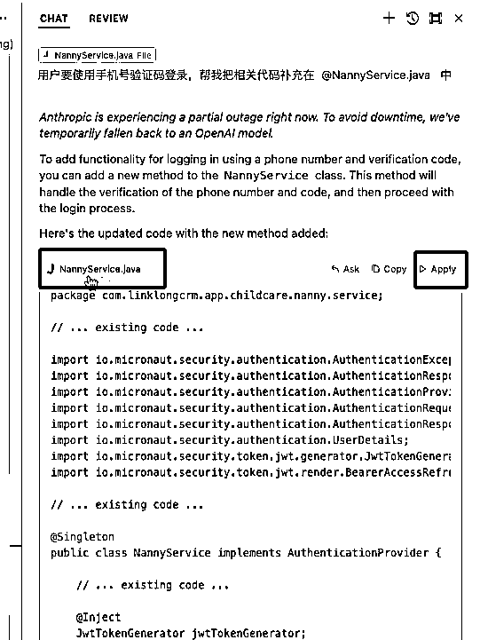
生成完之后，别忘了Review一下。大概率会看到一堆问题——没关系，就用刚才讲的Chat报错法一个个去揪、去修。
再说个隐藏小知识点：当你在@后面指定Web的时候，Cursor会启用它的爬虫去网上搜集资料来辅助生成代码。在设置里有个开关叫“chat always search the Web”，默认是关着的。你可以选择打开它，让每次对话都默认搜索Web。
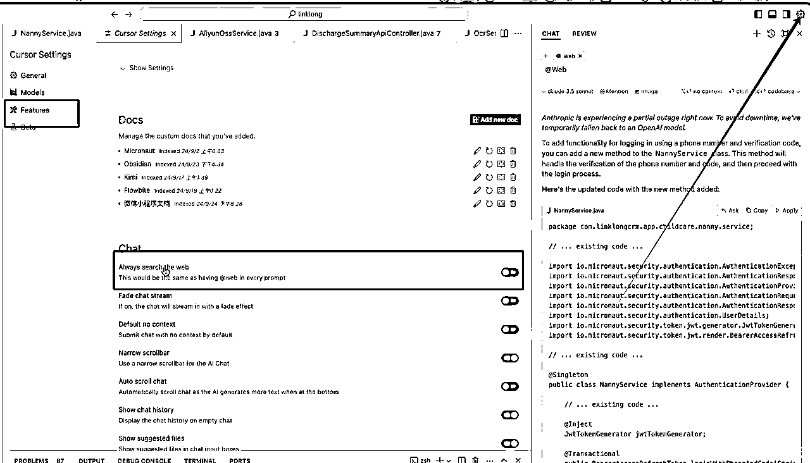
听起来很智能对吧？但我的实测感受是：效果其实一般，有时候反而让Cursor变得有点分裂。所以我现在的做法是——保持关闭，真需要网络资料的时候，手动加上@web就够了。
还有个小技巧叫全局限定，强烈推荐去试。它的原理和平时用AI一样，给足背景设定和角色身份，让模型的输出更可控。在Cursor里，对应的地方是设置里的「Rules for AI」，写上你的限定条件，那是所有文件都会生效的全局约束。
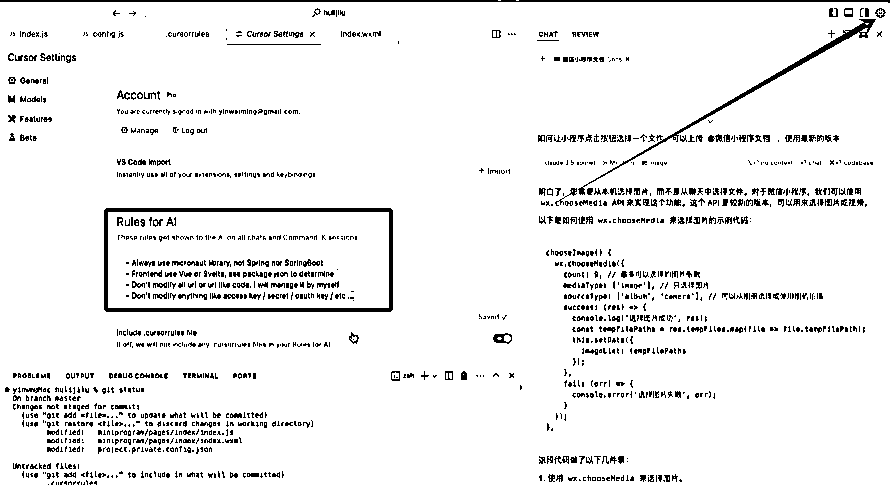
如果你只想对当前项目生效，可以在「.cursorrules」文件里写规则。比如我有个小程序项目，里面就写了一堆小程序开发规范。
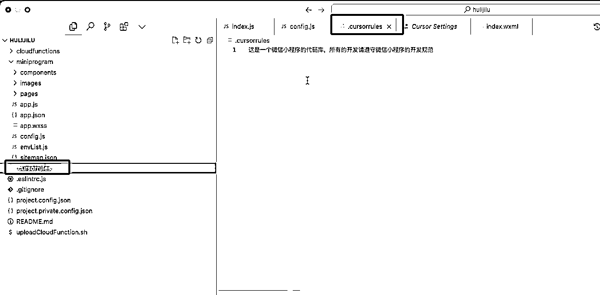
至于这些规则怎么写？秉持“能抄就不自己写”原则，我推荐一个宝藏网站：https://cursor.directory/，上面一堆别人写好的规则，直接复制粘贴就能用。
### 用Git有没有必要？
非常多的人做小工具根本不用版本管理。但我的建议是：**把它用起来，强烈建议。**
视频后半段我用CHATFRIEND-FE这个项目现场演示了具体操作——在9月24日《【高手领航4】：cursor 在实际项目中的使用经验分享》里，58分钟到1小时的那一段，大家感兴趣可以去戳。
## 我平时是怎么和Cursor一起写代码的
我目前常驻两种配合模式。
**模式一：拿Cursor当一个结对编程搭档**
我本身就是个开发者，这种模式下，Cursor主要负责解决“沟通”问题——不是“编码”问题。所以我的日常就是：不断把脑子里冒出来的想法落地成代码，然后互相Review——我看它的代码，它也看我的。
说白了，整个写程序的劳动投入是可以拆分的：体力劳动和智慧劳动。Cursor大约能扛掉90%的体力活，但智慧劳动大概只能替我搞定三成。
举个例子，“帮我写个快排”是体力活。“消息队列该怎么设计？到底要不要写缓存？分布式ID应该怎么生成？”这种思考才是智慧劳动。
我会把自己的思考不断抛给Cursor，让它参与讨论、给提示、甚至反过来Review我的代码。这件事效率收益极大——因为它把我原本消耗在“不确定感”上的时间大幅压缩，那种不确定的环节，原来大概占我总开发时间的三分之一。
剩下的三分之二到四分之三，其实全都是重复劳动，纯粹敲代码的“码农时刻”——这才是真正适合全部交给Cursor去跑的场景。
**模式二：把Cursor当“外包”团队用**
如果你是个纯小白、纯需求方，那么把Cursor当实施方来用也挺好。
比如我长期做后端，对前端只有概念性认知：VUE是啥？React又是什么？小程序究竟怎么搭？我真的不熟。既不清楚结构，也不知道代码该怎么内部运作。这时候，我就会切换到“让外包干活”的模式：
① 先找一个脚手架。用现成模板生成整体代码骨架。像这个小程序项目，我只需要“上传出院小结”和“账号登录”两个功能，底下那些“快速开发基础能力、业务实力”什么的模块根本用不上。但没关系，模板是现成的，多余的代码后面删掉就好了。

② 用@code base模式，让Cursor充当讲解员，把这段代码给我讲明白。
③ 等我把大致来龙去脉摸清了，才正式开始提我的真实需求。如果这段代码能猜个大概，我会直接指定文件位置；如果看得吃力，就用Compose配合一段精心写的详细需求来描述。在Cursor生成的同时，我同步进行Review，顺手就把这些代码给学了。毕竟有编程基础，大概3到4个小时后，我就能从「小白和需求方」模式切回「开发者结对编程」模式了。
这两种模式的最大差别在哪？在“外包”这种模式下，Cursor写出来的代码你根本不理解，中途想插手都不知道从哪儿下手。长时间来看效率其实上不去，你也无法把自己的想法嫁接进去。所以我一旦切换模式，就会不停问Cursor“为什么”——为什么小程序里要有这个json文件？它有什么用？是每个页面都要有吗？问题越问越深，越学越快，慢慢就能往结对编程靠拢。什么导航栏、自定义组件，全都是边干边学硬啃下来的。
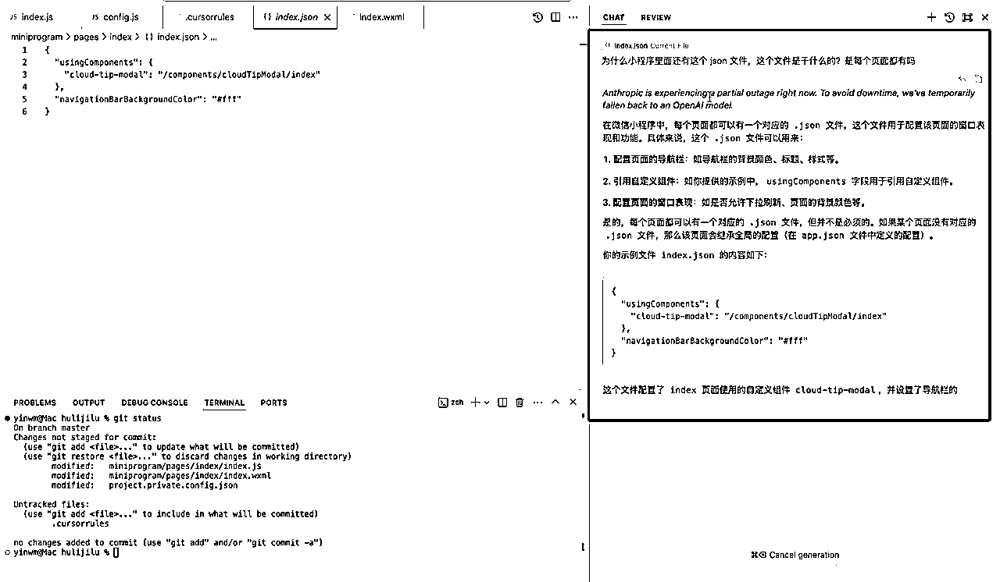
**模式三：就当个普通AI工具用的场合**
偶尔也拿它写写文章、改改文案，这时候它就是个普通AI。但差别还是要认识的：Cursor跑的是专门面向代码的小模型，为了特定编程场景做了优化，所以它会刻意保证“代码的完整性”。基础大模型可不会管这些。因此我不会真的把它当普通AI使，日常更多问的都是和编码强相关的问题。
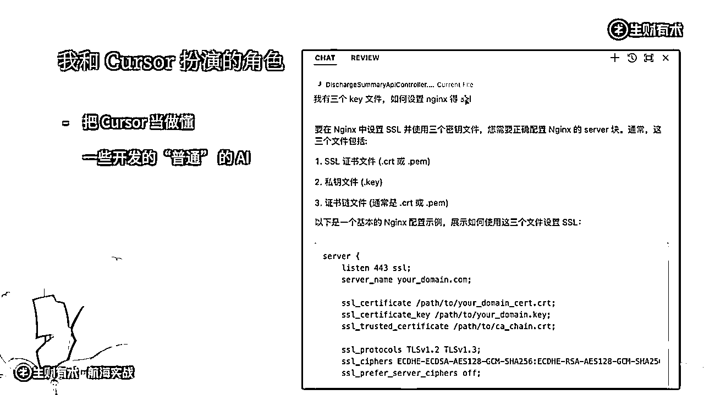
## 几个顺手的工具推荐
### SQLite3 Editor
本地开发我几乎都用SQLite数据库，跟Cursor协同起来特别省心。拿我做小红书视频转文字+分析的功能来举例，这就是我那个SQLite的数据库截图，用起来毫无压力。
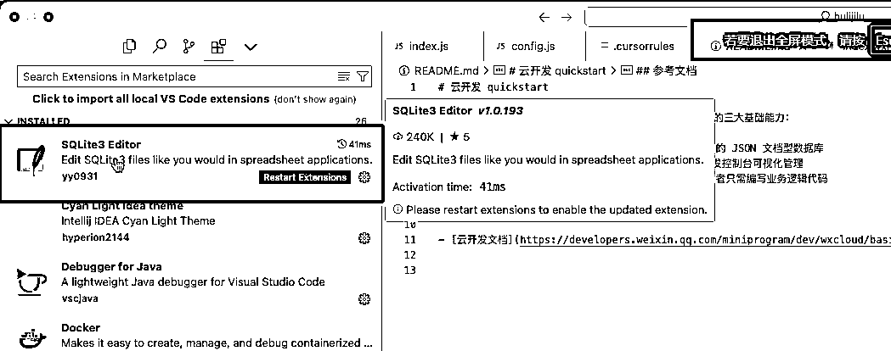
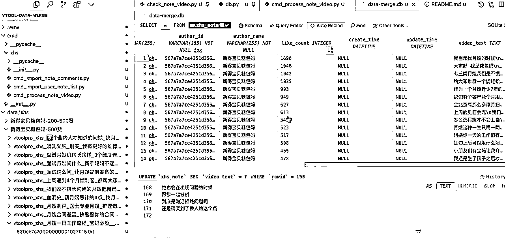
### Cyan Light idea theme
浅灰色主题，我的IDEA皮肤全是它。纯粹因为偏爱这种颜色。
### Excel Viewer
就是用来看Excel表格的。比如这样：

### Git Graph
巨好用，可以直接点击执行create、check out之类的操作，不用切出编辑器。
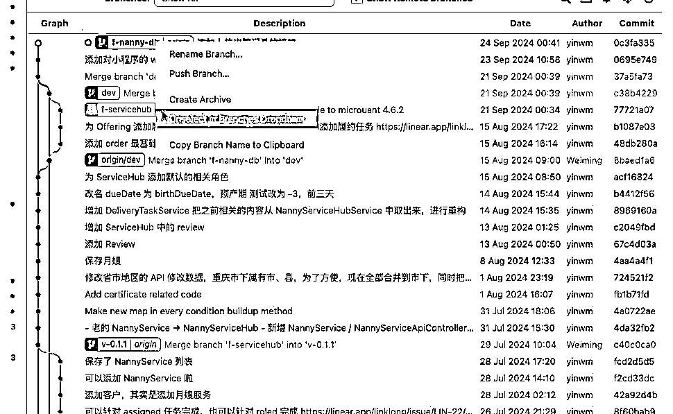
## 三点提醒
1. **别把单文件搞太大**。大得过度会把token直接撑爆。我现在会约束文件保持在600行以内；如果你不太会自己拆文件，那就尽量多让Cursor帮你拆——文件大到某个临界点就根本没法维护了。
2. **人工修改和AI修改混用时要小心**。一个很常见的坑是：你改完的地方AI又给你“改回来”，为了响应你的其他需求来来回回，逻辑就乱了。遇到这种情况，建议直接开一个新对话窗口做“重置”，让Cursor重新读取、重新熟悉文件。
3. **多用Git，经常提交**。
最后，完整回放链接也放在文末。文章已经把核心信息尽量写清楚了，想看具体演示的朋友们，可以去翻这场直播回放：9月24日《【高手领航4】：cursor 在实际项目中的使用经验分享》@大铭。