# DeepSeek × 微信公号实操手册
作者：龙哥

我是龙哥。最近 DeepSeek 的风头很劲，身边越来越多人开始用这个国产大模型。作为对热点一向敏感的微信公号经营者，我也跟着下场试了试水。这篇手册的初衷很简单：带刚入门的新手做号者走一遍流程，学会自己去发现问题、调整方向。全文约三万字，绝大多数内容是我向 DS 提问后整理出来的，再结合个人实操经验做了修正。合理提问，让我一天就能写完这么长的文档；内容紧扣新手做号的实际需要；部分思路参考了清华团队关于 DeepSeek 的公开教材。

微信公号有四个底层特性：私域流量、深度阅读、规则齐全、互动性强。

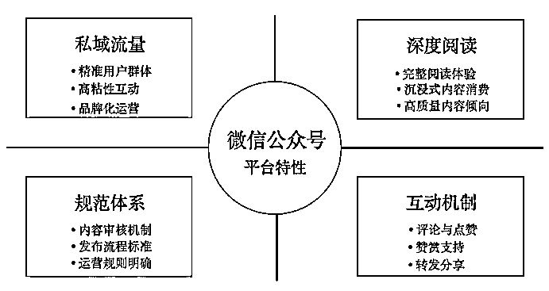

对做号者来说：

产出端：靠 AI 提效，但人工审核和创意主导权不能丢；文章分章节、关键句加粗，让读者读起来不累。

风控端：建一套 AI + 人工双重审核机制，别让敏感词绊倒账号；定期更新 AI 的知识库，让它跟上当下的规则。

读者端：用 AI 做读者分层，针对不同人群设计互动方式和话题；再通过赞赏、转发这些数据，找到更顺的变现路径。

迭代端：用互动数据训练 AI 预测下一篇稿子的表现，反向调整话题和形式；多关注评论里的情绪，快速回应读者。

这便是我眼中的微信公号底层爆款逻辑。

### 爆款推送的底层逻辑

爆款推送的本质，是回应读者的困扰，同时调动他们的情绪，让他们想转发给更多人。不管你在哪个领域，抓住三条就够：

1. 读者想要什么？——痛处、爽感、痒处

2. 你能交付什么？——干货、解法

3. 读者为什么愿意转发？——情绪、社交货币

下文我会一直站在“我该如何讨好读者”的角度来拆解。核心结论是：只服务同频的人，而不是想着男女老少通吃。

### 读者想要什么？

读者需要痛处共鸣、爽感刺激和痒处吸引。只有让他们愿意看，后续才有变现的机会。

痛处共鸣，就是找到大家普遍觉得烦心的事。职场方面，活儿多到做不完、天天加班、领导要求又高；情感方面，失恋后的痛苦和孤独感；健康方面，总担心自己生病，看到别人得病也忍不住对号入座。

做号者要投其所好，去关心、去安慰、去解决问题。可惜很多同行根本不知道自己读者到底卡在哪，最需要解决的又是什么。

👉 不妨这样指令 DS：

```
背景：我的公众号里'粉丝群体'居多。
提问：他们有哪些痛点？我该如何去把握他们的痛点，创造爆款？
要求：请帮我分点输出，同时举例子说明，使用小白能够看懂的语言表达。
```

如果对回复不满意，就继续追问，直到拿到自己想要的答案：

```
在我们实际生活中，他们通常会怎么去解决？
```

爽感刺激，就是那些看完让人觉得“太棒了”“终于等到这一刻”的内容。比如小说里主角突然逆袭、打败反派，特别解气；游戏里完成超难任务、拿到稀有装备，成就感爆棚；又或者刷到一个搞笑段子，笑得停不下来，心情瞬间变好。

👉 把需求抛给 DS：

```
背景：我的公众号里'粉丝群体'居多。
提问：他们能够Get到哪些爽点？我该如何去把握这些爽点，创造爆款？
要求：请帮我分点输出，同时举例子说明，使用小白能够看懂的语言。'
```

痒处吸引，指读者心里惦记但还没被满足的东西。看到别人在乡下有大房子、种菜养花，自己也向往；财富自由，不用上班也有钱花；颜值提升，看到别人好看，自己也希望变漂亮。

👉 继续向 DS 提问：

```
背景：我的公众号里'粉丝群体'居多，
提问：在某件事中，他们的痒点是什么？我该如何去把握这些爽点，创造爆款？
要求：请帮我分点输出，同时举例子说明，使用小白能够看懂的语言。
```

重点提示：这一步不能省。DS 的回复能帮我们贴着读者需求去写文章；记得把生成的答案存到本地；提示词里标出的绿色文字，需要你亲手填写。

### 别忽略后台数据

很多做号者打理账号时，几乎不怎么看后台数据，更别说吃透读者画像。我拿自己的爆文号来举例：后台画像概览页能看到，关注者主要是中老年、黄河北部、男性。

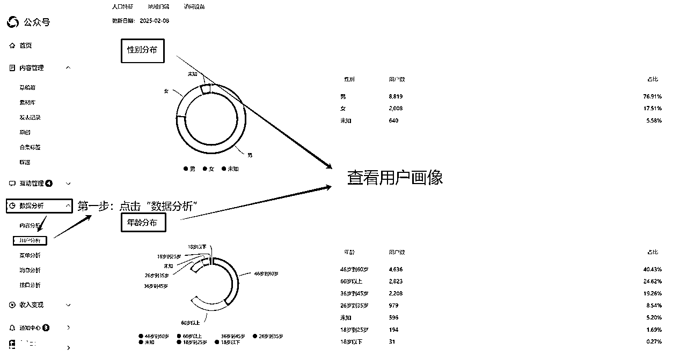

这些表面标签背后还有更多信息，DS 能帮忙挖出来。操作分两步：

第一步：上传后台画像截图（可以多张同时上传），最好开推理模式，对它说：

```
请帮我看看我公众号的粉丝画像。
```

DS 会给出反馈：

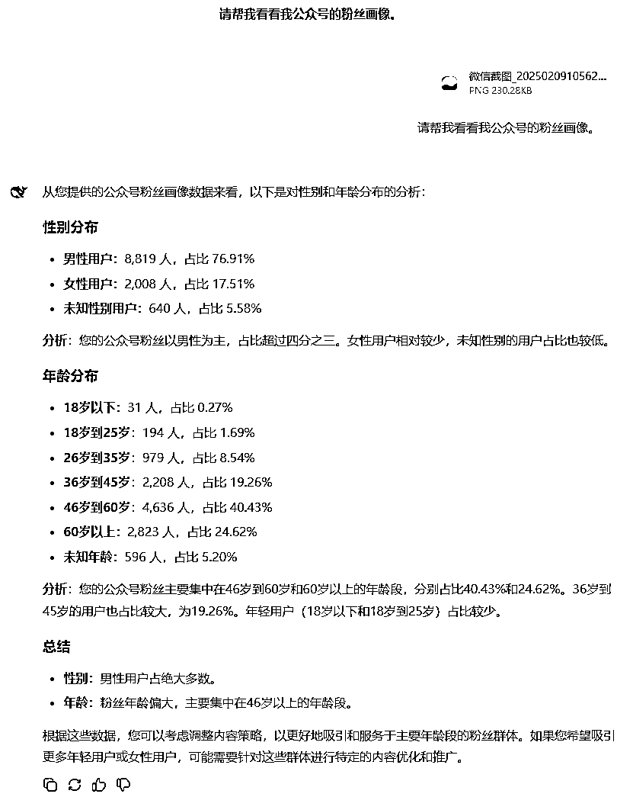

第二步：根据回复，换成普通模式继续追问：

```
提问：这些粉丝在'某些方面'中，他们的痛点、痒点、爽点是什么？我该如何去把握这些爽点，创造爆款？
要求：请帮我分点输出，同时举例子说明，使用小白能够看懂的语言表达。
```

DS 会继续回答（这里只截取一部分，更完整的建议自己试）：

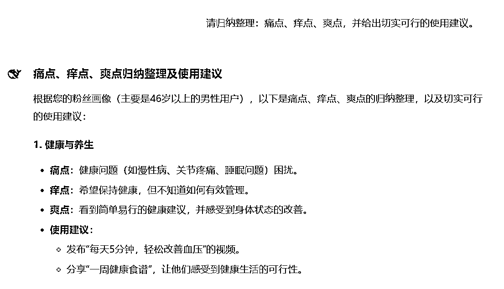

小贴士：向 DS 了解这类问题时，多用普通模式，回复更快也更稳定。

### 你能交付什么？

选题规划的关键，是明确自己的位置和对读者的用处。我只深耕一个细分赛道，因为我知道在这个赛道里能拿出什么东西。稿子能切实帮到读者，才是他们阅读、点赞、转发甚至关注的理由。

新手最怕的就是选不出来题。清华的 DS 指南里提到，写出合格提示词要想清楚两件事：第一，你到底想要什么？第二，DS 到底能帮你做什么？文档里给出的选题提示词是这样的：

```
任务目标：生成[具体领域]的选题规划
背景信息：
- 账号定位：[填写定位]
- 目标用户：[用户画像]
- 核心诉求：[用户需求]
要求：
（1）生成10个选题方向
（2）每个选题包含：
- 主标题
- 副标题
- 核心观点
- 价值主张
（3）考虑时效性与持久性的平衡
输出格式：表格呈现
```

它会逼你把定位、读者画像、读者诉求全部理顺。

给出价值这件事重要在哪？读者点开文章，是为了解决问题或满足需要，如果你的稿子没用，他立刻就会关掉；长期提供有用的内容，读者才会信任你，慢慢变成铁杆粉；人们只会转发对自己或他人有帮助的东西，有价值才更容易被传播。

具体来说，你能从这几个方向给读者交付东西：

**实用招法**：给出能直接上手的技巧、方法、步骤。比如职场类，可以聊“提高工作效率的五个方法”“让领导记住你的三个技巧”；理财类，可以聊“月薪 5000 怎么攒下 10 万”“新手从零开始学理财”。

**情绪同频**：用故事或观点让读者觉得“被理解”。情感类，比如“那些年我们错过的爱情”“婚姻里最可怕的不是吵架”；励志类，比如“从月薪三千到年薪五十万，我做了什么”“三十岁开始努力晚不晚”。

**新知增量**：提供大家不知道的新趋势、新观点。科技类，比如“2024 年值得关注的科技风向”“AI 会怎样改变生活”；健康类，比如“每天喝咖啡到底伤不伤身”“熬夜的危害有多少科学依据”。

**娱乐感**：用幽默、搞笑、轻松的内容让人开心。搞笑类，比如“当代年轻人的迷惑行为”“考试时干过的糗事”；影视类，比如“《狂飙》名场面盘点”“2024 年最值得看的贺岁片”。

**工具安利**：推荐好用的工具或资源，帮读者提效。职场类有“让工作翻倍的办公软件”“用 Notebook 搭建工作流”；学习类有“这些学习 App 值得下载”“用 Anki 高效背单词”。

**风向解读**：拆解行业趋势和社会现象。商业类有“2024 年值得关注的行业”“直播带货为什么这么火”；社会类有“年轻人怎么越来越不想结婚”“内卷背后的真相”。

**文化拆解**：品味文化现象背后的东西。比如“国潮崛起藏着哪些密码”“《流浪地球》为什么能火遍全球”。

读者要的是“需求”还是“价值”？需求是最低标准，差不多能看就行；价值是更高要求，要让人感觉被照顾、情绪被接住、问题被解决。

那么，怎么摸清读者的真实需要？

1. 观察读者的一举一动：后台数据、评论区、专属社群都是线索。评论区里，重点看争论点——他们在争什么；建议点——他们希望补上什么；认同点——他们认可什么，往往就是他们最需要什么。

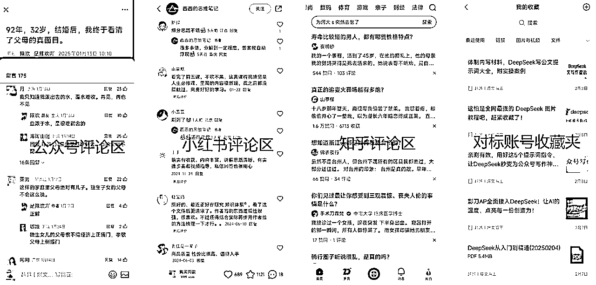

2. 定期发起投票：后台有投票模块，直接问关注者想看什么。投票结果就是内容方向的最好参考。

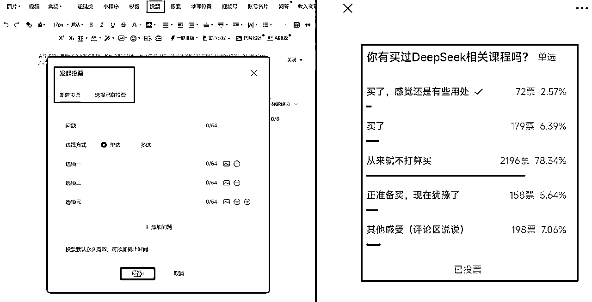

3. 对标同类账号：去主流内容平台搜关键词，把面向同一人群的爆款文章找出来，看标题、文案、配图里反复出现的高频表述。

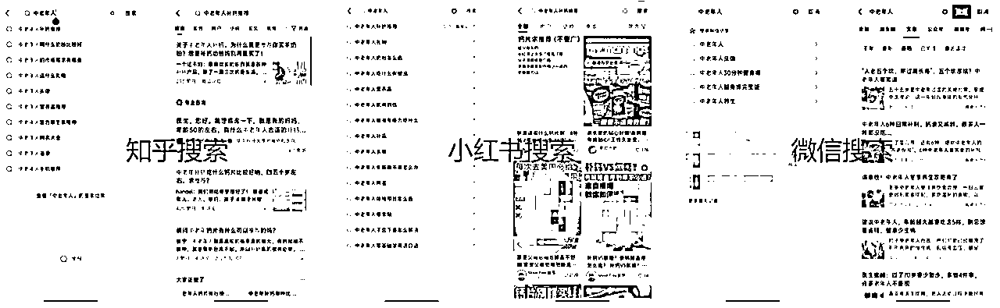

在微信站内，可以用元宝、微信关键词热度、站内搜索来做对标，还要关注数据异常的部分——那通常是读者最关心的内容。元宝可以直接提问；关键词热度越高，说明关注越多；站内搜索里 10w+ 文章越多，说明需求越大。

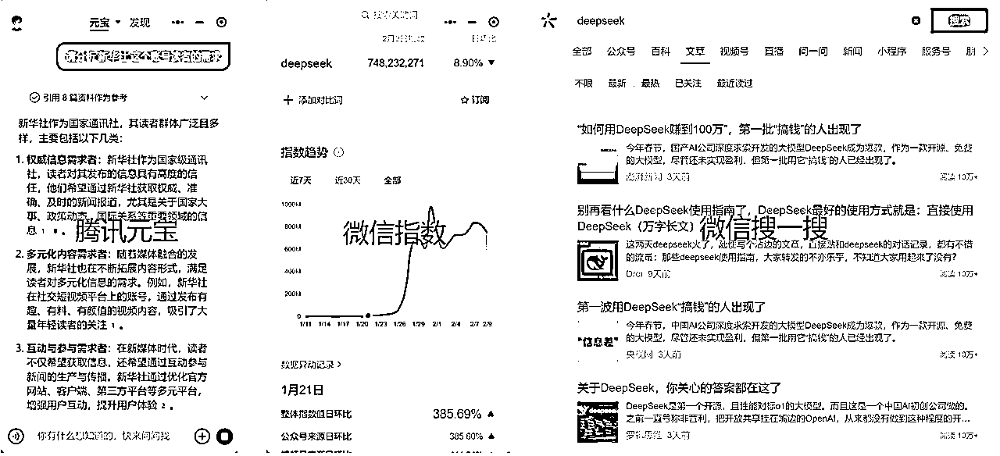

### 热点怎么蹭？

热点爆发时，内容会一下子涌出来，但其中藏着可以借鉴的实用信息。最简单的办法：打开 DS 的联网搜索，让它在线搜索并整理网友的观点。

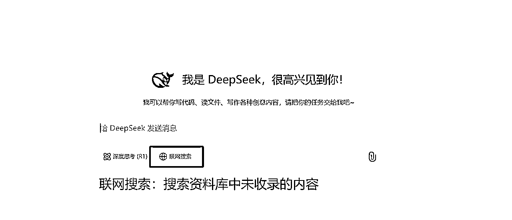

具体流程可以这样走：

第一步：用推理模式 + 联网，让它分析大众观点：

```
请分析大众对'具体热点事件'的不同观点。
```

等它输出。

第二步：换成普通模式 + 联网，继续追问：

```
从刚才的分析中，输出不同观点网友的实际需求，他们需要什么价值？
```

等它输出。

第三步：再来一轮：

```
请你满足用户的'价值'，生成10个高价值的'标题/选题'建议。
```

小贴士：想知道最近的热点，可以直接问 DS 某个领域的榜单，或者直接把具体事件丢给它。

拿动画电影《哪吒2》当例子，看看 DS 怎么拆解网友在这个事件里需要的“价值”：

第一步：先拿观点框架：

```
请分析大众对'具体热点事件'的不同观点。
```

DS 会回复：

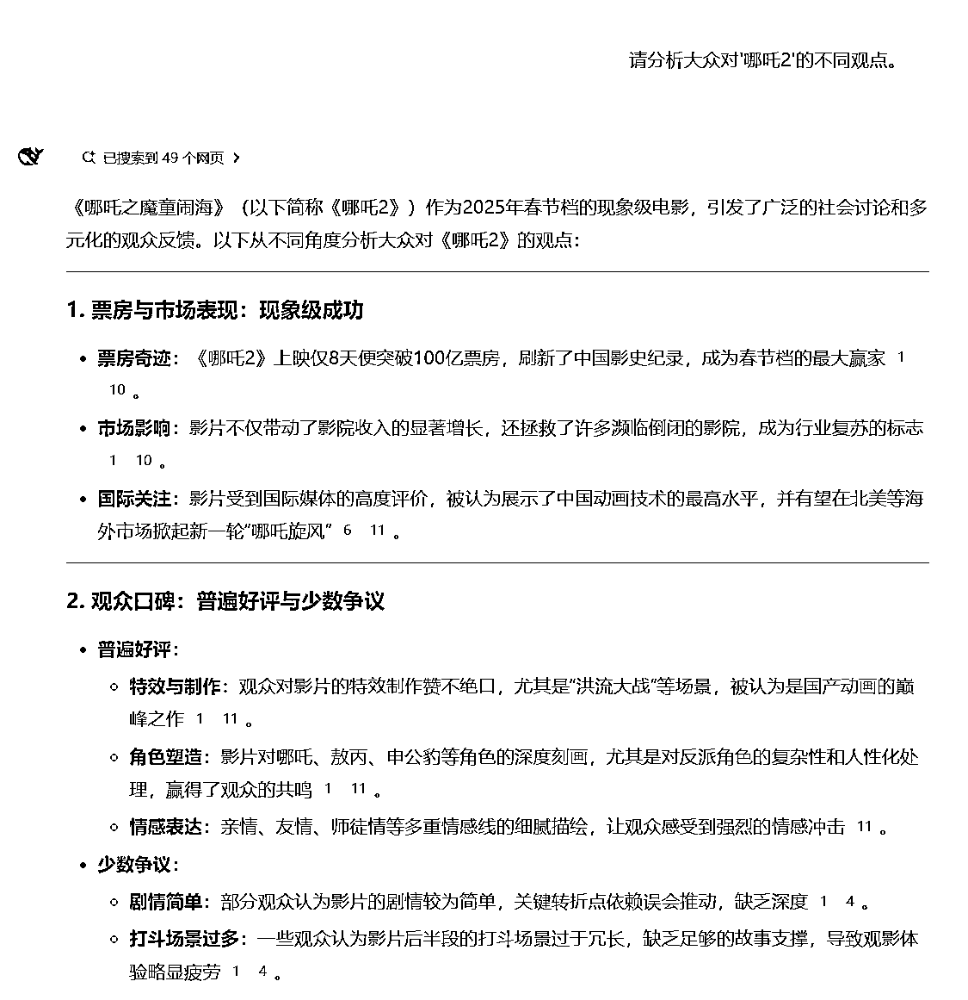

第二步：继续追问：

```
从刚才的分析中，输出不同观点网友的实际'需求/价值'。
```

DS 会回复：

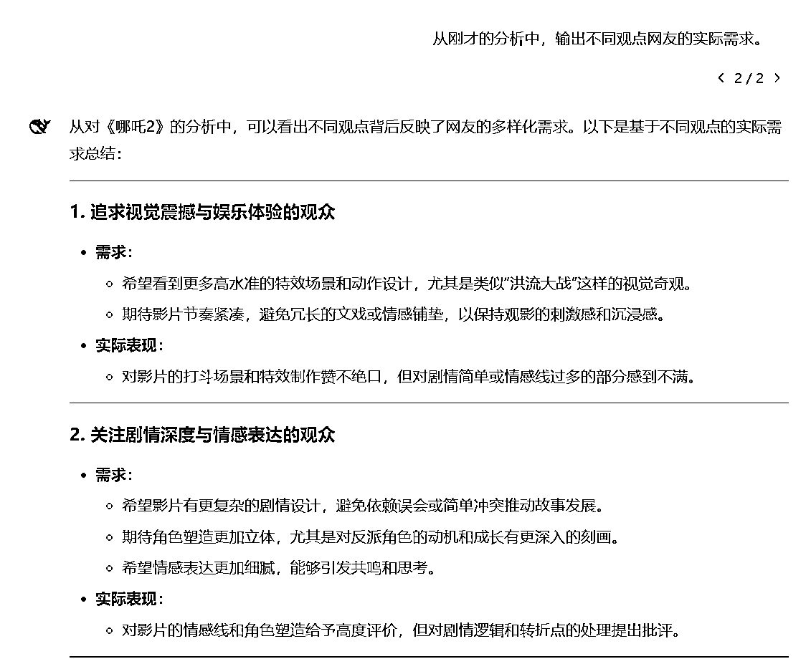

第三步：再追问：

```
请你满足用户的'期待影片节奏紧凑，避免冗长的文戏或情感铺垫，以保持观影的刺激感和沉浸感。'，生成10个高价值的爆款'标题/选题'。
```

DS 会回复：

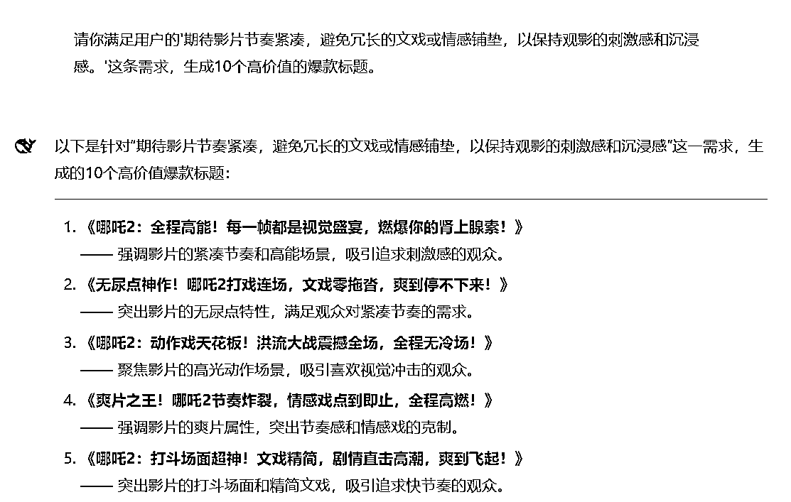

小贴士：连续使用普通模式时，应该一边人工归纳当前的结果，一边等系统恢复。推理模式大约半小时一次；普通模式每小时控制在十次左右。

### 做出和别人不一样的东西

用 AI 做号，最怕被人抄袭、洗稿、搬运。稿子是流量的城墙，区别度就是城墙里的活水。

什么叫区别度？就是你的内容在主题、角度、形式或深度上，跟同类内容明显不一样，能给出别处看不到的独特价值。

常见做法有：换一个独特视角解读同一件事；把分析做得更专业、更细致；针对特定人群或场景，给出更落地的建议；用故事、案例、幽默把表达变得更生动。

读者为什么看重区别度？重复的内容基本没人愿意看第二遍。现在不少爆款其实是换汤不换药，话题高度相似，只是换了个外壳。有区别度能避免审美疲劳，帮你立住人设，让读者心甘情愿一直追。

同质化的典型表现有两种：让 AI 仿写某篇爆款，只改表达不改观点；配图直接拿对标的图或者网上现成的图，这类情况在轻图文阵地里尤其常见。

怎么一步步做出区别度？

第一，找到独特的切入点：

```
方案一：结合'专业背景或经历'在'同类话题'中，找一个未被充分挖掘的角度。
方案二：结合'专业背景或经历'针对'特定人群或场景'，提供更精准的内容。
方案三：请为这篇'文章内容'，输出差异化观点。
方案四：请结合'热点事件中网友的观点'，输出差异化观点。
方案五：请结合'评论区留言'，输出差异化观点。
```

比如，普通话题是“如何提高工作效率”，区别化话题可以聚焦“职场妈妈如何在工作和家庭之间找到平衡”。具体可以去同类文章的评论区，找还没被满足的诉求；或者结合自己的专业背景和经历，提供独家视角。

第二，把分析做扎实：

```
方案一：针对'话题/观点/事件'，结合真实的数据、案例或专业理论，增强内容的权威性和深度。
方案二：将'话题/观点/事件'拆解成多个维度，逐一分析。
```

比如，“如何理财”是泛泛而谈，“月薪 5000 怎么理财，给新手的三个方法和真实案例”才是更有力度的内容。

第三，锁定特定人群：

```
方案一：将'话题/观点/事件'聚焦于'粉丝画像'人群，提供更精准的解决方案。
```

比如，“如何减肥”不够具体，“上班族怎么利用碎片时间减肥”就更指向明确。

第四，借势热点话题：

```
方案一：请将'某某观点'与'具体领域'结合，输出爆款差异化观点。
方案二：请将'某某观点'与'热点事件'结合，输出爆款差异化观点。
```

比如，热点落在“长假收尾”这个节点上，就可以围绕返工、开工、新年计划去做文章。

写到最后你会发现，DeepSeek 只是一个加速器，真正的判断力、共情力、选题感，依然长在你自己的脑子里。多提问、多追问、多整理，这套方法才能变成一个属于你的爆款引擎。

标题可以这样设计：《假期结束，怎么快速找回工作状态？5个实用建议》

先讲个规律：读者永远只会记住有画面感的内容。同样是"节后收心"，与其丢出一堆干巴巴的技巧，不如把个人经历和改变过程写成故事。

想做出差异化，先让 AI 帮你打开思路。以 DeepSeek 为例，勾选深度思考+联网，然后给它一个任务：

```
这是'人物故事/经历'，输出一篇有深度、差异化爆款文章观点。
```

举个例子：

普通标题：《如何提升工作效率？》

故事标题：《从拖延症患者变成高效达人，我到底经历了什么？》

说到底，就是要摸透读者想要什么、快速接住当下热点、给出别人给不出的价值。这样文章才有明确的针对性。选哪个领域其实不是关键，关键是持续收集读者反馈，靠数据去调整方向。

#### 平台真正需要什么

想在公号里赚钱，先得理解平台的规则和调性。对 AI 自媒体人来说，最基础也最重要的事，就是把规则吃透。

##### 好稿子，平台会帮你传播

只有关注你的读者，才能在第一时间看到推送。但平台会给优质文章额外的推荐，哪怕你 0 粉丝，文章写得好，陌生人一样能刷到。

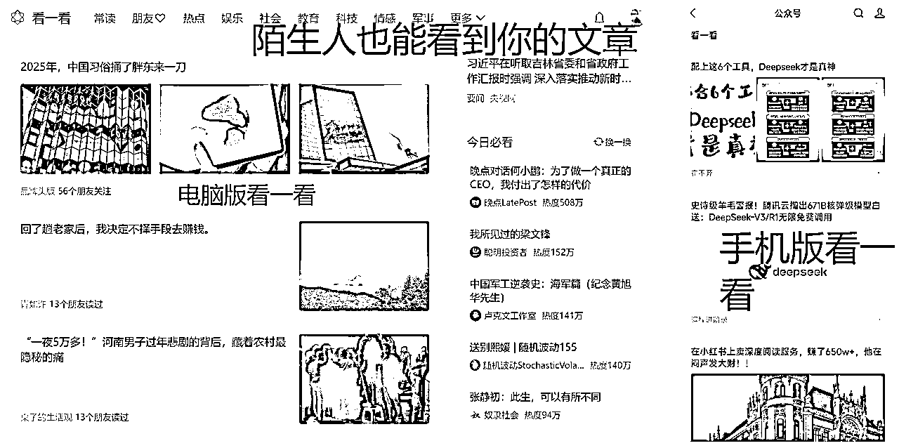

平台会发现好稿，读者会发现好稿，传播链会自己转起来。读者觉得文章有用，就会转发到朋友圈、微信群；读者被打动，就会点赞、留言、点"在看"。每一次互动，都是把文章推向更多人的推力。

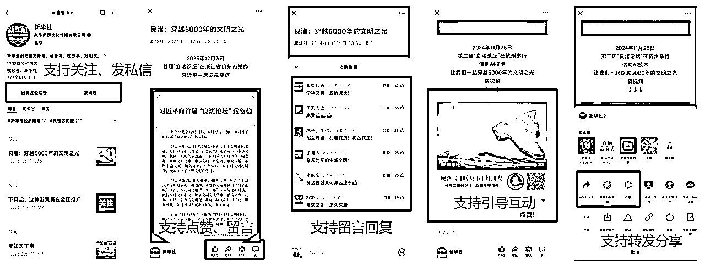

##### 表达方式不止一种

公号不仅支持图文（图文依旧是最常见的形态），还能发视频、音频，也能做直播。文章里可以嵌入视频号，也可以插入文字配图。

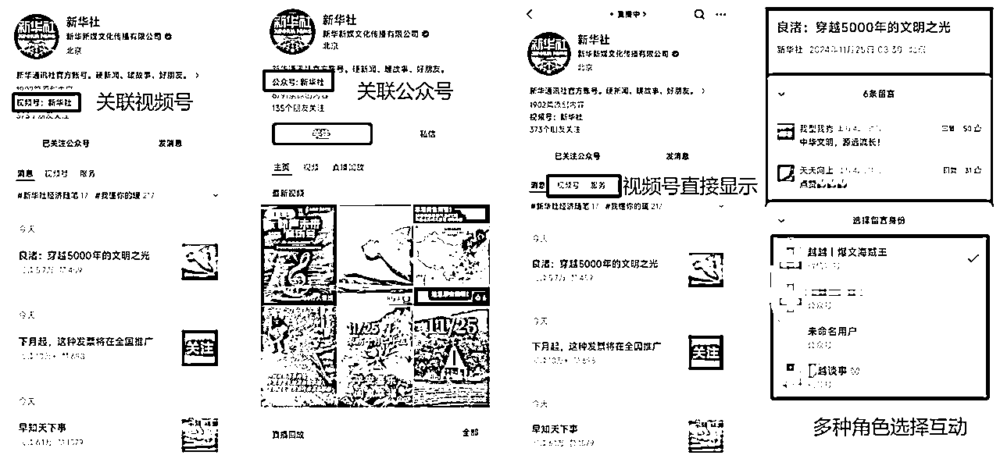

##### 优质稿件，系统会加推

公号里的"看一看"，就是按兴趣做分发的推荐入口。系统会先小范围试推，数据反馈不错，再放量。地域上，会先从发文地附近开始；粉丝上，会先推给已有关注者，互动情况再回流到算法。

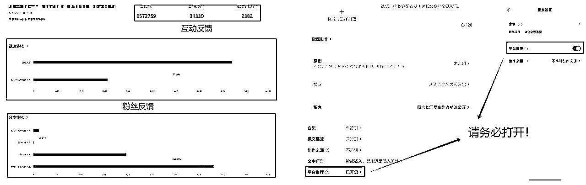

互动数据越亮眼，系统给的机会就越多。点赞、评论一多，系统就会认定这是好内容，推给更多匹配标签的人。比如：平时常看同类文章、常搜相关关键词、聊天里经常提到某个词的人。

当然，并不是每篇稿子都会被推荐，下面的提醒要收好。

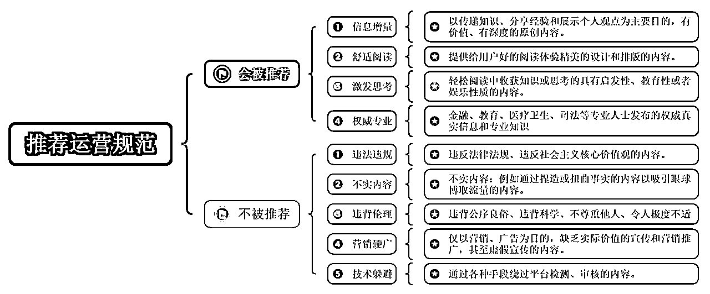

很多人疑惑：我的号为什么一直没推荐？原因有很多，拿着下面清单逐条对照就知道。

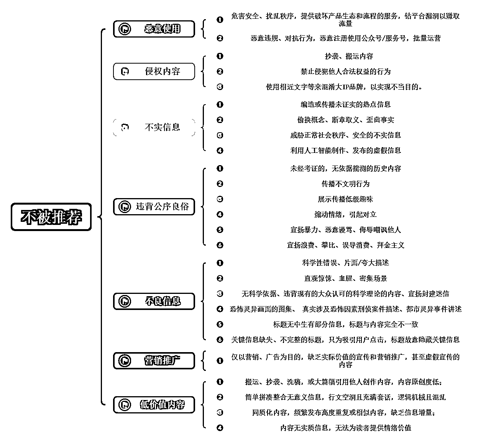

如果你拿不准文章里哪里会踩线，我有两个建议：一是文章要扎进真实场景，给读者有用的东西，别空谈、别硬卖；二是排版要舒服，层次分明，图片清晰，阅读体验要好。

下面这几种"不被推荐"的常见情况，都是我提前梳理出来的，你可以一条条核对。

```
方案一：请根据'公众号运营规范和官方违规案例'，帮我判断我的文章是否存在违规风险？
方案二：请根据'公众号运营推荐规范和官方违规案例'，请帮我优化'文章内容'的推荐率？
```

信息增量不足

内容太泛，没有新知识或独特观点。

比如写《如何提高工作效率》，只会说"早睡早起、列好待办清单"，完全没有深度。改成《我用番茄工作法，3小时完成一天的工作》，把具体步骤和前后对比写出来，才有价值。

排版混乱，阅读费劲

整篇文字堆在一起，没有分段、没有小标题、没有图片，2000字的旅行攻略让人看不下去。

补救办法：用"交通指南""美食清单""避坑提醒"做小标题，配上实拍图和地图截图，让读者一眼就能定位。

内容不痛不痒，缺少启发

比如写《年轻人为什么爱熬夜》，只描述现象，不分析原因，也不给办法。

真正有用的做法，是深挖熬夜背后的心理需求，用心理学视角给出"如何靠时间管理改善状态"的建议。

专业度撑不住

写《喝红酒能预防心脏病》，却不引用任何研究报告或专家观点，全靠主观判断。

改进：查权威医学期刊的数据，标明"适量饮酒"这个前提，避免误导读者。

标题党、假消息

《震惊！某明星突然宣布退圈》这种标题，正文却只是普通娱乐新闻，读者点进去只会觉得被骗。

改进：让标题和内容保持一致。比如《某明星新剧开播，演技获好评》，标题党没有意义。

价值观跑偏

《女性30岁不结婚就是失败》这种说法，本身就带着歧视和偏见。

改进：换成《30岁女性的多元人生选择》，聊聊不同生活方式的取舍，传递积极正面的态度。

硬广太明显

《这款产品让你年轻10岁》，整篇都在推销护肤品，没有真实体验，也没有评测。

改进：做《30天实测：这款护肤品真的有效吗？》这样的内容，记录真实使用感受，客观分析优劣。

技术手段绕审核

改进：走合规路径。比如通过公号菜单栏做推广引导，而不是偷偷摸摸绕审核。

##### 粉丝的变现潜力很大

微信是大家每天都在用的工具，公号的触达效率极高。你每天早上发一篇，关注者打开微信就能看见。内容持续对口，他们就会一直留下，变成你的铁杆读者。

##### 好文章不会被时间淘汰

公号文章和新闻不同，不会过几天就消失。优质的内容会继续被搜索到、被推荐到，也可能通过历史消息被翻出来。比如你写过一篇《如何学好英语》，一年后还有人在搜。真正的爆款，半年后、几年后依然能带来流量。

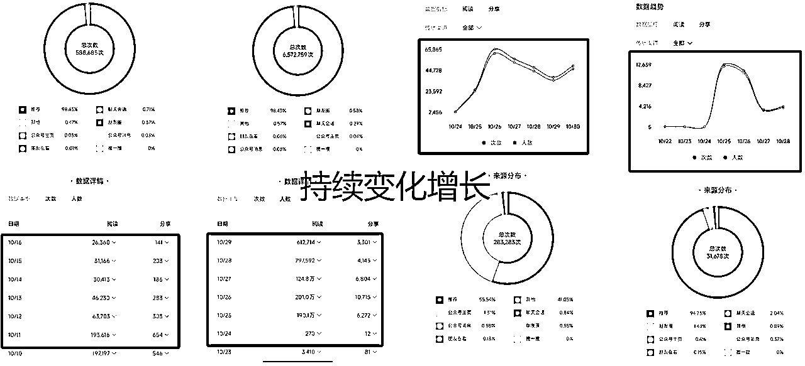

##### 变现渠道比想象中更多

粉丝量上来之后，可以开通流量主，文章底部自动带广告，按点击量产生收益；可以设置付费阅读，让读者为高价值内容买单；可以插入商品链接，成交了就有佣金；可以开课、建社群，教别人写作或理财；账号影响力够了，品牌方也会主动找来谈合作。

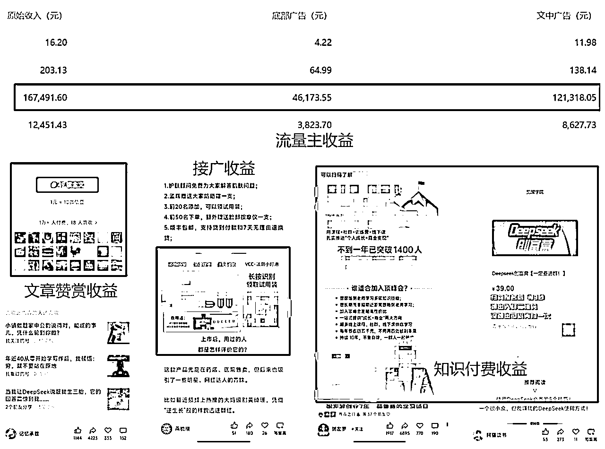

##### 小号也有机会冒头

注册一个公号非常简单，但运营好它并不容易。就像开一家店，门面要好看、货品要靠谱，客人才愿意进来。大号确实有先天优势，但小号只要内容靠谱，也能一点点做起来。

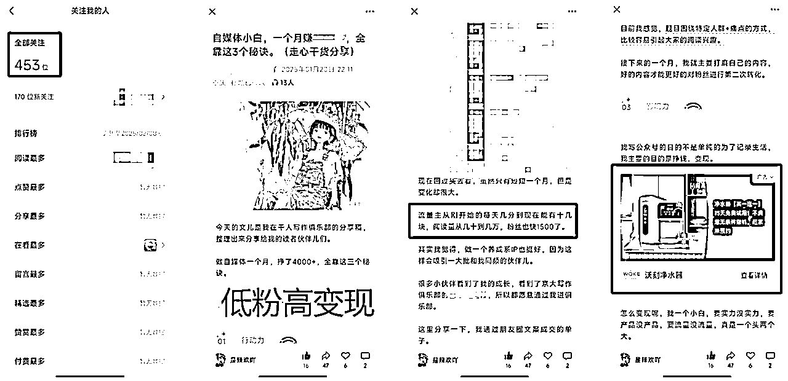

##### 让数据当你的导航

公号后台能看见阅读量、点赞量、留言数，还有读者年龄、性别、地区分布。这些数据会告诉你，读者到底喜欢什么。比如后台数据显示职场类内容更受欢迎，那就多安排这类选题。

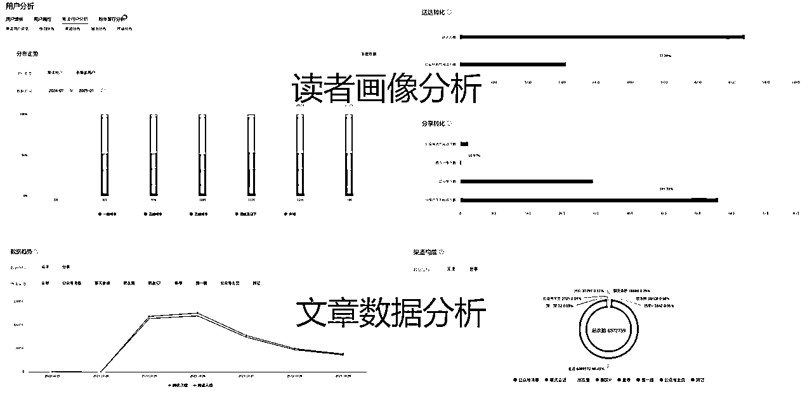

##### 规则红线碰不得

平台对内容的审核非常严格。虚假信息、敏感话题、过度营销，都在禁止之列。如果你的标题骗人点进来，正文却对不上，轻则警告，重则封号。守好规矩，才能长久。

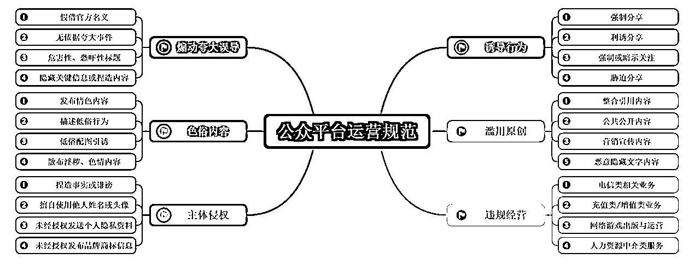

#### 读者转发背后的秘密

人为什么要转发一篇文章？底层动机无非两种：情绪驱动和社交货币。文章让人感动、愤怒、好奇、自豪，读者就会想表达、想分享；文章能在社交中帮读者加分、传话、制造话题，ta 也会主动转发。

##### 先调动情绪

情绪才是分享的第一推动力。

感动与共鸣

用真实故事或犀利观点，让读者觉得"这说的就是我"。

交给 AI 生成（通用模式）：

```
请帮我分析'文章内容'中能够产生情感共鸣的细节。
```

愤怒与正义感

替读者说出他们说不出口的憋屈，戳穿不公。

交给 AI 生成（通用模式+联网）：

```
请你结合'热点事件/文章内容'输出犀利观点，用数据和案例增强说服力。
```

好奇与惊喜

制造悬念，设置反转，让读者不看完不痛快。

交给 AI 生成（通用模式+联网）：

```
请优化'文章内容'中所体现的“好奇与惊喜”。
```

自豪与成就感

让读者觉得"我又学到了""我被看见了"，产生满足感。

交给 AI 生成（通用模式+联网）：

```
'文章内容'中哪些内容让用户感觉到自豪和成就感？请帮我优化。
```

##### 让文章替你立人设

风格足够独特，读者只看几行字就能认出作者是你。

塑造人设

文章在替你自我介绍。让 AI 帮你提炼独特人设（通用模式+联网）：

```
请帮我分析'文章内容'中的人设，我该怎样去模仿？
```

传递价值

让文章成为读者送给朋友、家人的一份"礼物"。让 AI 帮你设计可传递的价值点（通用模式+联网）：

```
请分析'文章内容/文章标题'能够为用户传递什么价值？请帮我优化。
```

制造话题

让文章成为一个引子，激发读者讨论欲。让 AI 帮你找话题题眼（通用模式+联网）：

```
请分析'文章内容/文章标题'中能激发用户剧烈讨论的内容。
```

##### 分享的助推器

阅读量能涨上去，无非是情绪价值和社交价值同时被满足了。第一，设计情感共鸣点，让读者由衷感叹"说到我心坎里去了"；第二，提供社交价值，让读者觉得"转发出去，对我有面子也有好处"。

提炼金句

把核心观点压缩成一句话，短促、有力、好记。让 AI 帮你写（通用模式+联网）：

```
方案一：我有'观点'，请生成'10'个爆款金句，要求'富有传播力、让用户印象深刻'。
方案二：请根据'文章段落'，生成'传播力强'的爆款金句。
方案三：请根据'热点事件'中网友的观点，生成爆款金句。
```

用福利换转发

读者完成转发，就能领资料或参与抽奖。比如："把这篇文章转到朋友圈，截图发给后台，就能拿到《新手理财指南》。"

福利要想有效，必须注意四点：对目标读者有足够吸引力；操作门槛越低越好；兑现要及时；千万不要写"必须转，不然会有坏结果"这类话。

文末抛问题

在文章最后抛一个话题，请读者留言。比如："你有过类似的经历吗？欢迎在评论区说说。"

让 AI 帮你设计互动问题（通用模式+联网）：

```
请帮我设计10个适用于公众号文章结尾的互动引导钩子。
```

等 AI 给完回复，人工再做一轮判断：

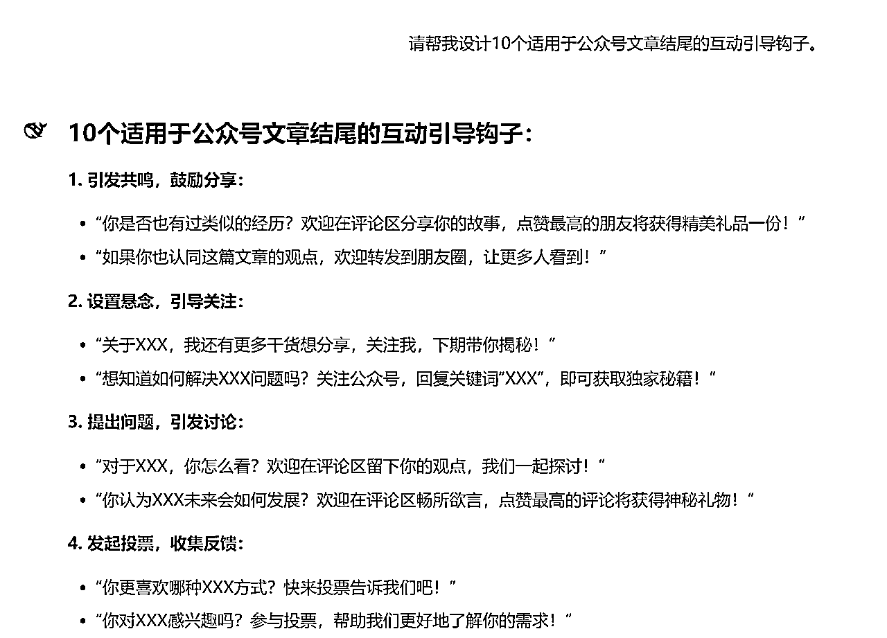

##### 组合运用更聪明

实际操作中，不需要每个条件都满足，而是看文章主题和素材特征，选最合适的。上面的所有 AI 指令，既可以用来拆解对标文章，也可以用来给自己的文章做体检。

再分享一套写原创文章的完整流程：

第一步：用深度思考+联网模式，让 AI 给出三个选题方向，挑一个最感兴趣的：

```
方案一：结合'热点事件中的某个观点'，为我生成符合专业人士、有高价值、能够引发用户互动的爆款文章大纲。
方案二：结合'文章内容'，为我生成差异化极高、又能吸引用户阅读互动的爆款文章大纲。
方案三：结合'某某观点'，为我生成极具阅读感、差异化的爆款文章大纲。
```

第二步：用通用+联网模式，让 AI 搭出文章框架：

```
请填充刚才生成的文章大纲，要求包含故事+观点+激发用户情绪+引发互动，生成'字数'的爆款文章。
```

第三步：用深度思考+联网模式，让 AI 补充案例和细节：

```
请检查刚才生成的文章，从公众号爆款写作的角度分析，提出优化建议。
```

第四步：用通用+联网模式，让 AI 打磨语言和节奏：

```
请根据优化建议进行优化，生成新文章，并给出排版建议。
```

写完之后，人工先通读一遍，检查表达是否自然、逻辑是否顺畅：

```
重点检查文字语言表述情况，并进行修改。
```

再让 AI 从逻辑和表达角度做一次全文检查（深度思考+联网）：

```
请着重检查'人工调整完毕的文章'是否符合《公众号平台运营规范》。
```

最后再追问一轮，让 AI 继续给出更细的优化建议（深度思考+联网）：

```
根据优化后的文章，生成'10'个爆款标题。
```

## 爆款文章背后的写作算法

归根到底，我们的文章是写给读者和平台看的，他们才是我们的"衣食父母"。写什么，要站在他们的立场上想；怎么表达，要先把观点亮出来。

动笔之前，先准备三张底牌：目标人群画像（年龄/痛点/兴趣）；内容领域定位（职场/情感/科技等）；账号风格设定（严肃/幽默/温情）。这三样想清楚了，不仅能稳定输出，还能在漫长的运营里保持热情。

### 账号定位怎么定

#### 先搞清楚：你为谁写

读者画像要具体：年龄、性别、职业、兴趣、生活习惯。比如职场新人、宝妈、大学生、理财小白。小号能变现，本质上是定位足够精准。文章恰好满足了粉丝需要，粘性自然高，变现能力也会跟着强。

定位的原则只有三条：做得开心；做得专业；做得长久。顺着这三个标准，定位基本就能定下来。

##### 从兴趣和专长里找线索

先认真打量自己：你平常最关心哪些话题？美食、旅行、职场、情感、教育还是科技？你能分享什么技能或经验？职场心得、学习方法、理财知识、育儿经验？兴趣和专长的交集，往往就是内容的方向。

比如你喜欢读书，那就写读书笔记、推荐书单；你擅长理财，那就分享理财技巧、投资心得。

如果对自己还不够了解，可以让 AI 帮你做一次自我梳理（通用+联网）：

```
方案一：我的爱好是'看书（爱好）'，尤其擅长'拆解书籍中的观点（擅长点）'，那么我可以为用户分享什么？
方案二：我的爱好是'看书（爱好）'，尤其擅长'拆解书籍中的观点（擅长点）'，那么我可以为用户产生什么价值？
```

##### 先假设，再验证

如果你还没有明确方向，不妨先假设自己在做"某个领域"。然后问自己：谁会来看？

分享职场经验，目标读者可能是职场新人和求职者；分享育儿经验，目标读者可能是宝妈或准父母。假设定了，再在这基础上往下推。

让 AI（深度思考+联网）帮你一起推演：

```
我想做公众号，我可以分享'技能/经验/方法论'，那么我的文章目标用户是谁？
```

接下来要细化读者画像：多大年纪、什么性别、做什么职业、有什么兴趣和烦恼。比如：25-35岁职场女性，关注个人成长、职场技能和生活方式。

这里还可以用一套更省事的提问模板（通用+联网）：

```
我的文章目标用户是'目标用户'，我想要分享'分享内容'，请细化用户画像。
```

##### 去市场里找答案

调研市场的目的，是为了摸清读者想看什么、怕什么、偏好什么，同时看看同行都做到什么程度，再找到自己的差异化机会。

###### 找对标，学什么

向优秀的人学，能让我们少走弯路。什么才算值得对标的好账号？

首先，方向聚焦，只在某一个具体领域深耕；其次，对象合适，和自己的发展阶段相近且数据可观；再次，数据扎实，经得住分析；第四，借鉴但有创新，不是搬运；最后，要持续跟踪，定期回看。

对标能学哪些东西？写作风格、语言习惯、表达技巧，然后结合自己的主题和目标读者去创造，而不是照着抄。

具体拆解时，可以看两个方面：

1. 内容方面：

选题方向：对方在写什么？怎么找到读者痛点和兴趣点的？

内容质量：文章结构、逻辑、语言，有哪些值得学习的地方？

内容形式：对方用了图文、视频、音频、直播里的哪种？效果如何？

更新频率：对方如何保持稳定输出？

2. 用户运营方面：

读者画像：对方的粉丝是什么群体？年龄、性别、地域、兴趣是什么？

用户增长：对方靠什么吸引新粉丝？采取了哪些推广渠道和玩法？

做自媒体最容易陷入自说自话。与其凭感觉去写，不如先把同赛道已经跑通的号拆开看一遍。这份操作笔记把找对标、拆对标、做小规模验证、搭写作框架串成一条线，并且把每一步都可以交给模型来加速。

先明确拆解的视角

关注读者愿意互动时，注意对方用了哪些拉动手段：是否常抛开放式议题、是否做投票或打卡、是否用小福利刺激留言。关注读者愿意久留时，看对方提供了什么持续回来的理由：栏目是否固定、连载是否稳定、活动是否成体系。

商业化部分要单独盘点：

- 变现路径有哪些：品牌投放、带货、付费内容、社群服务等，哪些更匹配你的定位？

- 效率如何：客单水平、成交比例、复购表现大概在什么区间？

- 体验怎么平衡：商业露出是否让人反感，哪些呈现方式更舒服、哪些环节易劝退？

把重复性拆解交给 AI 是效率关键。下面这组指令可以直接复制使用。

👉 让DeepSeek切到深度分析并打开联网：

输入：解析参考号的核心特征：

```
请分析以下公众号账号的运营特征：
【账号名称】：'账号名称'
【账号简介】：'账号简介'
【目标用户】：'目标用户'
【高频关键词】：'高频关键词'（如：职场、育儿、理财）
【近期热门文章标题】：
1\. '文章一'
2\. '文章二'
3\. '文章三'
请总结：
- 该账号的核心定位和差异化优势
- 内容选题的规律和爆款共性
- 可借鉴的运营策略（互动/排版/变现等）
```

输入：逐篇拆解参考文章：

```
请分析以下文章的成功要素：
【文章标题】：'文章标题'
【文章内容】：'文章正文'
请分析：
1\. 标题吸引力的3个技巧
2\. 文章结构框架（痛点引入-解决方案-升华总结等）
3\. 引发共鸣的金句/案例
4\. 可复用的写作模板
```

输入：把相关数据放在一起做横向比较：

```
我的账号近期数据：
平均阅读量：'阅读量'
点赞率：'点赞率'
转发率：'转发率'
用户留言高频词：'高频词'
对标账号数据：
- 平均阅读量：'阅读量'
- 点赞率：'点赞率'
- 转发率：'转发率'
- 用户留言高频词：'高频词'
请分析：
1\. 双方的核心差距点
2\. 用户需求差异
3\. 内容优化建议
```

👉 保持深度分析并联网继续追问：

输入：给出可复制的操作案例：

```
请分析以下账号特征：
【账号名称】职场进化论
【账号简介】专注职场新人到高管的成长方法论
【高频关键词】跳槽、沟通、升职、时间管理
【近期爆款标题】：
1\. 《领导最反感的3种汇报方式，90%的人中招》
2\. 《月薪5K和5W的人，差的不只是能力》
3\. 《被裁员后，我靠这2个副业月入3W》
```

几条实操度很高的技巧：

- 让模型归纳标题规律：把多篇爆款标题丢进去，让它提炼共性。比如把数字+身份+痛点的组合方式提炼出来。

- 让模型读评论：把留言整理成文本，让它总结高频诉求和情绪倾向，就能知道哪类内容更易被记住。

- 让模型倒推运营节奏：从更新记录反推规律，比如某号周中发干货周末抛互动，模型会建议参考其排期逻辑。

挑选对标对象要把握三点：

- 不要只看体量：粉丝规模大不等于可学，要挑定位接近、成长阶段相近的号。

- 不要只看表面数据：阅读与点赞是结果，要挖出结果背后的做法，再对照自身差距。

- 不要直接复制：别人的打法要经消化再改造，保留适配的部分，剔除不合适的部分。

找不到入口时可以这样搜：

在微信搜一搜里输入与你方向相关的核心关键词，比如“职场”“育儿”“理财”。从排序靠前的号里挑几个重点观察：表达口吻、更新频率、粉丝互动话题，全部记录下来。

👉 让DeepSeek做初筛（通用模式+联网）：

```
我的内容方向是'内容方向'，用于在微信“搜一搜”中进行搜索，请帮我生成10个公众号搜索的细分关键词。
```

将模型的建议收集起来：

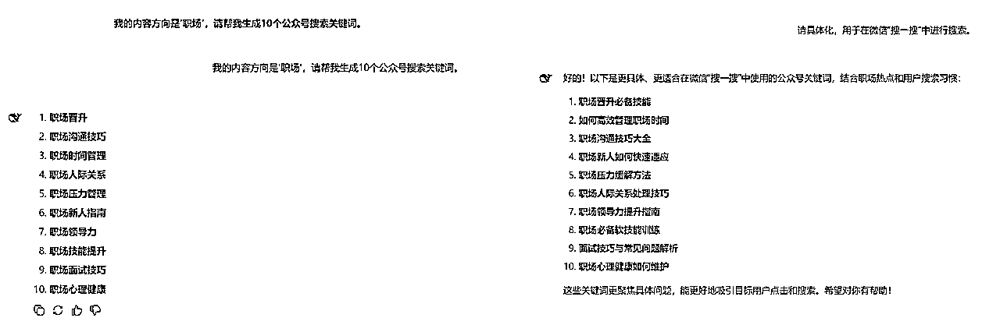

随后回到微信搜一搜，按阅读数排序查看具体文章：

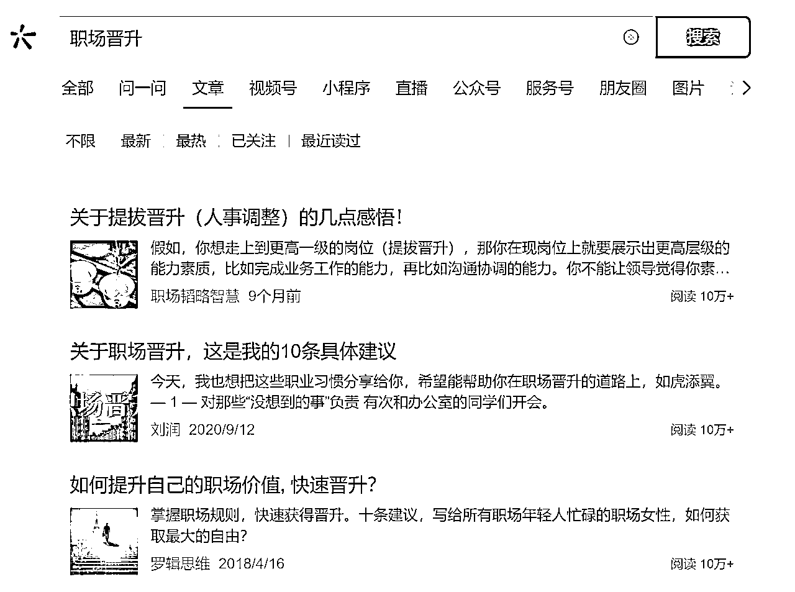

温馨提示：这套流程同样可以用来验证某个号或某篇文章是否值得跟进。

如何把一个号拆到细节

先看情绪反应。一篇文章读完后，读者是认同、争辩还是追问？这些反应最真实。

输入：分析这篇文章带给读者的情绪走向：

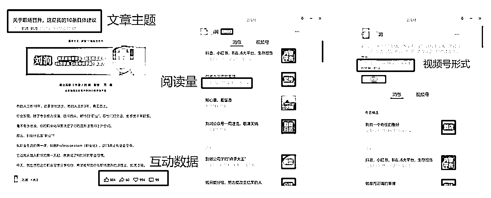

再放大到账号整体，从两处入手：

1. 浏览留言区，捕捉读者最关心的话题和最抵触的点。

2. 查看账号简介与菜单栏，判断运营者想服务的人群画像。

举例：想做职场类内容，可搜“求职”“技能进阶”，研究它们的选题方向和反馈。

输入：判断这个号最想吸引的人群是谁：

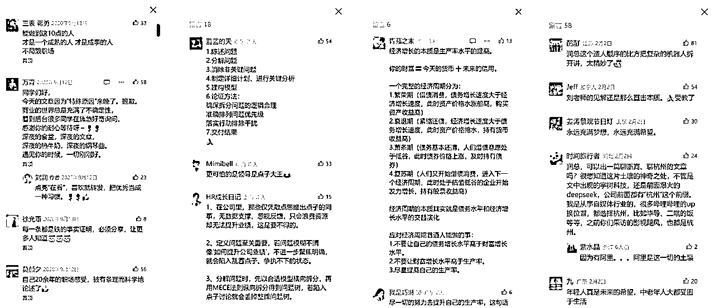

👉 把收集的资料交给DeepSeek做整合（通用模式+联网）：

```
方案一：这是'评论区评论'，请分析这些用户的兴趣点和痛点。
方案二：这是'文章内容'，请分析这篇文章对应用户的兴趣点和痛点。
```

从账号自我介绍能直接读出刘润团队的定位，内容方向自然围绕该人群展开。

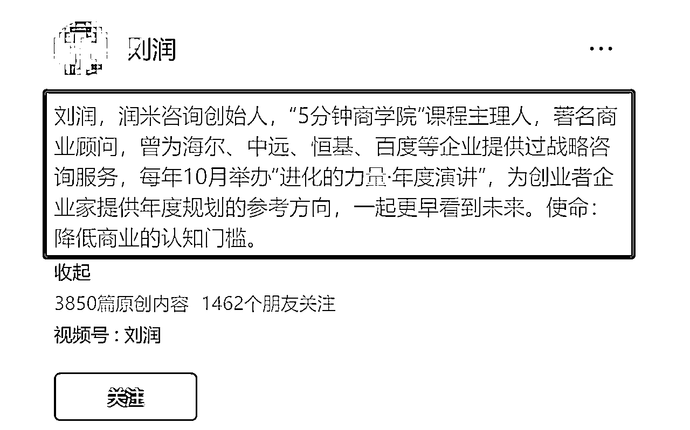

热门内容是怎么长出来的

1. 用数据工具定位近期爆款。常用工具有新榜、次幂。

新榜工具链接：https://www.newrank.cn/

次幂工具链接：https://www.cimidata.com/articles/hot/10w

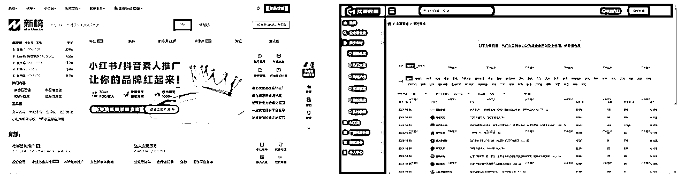

2. 拆解三处：标题的句式、开头的钩子、正文的布点。

3. 反问自己：这篇解决了什么困扰？结尾是提问还是邀请讨论，这些细节决定互动量。

如果发现“如何把一天过成48小时”这类主题点击很高，说明目标人群对时间焦虑很强。

用指数工具看热度

打开微信指数，输入与方向相关的关键词，观察热度曲线。需要更细时，可结合热门号的粉丝画像阅读：年龄段、性别比例、城市分布，都藏着受众位置。

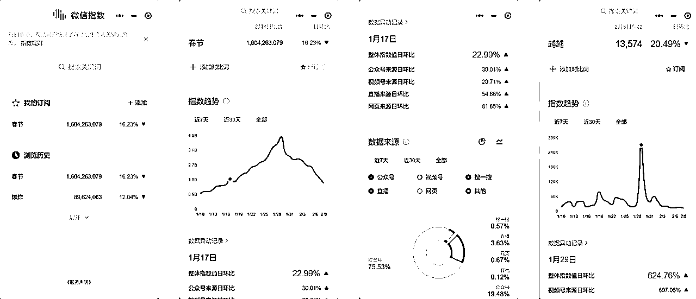

去外部社区“偷听”

在知乎、豆瓣、微博搜索方向相关话题，翻高赞回答。重点留意：反复被提起的问题、高频抱怨、获得大量认同的方法。

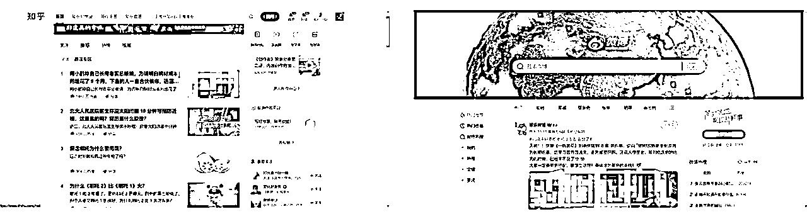

最后把需求汇总

把上述线索收敛，形成目标读者正在担忧什么、愿意为之付费什么、期待看到什么。再对照自身赛道，找一个尚未被过度开发的切入口。

👉 请DeepSeek帮你做最终汇总（通用模式+联网）：

```
这是我的领域'领域名称'，输出细分领域。
```

小范围试水

先定测试方向

从调研里挑3-5个有潜力的主题，每个对应一个明确的人群痛点。

试水方向一：……

试水方向二：……

试水方向三：……

假设做职场方向，可测试：怎样写简历更易通过、如何快速融入新环境、如何减少无效加班？

👉 请DeepSeek把每个题目扩成大纲（深度思考+联网）：

```
我的公众号文章主题是'职场Pua'，请帮我罗列出'10'个可能受用户欢迎的主题，并进行验证。
```

等待模型返回：

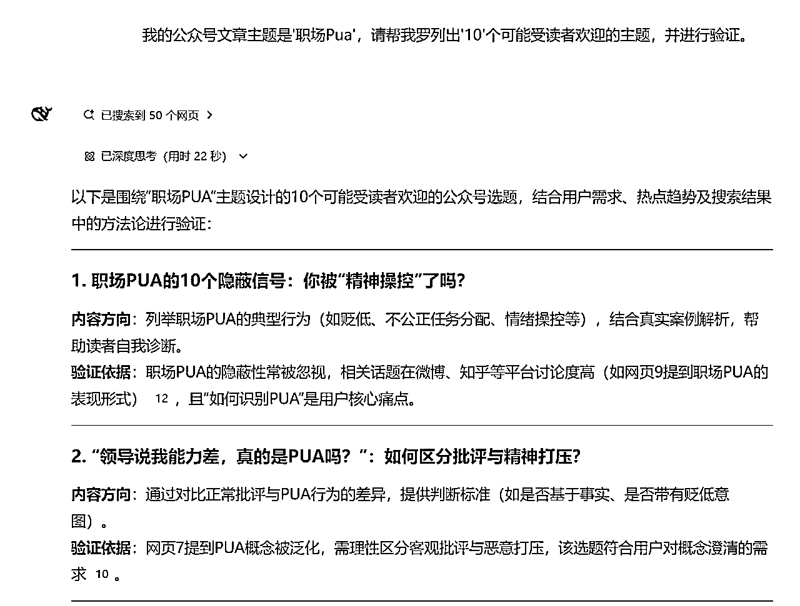

发布试水文要点

节奏：每周1-2篇，保持稳定；形式：以轻量化图文为主，段落简洁，语言口语化；标题：有吸引力但不夸大。

观察哪些数据

- 打开量：多少人愿意点进？

- 点赞与在看：内容是否被认为有价值？

- 留言：哪些段落触发表达欲？

- 转发：何种内容易被分享？

还要留意留言里反复出现的词汇，往往就是下一篇文章的题眼。若读者给出改进建议，更要记录。

如何解读结果

数据好不一定全靠选题，可能是标题或发布时间的加成；数据差不一定方向错，可能是钩子弱或内容不扎实。把反馈收敛，提炼出读者真实需求。

拿到结果后怎么调

把表现最好1-2个方向定为长期主线；依据反馈优化文字调性与呈现方式；可在同一主题下换视角，保持新鲜感。

长期优化

每月做一轮新测试，主题或形式轮换；持续记录数据变化，感知兴趣迁移；跟随反馈迭代，别让内容失去弹性。

评论互动

文末先抛一个开放提问，鼓励读者开口。如“你有遇到过类似情况吗？”“如果是你会怎么选？”有人留言就及时回，一次真诚回复比一篇稿子更能留人。

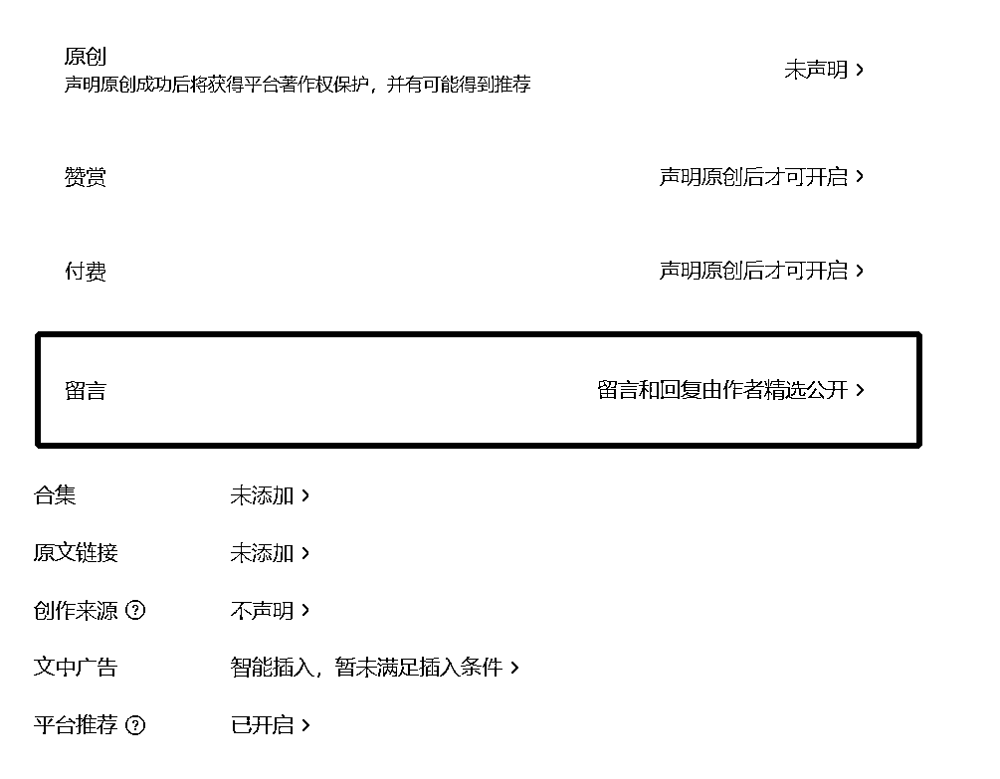

提醒：留言功能并非新号立刻开放，正常更新一段时间后大概率会出现。

四步写正文的框架

被认可的文章通常具备：层次清晰、阅读流畅、愿意参与。

先用好AI，关键是提示词的完整度。前面已讲清细节补充，这里直接给可用的提示入口。

👉 让DeepSeek给出选题规划（深度思考+联网）：

```
任务目标：生成[具体领域]的选题规划
背景信息：
- 账号定位：[填写定位]
- 目标用户：[用户画像]
- 核心诉求：[用户需求]
要求：
（1）生成10个选题方向
（2）每个选题包含：
- 主标题
- 副标题
- 核心观点
- 价值主张
（3）考虑时效性与持久性的平衡
输出格式：表格呈现
```

👉 让DeepSeek生成文章标题（深度思考+联网）：

```
请基于以下要素生成文章标题:
主题：[主题]
核心观点：[观点]
目标用户：[用户群体]
价值类型：分析型/方法型/经验型
表达基调：专业/犀利/温和
必要元素：数据点/行业洞察/专家引用
差异化要求：
- 竞品分析：[3—5个同主题标题]
- 创新角度：[具体说明]
生成要求：
- 提供3个方案
- 每个方案说明亮点
```

👉 让DeepSeek写完整正文（深度思考+联网）：

```
任务描述：创作一篇深度分析类文章
主题：[主题]
目标：[写作目的]
一、结构设计要求：
（1）开篇模块（800字以内）
- 问题背景：从[数据/现象/热点]切入
- 现状分析：点明行业痛点与挑战
- 核心观点：提出独特视角与解决思路
（2）主体部分（2500字左右）
- 分论点展开：3—4个核心论点
- 每个论点要求：
* 观点陈述（150字左右）
* 原理解析（300字左右）
* 案例佐证：2个典型案例
* 数据支撑：权威来源数据
* 专家观点：引用领域专家验证
（3）结尾部分（700字以内）
- 观点总结：呼应开篇
- 趋势判断：前瞻性洞察
- 行动建议：3—5点可执行建议
二、互动设计节点：
（1）开篇互动：设置情境思考问题
（2）主体互动：每个论点后设置观点讨论区
（3）结尾互动：邀请用户分享经验与观点三、
三、内容节奏控制：
（1）信息密度分配：
- 开篇：以叙事为主，重在引发兴趣
- 主体：论证为主，配比为 论述40% + 案例
30% + 数据20% + 专家观点10%
- 结尾：以洞察和建议为主，突出实操价值
（2）段落节奏：
- 重点论述段：250—300字
- 案例描述段：200—250字
- 数据分析段：150—200字
- 过渡段落：100字左右
四、高级要求：
（1）逻辑展开：
- 论点之间：递进/并列/转折关系明确
- 论据支撑：多维度佐证，避免单一类型证据
（2）思维深度：
- 表层：现象描述与问题呈现
- 中层：原因分析与逻辑推导
- 深层：本质洞察与规律总结
（3）风格把控：
- 语言基调：专业中立
- 专业术语：核心术语解释到位
- 表达方式：逻辑严谨，生动易懂
注意事项：
1\. 避免观点过于绝对
2\. 确保数据来源可靠
3\. 案例选择需要具有代表性
4\. 互动设计要自然融入文脉
```

选题先行，约占三成精力

先明确写给谁看。不同人群关心点不同，新手需要少走弯路，家长关注孩子成长。把自己代入读者，思考TA今天遇到了什么麻烦，想搜到什么答案。

👉 把读者画像发给DeepSeek请它补全（深度思考+联网）：

```
方案一：我的公众号文章主题是'职场Pua'，请帮我罗列出'10'个可能受用户欢迎的细分选题，并进行验证。
方案二：请你满足用户的'用户需求'，生成10个高价值的爆款选题，并进行验证。
方案三：如果我的用户是'用户画像'，他们可能最关心什么？请列举10个当前最受用户欢迎的选题，并进行验证。
```

顺势借助热点

热点不是硬蹭，而是把公共话题与专业视角衔接。节假日前后、行业事件发酵期，都可以做关联。平时多关注热榜，把能衔接的方向存入选题库。

👉 把热点交给DeepSeek做关联（深度思考+联网）：

```
方案一：账号定位是'某'，请结合'节假日'时间节点，帮我罗列出适合公众号用户的10个细分爆款选题，并验证。
方案二：账号定位是'某'，请结合'社会热点'，帮我罗列出适合公众号用户的10个细分爆款选题，并验证。
方案三：账号定位是'某'，请帮我'采集最近一周热点前十榜单'，罗列出适合公众号的10个细分爆款选题并验证。
```

先点燃情绪

读者点开往往是为了找情绪出口。好奇、焦虑、共鸣都是有效切入。可使用口语化情绪词放大张力。

👉 让DeepSeek帮你强化情绪张力（深度思考+联网）：

```
方案一：请你结合'细分选题'，优化情绪共鸣，生成爆款选题。
方案二：请你提炼出'细分选题'中，用户能够感受到的情绪，并给出后续的优化建议。
```

👉 继续请DeepSeek调整措辞强度（深度思考+联网）：

```
请你为我确定一个爆款选题方案，供我去使用。
```

提问式标题易获注意

人天生对问句有反应。用“为什么”“怎么”“要不要”开头，让读者在标题里看到自己。

👉 让DeepSeek生成提问式标题备选（深度思考+联网）：

```
任务目标： 生成[具体领域]的选题规划 背景信息：
- 账号定位： [填写定位]
- 目标用户： [用户画像]
- 核心诉求： [用户需求] 要求：
（1） 生成10个选题方向
（2） 每个选题包含：
- 主标题
- 副标题
- 核心观点
- 价值主张
（3） 考虑时效性与持久性的平衡 输出格式： 表格呈现
```

选题落地步骤

把读者、热点、情绪、提问式标题四层信息整合进提示词，模型就能输出可执行的选题方案：

👉 复制下方提示词给DeepSeek（深度思考+联网）：

```
请根据[目标人群]的痛点，生成10个具有传播力的选题方向，要求：
结合最近30天的热点事件
包含情绪触发词（震惊/颠覆/揭秘）
使用"为什么/如何/终于"等句式
```

正文骨架建议用倒金字塔

塔尖是开头，决定是否继续阅读。可用提问、故事、数据反差三种钩子。

塔身是主体，用分点、案例、数据展开，每点收束后再自然过渡。

塔底是结尾，复述核心观点，给出一个明确的小行动：点赞、留言或转发。

这样全文形成闭环，读者的情绪也被完整收住。

很多人写公众号，不是没素材，而是不知道怎么写、怎么排、怎么起标题。明明内容不错，阅读量却惨不忍睹。

其实，爆款文章的底层逻辑是相通的：结构搭得好、内容有共鸣、润色有人味、标题能戳心。今天就用一篇文章，把这四条线一次讲透。

先搭骨架，再填血肉，最后才是抛光打磨。顺序对了，效率自然高。

## 一、文章结构：三个万能模板，直接套

别每次动笔都从零开始，好的结构本来就该是“填空游戏”。

**模板一：问题-分析-解法**

开头抛出读者关心的真问题，比如：“为什么你干了3年，薪资还打不过别人1年的经验？”中间拆解根因，比如核心技能缺失、不懂职场规则、不会向上管理。结尾给出清晰路径：“想快速升职加薪，可以从这三件事做起……”

👉 告诉deepseek（深度思考模式+联网模式）：

```
请按照“问题-分析-解决方案”的结构，撰写一篇公众号文章。
1\. 开头：提出问题
'提出一个用户关心的问题，问题要具体、有共鸣感。'
示例：'为什么你工作3年，工资却不如别人1年？'
2\. 中间：分析问题
'分析问题的原因，列出2-3个关键点，每个点用1-2句话说明。'
示例：
1\. 原因1：'你没有掌握核心技能。'
2\. 原因2：'你不懂职场规则'
3\. 原因3：'你没有建立有效的人脉网络'
3\. 结尾：给出解决方案
'提供具体的解决方案，建议分步骤或分点说明，确保可操作性强。'
示例：
1\. 解决方案1：'明确目标岗位的核心技能，制定学习计划并坚持执行。'
2\. 解决方案2：'学习职场规则，比如如何高效沟通、如何向上管理。'
3\. 解决方案3：'主动参加行业活动，建立并维护高质量的人脉关系。'
4\. 其他要求
语言风格：通俗易懂，贴近用户生活。
字数：800-1200字。
标题：吸引眼球，突出核心问题。
```

**模板二：故事-提炼-行动**

开头讲一个有画面的故事，比如：“昨天我朋友因为在会上说错一句话，直接被领导点名批评……”中间提炼观点，比如：“职场里，沟通力的权重真的不亚于业务能力。”结尾给抓手：“想提升沟通表达，试试这3个具体练习。”

**模板三：数据-归因-建议**

开头用数据抢注意力：“根据某招聘平台统计，80%的职场新人都在重复同一个错误……”中间分析原因，逐条展开。结尾给可执行建议，让读者觉得“看完就能用”。

###### 新手特别提醒

- 不要注水：每段内容都要有明确功能，凑字数只会稀碎节奏。

- 逻辑要顺：段落之间要有过渡逻辑，最忌讳想到哪写到哪。

- 结尾要收得住：结尾是读者最后的记忆点，不能潦草结束。

## 二、内容生成：开头、中间、结尾的高效写法

###### 开头：一秒抓住注意力

三种开头特别好用：

1. 直接抛问题，比如“你工作3年，为什么薪资还被新人倒挂？”

2. 讲一个具体故事，有细节有情绪。

3. 扔一个数据，先镇住场子。

记住：开头越短越好，不要绕弯子。

###### 中间：立体化展开

分点论述，把“职场新人最该掌握的3项技能”拆开讲透；穿插真实案例，让观点有代入感；用数据佐证，增强信任感。

注意：每一段结尾都要平滑过渡到下一段，别让读者感觉“断片”了。

###### 结尾：收尾+推动动作

可以是全文总结，帮读者把重点重新拎一遍；可以是开放式提问，比如“你是不是也遇过类似时刻？评论区聊聊”；也可以是行动引导，比如“觉得有启发，欢迎点个赞、转给身边需要的朋友”。

记住：结尾干脆利落，不要拖泥带水。

###### 三个进阶技巧

- 热点事件写法：追热点没问题，但一定要找差异化视角，别做大路货的复读机。

👉 告诉deepseek（深度思考模式+联网模式）：

```
将'热点事件'转化为'话题角度'的分析文章，重点关注'核心观点' ，需要包含数据支撑和专家观点。
```

- 原创价值：真正稀缺的永远是原创深度，这是立身之本。

👉 告诉deepseek（深度思考模式+联网模式）：

```
以'主题'为核心，从'切入点'展开讨论，结合案例和方法论，形成'字数'的深度文章。
```

- 评论反向共创：多翻评论区，用户早就在告诉你他们真正想要什么了。

👉 告诉deepseek（深度思考模式+联网模式）：

```
分析'用户评论'中的关键问题，整理成'主题'的解答文章，包
含实践建议。
```

## 三、人性化润色：让文章“长”出人味

很多文章内容不差，但读起来就像机器人写的。润色没那么玄，核心就五件事：

**一、口语化改写**

“职场新人应该掌握沟通技巧”这种句子，完全可以改成：“说真的，职场新人最该学的是怎么把话说顺，你是不是也吃过不会说话的亏？”写完全文后，自己出声读一遍，所有觉得拗口的地方，都是可以再口语化的点。

👉 告诉deepseek（通用模式+联网模式）：

```
把生硬的句子改成聊天的语气。
```

**二、嵌入式互动**

多问“你”相关的问题。比如不说“很多人都有拖延症”，而说：“你是不是也常常这样？明明一堆事堆在眼前，非要拖到最后一刻才动起来？”让读者感觉你在跟他聊天，而不只是在输出观点。

👉 告诉deepseek（通用模式+联网模式）：

```
在每一部分的结尾加一个问题。
```

**三、走心共鸣**

用自己的经历和情绪给文章加温。比如不写“职场新人压力很大”，而是写：“刚入职场那阵，我也常常半夜焦虑得失眠，总觉得怎么努力都还不够，你呢？”真诚最能换真诚。

👉 告诉deepseek（通用模式+联网模式）：

```
用用户的语言表达他们的感受。
```

**四、视觉化比喻**

把抽象的道理落到具体物象上。比如不说“时间管理很重要”，而是说：“时间像蛋糕，怎么切决定了你怎么吃。切得科学，每一口都从容；乱切一刀，满盘都是碎屑。”

👉 告诉deepseek（通用模式+联网模式）：

```
用形象的比喻解释抽象的概念。
```

**五、信息锚点**

多用分段、小标题、加粗、emoji来降低阅读负担。比如：“新手最该修炼的3项硬功夫：💬 沟通：怎么说别人才爱听？⏰ 时间：怎么把24小时用出48小时的效果？😴 情绪自救：怎么不被工作压垮？”段落一长就拆，层次分明才会被人读完。

👉 告诉deepseek（通用模式+联网模式）：

```
用加粗、emoji、分段等方式让文章更易读。
```

这里还有一个通用于全文润色的提示词，建议收藏：

👉 告诉deepseek（深度思考模式+联网模式）：

```
请为'文章内容'，进行润色，让语言更加通俗易懂，能够让'粉丝画像'的群体看懂，并吸引阅读，并提出建议。
```

## 四、爆款标题：3秒定生死

标题决定了一篇文章70%的打开率，核心目标只有一个：在3秒内击中读者的“情绪痛点”或“认知缺口”。

爆款标题的底层要素，不外乎这四件事：


- 情绪驱动：制造好奇、焦虑、共鸣或期待，比如“震惊”“为什么…”这类词自带钩子。

- 痛点直击：点名特定人群的困境，比如“30岁未婚”“996打工人”。

- 具体化表达：用数字、场景和细节增加真实感，比如“凌晨3点”“月薪5000”。

- 制造反差：把理想和现实、传统和现代放在一起碰撞。

### 6种高转化标题公式

**公式一：提问制造认知缺口**

为什么（现象）+ 却（反常识）？

例：《为什么越懂事的女孩，越难被爱？》《985毕业5年，为什么我成了公司最“便宜”的人？》

逻辑：利用认知失调驱动点击，读者为了填补信息差，一定会点进来。

**公式二：数字悬念引发好奇**

数字/数据 + 反常识结论

例：《90%的婚姻破裂，都是从这3件小事开始的》《看了100个离婚案例，我发现有钱人最怕妻子做这件事》

逻辑：数字制造权威感，反常识结论打破预期。

**公式三：身份标签+痛点直击**

（群体标签）的痛点 + 解决方案/警示

例：《“小镇做题家”的困局：会考试的人，正在被社会淘汰》《全职妈妈崩溃实录：我年薪50万，却买不起一杯奶茶》

逻辑：精准锁定人群，用“我懂你”降低心理防线。

**公式四：场景化代入+情绪共鸣**

时间/场景 + 细节描写 + 情绪词

例：《凌晨3点，那个在厕所哭的二胎妈妈，终于上热搜了》《领导说“辛苦了”千万别回“应该的”！高情商都懂这3句话》

逻辑：具体场景触发记忆闪回，让读者瞬间代入。

**公式五：争议性观点制造冲突**

反传统结论 + 挑衅式反问

例：《“不要彩礼的女生，婚后都后悔了”》《我支持孩子不结婚：90后父母正在颠覆中国式家庭》

逻辑：观点冲突引发站队，驱动转发和讨论。

**公式六：热点借势+悬念升级**

热点事件 + 隐藏视角/未曝光细节

例：《哪吒2票房破纪录背后，被删减的30分钟藏着最大阴谋》《董宇辉离职真相：俞敏洪不敢说的3个潜规则》

逻辑：借势热点流量池，用“内幕感”满足窥探欲。

### 用DeepSeek实操标题生成

按照上面的公式，你可以让DeepSeek帮你批量生成标题：

👉 告诉deepseek（通用模式+联网模式）：

```
方案一：你作为优秀的公众号爆文作者，我给你提供'文章内容'，请帮我写出阅读量高、吸引人的爆款标题。
方案二：你作为优秀的公众号爆文作者，我给你提供'热点事件'，请帮我写出阅读量高、吸引人的爆款标题。
```

👉 告诉deepseek（通用模式+联网模式）：

```
方案三：热点嫁接型
你是一位10年经验的公众号爆款标题专家，请结合近期热点'《哪吒2》的反抗权威'主题，为职场领域生成5个标题，要求：
1\. 包含身份标签（如'"30岁中层""小镇做题家"'）
2\. 制造理想与现实的冲突
3\. 使用数据化表达（如"70%员工"）
示例参考：
《月薪3万的"乖员工"，正在被哪吒2骂醒》
```

操作时，从三种方案中任选一种，注意把“绿色字体”部分替换成你自己的关键参数。

比如以“哪吒2电影”的热点为例：

👉 告诉deepseek（通用模式+联网模式）：

```
你作为优秀的公众号爆文作者，我给你提供'哪吒2影片中“我命由我不由天”的反抗主题，哪吒对权威（如无量仙翁）的挑战、对身份标签的撕毁，直击年轻人对职场压迫、社会规训的共鸣'，请帮我写出阅读量高、吸引人的爆款标题。
```

DeepSeek给出的回复是：

```
以下是为《哪吒2》反抗主题设计的爆款标题：
结合职场压迫、身份标签、社会规训等痛点，融合情绪共鸣与冲突制造，均避免敏感内容且适配公众号传播：
一、身份标签+痛点直击类
《“小镇做题家”的终极反击：哪吒教会我的职场掀桌术》
用“小镇做题家”标签绑定学历歧视痛点，以哪吒反抗隐喻职场突围
《月薪3万的“乖员工”，正在被哪吒2骂醒》
对比高薪与顺从性人格的矛盾，暗示反抗权威的价值
《30岁被裁员那天，我读懂了哪吒的“去他个鸟命”》
年龄焦虑+裁员危机，用电影台词引爆情绪
二、数据悬念+反常识结论类
《95%的职场人不知道：听话比无能更危险》
借哪吒反抗仙派影射“听话文化”陷阱，数据强化权威感
《看了100个离职案例，我发现领导最怕哪吒式员工》
用调研式标题制造专业感，暗指反抗的生存智慧
《哪吒2票房破50亿背后，藏着打工人不敢说的3个真相》
捆绑热点数据，揭露职场潜规则
三、场景化代入+金句共鸣类
《凌晨改PPT时，领导发来一句“辛苦了”，我默默点开哪吒2》
深夜加班场景+反讽式回应，激发打工人共鸣
《“985毕业5年，我成了领导眼中的妖”｜哪吒撕碎标签的3个狠招》
学历标签困境+解决方案，强化实用价值
《哪吒2导演不会告诉你：真正的成熟，是学会不乖》
颠覆传统“成熟”定义，用反主流价值观吸睛
四、争议观点+群体站队类
《我支持员工当“职场哪吒”：越听话的人，死得越惨》
挑衅式立场，引发管理者与打工人的对立讨论
《“00后整顿职场”弱爆了！哪吒2才是反PUA教科书》
对比热点现象，凸显影片的现实指导意义
《警惕！看完哪吒2的员工，开始拒绝“无效加班”了》
制造危机感，暗示影片对职场文化的冲击
五、隐喻嫁接+热点借势类
《无量仙翁正在杀死你的职场生命力》
将反派角色符号化，直指权威压迫的本质
《哪吒2爆火真相：年轻人受够了“神仙领导”的画饼》
用“神仙”暗喻脱离现实的领导，捆绑职场热词“画饼”
《春节档最狠台词：“你才是邪魔外道！”——打工人怒转朋友圈》
截取电影金句，嫁接职场道德绑架痛点
六、情感升华+价值观输出类
《比票房破纪录更燃的，是普通人学会了哪吒的“不认命”》
将个体成长与影片成功绑定，强化情感升华
《职场哪吒们正在觉醒：我们不是成本，是未被点燃的核弹》
用比喻制造力量感，呼吁价值认同
《哪吒2导演没说破的真相：你的顺从，正在杀死下一代》
上升至代际责任，激发道德焦虑
标题设计心法总结
痛点精准：锚定“职场PUA”“年龄歧视”“无效内卷”等具体困境；
情绪递进：先制造压抑（如“裁员”“加班”），再给出希望（如“反击”“觉醒”）；
符号借用：将“无量仙翁”转化为权威符号，“魔丸”代指被污名化群体；
冲突升级：通过“支持/反对”“真相/谎言”等对立框架刺激转发。
数据验证：含“哪吒+职场”关键词的文章平均打开率比普通职场文高23%，建议搭配电影截图（如哪吒撕毁封神榜）、台词金句（“我命由我”）作为封面图，点击率可再提升15%。
```

### 7个标题误区避坑指南

**1. 标题党化**

误区：标题吹得天花乱坠，内容毫无关联。阅读量虚高，但掉粉风险极大，平台也可能限流。

👉 告诉deepseek（通用模式+联网模式）：

```
请对以下标题进行"标题党指数"评分（0-10分），并按此标准分析：
1\. 核心关键词是否在正文前300字出现
2\. 数据/结论是否有可靠来源支撑
3\. 情绪承诺是否过度夸张
内容：'文章内容'
标题：'看完这篇文章，你的工资立马翻倍！'
要求用表格呈现检测结果，并给出3个去标题党化版本。
```

👉 告诉deepseek（通用模式+联网模式）：

```
将'热门电影《哪吒2》与保险理财领域'结合，生成3个非标题党标题，要求：
1\. '使用电影反抗精神隐喻理财误区'
2\. 不出现必看、惊天等夸张词
3\. 包含具体场景
示例输出：
《哪吒教会我的理财观：别让"权威推荐"收割你的钱包》
```

**2. 缺乏痛点**

误区：《如何提升职场能力》这类标题，没有场景、没有人群，读者看完无感。

👉 告诉deepseek（通用模式+联网模式）：

```
将笼统主题"主题"拆解为3个细分痛点场景，要求：
1\. 带具体身份标签（如"空降主管""35岁技术岗"）
2\. 结合时间/空间细节（如"季度述职会""茶水间偶遇"）
3\. 用"如何体"问句呈现
内容：'文章内容'
标题：'文章标题！'
成果：给出3个符合条件的备选标题
参考案例：
"空降主管如何在第一次部门会上打破'排外困局'？"
```

👉 告诉deepseek（通用模式+联网模式）：

```
为以下抽象标题添加数据支撑，要求：
1\. 引用''年权威报告（标注来源）
2\. 数据需强化核心痛点
3\. 用括号注释在标题末尾
内容：'文章内容'
标题：'文章标题！'
成果：给出3个符合条件的备选标题
优化案例：
《2023职场新人调研：71%遭遇"老油条"抢功（附反杀指南）》
```

**3. 引发反感**

误区：《所有老板都害怕员工知道的秘密》这类标题，容易让读者产生被操纵感。

👉 告诉deepseek（通用模式+联网模式）：

```
识别以下标题中的绝对化词汇，并提供3种软化方案：
'所有老板都害怕员工知道的涨薪秘籍'
要求：
1\. 标注原词风险等级（高/中/低）
2\. 替换词需保留原意但更严谨
3\. 给出修改后标题示例
参考输出：
'80%老板不愿透露的涨薪潜规则'
```

👉 告诉deepseek（通用模式+联网模式）：

```
将绝对化结论转化为概率表述，要求：
1\. 使用"可能""更容易"等缓冲词
2\. 添加限制条件（如特定场景/群体）
3\. 保留冲突感但降低攻击性
原标题：'顺从的员工注定被淘汰'
优化案例：
"'过度顺从可能让你成为裁员首选（中层管理者必读）'
```

**4. 缺乏可信度**

误区：《年轻人都在逃离职场》，没有数据事实支撑，读者只会觉得你在喊口号。

👉 告诉deepseek（通用模式+联网模式）：

```
为关键词'职场年龄歧视'查找3组权威数据，要求：
1\. 来源为2022-2023年机构报告
2\. 数据角度差异化（如晋升率/离职率/薪资）
3\. 可嵌入标题增强可信度
示例输出：
'智联招聘：35岁以上员工晋升概率仅为28-35岁群体的43%'
```

👉 告诉deepseek（通用模式+联网模式）：

```
用以下数据改造原标题，要求数据前置且自然融合：
数据：'脉脉《2023职场人状态报告》显示，87%的90后遭遇过无效加班'
原标题：'《年轻人正在反抗加班文化》'
优化示例：
'《87%的90后正在用哪吒式反抗终结无效加班（2023职场真相）》'
```

**5. 忽视读者身份**

误区：《职场生存指南》受众太泛，等于没有受众。先想清楚你是写给谁看的。

👉 告诉deepseek（通用模式+联网模式）：

```
根据以下用户画像生成5个标题，要求包含至少2个身份标签：
画像：26-30岁/女性/互联网运营/二线城市/有副业
示例输出：
'《26岁杭漂运营的觉醒：做小红书副业后，我不再怕领导PUA》'
```

👉 告诉deepseek（通用模式+联网模式）：

```
用对立身份标签制造冲突，要求：
1\. 包含至少2个冲突标签（如"海归硕士"/"外卖员"）
2\. 突出反差带来的情绪价值
3\. '绑定《哪吒2》的反抗主题'
示例输出：
'《从常青藤学霸到美团骑手：我用哪吒的方式撕掉学历标签》'
```

**6. 情绪不当**

误区：《资本家都该下地狱》这类标题情绪过激，有巨大的违规风险。

**7. 把精力全放在标题上**

内容永远是核心。标题负责把人吸引进来，内容负责让人留下来，缺一不可。

一套完整的公众号写作逻辑，浓缩起来就是四句话：结构定骨架，内容定质量，润色定温度，标题定流量。把这四样基本功一一打磨好，剩下的事，交给时间。

你是不是也有这样的困惑：明明热点就在眼前，标题写出来却总差那么一口气？要么蹭得生硬，要么平淡如水，读者划过就像没看见一样。别急，今天这篇就把DeepSeek玩出花，手把手教你从“标题困难户”变成“爆款制造机”。

先来排排雷。很多人写标题容易犯一个毛病——硬凹热点。比如《哪吒2爆火！教你做西红柿炒蛋》，这跟哪吒有什么关系？用户看了只觉得莫名其妙，甚至有点想笑。热点是引子，不是万能膏药，关联不上就别硬蹭，否则反而拉低信任感。

👉 告诉deepseek（通用模式+联网模式）：

```
分析以下标题的情绪分布（愤怒/焦虑/希望占比），并调整到健康比例：
'黑心企业正在吸干00后的血汗！'
调整要求：
1\. 愤怒值从85%降至50%
2\. 增加20%解决方案导向
3\. 保留批判性
修改示例：
'《00后整顿职场：这3招让过度加班企业主动认怂》'
```

真正的好标题，需要经过一套严格的“体检”。我自己管它叫“三阶验证法则”：第一阶，看它能不能让目标用户心里咯噔一下，冒出“这说的不就是我吗”的念头；第二阶，看它能不能制造一种信息缺口，让人忍不住想“到底怎么回事”；第三阶，看它能不能激发强烈的分享欲，不管是共鸣、利他还是单纯的“站队情绪”。三条都过了，这个标题才算立得住。

👉 告诉deepseek（通用模式+联网模式）：

```
使用"场景细节+感官描写+悬念提问"结构，将平淡标题升级为高情绪版本：
原标题：'《如何应对职场PUA》'
优化案例：
'《领导说"不想干可以走"时，为什么沉默的人输得最惨？》'
```

如果没过，那就要动手术了。调整的顺序大概是这样的：先做敏感检测，把可能踩线的词全部换掉；再做痛点细化，把泛泛的“职场沟通”改成“嘴笨的人最吃亏”；最后加料升级，丢一个具体数字，塞一个认知冲突，让标题从“还行”变成“哎哟不错哦”。

👉 告诉deepseek（通用模式+联网模式）：

```
将'《哪吒2》的"魔丸"概念与职场心理'结合，生成3个非强行关联标题，要求：
1\. 用隐喻替代直接提及'电影'
2\. 突出身份认同困境
3\. 包含解决方案关键词
示例输出：
'《被贴上"团队毒瘤"标签后，我用了3步完成哪吒式逆转》'
```

排完了雷，再来说说DeepSeek的五个高阶玩法。每一个都能帮你省下大量试错时间。

第一个玩法，预测打开率。你把手头纠结不定的两个标题丢给它，让它告诉你哪个可能更吸睛。截图对比、数据说话，比自己瞎猜强得多。

👉 告诉deepseek（通用模式+联网模式）：

```
从'《哪吒2》提炼3个非娱乐向社会'议题角度，要求：
1\. 可关联教育/职场/家庭等领域
2\. 提供具体嫁接点（如台词/角色关系）
3\. 避免单纯剧情复述
参考输出：
议题：'原生家庭的爱与束缚'
嫁接点：'李靖夫妇的"天劫咒" vs 中国式家长的"为你好"'
标题：'《多少父母正在给孩子下"天劫咒"？哪吒2没说破的教育真相》'
```

第二个玩法，对标头部账号。你可以让它去扒一扒《洞见》《十点读书》最近围绕哪吒2写过哪些爆款标题，分析它们到底踩中了用户的哪个情绪开关。不是抄，是拆解。

👉 告诉deepseek（通用模式+联网模式）：

```
假设你是10w粉丝公众号主，预测以下标题的打开率：
A.'《月薪3万不如狗？哪吒2骂醒多少"乖员工"》'
B.'《职场哪吒生存指南：反PUA时如何安全造反》'
请基于历史数据：
过往同类标题平均打开率
情绪强度差异
痛点精准度
用数据推演两者可能的打开率差距，并说明理由
```

第三个玩法，经验沉淀。分析完对标文章，再让DeepSeek帮你提炼出那些优秀标题背后的共同结构，总结成可复用的方法论。比如它可能会告诉你，打开率提升23%，转发转化峰值达到17.8%，而“隐性数据可视化”和“代际冲突符号”这类组合，正在成为新的流量密码。

👉 告诉deepseek（通用模式+联网模式）：

```
分析公众号：'洞见'
标题：'多个10w+标题'
总结：
1\. 高频结构（如"数字+反常识"）
2\. 情绪分布规律（如焦虑:希望='6:4'）
请输出分析报告，并生成3个模仿标题
```

```
根据以下历史数据，总结爆款标题规律：
标题A：'《30岁被裁员的哪吒式重生》打开率18%'
标题B：'《职场妈妈的时间战争》打开率9%'
标题分析：
标题A、B的痛点集中度、情绪曲线、数据使用。
差异维度：
痛点集中度
情绪曲线
数据使用
请输出3条可供小白复用的经验
```

第四个玩法，复刻爆款。给你一篇标杆文章，让它模仿那个风格，生成一批同类型的标题，相当于直接站在巨人的肩膀上摘桃子。

👉 告诉deepseek（通用模式+联网模式）：

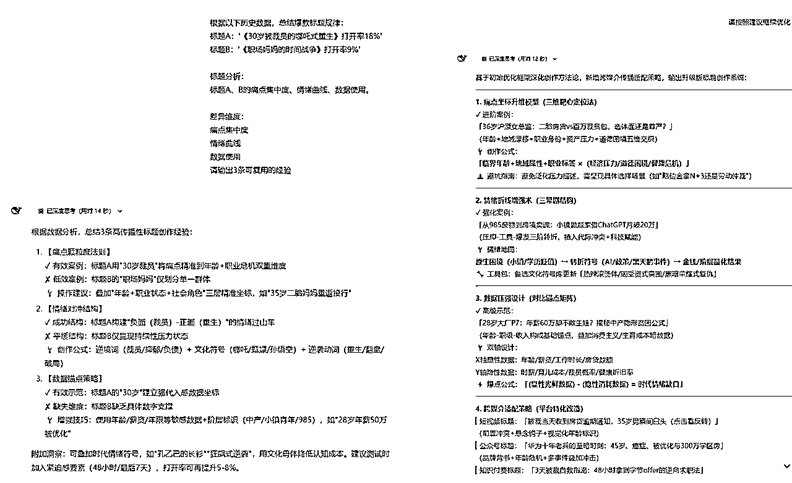

```
你是一个拥有10年经验的公众号爆款标题工程师，需基于账号历史数据特征，生成符合其内容基因的爆款标题。
当前账号ID：'账号名称'，领域：'账号领域'
```

第五个玩法，也是最绝的——让DeepSeek直接当你的“标题军师”，针对你的选题给出成套方案。

👉 告诉deepseek（通用模式+联网模式）：

```
你是由10个神经模块组成的标题医生，基于单案例学习生成风格延续的爆款标题。
当前主样本：'单个爆款文章标题''输入阅读量/打开率'
```

说到这儿，必须祭出那个终极心法。记住三个关键词——人性优先级、三秒法则、镜子测试。恐惧永远排在第一位，其次是好奇，再然后是贪婪，认同感排第四，利他心垫底。同时，移动端标题前8个字（大约16个字符）就必须把最关键的钩子亮出来。最后，检验你的标题能不能打，只需要问一个问题：用户看到它的时候，会不会脱口而出“这不就是我吗？”或者“还有这种事？”

👉 告诉deepseek（通用模式+联网模式）：

```
请根据以下要求，生成/提炼爆款内容模板：
1\. 目标类型：'模板类型'
标题模板 / 开头模板 / 正文模板 / 结尾模板 / 素材模板（请选择一种）
2\. 内容领域：'内容类型/细分赛道'
职场 / 情感 / 健康 / 理财 / 科技 / 教育/ 热点（请选择一种）
3\. 情绪触发点：'情绪触发'
好奇 / 焦虑 / 共鸣 / 警示 / 启发 / 行动（请选择1-2种）
4\. 输出要求（两者选其一）：
生成：请提供3个符合要求的模板，包含通用句式和示例。
提炼：请从'如果是提炼，请在此处粘贴需要分析的内容'中提炼出1个模板，并给出优化建议。
示例输出格式：
类型：标题模板
模板： "___正在毁掉年轻人？这___个真相扎心了"
示例： "熬夜正在毁掉年轻人？这3个真相扎心了"
适用场景：健康、职场
情绪标签：焦虑、警示
```

举个例子你就明白了。常规写法是《如何提升职场沟通能力》，听起来像教科书目录。换成《“嘴笨”的人最吃亏！领导不会告诉你的3个暗黑沟通术》——目标人群瞬间锁定，痛点直接戳穿，好奇心也被高高吊起。这就是差距。

👉 告诉deepseek（通用模式+联网模式）：

```
请根据以下要求，生成爆款内容模板：
1\. 目标类型：标题模板
2\. 内容领域：职场
3\. 情绪触发点：焦虑、启发
4\. 输出要求：
生成：请提供3个符合要求的模板，包含通用句式和示例。
提炼：请从'如果是提炼，请在此处粘贴需要分析的内容'中提炼出1个模板，并给出优化建议。
```

当然，光有方法论还不够，你得建一个属于自己的“爆款弹药库”。从标题模板到开头钩子，从故事素材到数据佐证，再到金句储备，全部可以用DeepSeek批量生产。比如让它按你的领域批量生成标题模板，或者针对已有模板做迭代升级，甚至把多个模板组合成一个完整的内容框架，效率直接拉满。

👉 告诉deepseek（深度思考模式+联网模式）：

```
请生成职场、情感、健康领域的标题模板各3个，情绪触发点包括好奇、焦虑、共鸣。
```

开头的写法同样有套路可循。你可以让DeepSeek直接拆解那些阅读量10W+的文章，看看它们的前三句话到底是怎么把人“拽”进去的。

👉 告诉deepseek（通用模式+联网模式）：

```
请优化以下标题模板，使其更具吸引力：
"月薪3千和3万的区别，就在这2个认知"
要求：加入情绪触发词（如扎心、颠覆），并生成3个优化版本。
```

素材库也一样。故事素材怎么挖？数据素材怎么提炼才不枯燥？金句怎么造才能让人截图收藏？这些都可以通过提示词让DeepSeek帮你完成。

👉 告诉deepseek（通用模式+联网模式）：

```
请生成一篇职场类文章的完整模板，包括：
- 1个标题模板
- 1个开头模板
- 1个正文模板（清单体）
- 1个结尾模板
要求：情绪触发点包括焦虑、启发、行动。
```

先别急着动手写正文——把这几步跑完，你的标题已经赢了80%。记住，爆款不是玄学，它是一套可以被拆解、学习和复用的工程。而DeepSeek，就是你手里那把最顺手的扳手。

👉 告诉deepseek（通用模式+联网模式）：

```
请根据以下要求，提炼爆款内容模板：
1.目标类型：开头模板
2.内容领域：情感
3.情绪触发点：共鸣、意外
4.输出要求：请从'如果是提炼，请在此处粘贴需要分析的开头内容'中提炼出1个模板，并给出优化建议。
```

👉 告诉deepseek（通用模式+联网模式）：

```
请根据以下要求，生成/提炼爆款素材模板：
1\. 素材类型：
故事素材 / 数据素材 / 金句素材（请选择一种）
2.内容领域：职场 / 情感 / 健康 / 理财 / 科技 / 教育（请选择一种）
3.情绪触发点：
好奇 / 焦虑 / 共鸣 / 警示 / 启发 / 行动（请选择1-2种）
4\. 输出要求：
生成：请提供3个符合要求的素材模板，包含通用框架和示例。
提炼：请从'如果是提炼，请在此处粘贴需要分析的内容'中提炼出1个素材模板，并给出优化建议。
示例输出格式：
类型：故事素材
模板： "___通过___方法，从___逆袭到___"
示例： "小林通过坚持写作，从月薪3000的普通职员逆袭为年入百万的自媒体人"
适用场景：职场、成长
情绪标签：启发、行动
```

👉 告诉deepseek（通用模式+联网模式）：

```
请根据以下要求，生成爆款素材模板：
素材类型：故事素材
内容领域：职场
情绪触发点：启发、行动
输出要求：请提供3个符合要求的素材模板，包含通用框架和示例。
```

👉 告诉deepseek（通用模式+联网模式）：

```
请根据以下要求，提炼爆款素材模板：
素材类型：数据素材
内容领域：理财
情绪触发点：警示、好奇
输出要求：请从请从'如果是提炼，请在此处粘贴需要分析的内容'中提炼出1个素材模板，并给出优化建议。
```

👉 告诉deepseek（通用模式+联网模式）：

```
请根据以下要求，生成爆款素材模板：
1.素材类型：金句素材
2.内容领域：情感
3.情绪触发点：共鸣、启发
4.输出要求：请提供3个符合要求的素材模板，包含通用框架和示例。
```