# RPA + DeepSeek + 多维表，我把头条号文章做成了半自动流水线

头条号说白了就是今日头条的创作后台，现在收益还挺能打。平台正大力推首发激励，内容在72小时内完成首发，就能拿3倍分成；再加上AI写稿的成本几乎可以忽略，原创内容这门生意的边际成本已经低到不行。账号方面，个人只能实名一个号，一家公司主体最多注册两个号。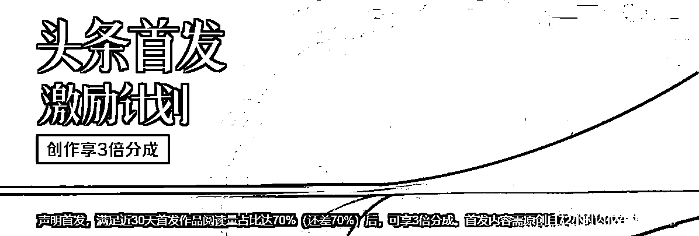

公众号运营的社群和教程到处都是，每期实战活动也不会缺席，但头条号相关的内容反而挺少。先亮组数据给大家打打气：我的头条号荒废了两年多，重新启动时账户余额只有4块。后来用一个号连续更新一周，每天半小时，赚到160元现金，涨粉300多人。之后因为违规被平台暂停更新，具体原因后面再聊。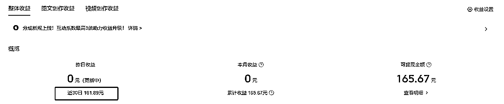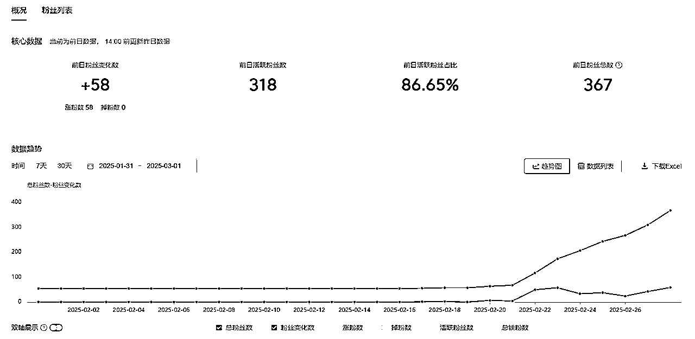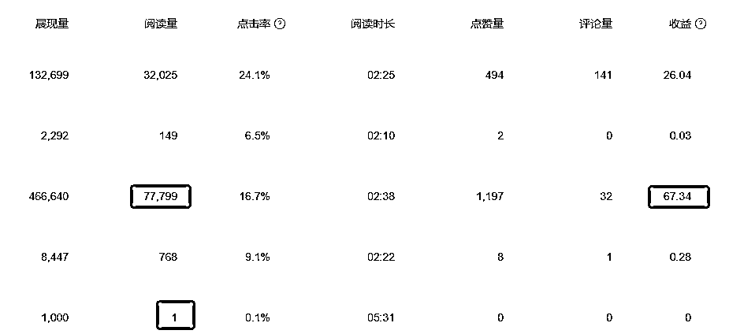

我的判断是，把平台限制吃透，再用矩阵方式放大，这件事完全能做成一个小项目，月入几千没有问题，时间成本也不会太高。

今年年初DeepSeek直接炸场，看到 @orange AI 的帖子后我马上坐不住了，第一反应就是文章创作特别适合切入——够轻、够简单。飞书多维表的配置方法，那篇帖子已经写得很详细，这里不重复。DeepSeek提示词的精髓其实就一句话：忘掉套路，把你的需求直接说清楚。

图文生产的核心流程不复杂，但为了应对流量和平台限制，需要加一些“补丁”。这个玩法一年前 @卟言 就分享过，还拿了精华。当时有两个限制：一是必须下载飞书国际版Lark；二是文章一次只能生成400字。可光靠400字想写出爆文，确实不太现实，总不能全靠图片硬凑吧？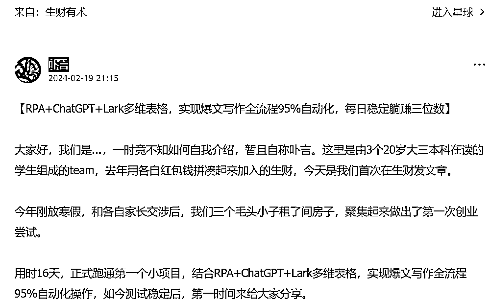

现在飞书多维表+DeepSeek一组合，直接把这套玩法升级成2.0版，剩下的就只剩动手干了。

## 1.0版：一半RPA自动，一半手动完成

### step1：选题方向

我个人的理解是，前五类内容要么要求极强的真实性——比如美国总统这个位子，不能随便安到普京头上；要么要求图文严格匹配——聊哪吒的时候，不能配一张射雕的剧照。这意味着在文章校验和配图上要投入更多时间，可能收益也会好一些。所以我选了第6类情感内容，流量够大，配图基本不用动脑。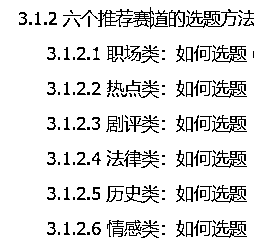

### step2：抓爆文

工具我用的是易攥，299元两年，现在已经回本。流程是网页端配置9步，每天等着收Excel；这段的RPA放在下面。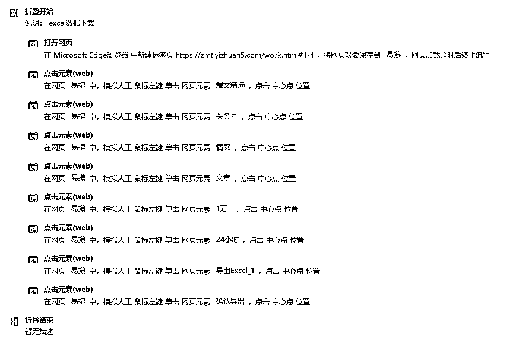

单账号拉24小时爆文完全够用，多账号就把时间区间拉长，素材基本源源不断。

### step2.5：人工筛选

易攥下载的表格，A到H列是自带内容。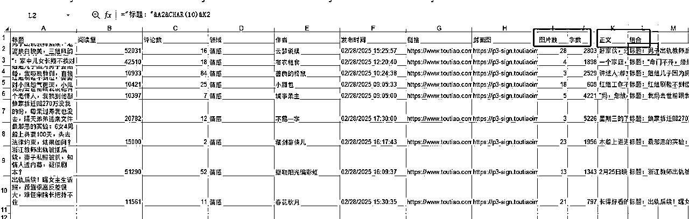

我又补了图片数和字数两个字段作为筛选条件。下面两类文章我会直接跳过：一是纯图片、正文没有一个字的。这类内容也不是不能用，但更适合拿去重工具处理图片后单独发图文号，放在文章创作里属于少数，不值得为它开分支；二是字数特别多的，动辄几千上万字，通常是连载小说的一章。所以字数过多或过少都被我剔掉。图片异常值我也会注意，一般每篇图片数是个位数；如果一张图都没有或者超过20张，我会点进原文看看。

正文和组合字段是这么处理的：用RPA按链接抓取每篇文章正文，然后 组合=标题&正文。之所以要拼在一起，是因为多维表里DeepSeek只能调用一个字段。

### 一个小提醒：多看看后台数据

头条号后台的数据挺全，前两天我都是闭眼发文，第三天才去看了一眼。结果发现家长里短的文章展示和阅读都更好，讲年轻人恋爱的几乎没有什么点击。再翻粉丝数据，好家伙，我的读者基本是一群退休大爷大妈。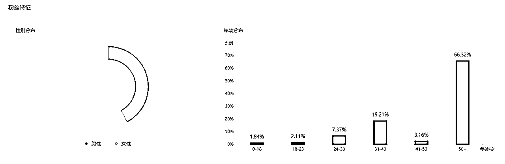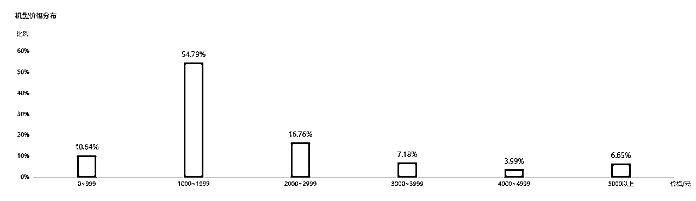

大爷大妈爱看什么？当然是婆媳关系、家长里短。因此在那批爆文里，讲年轻人求职等内容的文章我全部pass了。这也呼应了前面说的DeepSeek提示词不需要套路，我干脆在提示词里注明：账号的读者群体主要是50岁以上的老人。这么做确实有点粗暴，也许应该再观察观察；也可能不管它，模型跑下来用户画像自己也会变。这段也配了RPA。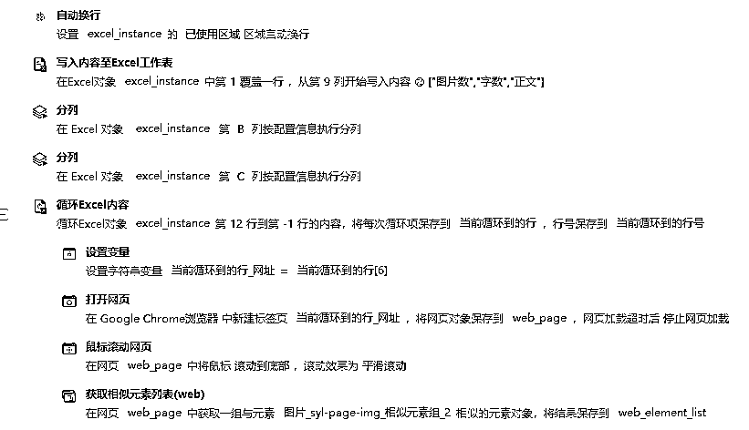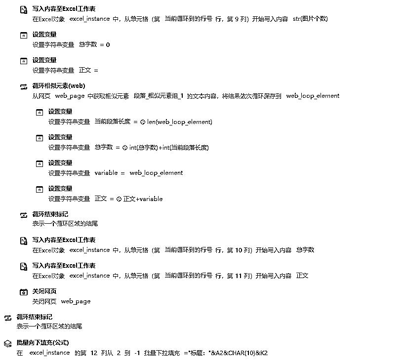

## 2.0版：70%自动化，发布前留一步手动

方向选择、爆文抓取、人工筛选这些步骤不变，主要是在后面接入自动化。

当时我还在学影刀的中级课程，一到飞书多维表就卡住了，所以1.0后半段几乎是手搓，好在都是复制粘贴的活，也没花多少时间。前两天看到 @leeka 分享了RPA+飞书多维表的玩法，我马上付费学习了。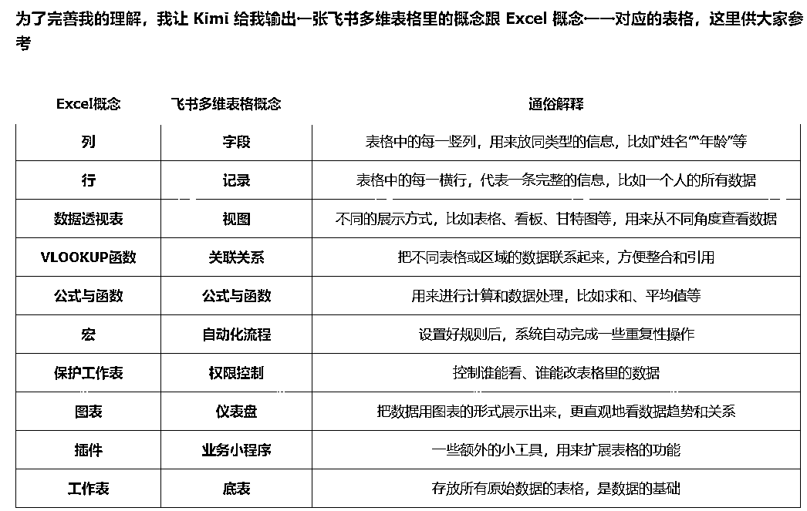

### step3：AI改写

多维表配置好以后，直接把Excel里的“组合”字段粘到“文本”列，DeepSeek就会自动开始改写。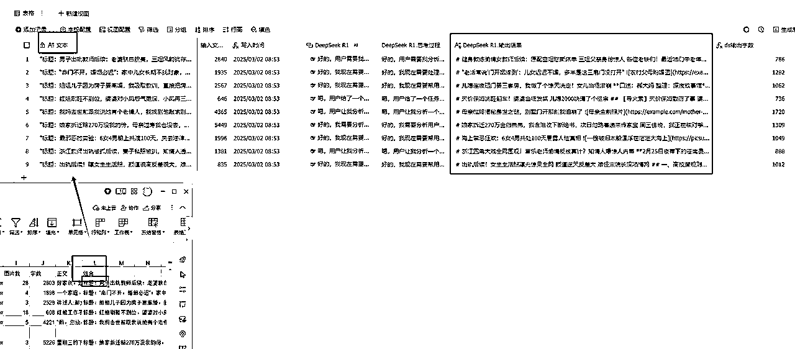

这段的RPA也在下面。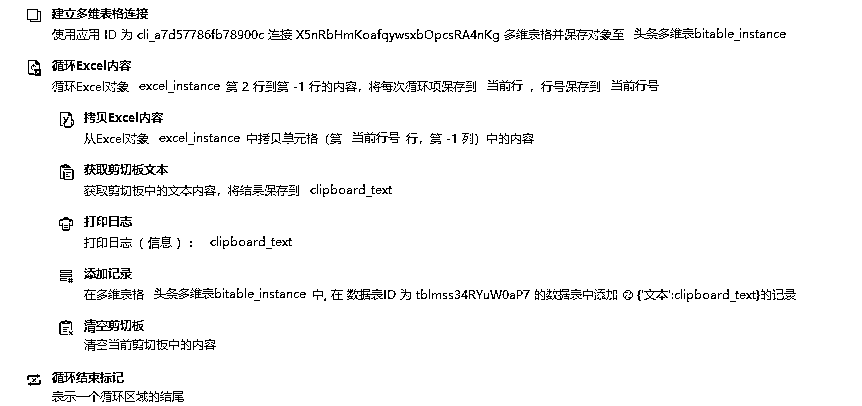

### step4：排版与发布

排版环节踩了个坑：DeepSeek输出的字段是飞书的新功能，影刀没法通过指令直接获取。试了一圈，又回到老办法：调用应用下载Excel，再到Excel里处理。

另一个小坑是多维表把所有输出限制在一个单元格里，所以我直接在提示词里要求“用markdown格式输出”。但这样还不够——包括飞书文档、头条在内的很多工具会把表格一起带上去，根本没法正常识别。我试了半天，终于发现语雀能完美识别，点一下按钮就能转化。直接粘到飞书文档会变成这样：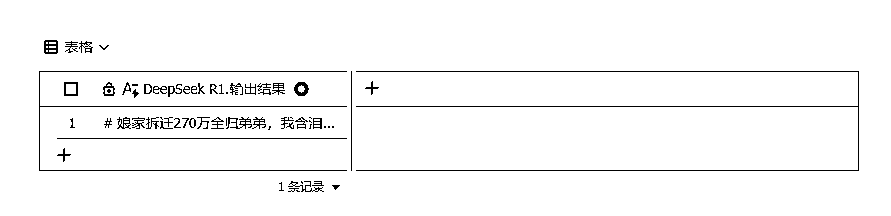 头条也是带表格识别不了：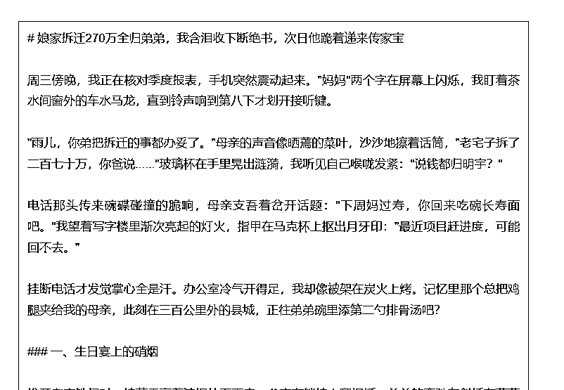 语雀点【立即转化】就能得到完美排版：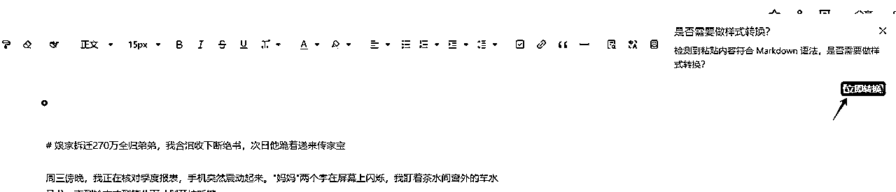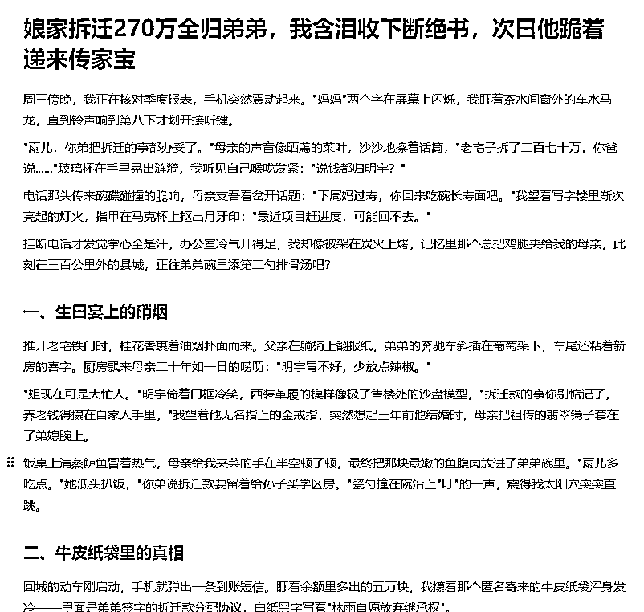 这部分的RPA在这里：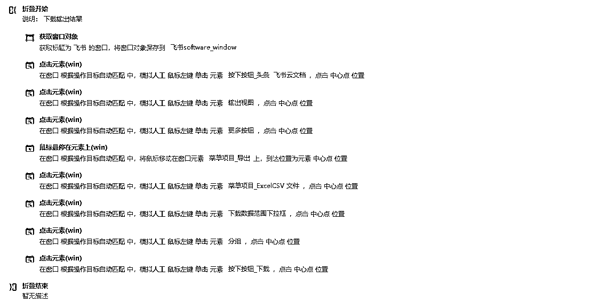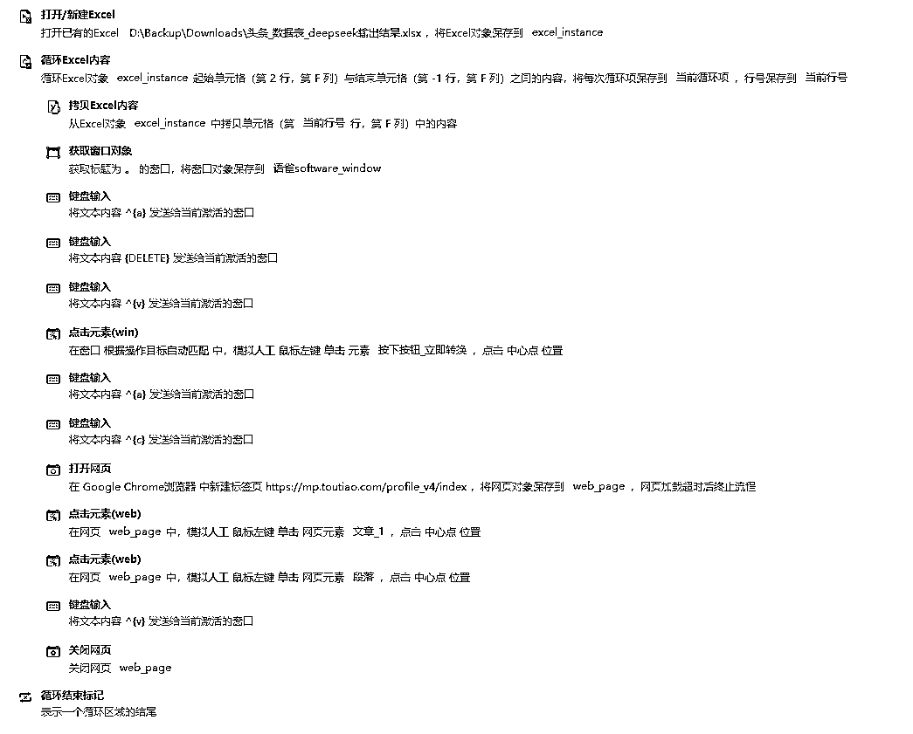

整套配完我的感受是：一顿操作猛如虎，回看发现还是手动更快，哈哈。

### 校验、配图、定时发布

RPA跑完之后，所有要发的内容都会进入“草稿箱”。接下来就是人工环节：逐篇校验、配图、设置定时发布。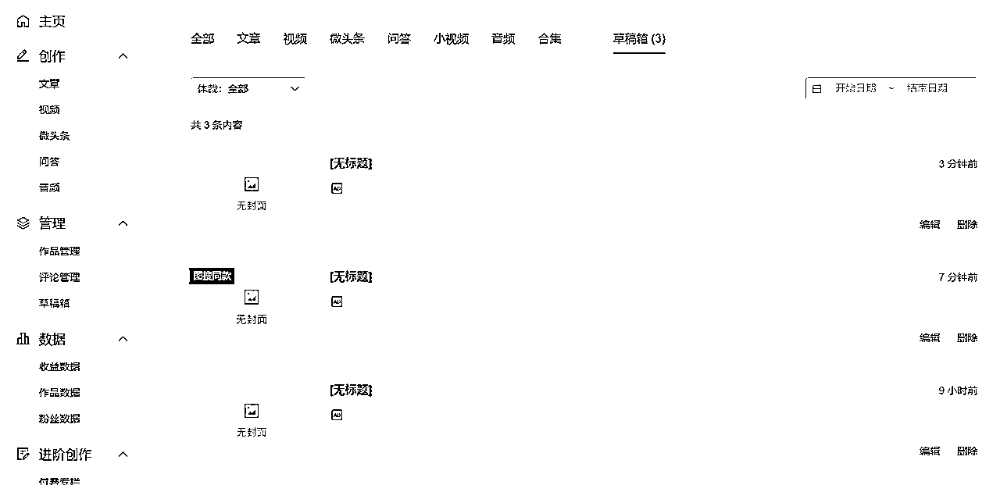

我一般每篇发布前花一分钟快速扫一遍，确保没有明显不合适的内容，比如暴力言论、AI自己编名字，或者不合适的段落。有时候第一行（也就是标题）没被正确识别，就需要手动补一下。

配图直接用头条“内容建议”里的素材，每篇凑够3张，就能生成三图封面。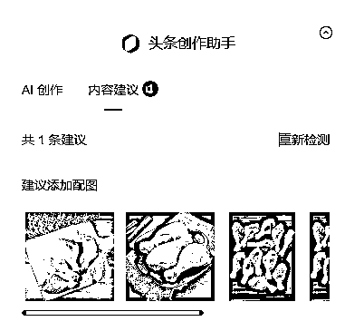

定时发布我会把时间错开一点，通常隔一小时发一篇。

## 踩过的坑

### 1. 连续两篇被判定与他人内容高度相似

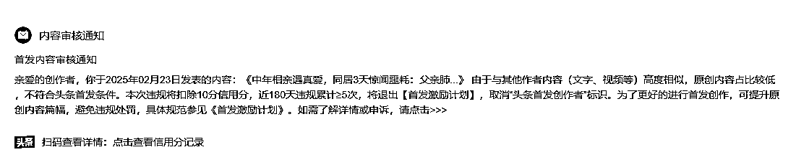

我拿着头条提供的原链接，试了多种检测原创度的方法，效果都不好。AI派全军覆没；DeepSeek也不行；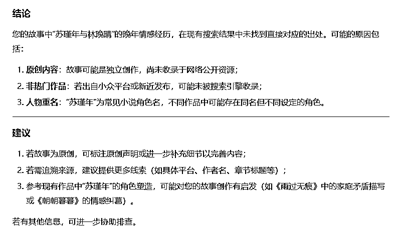 海螺照样没结果；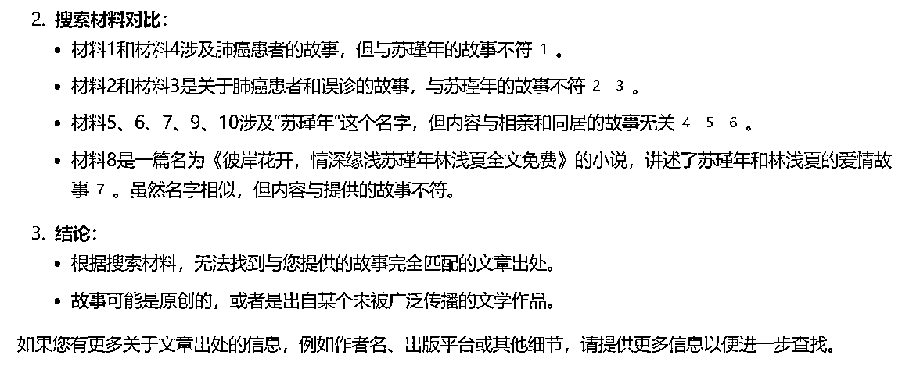 Kimi说明头条里根本搜不到；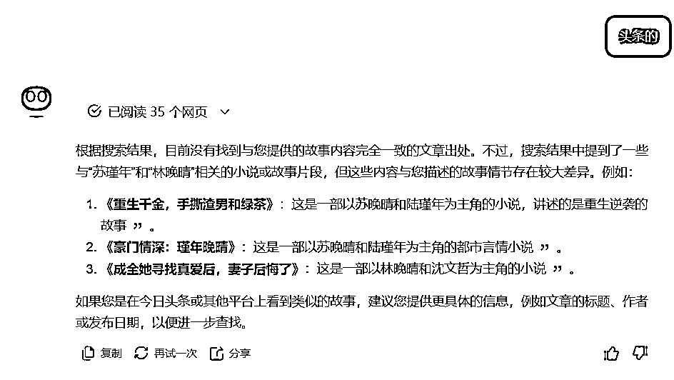 其它工具也一般。易攥倒是检测出原创度偏低，但它并不是对标头条的。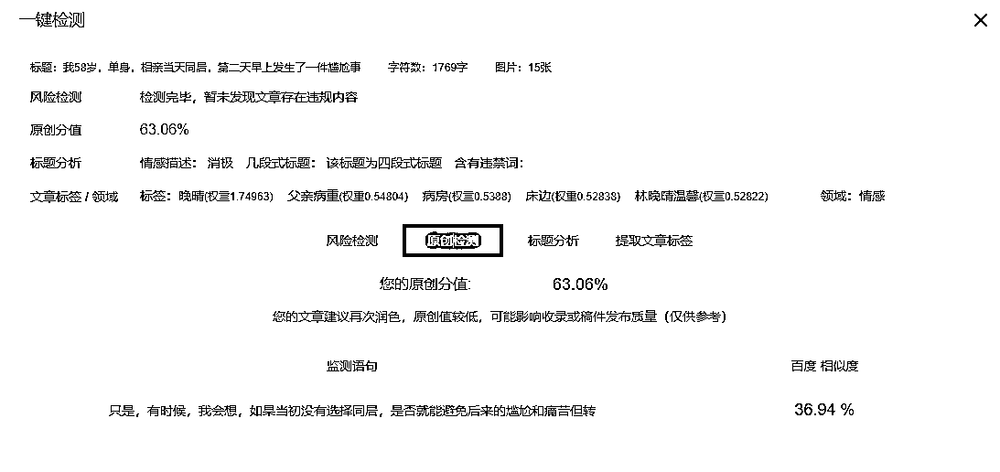 易媒助手嘛……emm。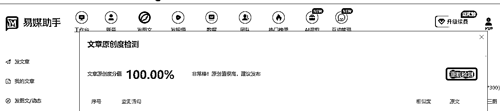

### 2. 干脆把首发声明关了

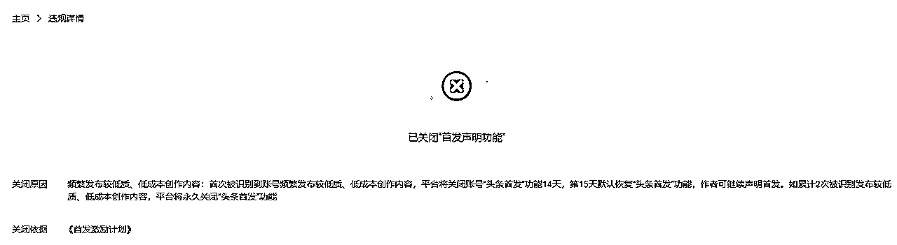

复盘下来原因大概有两个：一是发文太密，这周有一天发了10到15条；二是内容质量确实跟不上，截图里也能看出来。规避方法也简单：单账号每天控制在5到8篇；增加质量检测，重点做查重和内容质量评估；再不行就换账号。

其实这个小项目并不复杂，关键是理解平台规则、把流程自动化、再耐心做人工校验。希望这套思路能给大家一点参考。