# Reddit 工具箱：从入门学习到产品灵感，一站式整理
作者：龙哥

大家好，我是龙哥，一名喜欢折腾实用工具的 04 年大三学生。

最近发现 Reddit 的流量和社区价值越来越高，刚好看到老彭在朋友圈询问有没有人关注 Reddit，我立刻意识到：机会来了。经过几天整理和实践，我把这份 Reddit 工具箱做了出来。

感谢彩虹姐和彭哥在整理过程中提供的指导。下面将工具分为八类：基础学习、社区发现、数据挖掘、灵感获取、研究分析、内容创作、营销推广以及其他辅助工具，希望能帮助大家更高效地运营 Reddit。

如果你还知道其他实用工具，也欢迎在评论区补充，一起把这份工具箱完善起来。

## 一、基础学习工具

### 01 Subrise

**网站名称：** Subrise

**网址：** https://subrise.co/en

**工具标签：** Reddit 社区攻略、社区查询、概率解析、新手指南

Subrise 更像是一份 Reddit 使用手册，适合刚开始接触 Reddit 的用户。

它提供了社区参与技巧、热门版块推荐以及新手教程，也能帮助用户查询不同 Subreddit 的基本情况，例如社区规模、活跃程度和主要讨论方向。

除此之外，Subrise 还会解释 Reddit 的核心机制，包括 Upvote/Downvote 的影响、热榜内容的排序逻辑等。无论是普通用户，还是希望研究 Reddit 生态的开发者，都可以借助它快速建立基础认知。

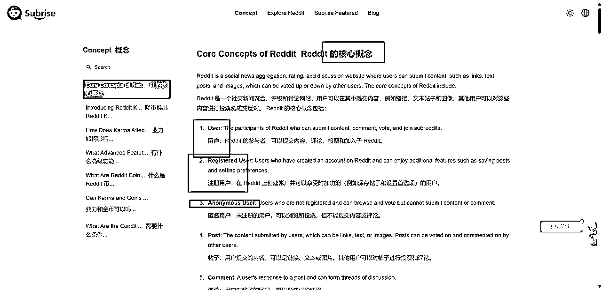

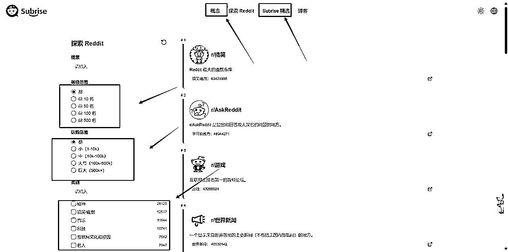

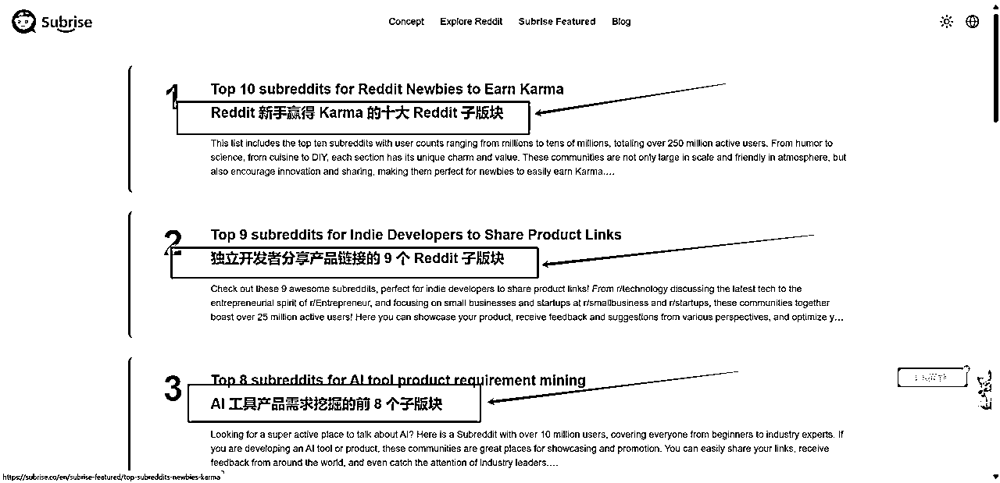

### 02 KarmaAssist

**Subreddit：** r/KarmaAssist

**网址：** https://www.reddit.com/r/karmaassist/

**工具标签：** Karma 获取、社区互动、内容分享、账号活跃

Karma 是 Reddit 用户的重要积分体系，通常来自帖子和评论获得的点赞。Karma 越高，往往意味着用户在社区中有更多贡献和影响力。

r/KarmaAssist 主要面向希望提升 Karma 的用户。大家可以通过发布内容、参与讨论和互相交流，提高账号活跃度。

由于部分 Reddit 社区对发帖者的 Karma 有要求，因此对于刚开始运营 Reddit 的用户来说，先积累一定 Karma 会更方便。这里也推荐中文 Karma 互助社区，帮助海外独立开发者完成早期积累，之后再进入其他版块发布内容，实现初步增长。

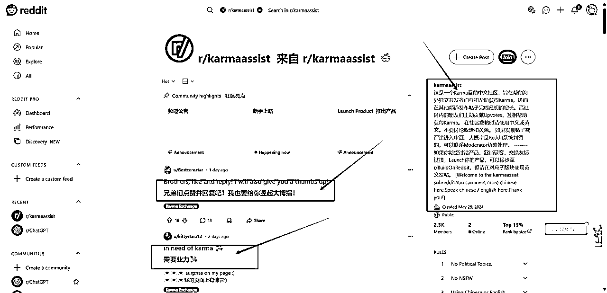

## 二、社区发现工具

### 01 Reddit Best Communities

**网站名称：** Reddit Best Communities

**网址：** https://www.reddit.com/best/communities/1/

**工具标签：** 社区推荐、热门 Subreddit、内容分类、社区导航

这是 Reddit 官方提供的热门社区入口，可以按照主题和受欢迎程度查看不同 Subreddit。

如果你还不知道目标用户聚集在哪里，或者想寻找适合产品推广的版块，这个页面非常适合作为起点。

**常见用途：**

1. **寻找目标社区**

出海开发者可以根据产品方向，筛选与目标用户相关的 Subreddit。

2. **获取选题灵感**

通过查看热门社区的讨论内容，了解用户正在关注什么，从而寻找内容创作方向。

3. **制定营销计划**

团队可以根据社区规模、主题和活跃程度，选择广告投放或 AMA 活动的目标版块。

4. **分析用户兴趣**

通过不同社区的主题分布，进一步判断用户偏好，优化产品和内容策略。

**参考来源：**

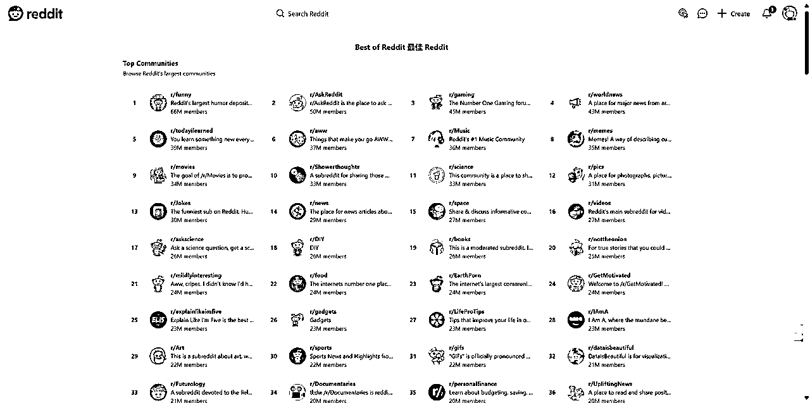

### 02 Redditlist

**网站名称：** Redditlist

**网址：** https://redditlist.com/

**工具标签：** 社区导航、热门版块、内容发现、受众定位

Redditlist 主要用于查找 Reddit 上活跃度较高的 Subreddit。

平台会按照订阅人数、受欢迎程度以及社区活跃状态进行整理和排序，帮助用户快速找到感兴趣的版块，也方便推广团队锁定潜在受众。

**主要应用场景：**

1. **海外市场调研**

搜索与产品或服务相关的高活跃社区，观察潜在用户的讨论内容。

2. **内容营销**

找到目标人群所在的版块，再针对社区特点设计内容。

3. **用户画像分析**

了解不同社区的兴趣、话题和用户结构，为产品定位提供参考。

4. **寻找新趋势**

通过关注热门版块和新兴社区，挖掘潜在机会。

5. **辅助广告投放**

根据社区规模和相关性，筛选更适合投放广告的版块。

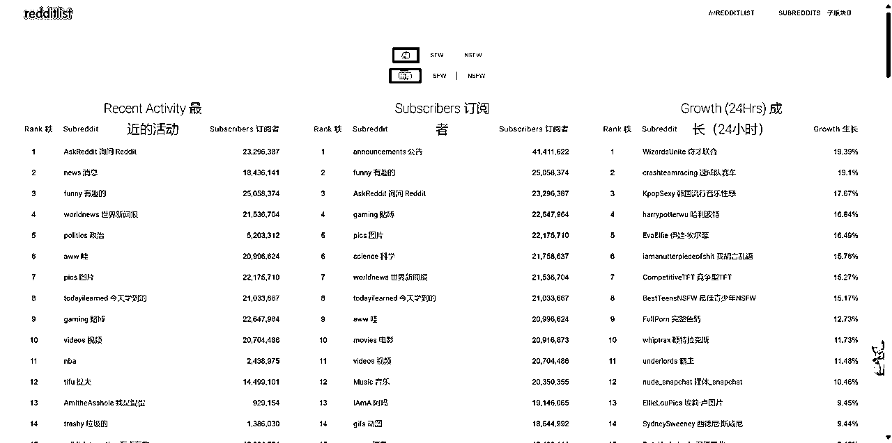

### 03 FindAReddit

**网站名称：** FindAReddit

**网址：** https://www.findareddit.com/

**工具标签：** 社区搜索、Subreddit 发现、分类导航、推广资源

FindAReddit 是一个面向 Reddit 社区搜索的工具，适合开发者、营销人员和市场研究者使用。

输入关键词后，平台可以帮助你找到相关 Subreddit，并提供社区订阅人数、活跃程度以及热门讨论等信息。

**常见用途：**

1. **搜索精准社区**

根据产品、行业或目标用户输入关键词，寻找匹配度较高的版块。

2. **内容发布与推广**

从多个候选社区中筛选适合发帖、互动或广告投放的目标。

3. **分析热门话题**

通过社区活跃程度和讨论内容，了解用户当前关注的问题。

4. **开展竞品研究**

找到竞品相关的社区，观察用户反馈、吐槽和真实需求，为产品优化提供线索。

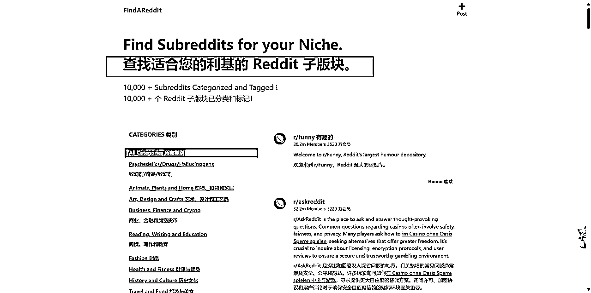

## 三、数据挖掘工具

### 01 Subreddit Stats

**网站名称：** Subreddit Stats

**网址：** https://subredditstats.com/

**工具标签：** 社区数据、活跃度分析、用户洞察、趋势追踪

Subreddit Stats 专注于 Reddit 各个子版块的数据分析，可以查看社区用户变化、发帖频率、热门主题和投票走势等信息。

对于想要做内容运营、市场调研或广告投放的人来说，这类数据能够帮助你判断一个社区是否值得投入。

**使用方向包括：**

1. **评估社区活跃度**

查看用户增长、发帖频率以及不同时间段的活动情况，辅助选择发布时间和目标版块。

2. **研究目标市场**

分析与产品相关的社区，了解用户需求、兴趣点和潜在痛点。

3. **寻找热门选题**

观察高热度帖子和内容主题，提高创作的相关性。

4. **优化营销预算**

根据社区规模、活跃程度和用户特点，选择更具性价比的推广渠道。

5. **开展竞品分析**

研究竞品所在社区以及用户对竞品的反馈，为产品迭代提供参考。

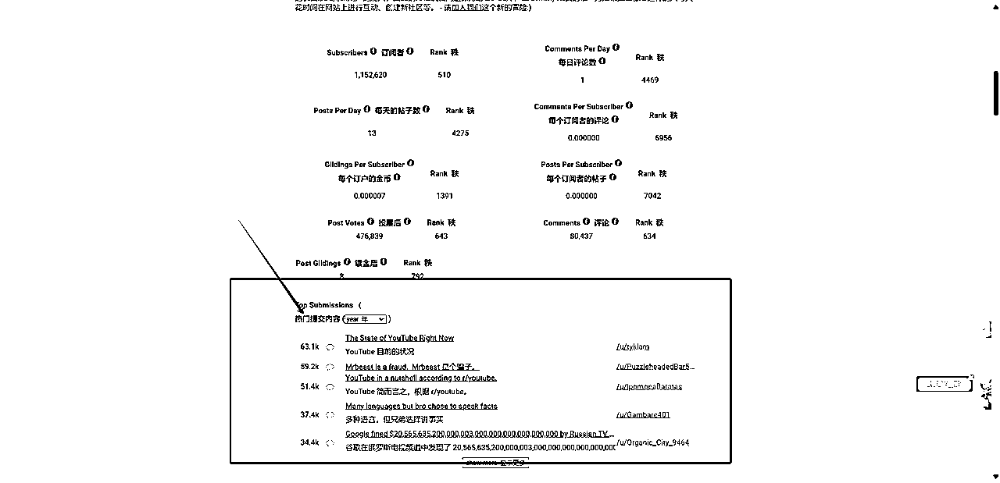

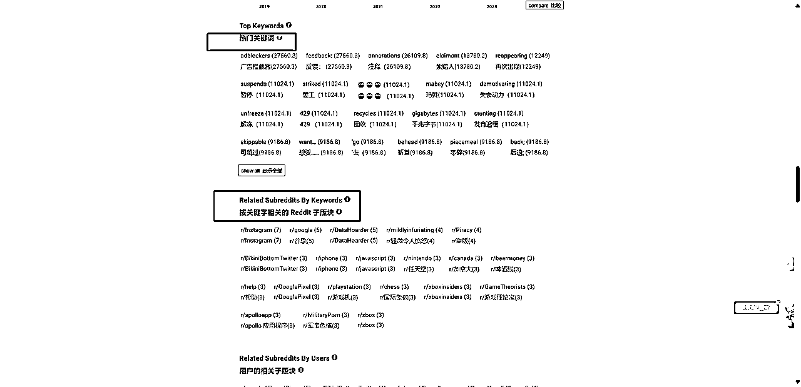

### 02 RedSim

**网站名称：** RedSim

**网址：** https://anvaka.github.io/redsim/

**工具标签：** Reddit 可视化、社区关系、版块探索、关系图谱

RedSim 用可视化方式呈现不同 Subreddit 之间的关联。

用户输入一个感兴趣的社区后，工具会展示与之相关的其他版块，并通过图形关系体现它们之间的联系强度。相比单纯搜索，它更适合用来发现隐藏的社区网络。

**主要使用场景：**

1. **拓展目标社区**

从一个核心版块出发，寻找更多相关社区，用于内容分发或推广。

2. **研究兴趣生态**

观察不同主题版块之间的连接，了解某个领域的社区结构。

3. **拓展潜在市场**

从目标产品所在社区延伸，发现可能感兴趣的受众群体。

4. **寻找内容方向**

参考关联版块中的讨论主题，挖掘新的创作切入口。

5. **分析竞品布局**

观察竞争产品活跃在哪些社区，寻找新的推广机会。

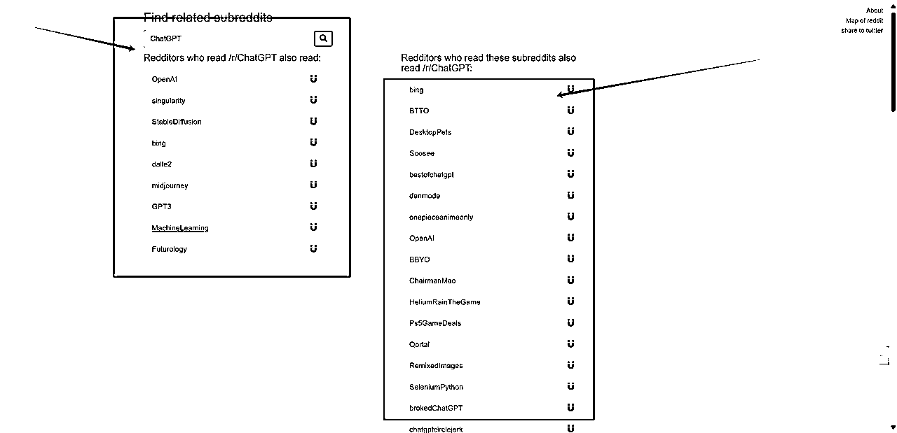

### 03 Keyworddit

**网站名称：** Keyworddit

**网址：** https://www.highervisibility.com/seo/tools/keyworddit/?utm_source=toolbaseio

**工具标签：** Reddit 关键词研究、SEO、内容选题、市场调研

Keyworddit 可以从指定 Subreddit 中提取关键词，并提供相关搜索量和关键词创意。

使用时，只需要输入关键词，再选择目标 Subreddit，平台就会生成按月度搜索表现整理的关键词列表。

你还可以点击关键词旁边的上下文信息，进一步查看 Google 搜索结果，了解 Reddit 内部与该关键词有关的帖子和讨论。生成的关键词也支持批量导出，方便后续用于 SEO、文章策划或市场分析。

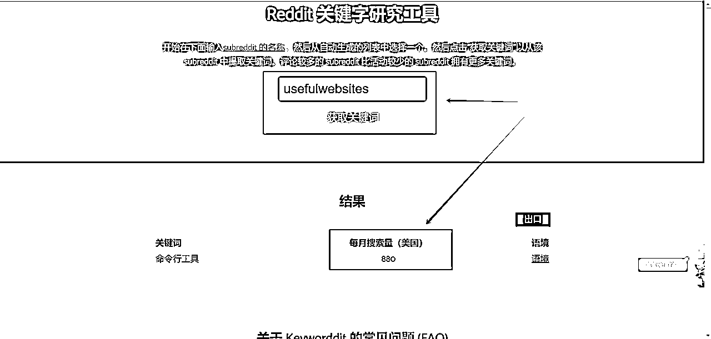

### 04 Reddit Insights

**网站名称：** Reddit Insights

**网址：** https://redditinsights.ai/

**工具标签：** 关键词研究、SEO 优化、用户问题分析、内容创作

Reddit Insights 通过整理特定 Subreddit 中与关键词有关的问题，帮助用户快速发现社区真实讨论。

它特别适合用来挖掘用户反复提出的疑问、长尾关键词和潜在内容需求。

**应用场景：**

1. **SEO 优化**

从真实用户提问中寻找长尾词，丰富网站内容结构。

2. **内容策划**

根据社区正在讨论的问题，为文章、视频或社交媒体内容寻找选题。

3. **市场研究**

识别用户需求、痛点和未被满足的场景。

4. **竞品研究**

观察用户如何评价竞品，分析产品在实际使用中的问题。

5. **社区运营**

参与用户关心的话题，通过有价值的回答提高品牌影响力。

## 四、灵感挖掘工具

### 01 Reddit Insights Finder

**网站名称：** Reddit Insights Finder

**网址：** https://www.ideawip.com/tools/reddit-insights-finder

**工具标签：** Reddit 数据挖掘、关键词趋势、社区洞察、热门话题

Reddit Insights Finder 适合用来观察 Reddit 上的热门话题、用户需求和活跃社区。

它目前包含两个比较实用的方向：

- **洞察工具：** 帮助查找 Reddit 用户正在表达的需求；

- **验证工具：** 根据你的产品想法进行初步评估。

此外，平台也会展示其他用户提交的想法，可以用来寻找产品灵感、参考验证思路。

**常见用途：**

1. **发现目标社区**

根据产品方向，找到用户活跃、需求集中的版块。

2. **追踪关键词与热点**

分析关键词背后的讨论趋势和用户关注点。

3. **研究市场需求**

通过帖子内容了解用户痛点，为产品开发和服务优化提供依据。

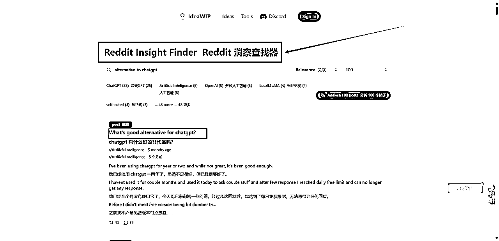

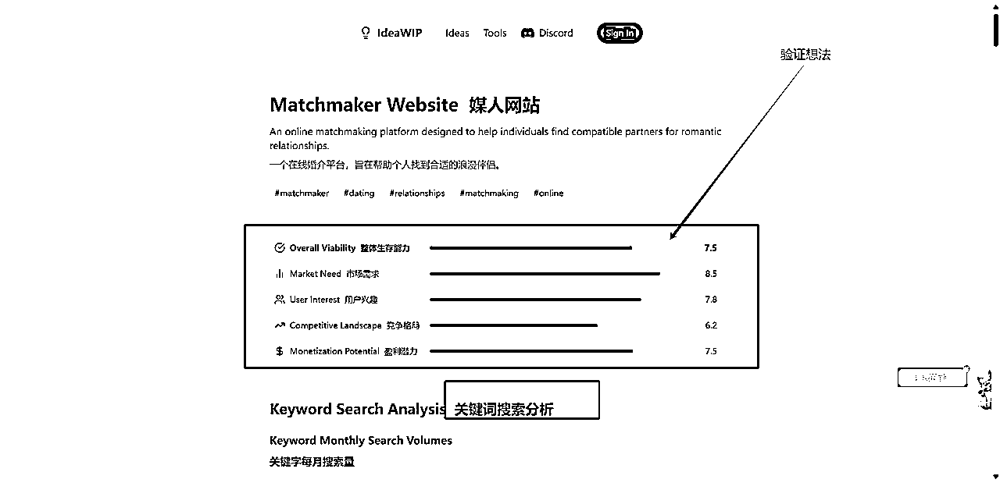

### 02 IdeaPicker

**网站名称：** IdeaPicker

**网址：** https://ideapicker.io/ideas

**工具标签：** 创业想法、创意筛选、市场验证、项目开发

IdeaPicker 面向创业者和开发者，帮助用户发现、筛选并评估产品想法。

用户既可以提交自己的创意，也可以浏览其他人发布的项目，从现有想法中寻找灵感。

**核心功能：**

1. **创意评分**

根据市场需求、执行难度和盈利潜力等维度，对想法进行结构化评估。

2. **想法数据库**

支持浏览和搜索已有创意，方便寻找方向。

3. **初步验证**

通过社区投票和反馈，判断一个想法是否具备潜在市场。

4. **多条件筛选**

可以按照行业、用户群体、商业潜力等条件筛选项目。

5. **社区交流**

用户能够评论、点赞并提出改进建议，帮助创意继续完善。

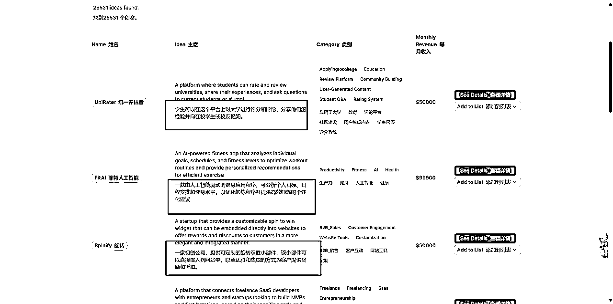

### 03 IndieIdeas

**网站名称：** IndieIdeas

**网址：** https://indieideas.io/

**工具标签：** 独立创业、产品创意、市场验证、开发社区

IndieIdeas 是一个服务于独立开发者、创业者和创意人士的社区平台。

在这里，用户可以提交自己的产品想法，也可以浏览别人正在探索的方向，并通过评论、投票等方式获得反馈。平台希望帮助个人创业者完成从灵感出现到产品落地的过程。

**主要功能：**

1. **发布创业想法**

分享自己的构思，获取其他用户的建议。

2. **验证产品方向**

通过社区评价和互动，初步判断市场是否存在需求。

3. **浏览其他项目**

了解他人的创意，寻找灵感或潜在合作机会。

4. **参考市场趋势**

借助平台上的行业信息和用户反馈，更好地调整产品定位。

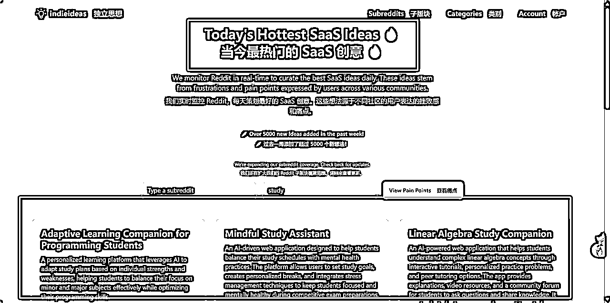

下面几个产品灵感网站来自刘小排老师的分享。如果你正在寻找产品方向，建议结合这篇内容一起阅读：

### 04 Product Hunt

**网站名称：** Product Hunt

**网址：** https://www.producthunt.com/

**标签：** 产品发布、创业工具、技术趋势、用户社区、产品推广

Product Hunt 是一个专门展示和发现新产品的平台，覆盖软件、硬件、应用、技术服务和创业项目等多个领域。

开发者、设计师、创业者以及早期用户都可以在这里发布、浏览和讨论新产品。对于刚上线的项目来说，Product Hunt 既是获取早期用户的渠道，也是一处收集反馈、观察市场趋势的地方。

**主要优势：**

1. **触达早期用户**

吸引对新技术和新产品感兴趣的人群，建立第一批用户。

2. **验证市场方向**

通过社区反馈了解产品是否有吸引力，以及后续需要改进的地方。

3. **聚集高质量用户**

平台汇集创业者、投资人、设计师和技术爱好者。

4. **观察行业趋势**

每日榜单能够帮助用户了解近期热门产品和技术方向。

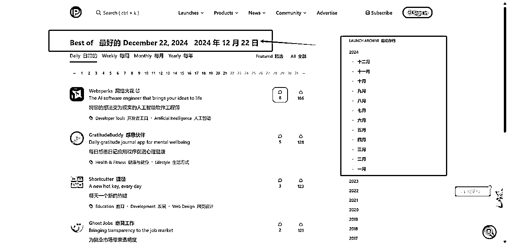

### 05 Hacker News - Show HN

**网站名称：** Hacker News - Show HN

**网址：** https://news.ycombinator.com/show

**标签：** 项目展示、产品发布、技术社区、创业分享、开发者工具

Show HN 是 Hacker News 中专门用于展示项目的板块。

开发者、创业者和创意人士可以在这里介绍自己正在开发的产品、工具或实验项目。由于社区聚集了大量技术从业者和创业爱好者，因此很容易获得早期用户的反馈与讨论。

**主要优势：**

1. **低成本曝光**

Hacker News 拥有大量技术用户和潜在客户，是一个可以免费获得关注的推广渠道。

2. **获得真实反馈**

项目发布后，能够直接接触开发者和技术用户，了解产品的问题与改进方向。

以上就是本次整理的 Reddit 工具箱。

从学习 Reddit 规则，到寻找目标社区，再到分析用户需求、挖掘产品灵感，每个阶段都有对应的工具可以辅助。对于出海开发者、独立创业者和营销人员来说，合理组合这些工具，能够减少试错成本，更快找到用户、内容和产品机会。

如果你还收藏了其他好用的 Reddit 工具，欢迎留言分享。

做产品最怕闭门造车。社区老成员随口提的几条建议，往往比内部会议上的高谈阔论更接近真实需求；这些反馈既有专业含量，又能立刻执行——要么让产品迭代少走弯路，要么帮团队解开卡了许久的技术死结。项目刚起步时，花少量时间泡在社群里，就能提前拿到市场的水温和用户的态度，比自己埋头猜测高效得多。

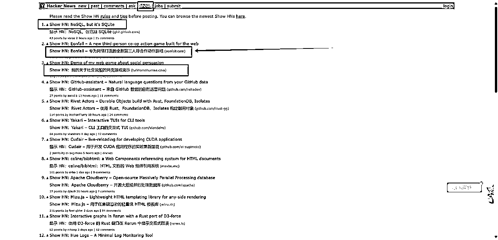

### 06 SEOBox

站点名：SEOBox

访问地址：https://seo.box/referring/

定位：这款产品把网站优化流程打包处理，重点盯着“哪些域名在向你的站点导流”。通过回溯链接来源，你能看清反向链接的数量和出处质量，再由此判断它们对自然搜索排名和流量的真实影响。

亮点：

- 反向链接建设更有章法：借助引荐域名数据，可以精准筛选值得深耕的导入链接机会，把力气花在能提升排名的环节。

- 竞品动向一目了然：拆解对手的导流结构，找出对方正在争取的高价值链接阵地。

- 风险链接早发现：低质或带毒的引荐域名会被快速识别，防止站点因垃圾链接被搜索引擎降权。

- 内容吸引力更易放大：了解哪些站点偏爱你的内容类型，再调整选题和呈现方式，就有机会迎来更多自然引荐。

榜单信息：哥飞整理的一份每月通过 Stripe 收款、收入最高的 100 个产品清单。

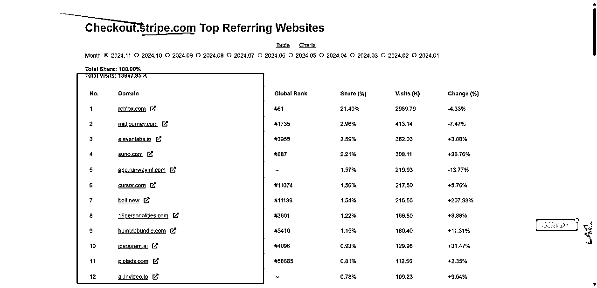

### 07 Toolify

站点名：Toolify

访问地址：https://www.toolify.ai/zh/

定位：一个把 AI 应用集中陈列的导航平台，收录对象覆盖效率办公、写作作图、写代码、图片加工等方向。想尝鲜最新 AI 能力，或者找某个具体场景的解决方案，到这里按图索骥就行。它由知名产品人阳光杉木推荐，目前在全球 AI 导航站中排在第二位。

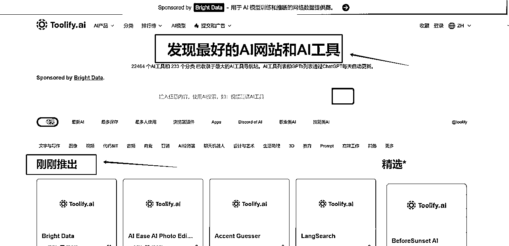

### 08 There’s An AI For That

站点名：There’s An AI For That

访问地址：https://theresanaiforthat.com/

定位：一座庞大的 AI 服务索引库，专门收集并归类当下冒出来的新 AI 应用。个人用户和公司团队都可以按需检索，快速定位对口服务，同时顺手掌握行业前沿变化。它的数据库规模与搜索体验是两大招牌。

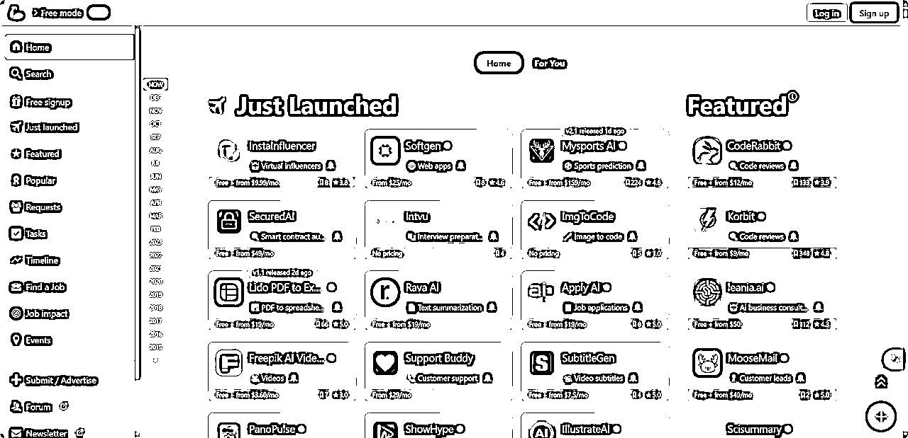

## 五、研究洞察类

### 01 SnooSnoo

站点名：SnooSnoo

访问地址：https://snoosnoop.com/

定位：一个专门给 Reddit 个人账号做“画像”的站点。输入任意用户名，就能回看其发过的帖子、留过的言、常见的上线时段以及长期逛的分区，方便做用户调研、行为观察和内容策略调整。

亮点：

- 活跃节奏拆解：明确某个人通常什么时候在线，投递消息或安排内容发布可以踩准对方的在线窗口。

- 兴趣地图绘制：把关注的话题领域串起来，方便做定制推荐；市场团队也能据此圈定目标社区，集中火力。

- 口味分析：判断对方更爱聊科技、娱乐还是政治，做内容时就顺着受众的喜好走。

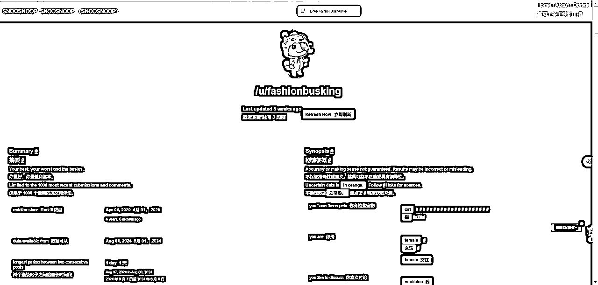

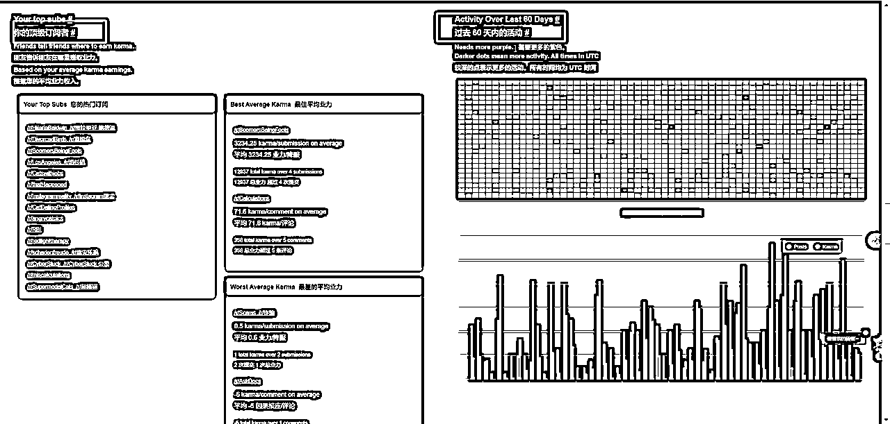

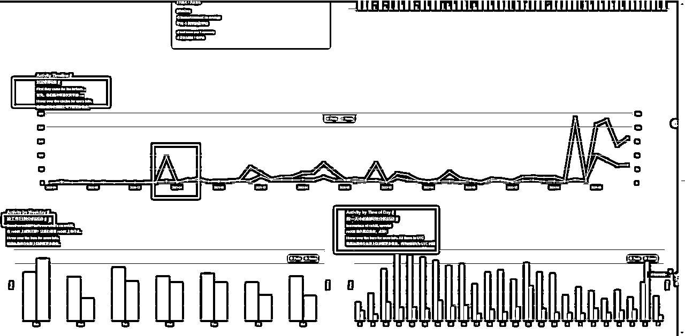

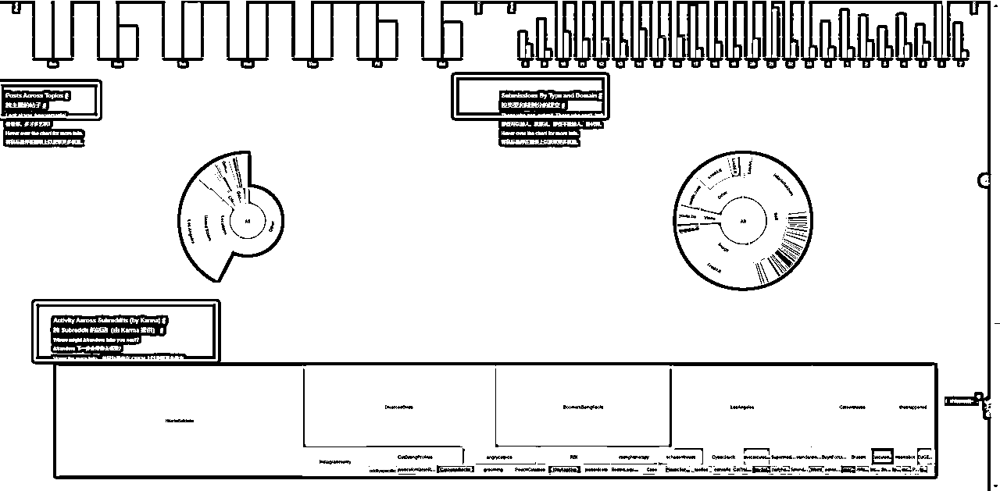

同场加映：

### 02 Reddit Metis

站点名：Reddit Metis

访问地址：https://redditmetis.com/

定位：面向 Reddit 分区的数据解读工具，能输出某个讨论区的内容发布量、互动热度、成员在线分布、帖子和评论的反馈表现。版主、运营、内容团队和品牌方都能借它调整发布节奏，增强社区互动，也方便盯住竞争板块。

亮点：

- 板块数据全览：内容规模、活跃时段、互动热络程度一目了然，帮你判断什么话题在该区最吃香。

- 最佳发布窗口：按小时/天/周拆解成员活跃曲线，做到在曝光量最大的时段推送。

- 爆款内容追踪：提取点赞最高的帖子与形式，总结标题和内容上的可取之处。

- 热词与议题扫描：整理讨论区里反复出现的说法和话题，为后续选题提供方向。

- 横向对比：同时比较多个分区，看活跃度、内容偏好和成员表现差异。

- 历史数据回溯：调取特定板块过去的表现，识别长期涨跌趋势。

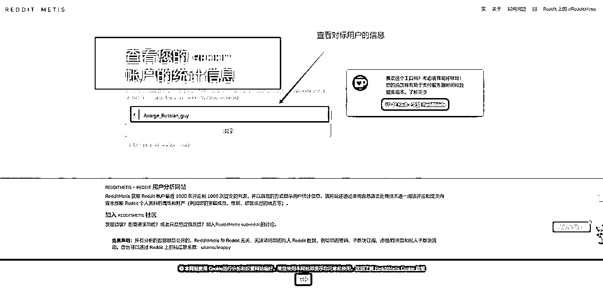

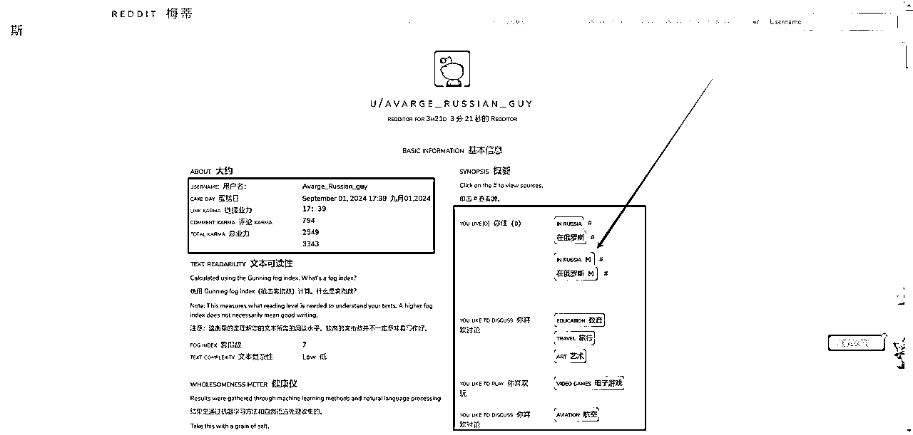

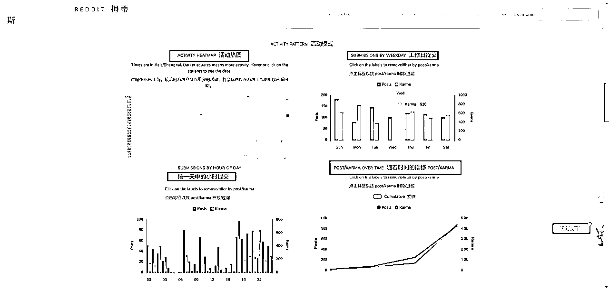

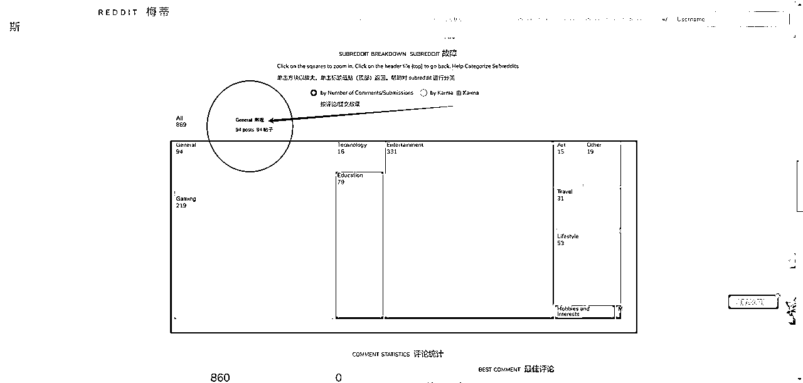

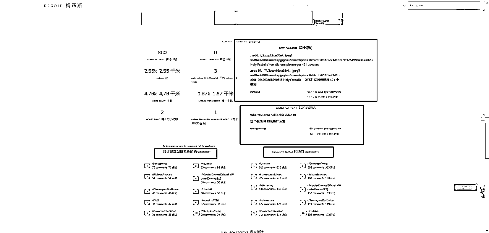

### 03 Postpone

站点名：Postpone

访问地址：https://www.postpone.app/scheduled

定位：Reddit 运营者的排期助手，核心能力是把内容提前排入队列，到点自动推送，且不限于单一平台。除了节省人工盯点，它还会分析你的账户数据，并附带标题生成之类的小功能。

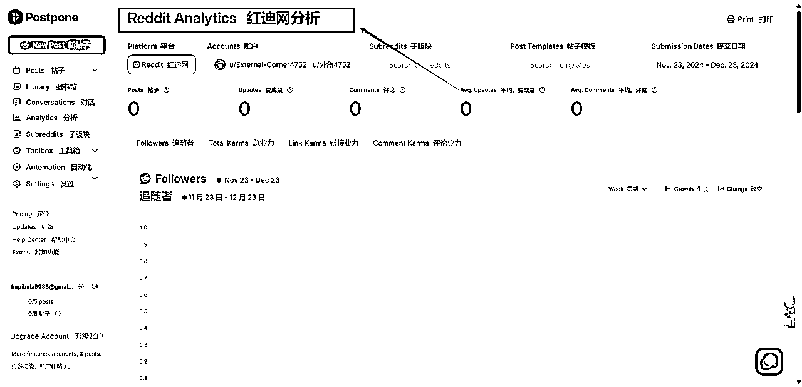

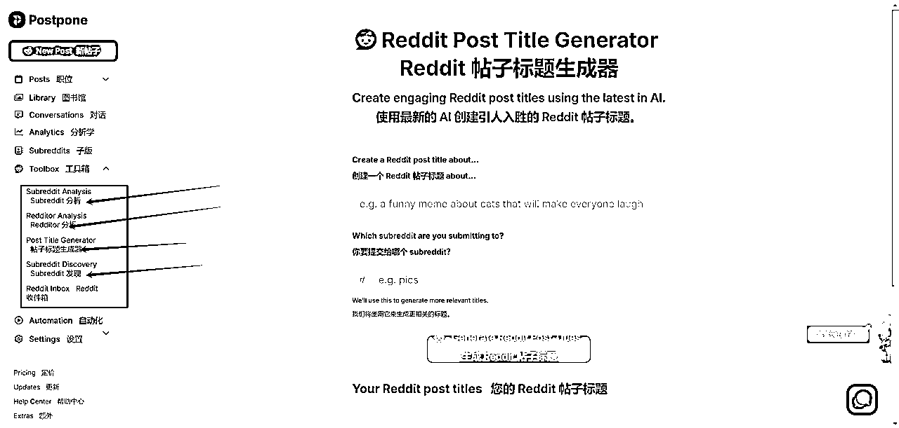

### 04 Later for Reddit

站点名：Later for Reddit

访问地址：https://dashboard.laterforreddit.com/analysis

定位：该工具聚焦分区趋势分析。输入板块名称，就能看到帖子的在线高峰分布、点赞曲线、评论热度与热门内容，据此找到最容易出圈的发布时机。

亮点：

- 时段洞察：统计成员一天/一周里的活跃峰值，锁定最佳发文点。

- 互动趋势：观察不同时间的点赞和评论变化，用来检验内容表现。

- 热门帖样板：整理高赞帖子，研究什么样的内容和标题更讨喜。

- 策略参考：根据历史数据自动给出发布时间和内容方向的建议。

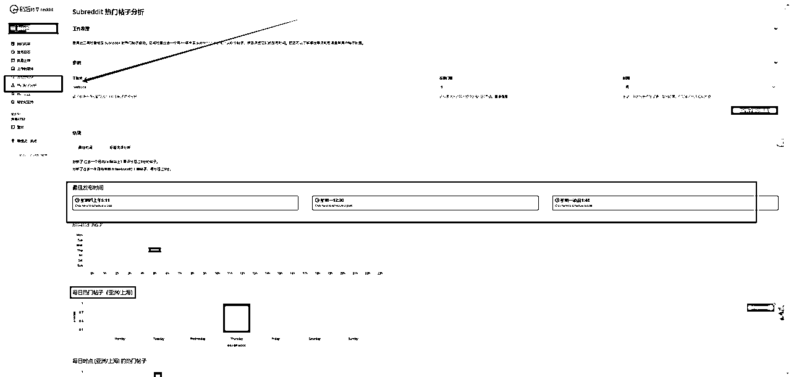

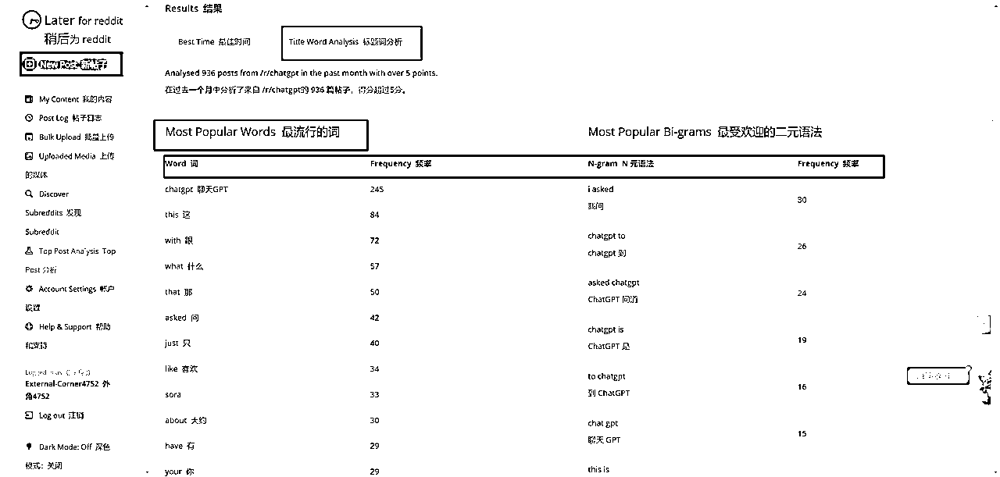

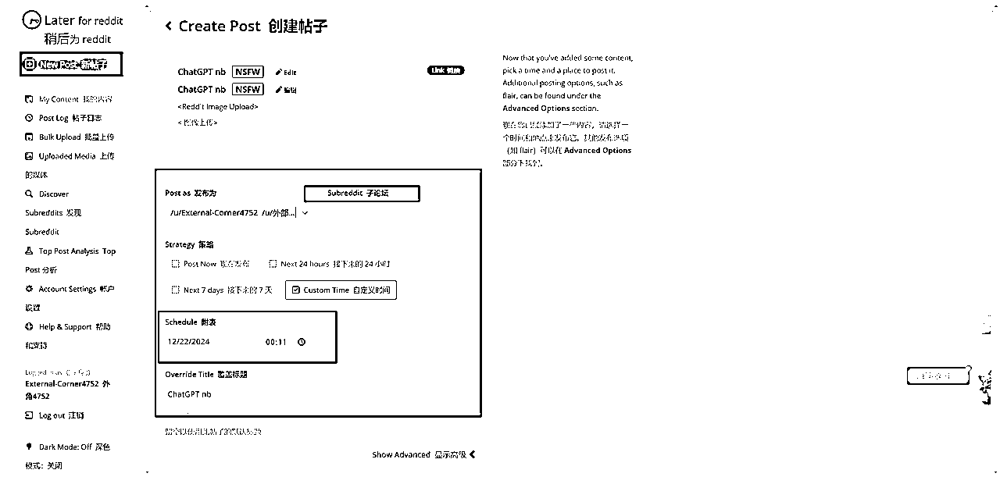

同类可选：

### 05 Delay for Reddit

站点名：Delay for Reddit

访问地址：https://www.delayforreddit.com/

定位：让帖子按计划自动发出的预约发布工具。提前写好内容、选好目标分区，到点便会自动贴出。对于需要跨时区协作的团队、内容作者和社区管理员尤其友好，能让每一条内容都踩在流量高峰。

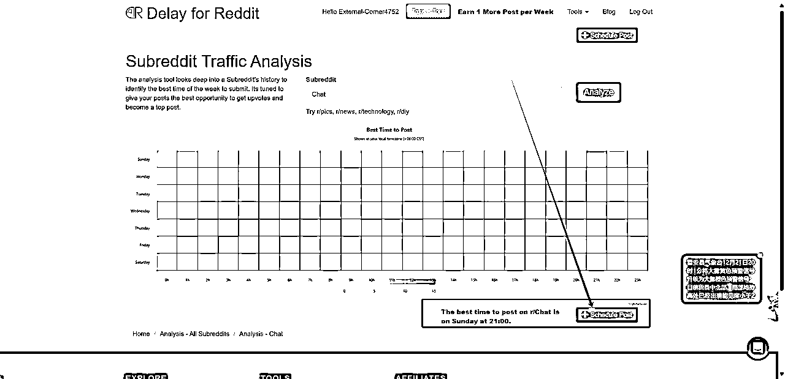

### 06 Redective

站点名：Redective

访问地址：http://www.redective.com/

定位：输入用户名即可抓取其发文轨迹、留言记录、混迹的分区和高频词，帮助你还原一个人的兴趣面、活动轨迹和社区影响力。

适用场景：

- 行为拆解：整理目标账号的发布和留言，找出其常在线时段、活跃板块与话题偏好，为选题或营销定位做铺垫。

- 潜在受众摸底：出海团队可以用它圈定站内值得触达的人群，搞清楚他们聚集在哪里、关注什么。

- 参与度画像：衡量某账号在社区里的活跃程度和板块分布，辅助建立人群画像。

- 竞品跟踪：观察竞品相关用户或社区的讨论，提炼对方用户的需求与不满，反哺产品迭代。

- 定向推广：筛出高活跃度账号，围绕他们做精准投放，提升品牌能见度。

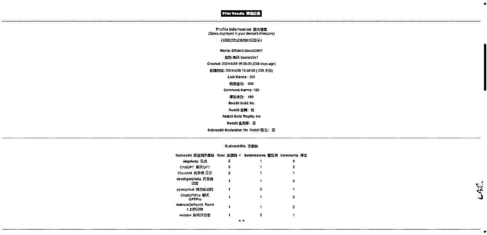

## 六、图文创作类

### 01 Canva

平台名：Canva

访问地址：https://www.canva.cn/

定位：一个面向大众的在线设计工具，模板库和素材库非常丰富，零基础的人也能做出海报、PPT、名片、短视频和营销配图。往 Reddit 上放内容时，配上一张好看的图，打开率完全不一样。另外，在闲鱼上花很少的钱就能买到长期会员，性价比相当离谱。

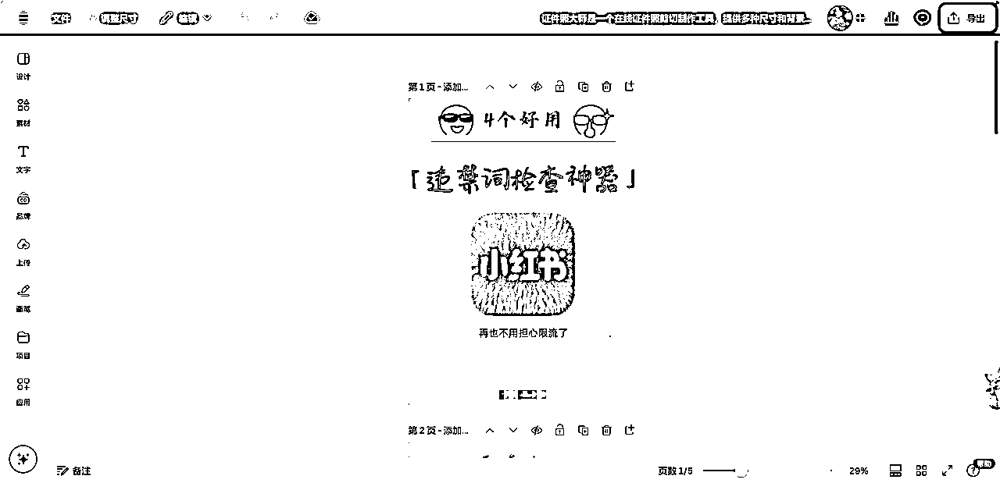

### 02 ShotEasy

站点名：ShotEasy

定位：免费的在线截图美颜工具，直接在浏览器里给截图加背景、边框、阴影和水印，还能裁剪、改尺寸、写注释。处理完的图片干干净净，特别适合放进博客、PPT 或社交动态里。

适用场景：

- 做图配文：给文章或演示稿配上精致的截图，质感立刻上一个台阶。

- 产品展示：给功能页面做视觉包装，让卖点更突出。

- 社交传播：把普通截图变成吸睛卡片，提升转评赞。

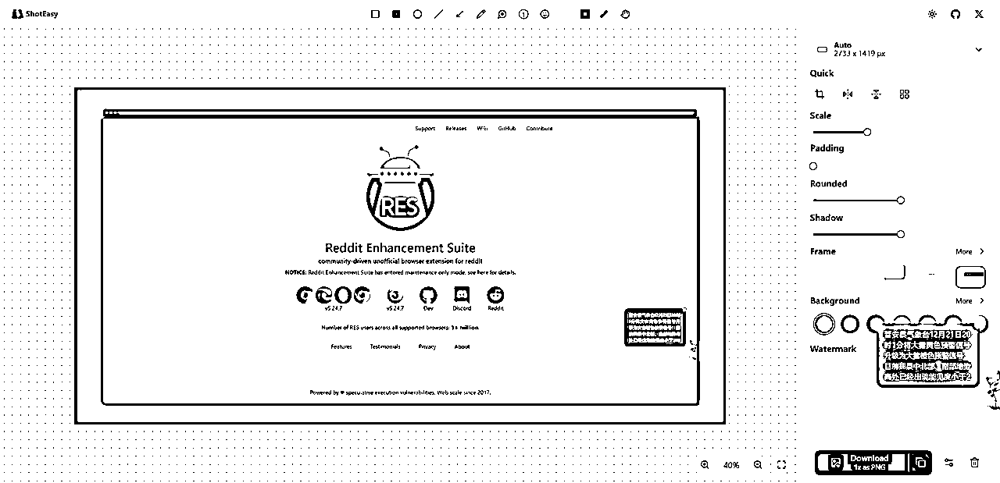

### 03 Reddit Preview

站点名：Reddit Preview

访问地址：https://redditpreview.com/

定位：发布前的“预览镜”，可以模拟帖子、广告或排版在真实页面上的样子，避免发出后才发现格式翻车。广告主、内容团队与版主都能在这里提前检查效果。

亮点：

- 帖子预览：在公开前查看标题、正文、图片或视频的最终展示效果。

- 广告预览：模拟信息流广告或纯文字推广的呈现，确保视觉和信息传达没问题。

- Markdown 检查：测试加粗、列表、超链接等格式是否正确显示。

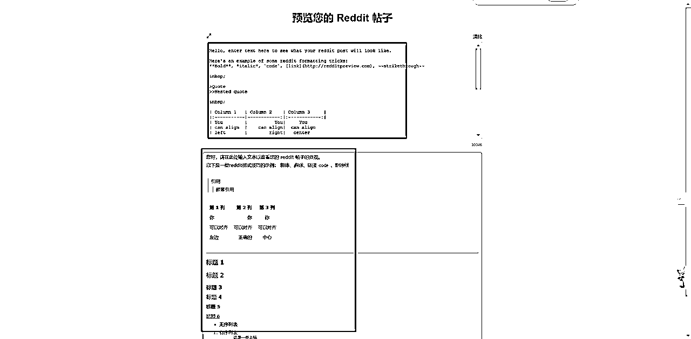

## 七、推广增长类

### 01 GummySearch

站点名：GummySearch

访问地址：https://go.gummysearch.com/audiences/

定位：用站内讨论数据做受众研究的平台，可以挖出目标人群真正在乎什么、焦虑什么、最近在聊什么，为产品设计、内容方向和营销打法提供依据。

适用场景：

- 人群调研：出海开发者可快速锁定站内的核心用户，看看他们在吐槽什么、期待什么。

- 热点追踪：市场团队持续跟进高热议题与热词迁移，把握用户注意力走向。

- 分区筛选与活动规划：挑出适合投放的板块，策划 AMA 或讨论帖等互动活动。

- 选题灵感：从用户高频提问中提炼素材，写出来的东西更贴脸。

- 竞品看板：分析竞品的受众分布和口碑反馈，找到差异化切入点。

信息出处：

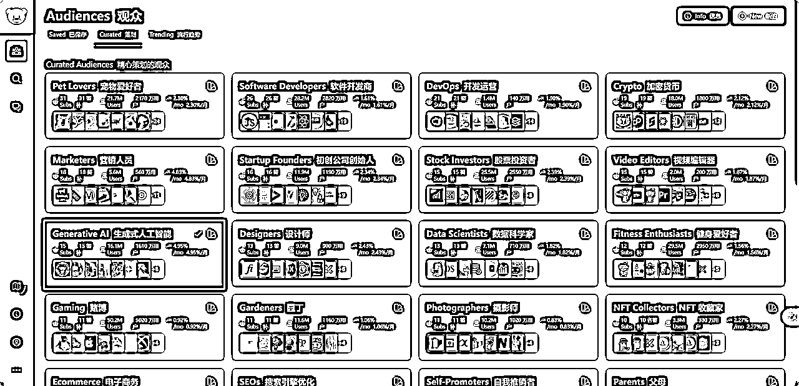

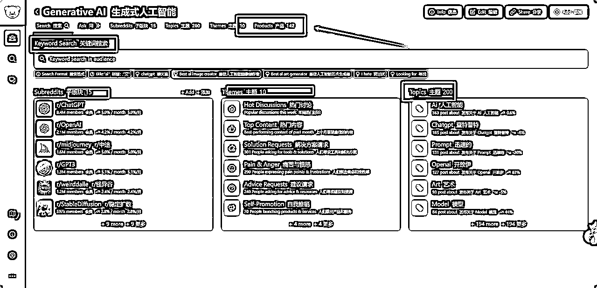

### 02 Reddit Ads Dashboard

站点名：Reddit Ads Dashboard

访问地址：https://ads.reddit.com/account/g7day0x3eyfn/dashboard?landing=true

定位：Reddit 自家推出的推广管理后台。广告主可以在这里搭建、打理和优化各类投放任务，按自己设定的条件圈选人群，把品牌、流量和转化一起抓。

亮点：

- 投放创建：几步就能建好一条计划，支持纯文本、图片、视频等版式，还能选择品牌曝光、点击、转化等目标。

- 精细定向：按兴趣、地理位置、设备、具体分区等条件圈人，让广告出现在最相关的人面前。

- 数据看板：实时查看 CTR、CVR、展示量与花费，随时调整出价和素材。

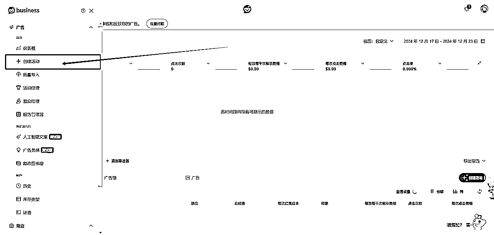

## 八、效率与辅助类

### 01 Reddit Saved

站点名：Reddit Saved

访问地址：https://reddit-saved.com/

定位：收藏夹的管理助手。把保存过的帖子和评论分门别类，搜索、翻阅都方便，也支持导出备份。对经常刷站内做资料收集的人来说，能省下大量找内容的时间。

适用场景：

- 收藏整理：把散落的书签归类归档，写作者和调研者随时调用。

- 灵感沉淀：出海公司可集中存放行业动态、用户反馈等线索，为后续产品和市场判断做素材储备。

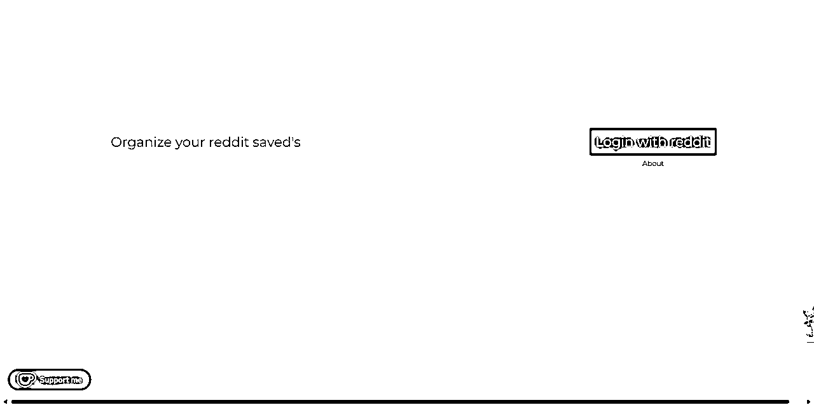

### 02 Reveddit

站点名：Reveddit

访问地址：https://www.reveddit.com/about/

定位：一个把平台“删除痕迹”摊开看的网站。无论是作者自己删掉，还是被版主或机器人移除，帖子和评论都能在这里被重新看到。想搞清社区内容审核的规则，或者找回被删的内容，它能派上大用场。

适用场景：

- 审核透明度观察：查看被移除或隐藏的内容，判断删除是否因为违反规定。

- 账号行为核查：如果某个用户频繁被删帖，可以检查是否存在违规嫌疑。

- 内容找回：自己的帖子或评论被误删时，可到这里翻出原文留档。

4.竞品分析：关注同类产品的内容是否曾被社区移除，并进一步拆解其内容运营方式，了解其中的优势与不足。

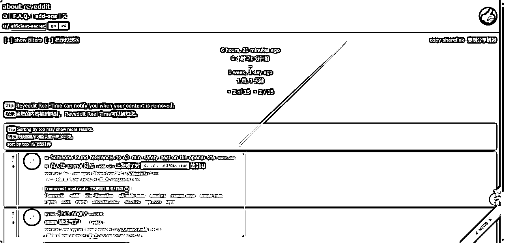

### 03 Reddit Enhancement Suite（RES）

网站名称：Reddit Enhancement Suite（RES）

网站标签：Reddit增强工具、浏览器插件、体验优化、内容管理

#### 工具介绍

Reddit Enhancement Suite，简称 RES，是一款面向 Reddit 用户打造的浏览器扩展。它在原有平台功能的基础上，加入了内容筛选、快捷操作、界面定制等实用功能，帮助用户更高效地浏览和管理 Reddit 内容。对于经常使用 Reddit 的高级用户以及社区管理者来说，RES 是一款功能较为全面的辅助工具。

#### 适用场景

1. **提升信息浏览效率**

支持无限滚动，减少频繁翻页带来的操作成本；同时可以按照关键词或内容类型进行过滤，让信息流更加符合个人需求。

2. **辅助用户管理内容**

用户可以保存浏览记录，快速进入常用子版块，也能更方便地整理和查找相关内容。

3. **打造个性化界面**

RES 支持调整 Reddit 的主题、页面布局和视觉样式，用户可以根据自己的偏好优化使用体验。

4. **便捷切换多个账号**

对于拥有多个 Reddit 账号的用户来说，多账户切换功能能够减少重复登录的麻烦，在不同身份之间快速完成转换。

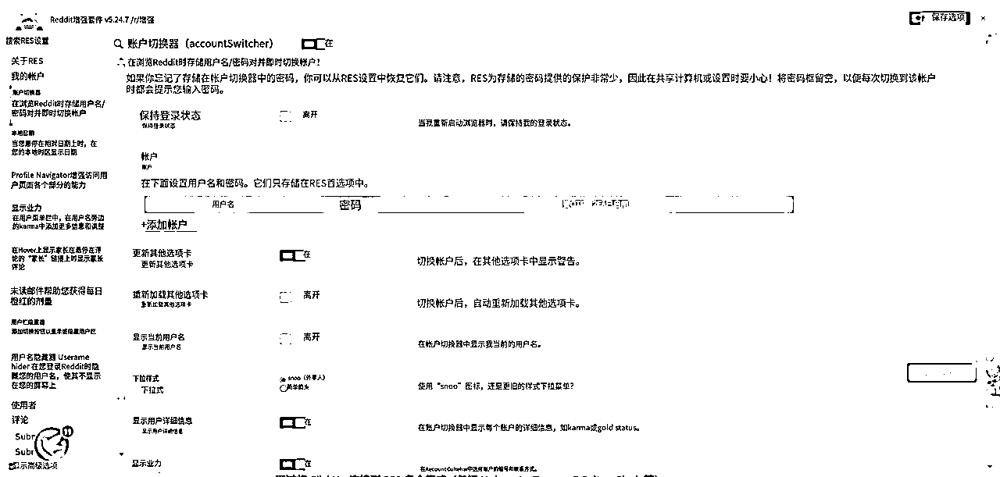

### 04 SnapAny

工具名称：SnapAny

标签：Reddit视频下载、图片保存、内容提取、在线工具

#### 工具简介

SnapAny 是一款用于保存社交平台内容的在线工具，支持从 Reddit 等网站下载视频和图片。整个操作流程较为简单，处理速度快，并且兼容多种内容格式。无论是想把有趣的素材留存到本地，还是用于离线查看与后续分享，SnapAny 都能提供较为方便的支持。

对于经常在 Reddit 上收藏精彩视频、图片的用户而言，这类工具可以有效降低内容保存的门槛，使用起来更加省时省力。

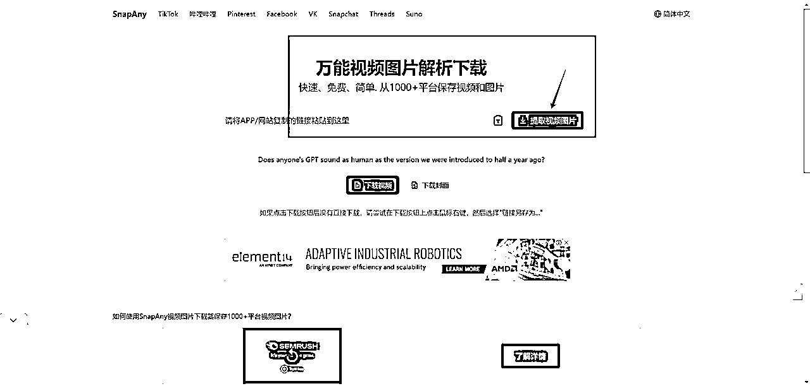

## 写在最后

如果你还知道其他值得整理的实用工具，欢迎在评论区留言交流。后续我也会继续搜集并筛选，把好用的工具整理成更完整的工具箱。

如果这篇内容对你有所帮助，别忘了点赞支持一下！