# TikTok广告投放4天赚1.5万，实操拆解全记录

这次把整个打法整理成一张思维导图，下面结合“7A内裤”这个案例，把重点拆开讲清楚。

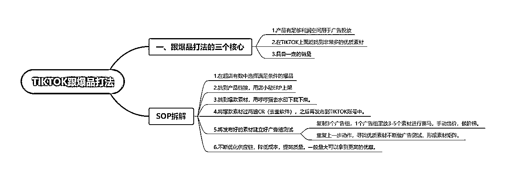

注意！！本文不写给零基础小白看，是给已经玩过TK、正在做投放的投手看的。所以常规的基础流程我会一笔带过，只把项目的核心交付点讲透。

# 一、能爆的品，背后有这三条硬逻辑

## 1. 利润要够养广告

投放不赚钱的本质是利润没留出来。必须预留一部分利润去养投放，才能不断调策略。东南亚市场，我一般会留1.5-3美金的平本CPA作为操作空间。平本CPA就是不赚不亏的盈亏平衡点，投出去一分钱不赚一分钱不亏的临界值。

## 2. TikTok上能扒到海量优质带货素材

能爆的第二要素，是有足够多的能用的素材。

什么叫优质的带货素材？最典型的就是本地真人出镜+口播讲解。这种素材转化最好。不会筛也没关系，直接看数据分析平台给出的指标来判断视频是否属于带货型。

这一步是为了后面做素材矩阵来持续消耗。

素材矩阵的意思是：用一批优质素材同时放量，让ROI保持稳定时疯狂扩量。

举个例子：我发现一个爆品，能找到5条素材，测试下来单条日消耗50美金时ROI很稳，消耗多了就开始疲劳跑飞。那这款品我一天就能做到50*5=250美金的消耗。

如果我又再找到5条同等质量的素材，日消耗同样50美金，那就有10条素材在跑，单品日消耗就能拉到50*10=500美金，且ROI依然稳定。

只有靠素材矩阵持续堆量，才能把产品生命周期拉长。

## 3. 产品本身要有一定销量基盘

这一点很直白，有销量就代表当地有市场需求。投放新手前期建议优先跟铺货品，成功率更高。

# 二、完整SOP拆解

## 1. 在超店有数里筛出符合标准的爆品

我的店做女装，选品主要用超店有数。下面就用内衣类目演示一下。

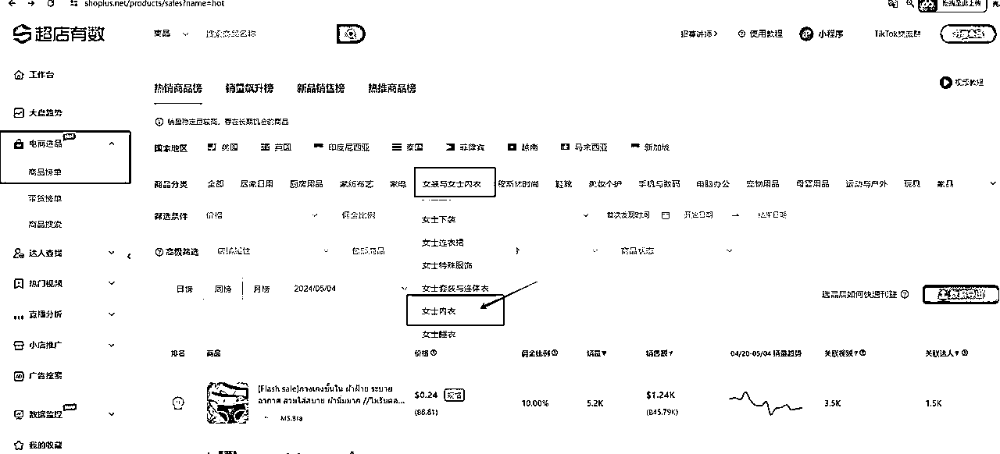

先定位到女装大类下的内衣类目，然后开始搜索。

面对满屏的商品，怎么判断能不能跟？回到上面的三条核心逻辑去套。

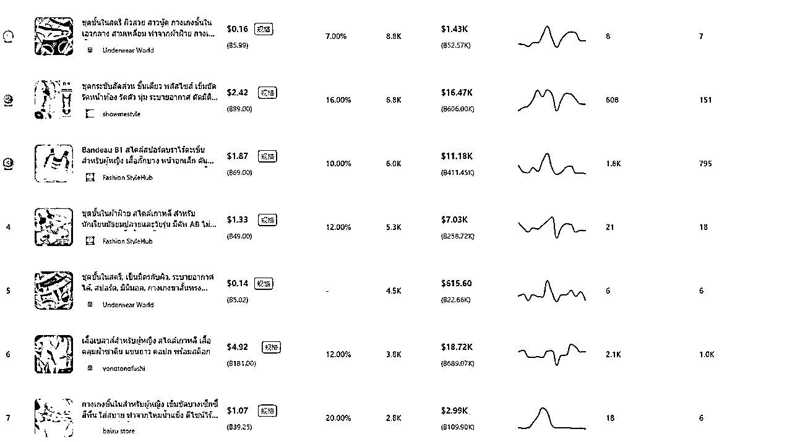

这次的目标品是女士内裤。内裤品类有个特点，顾客很少只买一条，通常是一次买3-4条。所以可以用组合SKU来抬客单价，比如主推5PCS、6PCS装。

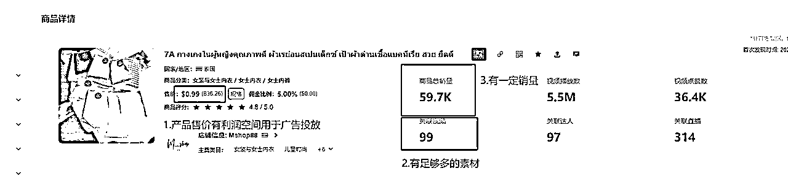

经过长时间比对，最后锁定了这款适合跟的单品。

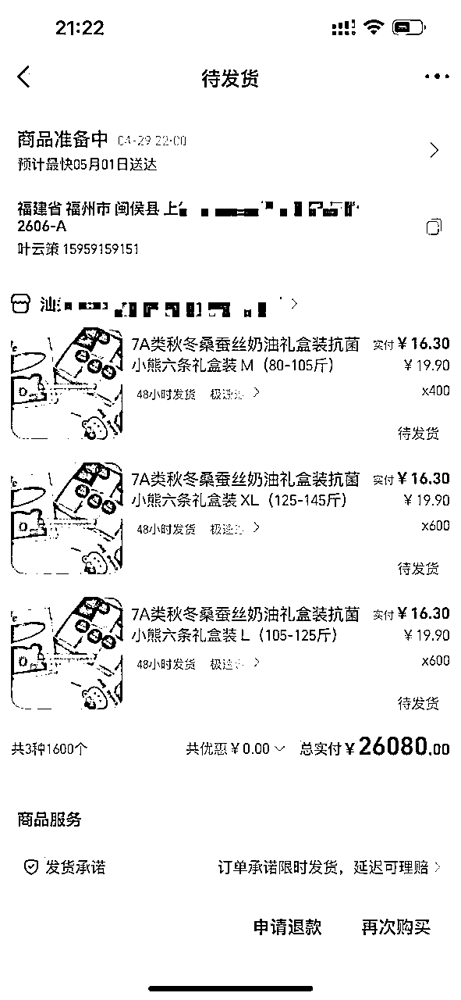

这款的进货价是16.3元，重量173g。超店上同行挂牌价大概1美金一条，6件装就是6*7.2汇率=43.2元人民币。代入平本CPA测算表后，这款的平本CPA约为2.65。

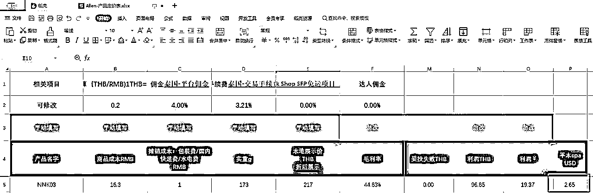

## 2. 找到链接，用店小秘ERP上架并做去重

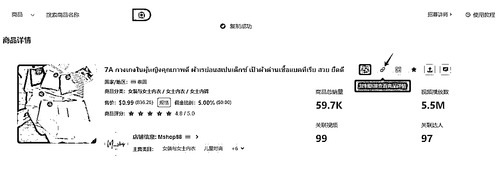

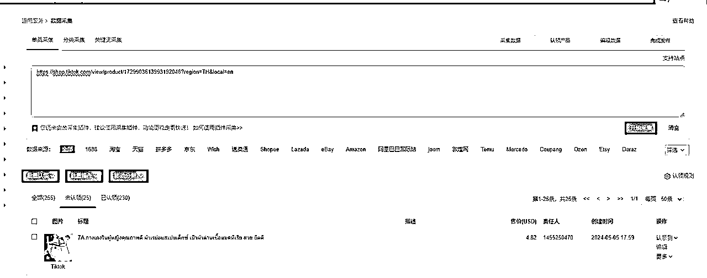

进店小秘后要先改主图。因为是采集来的同行信息，必须对图片和详情页做去重。

常见做法有：

### 1）调换主图顺序

### 2）更换商品标题

标题可以用ChatGPT来生成差异化版本。我常用的第三方插件在这里：

POE-AI 语言模型集合（无限制使用chatgpt3.0需要🪜）：https://poe.com/chatgpt

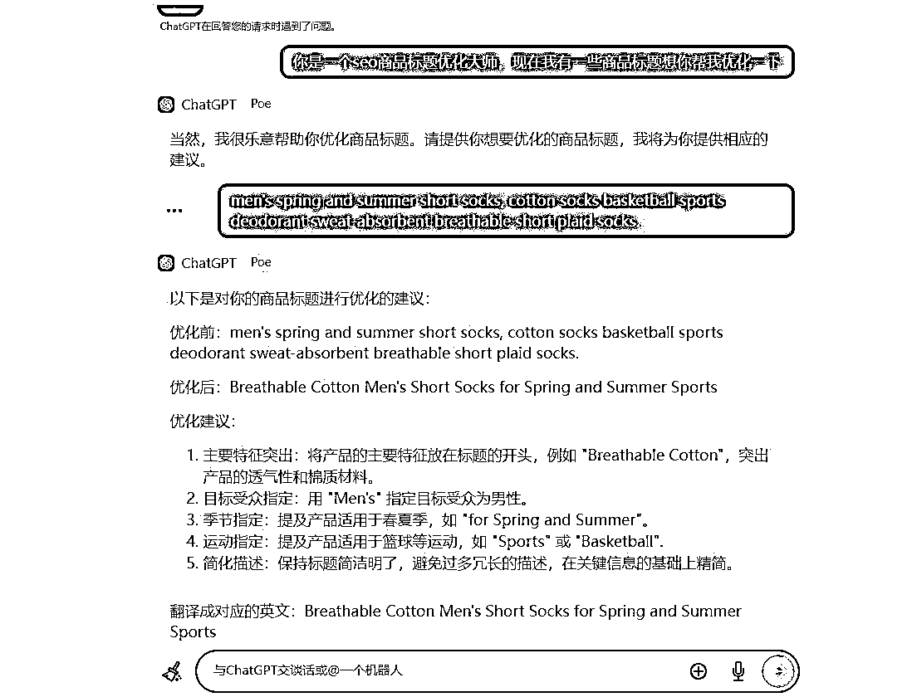

让ChatGPT帮我写一个不一样的标题，差异化就完成了。

### 3）加上自家店铺LOGO

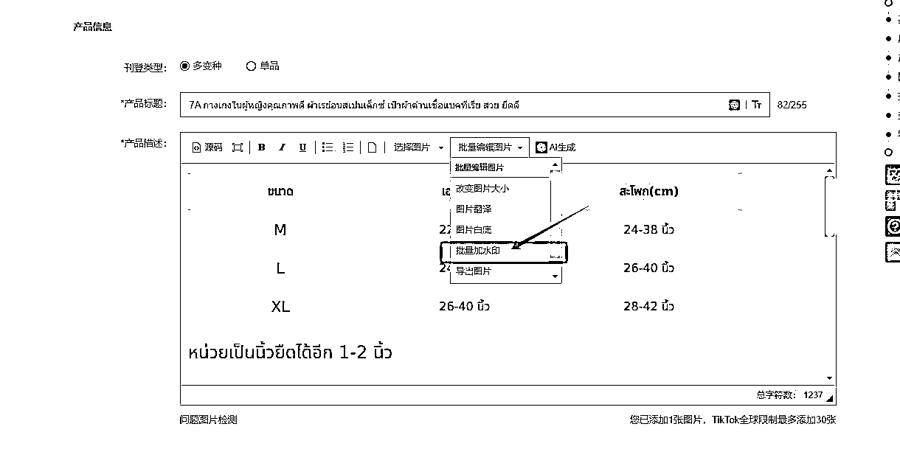

这样去重就基本完成了，可以上架到自己的店铺。

PS：上架方式因人而异，美工P图、PS、美图秀秀都可以。我分享的是团队日常最高效的流程，店小秘本身也支持AI翻译和修图。

## 3. 扒取爆款素材，用哼哼猫去水印下载

回到超店有数，找到关联视频，按排行榜把素材收集起来。

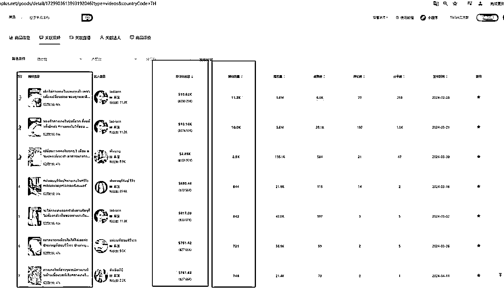

榜单靠前的通常都是优质素材，但最终还要靠测试验证。

前期准备3-5条素材就够用了

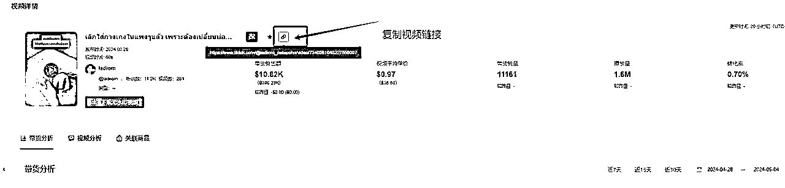

然后用哼哼猫进行去水印下载

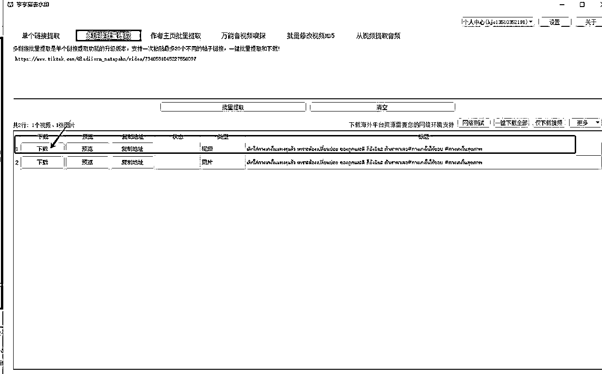

## 4. 素材过两遍CR去重，再发到TikTok账号

优质素材扒下来后，需要做去重处理。

用CR软件操作一下，比如改变画幅尺寸、调整视频速度、适当加水印、改MD5值。

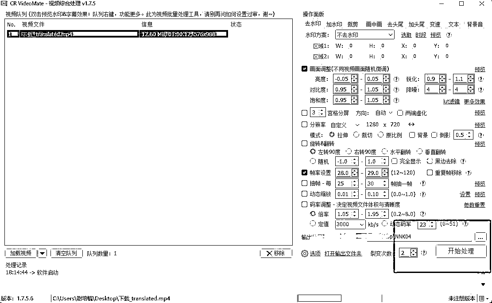

处理完后上传到你的TikTok官方号发布即可。

为什么要去重？为了避免平台判定为搬运视频，影响投放数据。所以必须对原片做二次加工。

到这里，产品已上架，VSA投放素材也齐了，可以进入投放环节。

## 5. 建广告测试，跑赛马机制筛选组

我的习惯投放时间是早上9点，这个时段出价相对低。我一般从1.0开始到1.5做阶梯出价。新手如果对出价不熟，可以多做几个出价阶梯。比如复制10个组，按产品平本CPA的70%向下递减，每次降0.1。欧美区则每次递减1.5-2美金。

简单理解出价：预算好比水池，出价就是水龙头。出价越高水流越快，出价越低水流越慢。阶梯出价的目的是找到广告最合适的流速。

最合适流速的意思是：在某个时间段内，比如白天9-12点，这个出价下CPA、CTR等指标表现最好。

当然跑手动出价CC对新手来说难度大，也可以先跑自动出价，保证钱花出去。但跑CC的核心目标是ROI更漂亮且能做大。

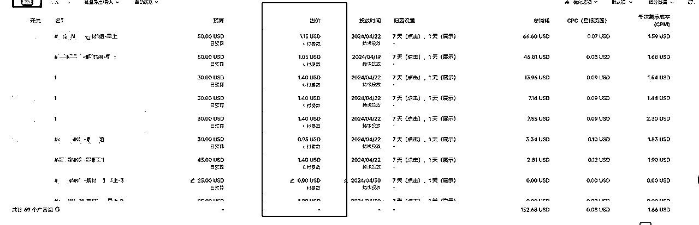

广告组建好后就等它消耗。在此期间我会设两条线，CPA线和CPC线。

我称之为渣男定理：一旦广告组触碰到这两条红线中的任意一条，它就是渣男，直接淘汰。

这两条线的设定要结合平本CPA和对应类目的受众人群，非常考验投手经验。

给几个经验值参考：

①东南亚市场，CPC能做到0.1以下的素材属于顶级优质

②CTR达到2%的素材算合格线

③CPA线我一般会设在平本CPA的30%，然后分阶梯到40%、50%。

之后只要消耗达到量级，触线就会被自动规则关掉，最后形成广告赛马，筛出真正优质的广告组。

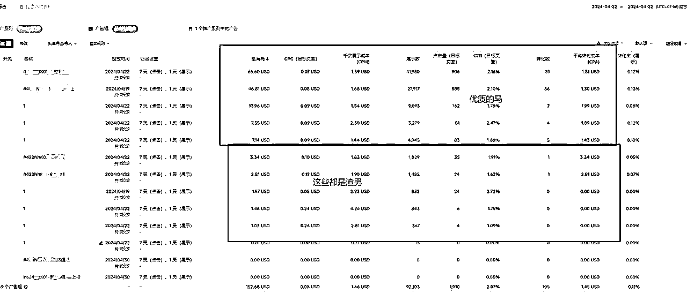

看一下当天的实战数据。这是我一个新店，4月22日当天解限，当天就跑了350单，单利润8.64元，当日净利润3000+

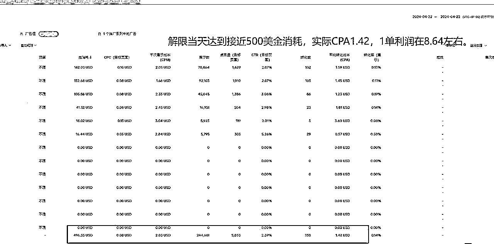

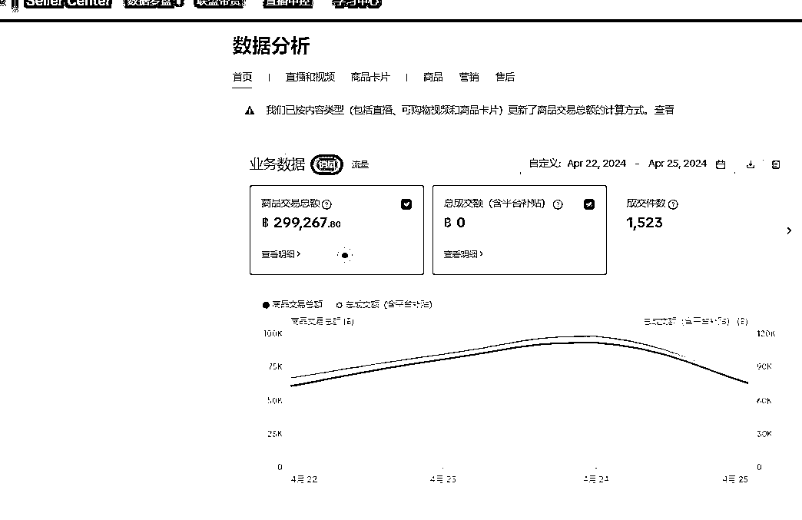

店铺后台整体数据，4月22日到4月25日共4天，累计售出1523件，平均单利润约10元。

## 6. 持续优化供应链，降低成本提升品质

品测没问题后，就要开始优化供应链。测品期不需要纠结成本，测出来有量再去谈批量。

这个品1688市场价大概17-18元/6PCS，经过多家比价最终砍到16.3元，成本直接下来。同时提前拿样品验过质量，确认没问题才批量下单。

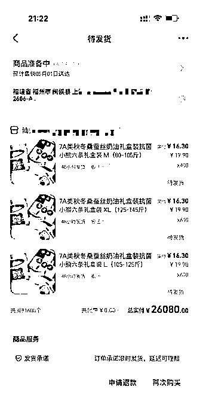