# n8n 从入门到上手实战全攻略·认知-熟悉-实践三步走
作者：龙哥

大家好，我是龙哥Chase

【越分享，越幸运】这篇指南是我专门为刚接触 n8n 的朋友准备的入门礼包。如果你愿意每天抽一点碎片时间去摸索、去试用 n8n，你就能掌握一个非常硬核的能力：把自己的工作流自动化起来，甚至让 AI 成为你的搭档。

如果去年的我能先看到这份材料，我至少能省下十几个小时的盲目试错。能够更快理解 n8n 自动化的底层思路，学会这项被我称为「当代职场魔法」的技能，用更少的投入换来更高的产出。

先抛一个观点：学会 n8n + 工作流自动化 = 现代人的超能力

n8n：把生产力工具民主化的代表

如果说 3D 打印机让制造变得触手可及，那么 n8n 就是在为非技术人群打开「应用自由」的入口。零编程基础也能根据自己的个性化场景，亲手搭建专属的解决方案。

自动化的本质其实很朴素

当 [应用 A] 出现 [事件 X]，就自动触发 [应用 B] 去执行 [动作 Y]。

把 A/B 换成你每天用的工具，把 X/Y 换成具体操作：数据库更新、内容生成、资料录入、邮件推送、消息提醒...

核心在于，当你把工作拆解成流程图时，会发现大量重复性动作完全可以交给工具。让系统成为你的「自动化管家」，稳定高效地去跑。

准备好了吗？本文会带你从认知到实操掌握 n8n。从基础概念到亲手跑通第一个自动化，让你把时间留给真正有价值的事。

本指南的特点：

1. 由浅到深：从概念、部署开始，逐步深入到复杂流程与进阶功能。

1. 模块化结构：借助 ctrl+F/cmd+F，可按需跳读或细读对应章节。

1. 重在思维方法：部分板块不会手把手教每个服务的配置，而是教会你如何用搜索引擎、ChatGPT 等工具自学。骑司更想传递的是解题思路而非标准答案。这些正是官方文档不会涉及的内容，毕竟低代码平台只解决「不会写代码」的问题，不负责教你如何配置各种应用。

# 开始前需要准备的工具

1. 网络环境🧙‍♀️

1. 沉浸式翻译：一个实用的浏览器插件，对英语阅读吃力的同学非常友好，能让你更顺畅地浏览 n8n 官网文档和社区，或在论坛提问时更安心。

1. 备好几款强力的 AI 对话工具，遇到 n8n 操作卡点时，直接把截图、描述丢给 AI 让它帮你诊断。国内的 AI 工具对 n8n 的训练数据较少，容易出现幻觉，不建议依赖。

1. 有问题想解决、想合作、想认识朋友，找鱼丸链接

# 一、认知篇

## 1.1 n8n 到底是什么？

一句话概括：

n8n 是一个开源的可视化自动化平台。无需写代码，就能像搭积木一样把各种应用和服务，如邮件、表格、文档、数据库、AI 模型、甚至公司内部系统，连成一条能自动跑的「工作流」。

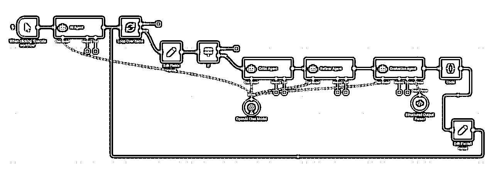

设想一下：客户在企业微信留言，你要手动复制到飞书记录，再去腾讯文档改状态，最后还得提醒自己用钉钉同步同事...这种数字搬运的生活，既耗神又易错。

n8n 就是为终结这种低效循环而生的工具。

配置好流程后，n8n 会 24 小时监控触发条件。条件一旦满足，它就会自动启动，严格按你的流程图在后台完成串联任务。

## 1.2 n8n 能干什么？

无论是日常办公还是 AI 增强场景，都能轻松覆盖。

1. 客户管理自动化：新客户注册后自动发欢迎邮件，同时写入 CRM 如 Notion 或 Airtable，并通过 Slack 通知销售团队，让跟进更及时。

1. 内容运营：订阅 RSS 获取新文章，自动生成摘要，用 AI 改写翻译，最后推送到 Twitter 或 LinkedIn，提升传播效率。

1. 智能提醒：实时监测商品价格、股价或天气，异常时自动短信或邮件告警，不错过关键信息。

1. 数据打通：把 Google Form 的提交数据自动同步到 Google Sheets 和 Notion 数据库，并生成 PDF 报告邮件发送，告别手工搬运。

1. AI 助手集成：收到特定邮件后，让 AI 分析并起草回复建议，你只需审核发送即可。

1. 内部流程提效：审批流、报告生成、数据备份、跨部门数据同步等繁琐工作，交给 n8n 自动完成。

1. ......

## 1.2 为什么说 n8n 强大且有厚度？

1. 无代码，但绝不肤浅：

* 可视化不等于简单。n8n 面板友好，拖拽连线即可，但底层是功能强大的工作流引擎，能深度集成复杂 API。支持条件分支、循环、数据转换、异常处理等核心编程逻辑，只是以图形化方式呈现，让你专注业务而非语法。

* 可能性几乎无限。内置近千个常用节点，如 Google、Microsoft、Notion、Slack、OpenAI 等，同时支持 HTTP 请求、Webhook 或自定义 JavaScript/Python 节点，连接几乎任何有 API 的服务，包括私有系统。扩展边界很宽，为创意提供空间。

* 自托管版本本地调用能力强，比如读写本地数据库、操作本地文件、控制服务器等。你可以在不改动原有业务系统的前提下，让 n8n 像一个寄生系统，为现有流程增加自动化与 AI 能力。

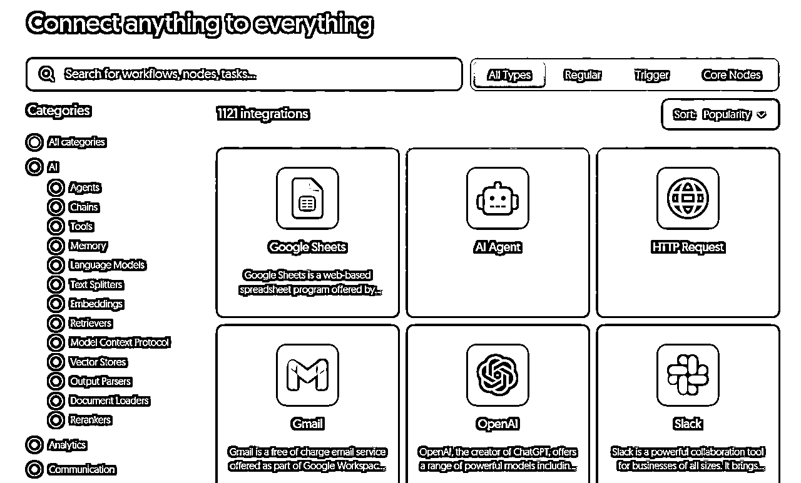

1. 开源的价值：

* 自主可控。作为开源软件，可免费在本地电脑或服务器上部署，支持 Docker 一键私有化，完全掌控数据与流程。

* 社群驱动。全球开发者持续维护，不断贡献新节点，遇到问题时社区里大概率已有答案。

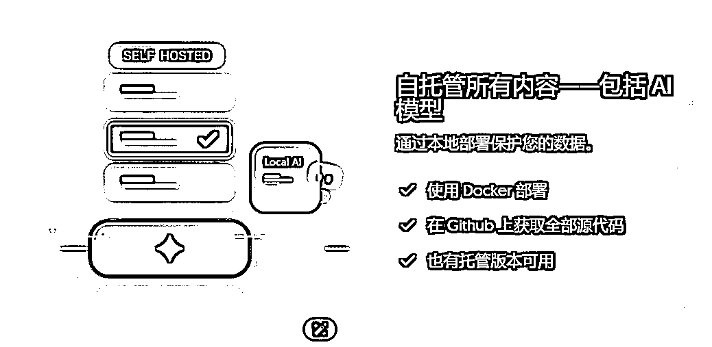

1. 天生拥抱 AI：

* 内置可视化 LangChain 节点，对 AI 支持很好。原生集成 ChatGPT、Claude 等，轻松把 AI 融入工作流：自动回复、文档总结、报告生成、数据分类...让 AI 成为自动化流程中的贴心助手。

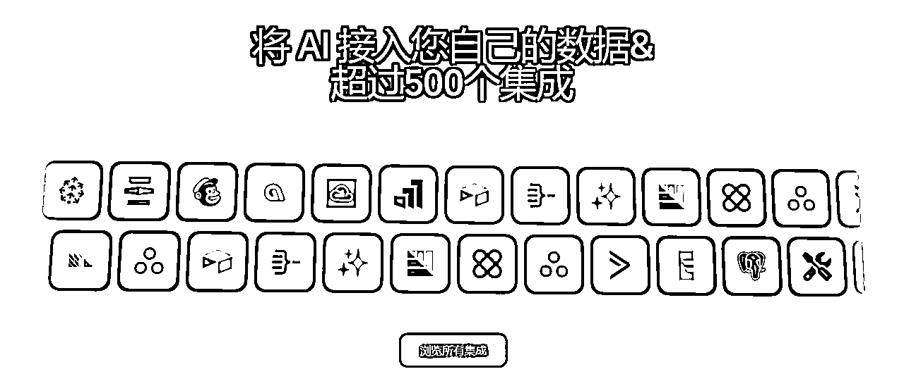

1. 低代码与代码的平衡：

* 相比 Coze、Dify.ai，n8n 在无代码与代码之间找到了平衡点。对已有的节点，只需拖拽即可接入；对未收录的功能，支持通过 HTTP Request 接入任何开放 API，灵活性极高。

* 很多零基础用户会发现 ChatGPT 擅长生成代码片段，却不擅长搭建完整工程。n8n 正好补足这一点：用拖拽搭建流程，缺块「积木」时再把 ChatGPT 生成的代码片段嵌入其中，二者结合效率更高。

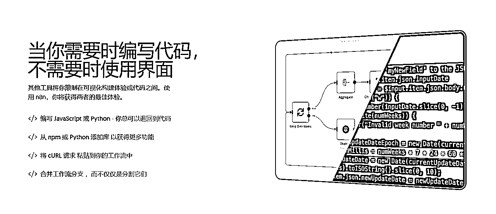

## 1.3 不会编程也能学吗？

很多人觉得自动化是程序员的专利，没有编码背景就学不了，其实完全没必要。

AI 让学习、阅读和生成代码变得非常容易，遇到任何问题都可以先交给 AI。边解决实际问题边构建自动化，才是学习 n8n 的正确姿势。

这个时代已经不是「非专业不可为」的年代。无论你是创业者、自由职业者还是小团队成员，自动化都能帮你省下大量时间。相信自己，你可以做到。

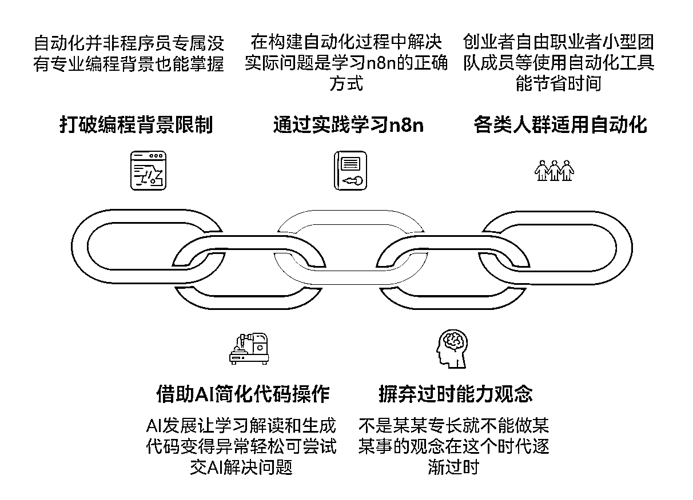

## 1.4 为什么现在学低代码越来越重要？

自从 ChatGPT 上线后，流行一句：AI 不会淘汰人，会淘汰不会用 AI 的人。话虽简短，道理很深。

很多非技术用户对 AI 的认知很矛盾，觉得它既万能又无用。根源在于分不清 AI 技术本身和 AI 产品的能力边界。

比如有人问：为什么 ChatGPT 不能批量处理表格数据？因为 ChatGPT 是一个产品，设计上不允许在对话中主动调用外部工具，无法直接根据 Excel 某一列生成另一列。

再比如：为什么 OpenAI API 不能实时搜索互联网？因为 API 只是大模型的内核能力，不是完整产品。若想实现搜索，还需额外搭建检索工具。

形象比喻：

AI 产品如 ChatGPT，就像手里拿着固定工具箱的人，能对话思考还能用厂商允许的功能，但工具使用范围受限。

AI API 则像双手空空的人，只能靠自身知识对话，无法操作外部事物。但你可以为它配工具，如 Excel、Notion，让它按需行动。

实际对比：ChatGPT 能读 PDF，但限于成本通常不超过 10 万字。而 GPT-4 API 本身不能读 PDF，但配合工作流搭建读取能力后，可处理 100 万字文档，成本由你承担。

所以最大化 AI 价值，最好用 API 方式，同时为它搭建工程化能力，让它能与现实世界交互。

问题是：非技术人员如何为 AI 打造工具？答案是 n8n。

n8n 是一个图形化低代码自动化平台，最初用于日常工作流自动化，如「学会 Python 工作不愁」的场景。通过拖拽即可构建流程。

对个人，它节省时间；对 AI，它像一座桥梁，打开与赛博世界其他事物的互动通道。

AI 与世界交互的方式类似我们整理数据：我们用鼠标打开 Excel、修改数值、保存。AI 没有鼠标眼睛，需要 OpenFile、EditFields、SaveFile 等函数。在 n8n 中，这些函数都变成了可视化节点，非技术人员也能轻松搭建，让 AI 在赛博空间释放潜力。

通过 n8n，你可以让 AI 与 1000+ 节点交互，几乎连接赛博世界所有主体，几乎无需写代码，只需拖拽设置参数。

从这里开始，你才真正迈向「会用 AI 的人」。

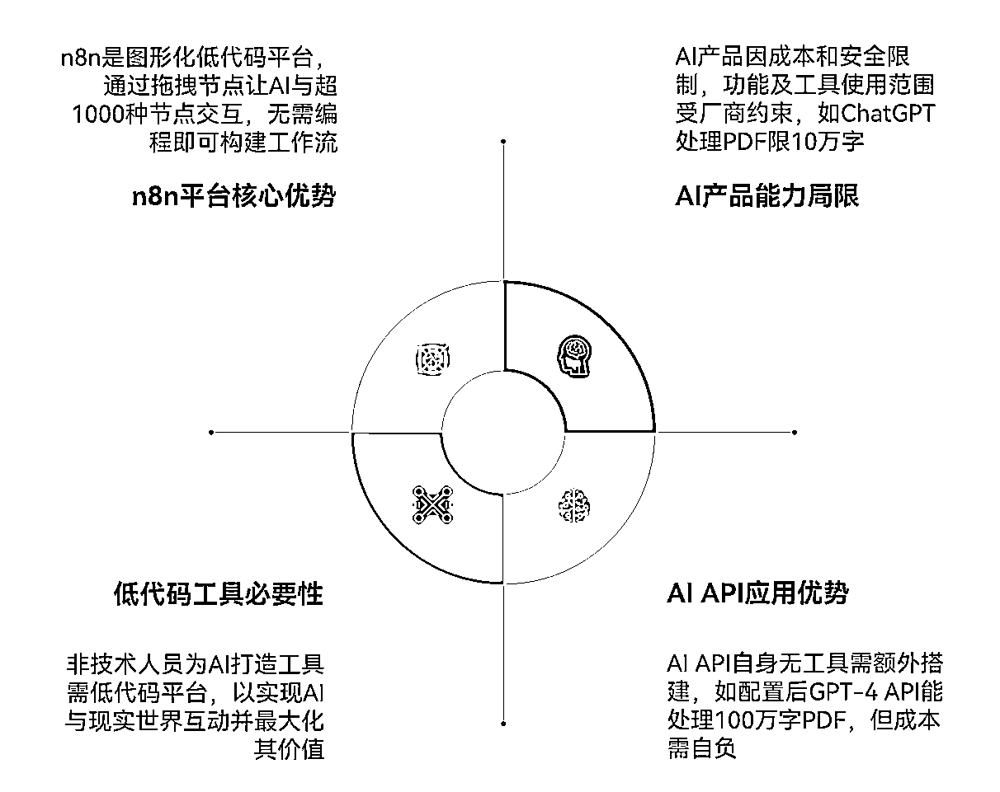

## 1.5 哪些场景特别适合自动化？

1. 高频重复、考验耐心：数据抓取整理、跨平台迁移、重复文档编辑与格式调整、简单表格录入、批量生成二维码条形码。

1. 步骤清晰的工作：批量邮件发送、文件归类归档、标准化邀约回复、固定模板报告生成、定期数据备份。

1. 耗时繁琐的事务：行政审批如请假报销、月度财务汇总分析、长时间会议记录整理、合同条款逐项核对、复杂表格公式校验调整。

## 1.6 核心概念自检

1. 开源：源代码公开免费，任何人可查看使用修改分享，像公开菜谱。

1. 可视化：用图形拖拽连线操作，而非写代码。

1. 自动化平台：帮助你设置规则，让电脑自动完成重复任务的软件。

1. 工作流：完成任务的一系列步骤，在 n8n 中就是把多个步骤像流程图一样连起来自动执行。

1. 应用和服务：微信、邮件、腾讯文档、数据库、ChatGPT、公司内部系统等。

1. 节点：工作流图中的具体动作模块，如「读取邮件」「发送通知」。

1. 触发条件：启动自动化的开关，如「收到新邮件」「时间到早上9点」。

1. CRM：客户关系管理系统，用于管理客户信息与互动。

1. RSS：获取网站更新的技术，类似订阅杂志。

1. API：不同软件间的桥梁，用于交换数据与功能。

1. Webhook：特殊的 API 方式，事件发生时自动通知另一软件。

1. 部署：把软件安装运行到电脑或服务器上的过程。

1. 本地调用：直接操作本地电脑或服务器资源，如读写文件、访问本地数据库。

1. 数据库：电子化存储和管理大量数据的系统。

1. 私有系统：公司内部自研不对外公开的系统。

1. 条件判断：满足条件做 A，否则做 B。

1. 循环：重复执行操作直到满足条件为止。

1. 数据转换：把数据从一种格式变为另一种格式。

1. 错误处理：预设出错时的应对措施，避免流程崩溃。

1. 扩展能力：通过添加新功能或自定义代码增强软件能力。

1. Slack, Notion, Airtable, Google Sheets, Twitter, LinkedIn, 企业微信, 飞书, 钉钉, OpenAI 都是 n8n 可连接的具体应用或服务，零基础用户只需理解为可连接对象。

1. 审批流程、财务分析、会议整理、合同核对、表格校验 都是需要手工处理的典型办公任务。

# 二、准备篇

## 2.1 n8n 本地部署：后续维护无忧版

### Step1 下载 docker，注册并登录

▼打开 docker 官网 https://www.docker.com/，下载对应系统版本

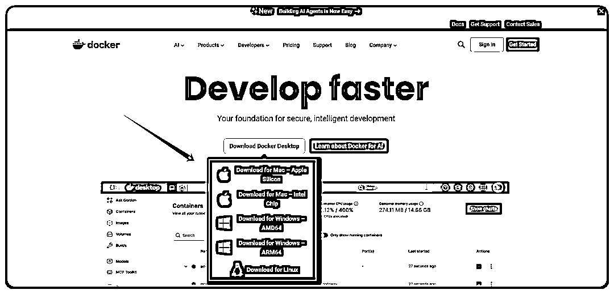

▼安装后注册并登录，可选三种登录方式

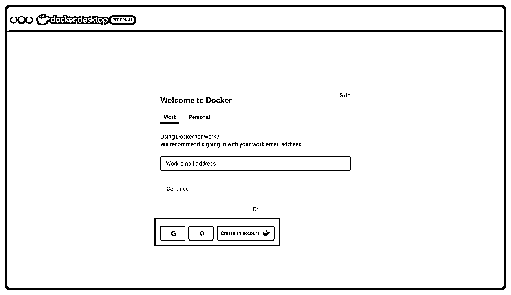

### Step3 用 docker 安装 n8n 并配置

▼左侧找到 Docker Hub，搜索 n8n，点击第一个结果

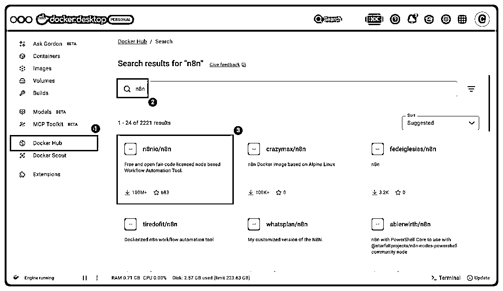

▼点击右上角 Pull

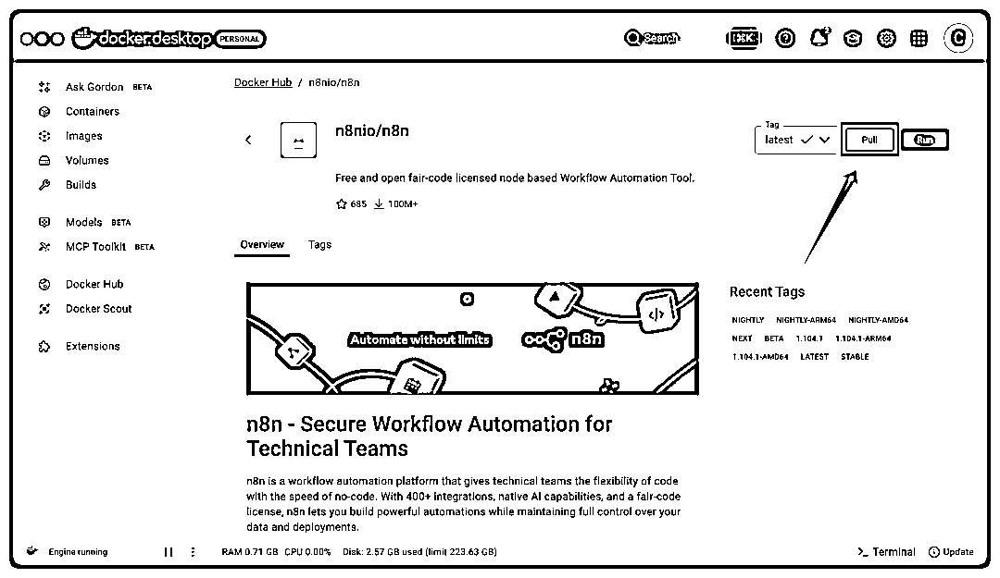

▼点击左侧 Images，等待下载完成后再运行

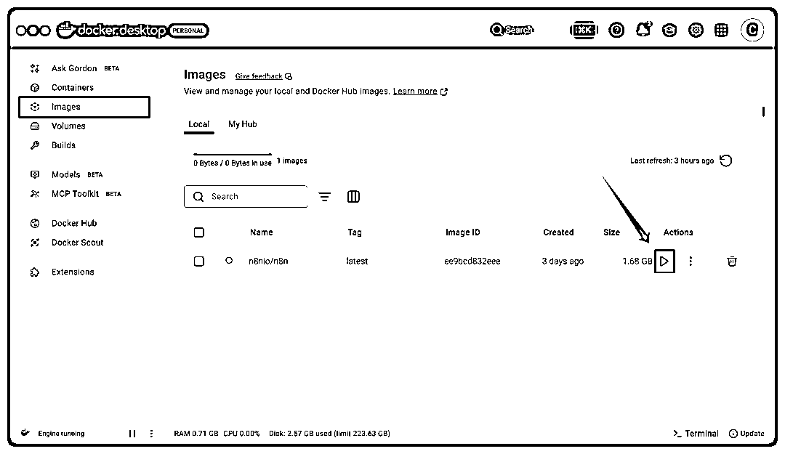

▼在电脑新建一个 n8n 文件夹保存数据，并复制其路径

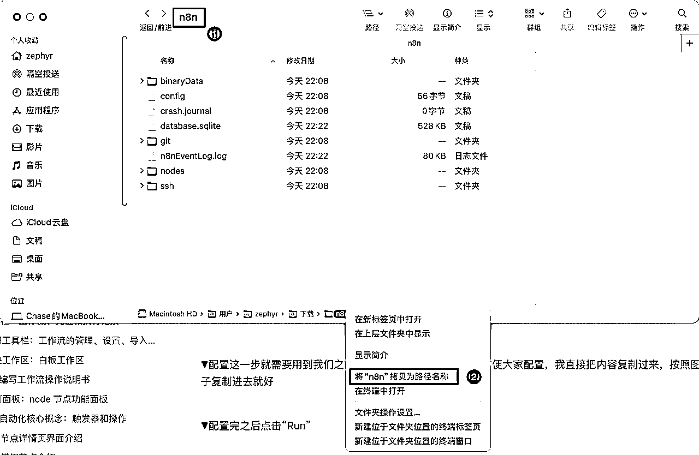

▼将路径粘贴到 volumes 第一格的 host path 中

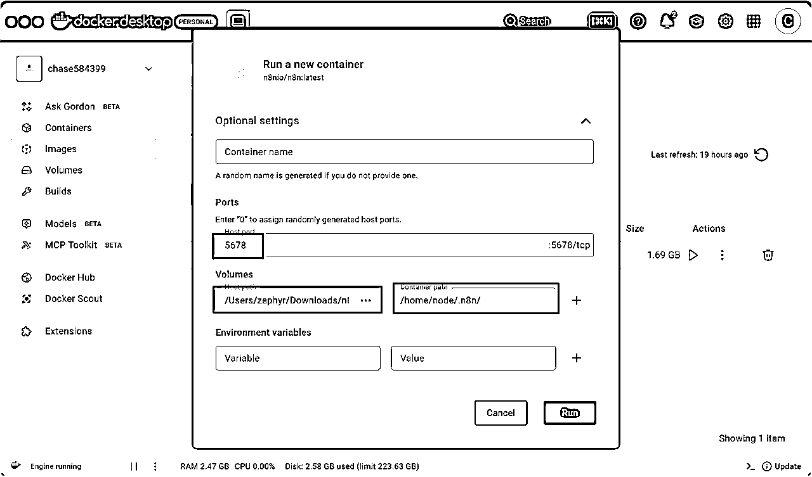

```
n8n
5678
你创建的文件路径
/home/node/.n8n/
```

### Step4 等待运行完成，点击链接即可访问，大功告成🎉🎉

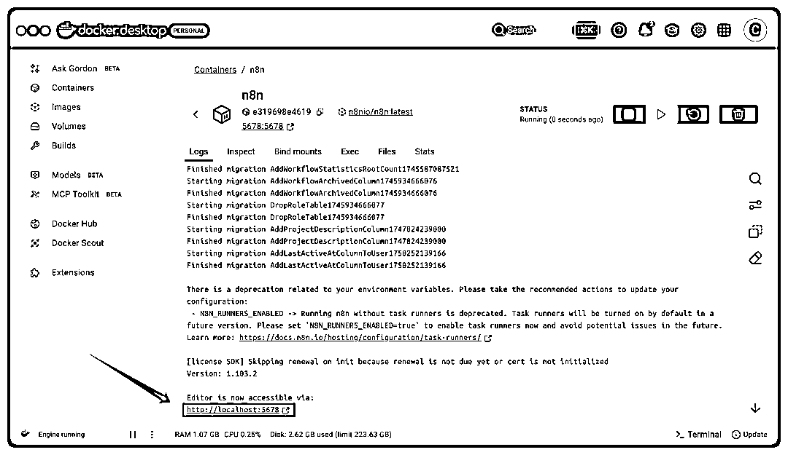

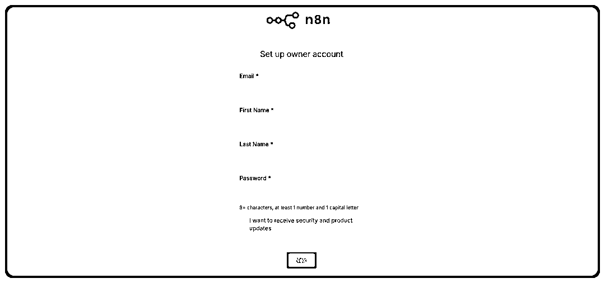

## 2.2 熟悉 n8n 的界面与功能

n8n 的灵魂人物其实是个设计师出身，并非写代码的开发者。正因为此，整个产品的交互质感被打磨得相当细腻。界面大量采用拖拽式操作，对初次接触的人来说可能会有一点陌生，但多点几下、拖动几回，就能摸到不少意外的便利。熟悉上手后，你会觉得使用体验非常顺滑。

### 左侧栏：工作区、凭据与运行日志

点进左侧的 Overview，就来到工作流总览。顶部还有三个入口：

*   Credentials：所有鉴权信息集中在此管理。

*   Executions：相当于工作流的运行档案，记录每一次自动化的启动过程、返回结果以及异常信息。如果某次执行报错，会在列表里显示 Error，点击即可追溯到具体出错的节点。

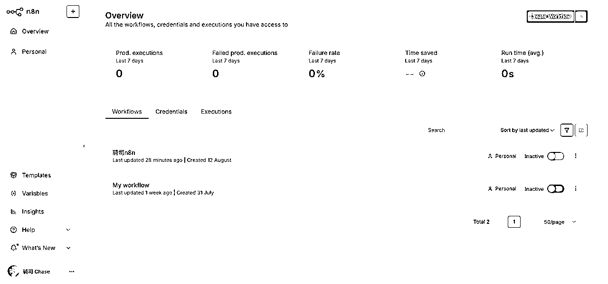

### 顶部工具栏：流程管理与导入导出

这里集中了流程命名、启停开关、保存、分享、导入导出等基础控制按钮。

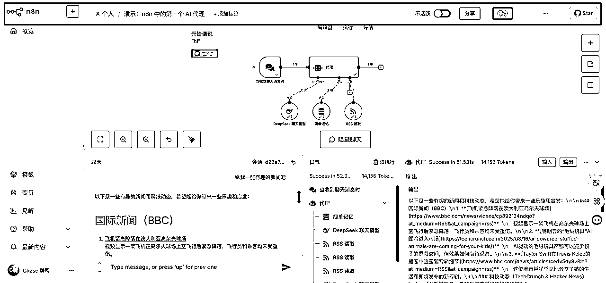

### 中央画布：白板式工作区

这是搭建流程的核心区域，可在此自由放置节点并连线，也能用便签 Sticky Notes 做补充说明。

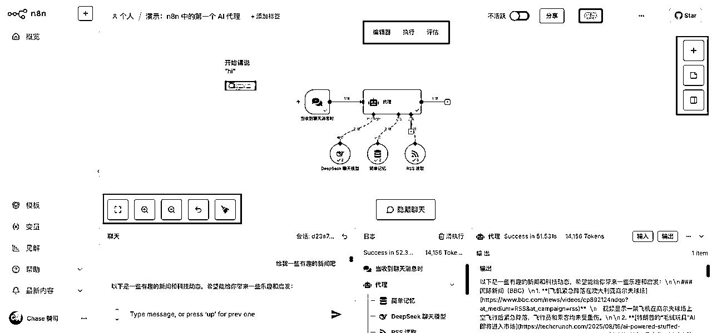

#### 如何为流程写一份操作手册

在搭建和验证阶段，通常需要反复按 Execute step 来确认各环节是否正常。流程上线稳定后，一般不会频繁回看，只有出现问题时才需要排查。

把当时的设计思路和步骤记下来，等于给未来的自己或同事留一份使用指南，也是对当下方案的一次深度复盘。复盘不只是回顾，更是为了让后续的优化更有效。

养成记录的习惯，既能快速回忆设计意图，也能在故障时提供可靠依据，让自动化流程更好维护。

可以用 n8n 的便签功能来做记录：

1.  进入 n8n，打开目标工作流

2.  点击画布右侧的便签图标新增便签

3.  在便签中写下思路与步骤。Sticky Note 支持 Markdown，可加入标题、加粗、链接等格式。

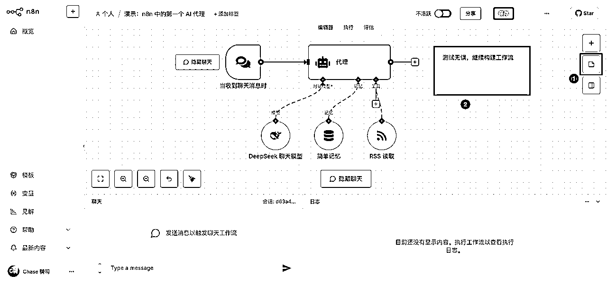

#### Executions 的用法

在画布上方切换到 Executions 即可查看该流程的历史运行记录。

这个页面很实用，因为画布本身不会自动保存历史版本，想找回之前设计的片段时，可以在这里翻阅，甚至直接复制回画布。

Executions 里的每个节点都是可点开的，能看到详细配置与日志信息。

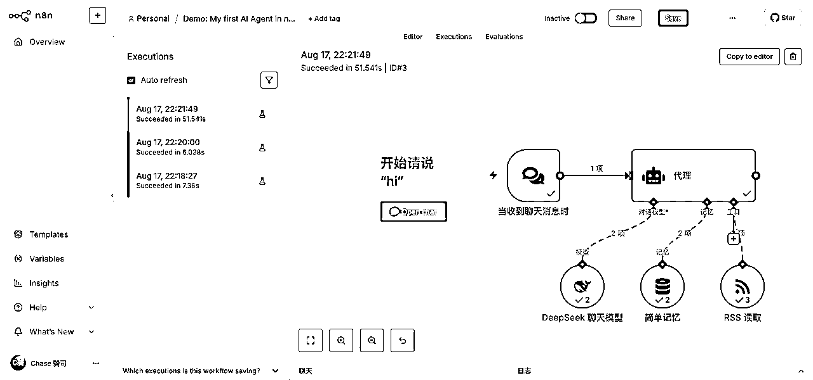

#### 常用操作小技巧

1.  画布支持触控板缩放，也可在左下角使用缩放按钮。

2.  每个节点都可拖拽移动。鼠标悬停时节点会显示 ➡️ 标记，表示单步执行，仅运行该环节，在调试时非常方便。

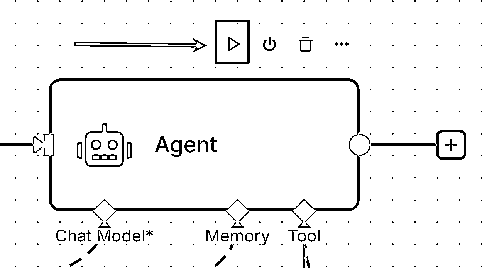

3.  注意：工作流画布不具备自动保存功能，请习惯使用【ctrl+s】手动保存。

### 右侧面板：节点选择面板

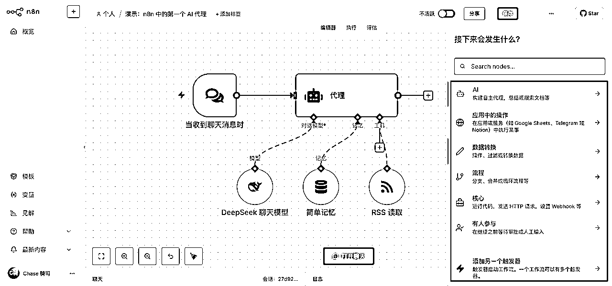

点击 “+” 即可看到全部可用节点，按分类或关键词检索。选中后节点会加入中央画布，开始拖拽连线构建流程。

#### 自动化的两大基础概念：触发与行为

自动化流程通常由两种节点组成：触发 Trigger 和行为 Action。

生活里的例子是：“早上 8 点闹钟响，就起床刷牙。”闹钟响是触发，起床刷牙是行为。

*   触发节点：何时启动流程

这类节点相当于告诉 n8n：“开始干活了”。例如有人提交 Notion 表单、发布 Facebook 帖子、达到特定时间等。

在节点列表里，带闪电图标的就是可作为触发器的节点。

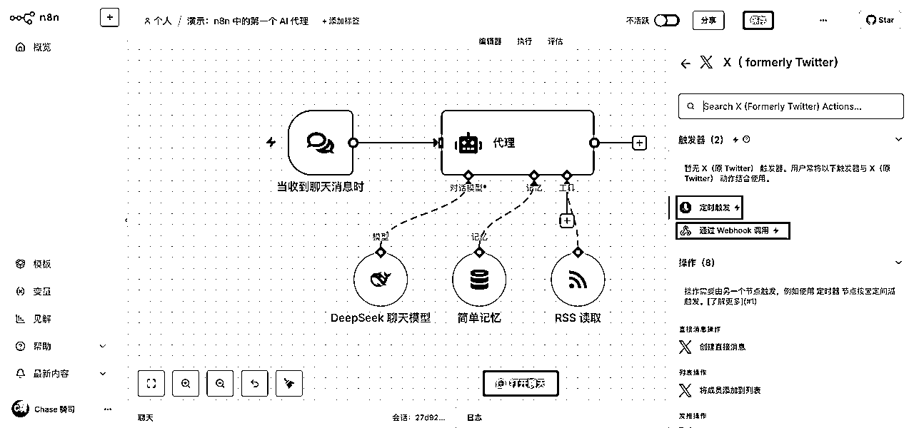

*   行为节点：要做什么操作

触发后，行为节点开始执行具体任务。例如每天 9 点发送邮件汇总，或有新订单时自动更新 Notion 数据库。

提示：一个流程里常包含多个行为节点。节点越多，测试量越大，出错排查也越复杂。建议新手先从简易流程练习起，逐步提升复杂度。

*   数据存放在哪里

明确触发点与行为后，还要决定数据的输入输出位置。常见的选择有 Notion、Discord、Telegram、Google Sheets 等，均可作为记录与交互的载体。

#### 节点详情页结构

每个节点详情均分为三块：左侧入参、中部处理与设置、右侧出参。

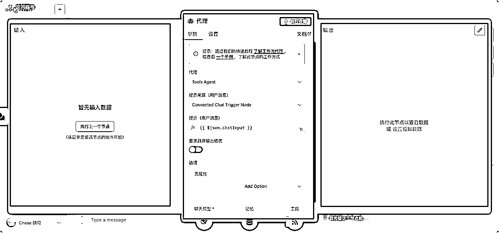

*   入参：显示来自上游节点的数据。

*   处理与设置：配置当前节点的处理规则。

*   出参：展示处理后的结果与日志。

入参与出参支持三种视图：Schema、Table、Json。

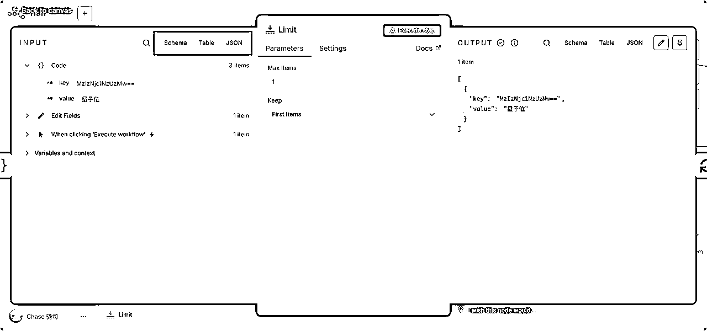

*   Schema：展示上游输出的元数据与示例。

*   Table：以表格形式展示全部数据。

*   Json：以 JSON 格式展示全部数据。

在任意视图下，都可把入参区的变量名拖到中部的设置框中引用上游数据。

更关键的是，n8n 支持跨多级引用，你可以引用上游、上上游等任意前序节点的数据。系统内部会自动建立唯一关联，无需担心数据错位，这就是隐式传递的设计。

配置完成后，点击 Execute step，即可在上游有缓存结果时对当前节点进行单步调试。

### 界面菜单区

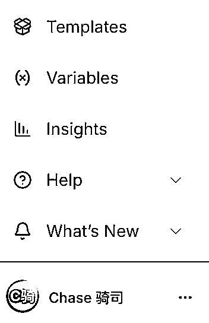

菜单区顶部依次提供：

*   模板 Templates：跳转至官网模板库；

*   变量 Variables：工作流外的全局变量，可统一维护，所有引用该变量的流程会按新值运行。需付费企业版，未订阅可忽略；

*   见解 Insights：流程数据分析页；

*   帮助 Help：文档、社区、视频链接；

*   最新内容 What's New：版本更新说明；

*   「…」设置 Settings：常规设置入口。

#### 设置建议：开启二次验证

点击账号右侧的「…」进入设置，建议部署完成后尽快开启 2FA 双重验证，提升账号安全性。

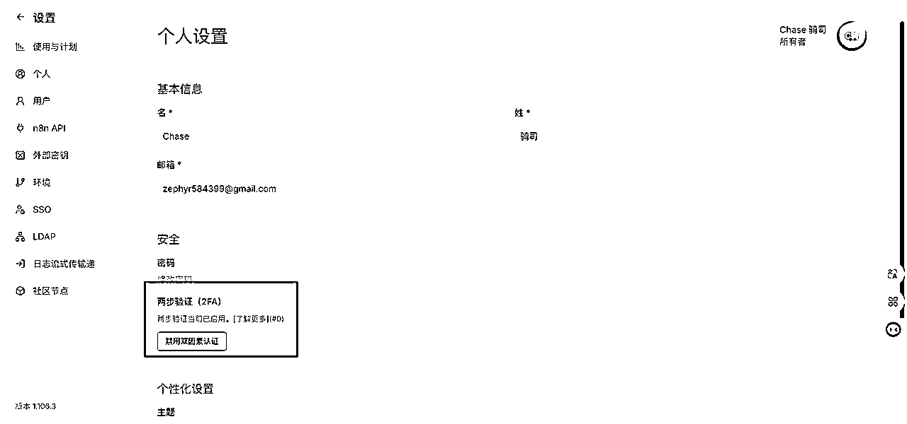

## 2.3 实践学前班 - n8n AI 节点完整指南

### 前言

n8n 内置可视化 LangChain 节点，可快速接入各类大模型。上手前先厘清几个基础概念。

### 基础概念扫盲

#### 什么是大语言模型

大语言模型是一种深度学习模型，擅长理解和生成人类语言。它在海量文本上训练，学习语言规律与结构。

可向它提问求答、续写句子、根据自然语言描述生成代码，或分析文本情绪。

#### ChatGPT Plus 就够了吗

很多人误以为订阅 ChatGPT Plus 就行，实际不然。

ChatGPT Plus 只是证明你能访问海外网络，想要调用 GPT-4、Gemini Pro 或 Claude 3 的 API，仍需注册开发者账号。

简单区分：

*   ChatGPT 是面向用户的对话界面

*   GPT-4 API 是面向程序的接口

*   n8n 需要的是 API

API 即应用程序接口，定义了组件间的交互规则。自动化程序必须通过 API 才能调用 AI 能力。

各厂商的开发者账号注册流程略有差异且涉及敏感话题，本文不展开。

#### LangChain 是什么

LangChain 是为大模型接入而设计的框架，核心价值是统一不同模型的调用方式。无论 GPT-4、Gemini Pro 还是 Claude 3，在 LangChain 中调用方式一致。

这意味着调试时可随意切换模型，无需重配参数。LangChain 就像 AI 与开发者的翻译层。

在 n8n 中，LangChain 以节点形式呈现，并包含子节点，大幅提升调试效率。

### 节点概览

Advanced AI 是 n8n 的 AI 节点分类，包含多种类型。每个节点介绍均说明用途，也可通过 AI Templates 下载社区模板。

本文重点介绍两类常用节点：Basic LLM Chain 与 AI Agent。

### Basic LLM Chain 详解

Basic LLM Chain 是最简 AI 节点，适合一次性文本处理，如摘要、校对、分类。

逻辑：接收上游数据 → 将 Prompt 与数据提交给模型 → 返回结果。

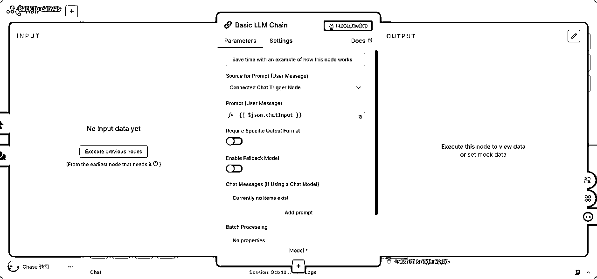

Model 必填

这是一个子节点，需单独添加到画布。n8n 当前支持的模型包括：

*   Google PaLM/Gemini Chat Model

*   Groq Chat Model

*   Mistral Cloud Chat Model

*   Ollama Chat/Model

*   OpenAI Chat Model/Model

*   Cohere Model

*   Hugging Face Inference Model

*   Azure OpenAI Model

*   AWS Bedrock Chat Model

*   Anthropic Chat Model

不同模型参数略有差异，详见官方文档。

### Chat Trigger 说明

Chat Trigger 是特殊触发器，可通过聊天窗口启动流程。

要点：

*   无需参数，创建即生效

*   每次发送消息即完整触发一次流程

*   默认不保存对话历史，每次都是全新会话

*   虽然建议连 AI 节点，也可作为普通输入触发器使用

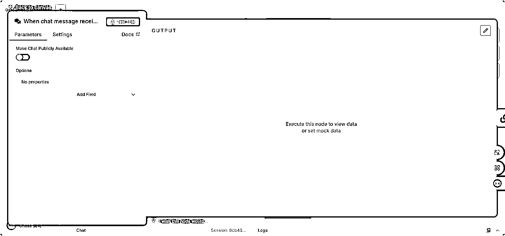

## AI Agent 深度解析

AI Agent 是 Basic LLM Chain 的进阶形态，充分释放了 LangChain 的能力。从外观看，其插槽更多，可连接更多子节点。

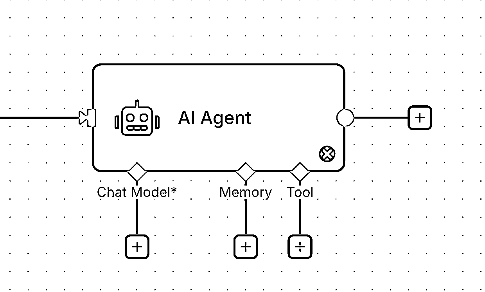

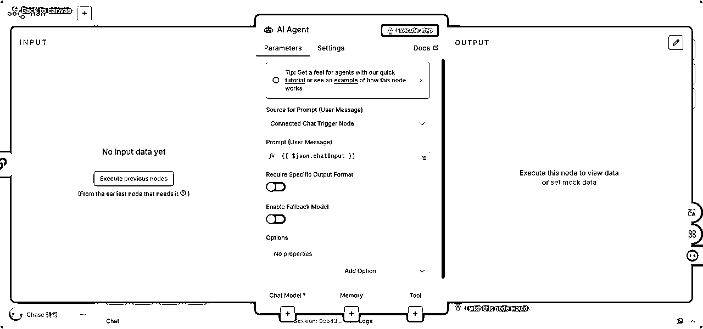

### Agent 类型

Conversational Agent

*   面向对话场景

*   支持 Memory 与 Tool

*   可加上下文记忆，也可接入搜索、天气等外部工具

Tools Agent

*   用自然语言操作工具

*   典型场景：让 AI 做精确计算

*   不支持上下文记忆

OpenAI Functions Agent

*   专用于 Function Call

*   适合调用特定函数

Plan and Execute Agent

*   通过自然语言调用多个工具

*   AI 自主决定使用哪些工具及组合方式

ReAct Agent

*   Plan and Execute 的进阶版

*   工作方式类似 ChatGPT Plus

*   AI 会根据任务选择工具、检查结果，不满意时尝试其他方案

*   可能发起多次请求

SQL Agent

*   直接与 SQL 数据库交互

*   支持 Memory

### Memory 子节点

Window Buffer Memory

*   基于浏览器窗口缓存

*   优点：无需部署

*   缺点：刷新后丢失

Redis Chat Memory

*   存于 Redis 缓存服务器

*   刷新后记忆可恢复

*   属短期记忆，按策略清理

Motorhead

*   开源 AI 记忆服务

*   支持存储、向量化与检索

Xata

*   AI 专用无服务器检索系统

*   付费服务，无需自建

*   相当于云端即插即用数据库

Zep

*   另一家 AI 长期记忆服务商

*   付费使用，免部署

### Tool 子节点

Calculator

*   基础数值计算

*   避免 AI 出现计算错误

Custom Code Tool

*   自定义 JavaScript 或 Python 代码

*   让 AI 调用自建工具

SerpAPI

*   Google 搜索 API

*   让 AI 具备联网查资料能力

Wikipedia

*   从维基百科获取信息

*   降低幻觉风险

Wolfram Alpha

*   学术问答搜索引擎

*   信息质量高，支持高级数学

Custom n8n Workflow Tool

*   将其他 n8n 流程作为工具调用

*   属于强力扩展

对中文用户而言，该工具很有价值。原版 n8n 对国内平台连接有限，可先做一个“向飞书发消息”的流程，再作为工具接入 AI 节点，实现任务完成后自动推送到飞书。

## 扩展应用

掌握 Basic LLM Chain 与 AI Agent 后，其他 AI 节点基本可举一反三。如 OpenAI 节点支持绘图与文件上传，Question and Answer Chain 优化知识库问答。核心流程始终是：输入数据 → 设定 AI 行为 → 接入工具 → 获取结果。

官方社区提供模板市场，通过 Advanced AI > AI Templates 进入，一键复制使用。

若预制节点仍不满足需求，可使用 LangChain Code 节点，直接编写 LangChain 代码定制行为。

n8n 的 AI 节点体系从简单到复杂，基本覆盖所有场景。

适用建议：

*   单次文本处理用 Basic LLM Chain

*   需要工具调用与记忆用 AI Agent

*   特殊需求写自定义代码

## 3.1 完成你的第一个 n8n 工作流

下面带你一步步搭建第一个流程，目标是跑通，体验成功感。后续可接入任意模型 API 或添加工具。

### Step1 添加触发器与 AI 节点

新建流程面板，按图示先添加触发器与 AI 节点。遇到英文不熟，可用沉浸式翻译插件。看不懂或暂时用不到的功能先放一边，保持正反馈最重要。

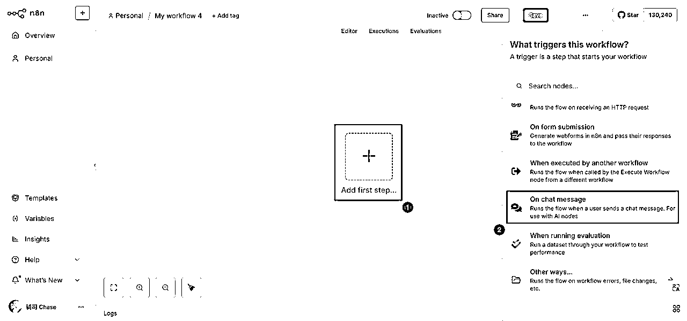

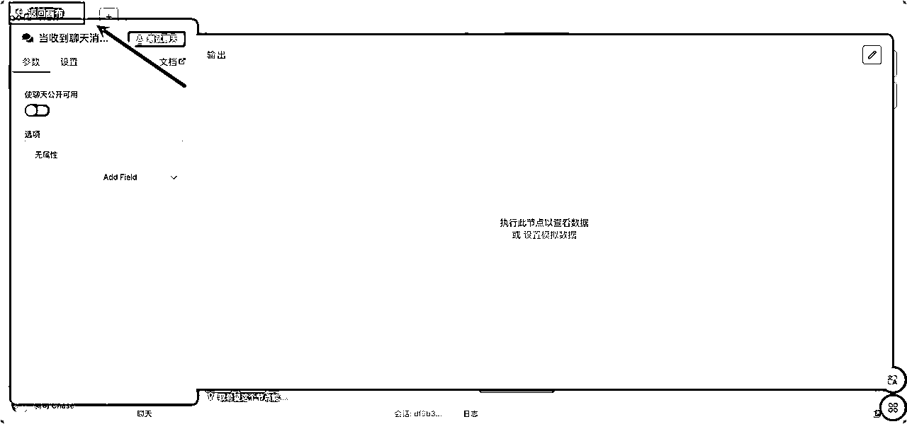

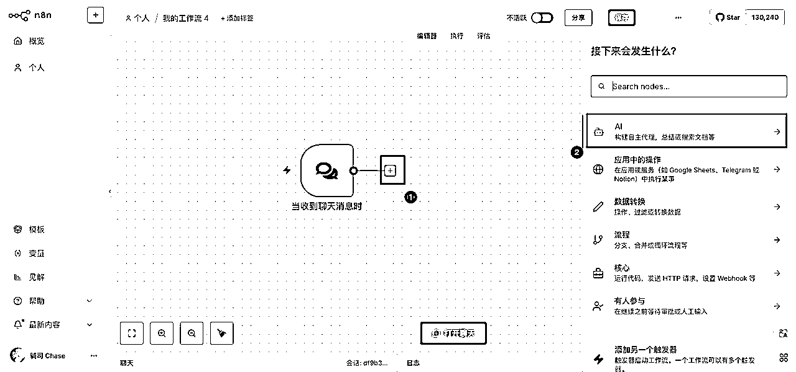

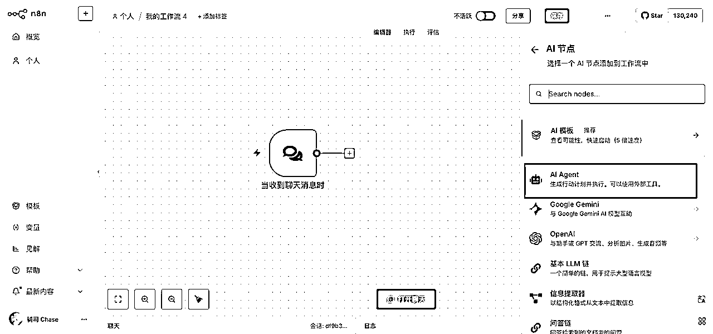

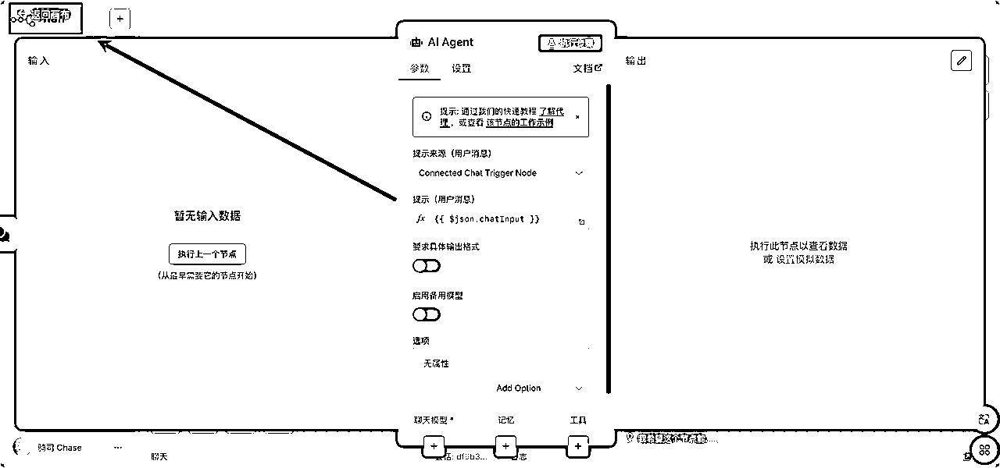

### Step2 配置凭证

本次使用 DeepSeek 模型，先创建新凭证。

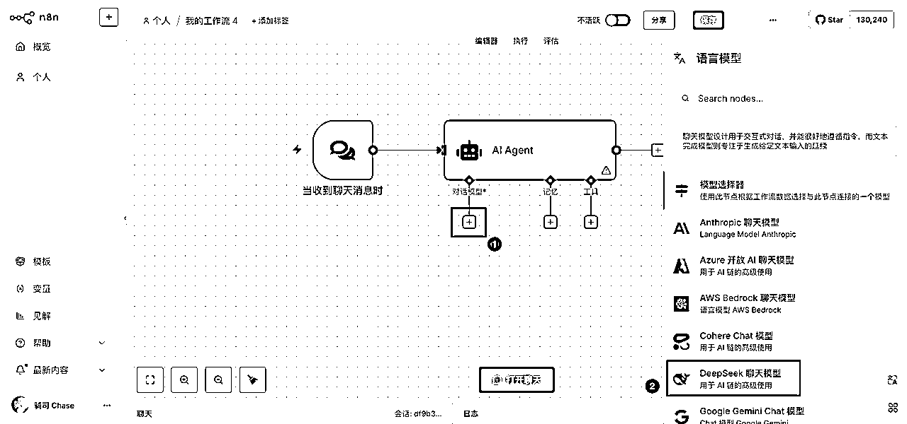

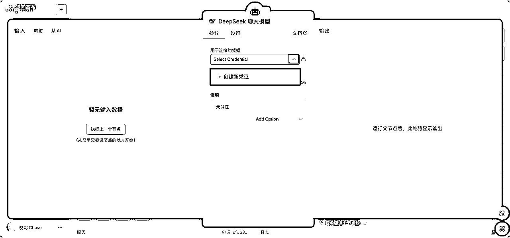

很多朋友问：怎么把 DeepSeek 接进 n8n，做一个能联网、能记住上下文的 AI 助手？其实流程并不复杂，只要照着下面几步走，新手也能跑通第一个工作流。

先访问 DeepSeek 官网，登录后从右上角进入 API 开发者平台，建议先充 10 块钱用作测试预算。其实不只是 DeepSeek，想接入任何大模型，思路都是相通的：去对应模型的开发者后台，找到 API 调用入口，创建一个 key，再把它复制到 n8n 里。

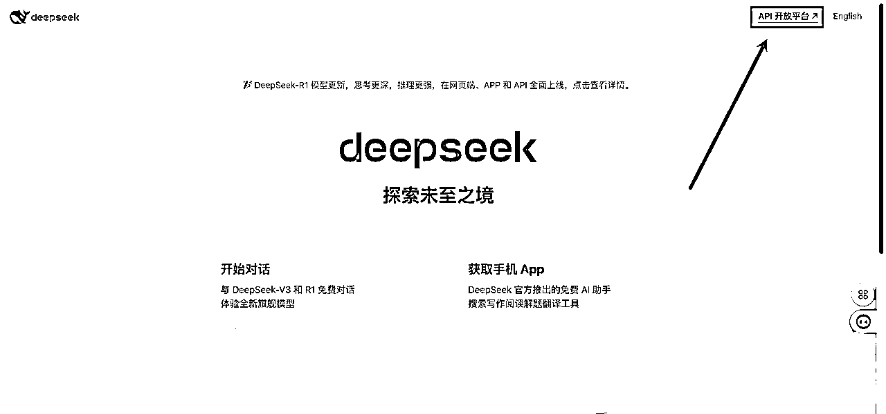

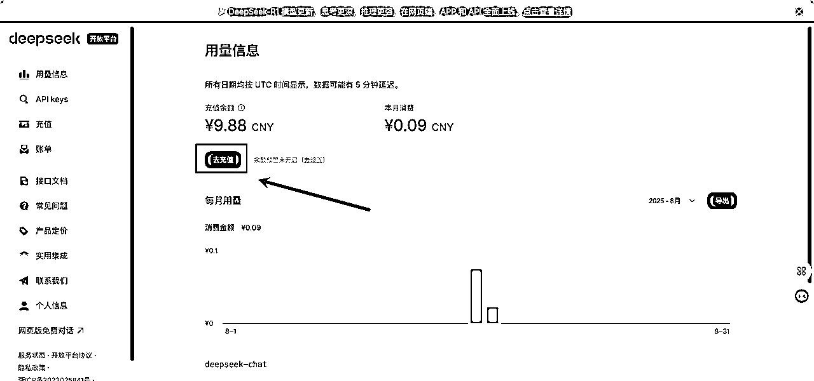

在 API Key 区域新建一个密钥，生成后记得马上复制。

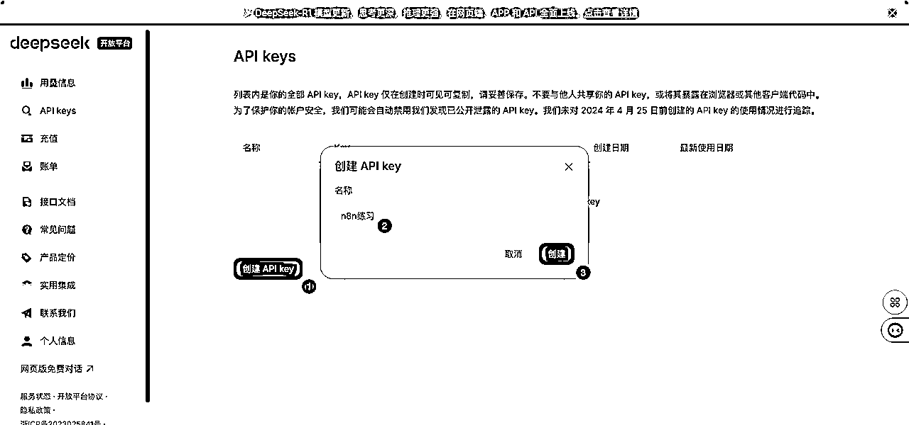

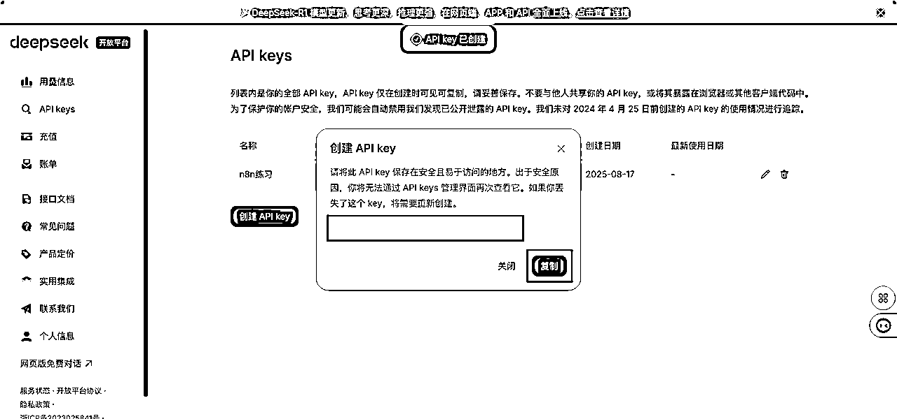

把刚才复制的密钥粘贴到 n8n 的凭证配置里，保存之后，凭证就建好了。做到这一步，DeepSeek 和 n8n 已经成功连上线。

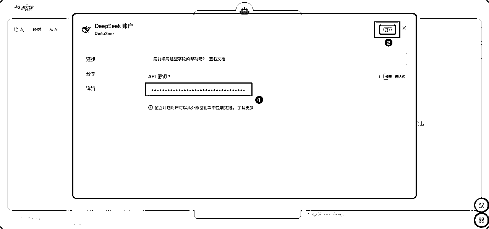

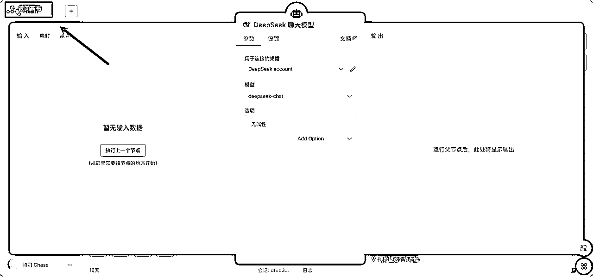

第三步，给 Agent 添加记忆模块。这样它才能结合对话历史来回答，而不是每次“失忆”。

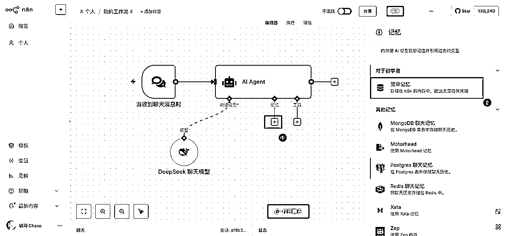

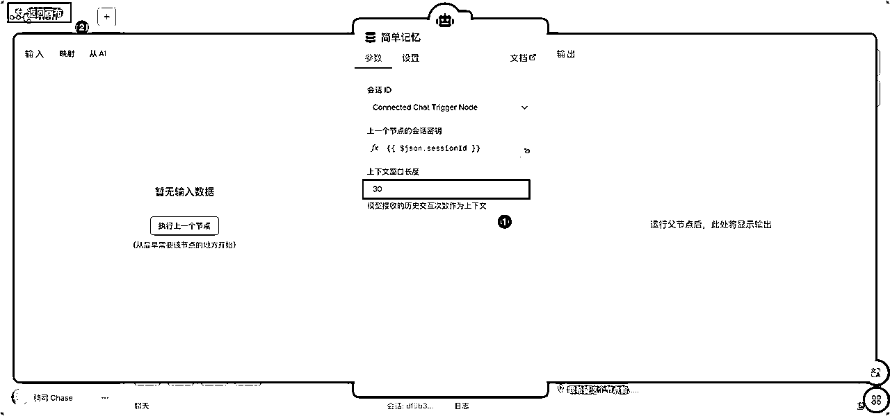

第四步，配置 RSS，让 AI 助手可以访问指定的网络信息源。简单说，RSS 是一种内容订阅技术，你不需要每天逐个打开网站，也能集中看到感兴趣站点的最新更新。换句话说，给 Agent 接上 RSS，等于帮它打开了一扇获取外部资讯的窗口。

在 n8n 里新建一个 RSS 读取工具，然后填入你需要监控的订阅地址。

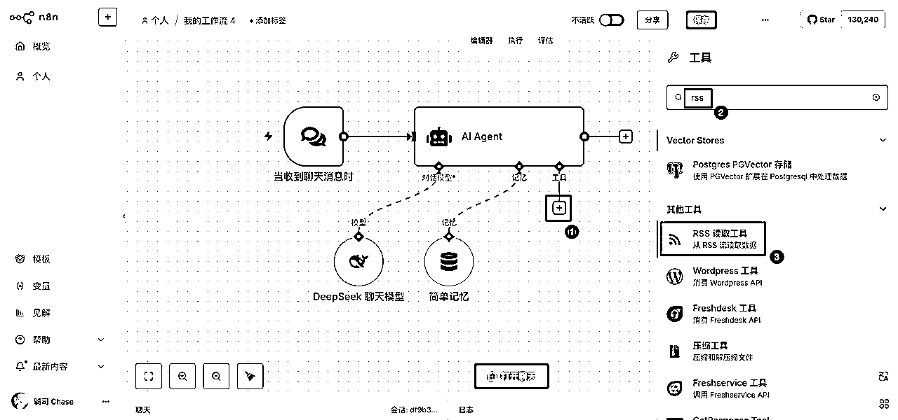

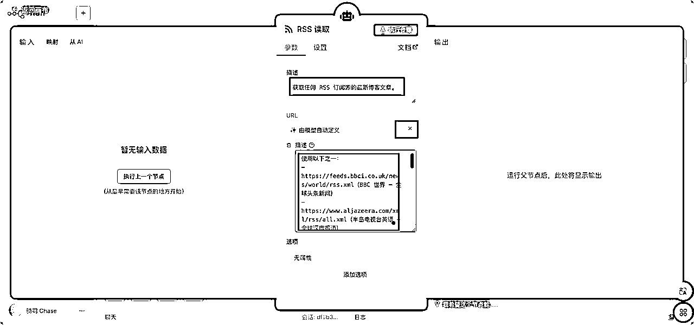

这个工具可以抓取任意 RSS 订阅源的最新文章。想立刻测试的话，可以直接选用这些源：BBC World 的全球头条、半岛电视台英语的深度报道、CNN World 的突发新闻、TechCrunch 的科技与创业资讯、Hacker News 的技术社区动态、n8n 官方博客更新、Bon Appétit 的食谱、ENDS Report 的环境法律与政策、MedlinePlus 的健康更新。

全部配置完成后，点击界面下方的【打开聊天】就能开始测试。我试着让这个 Agent 给我整理几条近期科技新闻，结果很顺利：它通过 DeepSeek 理解任务，再借助 RSS 获取最新内容，最后输出新闻标题、简介和原文链接。

到这里，你的第一个 n8n 工作流就正式跑通了！

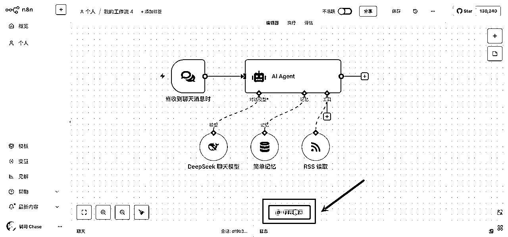


如果你还想给 Agent 设定内置提示词，也很简单：打开 AI Agent 节点，把提示来源切换成自定义，再写入你想要的指令即可。另外，在 n8n 里几乎所有功能、按钮都能随意点一点、拖一拖；多动手尝试，往往能发现很多惊喜。


那怎么找到值得自动化的需求？判断标准可以浓缩成三个关键词：重复、耗时、流程固定。

哪些工作场景适合交给自动化？

- 频繁重复、基本不用动脑的任务，比如从系统里捞数据、复制粘贴。

- 动作固定的任务，比如发送兑换码邮件、文件归档备份、批量发送合作邀请。

- 耗时冗长的任务，比如回复邮件、处理请假或报销这类行政流程，还有分析每月收支报表。

简单说：只要一件事同时满足“重复性强、耗费时间、流程可标准化”，就值得用自动化把它接住。现在不妨想一想，你工作或生活里有没有正好符合这些条件的任务？

另外，还有两个实用的小补充。

如果你想升级 n8n，并且安装时用的是我之前介绍的方式，那么只需要在镜像管理里找到 n8n，重新 pull 一次，就能拉到新版本。


最后是一些资源清单：n8n 官网链接、n8n 条款说明书、GitHub 上上千个 JSON 模板、YouTube 上 n8n 赛道的头部创作者、谷歌全家桶配置（Gmail、Google Drive、表格、文档等）、YouTube 上 n8n 博主的分析结果，以及 GitHub 上的免费模板。把这些资源用好，你的自动化工作流会越做越顺手。