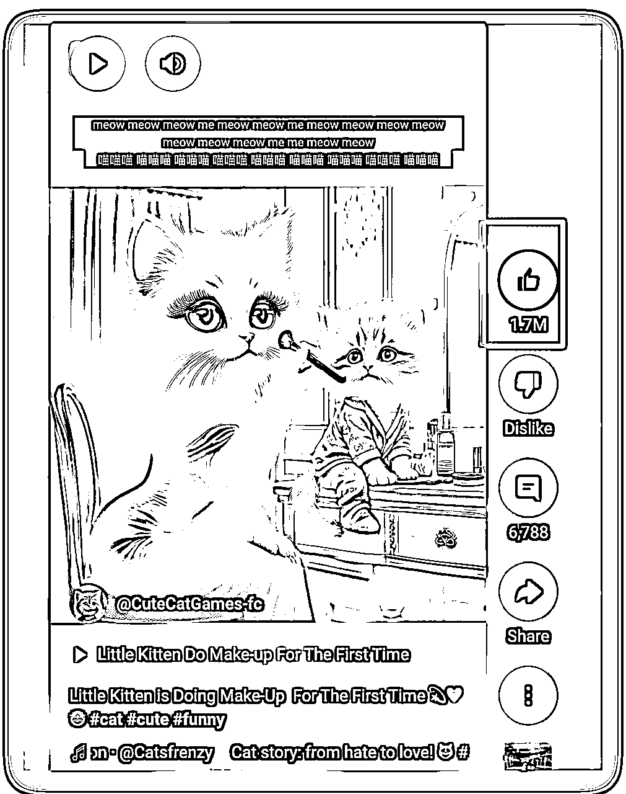
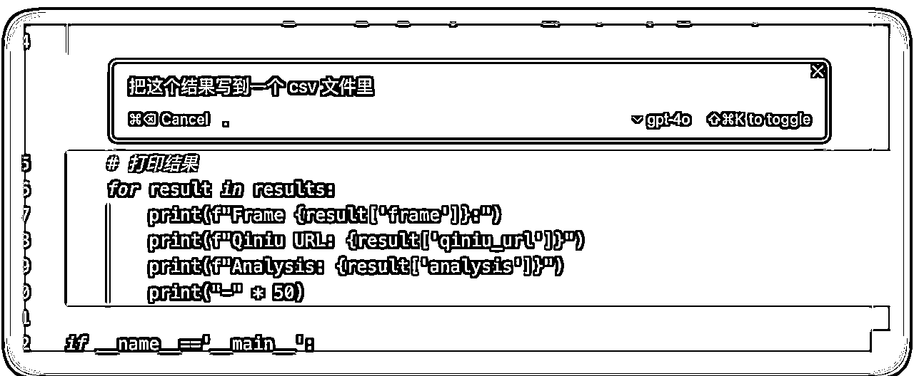
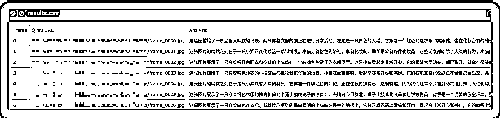
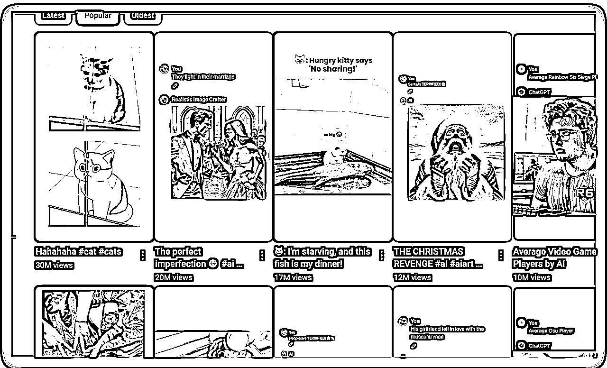

# shorts 爆款AI 视频，一键复刻
刷到一个超级风向标，看完真心觉得我也能上手一试。就是这个YouTube Shorts视频： 据说这个号一年能赚300万美刀，看到这个收入谁不心动？
我过去一直专注公众号，流量还算不错，但真的越来越卷。如今冒出Shorts这个机会，直接赚美元，加上AI加持，实在让我特别兴奋。
先说下我如何拆解这个爆款视频。把视频下载下来（用youtudl就能搞定，不多展开），仔细研究后会发现，它本质上是由多个小脚本、多段短视频拼成的“合集”——先写好一个完整脚本，再逐段生成几秒钟的视频，最后拼成一条30秒的Shorts。
我的复刻思路大概是这样的：先用脚本把视频按固定间隔切帧，比如30秒的视频每5秒截取一帧，得到6张关键图片；接着提取背景音乐；再把每张图交给AI分析，生成对应提示词；然后把这些提示词扔给视频生成接口，逐个生成几秒钟的短片段；最后拼接所有片段并配上原BGM，一个复刻版短视频就完成了。整个过程全部交给AI处理。
实际流程分两步。
第一步是素材准备：音频、提示词、基准图。先跑脚本提取视频中的音频。```
import moviepy.editor as mp
import os
def extract_audio(video_path, audio_output_path=None):
# Load the video file
video = mp.VideoFileClip(video_path)
# Extract the audio
audio = video.audio
# If audio_output_path is not provided, generate it from the video file name
if audio_output_path is None:
video_filename = os.path.basename(video_path)
audio_filename = os.path.splitext(video_filename)[0] + ".mp3"
audio_output_path = os.path.join(os.path.dirname(video_path), audio_filename)
# Write the audio to a file
audio.write_audiofile(audio_output_path)
# Close the video file
video.close()
if __name__=='__main__':
# Example usage
video_file = "./cat/1.mp4"
extract_audio(video_file)
``` 再抓取每个场景的帧画面，我用的是智谱AI的图像识别来解析。```
import cv2
import os
from PIL import Image
from github import Github
import base64
from zhipuai import ZhipuAI
# 设置您的 Google API 密钥和 Qiniu 访问令牌
GITHUB_TOKEN = 'YOUR_GITHUB_TOKEN'
REPO_NAME = 'xxx/xxx'
BRANCH_NAME = 'master'  # 或者您想要上传到的分支名称
def upload_to_github(file_path, github_path):
g = Github(GITHUB_TOKEN)
repo = g.get_repo(REPO_NAME)
with open(file_path, 'rb') as file:
content = file.read()
try:
contents = repo.get_contents(github_path, ref=BRANCH_NAME)
repo.update_file(contents.path, f"Update {github_path}", content, contents.sha, branch=BRANCH_NAME)
except:
repo.create_file(github_path, f"Create {github_path}", content, branch=BRANCH_NAME)
return f"https://raw.githubusercontent.com/{REPO_NAME}/{BRANCH_NAME}/{github_path}"
def describe_png(image_url):
client = ZhipuAI(api_key="xxxxx") # 填写您自己的 APIKey
response = client.chat.completions.create(
model="glm-4v",
messages=[
{
"role": "user",
"content": [
{
"type": "text",
"text": "请描述这个图片"
},
{
"type": "image_url",
"image_url": {
"url" : image_url
}
}
]
}
],
top_p= 0.7,
temperature= 0.95,
max_tokens=1024,
stream=False
)
res = response.choices[0].message.content
print(res)
return res
def extract_frames_and_analyze(video_path, output_folder, interval=4):
if not os.path.exists(output_folder):
os.makedirs(output_folder)
video = cv2.VideoCapture(video_path)
fps = video.get(cv2.CAP_PROP_FPS)
frame_interval = int(fps * interval)
frame_count = 0
extracted_count = 0
results = []
while True:
success, frame = video.read()
if not success:
break
if frame_count % frame_interval == 0:
output_path = os.path.join(output_folder, f"frame_{extracted_count:04d}.jpg")
cv2.imwrite(output_path, frame)
github_path = f"video_frames/frame_{extracted_count:04d}.jpg"
qiniu_url = upload_to_github(output_path, github_path)
print(qiniu_url)
# 使用  分析图片
response = describe_png(qiniu_url)
# 保存分析结果
analysis_path = os.path.join(output_folder, f"analysis_{extracted_count:04d}.txt")
with open(analysis_path, 'w', encoding='utf-8') as f:
f.write(f"Qiniu URL: {qiniu_url}\n\n")
f.write(response)
# 将结果添加到列表中
results.append({
'frame': extracted_count,
'qiniu_url': qiniu_url,
'analysis': response
})
print(f"已分析并上传第 {extracted_count} 帧")
extracted_count += 1
frame_count += 1
video.release()
print(f"总共提取、分析并上传了 {extracted_count} 帧图片")
return results
def main():
# 使用示例
video_path = "./cat/1.mp4"  # 替换为你的视频文件路径
output_folder = "output_frames_and_analysis"  # 输出文件夹名称
results = extract_frames_and_analyze(video_path, output_folder, 20)
# 打印结果
for result in results:
print(f"Frame {result['frame']}:")
print(f"Qiniu URL: {result['qiniu_url']}")
print(f"Analysis: {result['analysis']}")
print("-" * 50)
if __name__=='__main__':
# url = 'https://pics5.baidu.com/feed/eac4b74543a98226ef3c2e1b59bc650f4b90ebde.jpeg@f_auto?token=dd3576b04cf3c79fd41b0318b3888cd0'
# url = 'xxx'
# describe_png(url)
main()
``` 接着让AI工具把解析结果直接写进CSV。 这样一份完整的素材解析表就到手了。
第二步是视频生成。我之前写过一篇利用Cloudflare把文字变成图片的教程，链接在这： 我现在用的是智谱清言的bigmodel，现在有免费额度，虽然生成质量一般，但胜在免费。
直接开干吧！文末有最终复刻出来的成片，大家看看效果如何。
```
import sqlite3
import json
import random
import time
from zhipuai import ZhipuAI
client = ZhipuAI(api_key="x'x.x") # 请填写您自己的 APIKey
DB_FILENAME = 'video_generations_cat_01.db'
camera_movements = [
"镜头平移",
"推近",
"拉远",
"升降拍摄",
"摇摄",
"跟随拍摄",
"手持拍摄",
"无人机航拍"
]
shot_types = [
"大全景",
"中景",
"近景",
"鸟瞰视角",
"跟随视角",
"鱼眼效果"
]
lighting_effects = [
"自然光",
"丁达尔效应",
"柔和散射",
"硬光直射",
"逆光剪影",
"三点布光"
]
demo_prompt = f"镜头{random.choice(camera_movements)}, {random.choice(shot_types)}，{random.choice(lighting_effects)} ，一只性感猫妈妈一只可爱毛茸茸的小猫，小猫在用猫妈妈的化妆品在给自己化妆，前景是从门的方向看到的视角，背景是化亮色妆镜前面，场景家居卧室环境，氛围开心欢快"
demo_iamge = ""
def save_data(response, id_value=None):
if not response:
return
# Connect to SQLite database (or create it if it doesn't exist)
conn = sqlite3.connect(DB_FILENAME)
cursor = conn.cursor()
# Create table if it doesn't exist
cursor.execute('''CREATE TABLE IF NOT EXISTS video_generations
(id TEXT PRIMARY KEY, model TEXT, video_result TEXT,
task_status TEXT, request_id TEXT,
url TEXT, cover_image_url TEXT)''')
# Extract url and cover_image_url from video_result
url = response.video_result[0].url if response.video_result else None
cover_image_url = response.video_result[0].cover_image_url if response.video_result else None
# Check if the record already exists
# id_value is not none, will use query result. and extract mp4, cover image
if id_value is None:
id_value = response.id
else:
task_status = response.task_status
if 'SUCCESS' not in task_status:
return
model = response.model
video_result=response.video_result[0]
request_id = response.request_id
cursor.execute('SELECT * FROM video_generations WHERE id = ?', (id_value,))
existing_record = cursor.fetchone()
if existing_record:
# Update existing record
cursor.execute('''UPDATE video_generations
SET model = ?, video_result = ?, task_status = ?,
request_id = ?, url = ?, cover_image_url = ?
WHERE id = ?''',
(model, None, task_status, request_id,
video_url, cover_image_url, id_value))
print(f"Updated existing record in database. ID: {id_value}")
else:
# Insert new record
cursor.execute('''INSERT INTO video_generations
(id, model, video_result, task_status, request_id, url, cover_image_url)
VALUES (?, ?, ?, ?, ?, ?, ?)''',
(id_value, response.model,
json.dumps(response.video_result),
response.task_status, response.request_id,
url, cover_image_url))
print(f"Inserted new record into database. ID: {id_value}")
# Commit the changes and close the connection
conn.commit()
conn.close()
print(f"Response data saved to database. ID: {id_value}")
# Start Generation Here
def print_db_contents(update=False):
conn = sqlite3.connect(DB_FILENAME)
cursor = conn.cursor()
cursor.execute("SELECT * FROM video_generations ")
rows = cursor.fetchall()
for row in rows[2:]:
print(f"ID: {row[0]}")
print(f"Model: {row[1]}")
print(f"Video Result: {row[2]}")
print(f"Task Status: {row[3]}")
print(f"Request ID: {row[4]}")
print(f"URL: {row[5]}")
print(f"Cover Image URL: {row[6]}")
print("-" * 50)
if update:
query_result(row[0])
conn.close()
print(f'{len(rows)} datas found.')
def generate_prompt(context):
response = client.chat.completions.create(
model="glm-4",  # 请填写您要调用的模型名称
messages=[
{"role": "user", "content": "作为一名视频制作专家，请为我写一个视频拍摄思路，输出格式必须为：\"(镜头语言 +景别角度+ 光影) + 主体 (主体描述) + 主体运动 +场景 (场景描述) + (氛围)\",中文输出，不要有其他冗余的任何文字输出。"},
# {"role": "assistant", "content": "当然，要创作一个吸引人的口号，请告诉我一些关于您产品的信息"},
{"role": "user", "content": context},
# {"role": "assistant", "content": "点燃未来，智谱 AI 绘制无限，让创新触手可及！"},
# {"role": "user", "content": "创作一个更精准且吸引人的口号"}
],
)
msg = response.choices[0].message
content = msg.content
lst_cnt = content.split('\n')
if len(lst_cnt[0]):
return lst_cnt[0]
return content
def generate_video(prompt, base_iamge):
response = client.videos.generations(
model="cogvideox",
prompt=prompt,
image_url=base_iamge
)
print(response)
save_data(response)
return response.id
## query result
def query_result(id_value):
try:
response = client.videos.retrieve_videos_result(
id=id_value
)
print(response)
response.id = id_value
save_data(response, id_value)
except Exception as e:
pass
def main():
base_prompt = '几可爱的小猫'
# base_prompt = generate_prompt(base_prompt)
# print(base_prompt)
video_id = generate_video(base_prompt, base_img)
if __name__=="__main__":
print_db_contents(update=1)
```
## 4.3 后期合成
接下来把素材丢进剪映、秒剪这类剪辑软件里，批量选中几条小片段，我手上正好有 6 条每条 6 秒的短片，把它们连起来就能拼出一个 30 秒左右的成片。最后把前面分离出来的音频轨拖到视频下方一并合成，整段流程就收尾了。
# 做真正原创的视频
上面讲的其实只是拿旧素材做二次拼接，模仿的是别人的成片，并不算原创。
如果想沿用这种调性，却讲一个全新故事，做出一条完全不一样的原创内容，就需要自己写一个新的脚本。写剧本这件事，现在也可以交给 AI 来协助完成。
参考另外一个链接。
# 实战案例拆解
这个成片的思路，其实就是先拆解一条已经爆火的源视频，把它的音频和整体节奏都复刻下来，这是第一种可操作的方法。
第二种思路是，市面上大量用静态图加上动态效果的视频也在持续吸量，数据表现相当不错。局限不只是视频形式，核心是敢于动手去尝试。
https://www.youtube.com/@NoMulify

综合来看，第二种做法上手门槛更低。准备一批图片，配上动效、节奏踩点和背景音乐，很快就能成片。最重要的还是行动起来。