# 一个 RPA 工作流，打通小绿书、小红书与公众号内容发布
## 之前的工具，做了哪些升级？
此前分享的脚本，已经能自动调用 Coze 工作流生成文章，并将内容发布到公众号和小绿书。不过实际使用后，大家提出了几个值得改进的地方：
- 原来脚本分散在多个文件里，安装步骤不够方便；
- 执行过程中的提示较少，遇到故障不容易定位；
- 希望公众号文章能够自动声明原创；
- 希望增加小红书发布，让小绿书素材也能同步使用。
这些建议都很实用。因此，我对工具进行了整合和更新，把多个脚本合并为一个。新版目前支持：
1. 自动运行小红书改写小绿书的工作流；
2. 自动运行公众号 Coze 改写工作流；
3. 兼容服务号内容发布；
4. 支持发布到小红书；
5. 可自动勾选公众号文章的原创声明；
6. Coze 工作流新增更通用的小绿书总结生成能力，可用于多个内容领域。
下面介绍工具的安装、配置和使用方法。
# 一、申请飞书并配置权限
这部分设置非常关键，请按照飞书配置教程逐项完成。权限或参数没有配置正确，脚本就无法正常运行。
# 二、准备脚本运行环境
## 1. 安装比特浏览器
前往 https://www.bitbrowser.cn/ 下载并安装比特浏览器，按默认流程完成安装即可。
## 2. 配置比特浏览器并导入工作流
### ① 设置文件下载位置
打开比特浏览器，进入“系统配置”，找到文件下载目录，并将路径改成自己准备使用的文件夹。
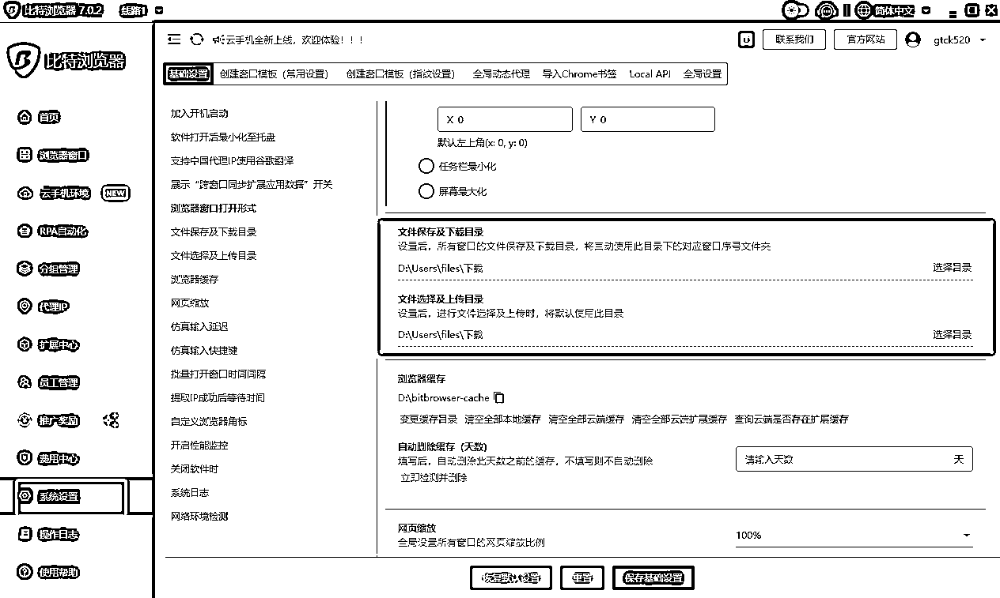
后续脚本下载图片时，会使用这里设置的目录。
### ② 导入 RPA 工作流
新版已经将原有脚本合并，只需下载并导入这一份即可。
下载完成后，打开比特浏览器，依次进入“RPA自动化”和“流程设计”。
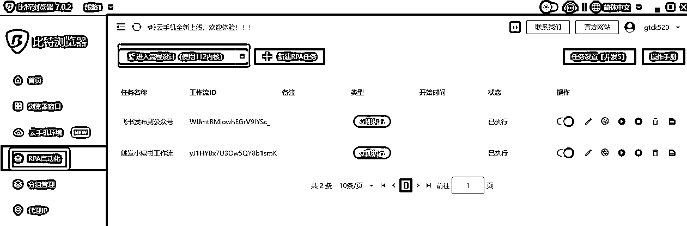
浏览器完成初始化后，会弹出 RPA 调试窗口，并安装好 Automa 插件。

接下来打开 Automa，进入工作流页面，点击下拉菜单中的“导入工作流”，选择刚才下载的文件。
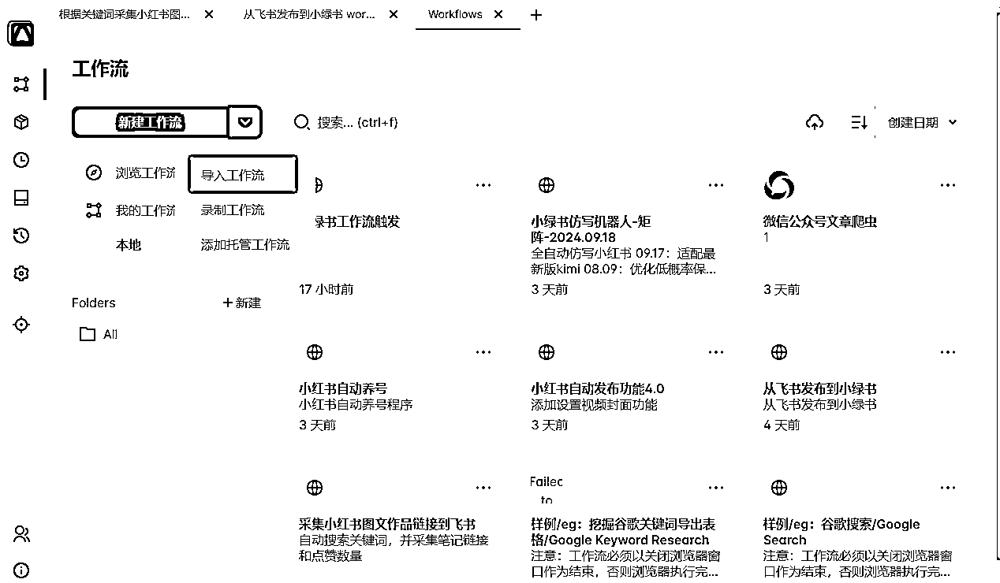
## 3. 准备公众号排版工具
脚本会用到墨滴 Markdown 排版工具。AI 生成的文章采用 Markdown 格式，经过墨滴转换排版后，可用于公众号发布。
### ① 登录墨滴
打开 https://www.mdnice.com/，已有账号直接登录，没有账号则先注册。
### ② 创建文章页面
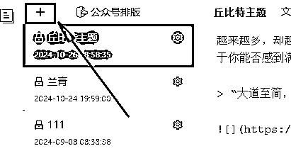
新建时标题可以自行填写。
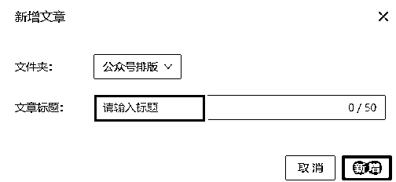
### ③ 选择排版主题
在文章编辑区输入任意内容，例如：
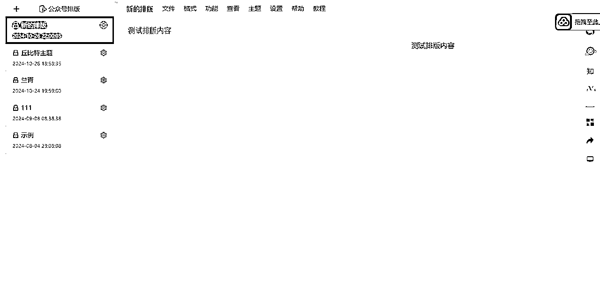
然后挑选一个自己喜欢的主题。之后生成的文章会按照这个主题进行排版。
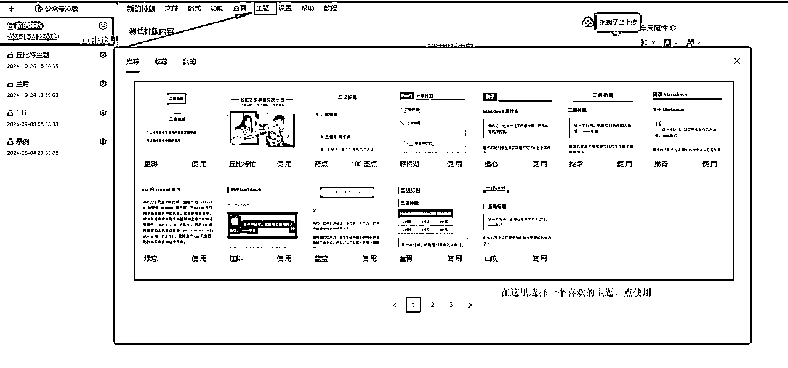
### ④ 记录文章链接
保存当前文章，并复制它的链接。后续需要把这个地址填入脚本配置，复制完成后即可关闭页面。
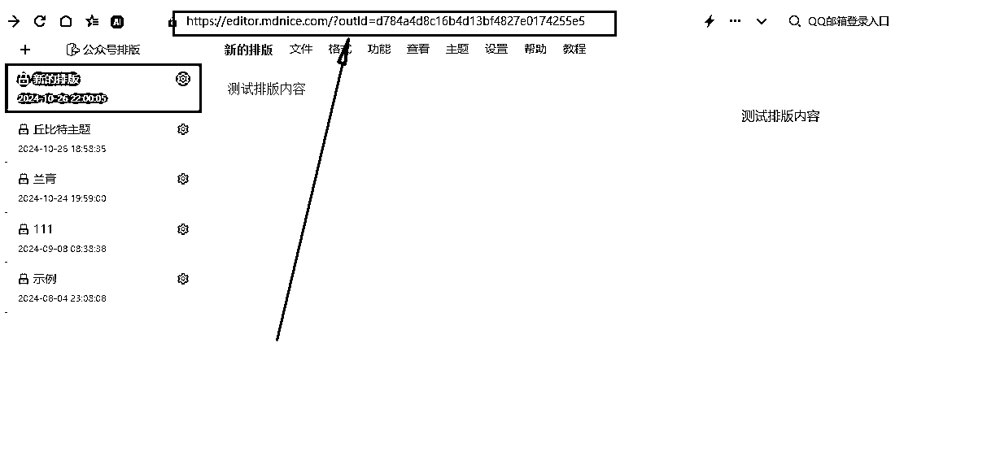
## 4. 配置 RPA 脚本
### ① 复制飞书模板
打开我的飞书表格，先创建一份副本。
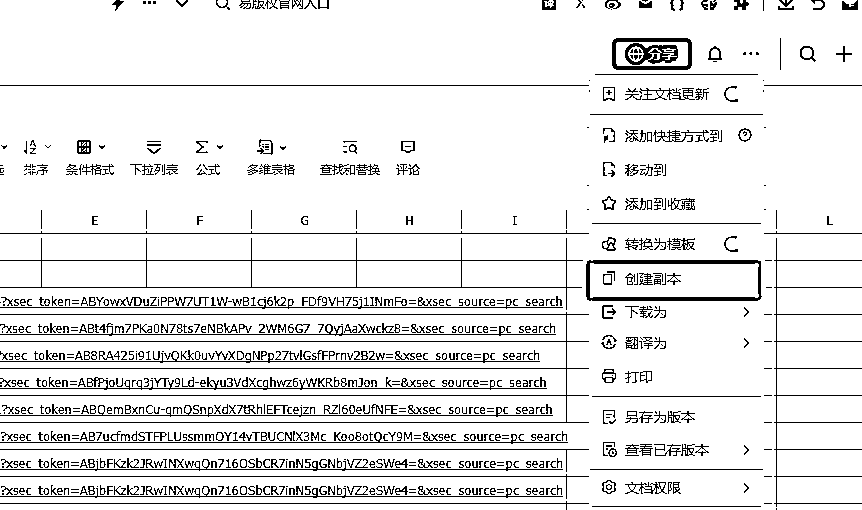
随后获取飞书表格链接。需要特别注意：不同表单对应的链接并不相同，后续配置时要确保每个地址都对应正确的表单。
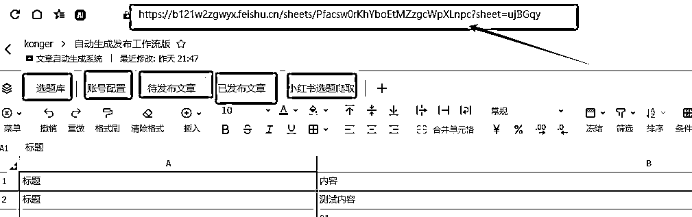
### ② 填写脚本参数
在比特浏览器中进入“RPA自动化”下的流程设计，找到刚刚导入的工作流并打开编辑页面。
在触发器后方找到“插入数据”节点，双击该节点，再点击左侧的“insert data”按钮修改参数。
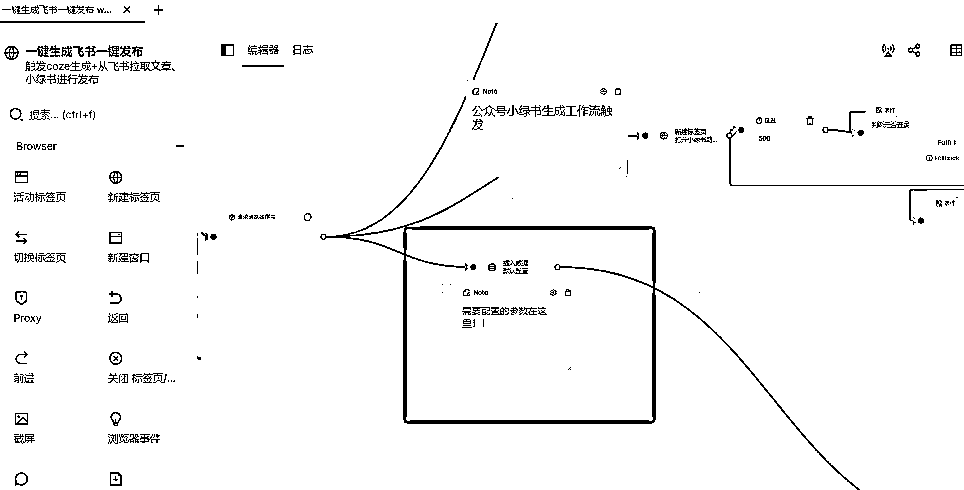
需要填写的配置项如下：
| 参数 | 填写内容 |
| `app_id` | 在飞书获取的 app_id |
| `app_secret` | 在飞书获取的 app_secret |
| `xuanti_sheet_url` | 选题库表单链接 |
| `daifabu_sheet_url` | 待发布表单链接 |
| `yifabu_sheet_url` | 已发布表单链接 |
| `zhanhao_sheet_url` | 账号配置表单链接 |
| `xhs_sheet_url` | 小红书爬取链接 |
| `save_draft` | 填 `1` 表示保存至草稿箱，填 `0` 表示直接发布（此功能仍待进一步测试完善） |
| `download_path` | 第 2 步设置的比特浏览器下载目录 |
| `markdown_theme` | 第 3 步配置的墨滴文章链接 |
| `user_name` | 账号用户名（具体查看相关说明） |
| `parent_code` | 上级邀请码（具体查看相关说明） |
| `is_modi` | 是否启用排版；关闭后将跳过排版 |
| `lingyu` | 预留字段，可随意填写 |
### ③ 先调试，再绑定窗口
配置完成后，先保存工作流并运行调试。确认当前脚本没有问题，再进行下一项操作。
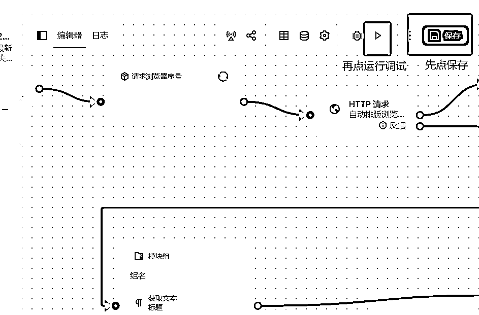
### ④ 查看运行日志
合并后的脚本会并行打开三个页面并执行自动化任务，但前台通常只会停留在公众号页面。请手动切换到另外两个页面，确认它们的运行情况。
首次运行时通常还要登录账号，请特别留意。登录及检查都完成后，后续运行就不需要一直盯着页面。
运行后可点击日志查看执行结果：
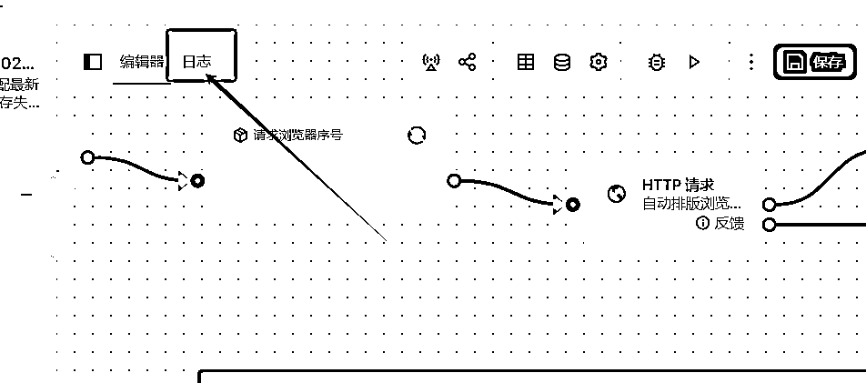
若脚本运行异常，日志中通常会显示类似提示：
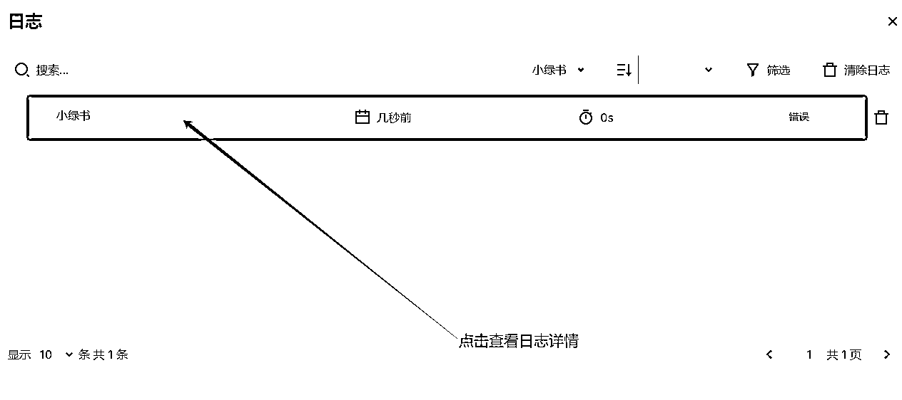
请根据报错内容排查。如果暂时无法处理，可以展开错误详情，找到标红的节点和具体信息，再把内容发到交流群中求助。
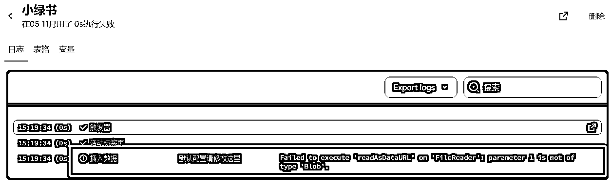
### ⑤ 绑定窗口并授权
窗口绑定的操作方法可参考之前的教程，这里不再展开。若计划绑定窗口执行定时任务，或通过不同窗口实现 IP 隔离，可查看“二、4、将 RPA 配置到比特浏览器，以实现定时执行和 IP 隔离”的说明。
绑定后，第一次使用时还需要在窗口中完成权限授权：
先打开对应的浏览器窗口。
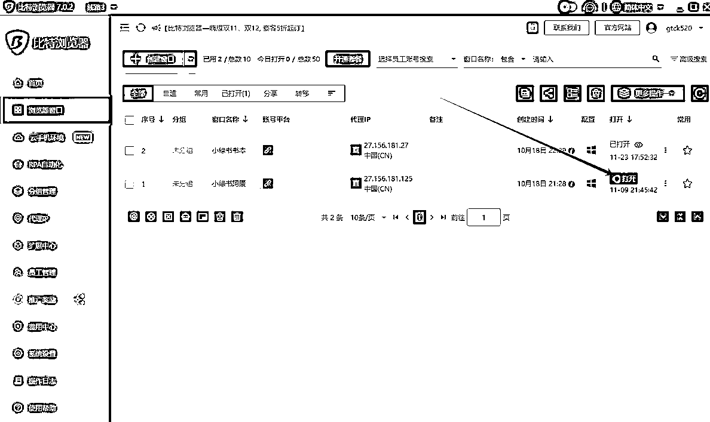
再从窗口内进入 Automa，找到导入的工作流。
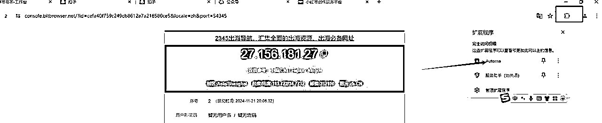
为以下三个节点授权。按图示完成权限设置后，脚本才能正常运行。
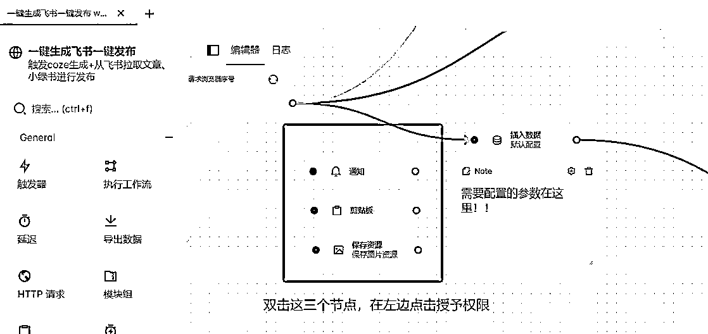
# 三、脚本功能与使用说明
完整的功能说明已整理成文档，可参考：
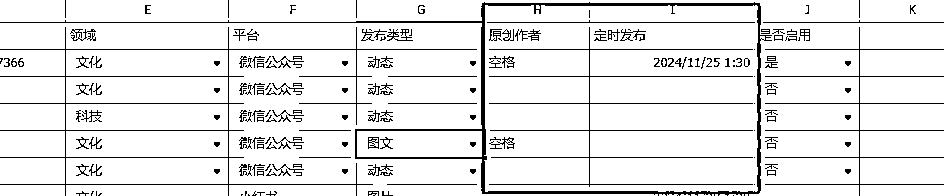
账号配置表中新增了两项内容：
- **原创作者**：填写后，公众号文章会声明原创；不需要声明时留空即可。
- **定时发布**：填写后可设置定时发布；不填写则立即发布。目前定时发布仅支持小红书。
# 四、常见问题排查
## 1. 脚本运行成功，但 Coze 智能体没有生成内容
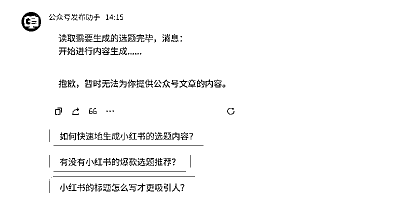
请检查 `xuanti_sheet_url` 是否填写为正确的选题库链接，同时确认选题库中有新的选题，并且相关字段符合要求。选题表中的“最后一次生成时间”为空时，表示该选题需要 AI 生成内容。
## 2. 脚本运行成功，但公众号没有自动发布
确认 `daifabu_sheet_url` 指向的是正确的待发布表格，并检查表格内是否存在待发布内容。若待发布标题尚未出现在已发布表格中，说明该内容仍需发布。
## 3. 无法提取文章内容或图片名称
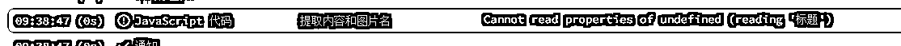
这种情况通常是待发布表格里没有正文，或文章所属领域与当前发布账号的领域设置不一致，导致没有可发布内容。请核对待发布表格链接和领域类型配置。
本次升级和使用说明就介绍到这里。如果操作中遇到问题，或者有功能建议，欢迎交流。