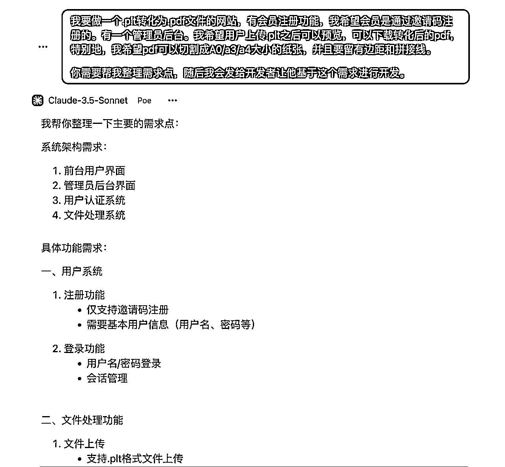
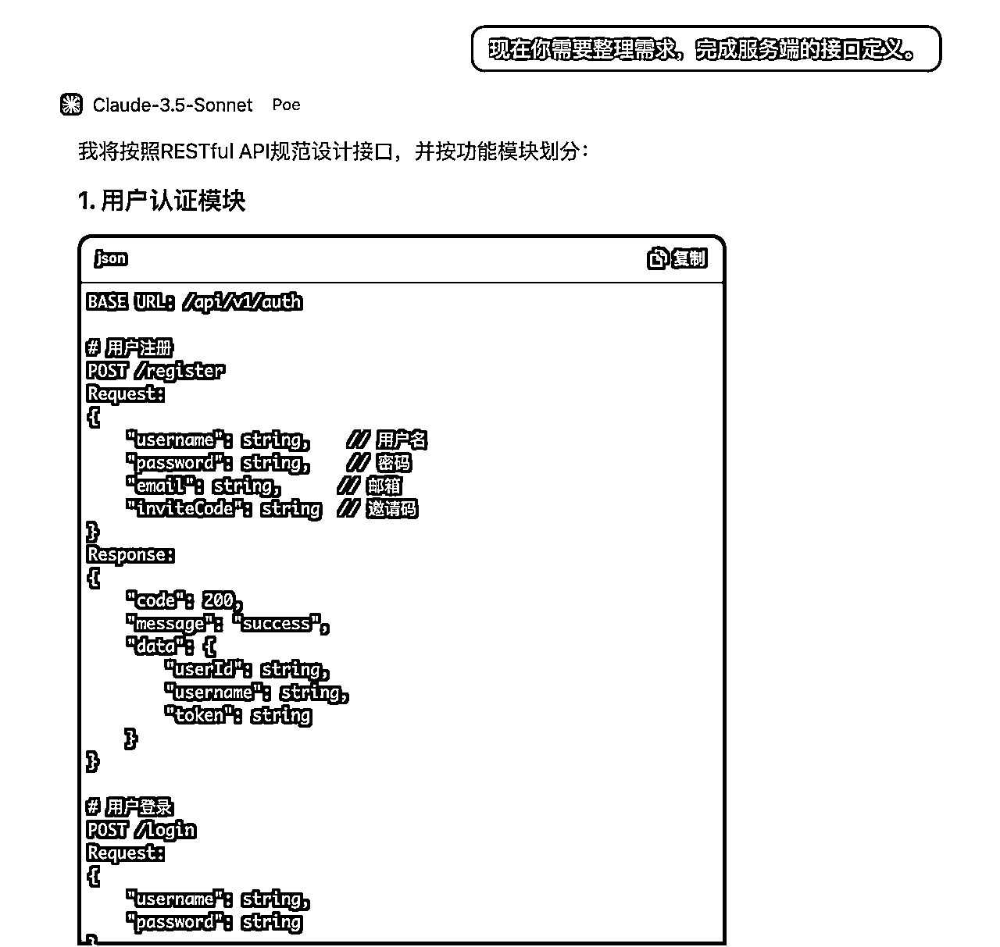
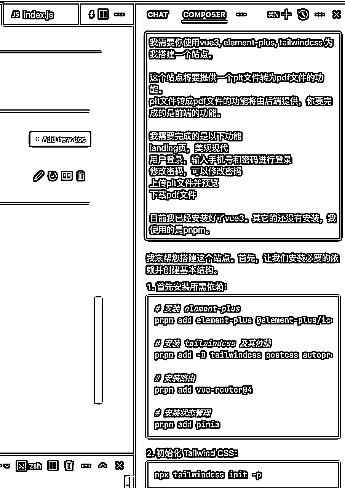
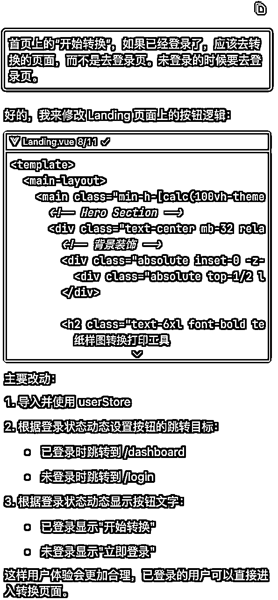
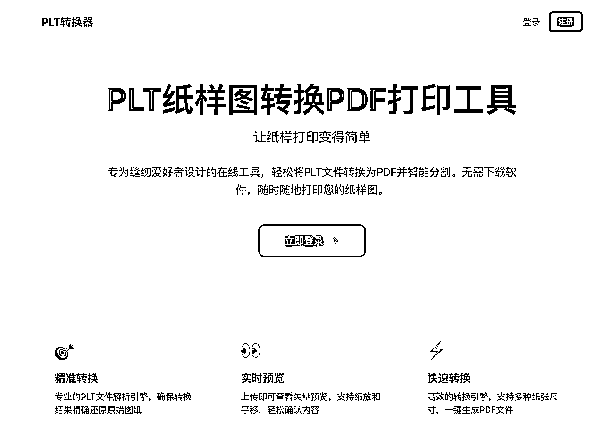
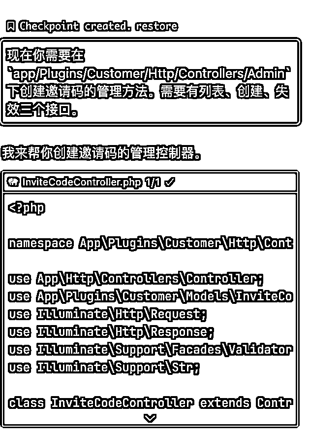
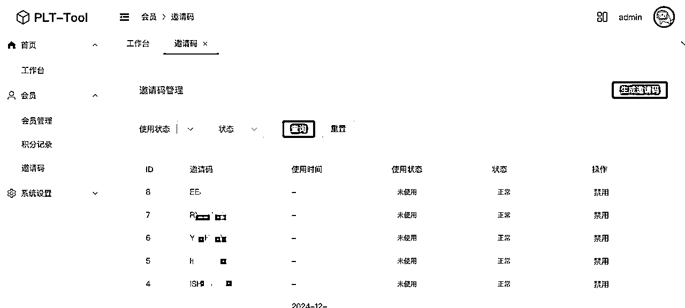

# 一个下午搭好 plt 转 PDF 的小站，我把 Cursor 当员工使
大家好，我是 David，一个干了不少年码农的老兵。之前小排老师讲过用 cursor 撸一个很小的页面，我这次的难度高了一点点，也顺手记录一下实操过程。
起因很生活化。我老婆最近迷上了缝纫手工，有天忽然问我 CAD 怎么用。我一头雾水，心想做手工现在也要上工业软件了？一问才知道，她手头有个 .plt 的纸样文件想打印出来，结果要靠 ABViewer 开，而家里全是苹果设备。于是我就琢磨着整一个转换工具，顺便试试 cursor 在做个普通网站上到底能扛到什么程度。成品就放在这里：https://plt.nanodeer.com
从零到能用，我只花了一个下午，前后端加转换服务全齐了。
先说个前提，AI 永远是副驾驶，你得坐驾驶位。别让它牵着走，你要当老板，它当执行。
## 怎么拆解
这个小站我把它切成了三块：给用户用的前台、给管理员看的后台、专门干活的转换服务。我个人很推崇用 Next.js 或 Nuxt.js 这种全栈框架一把梭，cursor 会更顺手。但我手头正好有之前的代码片段，就拆成三个独立项目来做。
a) 用户前台
b) 管理后台
c) 转换服务端
先把脑子里想要的功能过一遍，用自然语言写出来丢给 GPT，让它帮你拆成任务清单。我平常用的是 poe + claude.ai，下面演示也是按这个来。

接下来很关键的一步，让 AI 先帮你把接口定下来。

## 让 Cursor 上手干活
准备好需求文档和接口文档，分别放到项目根目录里，命名成 requirement.md 和 api.md。cursor 会把它们当上下文来读，后面对话的命中率会高很多。
### 用户前台
建个新仓库，把两份文档放进去，打开右侧的 Composer，直接把需求倒进去就行。
小建议是引导它用成熟的 UI 体系，比如 element-plus、ant-design、shadcn、tailwindcss。tailwindcss 特别香，基础样式很快就有体面感。

它会吐出一堆文件，你点 Run 或 Accept All 先跑起来，看看能不能通。我习惯先把所有 API 调用集中放到一个目录，后续改动更省心。
用 pnpm dev 本地预览，丑就直接在 Composer 里说哪个页面看着不对劲，让它改成现代简洁一点的。它会自己调。也可以手绘一个草图拍照丢进去，说照着这个布局改，它也能认。
报错就把日志复制回去让它修，或者自己看出来了就直接在左侧编辑器改掉。

我这个项目很简单，前台核心功能四十多分钟就跑通了。

### 转换服务端的接口
服务端我选了 Laravel，PHP 那个老牌框架。工作量就是做登录、上传、下载这些常规接口。
很熟的话会很顺。我让 cursor 写迁移文件、模型、控制器、路由，一条龙。

只要你清楚下一步要干嘛，cursor 基本就是一个码字特别快的双胞胎。
### 文件格式转换这块
这是整个站点的灵魂。我先去研究了 .plt 文件的格式、来源和结构，然后让 AI 思考怎么把它解析成 PDF。中间细节不少，这里不展开，对做开发的同学来说也就是捅破窗户纸的事。
### 管理后台
后台我直接拿了市面上一个开源的管理后台脚手架。把接口文档丢进去，告诉它要加会员管理和邀请码管理的功能就行。

## 拼起来
如果你用全栈框架就省事了。我这次是刻意拆开来体验 cursor，所以最后要手动串起来。跑一遍测试，哪里不对就丢回 composer 修。cursor 有两个窗口，Chat 适合问思路，Composer 适合直接改代码。Chat 更像一个 Claude 的代理窗口，Composer 才是动手写代码的工。
## 部署上线
前端我用 deployator 部署，PHP 那边用 Deployer。都是熟路的东西。虚拟主机配置我直接丢给 poe 让它生成，懒人福音。
## 宣传发圈
AI 现在最泛用的场景大概就是这个。把功能点整理好让 kimi 写文案，去稿定上拉几张图，发到社区里就差不多了。
做完后最重要的环节，是去跟老婆邀功。
## 一点感受
整体下来，cursor 真的是很强的生产力工具。它和 IDE 里带的通义灵码之类的不同点在于，它会给项目建索引，你还能喂文档进去，有点 RAG 的味道。配合 claude.ai 的 sonnet，写码能力非常靠谱。
过去手写这种站点至少要三四天，现在一个下午搞定，而且视觉效果是我能接受的。单就这个项目来说，放到海外也没问题，唯一美中不足的是 SEO 不太好做。
所以大家可以放心大胆试了，起一个项目的成本已经低到离谱。你的任务是多试路子，看哪个能变现，然后再把它做深。