# 一个人，如何借助自动化，运营100个中老年书法视频号？
## 写在前面
大家好，我是龙哥，目前在福州。
从2024年3月开始，我正式进入中老年书法视频号领域。最开始，我一个人管理5个账号，每天被剪视频、发内容、回消息、做转化等工作压得喘不过气。
后来，我不断拆解流程、寻找工具、测试组合，最终把这套业务升级成了一套自动化系统：一个人可以同时管理100个视频号，并持续完成内容生产与私域引流。
这篇复盘会重点分享三件事：
- 如何搭建一个中老年书法知识付费项目；
- 如何通过工具组合，把重复劳动交给机器；
- 在项目选择和规模化过程中，如何找到真正的核心竞争力。
如果你对视频号矩阵、自动化运营或中老年流量感兴趣，建议耐心读完。
## 引子：1600万营业额背后的启发
在做书法项目之前，我曾经参与过一个电商买药推广项目。
2022年3月至2023年9月，用户通过我的专属二维码进入平台小程序，花1分钱购买酒精、口罩、碘伏棉签等防疫用品。每成功带来一名新用户，我可以获得十几元佣金。
当时，“1分钱买防疫用品”本身就是一个非常强的获客钩子。我通过地推、线上推广和淘客等方式，在一年半时间里累计拉新超过100万人，最终做到了1600万元营业额。
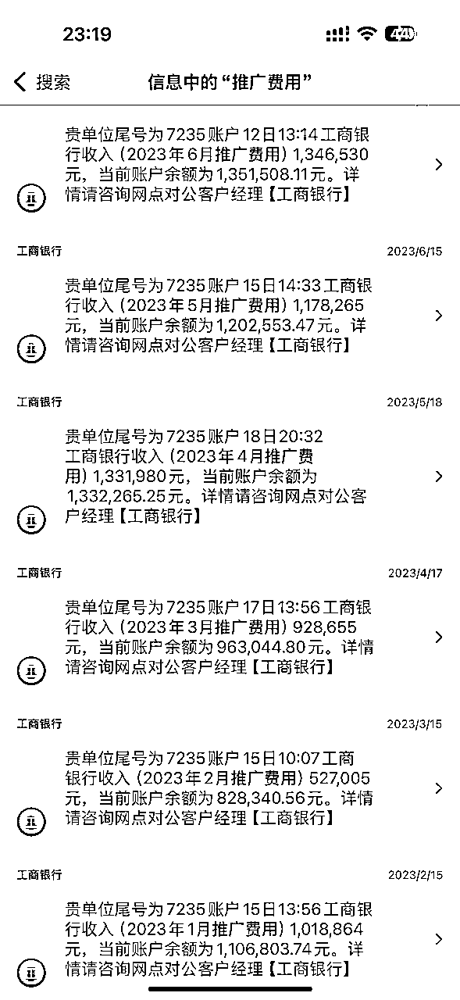
不过，这个项目有一个明显问题：用户几乎都是一次性消费。
领完福利之后，用户就离开了，平台很难再次触达他们。同行大多认为复购太麻烦，投入产出比不高，因此没有继续深挖。
但我当时思考的是：如果我能解决复购问题，是否就能形成别人没有的优势？
于是，我没有让用户直接进入平台，而是增加了一道流程：先关注我的公众号，再从公众号获取1分钱购买链接。
这样一来，用户就被沉淀到了我的私域里。后续，我通过公众号持续推送复购福利，甚至拿出部分首单佣金补贴复购用户，最终把复购率做到了5%—8%。
这让我的渠道能力与同行拉开了差距，也帮助我拿到了买药项目的独家代理权。后来，我运营的3个公众号累计沉淀了50多万粉丝。
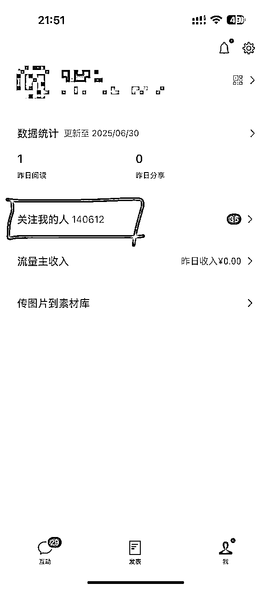
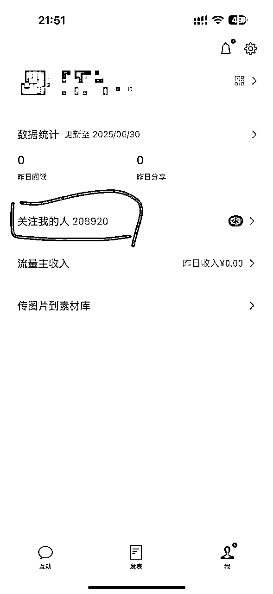
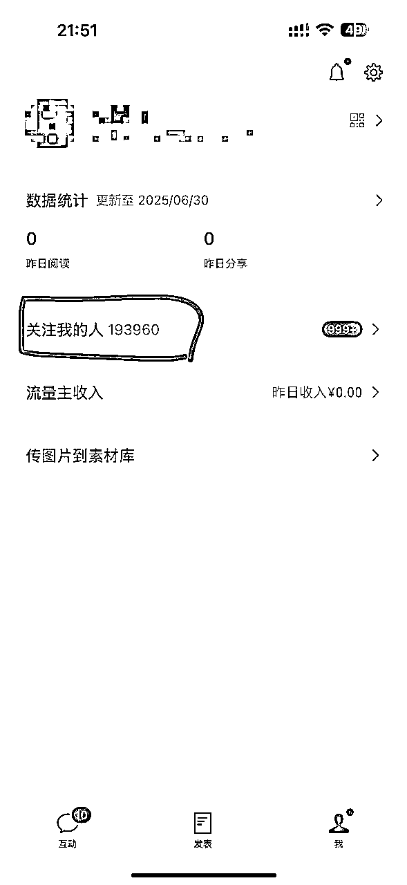
这段经历让我形成了两个重要判断：
1. **机会往往具有时间窗口。**
一旦红利期过去，后来者很难再用同样的方式复制。所以，真正看准机会时，就要集中资源快速进入。
2. **解决关键问题，才能形成壁垒。**
生意并不是简单地做流量，而是要解决别人解决不了的问题。对当时的我来说，提升复购率就是核心竞争力。
这些公众号粉丝，也成为我后来启动书法项目时的重要资源。
## 一、从5个账号开始的“手工作坊”
2023年9月，买药项目因业务调整暂停，我重新寻找新的方向。
直到2024年3月，我参加了中老年书法知识付费航海，发现这个赛道用户规模大、需求长期存在，而且商业路径也比较清晰：
> 视频号发布书法内容 → 引导用户进入私域 → 交付6天体验课 → 转化正价课程。
但刚开始时，我的运营方式完全依赖人工，几乎每一个环节都要亲自完成。
### 1. 视频制作：每天都在重复剪辑
为了寻找素材，我会在抖音搜索“书法教学”“零基础学书法”等关键词，重点寻找不露脸、以手部写字为主的视频。
找到素材后，再一个个复制链接、下载去水印，导入剪映进行加工。常见操作包括：
- 抠掉原视频背景，替换成新的图片；
- 去除原有背景音乐，只保留人声；
- 配上一段新的古风音乐；
- 对原声进行变声处理；
- 将视频调快或调慢；
- 添加贴纸、滤镜或画中画元素。
一条视频往往需要处理几十分钟。每天长时间坐在电脑前，脖子僵、眼睛酸，但一天最多也只能完成十几个视频。
### 2. 视频发布：账号越多，重复动作越多
除了自己的账号，我还把家人的账号利用起来，最终凑出了5个视频号。
每天，每个账号发布3条内容，意味着我需要重复15遍类似操作：
- 登录视频号后台；
- 上传视频；
- 填写标题；
- 添加相关话题；
- 选择封面；
- 设置发布时间。
这些动作看似简单，但账号一多，就变成了大量机械劳动。每天发布完内容，半天时间基本就过去了。
### 3. 引流和转化：一个人承担所有岗位
最初的引流主要靠主动私信。我会给点赞、评论的用户发消息，例如：
> 您好，如果想系统学习书法，可以添加我的微信，免费领取入门教程。
同时，还要持续查看评论和私信，避免错过潜在客户。
后端转化同样依赖人工。引流半个月后，我积累了一百多人，但真正进入社群的只有50多人，中途流失了一半。为了活跃群氛围，我还要自己充当“气氛组”，处理咨询、维护社群、完成销售。
那段时间，我既是剪辑师，又是运营、客服、销售和社群管理员。
每天忙得不可开交，但最终收入并不高。我逐渐意识到：如果始终依靠手工操作，一个人再努力，也只能经营一个小作坊，无法真正放大规模。
必须改变工作方式。
## 二、把重复劳动交给工具
我重新梳理了整个业务链路，把每个环节耗费的时间记录下来。
结果非常明显：大约80%的时间，都消耗在视频制作和账号管理上，而这两个部分恰好充满了大量重复操作。
所以，我给自己的破局方向定为：
> 找到高频重复动作，用工具替代人工；人只负责策略、创意和判断。
下面就是这套自动化流程的逐步搭建过程。
### 第一步：批量获取高质量素材
过去，我需要手动搜索和下载视频，效率非常低。于是我先从素材获取环节开始优化。
#### 1. 传统下载工具
早期，我使用过哼哼猫等工具。
它们可以批量下载，但缺点也比较明显：
- 筛选能力有限；
- 不能根据点赞量过滤内容；
- 文件命名混乱；
- 部分功能需要付费；
- 后续整理素材比较麻烦。
#### 2. 江湖工具箱
后来，我换成了【江湖工具箱】，整体效率提升很明显。
它支持：
- 批量抓取指定作者主页的视频；
- 根据关键词或话题批量提取内容；
- 按点赞量筛选作品；
- 自定义文件命名规则；
- 支持抖音、快手、小红书、B站、今日头条、TikTok、YouTube等平台。
我通常会设置“点赞量大于500”这一条件，先过滤掉大量低质量内容，再集中下载高表现素材。
命名规则也可以自定义，例如：
> 作者-点赞量-序号-视频标题
这样后续整理、查找和筛选都会方便很多。
【江湖工具箱】使用教程：
1. 下载地址：https://www.jianghudata.com/
2. 打开作品提取工具，选择对应平台；
3. 输入作者主页链接，点击开始添加主页；
4. 设置点赞量等筛选条件；
5. 点击开始下载。
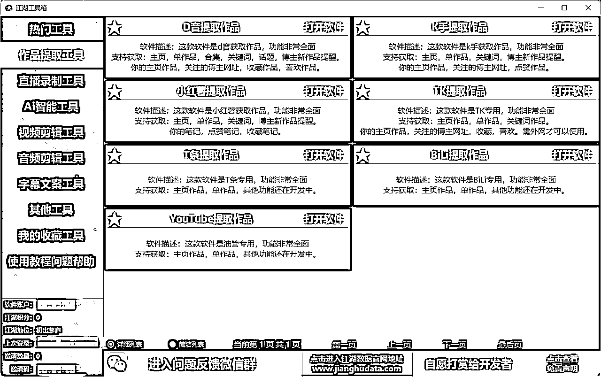
可根据需求设置下载的作品命名规则
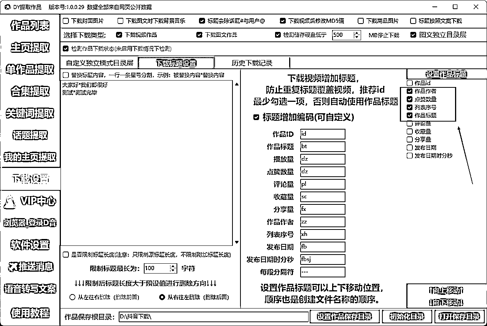
输入作者主页链接，点击开始添加主页，提取主页
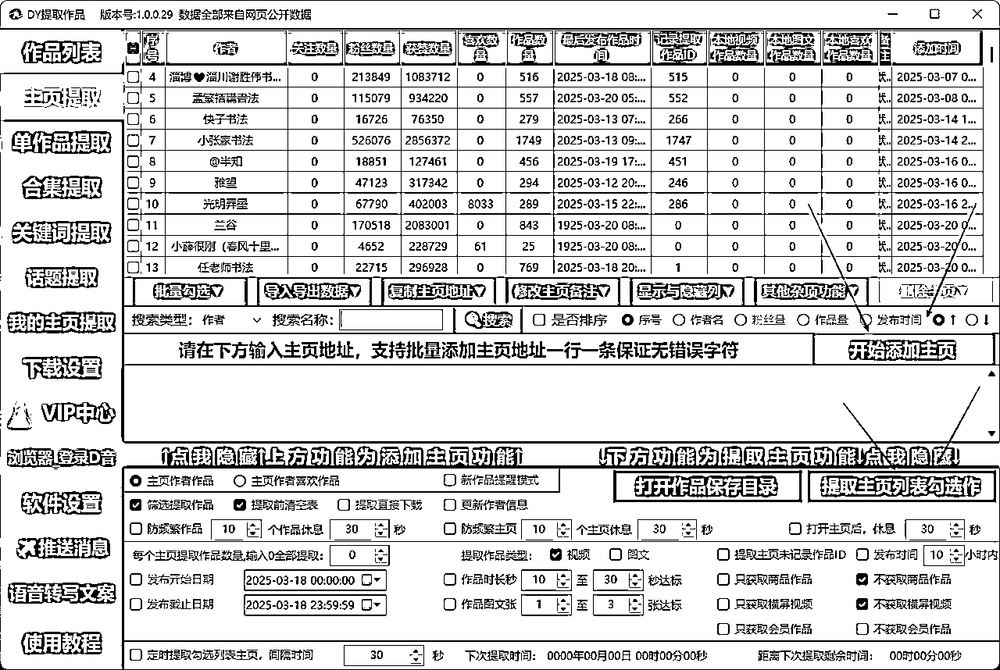
筛选点赞量大于500的作品，点击开始下载
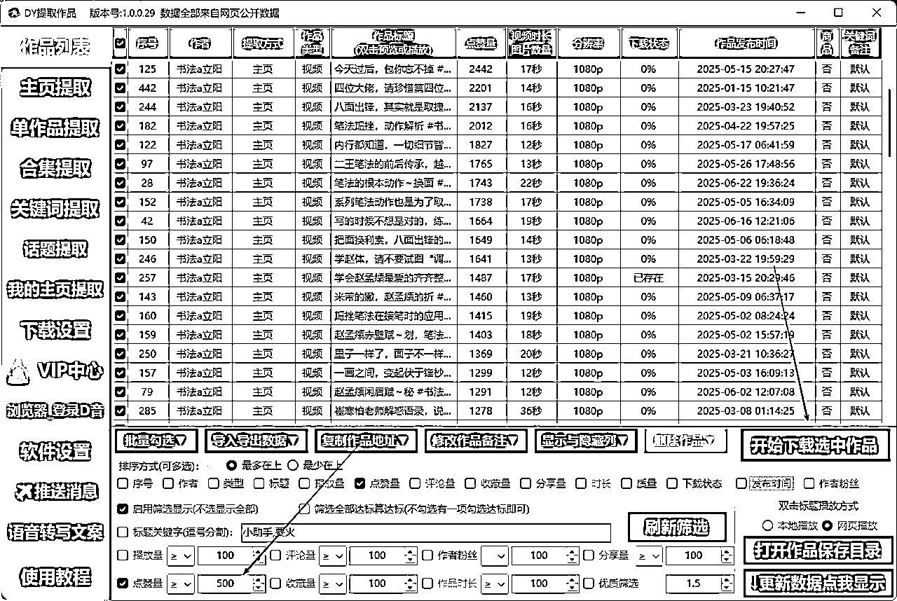
一次操作，就能积累几百个原始素材，彻底告别逐条下载。
### 第二步：批量完成剪辑和导出
素材准备好后，剪辑成为新的瓶颈。
我的思路是：人工只做一次模板，把背景、滤镜、音乐等内容设置好；之后由软件自动替换素材并批量导出。
#### 1. IO剪辑方法
我曾经学习过奇杰老师的“IO大法”。
具体思路是：把多个视频放进同一个剪映草稿中，通过快捷键I和O设置片段的起止位置，再快速完成切割。
这种方法确实能提高剪辑速度，但仍然存在一个问题：每个片段导出时，还需要手动点击确认。
也就是说，它解决了“剪辑速度”，却没有彻底解决“导出速度”。
#### 2. 剪映批量剪辑助手
后来，我使用了【剪映批量剪辑助手】。
它本质上是一款RPA工具，可以模拟人的操作，让电脑自动完成重复任务。
主要有两个功能：
**批量生成草稿**
我先在剪映中做好一个模板，例如设置背景、BGM、滤镜和轨道结构。之后把多个素材放入指定文件夹，软件就可以自动替换素材，并在几十秒内生成多个独立草稿。
**自动批量导出**
软件会按照顺序打开每一个草稿，点击导出，等待完成后继续处理下一个。
以前导出一条视频需要手动操作一分钟左右，现在只需要点击一次开始按钮，电脑就能自动处理上百条视频。
使用流程：
1. 先在剪映里制作好初始草稿；
2. 准备需要替换的素材；
3. 打开分区混剪替换功能；
4. 选择对应草稿和素材文件夹；
5. 设置音频、字幕等替换参数；
6. 批量生成多个视频草稿；
7. 使用自动化导出功能，一次性导出成品。
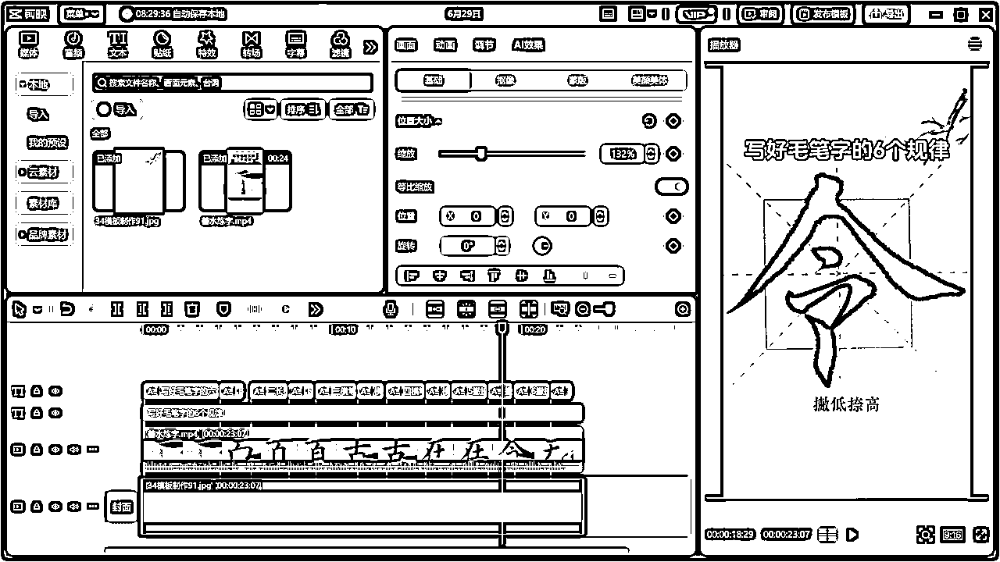
准备好要替换的素材
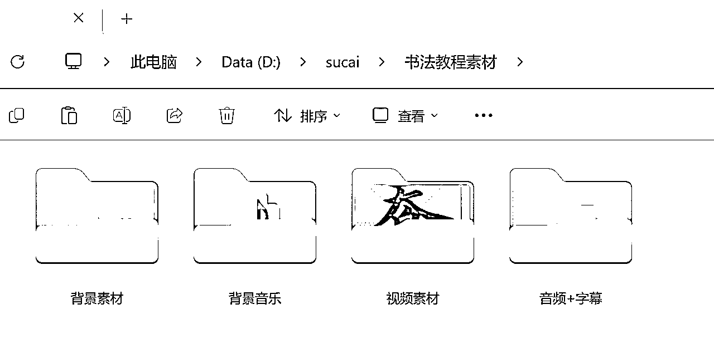
点击分区混剪替换，选择草稿选择替换内容
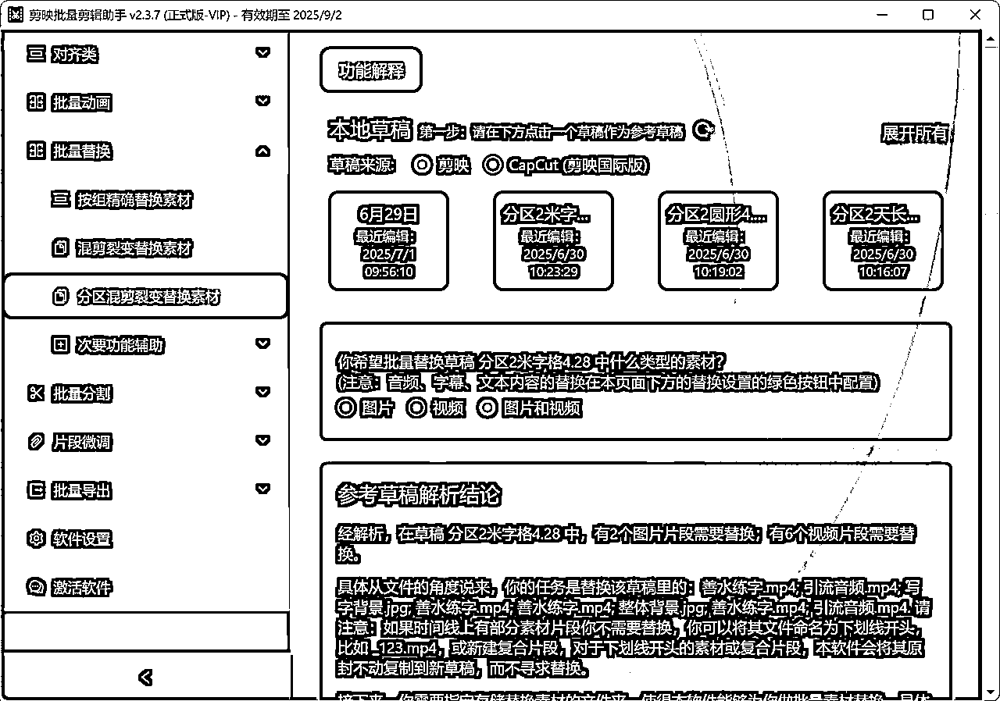
设置替换参数，选择替换素材文件夹
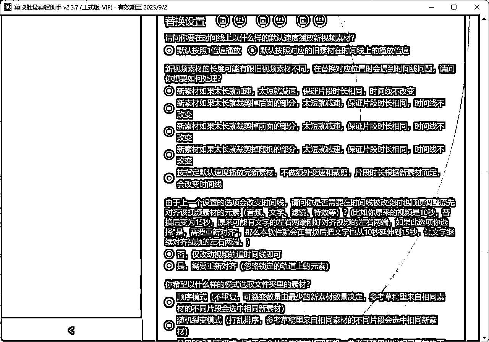
设置音频和字幕替换设置
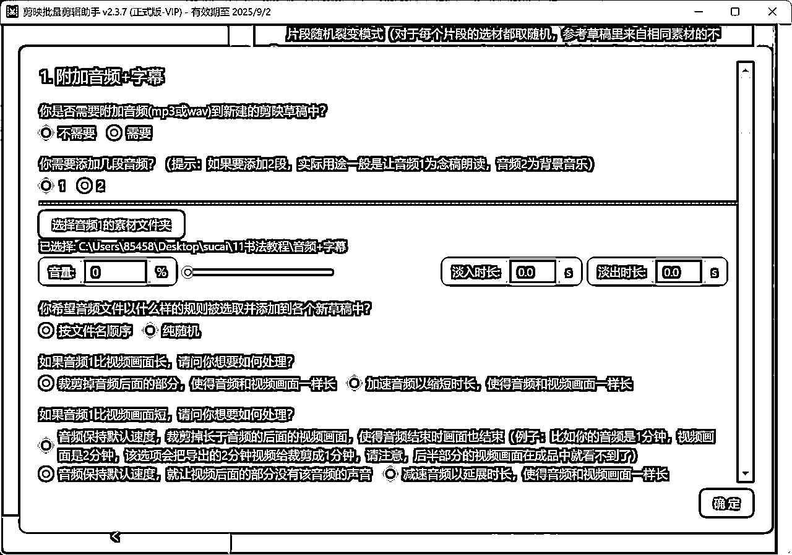
批量生成n个视频草稿
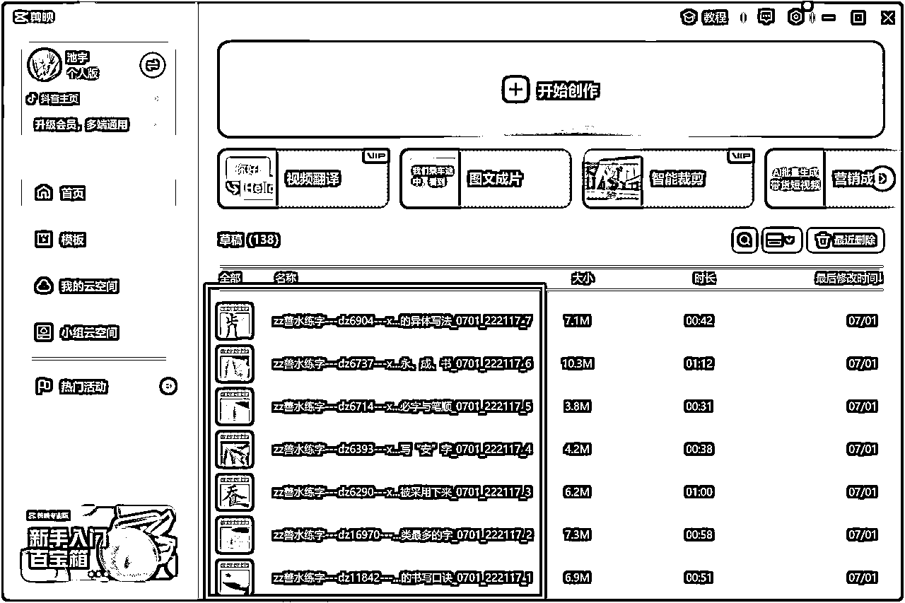
使用多个草稿自动化导出功能，批量导出剪映草稿
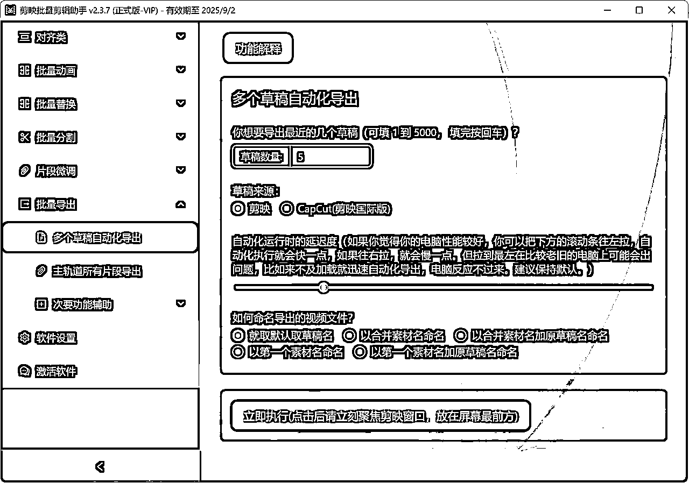
一次性导出多个成品视频：
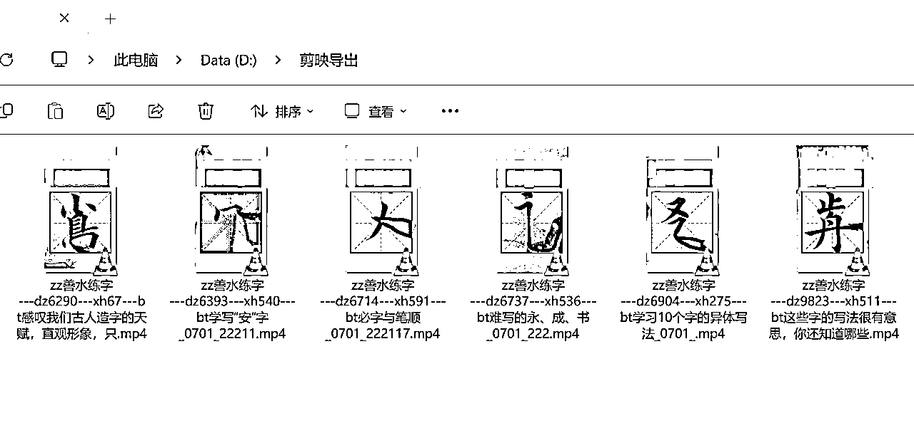
### 第三步：从简单混剪升级到AI内容流水线
工具解决了效率问题，但很快又出现了一个新挑战：内容太像。
如果所有视频使用相同的文案、配音和结构，发布数量一多，就容易被平台识别为重复内容，流量也会逐渐下降。
所以，我开始构建第二套内容生产系统，让每条视频的画面、文案和声音都尽可能不同。
#### 1. 先拆分画面素材
我会先用【江湖工具箱】获取大量写字视频。
如果一个长视频包含多个字的书写过程，就使用【剪映批量剪辑助手】的“智能镜头分割”功能，把长视频拆成许多个单字短片段。
这样做的好处是，可以把原始素材彻底打散，后续再进行随机组合，从而降低画面重复率。
操作方式：
1. 打开智能镜头分割功能；
2. 选择输入文件夹和输出文件夹；
3. 软件自动识别不同镜头；
4. 一键完成拆分。
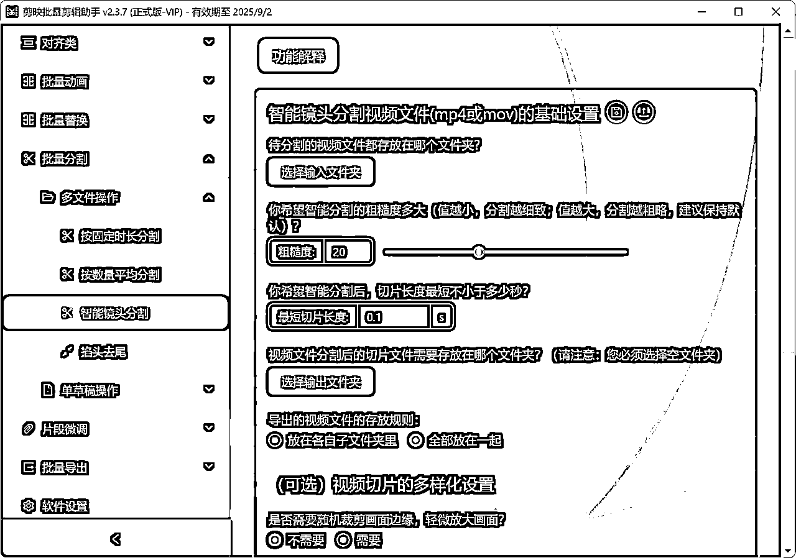
智能识别出77个片段并分割
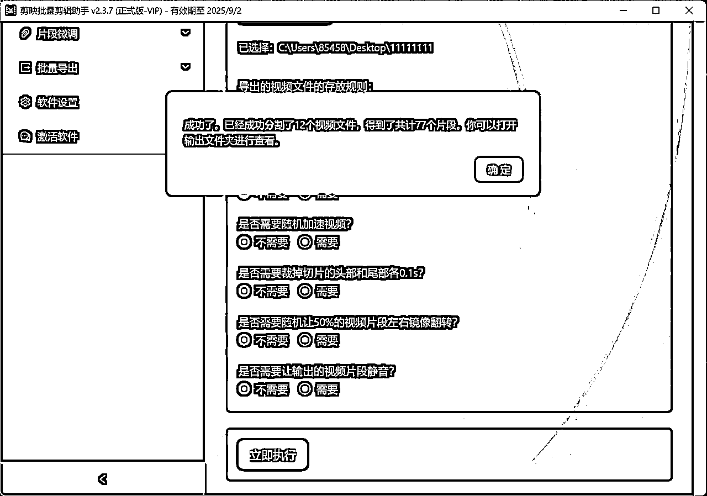
智能分割前12个视频：
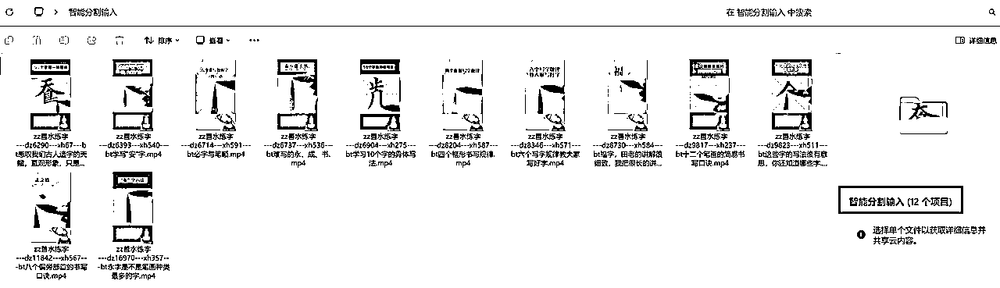
智能分割后77个视频：
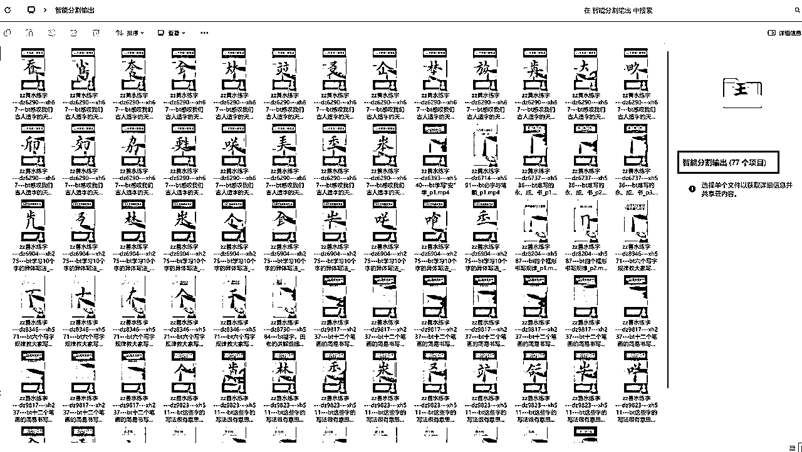
#### 2. 用飞书多维表批量生成文案
最初，我尝试让豆包或Kimi一次性生成几十、上百条书法文案。
但实际使用中，要么生成到后面质量下降，要么处理到一半就停止，稳定性并不理想。
后来，我采用了“飞书多维表+AI”的方式。
飞书多维表可以接入DeepSeek等大模型，并且支持多线程处理。我的做法是：
1. 设计一套稳定的Prompt；
2. 在表格中批量填写主题；
3. 让AI根据标题自动生成对应文案；
4. 统一保存和管理生成结果。
这样一来，只要准备好几百个主题，就可以持续批量生产文案。
使用地址：
https://olftqb2ldn.feishu.cn/drive/home/
这是飞书云文档首页，需要自行创建多维表格。
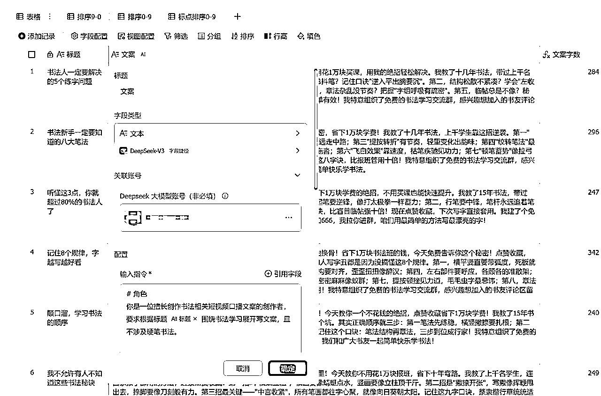
#### 3. 用海豚配音批量制作音频
文案生成后，还需要转成配音。
如果在剪映中逐条进行文本朗读，效率依旧很低。后来，我改用【海豚配音】。
它支持批量导入文案，并可以选择不同音色，统一生成音频文件。
操作流程：
1. 进入多人配音页面；
2. 批量导入文案；
3. 选择需要的音色；
4. 点击批量生成；
5. 生成完成后统一下载MP3文件。
网站地址：
https://www.ttson.cn/?source=8omH8q
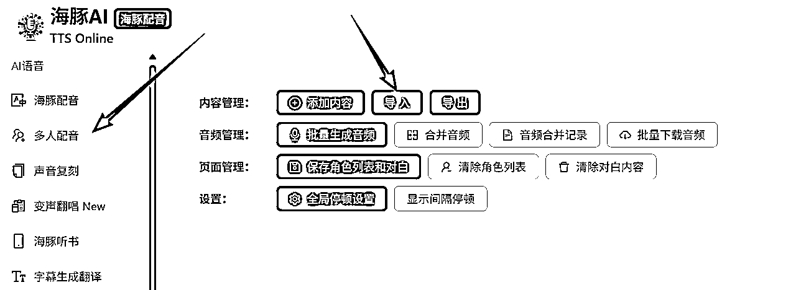
点击批量生成音频，音频生成后点击批量下载
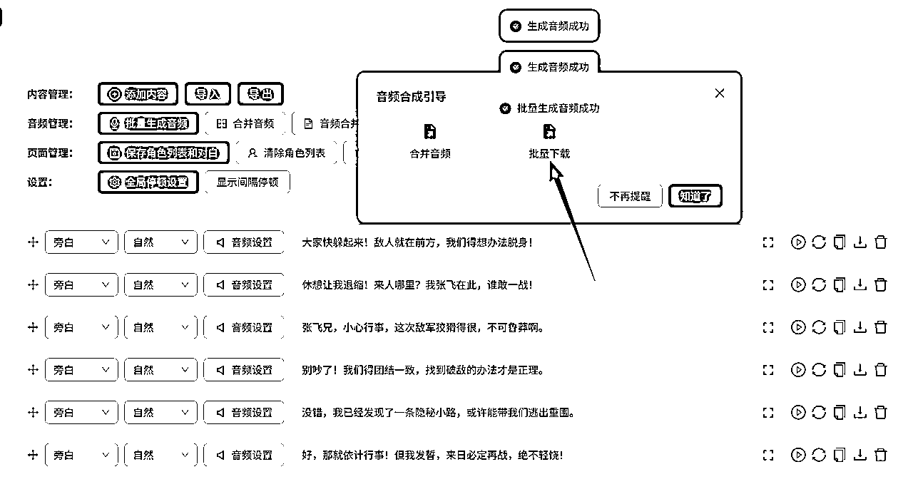
得到mp3文件
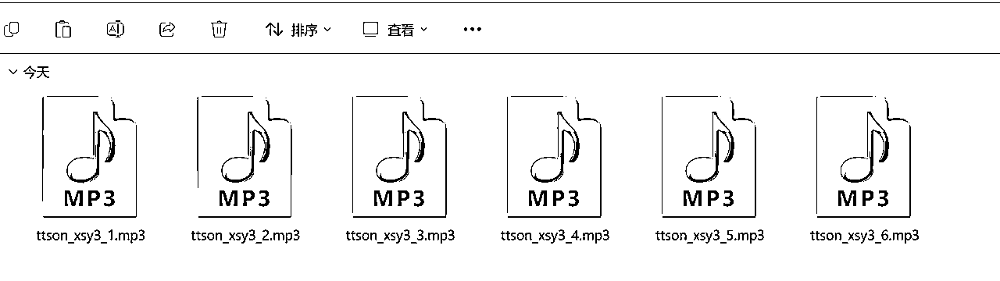
#### 4. 自动生成SRT字幕
有了配音，还需要对应的字幕文件。
我曾经试过“阿林字幕”等工具，但生成的字幕格式不够稳定，经常需要手动调整。
后来，我借助豆包的AI编程功能，自己制作了一个简单的网页工具，将TXT文本转换成指定格式的SRT字幕，并自动按照规则命名。
使用地址：
https://yin666888.github.io/srt2/
操作步骤：
1. 从飞书多维表复制标题和文案；
2. 粘贴到工具输入框；
3. 点击处理文本；
4. 下载生成的SRT文件。
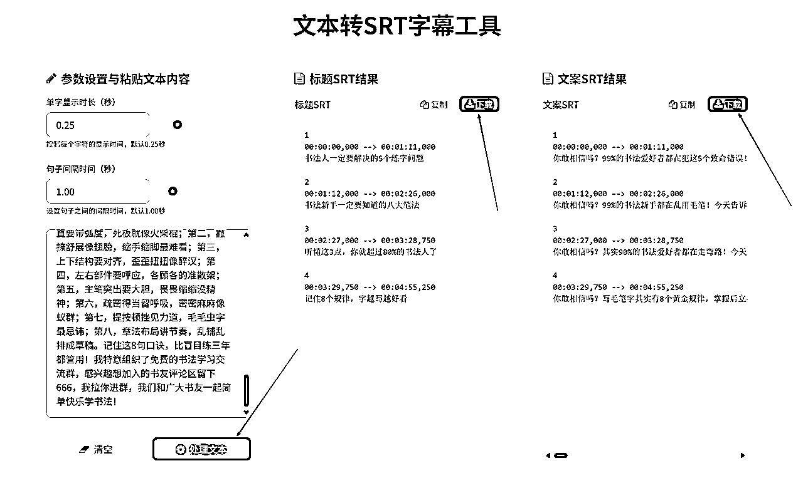
得到标题srt字幕与文案srt字幕
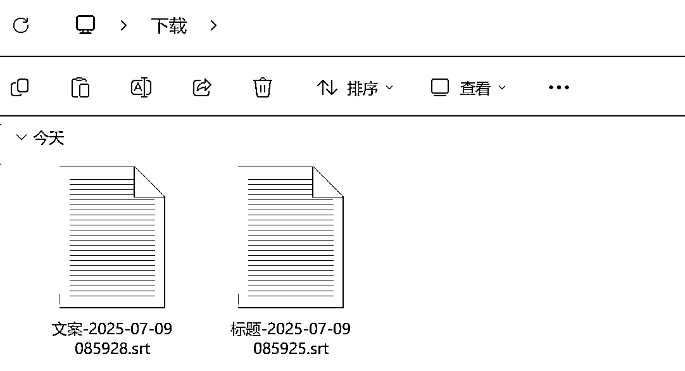
#### 5. 自动组合并合成视频
完成以上步骤后，我手里就有了三类素材库：
- **画面库**：拆分后的写字短视频；
- **音频库**：AI文案生成的配音；
- **字幕库**：与配音对应的SRT文件。
接下来，只需要在剪映模板中提前设置好轨道：
- 视频轨道：放入多个写字片段，并设置静音、抠像；
- 音频轨道：放入配音文件；
- 字幕轨道：导入SRT字幕。
再利用【剪映批量剪辑助手】，让软件从三个素材库中随机抽取内容并自动匹配，批量生成完整视频。
这样，一条自动化内容生产线就搭建完成了。
以后，我只需要定期补充画面、音频和字幕素材库，理论上就可以持续生成大量画面、文案和声音均不相同的视频，解决内容同质化问题。
## 三、账号规模化：从5个号扩展到100个号
内容生产效率提升后，新的问题出现了：5个账号已经无法承载这么多内容。
下一步，就是扩大账号数量。
### 1. 素人代发：管理成本太高
我最初尝试招募兼职人员，让他们使用自己的视频号发布内容并回复私信。
计费方式是按照私信量结算，每条私信支付1毛钱。
但实际执行起来，管理非常繁琐：
- 需要每天与大量兼职沟通；
- 要求对方录屏证明私信数量；
- 反复提醒他们及时回复；
- 兼职人员在线时间不稳定；
- 用户咨询无法得到及时响应。
最终，我发现这种方式虽然看起来省事，但管理成本很高，而且难以标准化。
### 2. 租号模式：让闲置账号产生收益
后来，我想到了此前积累的公众号粉丝资源。
我在公众号发布了一篇推文，主题大致是：
> 视频号闲着也是闲着，不如授权给我，每天赚一点零花钱。
合作方式很简单：
1. 账号持有人扫码一次，将视频号授权到我的矩阵管理系统；
2. 只要对方不主动退出微信或切换账号，授权通常不会掉线；
3. 对方不需要参与日常运营；
4. 我每天通过支付宝支付1元租金。
借助支付宝批量付款功能，我可以定时向上百位账号持有人统一打款。
很快，我就完成了100个视频号的账号储备。
部分佣金结算截图：
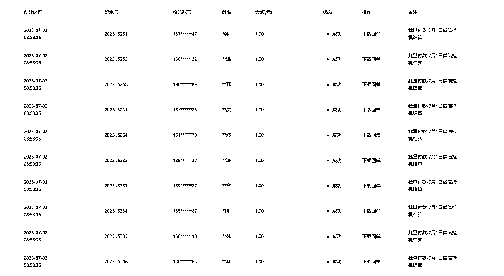
### 3. 矩阵管理系统：解决账号运营问题
账号数量上来之后，还需要一套稳定的管理系统。
市面上很多矩阵工具是基于视频号网页版开发的，往往存在以下问题：
- 登录不稳定；
- 需要频繁重新扫码；
- 容易出现掉线；
- 可调用的权限有限。
后来，一位航海同学向我推荐了【快视】。
这是我目前使用过的功能比较完整的视频号矩阵系统之一。
它的核心登录方式并不是普通网页版，而是让微信扫码登录到虚拟iPad设备中。
这样做的好处是，只要租户的微信保持在线，后台通常就不会频繁掉线，而且能够获得接近真实设备的操作权限。
借助内容自动化系统、账号租赁模式和矩阵管理工具，我才真正实现了从单账号运营到百号矩阵的升级。
真正的规模化，不是让一个人不断加班，而是把业务拆成标准流程，再用工具将重复动作自动执行。
做视频号矩阵快一年了，我越来越坚信一件事：获客这件事完全可以交给系统去跑。
身边很多人好奇一个人怎么盘活上百个号，答案其实很简单：把闭环搭成自动化。每天花上半小时把素材集中导入，系统能按文件名自动生成标题和介绍，也可以手动微调、预约发布时间、加上区域定位。其余环节全部交给工具去闭环。
真正撑起整个体系的，是引流的自动化。
我现在用的工具是【快视】。设定好关键词后，评论区会自动回复并把我的引流话术置顶；私信进来会即时推送我的微信号；对于关注、点赞、评论过的用户，系统也会主动推送一条私信。这相当于请了一个不打烊的客服，把微信号的曝光拉到最大，也彻底解决了人工回复慢半拍的问题。
【快视】使用教程：
1. 网站地址： https://video.timexxs.com/#/?referralCode=918857505
1. 使用教程：批量发布视频
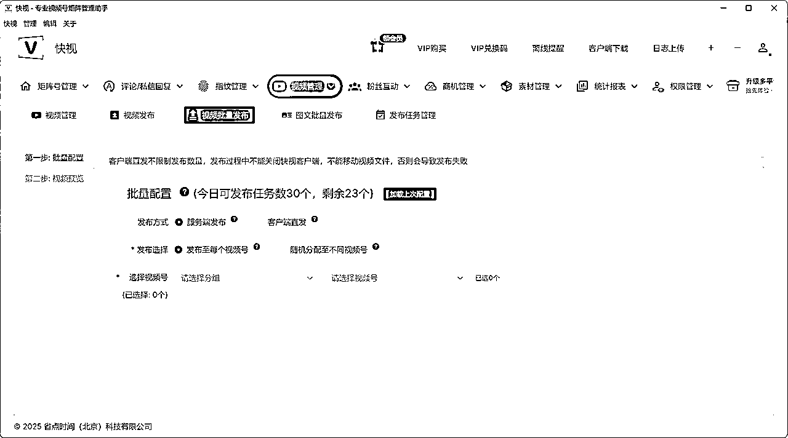
设置私信自动回复
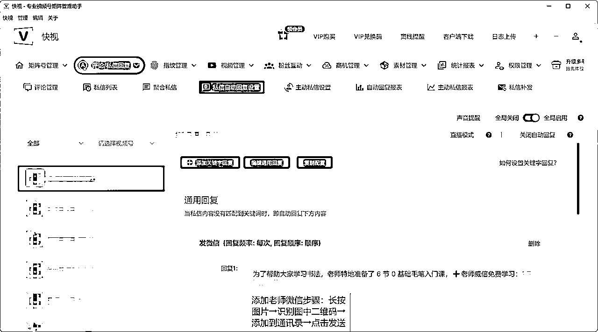
设置主动私信
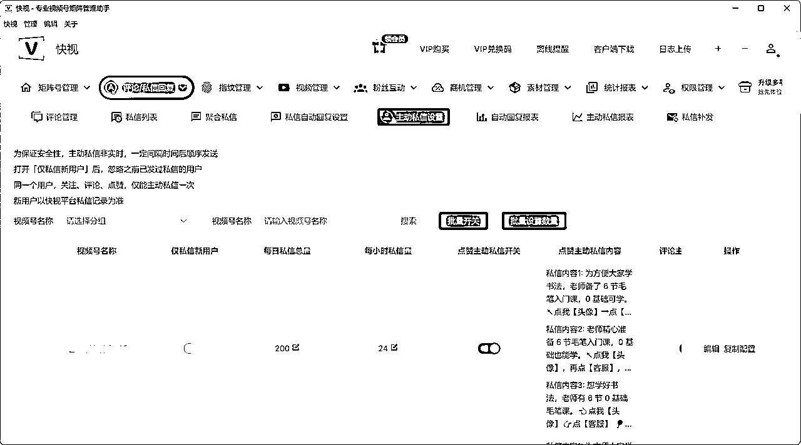
还有很多功能就不一一列举了
靠“内容自动化生产 + 账号矩阵 + 引流自动化”的组合，流量很快稳定下来。做出了好几个破万粉的账号，目前每天能稳定带来100到200人的引流。
部分账号粉丝量截图：
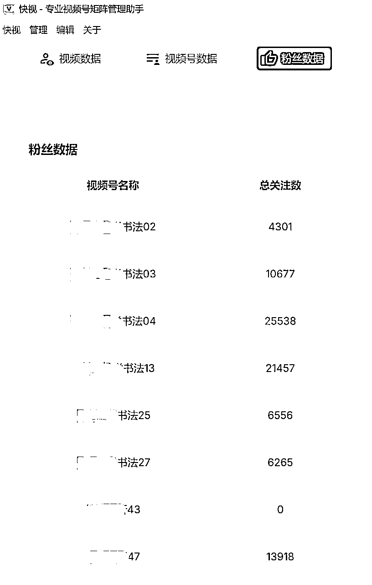
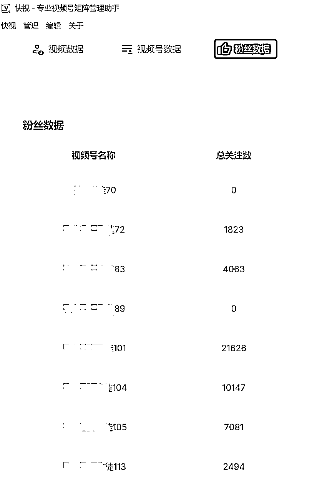
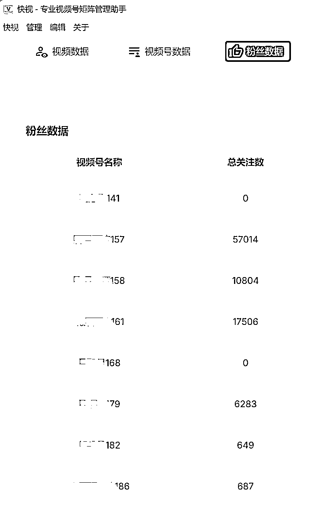
## 后端转化：从亲自卖课到做流量供给
前端打通后，后端的问题就暴露了。
我本质上不擅长做后端运营，被拉群、暖场、答疑、售后这些琐事耗尽精力。我更像是个流量玩家，强项在前端获取，后端的运营对我来说成本太高。
后来一个同行通过视频号加我，聊了两句说：“你这流量很猛，自己扛转化太累了，有没有兴趣直接卖给我们？我们是专业的书法教育机构，有成熟的转化和交付团队，首单按CPS给你70%分成。”
这句话点醒了我。
没必要硬啃不擅长的板块，应该把低成本规模化获取精准流量的能力做到极致，后端转化交给专业的人去做。
于是我把定位调整为流量供货方。
我对接了多家书法机构，比较转化率、客单价和合作方式，也踩了不少坑：
*   坑1：获客链路过于冗长。 有些机构给的企微链接需要点击→授权→跳小程序→再扫码，流程繁琐。受众以中老年为主，每多一步流失就很明显，还会引发一堆“老师这个怎么点”“为什么要授权”的提问，极度消耗精力。
*   坑2：中间商截留。 一定要直接和甲方机构合作。中间商会存在扣量的情况，我曾被一个中介扣了30%，后来直接找到甲方才查清。最终我选了一家链路最短、点一下直达企微添加页、数据透明、结算迅速的机构深度合作，我只需专注流量。部分转化数据：
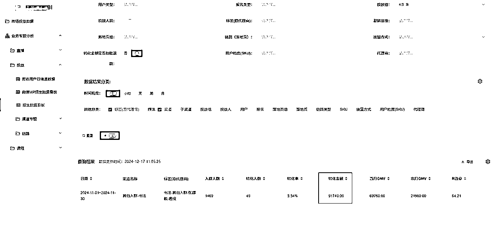
## 承接方式的进化：从个人微信+RPA到微信小店客服
转型初期我的承接是：
*   迭代1.0：个人微信 + 影刀RPA
*   我在闲鱼买了一台可多开的摩托罗拉手机，一部设备同时登录6个微信号，分散封号风险。
*   好友请求手动通过太慢，我用【影刀】写脚本，自动完成“通过申请→推送机构企微链接→次日提醒添加”，并把数据自动汇总到飞书多维表。
【影刀RPA】使用教程：
1.  下载地址： https://www.yingdao.com/client-download/
1.  官方学习地址：https://college.yingdao.com/lesson
1.  使用教程：用数据线连接手机，具体配置可以看官方教程：https://college.yingdao.com/course/courseDetail
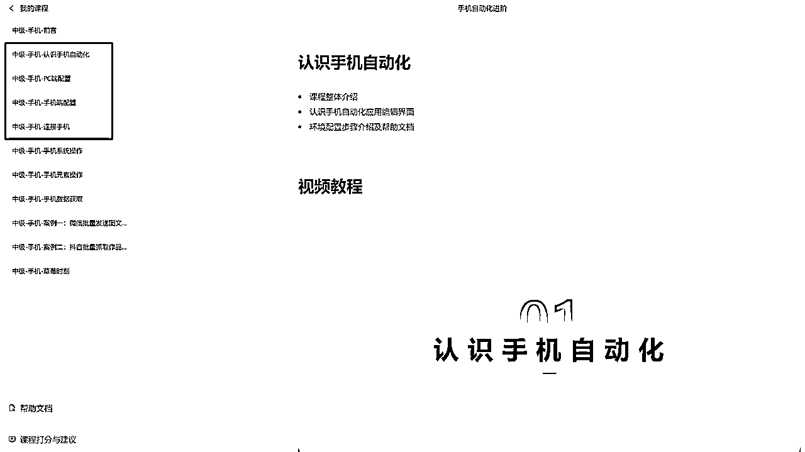
学习影刀控制手机的一系列操作
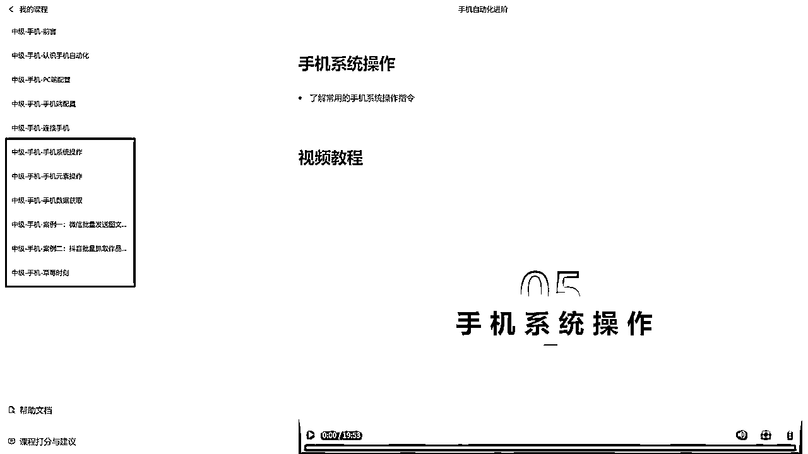
梳理工作流：循环打开手机上的6个微信->检查是否有新增好友申请请求->点击通过好友->设置昵称备注->设置标签->点击发送消息->发送机构的获客连接->统计用户信息到飞书多维表
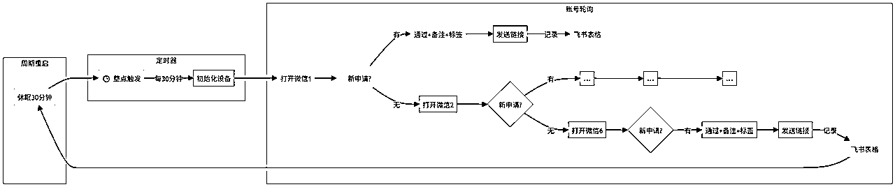
以下是影刀部分代码：
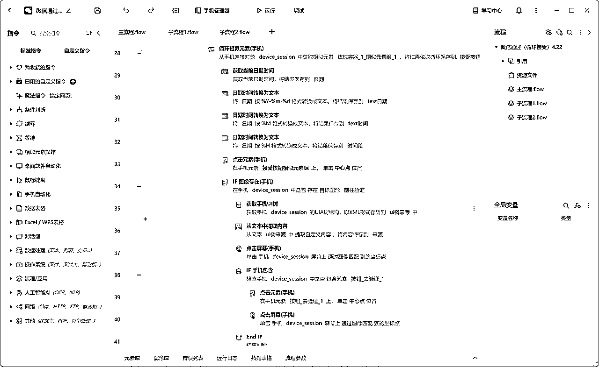
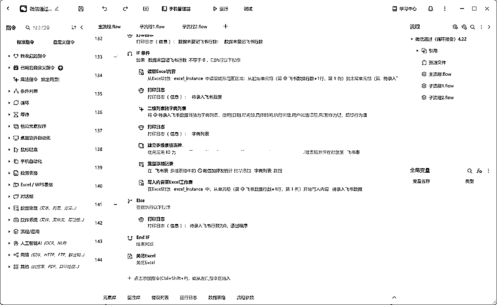
在触发器设置定时触发，每半小时触发一次，24小时运行
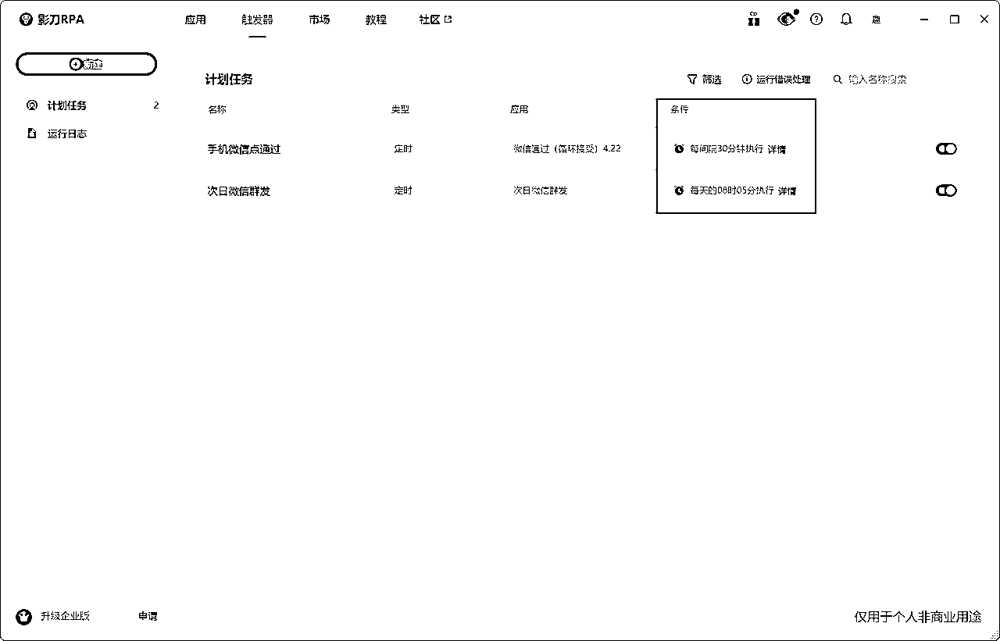
影刀自动统计用户信息到飞书多维表
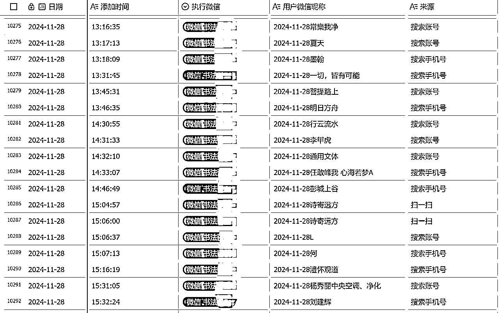
飞书多维表仪表盘数据看板
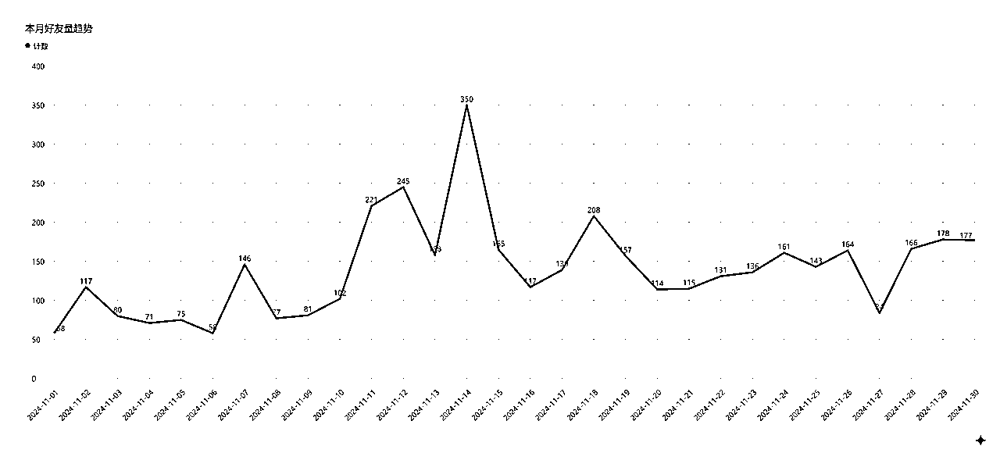
*   痛点： 即使上了RPA，模式仍有两大问题。第一，个人微信承接再转给机构，多了一层，实测流失约30%。第二，这些加到我个人号的用户，我尝试推毛笔字画，因缺乏信任转化极低，成了死域。我研究同行，发现头部玩家把视频号主页的“私信”改成了“客服”按钮，用户一点就收到推送，里面就是企微获客链接，直接跳到添加页。
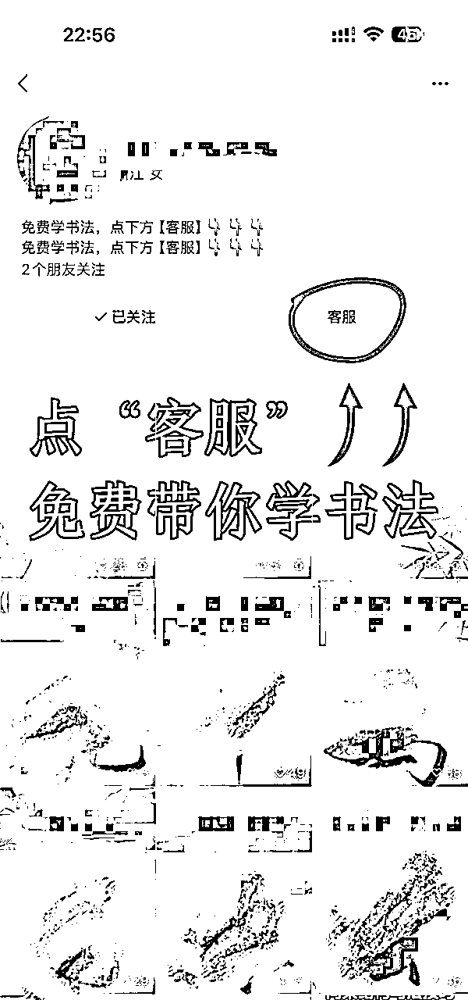
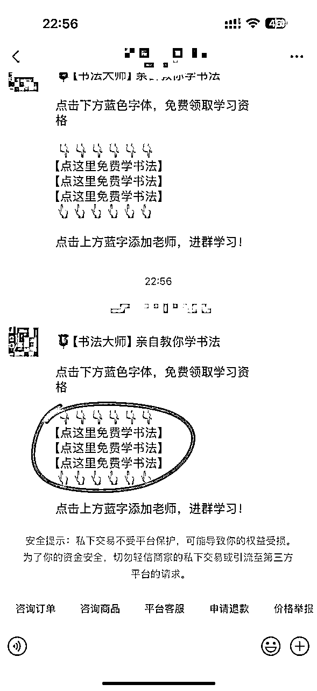
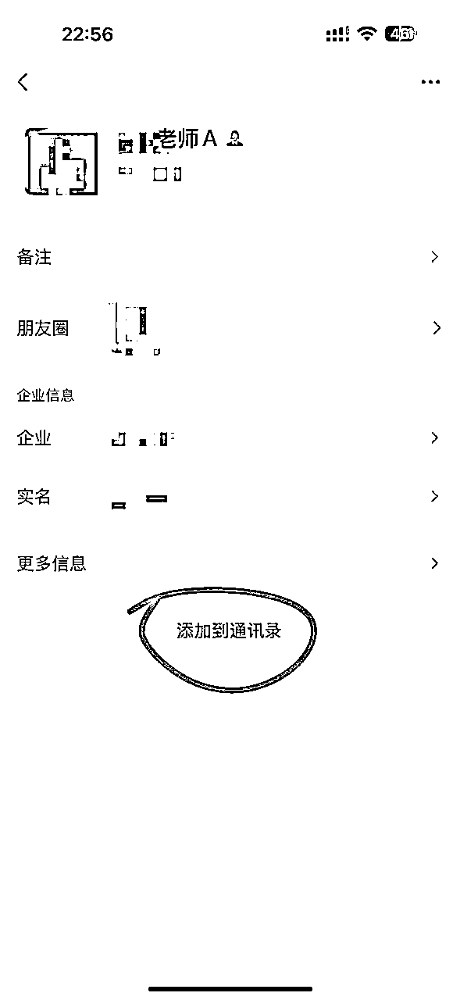
这个思路让我兴奋。我在闲鱼买了教程弄懂原理：开通微信小店并绑定视频号，就能把私信入口升级为客服，并设定关键词自动回复。
*   迭代2.0（终极形态）：微信小店客服
*   流程： 我在自动回复里设定，用户点击客服后直接推送机构企微获客链接。
*   效果： 流程非常丝滑。用户从主页到添加企微只需两次点击，中间无干扰，转化率直接翻倍。
*   账号问题解决： 一个执照可开30个微信小店，一个小店可绑5个视频号，共150个号位足够。我自己的执照因历史违规无法开通，就在租号群找有执照的租户，花5元让他们注册小店并把我设为管理员，我即可登录操作、绑定号、设置欢迎语。
【微信小店】设置教程：
1.  网站地址： https://store.weixin.qq.com/
1.  使用教程：注册微信小店后，找到关联账号，关联视频号后视频号首页的私信按钮就变成了客服入口
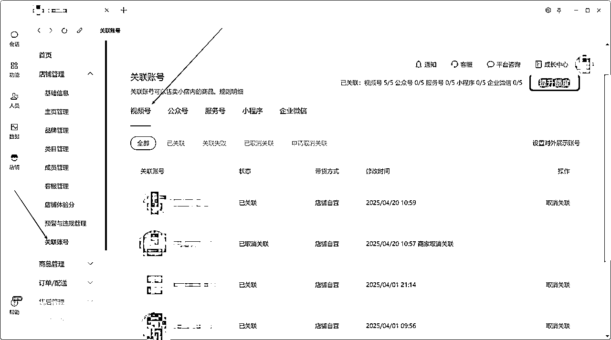
设置欢迎语为企微获客链接
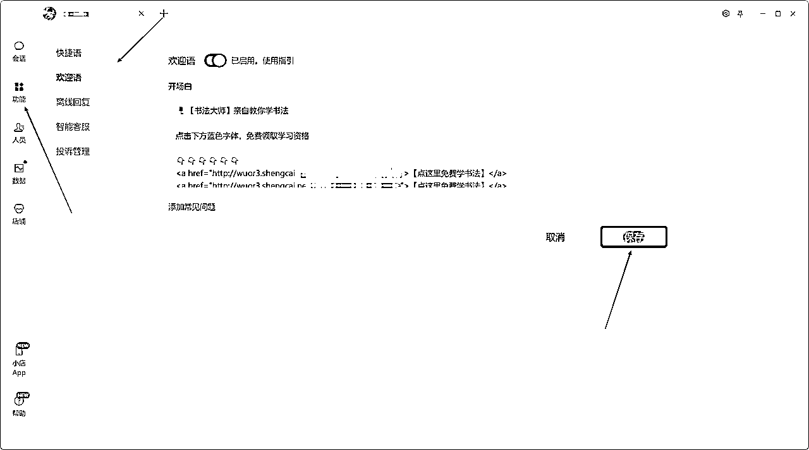
至此，自动化引流与交付的SOP闭环完整跑通。
前端： AI流水线生产内容 -> 快视系统批量发布
中端： 快视系统自动引流 -> 微信小店客服自动承接
后端： 流量直达甲方企微 -> 我看数收钱
现在整套成熟的SOP已交给线上助理执行，我每天花少量时间把控内容方向和拓展甲方资源即可。
## 算笔账：自动化到底赚不赚
聊流程最终要看利润。这套系统盈利情况如何？我算一笔清楚的账：
*   月度成本：
*   租号成本： 100个号 * 1元/天 * 30天 = 3000元
*   人力成本： 线上助理薪资 = 3000元
*   软件费用： 各类工具会员费约 = 1000元
*   总计成本： 3000 + 3000 + 1000 = 7000元/月
*   月度营业额：
*   课程客单价： 合作机构课程有2580元、1880元、880元等档位，综合均价约1700元。
*   月成交量： 每月稳定在50 - 100单。
*   分成收入： 按70%分成，我的月营业额在 59,500元 到 119,000元之间。
*   月度纯利润：
*   营业额 - 总成本 = 纯利润
*   因此，我目前的月纯利润稳定在 5万 - 10万元 左右。
这套系统让我摆脱重复执行，实现半自动盈利。
## 复盘与感悟
回头看，我做对了两件事：
1.  果断放掉不擅长的环节，聚焦核心优势。 我清楚自己不是优秀的销售，而是一个合格的流量工程师。把后端转化外包，把精力全部放进自动化获客，效率和收益都质变。这其实是找到自己在价值链上的位置。
2.  始终保持懒人思维，善用工具。 只要一件事情重复且累，我就想办法用工具替代。从江湖工具箱、剪映助手，到飞书、快视、影刀，再到微信小店，正是这些工具的组合，让我一人撬动百号矩阵。人效提升的本质是用工具对抗人力消耗。
## 你可能关心的问题
### 什么人适合做？有哪些坑？
1.  适合人群
懂流程、有矩阵思维、喜欢折腾工具的人。项目核心不是单点创意，而是搭建稳定高效的自动化流水线，享受优化流程和工具组合。
能专注且懂得取舍的人。清楚能力边界，我把擅长的流量做到极致，不擅长的转化果断外包。贪多求全容易两头空。
会盘活存量资源的人。复盘手上有什么牌，我能快速起量，离不开此前电商平台买药项目积累的50万公众号粉丝，他们是我第一批租号主。
2.  必须避开的坑
最大的坑是想通吃。很多玩家失败源于自己引流、自己卖课、自己交付。后端转化运营重，容易拖垮前端，也让流量优化没资源。
效率坑：沉迷手动操作。满足于每天剪十几个视频、手动回私信，天花板很低。一定要拥抱自动化，用系统放大能力。
内容坑：模板用到底。即便自动化，也要持续测试迭代，否则很快被平台判定为低质搬运被限流。
合作坑：被中间商赚差价。尽量直接对接甲方机构，警惕链路长、数据不透明、用Excel对账的中间商，很可能克扣量。
### 为什么能坚持下来
刚开始手搓视频的一个多月，我也差点放弃，太累且看不到希望。
坚持下来的关键是自动化。
把内容生产到交付全部用工具和SOP串联后，项目不再是苦差事，而是一台自运转的机器。我每天只需看数据、补素材。事情变轻松，正反馈很快，自然容易坚持。
很多项目能不能做成，关键看你有没有能力把它改造成适合自己的可持续模式。
分享就到这里，项目仍在迭代中，欢迎和志同道合的圈友交流，一起探索更多可能。