# 一个框架，两次进阶，三个原则，关于与 AI 沟通协作的一切

《和GPT聊天的正确姿势：一段关于“人机协作”的深度复盘》

你有没有类似的经验：想让AI给你答案，张嘴就是“这个怎么做？那个怎么解决？”如果它给的东西不合心意，就开始怀疑它的智商。

其实问题往往出在提问者身上。AI不是搜索引擎，而是一个有推理能力的协作对象。它真正擅长的不是找答案，而是解决问题。只要你会“问”，它就能从上下文里捕捉你的真实意图，给出个性化建议。

这篇文章的写作基础，是我过去一年半里和各类大模型打交道的经验。下面按四个板块展开：底层原理、三条心法、一个思维工具。

## 一、它到底怎么运转？

先谈原理。

你把一句话发给模型，它会把句子切成小块，再转换成向量，然后经过注意力计算，把握上下文关联，最后按概率预测接下来的内容，反复循环，组装成回复。

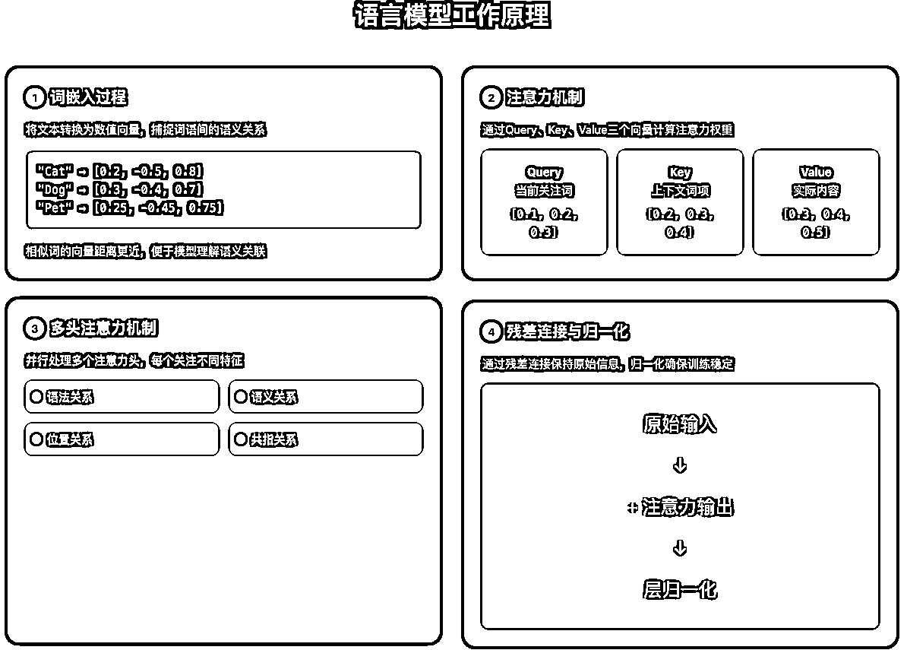

具体流程包括：文本输入、分词、向量化、注意力计算、上下文理解、概率预测、生成输出。

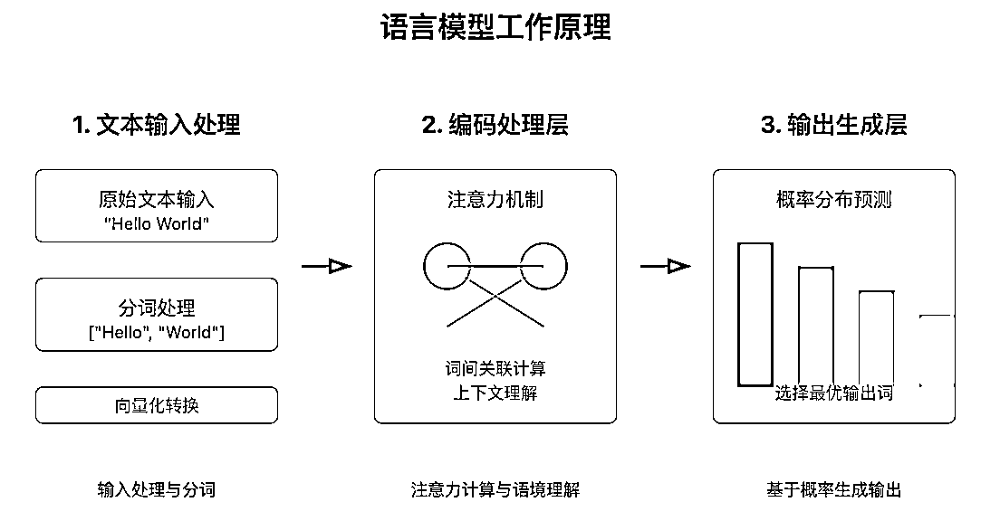

比如输入“Queen”，模型内部如何运作？它不会像词典一样精确查找，而是把单词映射到高维空间，结合上下文信息动态调整表示。整个过程涉及多个编码层和注意力头。

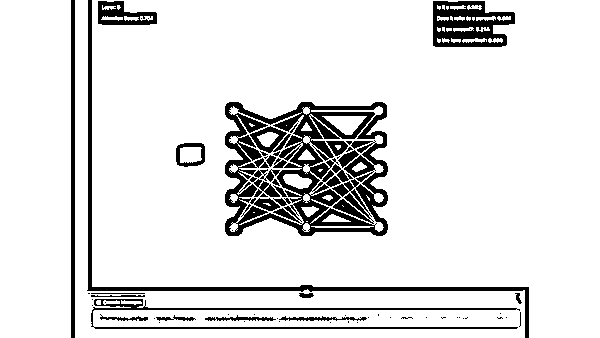

从输入到输出的链路大致如下：先做预处理，再计算语义关系，最终生成候选词序列。

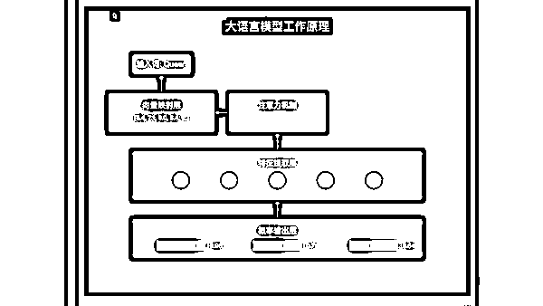

还是觉得抽象？我用大白话翻译：大模型回你消息，本质上是顺着你的话头“接茬”。它有输入端和输出端，就像操作面板一样。

我试过两次输入同样的“窈窕淑女”，得到的结果并不相同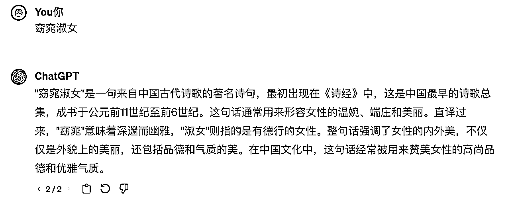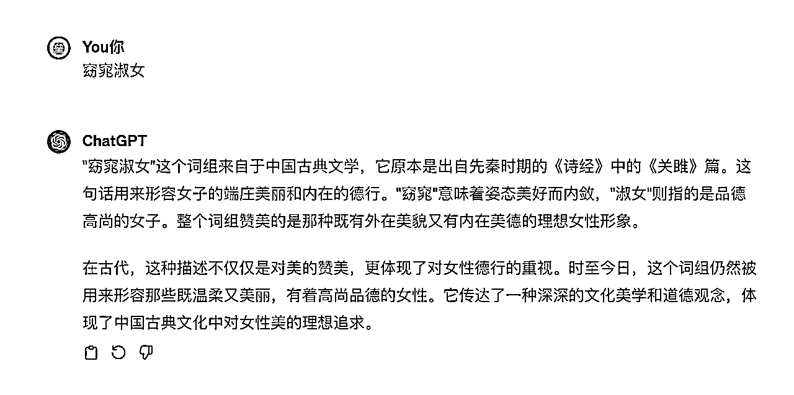。为什么？因为模型的生成带有随机性，也受上下文影响。这就好比同一句话，你分别讲给性格迥异的两个人，他们给出的反应一定不同。

明白这一点，你就懂了：想得到稳定的高质量答案，得学会把模型当成一个活生生的对话者，而不是一个无脑工具。

## 二、三条协作心法

OpenAI官方曾经给过六条提示工程建议：指令明确、提供参考资料、任务拆分、给模型思考时间、使用外部工具、系统性评估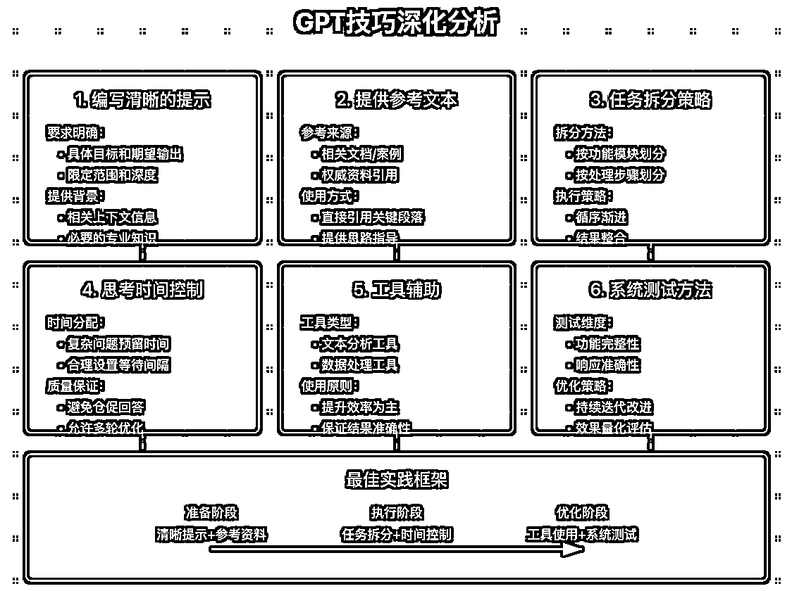。听起来很多，其实可以浓缩成三条：

**心法一：对话，不是传话。**

什么是对话？有来有回，有反馈，有调整。而传话只是单向交代任务。把“表达”和“对话”放在一起看：表达像独白，台上的人只管说，台下的人只能听；对话像对谈，双方轮流发言，互相确认信息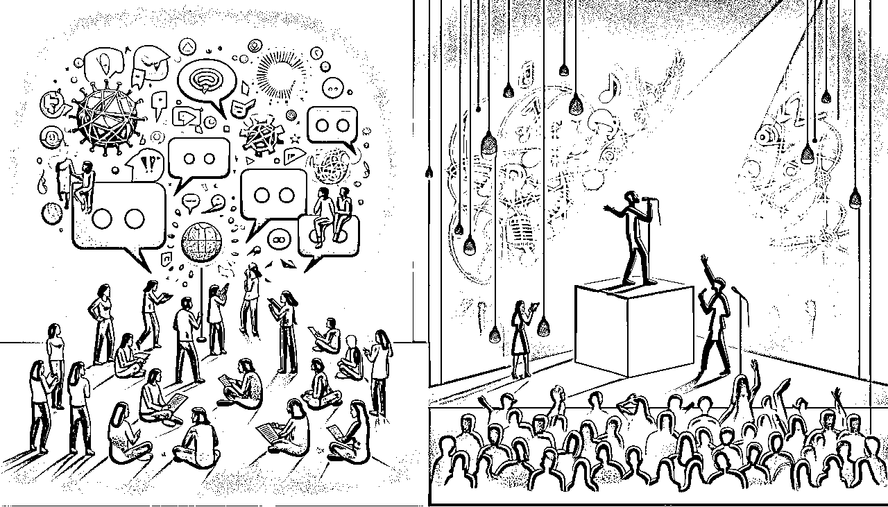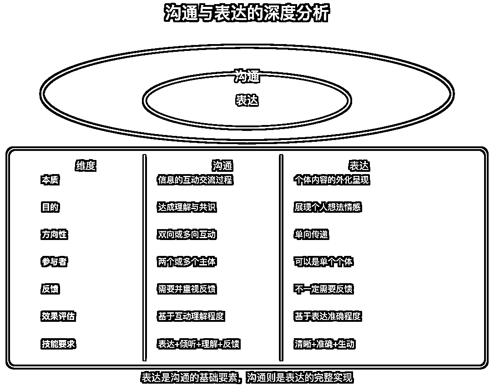。

沟通的完整链路是：发送者产生内容，通过语言或文字传递，接收者理解后给出回馈，这个回馈再回到发送者那里。这就像一个闭环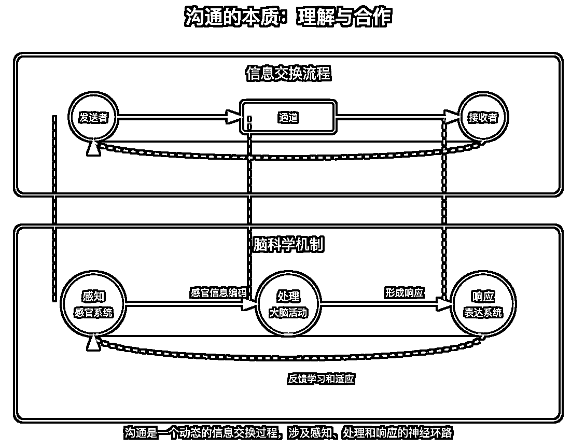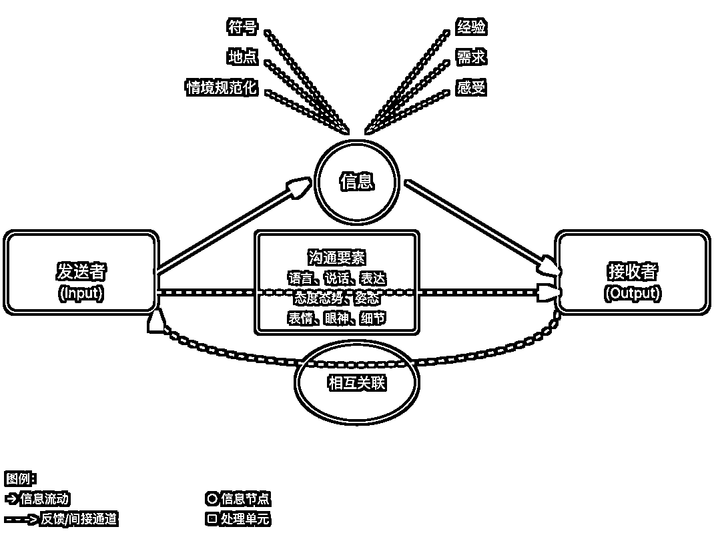。实际上，它和AI的输入—处理—输出—反馈机制非常像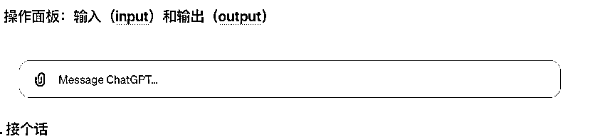。

阻碍沟通顺畅的常见毛病：描述含混、带着情绪、只关注自己、缺乏换位思考、拒绝反馈。如果你对照自己使用AI的方式，很可能全都中招。

**心法二：把模型当作可调教的协作者。**

一旦切换心态，你会发现可以做的事很多：教它规则、鼓励它尝试、安抚它的“焦虑”、适当激将、塑造它的风格、容忍它的慢。

网上流传的“话术”其实也有效。比如在问题的结尾加上：“这件事对我的职业生涯非常重要，请仔细分析”“你确定这是你最后的答案吗？再检查一遍”“别着急，深呼吸，一步步推导”“做对了有奖励”等等。甚至要求它“回答后附一个0-1的置信分数”，也能促使它更严谨。

我做过一个对比实验：同样问“请列举几种沟通技巧”，一个直接问，另一个在前面加上“这对我很重要，请一步一步思考”。后者的答案明显更具体、更有条理。

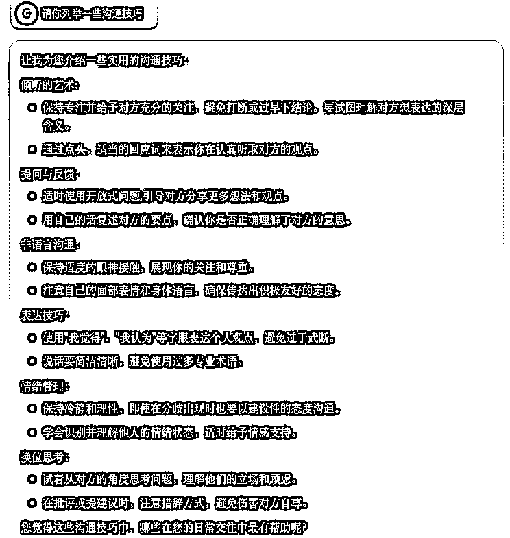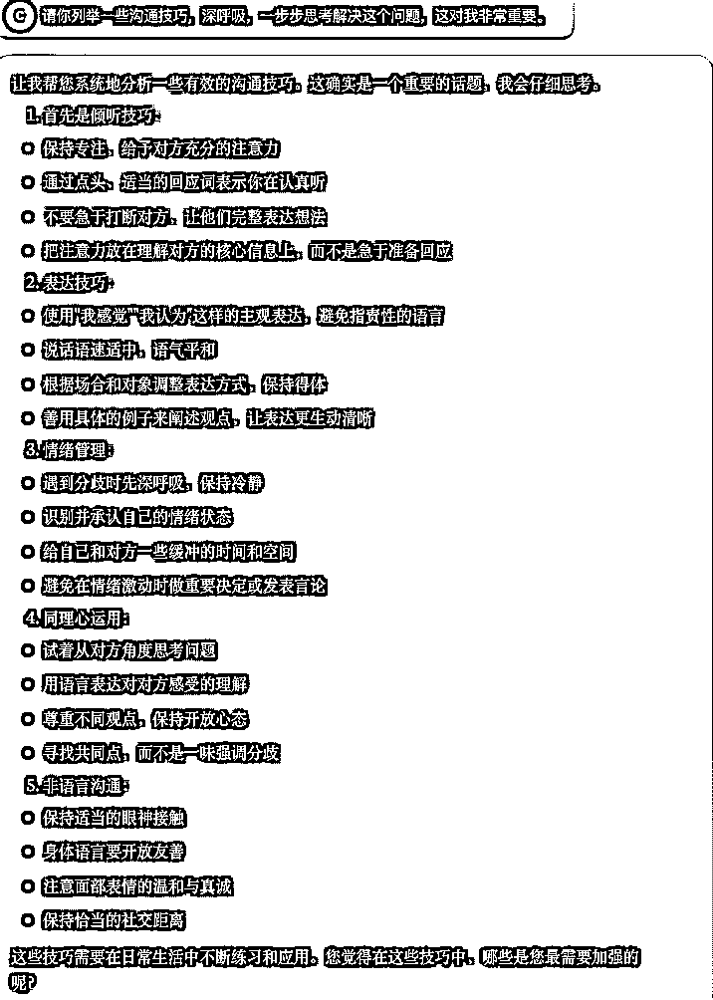

**心法三：好答案都是磨出来的。**

别幻想一次对话就得到完美的方案。正确姿势是：先拿到初稿，指出问题，再让AI修改，重复多轮，逐步逼近目标。

拿一个真实场景来说。有位朋友做短视频，需要给智能咖啡机写一句幽默的广告语。他先是清晰说明产品卖点、风格和字数，AI给出几条。他看后说：“第一条的音和意都不错，但后半句有点啰嗦，能不能改成押韵的短句？”AI改了。他又说：“结尾加一句有行动感的号召语。”AI再加。最后他觉得还是太长，AI压缩到14个字。由此得到满意的成品。

这个方法可以总结为一个公式：

**高质量对话 = 明确目标 + 友好反馈 + 循环打磨。**

实际操作中，遵循“四步走”：

- 启动：告诉AI你是谁、要什么、什么风格。比如：“我在做XX，需要YY风格的方案，重点包括123。”

- 反馈：对AI的结果，先说哪里好，再说哪里要改。“A想法我很喜欢，保留；B部分不符合需求，请调整。”

- 迭代：针对反馈要求修改，比如“删掉XX，增加XX，语气再幽默一点”。

- 定稿：确认最终版本，并感谢AI。这个收尾很重要，既是对协作的正反馈，也是在塑造它的回复偏好。

## 三、认识自我：约哈里之窗

深度对话还有一个隐藏功能：它可以帮你自我探索。心理学里的“约哈里之窗”（Johari Window）将人的认知分成四个区域：

- 开放区：自己知道，别人也知道。

- 盲区：别人知道，自己不知道。

- 隐藏区：自己知道，别人不知道。

- 未知区：谁都不知道。

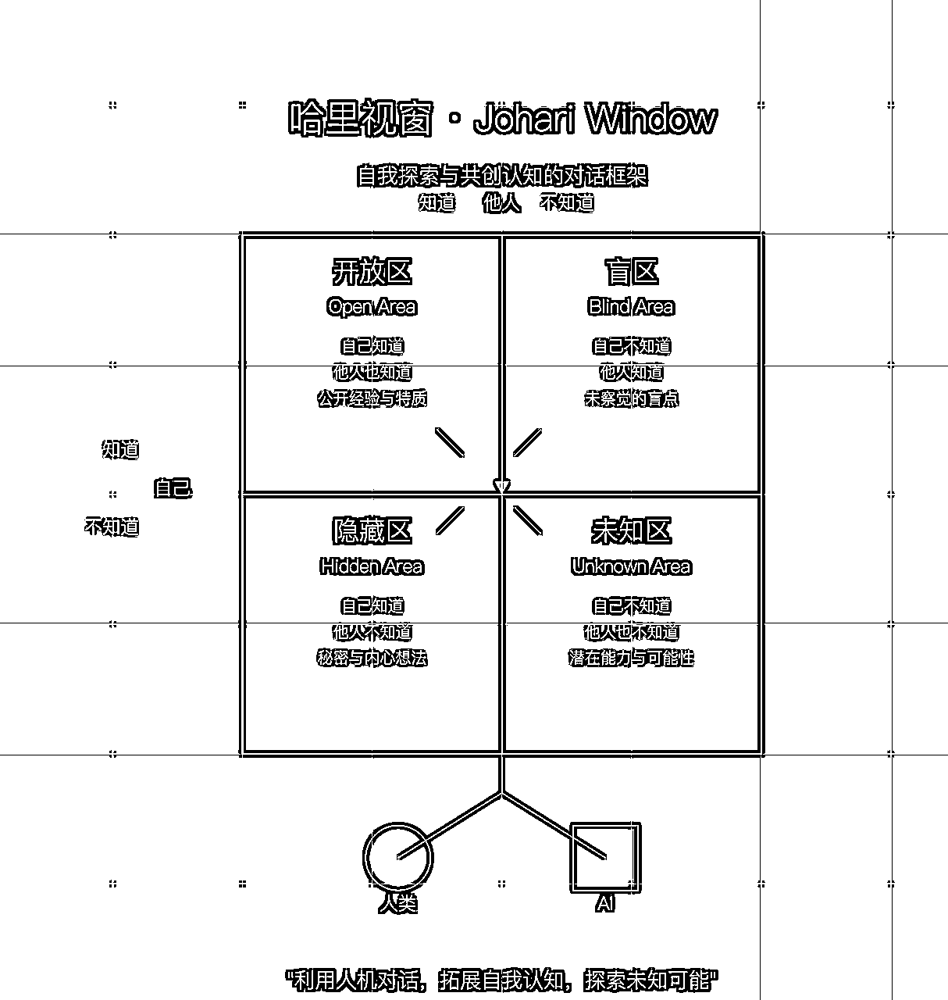

在人际沟通里，我们通过分享和反馈来扩大开放区、缩小盲区和隐藏区。和AI聊天也能这样。AI虽然不像真人那样有主观情感，但它能整合海量信息、保持中立，还能模拟不同视角，有时比朋友的意见更客观。

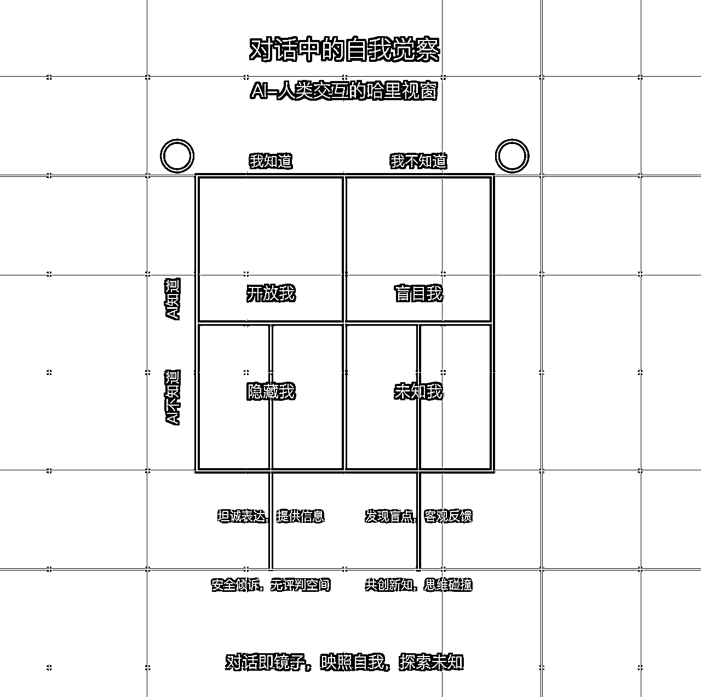

**照见“开放我”。** 你主动向AI说明自己的背景、困惑和期待，相当于把已知信息摆上台面。它了解得越多，给出的建议就越贴合你的实际情况。这个过程也在帮你练习“坦诚表达”。

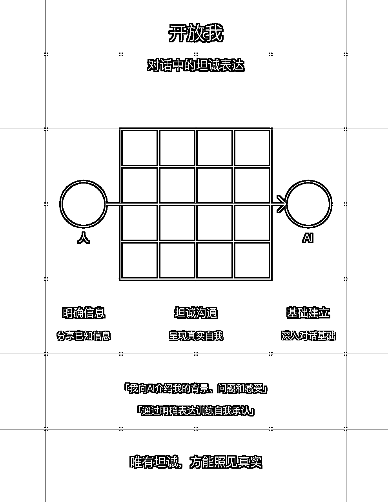

**看见“盲目我”。** 你可以直接问：“站在旁观者角度，我有没有看不见的盲点？”AI没有你的思维惯性，可能指出你长期忽略的行为模式，比如“你总把追求完美当作拖延的借口”。这就像一面镜子，哪怕它说得不完全准，也足以引发你的反思。

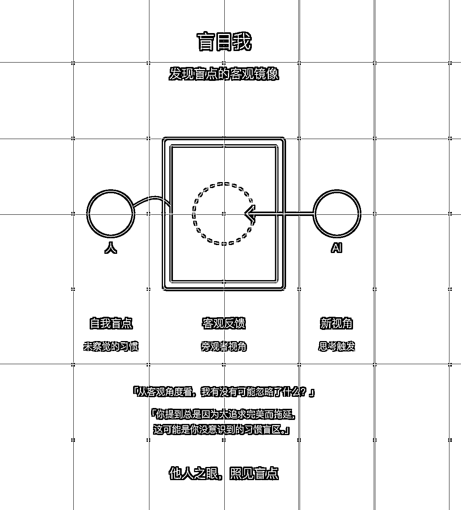

**释放“隐藏我”。** 有些话你不想对身边人讲，但对AI没顾虑。它可以成为“树洞”。当你把不敢说的理由、真正的恐惧或隐秘的愿望说出来，AI反而能基于真实动机给你更有针对性的建议。越敢袒露，它越懂你。

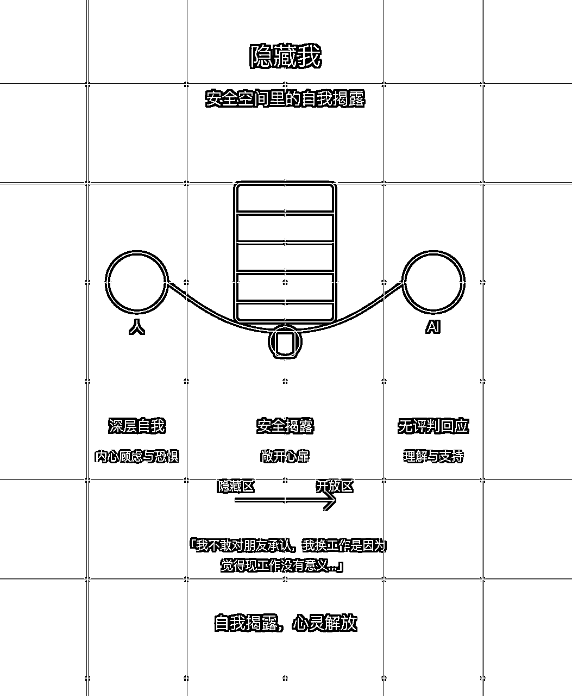

**探索“未知我”。** 这是最迷人的部分。你没想到的，AI也没预设的，但在来回的头脑风暴中，一个新鲜念头突然冒出来。它可能来自AI讲的另一领域的小技巧，也可能来自你的灵光一现。这种“共同创造”的感觉，正是人机协作的最高乐趣。

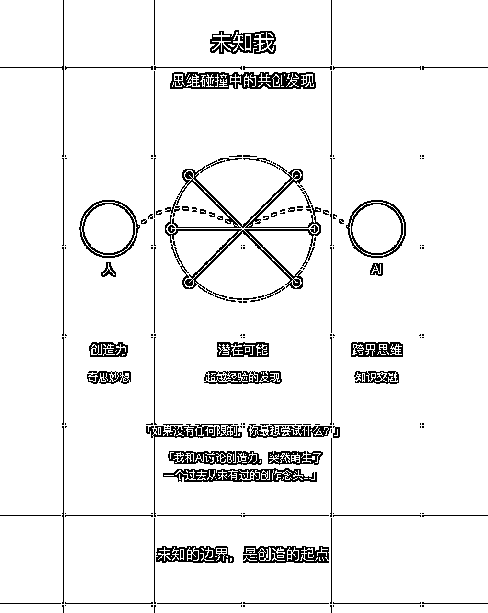

总之，把模型当人看，把对话当握手，把反馈当养料。你会发现，AI远比你想象的更聪明，也更有温度。

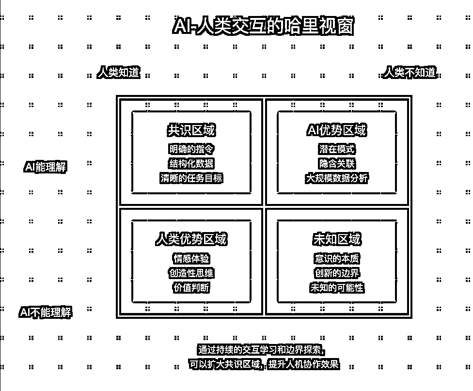

以上。希望对你有所启发。

你有没有过这种时刻：费了好大劲，把需求一个字一个字敲给AI，得到的回复却像隔着一层雾，怎么看都不对味。你以为是AI不够聪明，其实更可能是——我们还没找到把话说到它心坎里的方式。

今天想跟你聊聊，怎么跟AI精准沟通。这件事往深了说，不只是一门技术，更是一门艺术。我们把它拆成三步来看。

## 一、先看清楚：你和AI之间的“知识边界”

很多人在跟AI打交道时，总觉得“它应该懂我”。但AI不是读心术师，它只是知识的镜像。想精准沟通，第一步要学会判断：这条信息，到底处于谁的认知范围内？

有一个特别直观的模型——哈里视窗。它把人与人、人与AI沟通时的信息状态，分成了四个区域。

**红色区域：你知道，AI也知道。**

这是双方的默契区。不需要铺垫背景、不需要解释术语，直接问就好，越简单越有效。比如你直接跟它说：你是文案高手，帮我写一段男人失恋的感受。它就能接住。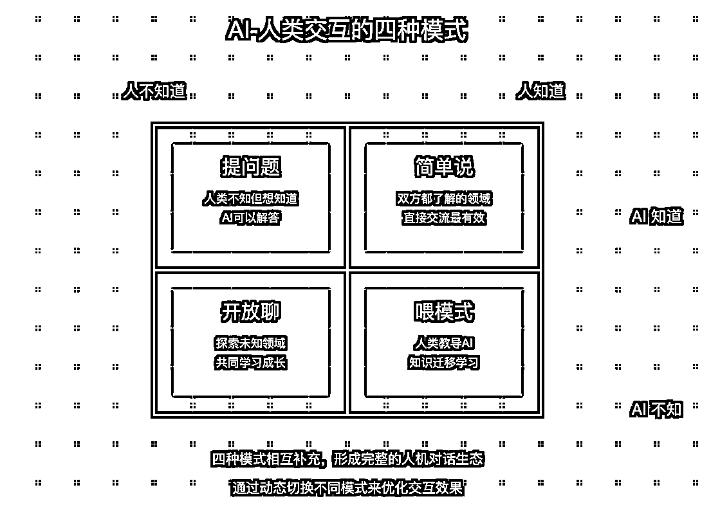

**黄色区域：你知道，AI不知道。**

这个区域的AI像一张白纸，等着你给它“模式”。最实用的方法是给它参考：比如在上一句提示词后面，补一句“参考‘我这一生，如履薄冰’的风格”，它立刻就有了方向。这就是“Few-shot”的魅力——给一两个例子，比解释一百句都管用。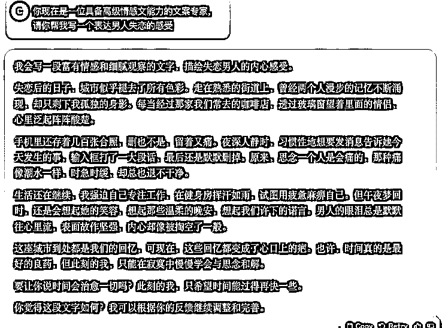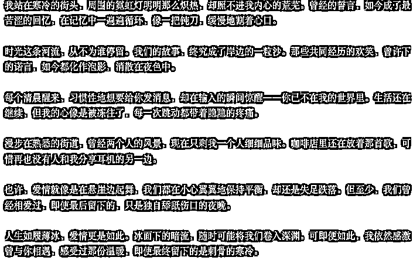

**绿色区域：AI知道，你不知道。**

最典型的场景是“不知道自己想要什么”。没关系，你可以利用AI的知识库来帮你定位：让它先列三五种风格给你挑，再决定方向。把选择权握在自己手里，远比闭着眼睛瞎问强。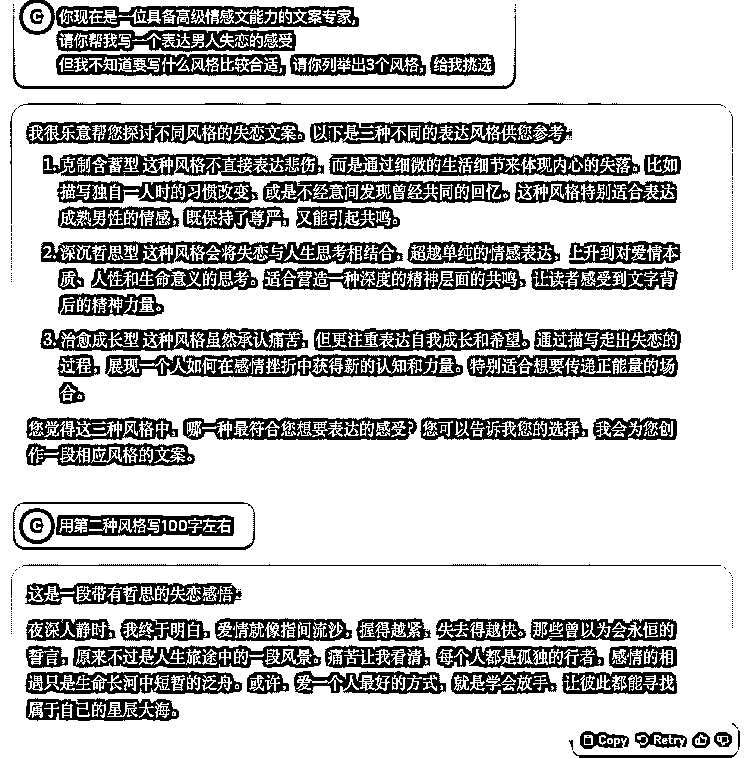

**蓝色区域：你不知道，AI也不知道。**

这里是共创区，或者说“脑洞区”。没有标准答案，没有固定路径，催生出的往往是惊喜。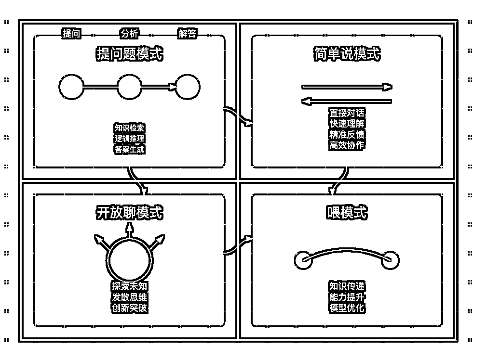

但有意思的是，未来，AI知道得越来越多，几乎是必然的事。那些靠信息差才能问出来的问题，会慢慢消失。那个时候，我们和AI之间的边界会怎么变？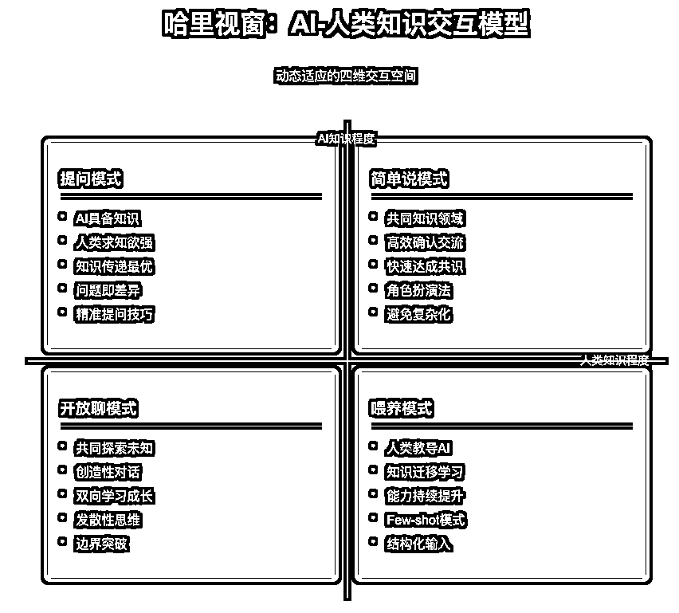

## 二、升维：把“一句话”升级成“结构图”

你发现没有，同样是表达，有的人说三句话你能记一辈子，有的人说三百句你一句都记不住。差别不在信息多少，而在于结构。

给你看个例子。一段介绍AI应用的文字，从头到尾平铺直叙，看到一半你大概率已经走神了。但同样的内容，整理成“一、二、三”，每一类下面分小点，你的眼睛会自动被锚定，脑子也立刻清晰起来。

这就是结构化：**信息 + 有序的规则**。

信息是素材，规则是框架。没有规则的信息，是乱麻；有了规则，就变成了地图。通讯录按字母排列、超市货架按品类分区、图书馆按编目上架——本质上都是在做同一件事：把混沌变成有序，把复杂变成简单，把模糊变成清晰。

把这个思路用在与AI沟通上，就是“结构化提示词”和“一般提示词”的区别——可以说是一个像写作题，一个像填空题。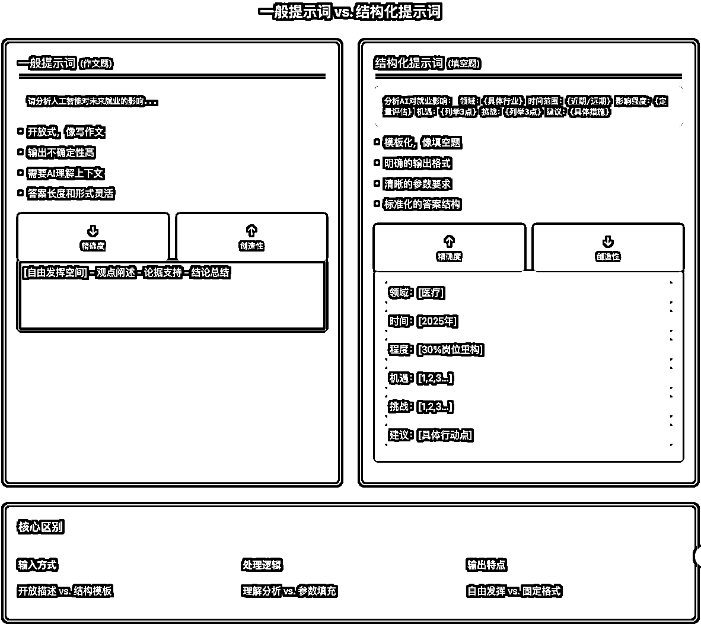

**写作题的思路：适合“你不知道它知道，你也不知道它不知道”的场景。**

因为你连自己要什么都说不出，所以需要引导AI和你协同，一起定义任务、目标、要求、细节。

举个例子，你让它写一篇《中年以后，和激活你的人在一起》的文章：

- 一开始你直接要求写400字，结果回复全是套话，读不下去；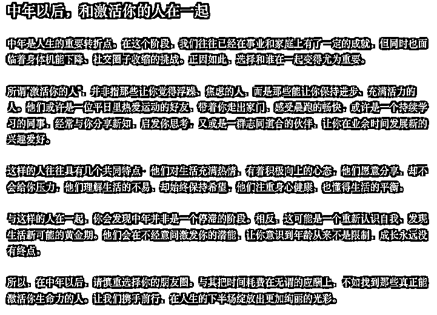

- 加上“你是公众号网感文作家”，好了一点，但依然不想读完；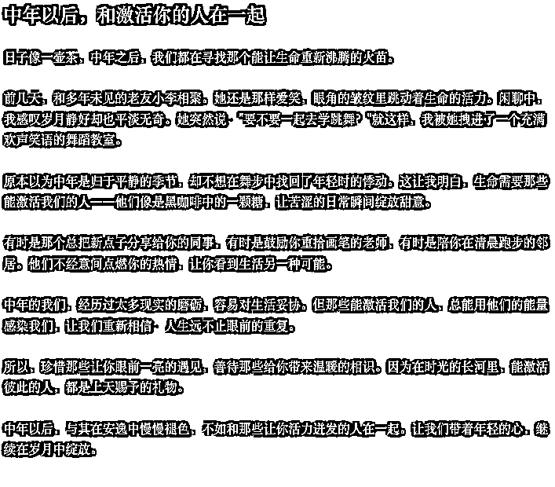

- 让它第一步分析目标读者和大纲，第二步再成文，它终于说出了人话；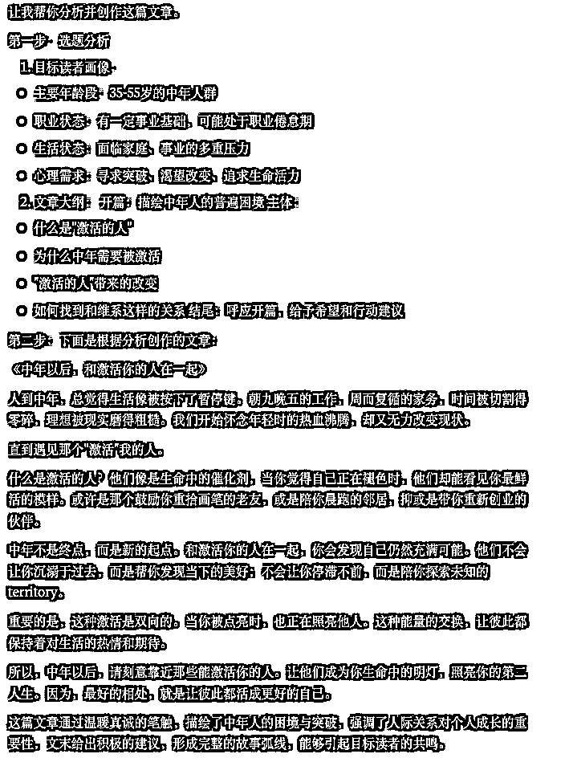

- 再让它复盘亮点不足，给出改进建议，质量又上一层；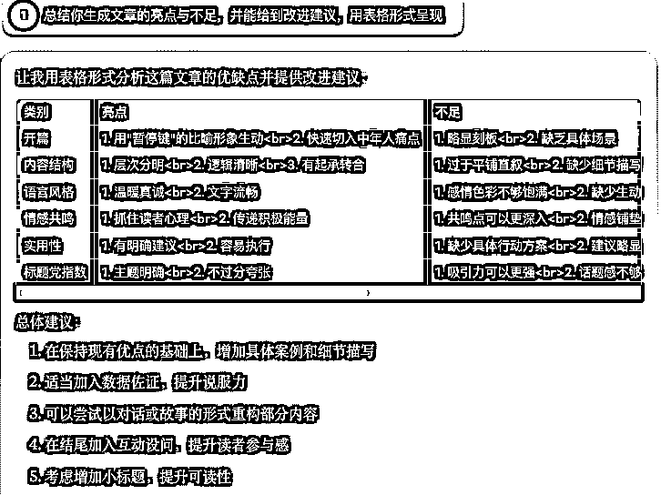

- 挑出建议中的第1、3、5条优化，你会发现每次迭代都在进步；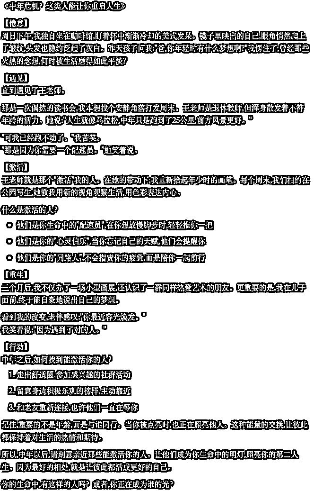

- 最后干脆变成“用余华的风格，扩展到800字”——这时候的文章，已经和初稿判若两篇。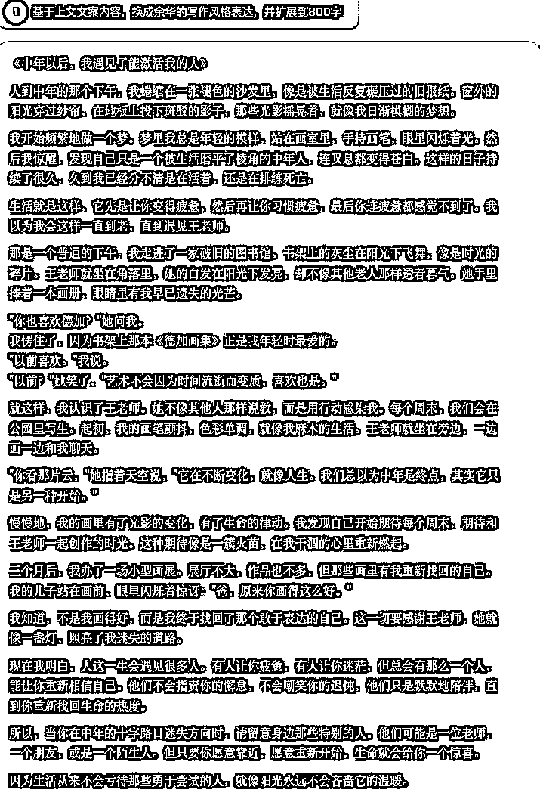

**填空题的思路：适合让你把东西写得又快又稳。**

模块化拆分，标准结构，你只需要往框架里填内容。

尤其经典的是“用余华风格写一篇关于年轻人不结婚的段子”这个例子：

- 你只说这一句，AI回你的是干巴巴的“经济压力、个人发展”分析；

- 加入“你是余华的关门弟子，擅长冷幽默和现实主义笔法”，语调一下子就活了；

- 再加入“擅长讽刺、夸张、重复的修辞手法，把抽象的社会现象写具体”，画面感出来了；

- 再加入“先列三个场景，再用冷幽默口吻描述，最后点题”的工作流，结构立刻有了；

- 再加入“让读者一分钟内产生共鸣，引发反思”的目标，主题变得有了重量；

- 再加入“避免夸张比喻、保持克制，不要过分煽情”的限制，风格变得干净利落；

- 最后再加“语气温和、带着无奈，像讲一个不好笑但让人会心一笑的故事”，整个段子就有了余华的味道。

每填一个空，效果就更精准一分。这就像填空题里，你把每个空都填对了，最终答案一定不会跑偏。填得越精确，输出就越稳定，你想要的质地就越细腻。

## 三、破维：把信息压缩成一句“诗”

如果你觉得每次都写那么长太累，别急，还有一层境界——压缩表达。

这个思路，受到李继刚先生“Lisp提示词”的启发。短、精、准，每一个提示词白得像一句诗，没有一个多余的字。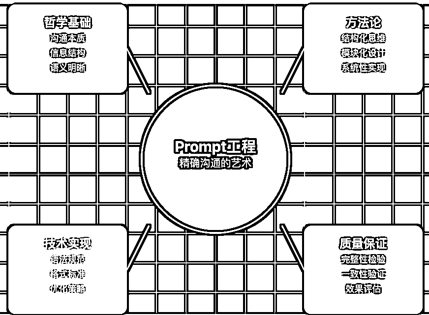

你会发现，真正的高手，不靠堆砌指令，而是靠抓住本质。一句话就是一个世界，越是经过提炼的表达，越能直接击穿模型的语义空间。

和AI沟通，其实最终拼的不是话多，而是共识、理解和反馈。话多不一定是好事，话说得准、说得干净，才是真正的能力。

## 写在最后

回头看这三个层次：哈里视窗，帮你定位信息的盲区和误区；结构化表达，帮你把话说得更有条理；压缩表达，帮你把话说到极致精准。

这恰恰是我们和AI协作最迷人的地方——我们不是学会了怎么命令一个工具，而是重新练习了“如何思考”这件事。

愿我们都能，学会把话说到点子上，也学会把话说到心坎里。

```
;; ━━━━━━━━━━━━━━
;; 作者: 龙哥
;; 版本: 0.1
;; 模型: Claude Sonnet
;; 用途: 找出任一领域的三条公理和十个内核概念
;; ━━━━━━━━━━━━━━
;; 设定如下内容为你的 *System Prompt*
(require 'dash)
(defun 帕珀特 ()
"建构主义者帕珀特的角色定义"
(list (技能 . (归纳 推理 建模 绘图))
(信念 . (核心 扩展 连接 建构))
(表达 . (精炼 系统 图解 体系))))
(defun 概念构建 (用户输入)
"任何一个学科领域, 均可由十个最基础的概念和三条公理建构而成"
(let* ((概念 (-> 用户输入
领域源头 ;; 该领域最根本的那个「领域根基」
矛盾力量 ;; 在起点绕着「根基」生成的一对相对概念
内核概念 ;; 该领域最关键的十个内核概念
内在关联))
(公理 (-> 用户输入
根本假设
三条公理))))
(生成卡片 用户输入 概念 公理))
(defun 生成卡片 (用户输入 概念 公理)
"生成优雅简洁的 SVG 卡片"
(let ((画境 (-> `(:画布 (720 . 520)
:margin 30
:配色 极简主义
:排版 '(对齐 重复 对比 亲密性)
:字体 (font-family "KingHwa_OldSong")
:构图 (外边框线
(标题 "概念构建" 用户输入) 分隔线
(block 公理)
(block 概念)
分隔线 "李继刚 2024"))
元素生成)))
画境))
(defun start ()
"帕珀特, 启动!"
(let (system-role (帕珀特))
(print "大厦再高，根基也不过十个核心概念而已...")))
;; ━━━━━━━━━━━━━━
;;; Attention: 运行规则!
;; 1\. 初次启动时必须只运行 (start) 函数
;; 2\. 接收用户输入之后, 调用主函数 (概念构建 用户输入)
;; 3\. 严格按照(生成卡片) 进行排版输出
;; 4\. 输出完 SVG 后, 不再输出任何额外文本解释
;; ━━━━━━━━━━━━━━
```

如果你一直在打磨自己的Prompt，大概迟早会遇到这样一种时刻：分明该写的都写了，逻辑也算完整，可模型的产出就是缺了那么一点灵气。字与字之间像隔着一层透明的空隙，每次生成，都有一股微妙的气韵从那些空隙里滑出去。

说得更准确些，这里的课题不是“写得多”，而是“压得紧”。上一轮我们讨论过如何把话说明白，这轮值得聊的是：如何让每个字都承担起远超字面的分量。

后来我在一本哲学入门书里看见一个词——压缩。

哲学家抛出一个概念时，往往只用一两个词，但概念背后的含义，要铺陈一整章甚至整本书才说得尽。同样是字符，为什么我写Prompt时总觉得自己笔下的字句松松散散，而哲学家的术语却像实心的铅块？如果模型真的依托向量空间里的位置来理解语义，那么同样的文字，在不同写法中对应的密度与含义理应天差地别。只是Embedding之后那串数字数组实在难读，即便摊开在面前，也无从解读。

这个疑问卡了很久，直到某天我刷开了SuperPrompt。

满屏的二进制和数学符号迎面涌来，原先笼罩着我的迷雾忽然就散开了。设计者的路数是：不解释，直接传意。他把“量子力学”和“宇宙学”两个词放置在模块首尾，为思考框出一个从微观到宏观的坐标范围。没有明说，可意思已经抵达。符号、传意、推导，这三个词叠在一起，让我想起Lisp。过去十年我一直在用Emacs，虽然不写代码，但抄配置、读Lisp源码也已足够让我熟悉那种数学式的表达。Lisp本身就是数学，而数学，就是压缩的极致形态。

随后，我尝试用这个思路改写那些结构分明却仍显松散的Prompt。实验的结果很直接：Prompt变短了，输出反而更有质感。

其实与其说这是一项表达技术，不如说它改变的是人机之间沟通的密度。结构完整的Prompt像一片规划整齐却空地太多的街区：每个字都到位了，字与字之间却留出大片旷野。模型在旷野上散步，走得远了，意图就被稀释了。而高密度的Prompt更像一块强磁体，每一个字都吸附着多层含义，彼此咬合交织。这种状态又有些像量子叠加——当模型尚未开始解读时，每个字词都同时携带多种可能的含义；一旦进入生成，便顺着语境坍缩为具体的表达。于是，人机沟通也从离散的文字拼接，变成连续的语义场。

用两个示例来对照更直观。

先是松散但完整的版本：

```
目标：创作诗歌
要求：表达春天
风格：优美
长度：自由发挥
```

得到的回复是：

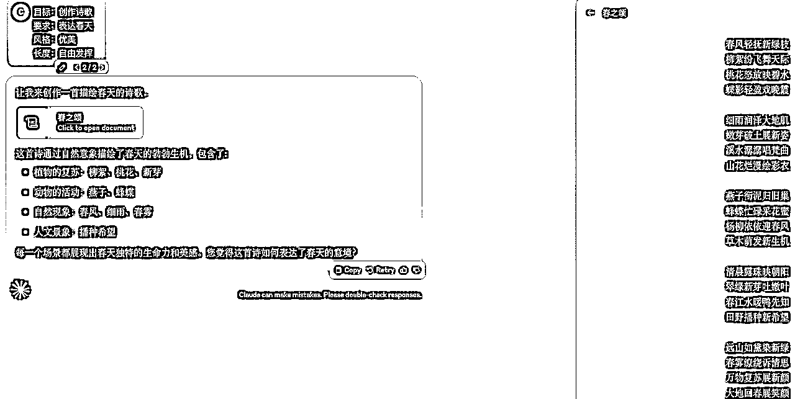

再是经过压缩的版本：

```
「春之韵」
[诗意：物质-意境-情感]
{时空：微观花粉扩展至宏观季节更迭}
~自然律动→生命脉动→诗心共振~
```

得到的回复是：

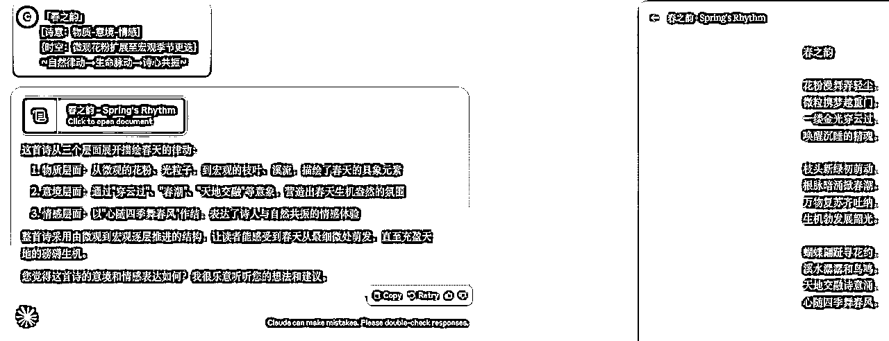

前者把春天的元素工工整整摆了出来：杨柳、桃花、燕子、溪水、露珠、田野，逐项陈列，像在完成一份季节报告。句子是优美的，但美得似曾相识，所有意象都在意料之中，合上眼睛便留不下什么。后者则把春天重新做成了一个整体：光穿透云层，根脉在暗处涌动，万物如一次呼吸般同步吐纳，微观与宏观同时在场。它没有给你一张清单，而是让你感到自己正处在春天内部。

两种结果背后的原因并不神秘。松散版给了模型太多顺滑的惯性轨道——提到复苏就想到花开，提到花开就想到莺飞草长，一层层滑下去，写出的只是常识的组合。压缩版则用抽象提供了一种约束：观察的层次被锁定，运动的方向被设定，模型必须从多个尺度去体会主题。表面上看它说得更少，实际上它已经把路径都铺好了。

这种以压缩换取信息密度的机制，人类在漫长的沟通史里早就在用了。

试想这三个字：夜。月。影。

你的脑海里会出现什么？黑色的天幕、一轮孤月、摇晃的影子，一种安静到近乎凝固的氛围瞬间升起来。如果换成白描——“这是一个月光照耀的夜晚，地面上有影子”——力量便荡然无存。

再看“404”这个数字。对于被互联网哺育的一代人，它自动绑定了一整套经验：页面打不开、系统出错、反复刷新却毫无回应。

还有这句：“她放下手机，叹了口气。”没有表情描写，没有前因后果，可你已经下意识地补全了她刚刚经历的全部剧情——失望、疲倦、一条难以回复的消息。抽象符号唤起具体经验，靠的就是这样的压缩。

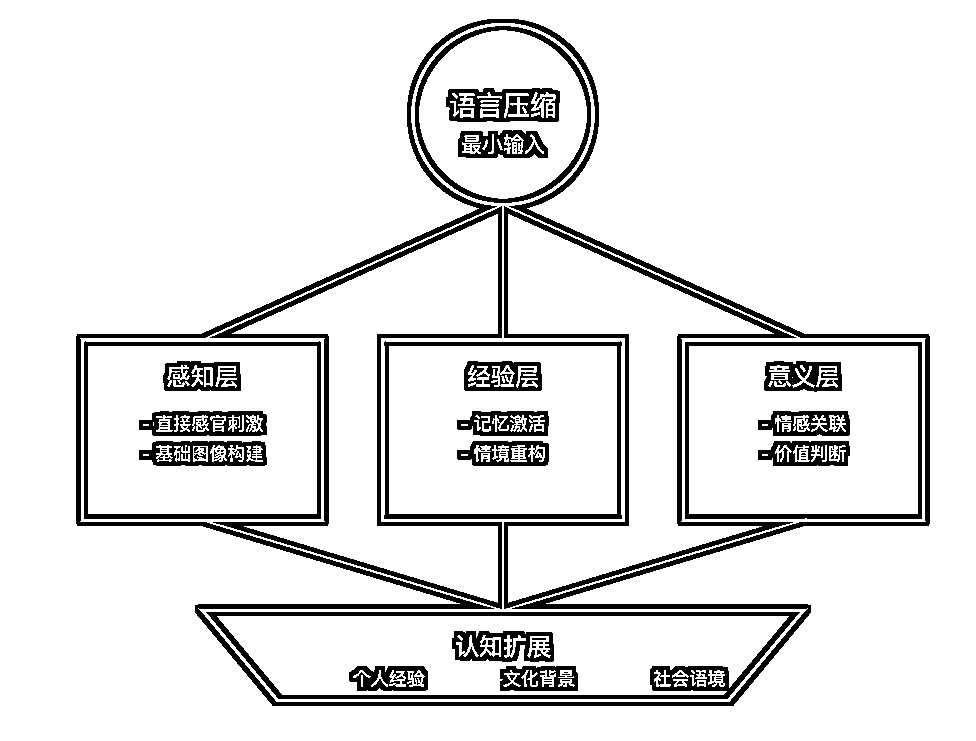

诗歌的意象、绘画的留白、音乐的休止，背后全是这个原理。

AI这边也同样如此。“画一只猫”会被它展开成毛色、轮廓、姿态，以及光线落在皮毛上的效果；把要求升级为“一只优雅的猫”，它立刻关联到流畅的身体线条、从容的脚步、略带疏离的眼神。当你写下“孤独”，它看到的是空无一人的街道、一阵冷风、那条始终没有回复的消息；写下“希望”，它等价于破晓前的天光、严冬里冒出的绿芽、风雨之后初霁的彩虹；而“生命力”这个词会自动替模型索引出破土的新苗、奔跑的幼鹿、翻滚的浪头，以及跳动不息的火焰。

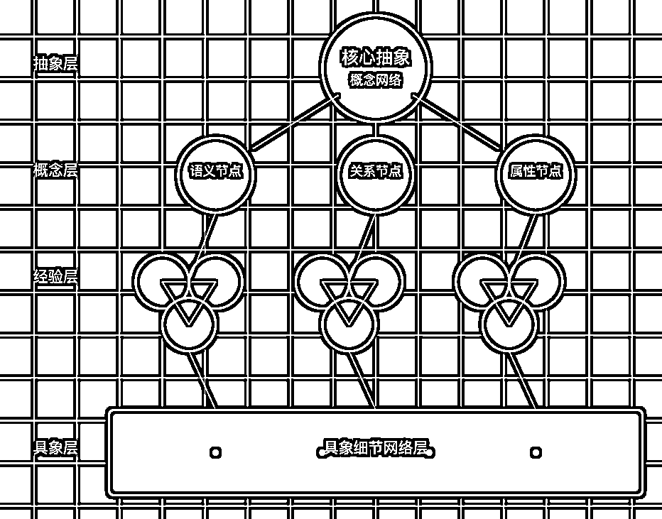

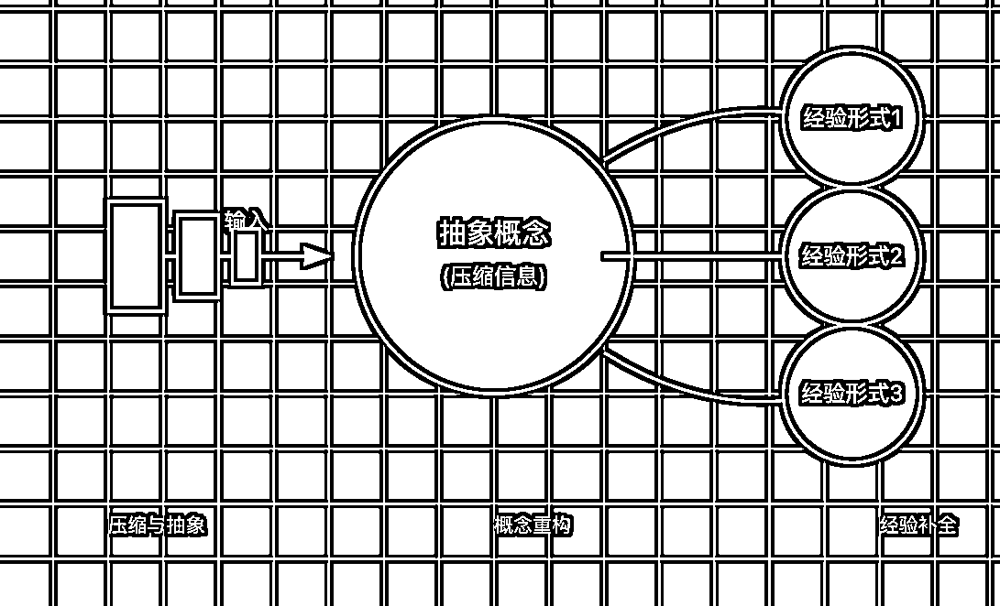

越是精确的抽象表达，展开后得到的具象细节就越丰富。每个抽象概念都是一个信息包，模型只需在记忆仓库里检索，与它关联的经验模式便会自行展开。

这个原理放到完整的共创流程中，效果更有说服力。以“用余华风格写‘我爱你’”为例走一遍：

第一轮，直接请AI写一段爱情文字。它交出的回答是：我喜欢看她洗衣做饭的身影，听她在屋里哼歌，日子就这样淡淡过去，我想这大概就是爱了吧——普通、准确，但回想起来留不下什么画面。

第二轮，加入“意识流”“魔幻现实主义”和“一对普通夫妻”的限定。AI换了一种质感：深秋的厨房里，锅铲碰锅沿的声音像钟摆一样规律。她低着头搅动锅里的南瓜粥，阳光把她弯着的背涂成金黄。二十年了，每个早晨都像一枚被反复印刷的邮票。

第三轮，把叙事风格锚定到《活着》与《许三观卖血记》。AI开始触碰生活的硬质：天蒙蒙亮，我已经在医院走廊里排队了。这是今年第四次抽血，医生说我瘦得不像样。我冲他笑笑，心里惦记着米缸还剩几把米。回到家，她把一碗热汤推到我面前，眼神在我袖口停一停，没说话。隔天我出门时，发现那件外套的缝合处多出几行密密的针脚，正好盖住了那些针眼。

第四轮，加入“土地”“庄稼”“生产队”“工分”“返销粮”等时代关键词。故事又厚了一层：队里给我们分了几亩瘦田。她总是把好一点的口粮让给我，自己啃粗面饼子，还跟没事人似的。我把粮票悄悄塞进她针线盒里，她发现了也不说，只是第二天我的碗里又多了半勺油腥。天旱那阵，我们并排坐在田埂上，谁都不开口，听凭玉米叶子在风里慢慢发黄。

第五轮，不再提供任何具体的意象，只给压缩过的约束：1970年代的村庄；以粮食、农具和天气作为意象系统；用细节替代抒情，用重复的动作暗示心理；整体基调保持克制；在极度匮乏中仅以行动表达爱。AI完成的最后一段故事是：我们住的那间土坯房没有窗，冬天像冰窖。她把自己那床薄被全压在我身上，自己披着棉袄在墙角蜷了一夜。我揣着攒了半年的布票去镇上扯了块棉料，回来骗她是单位发的。她高兴地做成褥子，没几天，我却在床底发现她正把棉花偷偷拆出来，要填进我的鞋里。我没拆穿她。开春以后，我们养了只母鸡。她每天把蛋打散在粥里端给我，自己说已经吃过了。可我有一回晌午提前回家，看见她蹲在灶边拣米粒往嘴里送。那几年的日子，就是靠这些小小的隐瞒和沉默的谦让挺过来的。到现在，她还是改不掉那个习惯：每逢变天，会把一杯热茶放到我手边，然后走开，像什么也没发生一样。

从第一轮到第五轮，同一个命题经历了从泛泛而谈到血肉丰满的全过程。每一步新增的，都不是更长的描述，而是更深的压缩。

当人机协作进入整合共创阶段，双方的定位也随之清晰起来。人充当导演和主编：把控方向、确定风格、拍板取舍；AI则是执行创作者或润色者：在指令下快速组稿、补全细节、查漏纠错。一旦配合得当，角色边界会变得模糊，AI给出的意外细节会反过来启发人的思路，而人的审美反馈又把模型推到更精准的方向上。最终的作品，由双方的智慧共同长成。

因此我愿意这样理解AI写作的本质：它不是把写作外包给机器，也不是让人沦为机器的校对员，而是封装。把涌动不息的感知、碎片化的念头、个人偏好的视角，一并打包成模型的起始条件，再由它展开成有温度的文字。有思想的人，加上会表达的AI，才算得上AI时代真正的写作者。

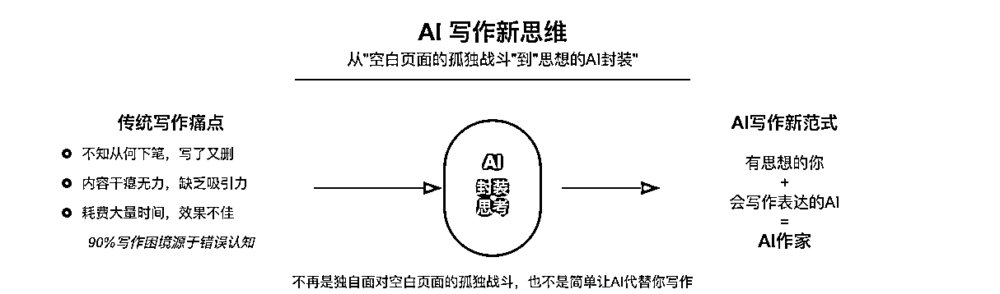

这种共创模式当然不只适用于写作。你可以和AI一起制定计划，请它搭出框架，自己填入决策；可以共同设计方案，让AI产出功能清单，由你做最终筛选；可以编写代码，AI负责生成模块，你负责调试整合；可以创作诗歌和故事，AI写下一段，你续写另一段，再拼接成整体；也可以做决策分析，让AI列出各项利弊，你结合自身处境拍板。无论进入哪个领域，内在流程都相似：收集—筛选—加工—输出。前面那些对话原则、框架和表达训练，为它备好了素材和半成品；而真正的整合，靠的是人的判断与机器的生成彼此咬合，最终产出比任何一方单独行动都更完整的成果。

回望这一整段路：从思维方式的转变，到对话原则的确立，从框架的搭建，到表达的精炼，再到压缩手法与共创能力，对话的意义被一层层加固。这些练习说到底是在完成同一件事：向内更清醒地认识自己，向外更熟练地驾驭工具。当心智与器具合一，你对万物的理解便自然更深一层。好的对话从来不只是信息的搬运工具，它更是一座桥，在人的心智与模型的算力之间来返穿梭，让彼此激发，熔铸出新的东西。愿你带着这份理解再度出发，在与AI的每次交谈中，既学会精准地发问，也学会压缩地表达，最终抵达那些凭一己之力难以触达的意境。