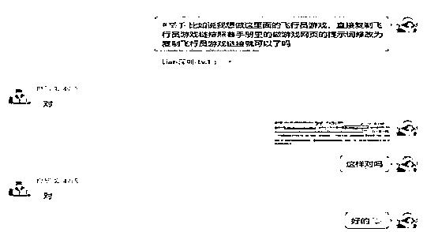
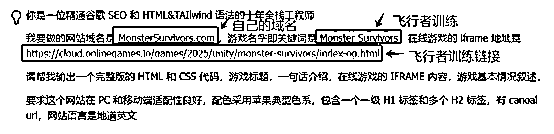
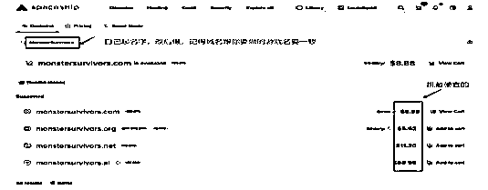
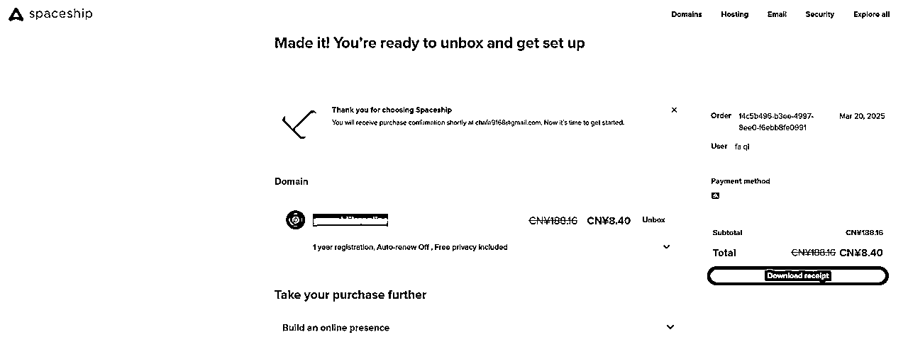
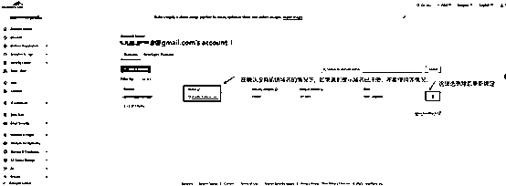
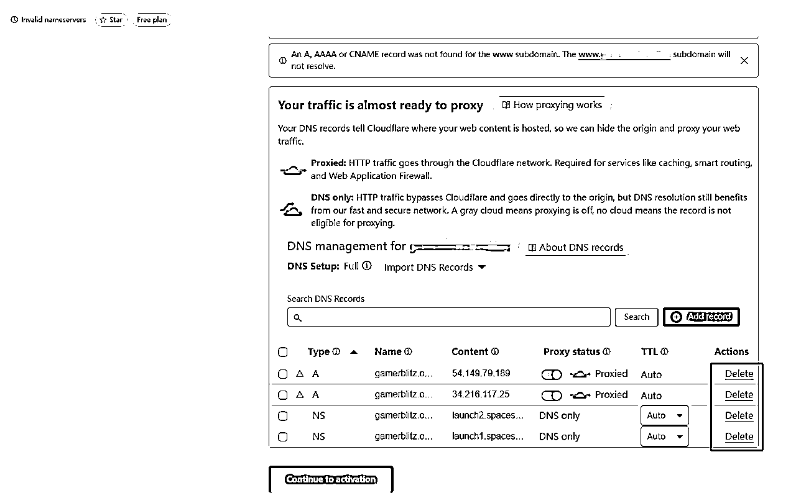
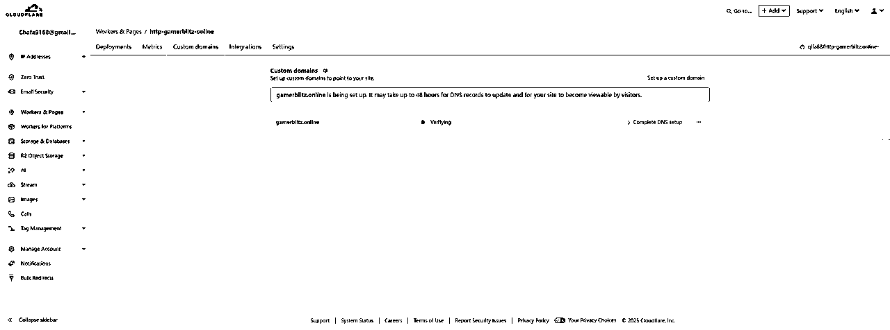
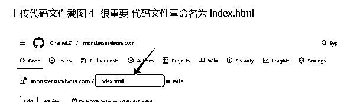
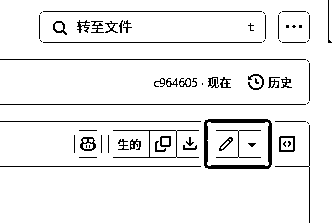
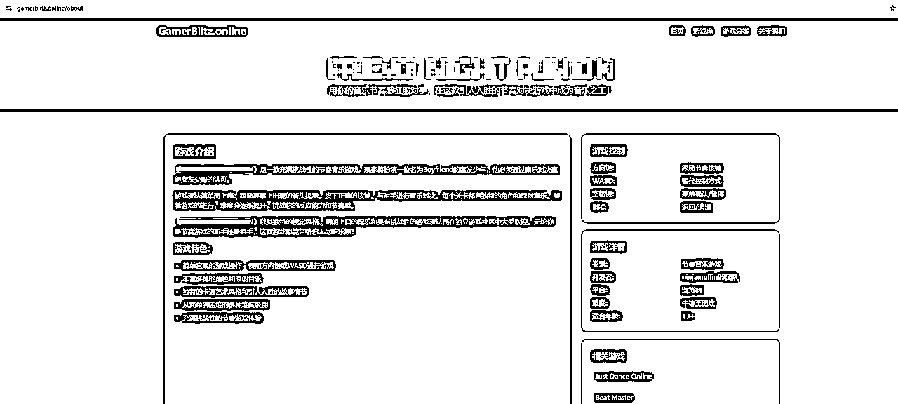

# 一个零基础的我，用 4.5 小时就把游戏站上线了
大家好，我叫思齐，入圈赚钱已经一年多。去年三月有幸去到杭州参加千人线下聚会，那种全员冲向变现的氛围，真的给我上了一课。
现在手里有两摊业务，一边是我带的一个做系统定制的开发小组，以前主要吃政府的单子，受大环境影响现在我们彻底不碰了，全部转向服务企业客户。另一边是做视频号直播带货的团队。
受龙哥的《超级标》系列启发，我决定把主攻方向押在 AI 加出海上，想找一个新突破口。
去年的 11 月中，我刷到小排老师的一篇分享，说新手也能五分钟起一个站。抱着试试看的心态照做，没想到真的搞出了一个算命类网站。那一刻我才真切感受到，建站这件事对小白来说门槛已经很低了，自信也一下子上来了。
可好景不长。去年 12 月初我被期货量化吸引，用 Cursor 想自己做一个交易系统。结果零基础的我完全懵圈，看不懂生成的代码。它一句“代码已生成，请运行”，一跑全是报错，让它改就冒出新的报错，无限循环。打击不小，最后只能先把项目冰起来。
转机出现在今年。看见群里有伙伴靠 AI 工具做出上线项目，我忽然觉得自己也能行。于是我报了三月的 AI Web 网站航海，同时也报了油管航海，想两个赛道一起冲。
今天想把我今天 12 点到 16 点半，连续 4 个半小时把第一个游戏站跑通的实战过程说清楚。非常感谢赚钱 AI Web 航海的教练组，出品的那本航海手册真的细到像手把手喂饭。尤其是 @良辰美 教练，其他教练还有群里的船友，每次我这种“超级小白”的截图和傻问题都耐心拆解，真的太感恩了。
手册里的操作截图已经足够清晰，下面是我自己踩过的几个坑，我第一个练手的项目就是游戏站。
小白问的这些问题，估计教练看到都想笑，哈哈

先把需求 prompt 定下来，然后立刻去买域名并绑定。我的建议是买完域名就先去绑定，别拖到后面。
买域名
小提示：做游戏站最好让域名和你主推的游戏名保持一致。比如你想推的是“飞行者游戏”，域名就可以取飞行者游戏加上合适的后缀，像 .org / .net / .com / .app / .ai 都不错。.online 首年价格很香，我当时用的就是这个后缀，一年不到 1 美元。教练也说了，第一站练手就挑最便宜的来。

绑域名

手册里演示删 2 条记录，但我实际显示要删 4 条，别慌。这跟后缀有关，我的 online 后缀就是 4 条，该删就删。

删完后就是绑定成功了，刷新等个几分钟就行。
上传代码

上传代码那步我没注意手册里强调要把文件名改成 index.html，白白花了点时间找重命名入口。

如果你也像我一开始那样忽略了，不用急，在这里可以直接改名。
托管网站
这一步千万别心急，严格对照手册的截图一步一步走。我就是之前太急躁，导致要从托管的第一步重新来才成功。

登登登登……我人生中第一个真正属于自己的网站就上线了！
最后想说一句，别因为觉得难就先否定自己。不是事情本身难，而是你先不想做才让它变难。龙哥一直强调要做难而正确的事。祝大家每一步都能顺起来！
我是南宁人，借用刚结束的南宁见面会口号，我们一起龙哥盟，邕抱财富！