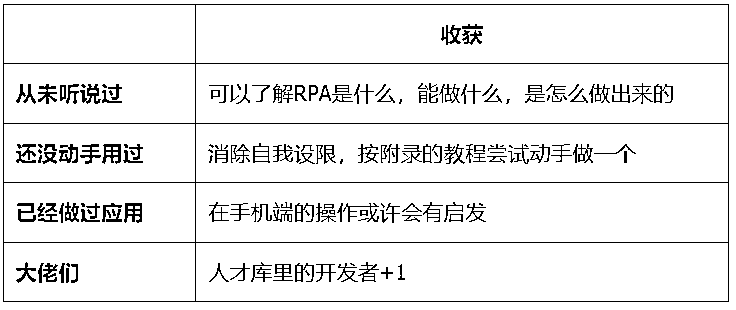
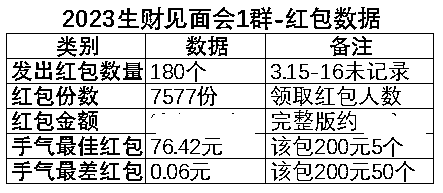
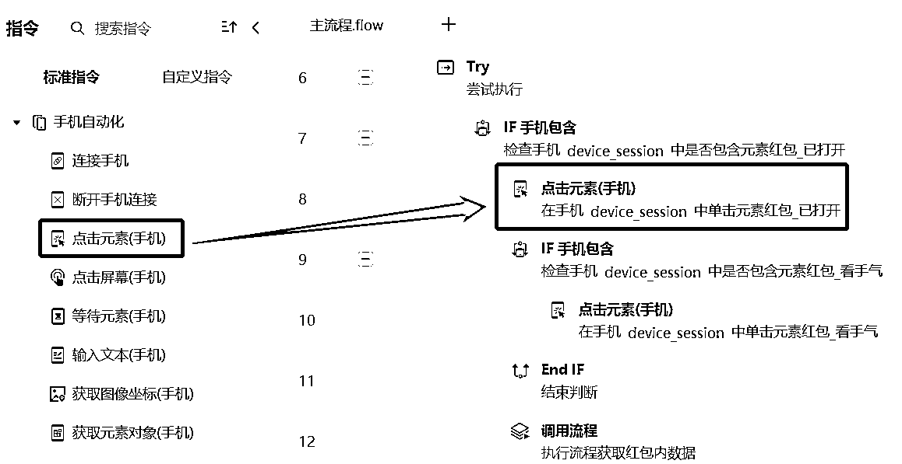
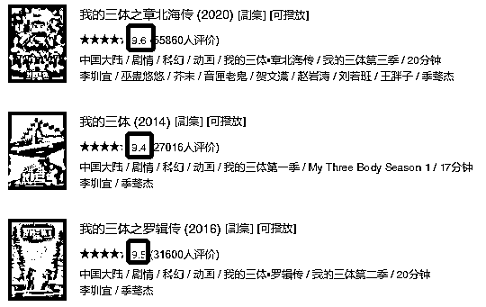
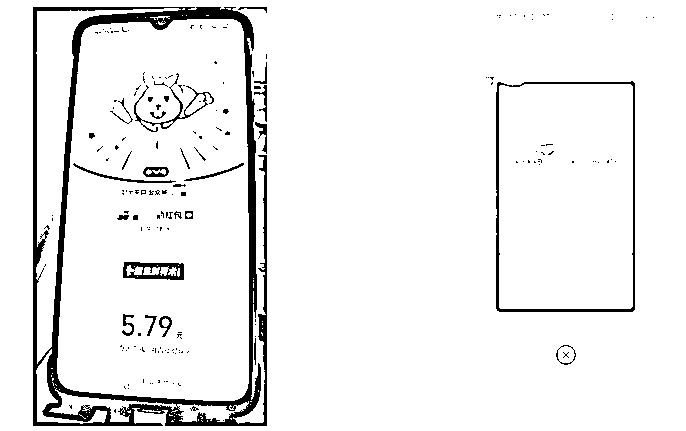
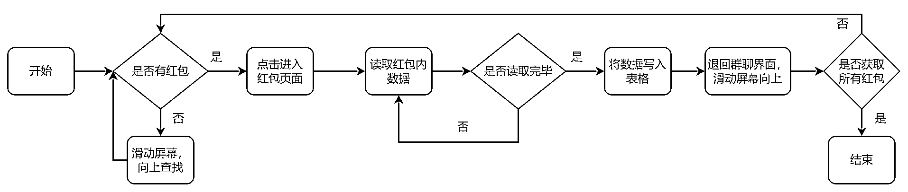
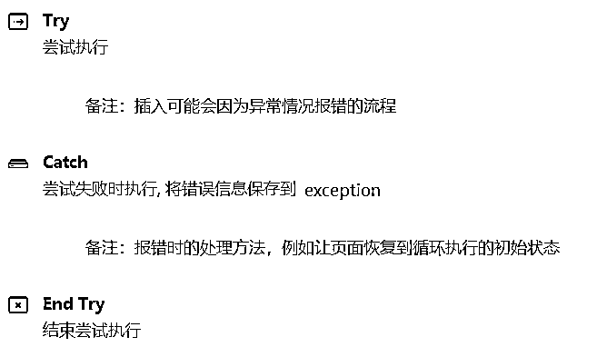
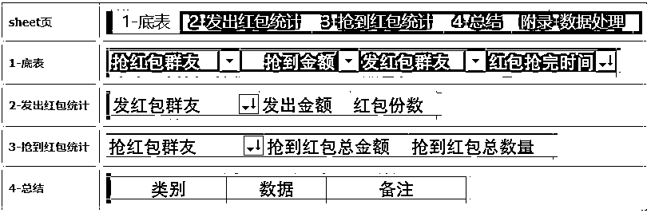
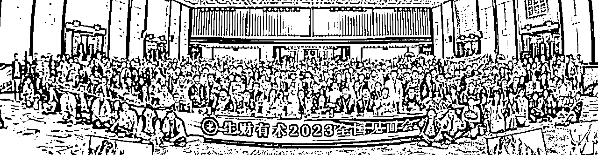

# 一周雨洒 9000 多个红包，我用影刀 RPA 把赚钱见面会群的微信红包全扒了

## 《7 天 9000+ 份红包雨，我用影刀 RPA 爬取赚钱见面会群微信红包数据》

作者： 龙哥

日期：2023-04-03

大家好，我是龙哥，现居广州，目前做量化交易和流程咨询，也在帮中小企业和个人用 RPA 把业务流程做成超自动化。

这次想分享的是一个微信群红包数据的抓取实战。说到数据采集，很多人第一反应是网页爬虫，用 Python 或八爪鱼从电商、自媒体平台捞数据，手机端抓 APP 数据的插件也常见，但微信群里红包数据的采集，估计就比较少见了。

明眼人都能看出这属于偏“手工耿”式的玩法，有点技术含量，看起来有点无聊，不过点子本身挺好玩的，万一换个场景微调一下就能变现呢？所以我把这次记录定位成“在熟悉场景里做一次新鲜操作”的技术拆解，让非技术背景的朋友也能窥见 RPA 的能力边界，理解自动化流程的思考方式，方便日后识别自己业务里高频重复的环节，和开发者沟通更顺畅。

>>手机端排版乱了可以直接去飞书看完整版 → [链接](https://ih195hg9y3.feishu.cn/docx/EtosdPFUuo1iPexWVKxclw4jnYg)

### 〇、阅读指引

为节省大家时间，预判不同程度读者能带走的内容：

### 一、起因

本月赚钱圈最重磅的事，无疑是酝酿三年的千人线下见面会。上周起见面会群就开启了各小组自我介绍，连续 8 天，每天晚上 1 小时。

赚钱讲究“谈钱不伤感情”，见面随手发个红包让钱流动起来，互动感很强。撑一天还好，撑一周，那就是真·红包暴雨了。

没错，就是这个实况，而且还有人当气象记录员，把这场暴雨里每一滴雨水的去向都记录下来。

几个关键数字先上：

1. 4 秒：绝大部分 50 份的红包，从发出到抢完平均只要 4 秒。

2. 9000+ 份：抓取时前两天不少红包已无法打开，按每天 1000+ 的记录推算，群内总发放量超过 9000 份。

3. 76.42 元：手气最好的一位群友，抢到一个 200 元分成 5 份的红包里，拿到 76.42 元。

4. 0.06 元：在人均 4 元的红包里，有位非酋只抢到 0.06 元。

我把数据做了透视表，但涉及群友隐私就不公开全量了，想要复现测试的可以拉我进有红包雨的群。自己手抢的数据可以放出来，徒手抢到 38 个，平均 3.9 元，正好卡在均值上。

我并非蓄谋已久，3 月 22 号晚上，鱼丸发完见面会流程和地点提醒时，我才恍然“哎呀真的要见了”。回想这几天的自我介绍，印象深刻的可以粗略分成三类：有结果的，有能力的，有作品的。

作品又能分三层：

1. 展示型作品——“哇塞”：作品本身就能体现作者能力，看完就知道找他要什么服务，呈现形式多为文章、文档、图片、视频。

2. 工具或方法型——“啊哈”：不仅能看还能用，让人眼前一亮，比如针对某短视频平台的批量剪辑工具。

3. 通用场景可用型——“我要”：更普世的工具，直击日常痛点并给出解法。比如有大佬说自己做了能下 99% 网页视频的插件，你看到会不会想立刻收一个备用？

那么见面时聊点什么能让人记住？我从当下最应景的场景出发，结合自己在做的事，还要有点趣：

1. 场景：赚钱见面会相关话题

2. 事情：用 RPA 控制微信，批量抓取数据

3. 有趣：统计群内红包数据，这个此前没人做过，也没什么场景能凑到这么大体量

4. 产出三件套：红包数据、RPA 应用、以及这篇精华文。

思路定了，就开始梳理实现路径。

### 二、实现思路

#### 给小白的 RPA 速写

先照顾下非技术朋友，RPA 到底是什么，和别的工具有什么区别：

RPA 即 Robotic Process Automation 机器人流程自动化，本质是软件模拟人在电脑上执行操作，用来自动完成重复性工作，比如数据录入、发邮件、网页操作、操控软件等。

重点是这句：模拟人类在计算机上执行操作。

我的理解是 RPA = “软件的软件”。它能模仿人类用鼠标、键盘或指令去操控各种软件，浏览器也算，还能做数据处理、调 API 等需要代码才能搞定的事。

前面有按键精灵这类基础点击输入工具，后面是编程的常规操作，但把两者结合，再加上 AI 的文本识别、图像识别和自然语言处理，RPA 就能“看见”目标软件的内容。窗口缩一下、挪一下也能定位到按键在哪。

而且大部分 RPA 都是可视化编程或低代码，把基础能力做成积木块，拖进去就能用。可以看我用影刀做的微信群红包爬虫编辑界面。

我想点手机上的红包，只需把“点击元素”指令拖到右侧流程，配置里选“红包元素”，一个动作就完成了。

其他操作基本都是找指令、拖拽、按需求配置，像搭积木一样。

会不会简单就意味着弱？看《我的世界》就懂了，我大概只能搭棵树，高手能搭城堡，大神能做出一部方块人版《三体》，B 站连播三季，豆瓣 9.4。

简单反而带来更高的开放性，也能让更多有想法、有痛点的普通人跨过开发门槛。像现在火的 ChatGPT 或 AI 绘画，界面就一个输入框，能把问题说清楚就能实现。具备这种开放性的工具值得深挖，提升搞钱效率。

#### 开发实录

现在进入正题：我清楚想要“把微信群里所有红包的数据抓出来”，要怎么教 RPA 机器人去打开上百个红包并记小本本？

我做 RPA 的习惯分五步：手动操作→步骤梳理→模块开发→运行测试→修 BUG。

#### 手动操作

RPA 的核心是模拟人操作，所以得先示范，而且不能只做“能用就行”的标准操作，还得考虑异常。

先看常规路径怎么看一个红包数据：

1. 在群聊里找到红包。

2. 点开红包，抢到的直接进，无抢到的会提示“手慢了”，需再点“看看大家手气”才能进入。

3. 红包里能看到发红包人、抢红包人及金额、抢红包时间。

4. 退出红包页，返回群聊找下一个红包。

重复这四步就能把群里所有红包收录。

有个细节：打开红包后，群友名字和金额无法直接复制，手打既慢又易错。RPA 可以直接识别文字并原样保存。这种“不可复制”的场景在网页、软件、APP 里很常见，正是 RPA 的优势。

群里的异常情况也很多，多亏赚钱群友贡献了样本：

1. 异形红包：颜色或外形和普通红包不一样，靠图像识别容易漏，所以必须用“元素”识别而非“图像”。具体操作不展开，用起来就懂。

2. 红包封面图：进入后封面图或视频很大，占满大半屏，下方数据被遮挡。直接读取会报错，得先灵魂一滑，往上轻轻滑动收起封面，才能继续读取数据。

3. 干扰元素：群聊里聊天记录很多，会干扰采集。比如过期红包点不开，或头像、表情包被误识别为红包，点进去就卡住。这些情况都要识别出来并返回群聊，继续执行。

#### 步骤梳理

了解了标准路径和异常情况，就能画流程图教 RPA 执行。RPA 也好，任何编程语言也好，本质都是给机器做一次操作流程培训。流程无非三种：顺序、循环、分支。复杂的英文符号只是标记方式，关键是思路别被吓到。

抓红包数据的简化流程图如下，每一步对应要教会机器人做的小动作。

#### 开发与调试

具体代码不展开，只说几个关键点，给大家操作手机应用时一些启发：

1. 从关键步骤开始写：流程里最核心的先做，比如这里是群里打开一个红包，有了它后面读取数据才有意义。滑动找红包这类步骤可以后面再补，边写边测能否完整抓到每个红包数据。

2. 滑动屏幕：以为很简单，实测调了挺久。影刀目前滑动距离靠“滑动时间”控制，理解为手指在屏幕上的滑动速度。同样区域，200ms 比 800ms 滑动更远。参考设置：群聊界面取整个群聊窗口，滑动时间 500ms；红包内取发红包人名字区域，滑动时间 200ms。

3. 去重：数据采集时去重必不可少。这次在源头解决，用“字典”存储。一个红包里每人只能抢一次，即使翻页重复获取，字典的键值对特性也会自动去重。

4. 结束标志：我用最后一位抢红包人名字对比，上一次的最后一位和本次相同，说明滑到底了，可以返回群聊。

5. 异常处理：重复执行的步骤都包在“Try”指令里，遇到未预料的干扰不会直接报错终止，而是进入异常处理分支把界面恢复正常。掌握异常处理，是新手毕业的标志。

#### 数据处理

数据抓出来后要直观看出来，Excel 数据透视表最方便。思路如下：

1. 原始抓取数据放“底表”，用来生成 2 和 3 的透视表。

2. 发红包统计以“发红包群友”为维度，红包份数通过对“抢红包群友”计数得到。

3. 抢到红包数量以时间为维度计数，因为群里红包是按分钟级发出。

按这个框架处理完，即使是闹着玩的小项目，看起来也能随时拿去汇报。

### 三、收尾

看到这里的感谢。这一篇希望能让对 RPA 感兴趣的朋友有所启发。对我而言是从“试试能不能控制手机指令”开始，一不小心就做出了这个应用，原本觉得难的，实操摸索就过了。

探索新技术时也别忘了龙哥老大的提醒：搞钱才是正事，把所学形成闭环才是修炼重点。

在 ChatGPT 和生成式 AI 掀起生产力变革的时代，懂编程思维、更懂 AI 才能用得更好；掌握操控“软件的软件”，等于给自己配了个影分身，愿各位搞钱效率倍增。

### 附录

#### 附录 1：启发文献

赚钱圈极有启发的几篇 RPA 文章，我开始用影刀也是受小排老师启发。

二哥：[如何利用 RPA 实现自动化获客，让项目提效躺赚？]()

二哥：[RPA 自动化适合普通人赚钱的方式]()

刘小排：[流量密码：普通人用 AI 做内容创作，有手就行]()

#### 附录 2：入门通道

影刀注册：[影刀官网](https://www.winrobot360.com/share/activity?inviteUserUuid=3ff34ec6-954c-47ec-95b6-002beaa232eb)

影刀课程（B 站）：[影刀初级课程](https://space.bilibili.com/393215006/channel/seriesdetail?sid=2357562)

官方课程质量不错，按着做上手不难。遇到问题欢迎交流，我也在筹备一份项目导向的实操课，以搭建具体应用为目标，在实战里掌握基础，要么好玩，要么解决问题。

本文源于龙哥盟 2023 全国见面会，以大合照收尾，祝明年以更进化姿态会圈友。

评论区：

二帮主 : 批量扒号码加好友那个不会封控么？一天执行多少个 邹培盛 : 最近个微风控挺严，换台设备登录都有可能要好友验证。建议先别批量加，思路可以沿用在其他地方 一叶 : 厉害厉害 下雨。 : 方便加个 V 吗 吉祥 : 这个必须三连[拳头] 邹培盛 : 可以呀[呲牙] 书情小跟班 : 非常优秀，认识一下