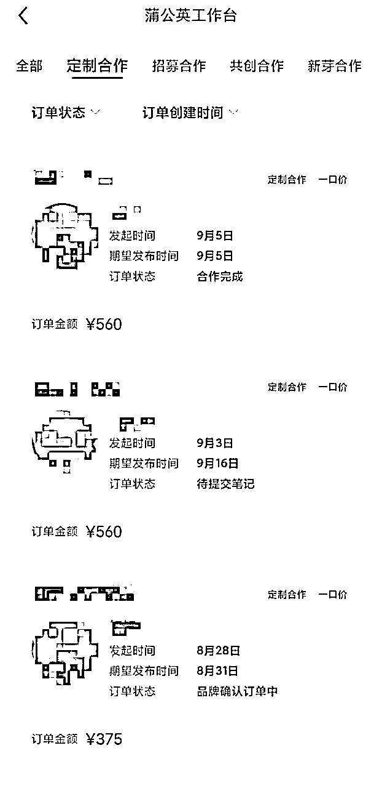
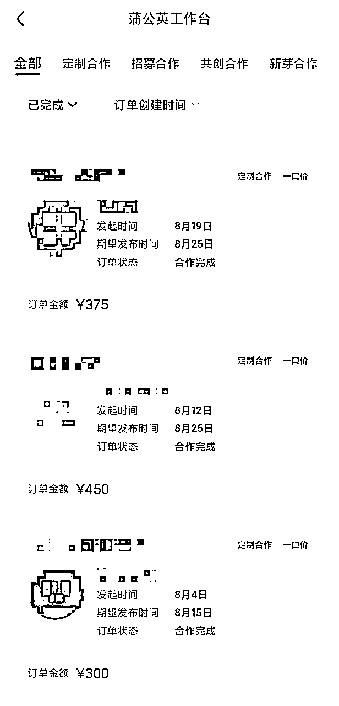
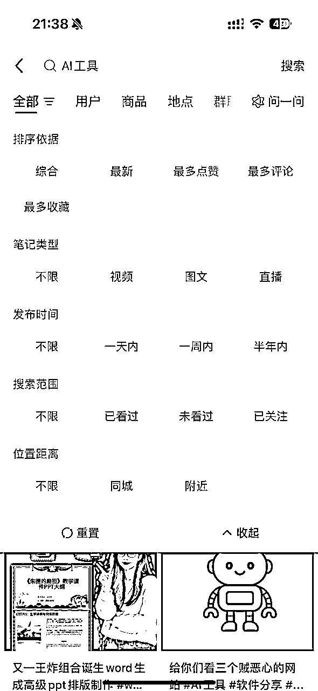
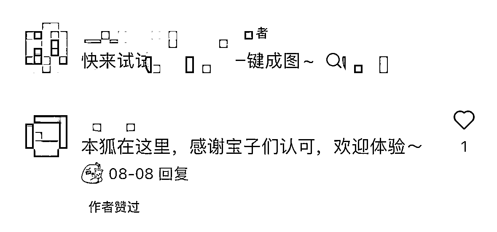
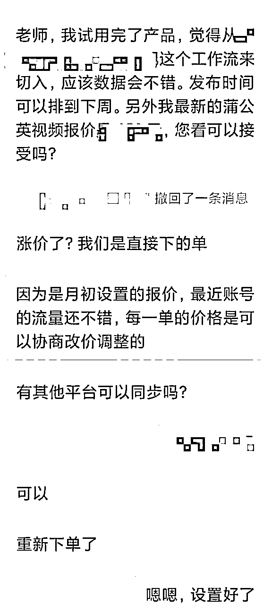
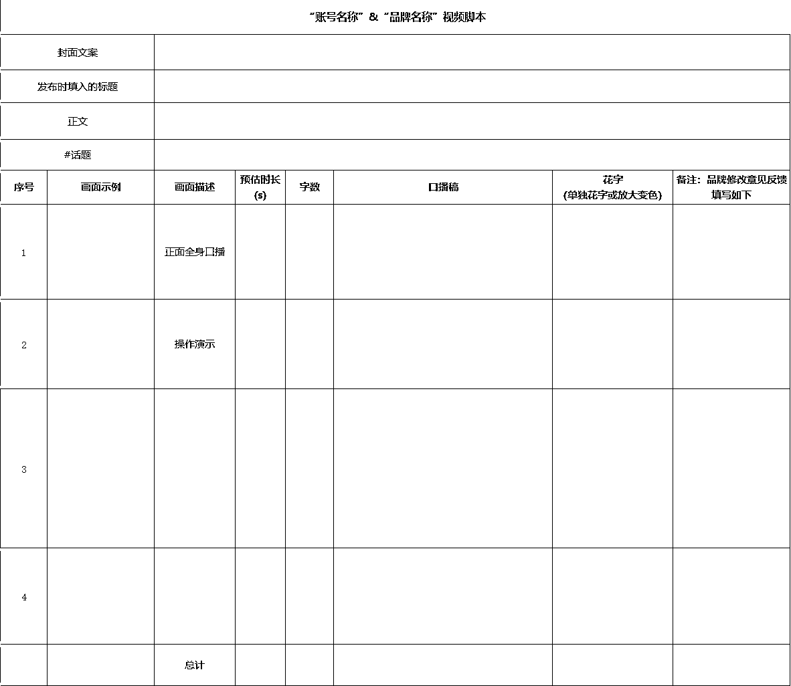
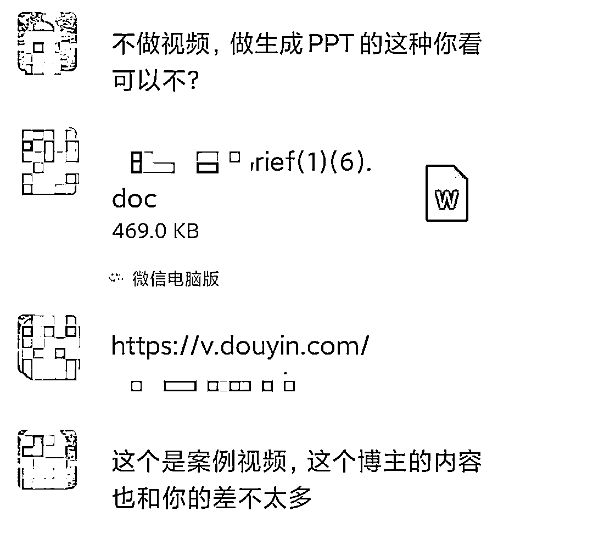

# 三千粉也能做到月入五千：我的小红书AI账号接单实录
## 一、现阶段的数据盘点
大家好，我是龙哥，95年，工作地点武汉。加入赚钱社区刚满一年。
今年五月跟着航海计划开始做AI垂类内容，目前小红书和抖音的关注量都在三千左右，已累计完成二十多笔商务合作，其中小红书占七成左右，抖音占三成，累计变现超过五千元。
虽然体量不大，但邀约保持稳定，平均每月能收到七到十二个合作意向。单价最高的一次达到五百加，跨平台投放。真切感受到了AI产品投放的热度。
这是可在蒲公英后台看到的报备订单，还有不少线下私单并未体现在系统里。

接下来我把从零到一搭建账号、拿到商业合作的完整经验拆开讲，希望对准备入场或正在经营AI自媒体的朋友有参考意义，也欢迎大家多提意见交流。
## 二、账号方向：给普通人找一条可落地的细分赛道
我现在已经打通了从内容到变现的第一步，如果想把收益做大，天花板的关键就在于定位和内容形态。
目前平台上比较常见的AI号型大致分为几类，我把它们各自的商业表现和创作门槛做了一个归纳。
### 1.常见号型对比
| 内容形态 | 人设强度 / 是否露脸 | 全网体量 | 商单情况 | 单条时长 / 价值感 | 核心优势 | 代表账号 |
| 头部大V路线 | 强人设、常露脸 | 5万-30万+ | 大厂为主、报价六千起 | 1-10分钟 | 露脸信任感+长视频价值+精剪 | 秋芝2046、直男山禾、Xuan酱、AI红发魔女 |
| 生图+制片类 | 人设弱、不露脸 | 千粉到数万 | 主要集中在绘图、视频类产品投放 | 1-2分钟 | 审美在线、艺术感强 | 喵同学AIGC、Ai风向标 |
| 素人IP | 人设强、信任度高 | 1千-5万 | 多为小程序、小站，高质量人设可拿大厂 | 1-2分钟 | 真实感、接地气、露脸背书 | 陈陈是只AI喵、闪闪AI进化论 |
| 工具测评/教学号 | 人设弱、不露脸 | 千粉-10万+ | 小工具、小站点为主，但数量多 | 30s-1分钟 | 节奏快、信息密度高 | 小e同学、Genji是真想教会你 |
| 资讯+观点类 | 有人设、配音/对电脑出镜 | 千粉-20万+ | 商单偏少，多为新品发布、大会宣发 | 1-2分钟 | 观点性强、时效性强 | AI楼叔、朋克周 |
建议先对照自身条件挑一个方向，再去收集十到三十个不同量级的对标号做研究。
起步期优先找低粉对标，尤其是小红书粉丝在一万以下但单条点赞已过几百的账号。这类号同样处于成长期，形式未定型，更容易学习借鉴。
万粉以上的号内容更成熟，数据受粉丝基数、投放影响大，新手很难直接复制。
### 2.怎么找到低粉对标号
思路来自航海手册和社区精华帖：翻近一个月AI领域的爆款，从中筛选出低粉高数据的号。
常用检索词：AI工具、AI教程、效率神器、网站推荐、人工智能、DeepSeek、github、AI、agent、智能体、AI软件、效率工具
先批量关注一批同行，每天刷首页推荐，平台对新号友好，低粉爆款出现频率高。

### 3.素人IP的加分项
我观察到不少原本做职场、阅读、教学等赛道的万粉博主，现在大量转做AI内容，表现不错，商业合作也不少，且比纯工具号更受品牌方青睐。
比较吃香的人设身份有：程序员、教师、职场创作者、家长，可作参考：
| 人设类型 | 典型账号 | 优势 |
| 程序员/技术 | 艾克ai分享、林月半子的AI笔记 | 专业壁垒高、内容深度足、易涨粉 |
| 教师 | 糯米棋棋子、李塔Rita | 教师向产品多、流量大、商单稳定 |
| 职场号 | 奔跑的昊子、斯前想后来 | 商业需求广、受众面宽 |
| 家长 | 是超哥的视界 | 人群广、转化场景多 |
## 三、内容生产：如何打出可起量的作品
### 1.选题来源
核心是去对标号里挖近一个月的异常值选题，点赞明显高于同类笔记的题材。
越接近自己的对标，复刻爆款选题的成功率越高。跨细分搬题风险大，受众画像不同。
AI赛道能否走量，关键在选题是否精准。选题对了，比花哨剪辑更重要。
### 2.制作方法：保留骨架，微创新
1. 复刻爆款
拆解爆款的爆点和结构，特别是封面标题和前三秒钩子。能把爆款复现出来并在细节上做得更好，起量的概率就大。把多篇爆款优点融合，提升信息密度，也更易走量。但时长不要随意拉长，否则完播会掉。
2. 从评论区找真实需求
爆款评论区被反复点赞、反复提问的问题，就是真实痛点。
比如一篇高播放的PPT生成工具测评下，大量评论问“有没有能用公司自有模板一键生成PPT的工具”。只要找到对应产品立刻做出，数据往往不错。
我的第一条小红书千赞笔记就是这样来的。当时“DeepSeek生成XXX”选题大量铺开，我跟做却不火。评论区有人反馈实操失败。我去知乎搜方案，找到另一种更稳定的解法，做成教程后凭借成功率高持续吃搜索流量，三四个月点赞过千，也为我带来三四百粉丝。
## 四、商单全流程拆解
### 1.新手如何分辨广告
初期很难分辨哪些是商单，经验多了结合投放规律就能识别：
1. 所有DeepSeek内容基本都不是广告，官方不收推广且自带热度。
2. 豆包、Kimi、即梦、腾讯元宝这类知名产品，千粉百粉号做的大概率是自发内容，几千到几万粉号做则多为投放。
3. 整条内容八成以上都在讲一个冷门小工具/小站/小App，九成是商单。哪怕是夸克、百度、通义千问这类关注度一般的产品也一样。
4. 评论区带品牌话题，且有品牌官方账号留言，基本可判定为商业合作。

### 2.小红书报价逻辑
1. 基础价普遍是粉丝数的10%。
2. 内容数据好可溢价：报价=近30天阅读中位数×0.5~1.5
阅读中位数指近30天笔记阅读数排序后中间一篇的小眼睛。系数取决于是否真人出镜、画风是否统一有质感、场景是否契合品牌调性等。
3. 多平台打包价通常是各平台单价之和后再打8-9折。
4. 返点问题
品牌直签一般不收返点，到手=商单价-平台手续费。
第三方PR会要求20-30%返点，到手=商单价-手续费-返点。
若是非报备水下合作，无需返点，但价格一般是报备价的70%，算下来相差不大。
起初我觉得返点高，后来与汤姆CC教练沟通才明白，广告公司也要给甲方返点。所以在蒲公英填报价时，可适当上浮20-30%，给第三方留利润空间，更易被推荐。价格过高也会吓跑品牌直签，需自行权衡。
5. 蒲公英单价可在固定报价基础上浮动，低至80%，高至150%。空间很大，可根据内容难度、发布时间与PR具体谈判。下图是我一次成功加价的案例：

### 3.PR沟通全流程
1. 提前准备好近期单平台报价和小红书/抖音/视频号打包价。
2. PR来聊时先看Brief，了解产品、需求和要求。
3. 亲自试用功能，查口碑，判断产品好坏。
4. 在平台搜索近期同品类内容，评估流量水平和制作难度。
5. 确认期望发布时间。
6. 谈价格，可灵活运用：
a. 拖延报价：老师我先体验产品、构思方向，再给您一个合适的价格可以吗？
b. 专业形象：老师我体验完了，觉得从XXXX角度切入数据会更好。我最新报价是XXX，您看可以吗？
c. 应对砍价：最低XXX了，可同步XXXX平台，其他平台我同类内容数据也不错。时间比较紧需加班，价格难再降。
7. 提交文字脚本审核
8. 提交成片初稿审核
9. 正式发布
### 4.如何让商单数据更好看
商单主题已定且有截止时间，很难靠热点，自然流量更难。提升数据的办法：
1. 对标模仿
搜产品或竞品近1-3个月的表现，有爆款就模仿；没有爆款就找数据好的同类内容拆解爆点植入。
2. 用爆款选题包装
比如“同事不许看的XX邪修工具”“记住这3个AI一个人就能开公司”“年度3大邪修神器 让你2025年收入翻倍”。
3. 教程化植入
把功能做成教程，弱化广告感。如“豆包+微信王炸组合，30秒把Word变PPT”，本质是PPT小程序广告，却持续跑量。
4. 痛点切入
找长期存在的痛点。如“1分钟用AI做精美Logo，设计小白保姆级教程”，实际是即梦广告，但搜索长尾稳定。
5. 干货稀释营销感
甲方要全面介绍功能时，用大量干货把广告包装成解决方案。
6. 利益诱导
突出赚钱、副业、搞米等用户敏感点。
组合使用效果更佳。举两个案例拆解。
案例1：痛点切入+教程化
《3分钟AI音乐生成| 90%博主不敢说的BGM野路子》 赞141 藏86
做短视频找不到合适BGM？还在熬夜扒歌？怕侵权？找痛点。接下来手把手教用XXX+豆包组合三分钟生成原创音乐，还能躺着赚米。利益点一起上。随后详细演示操作流程，最后再次重申创作者的版权焦虑场景。
案例2：干货植入+教程化
《7天起号 接到商单！2025普通人新出路丨AI做自媒体全流程》 赞2494 藏2927
用一个5000元买课程三个月未破千的反面案例，对比自己AI辅助七天出爆款并接到腾讯大厂商单的正面案例，引出“免费笔记+三找起号法”。在每一步都自然植入腾讯元宝的赛道分析、文件解读、识图等功能，干货远多于广告，感知度低。
### 5.脚本怎么写更专业
一份规范的脚本模板能体现专业度，降低沟通成本，促进复投。多人PR模板提炼的精华版如下，其中预估时长是常被忽略但很重要的点。

### 6.提升商单量的小技巧
1. 厘清账号生态位
弄清自己在商务心智中和哪些账号是同类，从人设、受众、定位判断。看到同类账号接了哪些单，就可主动做相关品类内容。同一主题下竞品会跟进。

我做过视频转文字工具的商单表现不错，后续又来了两家同类产品邀约。
目前投放较多的品类：语音转文字、视频转文字、AI做PPT、AI生图、AI生视频、数字人、教师AI工具。可重点布局。
2. 简介和合集要清晰，身份、内容定位明确，合集可命名为职场AI工具、教师AI工具等，方便PR匹配目标人群。
3. 小红书甲方很看重封面调性，杂乱易被刷；抖音甲方更看数据不看封面。
4. 维护蒲公英商单数据
PR能直接看到你的报备数据表现，连续数据差会减少合作机会，只能靠降价维持。可适当投薯条补数据。省钱投薯条方法可参考另一篇笔记。
## 五、数据焦虑与心态调整
### 1.如何面对数据焦虑
数据焦虑很正常，几乎所有做流量的创作者都会有。关键是别让焦虑消耗自己。
认知上调整：一条数据差，就去后台复盘。是封面、标题、前三秒问题？选题过时？发布时间不对？找到原因再改发。我有多条作品是二发、三发后才起来的。
做账号最踏实的一件事，就是把每一次没火掉的作品拆开来看。把踩坑的原因记下来，反复对照，爆款的命中率才会越来越高，内容手感也会越来越稳。
### 2. 未来变现不确定带来的心慌
这种心慌几乎是每个项目都会经历的阶段，而且会随着你对项目的理解加深、对行业的熟悉度提升而不断变化。
我长期追更龙哥的小灯塔，也常刷程前的动态，慢慢明白一件事：创业里最稀缺的资源是心力，它比当下的技能更关键，心力决定了我们为什么出发，也决定了我们能跑多远。所以必须学会护住自己的心力，别让它被无止境的焦虑耗光。
做自媒体其实很像修行，每天交付一个作品，一份一份地打磨能力，时间一长复利就出来了。
对焦虑的处理我分了两条路。
向内找出口：把当下的情绪写下来，情绪被具象化后压力就会小很多；跟AI教练聊聊，把思路理顺；做一份项目里程碑日历，把微小的进步可视化；运动也是很直接的生理调节方式。
向外借力量：看小灯塔的复盘、看创业者的访谈、跟同路人组局交流、找个教练聊聊。
说实话，就算已经有几万粉的大号，焦虑也没少过。商单报价越高，交付压力越大，还得靠投流、买薯条来稳住数据。所以没必要去羡慕别人，保持对自己的专注，让能力曲线持续向上就行了。
### 3. 从“来者不拒”到“精挑细选”的单子进化史
项目启动的前三个月，视频的数据其实还算可以，但粉丝增长很慢，接到的商单也寥寥无几。为了先拿到第一笔收入形成正反馈，我当时什么都敢试：按点赞结算的小程序广告，接过那种只负责投流给钱的单子也接过。
等粉丝基数起来后，询单量开始变多，时间精力有限，就必须做取舍了，直接把一批单子谢绝掉。那段时间从千粉到万粉，增粉才是第一优先级。
在我看来，一个合格的好商单，核心判断标准只有一个：能不能帮账号涨粉。要么契合当下正火的选题方向，要么是头部大厂产品自带热度，这两种才值得投入。
## 六、复盘总结
### 1. 关键数据一览
分享一下我的小红书AI账号成长轨迹。粉丝突破3000后，就进入了小KOC的区间，商单的来访频率肉眼可见地提升。
粉丝数 | 商单数量 | 报价区间/元
1-1000 | 5 | 30-100
1000-3000 | 5 | 100-300
3000-3800 | 13 | 300-560
变现能力得到验证后，下一步的重心要回到增粉上来。内容打磨要更用心，商单数量适当收缩，去研究万粉博主的内容质感，逐步把报价往上抬。
### 2. 给新人的入场建议
小红书的去中心化分发对新号还是很友好的，现在入局仍有窗口期。
基于近期的观察，我比较看好下面两类内容方向，这两个赛道最近都有新号起量并实现变现的案例。
内容类型 | 人设/出镜 | 全平台粉丝量级 | 商单情况 | 视频时长/价值 | 核心优势 | 参考账号
AI素人IP | 人设感强、信任感高 | 1000-50000 | 以小程序、小网站为主，调性好的可接到大厂单 | 1-2分钟 | 出镜带来的信任感、接地气、真实感 | 陈陈是只AI喵、闪闪AI进化论
工具/网站号、教程号 | 人设弱、一般不出镜 | 1000-100000 | 多为小工具、小网站，但数量多且稳定 | 30s-1分钟 | 画面节奏和剪辑要求高 | 小e同学、Genji是真想教会你
## 写在最后
写下这篇复盘时，我又想起起号前三个月那个被不确定感折磨的自己。而此刻的你，或许正处在同样的煎熬里。0到1这段路，我唯一能确定走通的方法，就是在绝大多数人已经转身离开时，我依然选择再试一次。
AI浪潮已经掀起来了，自媒体赛道的大门还没有关上，机会依然存在。
祝你早日拿到想要的结果。
最后特别感谢赚钱AI自媒体航海的几位教练——@Elaine @汤姆cc @东篱，他们的分享和陪伴在迷茫时给我了很大的力量。