# 不花钱的AI人像摊位速成术：一天上手，第二天开张

原文首次发布时间为2024年11月，于赚钱：

* * *

我是Penny，2021年加入赚钱社区至今一直潜着。最近在刀姐那个社群重读《别独自用餐》，心里忽然被点什么敲了一下：自己闷头出摊踩过的坑，别人也许正等着往里跳。倒不如把这段经历写成文字，让有需要的人少走点弯路。

# 一、怎么想起去摆摊的

起因是一位朋友发来消息：某AI技术交流会要在周末办市集，摊主名额不收任何费用，只需填张申请表就能占个位置，距离活动开场只剩不到一周。

我当时正琢磨着精进AI技能，看到这个低门槛机会，立刻锁定了相对容易上手的人像摄影摊。

真要交代一下技术底子：我属于那种连代码都看不明白、ComfyUI听都没听过的小白。报名后用了三天硬啃ComfyUI教程，成效约等于零——三天根本不可能速成，最后现场也确实一点没用上。

不过天无绝人之路。在临开市前，我意外发现一个信息差：用即梦AI生成人物肖像，出图质量远超预期。只花了一天熟悉操作，第二天就开张了。

# 二、定制化人像写真实操

具体路径并不复杂，一步步说：

先打开即梦官网：https://jimeng.jianying.com/ai-tool/home/?utm_medium=baiduads

进入首页后，找到“写实肖像”的入口。

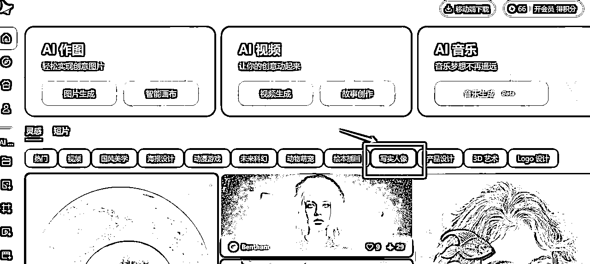

然后在模板区选一个喜欢的风格，比如下图那组人鱼主题，点“做同款”。

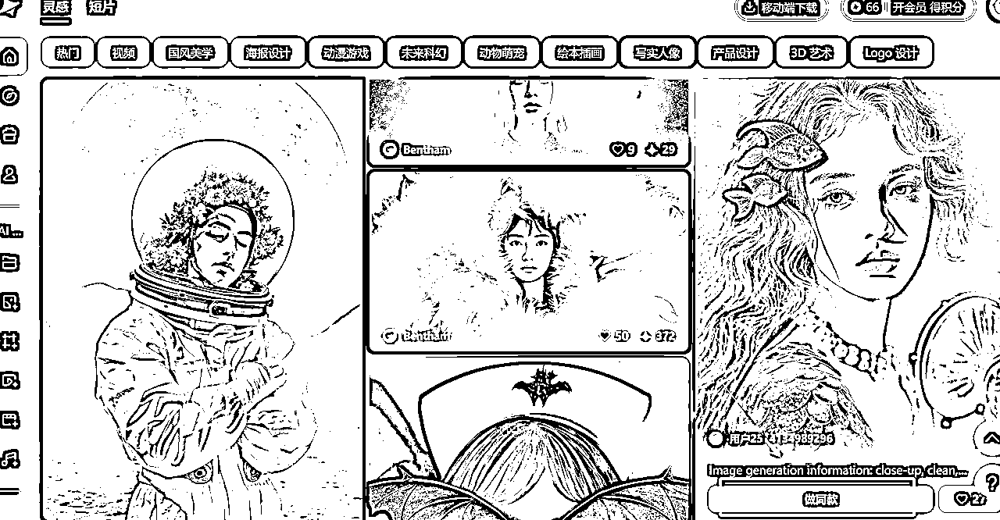

这里有个关键动作：要生成自己的专属面孔，一定得打开“导入参考图”。

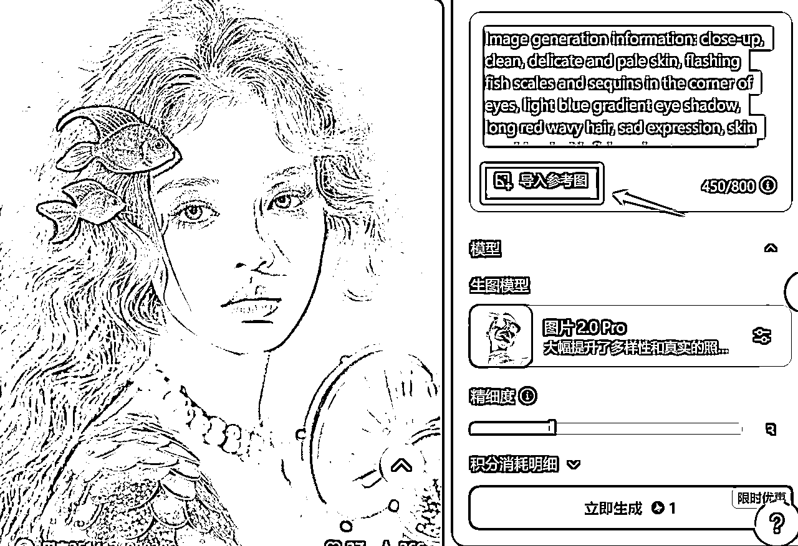

接着点进“人物长相”设置。我当时随手拿了一张希拉里的照片来测试。顺便提醒一句，很多名人的脸系统并不支持，例如我用特朗普的照片尝试，直接失败。

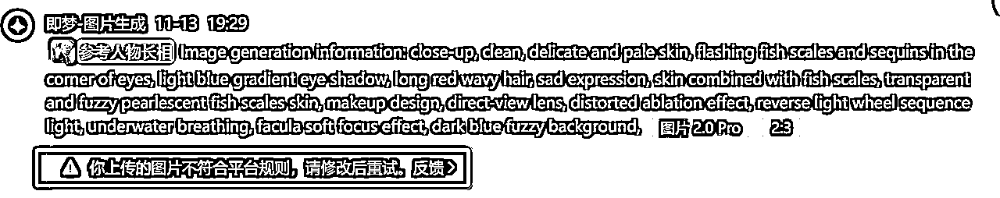

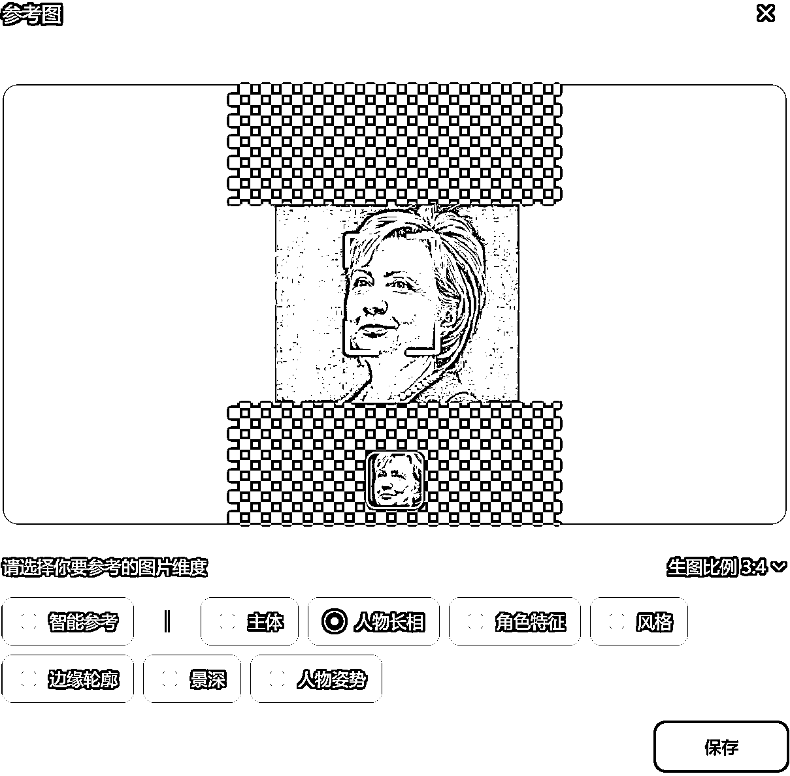

全部选好之后，点“立即生成”。

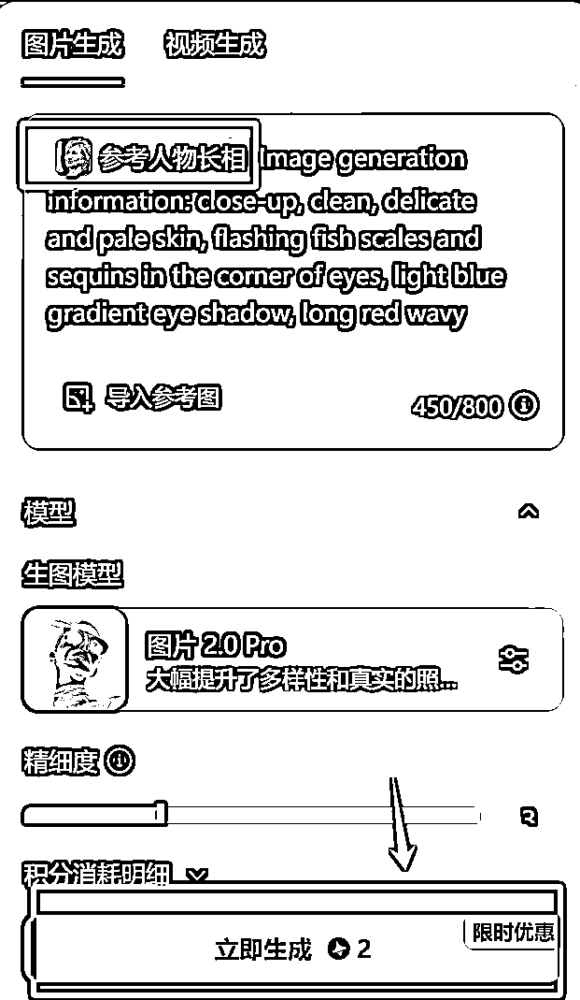

稍等片刻，写真就出来了。

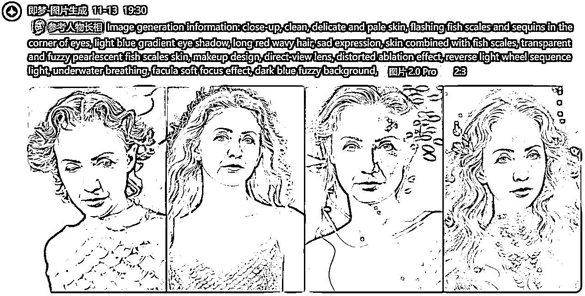

看着是不是还挺有质感？如果对首版效果不满意，就再点一次生成，多刷几轮，挑最顺眼的一张或几张留用就好。

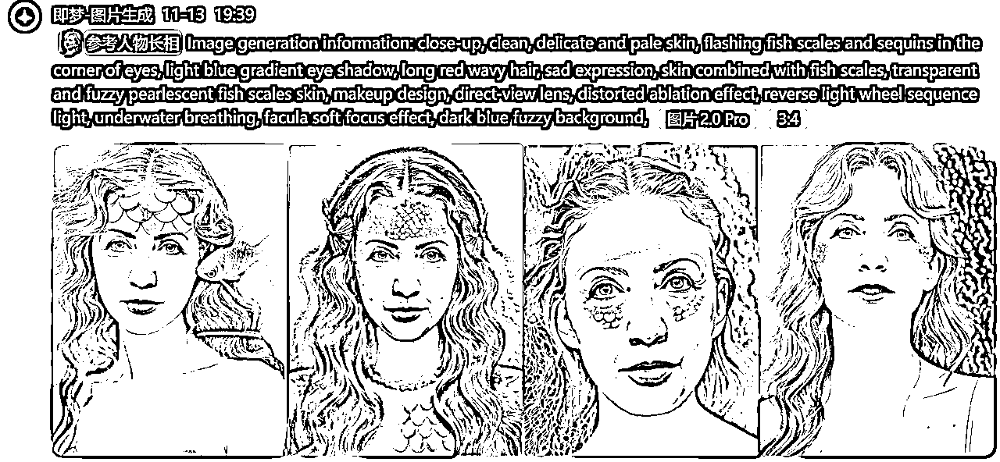

## 1、参数设置心得

生图模型尽量选最新的2.0 PRO，照片质感最接近真实镜头。比例可选八种，图片尺寸也能自由调整。

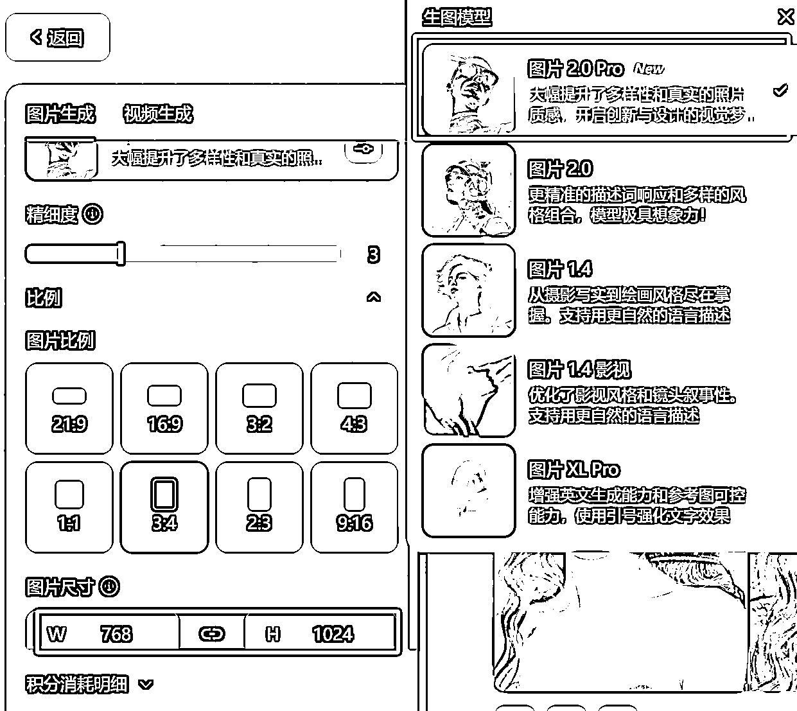

## 2、常用风格收藏与Prompt

下面是我亲测好用的几种风格，Prompt可以直接复制。

### 女性风格01：氛围灯光＋皮草大片

Prompt：氛围感下的人像写实摄影，模糊剪影在磨砂玻璃后，低角度，可爱的中国美女，皮草大衣，发光手写汉字高速动态模糊，画面层次丰富，8K画质，立体，半身像,身材高挑，高冷，大师摄影，虚影

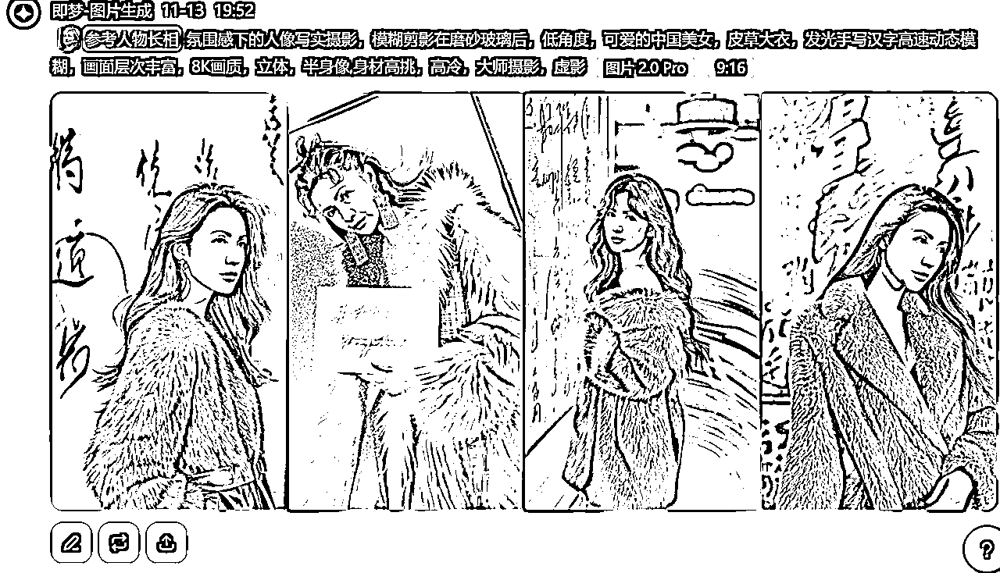

### 女性风格02：自拍视角＋故事叙事

Prompt：用自己镜头的自拍照，人像双重曝光，渐变磨砂质感，胶片，弥散光学，优雅，高级感，淡雅简约，故事感

这组Prompt主要取的是面部五官，所以记得选“参考人物肖像”模式。

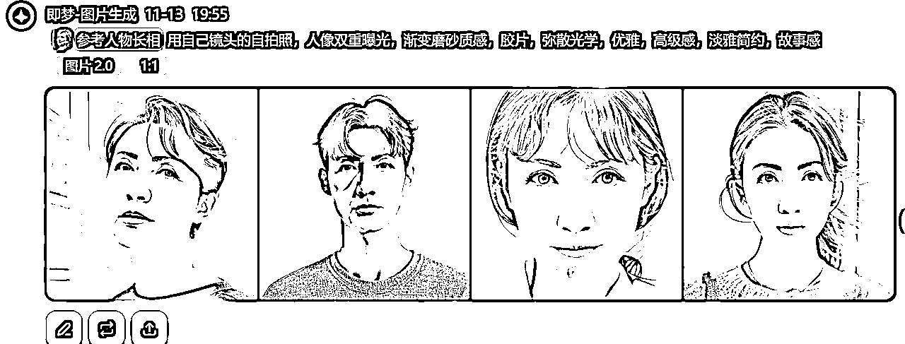

### 女性风格03：黑白艺术＋动态虚化

Prompt：黑白女子人物运动模糊摄影，面部特写，高级强烈的运动模糊和动感模糊，艺术的虚化效果，高级感，模糊到只看得出人物轮廓，看不清楚五官。朦胧感，超现实主义，蓝灰肉丝变背景，加艺术签名

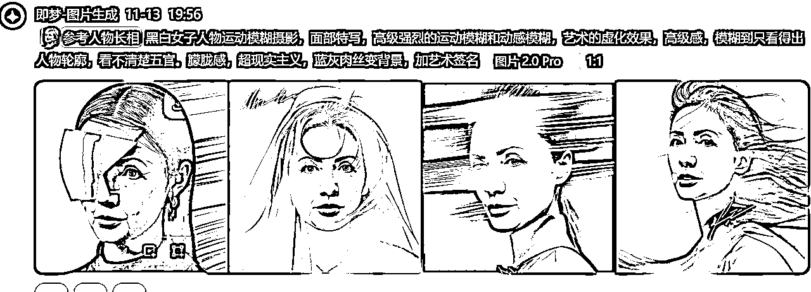

### 女性风格04：萌宠守护＋双马尾少女

Prompt：人物高端旅拍，场景重庆李子坝轻轨战，少女写真，胶片质感。女孩（双马尾）的自己的猫咪(加菲，胖嘟嘟）穿着同款浅色嘻哈服，人像半身，低机位仰视，轻轨从高楼中穿出，蓝蓝的天空。女子和猫咪坐在轻轨下跟轻轨互动，做出一些有趣可以的动作。取景干净简洁，背景虚化，光线柔和自然

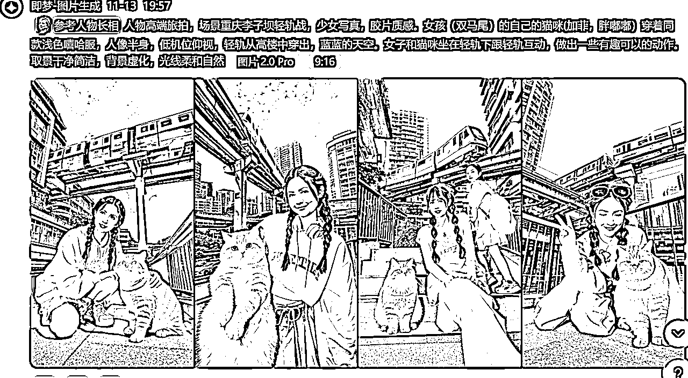

### 女性风格05：狼族公主＋民族风情

Prompt：一个狼族的公主，表情忧伤，凌乱的蓝色头发，穿着少数民族服装，样子精致，一定狼头帽子，一条少数民族银饰，背景是幽暗的山谷，有雪的山峰，高对比的色彩，高品质，高清晰

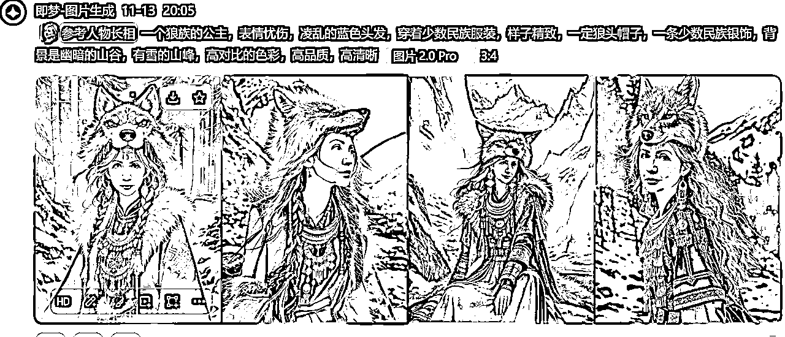

### 女童风格：花朵元素儿童摄影

Prompt：儿童摄影写真《乐开了花》，头上开出了一朵花

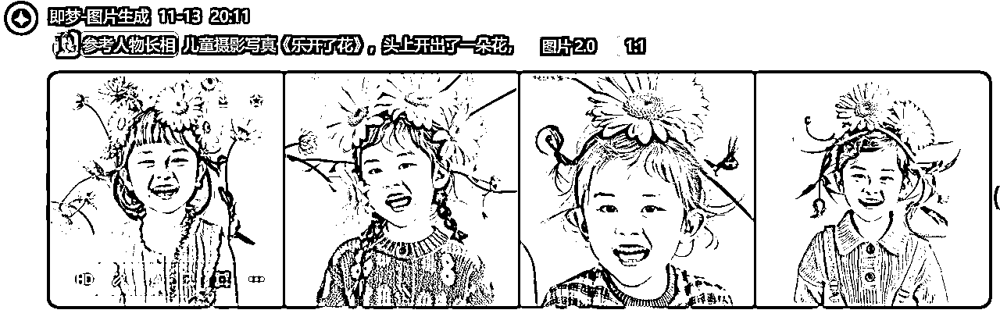

### 男童风格：幼儿园毕业纪念

Prompt：单人毕业照，一个可爱幼儿园小男孩，穿着毕业服，可爱动作，表情可爱，旁边一只小博美，幼儿园教室背景，超高清，细节丰富，彩带，气球

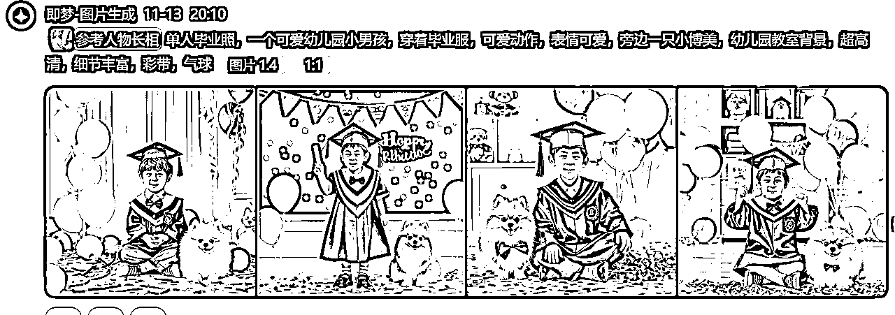

有人能看出这组图参考了哪位男星的童年照吗？评论区猜对的话，文末有惊喜。

### 男性风格：黑白复古街头

Prompt：黑白摄影，老照片，街头摄影，朦胧的光晕，帅气模特青年，五官深邃，立体感强，倚靠在巴黎街头的黑色路灯柱，等待，高斯模糊身后行走的路人，抱着一束浅色玫瑰花，帅气，强烈的明暗对比

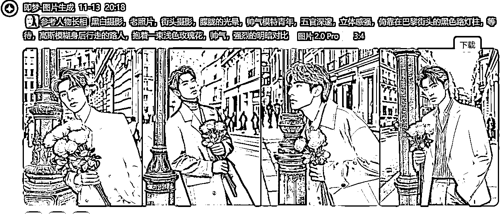

## 3、积分算法

文生图和垫图生图，每次都是扣2个积分。即梦每天登录自动赠送66积分，折算下来等于每天能免费做33次定制人像，每次出4张图，33×4=132张。如果觉得不够用，换个手机号再注册一个账号就行，免费额度完全够薅。

基础会员相对免费版主要多了一个去水印功能。

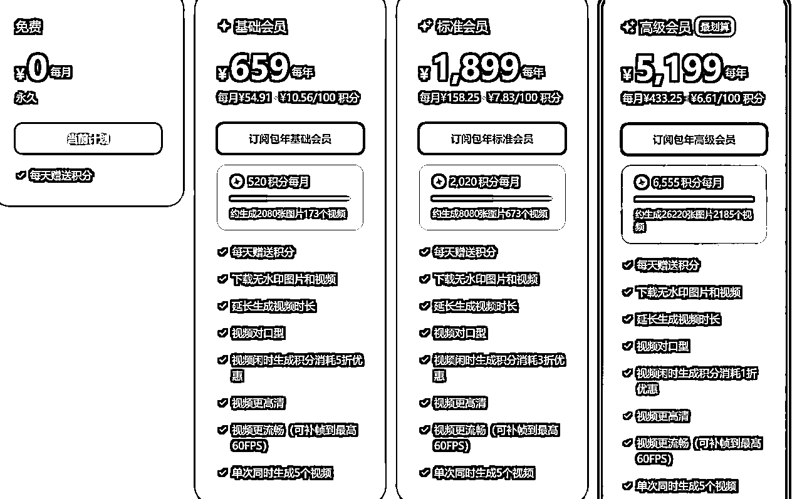

不想开会员的话，免费去水印的线上工具也不少，比如这个：https://www.apeaksoft.com/zh-CN/watermark-remover/

# 三、摊位上的一点点碎碎念

实话讲，门槛越低的行当，冲进来的人就越多，后入场者赚钱的难度也会水涨船高。以我并不丰富的实战经历看，AI人像写真目前还是能赚到钱的，只是红利窗口正在迅速关闭。

我出摊时的定价是9.9元一张体验价。有人愿意扫码尝鲜，摊子能开张，但利润微乎其微。

同一场活动里有个小姐姐跟我卖几乎一样的东西，她一张要88元。图的内容大同小异，差异在于她的模板更丰富、使用的工具更多，而且支持现场打印照片、装进相框，另送一个拼多多买的小徽章。结果她那边冷清得很。

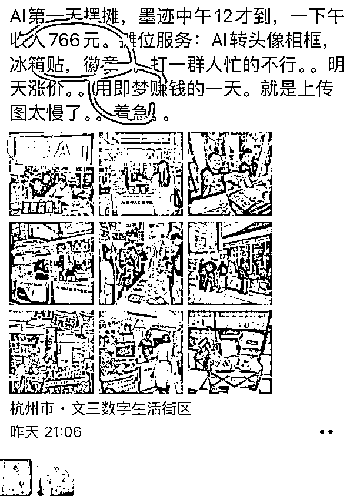

另一个摊位同样做AI写真，但多了不少冰箱磁贴和徽章这类小物件，人气明显高出一截。还有的摊主直接走升级路线：有人把ComfyUI玩得很溜，有人结合了更新的技术方案。AI和市集碰撞在一起，还真有点八仙过海的意思。

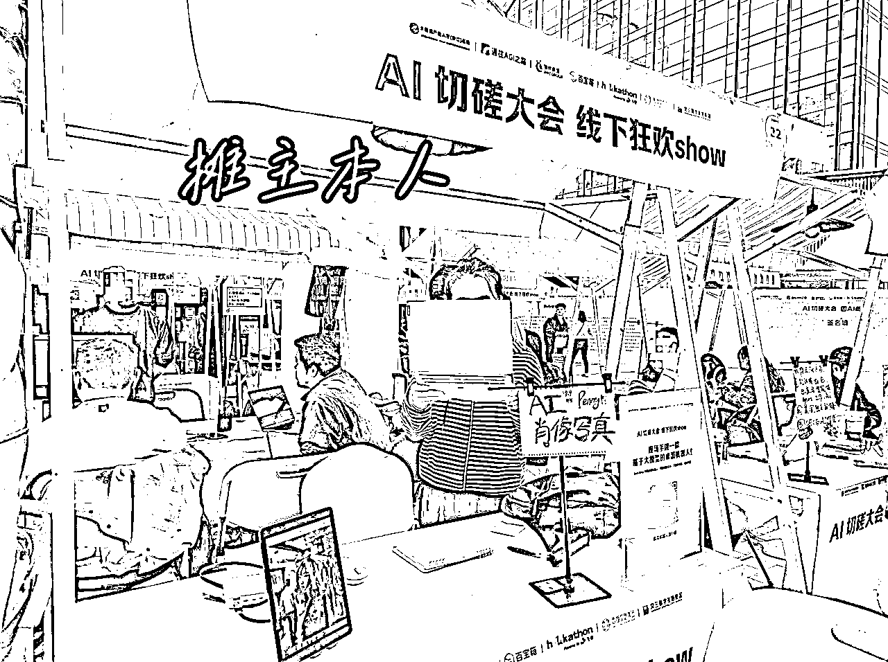

最后放一张脸没入镜的摊位照，社恐人士的营业日常。

以上，就是这次AI人像摊的完整复盘，希望能给观望的朋友一点参考。

* * *

# 四、2025年1月补充

过去这几个月，AI人像的技术门槛越来越低，市场已经卷成红海。尤其现在很多常用App都能一键做风格转绘，年轻用户对这种产品的新鲜感和付费意愿都明显下滑。

想入局的朋友，听我几句劝：

1. **别把硬成本砸进去**。照片打印机不值得买，闲鱼上按天租就行；相框在拼多多、1688上买，便宜到可以忽略；摊位优先找免租金或者收费低的。

2. **出图速度是生命线**。即梦这类工具有抽卡属性，可能要反复尝试，客人等久了就走了。如果你会ComfyUI，多试试LiblibAI上的免费写真流程，人物和宠物模板都很全。

3. **摊位选址要认真做功课**。位置决定了你会遇到什么人，而人几乎直接决定了成交率。

4. **动手才有答案**。一千个摊主有一千种玩法，欢迎把你的摆摊故事发在评论区。