# 不露脸、不直播，靠小红书资料产品和私域，4个月做到15万+：Rose的实战拆解

260715 副业SC 精华

大家好，我是 龙哥。

这次想分享的，不是某个突然爆红的神话，而是一条我亲自验证过的低成本路径：

把熟悉行业里的经验，整理成普通新人能直接使用的资料包；再借助小红书的搜索流量完成成交，通过微信端承接后续关系，让一次购买不止停留在一次交易。

整个过程不需要出镜，也不用开播，更不涉及进货压库存。

先把目前的数据摆出来：

- 小红书店铺收入超过13万元；

- 累计成交约3500笔；

- 微信端留下的用户接近1700名；

- 私域另有1.5万元以上收入；

- 从零起步至今，大约经历了4个月。

这套方式，比较适合以下几类人：

- 在某个行业工作过，掌握的信息比初学者多一些；

- 清楚新人最容易在哪些环节卡住；

- 手里有经验、清单、表格或流程，能够进一步加工；

- 不愿出镜或直播，但愿意持续写内容、做资料；

- 想做轻投入项目，同时把读者逐渐转成买家、联系人和老客。

文中会讲清楚：

1. 我为什么放下单纯做账号，开始搭建资料产品；

2. 我为什么认为这个方向仍有可操作空间；

3. 从发现需求到卖出第一份资料，我具体做了什么；

4. 小红书内容、店铺、微信承接、评价和复购之间如何衔接；

5. 普通人需要具备哪些基础能力，以及我现在使用的工作流程。

如果要概括这段经历，就是：过去我只关注“今天能不能获得曝光”，现在更在意曝光之后能不能留下产品、关系和后续收入。

## 先交代一下我的起点

我并非天生会做生意的人。

我毕业于普通本科，来自农村，刚到深圳工作时，每个月固定工资只有3500元。以前我对赚钱的理解很简单：先把工作做好，再争取涨薪，然后慢慢存钱。

至于创业和副业，我曾经以为那属于资源丰富、表达能力强、社交圈广的人。

真正做完这个项目后，我才发现，普通人并不一定要等到自己成为专家，才有资格开始。只要你在某个具体领域里，比刚入门的人多经历过一些事情，知道他们容易犯什么错，并且愿意把这些经验整理成可使用的内容，就具备了做小产品的基础。

我的性格偏安静，不爱露脸，也不擅长频繁社交。相比于构建复杂人设，我更擅长拆解别人的做法，再结合自身情况执行、修正。

这不是一篇“天赋选手”的故事。我想说明的是：资源一般、表达普通、不喜欢抛头露面的人，也能从已有经验里找到一个切入口。

我之所以公开这段经历，一方面是因为这条路已经产生了真实结果；另一方面，是我在继续放大时遇到了瓶颈。

项目已经完成了从0到1，可是接下来到底应该优先改产品、扩内容、做用户运营，还是补交付流程，我并没有清晰答案。希望借此认识更多有经验的同行，也让已经验证过的部分接受更多反馈。

之前看过小鹅的一句话，对我影响很大：

> 尽可能进入更多人的视线，把自己的能力和价值公开展示出来。

所以，这篇内容也算是我迈出的一步。

## 一、我为何从内容账号转向资料产品

在做资料项目前，我已经运营了一段时间的小红书账号。

目前那个账号有4.5万粉丝，曾在约3个月里增长2万粉，也出现过多篇获得2万以上点赞的内容。

不过，账号并不是一次成功的。我此前尝试过十多个账号，几乎都没有明显进展。

过去我特别热衷于寻找免费的课程、资料和经验分享。看起来没有花钱，实际上却把大量时间耗在了反复试错、反复猜测上。资料看了很多，真正落地的内容却很少；方法试了不少，也很难判断问题究竟出在策略还是执行。

后来读到李笑来的《财富自由之路》，其中“免费其实最贵”的观点让我重新思考这件事。

我并非没有付出代价，只是把付款方式换成了时间、精力和弯路。

之后我开始研究对标账号，发现某个做得不错的账号，背后有系统学习和训练的经历。于是我决定不再完全靠猜，花199元买了自己的第一套付费课程。

这笔钱不算多，却改变了我的做事方式：有些支出不是消费，而是在购买更短的试错路线。

账号做起来之后，我接过广告，也售卖过资料，累计收入大约8万元。表面上看，粉丝、爆款、广告和收益都有了，但做久后我越来越清楚地感受到一个问题：

账号的数据并不真正掌握在我手里。

某篇内容表现好，当然会开心；但紧接着就会担心下一条是否还能达到同样效果，广告能否持续，暂停更新几天后账号会不会下滑。

尤其是视频内容，从找题目到拍摄、剪辑、发布，耗时非常明显，而且投入与结果之间没有稳定对应关系。

更麻烦的是，内容账号往往是“流量来了就消耗一次”。没有产品承接，没有长期关系，下一次还得重新从头争取曝光。

于是我开始寻找另一种可能：

能不能让每次内容带来的访问，除了阅读和点赞之外，还留下某种长期价值？比如一次购买、一条评价、一个微信联系人，或者后续的二次消费。

也是在听播客时，我接触到了虚拟资料这个方向。

它和我的特点比较匹配：

- 不要求出镜；

- 不依赖直播；

- 不必先塑造强个人品牌；

- 更看重文字表达、资料加工和服务设计；

- 可以围绕一个清晰问题开发产品。

我不是那种特别擅长凭空创造的人，但我愿意研究、拆解和执行。看到别人已经验证过一条路径后，我更愿意把它拆开，再做出适合自己的版本。

年初时，我还给自己定了一个目标：一定要拿出一笔钱，用来提升能力和效率。

加入赚钱之前，资料其实已经做出来了，但我心里始终没底。我反复担心：需求会不会太小？这个行业是不是只能卖到几千单？产品有没有继续增长的空间？

当时我也向AI龙哥请教过。他的一句话让我放松下来：

> 别人的上限，不等于你的上限。只要产品和交付做得更好，就可能获得更多成交。

这句话的价值不在于给出标准答案，而在于帮我把混乱的担忧拆成一个个可验证的问题。

现在回头看，我选择这条路的原因很朴素：我有行业积累，也做过内容，愿意持续执行，而资料产品恰好把这几项能力串在了一起。

## 二、我看中的三个切入点

### 1. 不必成为顶尖专家，先解决初学者的问题

以前有位老师告诉过我：

> 刚开始不用证明自己是大师，只要比零基础的人多掌握一些，就能提供帮助。

我在相关行业工作了5年多，虽然称不上顶尖从业者，但对于刚入门、准备求职或刚开始工作的人来说，我已经经历过他们即将遇到的许多环节。

如今还有AI工具可以协助完成检索、归纳、排版、图片和视频制作。真正重要的不是“知道所有答案”，而是能否准确识别问题，并把答案加工成可执行的形式。

在决定制作前，我会先检查三个方面：

- 这个问题是否长期被用户反复提及；

- 是否已经有人愿意为解决方案付费；

- 市面上的现有产品是否存在体验缺口。

只有这三项同时成立，我才会继续推进。

这份资料从确定方向到正式发布，前后大约花了一个星期。产品放上去后，我发布了一条相关内容，第二天早上就收到了第一笔订单。

金额虽然不高，却完成了非常重要的验证：原本只是判断和猜测的需求，已经有人愿意用钱投票。

### 2. 启动门槛低，适合小规模验证

资料型产品不需要仓储、租赁场地或复杂团队，前期很多环节都能由个人完成：

- 找到具体问题；

- 设计内容框架；

- 加工素材；

- 发布相关内容；

- 处理咨询；

- 完成交付；

- 继续收集反馈。

很多项目并非没有收入空间，而是开始阶段就需要投入太多资金，失败一次便很难承受。

资料产品的优势在于可以先做小范围测试。只要抓住一个明确痛点，并把解决办法组织成清楚、易用的内容，就有机会先完成第一笔交易，再根据反馈继续调整。

### 3. 小红书仍适合承接问题型需求

我目前的主要成交来源就是小红书。

这个平台上有不少用户并非单纯消磨时间，而是带着具体困惑来寻找答案。只要内容能够精准回应他们的场景，再配合合适的产品承接，就有机会形成转化。

前段时间，部分同行因为类目和规则等原因减少投入，也让一些细分方向出现了重新布局的空间。

当然，这并不代表随便发几篇内容就会产生收入。它更适合这样做：

先找到长期存在的具体问题，再用内容建立信任，最后用价格适中的资料完成首次交易。

## 三、我把这条路径拆成了什么样

店铺累计13万多的成交，并不是某一条内容突然爆发带来的。

我的做法更接近于：先搭出一条简短链路，再持续修补每个环节。

目前的流程大致是：

小红书内容触达 → 商品页面成交 → 用户获得资料 → 在交付中提供后续联系入口 → 用免费资料继续承接 → 收集评价 → 建立长期联系 → 推出新的相关产品。

过去，内容发布后用户离开，价值基本就结束了。现在，一次访问可能产生多种结果：购买、留下联系方式、提交评价，甚至在未来再次购买。

这就是“流量”与“用户资产”的区别。

### 第一步：从熟悉的行业切入

我没有选择完全陌生的方向，而是从自己长期工作的细分行业开始。

原因很直接：我知道新手最容易在哪些地方出错，也清楚哪些内容看起来丰富，实际却无法帮助他们行动。

如果你准备尝试类似项目，可以先问自己：

- 哪个领域是我长期接触过的？

- 我曾经解决过哪些难题？

- 哪些经验可以整理成清单、表格、模板或说明？

- 我能否帮别人少花几天甚至几周的摸索时间？

不必一开始就追逐热门赛道。熟悉程度往往比市场热度更重要，因为它决定了你能不能持续产出、准确判断和补足细节。

### 第二步：先观察真实提问，再设计产品

确定方向后，我没有马上制作资料，而是先去观察用户到底在问什么。

我主要关注这些场景：

- 初学者怎样进入某个行业；

- 求职面试前该做哪些准备；

- 入职后需要掌握哪些基础流程；

- 工作过程中缺少哪些表格和范本；

- 没有系统培训时，大家会主动寻找什么内容。

这些问题背后，通常是明确的行动焦虑。用户并不满足于看一篇泛泛介绍，他们更想知道下一步该做什么、先准备什么、怎样避免低级错误。

我会在小红书上搜索相关词语，不刻意限定发布时间，因为我要找的是持续存在的问题，而不是短暂热点。

观察时重点看两种内容：

第一种，是点赞、收藏表现较好的主题。比如点赞超过1000，往往说明它已经获得了一定关注。

第二种，是评论区主动索要资料、表格、电子版或模板的内容。

当评论里反复出现“有没有完整资料”“能不能发电子版”“刚好遇到这个问题”等话术时，说明用户已经从“想了解”走向“想拿到能使用的东西”。

我会从四个角度判断是否值得继续：

- 这个主题是否多次获得较好反馈；

- 用户是否不断提出资料需求；

- 同类产品是否已有销量；

- 现有产品是否存在内容混乱、结构简陋或使用不便的问题。

我尤其关注用户买完之后还缺少什么。因为那些反复出现的疑问，往往会变成后续内容和新产品的方向。

当时，我看到同领域有一款类似产品，销量接近2000单。这说明需求已经被市场验证。

但对方的资料主要以网盘文件形式交付，内容虽然不少，却缺少清晰的阅读顺序和使用说明。

对新手而言，困难往往不是文件太少，而是面对一堆文件时不知道先打开哪份、怎样组合使用。

因此，我的判断是：问题成立，但体验仍然可以改善。

## 四、怎样把零散素材做成真正能用的产品

资料产品并不是把网上内容简单搬到一起。

我的处理顺序如下：

1. **先锁定用户要解决的具体问题**（比如会计做账，我看到最近一年，很多点赞收藏数据都不错，说明有需求）

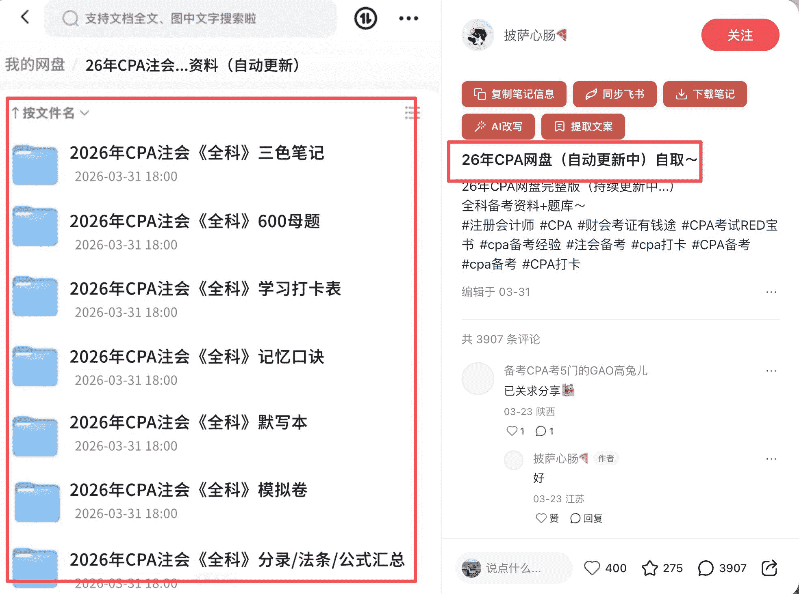

2. **再到闲鱼、小红书、整理对应资料**（小红书点赞收藏1万+，说明这个帖子需求很高，但是是手写的，没办法打印和下载，我们就可以把他整理下来）

3. **用自己的经验做筛选和补充**

4. **用 AI 辅助优化结构、图片、视频、说明文案**（把上面的信息都发给 ai，我用的 codex，让他整理）

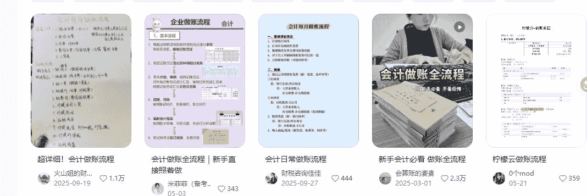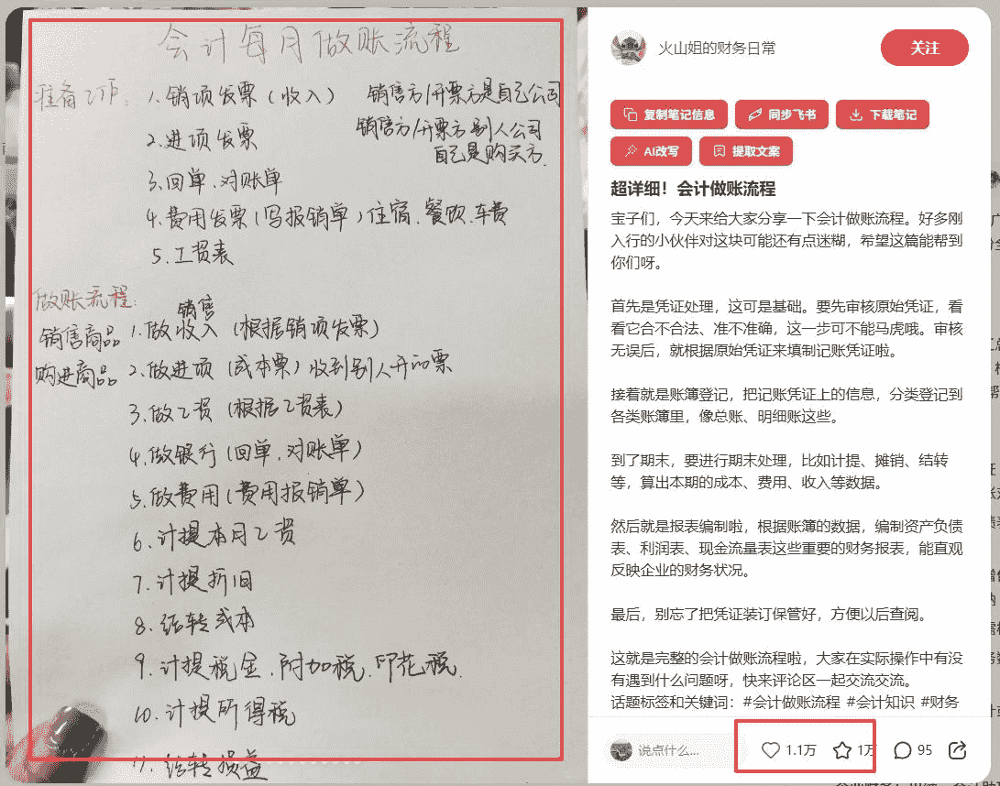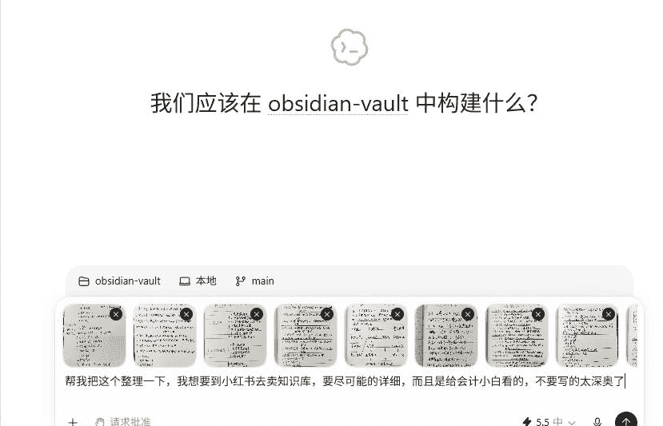

5. **最后打包成用户能直接使用的形式**（我用的飞书知识库）

真正决定产品价值的，不是文件数量，而是用户拿到之后能不能迅速找到答案、按顺序执行。

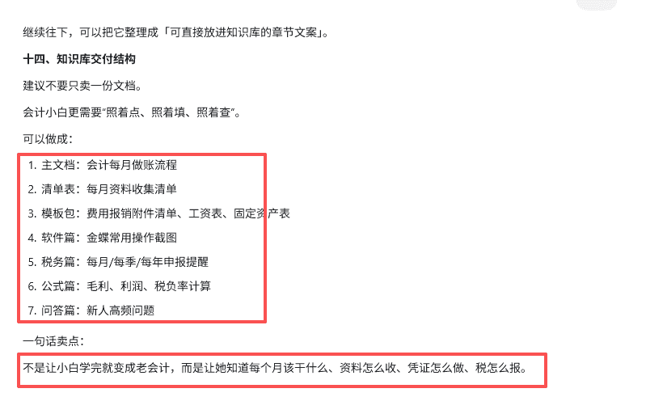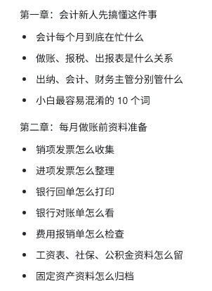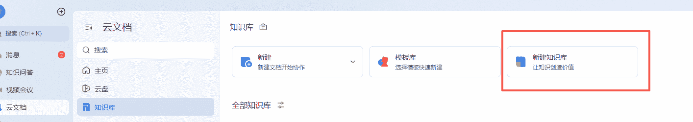

所以我会重新设计使用方式：

- 没有基础的人先从哪里开始；

- 正在准备面试的人需要优先查看哪些部分；

- 已经入职的人可以马上调用哪些范本；

- 哪些步骤最容易出错，需要提前提醒。

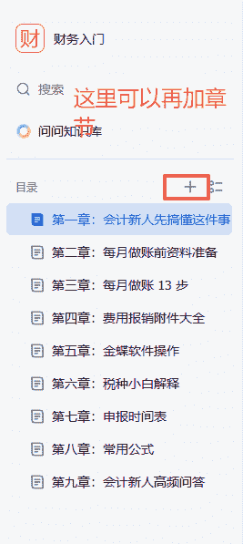

我没有把资料简单塞进一个文件夹，而是借助飞书知识库重新搭建目录，把零散内容按照学习和使用顺序排列，并加入自己多年工作中的判断、提示和注意事项。

同样数量的文件，若只是杂乱堆放，用户拿到后仍然需要二次整理；如果结构足够清楚，用户能快速找到并使用，购买体验自然会更好。

## 五、如何完成第一笔交易

目前店铺累计成交约3500单，收入超过13万元。

这组数据对我来说最大的意义，不是金额本身，而是证明了：普通人不必先拥有巨大粉丝量、成熟团队或强个人品牌，也能搭建出有收入的小型项目。

在定价上，我没有采用9.9元这种极低价格。

实际测试后，我发现平台用户并非只看最低价。只要产品能够解决一个具体且紧迫的问题，49.9元、59.9元同样有成交机会。

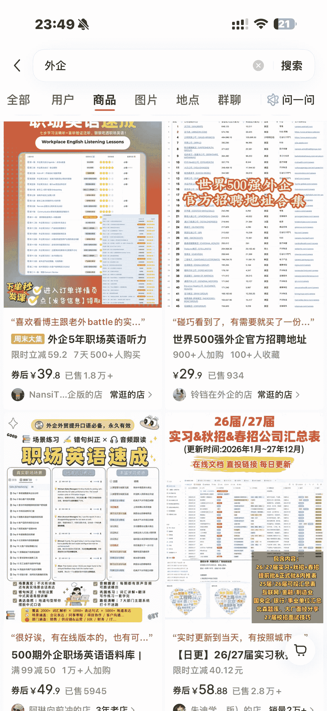

我的主要购买者多是刚进入行业的人，他们常见的需求包括：

- 怎样迈出入行第一步；

- 面试前应该准备哪些内容；

- 刚开始工作时如何避免手忙脚乱；

- 哪些流程、表格和基础资料值得提前掌握。

这套做法跑通之后，我回头把整个过程捋了一遍，发现真正起作用的其实不是哪个灵光一现的点子，而是一连串很朴素的判断。把这几个月的东西整理出来，当作一次阶段性的记录吧。

一开始，我盯上的是那些刚想踏进某一门新行当，却发现周围没人能教自己的人。他们的处境我知道得太清楚了：东西没学透，面试那关就难过；就算勉强进来了，手上功夫不到家，工作时也会不断出岔子。更致命的是，公司大概率不会为你专门搭一套培训体系，能靠的只有自己从网上捞那些零零碎碎的信息。

所以这东西对求购者来说，解决的不是“没资料”的问题，而是“我不知道该怎么开始”的问题。他们要的是一份安全感：有人告诉我先干哪步、后干哪步，做砸了怎么办。我的答案是给他们一条清楚的路线，而不是丢一堆文件名过去。

商品上架的时候，我并没有等它变得完美。做出个能拿得出手的版本就挂了上去。我始终觉得，空想出来的需求跟真正卖得动的需求经常不是一回事。你猜客户想要什么，不如直接把他放进购买场景里看他的反应。所以我的节奏很固定：先放上去，发几条帖子测测水温，收到反馈后再慢慢调整。

第一次发文之前，我会把之前收藏的那些热门帖子翻出来重新看一遍。这回不是学选题，而是学表达。我把别人的标题拆开，研究它是怎么把难处说明白的；把封面图放大，看它第一眼能不能让人意识到“这说的就是我”；标题里有没有埋下入门、面试、准备材料这些信号；留言区里大家都在问什么，哪些问题可以直接写进我的正文里；再有就是，这篇内容适合挂在哪个商品的链接下面。

说白了，就是拿已经验证过的东西当参照物，再填充我自己的表达。刚开始做的时候审美不够，标题模仿高分帖是完全没问题的，但正文一定要凭自己写。后面的人买不买，不取决于标题多响，而取决于正文有没有戳中他、你的东西能不能解决他眼下的麻烦。

动笔写帖子时，我要求自己别急着亮出商品。先写那些对方憋了一路都说不出口的话。比如：刚靠近一个领域时，怕的从来不是活儿多难干，而是连从哪下手都不知道；快面试了，收藏夹里躺满了各路PDF，却还是分不清哪份真正管用；公司里没人管你，只能自己摸索，好东西找了不少，却没一样用得上。

这些话一说出来，有人就会想：这人是不是躲在我心里装了摄像头？到这个节骨眼上再交代，这套东西适合什么样的人、能解决哪些麻烦、里面按什么结构编排。最后补一句：假如你正为起步、面试、入职的准备工作费神，我把这些内容归拢成了一份更好读的版本，放在我小红书主页那个小店里了。

我不喜欢硬塞式的推广。先点破处境，再递上方法，最后预留一个入口，这个顺序完整走下来，成交反而轻松。

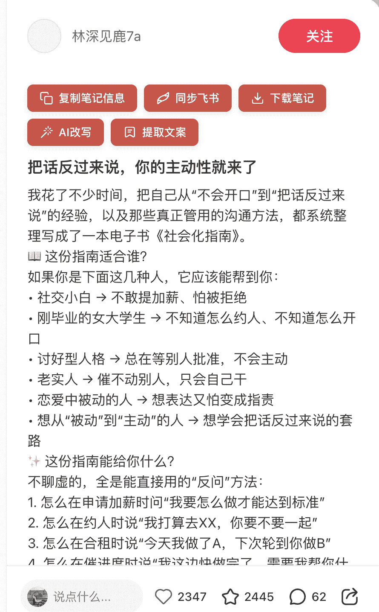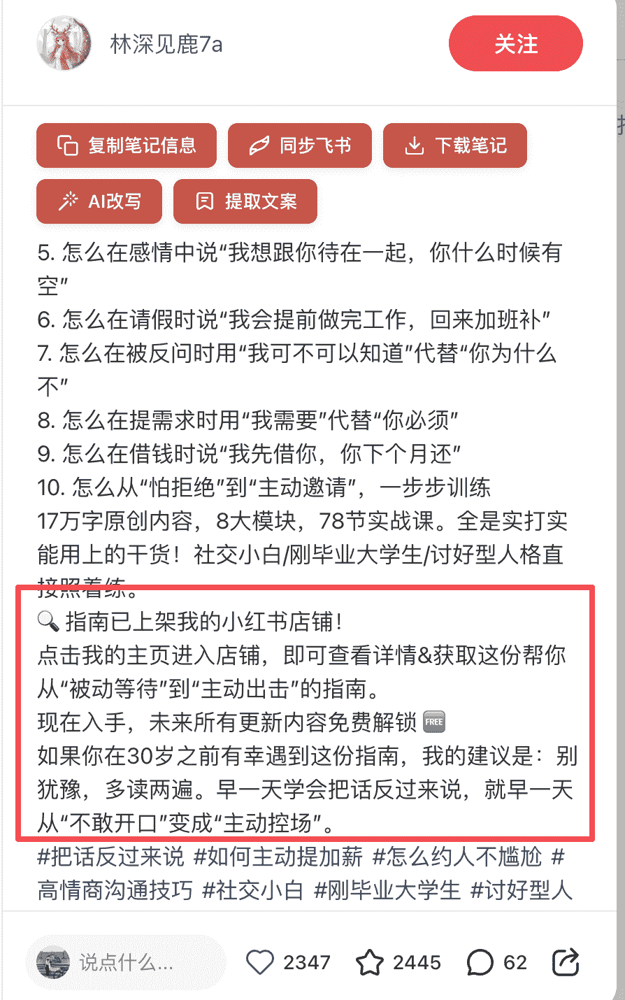

眼光若只停在平台上的这一次成交，那么流量注定是过路的。我过去做账号时吃过这个亏，这次说什么都不能再犯。所以我在文件内和发货的自动通知里，都留了我的微信号。

这不是要把人硬往别处拉，而是给他们一个顺理成章的理由：想要一份额外的免费内容，或者想多了解这个职业背后的信息，可以加我细聊。

这么走过来的好友，没有一个是为了看热闹的，全是买过单、有真实需求的人。跟这群人再打交道，信任的成本确实低。

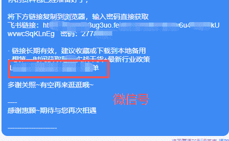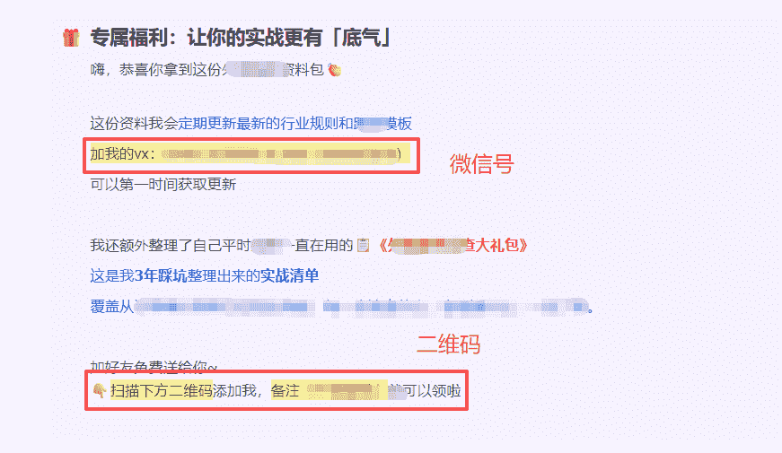

让人帮我写好评这件事，中间我改过一版。最初是先给人发福利，然后客客气气请人家有空去评论两句。那阵子确实有人响应，可我后来又发现，很多人并非存心不帮，是真记不住。嘴上答应得很爽快，转头就没了声。

由此我得出一条结论：指望别人回头还你人情，远不如让他为了自己的好处先动手。于是我把话术调转了个方向——先请买家把订单标注成已收货，顺手写几句带图的评论，把截图发过来，再找我领取那份额外的文档。

这个顺序一改，局面立刻不一样了。对方为了拿到想要的文档，自然不吝啬那几条评论；我也不用天天追着人问“评了没”，两边都省心。

现在这个链接下面已经有1500多条好评了，差评只有一条。

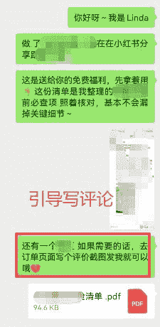

这样做的好处一眼就能数出来：客户额外拿到了想要的东西，好感度自然更高；链接下的评论数量涨上去了，后来的人更敢下单；我也不用求爷爷告奶奶，对方为了拿到那点额外的好处，自己就会先去完成那个动作。

整条链路长这样：下单→加微信→写评论→领文档→链接的转化率被喂得越来越高→又带来更多订单。等到这个循环自己转起来，项目的负担一下子就轻了。

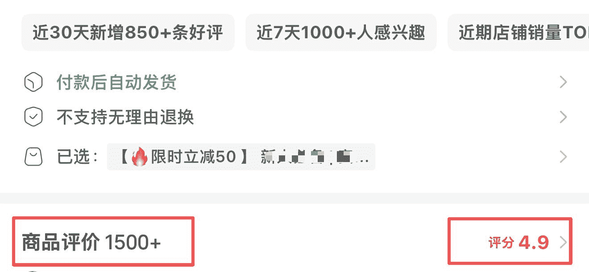

当这些加了微信的人陆续感受到我做事的分寸，后面我再拿出新东西，他们接受度比从前高出一大截。目前这个池子里已经攒了近1700人，额外产生的收入也超过了1.5w。

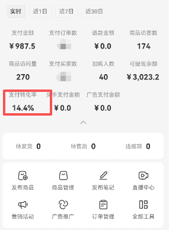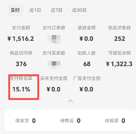

这件事让我想明白了一点：电子文档的真正价值从来不在那一份文件里，而在于它能帮你从人群里捞出那些愿意为同类问题掏钱的人。这么一群人跟在我手里，后续想做任何延伸都不愁没有地基。

以前我总觉得卖文档这个事有点拿不出手，现在却看得很清楚：那分明是一个极低的价格标签，帮你把目标客户聚拢到一个屋子里。这些人，才是后面各种业务的出发点。

我会继续围绕他们的真实需求，把东西越做越细：给刚起步的人的路线图、给还在犹豫的人的检查单、核心操作的填空模板、常用流程的参考底盘、把AI嵌进日常工作的工具集、小范围行动营，还有一对一解答问题的窗口。

看明白这一点之后，我就不再把心思放在“多卖一单”上面了。我更在意的是把每一个买过我东西的人都留住，顺着他们不断冒出来的麻烦，一直做出下一件对得上号的东西。平台负责把人送过来，我的微信负责让人留下来。

刚加过来的人，我绝不会张口就推销。最先给的一定是些实打实的东西：补充分享、行业消息、日常答疑。我希望让每个加我的人都觉得，来这儿不是被薅羊毛，而是真的有用。

微信里这些人还有一个额外的作用：他们会把需求直接送到你面前。我收到过太多相似的提问，比如：我适不适合进这一行？新手去哪找头一单活儿？入行前要备什么？等到真正上工了，一天到晚都在忙些啥？事情太多，从哪件开始抓？

这些问题反复出现，本身就指明了方向。我现在基本不凭空设计东西了，而是把这些高频问题收集起来，逐个做成新的交付。

做到目前这个量级，前后加起来差不多3500单。坦白说，没有哪篇内容突然爆掉，我只是把几件普通的小事叠在一起，让它们自己产生化学反应。

头一件，问题本身就很折磨人。这份文档回答的是“刚入行的人眼下最头疼什么”：选方向拿不准、面试心里没底、入职后没人带、基本流程搞不懂。需要它的人，不会把它当消遣，而是当救命稻草。

第二件，选题是从市场上捡来的。我没自己拍脑袋，而是去平台翻那些已经跑出热度的帖子，看留言区有没有人在求文件、求电子档，再看别家店铺是不是真有成交。看见类似的商品已经出了近两千单，我就认定这事靠谱。

第三件，我交付的东西更容易入口。不少同行给个网盘地址就算完事，买家下载完不知道该看哪份。我换了一种编排方式，把内容按照新人接触业务的先后摆好，在关键的地方还写了批注和提醒。对一个新手来说，有个人帮他把顺序理顺，比单纯收到一堆文件强太多。

第四件，内容从头到尾没有推销腔。我写的是那些刚入行时的真实状态：心里发慌、拿不准该练什么、也没有人可问。读者先有了“这说的分明是我本人”的感觉，再看见商品链接，购买就成了顺理成章的选项。

第五件，我始终在复盘和加码。帖子发出去只是开始，后面我每周都会看数据：哪个标题有人点，哪个内容能出单，哪个话题被人一路追问。跑出效果的选题就再换个切入点写；单独一个号拿不到足够曝光，就再养一个新号，让同一样东西有更多被找到的途径。

往深了想，这项目的底层其实也没那么玄，无非四层。

第一层，用很低的价格敲开第一次信任。一个陌生人不可能上来就买几千块的东西，但为了一个具体的困惑，花小钱买份材料是很轻松的。这笔小额交易一旦完成，双方的关系就有了着落；只要第一次拿到的料够好，后面再买更大的东西就不会那么犹豫。

第二层，做内容的目标并非涨粉，而是换钱。以前做账号，我会盯着点赞数看；现在我只衡量一件事：这条内容带没带人去看商品？有没有人因此付款？有没有人愿意留下联系方式？买完之后反馈如何？在这个赛道上，内容不一定求爆，但求准。一千个精准看见的人，远远好过十万个看两眼就走的路人。

第三层，手里有池子，项目才能越来越省力。没有池子的时候，每篇内容都得从头去找陌生人；有了池子，每卖一单就多一个可以反复对话的人。他们会给你反馈、帮你写评论、下次还来买，还会主动讲给你听下一步该往哪走。平台管获客，私信管留存，内容管变现，这三块接在一起，生意才不会永远只做一回买卖。

第四层，一个普通选手能拼的东西，从来不是创意，而是下功夫拆透再做。我不太擅长发明新东西，但这门生意指望不上太多创新。找一条前人都走过的路，掰开来看：付钱的人是谁、处理的是什么麻烦、怎么让人看见、怎么让人付钱、怎么留住回头客。把这些问清楚了，再照着自己手里的条件走一遍。这就是我常说的“抄路径”——抄的不是文字，是已经通了的路。

眼下这个阶段，对我来说只是把前端跑通：能在平台上卖出东西，也能把人引到微信里。后面还有三件要紧的事等着做。

第一件，从交付文件变成交付结果。单卖一份文档，收入的上限就那么高。要是能把材料、模板、工具、答疑和陪跑打包在一起，买家拿到的就不是文件，而是“从零到上手”的一整条路。

第二件，让商品分成几个档次：低价的文档负责成交第一单；更厚实的进阶包用来提高客单；小班陪练解决动手的问题；一对一的咨询则处理买家面对的专属麻烦。

第三件，把流程全部变成SOP。从选题、写文、发货、留人，再到推第二次购买，每一步都要写下固定的做法。只有做到这一步，这件事才不会永远靠我当场拍脑袋。

把这段日子落到纸上，我也算把这几个月重新走了一遍。老实讲，我如今手上这堆东西还远谈不上成熟，产品怎么排、私信怎么聊、流程怎么定、回头客怎么做，都还在逐年逐月地补。

但这段日子让我特别确定的是：像我们这种条件一般的人，机会一直都在。你只需要找一个足够细、足够省力、又能把过去攒下的经验用上的方向，然后把自己放进去。我选的这一行——小红书上卖电子材料——恰好就满足这几条。

它让我从奔着流量去的状态里走出来，开始学着做东西、交朋友、设计回头客。更重要的是，我第一次真真切切地体会到，一个人不必非要等到准备周全才敢开张。你可以先抓一件特别不起眼的小事，卖出一单，留住头一个买家，听一听对方的意见，再慢慢把它喂大，让整件事转动起来。

这不酷，也不算奇迹，但它确实是真的。

最后想说的是，龙哥盟这个圈子，我是真心感激的。加入这里之前，我多半是关着门自己和自己较劲：消息自己搜，判断自己做，焦躁自己咽。等项目真的跑起来，我才越来越清晰地感到，自己做副业的人，缺的常常不是力气，而是一扇能看见更多路的窗户。

在赚钱，我见过不少同路人，用一件件具体的事情，把日子一寸一寸挪到想要的方向。前几天刷到赚钱广州联合空间扩租的消息，我脑子里突然冒出一个画面：或许某个早上醒来，我也能不必准时坐班，不必等着工资到账，不必等好运来找我，而是有一份自己握着方向盘的事业。

我很清楚，自己只是刚走完了一小段路，甚至还没走出多远。

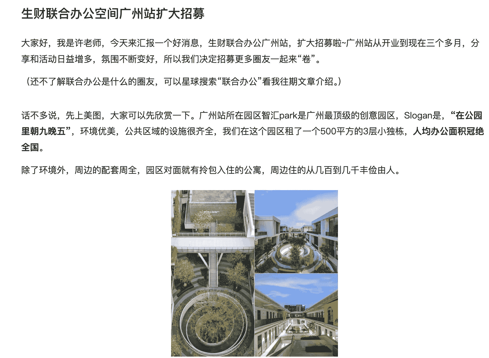

但正是因为在这里看见了那么多普普通通的人正在迈步，正在验证，正把一件件小事磨成自己的家底，我才愿意相信：那条路离我并没有想象中远。写下这些文字，也是我推着自己往前走一步。

再次感谢，也谢谢一路读到这里的你。希望下一次碰面时，我能带回来更多进展，再跟你细细说。

————分割线————

看完这篇长文，你可能会有一种“我懂了”的感觉。但以我带人的经验，绝大多数人会在头一步就卡住。各种工具和说明只是最外面那层壳，真正起作用的是马上开干，以及圈子带来的不对称情报。

这里不喊口号，只做两件事：拆开讲明白已经赚到钱的商业模型，以及把AI用到极限。库里已经叠了1000多套被验证过的实战案例。

👉 想翻翻完整的资源目录和加入门槛，点这里：

觉得合适、准备下场开干的，加我的微信（）

添加时请填写验证信息：实操上车。闲谈勿扰。

