# 专注用 AI 做小红书虚拟资料 K12 教学课件，摸索试错半年后我做到月入 2 万 + 实操复盘
今天要分享的这份实操复盘，来自一位45岁的小城体制内老哥，他利用AI在小红书上卖K12语文课件，从零起步，花了半年时间把副业做到了月入两万多。整个项目听起来不算惊天动地，但胜在真实、可复制。
先说说这位老哥的适配人群：如果你有一份稳定工作，想找个靠谱副业，同时多少懂点教学，那这条路子很适合你；但如果你指望短期暴富，或者一点教育经验都没有，那恐怕会失望。这个项目的精髓在于：他把原本杂乱无章的课件生产流程，硬生生拆成了7个标准化步骤，做成了一个半自动化的操作台。最妙的是，他把做课件的技能指令直接焊进了操作台，不用再背那些拗口的技能名，从教案文档生成，到PPT制作，再到Canva分层精修，全程基本不用盯。正因如此，暑假那波需求高峰他能做到日入千元。但话得说清楚，这波收益有很强的季节性，暑假一过，需求大概率回落；而且没有教学底子的人，光靠工具堆不出好课件。

下面就把他的完整复盘转述给大家。
这位朋友网名叫“新手老白”，今年45岁，在小城市体制内待了二十多年，工资微薄，养家糊口不容易。此前做过几年实体店生意，没赚到什么钱，后来行情冷淡就关了店。他说日子一眼望到头，心里总有些不甘。
他坦言，分享这个项目是有些纠结的。一方面，项目确实做出了点成绩；另一方面，从今年3月全力投入虚拟产品算起，满打满算也才半年，远谈不上什么成功经验，很多细节还在摸索调整。所以这篇不是保姆级教程，更不会说“照做就能发财”。他只是想把自己这半年实打实做过的事梳理一遍——中间经历了哪些转折，以及如何用AI把反复出现的课件制作工作，沉淀成一套能持续运转的流程。
如果你也在做虚拟资料，或者正研究如何把AI真正应用到日常工作中，他的经历也许能带来一点启发。
先说项目进展。去年11月，他第一次试水小红书虚拟资料，前前后后开了几个杂货铺，都没做起来。后来把一个小店转向英语课件，定价9.9元一份，12月出了200多单，卖了3000多元。后来平台政策调整，他就歇了一段时间。今年3月重新出发，这次换成女儿正在学的三年级语文课件，基本能做到赶在老师上课前把课件做出来。一开始速度很慢，但几个月下来，他把从制作、上架到销售、运营这条完整链路摸清了，也沉淀出一套适合自己的流程。
暑假期间，他继续做四年级上册以及其他年级的课件，慢慢把教案、逐字稿、PPT、上架、笔记发布这些环节都整合进同一个操作台。那段时间，他几乎每天都在优化细节，最终打磨出现在的PPT生产台（虽然离完美还有不小距离）。回头看第一版课件，他自己都觉得粗糙，后来不管是内容、结构还是页面，都反复推倒重来过多轮。到8月初，小学阶段的课件基本备齐；8月中旬开始，每天的收入稳定在1000元左右。这个数字放在6月份，他自己想都不敢想。不过这里说的是主号的数据，另外三个店是8月下旬才同步铺开的，还在慢慢发笔记，每天收益只有500到1500，就不晒图了。
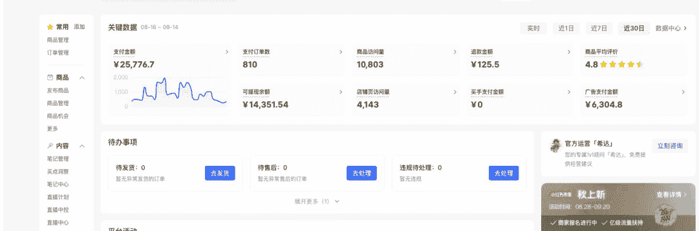
最近几天数据有所回落，每天大概500块，他干脆把付费推广全停了，想单纯看看自然流量的真实情况。
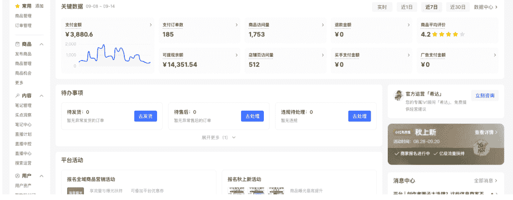
关于付费推广，他一开始觉得这就像买彩票，心里没底，每天只敢在“简单投”里花几十块钱试试水温。后来花了好几天研究千帆后台的“乘风推广”，设置了一些人群定向和ROI目标之类的参数，效果似乎慢慢出来了，7日ROI能做到2.5左右，至少不会亏。这样跑了十多天，每天花300，能带回来600到800的成交，相当于一天净赚400上下。后来之所以停掉，一是想验证不投放的时候自然流量究竟如何，二是担心付费流量把销量数据推得太高，反而引来同行注意（可能是他想多了）。停投以后，整体销售额确实降了一些，但把付费带来的那部分剔除后，自然流量并没有受到什么影响。所以他的判断是：投不投，自然流量都在那里，付费推广的作用就是拉高总盘子。
不管怎么说，至少验证了一件事：课件的需求是真实存在的，并且收入来自于持续积累。
他很清楚，这波成绩里，时机占了很大的权重。暑假本来就是老师集中准备新学期课程、疯狂找课件的时间点，他正好踩上了这个需求峰值。因此，这其中有产品力和效率的因素，也明显有时间红利。如果脱离具体时间节点，单拿“日入多少”说事，意义不大。而且开学以后，需求会不会下降、下降多少，都还有待观察。所以相比收益，他更看重另一个结果：用两个月时间，把原本零散的课件制作流程，磨成了一条相对完整的流水线。这才是他最想分享的东西。
下面进入正题，聊聊他的PPT生产台。
他是严格根据自己的业务环节，搭了这套PPT生产台。按照他的说法，这是目前他觉得最顺滑的流程，涵盖了从制作到运营的每一个节点。配置好一次，后面基本就是傻瓜式操作。他就按操作台的板块挨个介绍，这也就是这个项目的完整流程。
**第一环：文档生成**
这一环主要负责产出教案大纲和逐字稿，也就是俗称的“三大件”。他把制作三大件的技能指令直接内嵌到操作台里，好处是不用每次打开AI对话窗口手动调用某个技能——因为他总记不住那些技能名称。现在技能已经固定在里面，他只需要输入某篇课文的路径，写上“制作这篇课文的交付内容”，然后在下面选择用workbuddy还是codex来执行，系统会自动打开AI对话窗口并填好命令提示词，他敲一个回车，等着就行。任务完成后，这些文档会自动出现在指定路径里。系统会按照预设的技能逻辑，自动分析教材、检索参考资料，最终交付三大件成品。
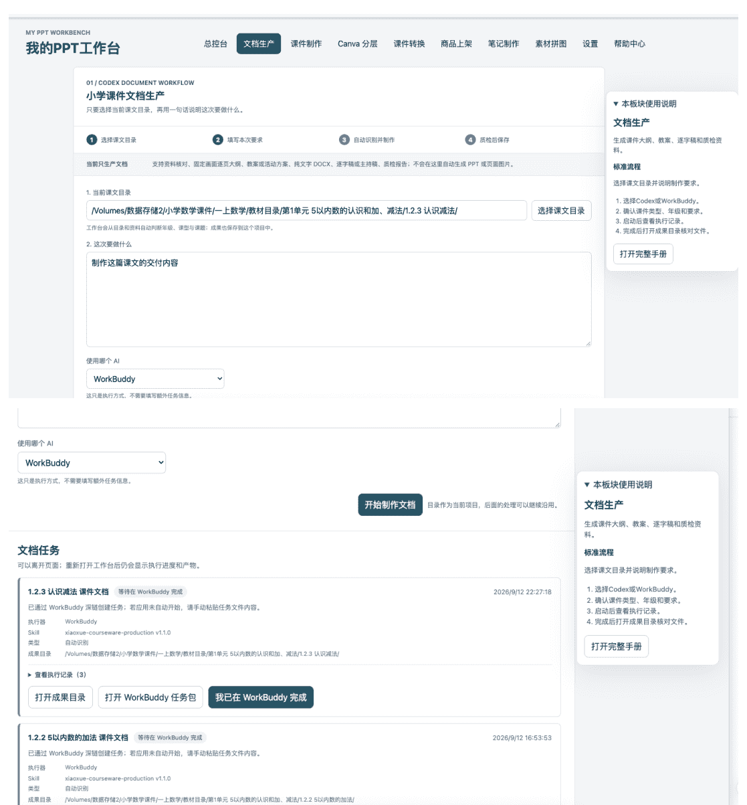
**第二环：课件制作**
同样是傻瓜式操作。只要选择了大纲的上传路径，再在发送设置里指定课件的保存路径，就能自动开工。他在这里设了三种执行方式：第一种是用网页版ghatgpt，好处是不额外消耗token，风险是操作频率过高容易触发风控，不过目前观察下来不会封号，最多是临时限制访问，等风控解除还能继续用。单量少的时候，他会把并发数调成1，避免多个窗口同时运行（见图1）。第二种是交给codex处理，第三种是调用API。后两种效率都很高，就是更费token。
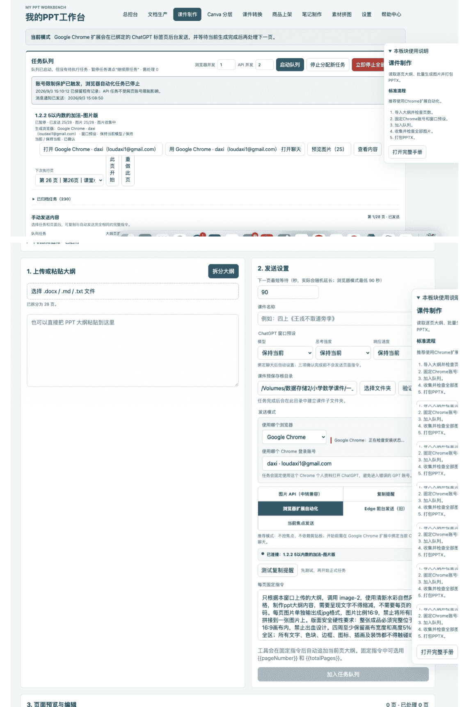
**第三环：格式转换**
这一步主要负责把图片版的PPT转成文字可编辑的版本。他没有用WPS的转换功能，因为那东西容易把字转错，还经常把背景图压得模糊，后续修起来很麻烦。
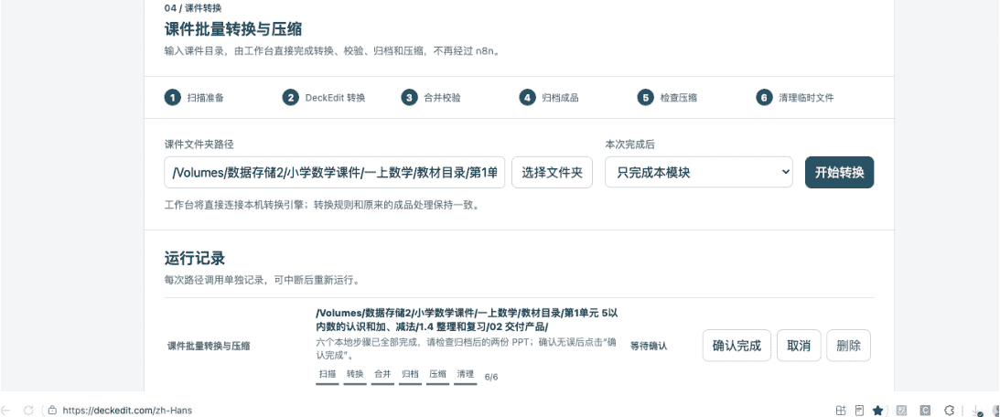
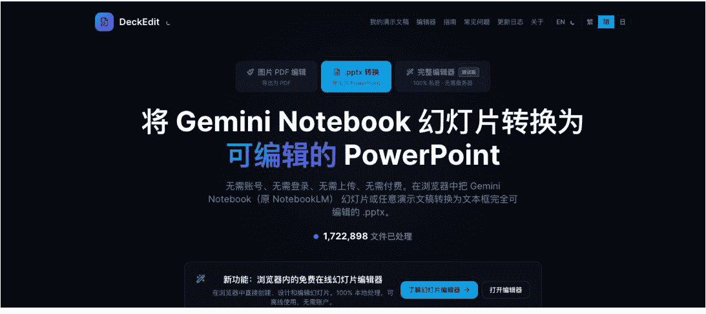
操作时，把上一步生成的图片版PPT路径填进去，点一下开始转换，系统会自动打开第三方转换工具的网页（deckedit.com/zh-Hans），同时按要求切分页数、控制文件体积（每份不超过15页、小于30M）。逐个转换完以后，会自动合并成一份全新的PPT，并自动命名为待编辑的文件名。到这一步，可以选择直接上架销售，也可以继续做精细化打磨。他的习惯是先上架开卖抢时间，再回头慢慢做人工精修、加动画、调细节。至于精细化那一步用的Canva AI图层功能，先放一放，后面再细说。先介绍上架和做笔记的流程。
**第四环：商品上架**
这一步主要是为多SKU场景准备的。如果只是单个课件，根本不需要走这步。操作时，打开新品采集扩展。
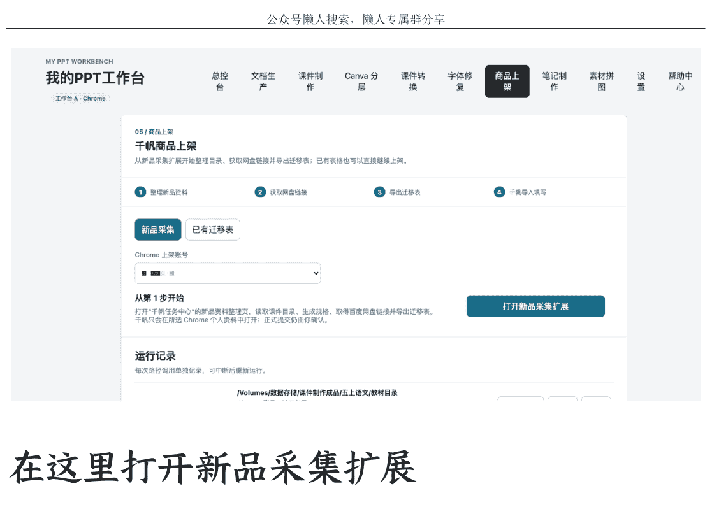
选择“本地完整读取资料”，系统会弹出本地文件夹，让他指定资料存放的根目录，然后自动扫描根目录下所有文件夹和子文件夹（这些文件夹都以课件名命名，他会提前把目录结构完整复制一份到百度网盘，确保两边层级一致）。扫描完成后，下方会展示读取到的结果。
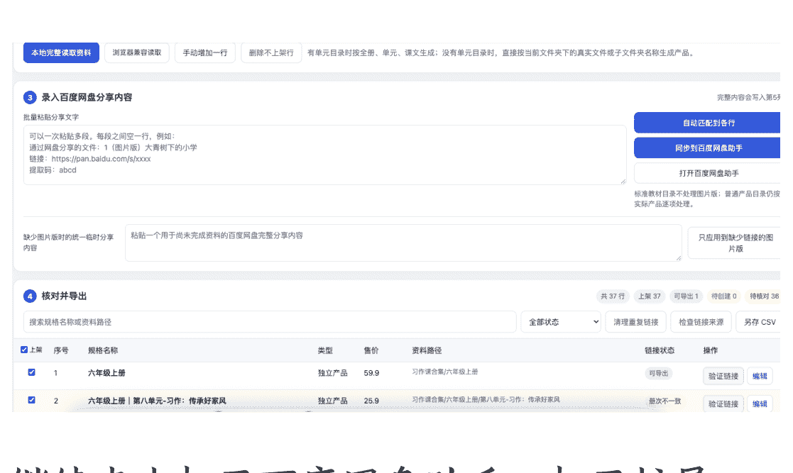
接着打开百度网盘助手扩展，进入资料根目录，把当前页设为主目录。先测试一条数据没问题后，再点“从断点继续”，系统就会按照目录结构，自动为每一份资料生成分享链接，然后回填到上一步的链接状态里。
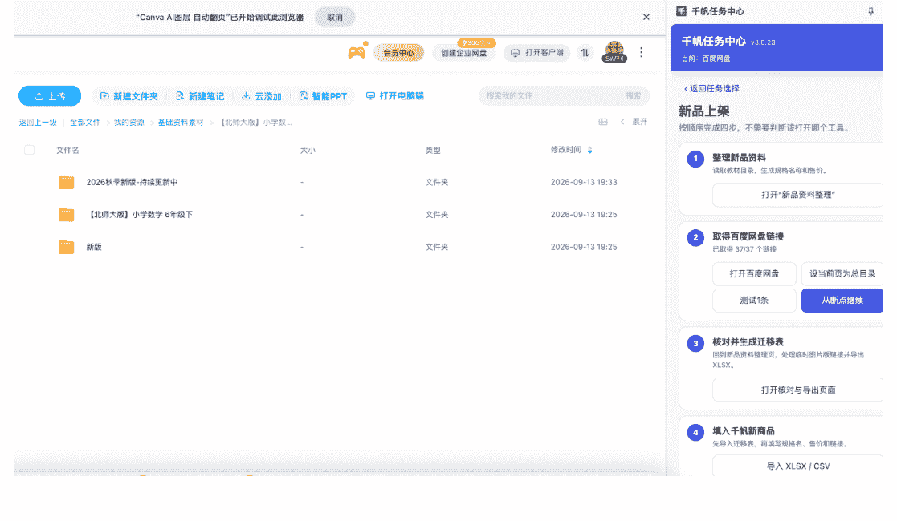
最后导出xlsx表格。

然后就可以打开千帆商家后台批量新建商品了。这一步最重要的价值是解放双手，不用再一个一个手动填写规格名称、链接那些重复内容。当然，商品主图、详情说明、售价这些还是需要自己填，不过也支持批量填写。规格少的时候可能不明显，但规格一旦多起来，尤其是几个店铺要填同一套信息的时候，效率提升非常明显。
**第五环：笔记生成**
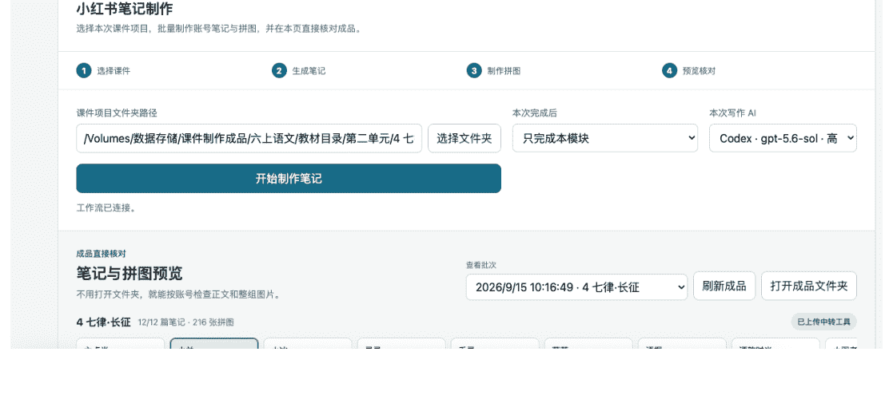
他的PPT生产台界面。
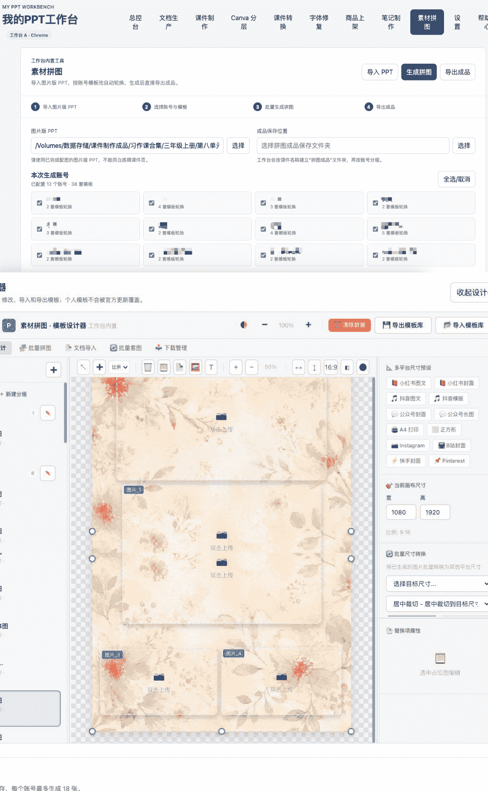
这一环就更省事了。选择一个需要做笔记的课件，甚至可以直接选某个单元批量生成。执行端可以用codex或其他AI，目前他主要是在codex和workbuddy之间切换，哪个有额度就用哪个。笔记完成后，系统会自动进入拼图流程：后台调用拼图工具，上传PPT，按页面顺序拼成长图。不同的账号绑定不同的模板，模板可以自己添加和调整。整个流程是：自动撰写笔记，自动调用拼图工具出图，再把笔记和图片同步到他的素材中转站。之所以不直接自动化发布笔记，是因为担心被平台判定为营销号。那个中转站专门按账号归置素材，每个账号有独立的入口，可以提取对应的笔记和图片，一键复制文案、一键下载图片，然后自己打开小红书粘贴发布，相对安全。
他给我看了一张当时的运行记录，上面列着好几个等待确认的任务，比如“七律·长征”“汉祖祖”之类的，每个任务都可以查看成品、确认完成、取消或删除。另外还有一篇写好的笔记样例，标题叫“六上长征作业分层，让每个孩子都有收获”——正文按基础层、提高层、挑战层设计了课后作业，并配了话题标签。
到这里，常规流程就算走完了，商品说明可以写上“文字可编辑”。如果客户要求更高，连图片也得能改，那就进入最后一环。
**第六环：Canva分层精修**

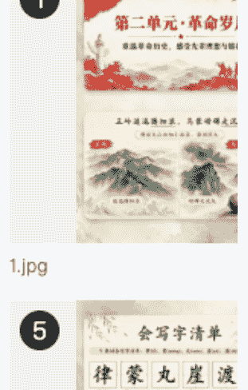
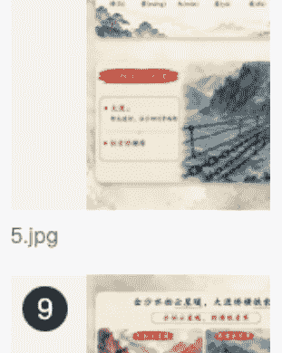
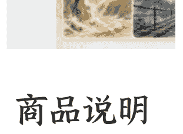
Canva的AI分层功能确实强大，但它有个致命短板——识别汉字特别容易出错。他的解决办法是：先用前面的步骤把大部分文字从PPT里拆出去，只保留背景底图，再去做AI分层，这样错误率大幅下降，后续改动也轻松许多。具体操作是：选中已经转换过一次的PPT路径，点“开始完整流程”，任务会自动拆分PPT，把文字层和背景层分离出来，这里只需要背景图。因为免费版Canva的AI分层有限制，每5分钟才能处理一页，他又写了一个浏览器扩展来自动定时点击。另外，他最近加了个实用功能——可以选择用哪个浏览器来执行任务。不同浏览器登录不同的Canva账号，每个任务用不同的浏览器并行处理，速度直接翻倍。电脑性能好的话，还能再加更多浏览器。
每份课件做完分层后，下载到本地，再在任务卡片中点一下“只执行合并”，把之前拆出去的文字部分重新合并回来，而且不会影响原排版位置和动画效果。经过这轮操作，产出就是一份图文都能编辑的完整版本了。最后通读一遍，检查错别字，收工。
**整体复盘**
从三大件自动生成，到PPT批量制作，再到格式转换、多SKU免手填上架、笔记拼图半自动发布，直到最后的Canva分层回合并——每一步他都在想办法把重复劳动压到最低，留给自己的只有那些机器干不掉的判断与微调。这套流程本身并不复杂，难的是一环一环拆细、再重新拼起来。就像他自己说的，比起月入两万这个数字，这套亲手磨出来的生产流水线，才是真正值钱的东西。
讲到这个节点，整套制作思路其实已经能串起来了。听起来步骤不少，但核心逻辑就是理顺了。之所以要搭这个操作中枢，最大的动机是我不想每次都要打开 Codex、WorryBuddy 去翻找要用的那个功能模块。以前最烦的就是名称记不住，模块多了列表就乱，敲下斜杠后还要往下拖很久。这套中枢把所有模块都内嵌了，基本就是按步骤点选就能走完，更新也方便，在 Codex 里发一条指令，中枢会自动同步，不用重复操作。
下面说说复制这件事。
看完流程，很容易冒出一个想法：把这套中枢和模块搬过去就能直接用吗？我的看法是不能这么乐观。
工具是可以学的，流程也可以借鉴。但最终决定产出好坏的，不是表面的工具组合，而是更底层的能力。
其一，是内容上的判断力。
以教学材料为例，很多关键决策来自一线经验。哪些内容适合放进演示文稿，哪些环节需要教师主讲，哪些要留给学生讨论，哪些知识点容不得偏差，一篇文本拆成几节课才合理。这些 AI 只能辅助，最后定夺还得靠人。如果对领域没有体感，靠机器批量产出，速度快但失控风险高。
其二，是会用 AI 而不是会写代码。
我现在用到的 ChatGPT、Codex、技能模块和少量自动化，全都是在真实项目里边碰边学的。总结起来就是：遇到卡点→找办法→能用就保留。所以对刚起步的人，我更建议先别去折腾复杂的自动化。先把第一版完整的成果交付出来，比先搭建一个看起来漂亮的系统更有价值。做完一遍后，重复点才会真正显现。
其三，是把流程沉淀下来的习惯。
随着使用，我越来越在意这一点。每当某个问题反复出现，我会问能不能固化成规则；每当某个动作反复出现，我会问能不能交给系统。效率真正的分水岭，往往不是工具数量，而是有没有把动作变成体系的意识。
再分享几处我自己踩过的坑。
第一，别一开始就追求完全自动化。有时为了省下十分钟，我会花上几个小时去调。后来我的判断标准变成：只做一次的就直接做，重复几十上百次的才值得投入自动化。自动化的意义不在于这一次省了多久，而在于此后每次都不必重新思考。
第二，别把会用 AI 当成壁垒。现在生成文本、图片、演示文稿的门槛都很低，单纯的工具熟练度贬值很快。更难被替代的是：你对赛道是否理解，你是否知道用户真正需要什么，你有没有自己的品控标准，你能否稳定持续交付。工具会越来越易用，判断会越来越重要。
第三，别只看别人公开的回报。包括我前面提到的成交案例，也只是说明在某个时间点用那套组合跑通过。它不能证明任何人在任何时间都能复制。暑期本就是教师备课需求集中的窗口，流量、选题、质量、定价、上架时间都会影响结果。
现在入场还有没有空间？
我不会给出 yes/no 的简单答案。需求还在，但粗放的做法会越来越难。生产门槛下降后，会做材料的人只会更多。未来拉开差距的，可能不是谁更会点按钮生成幻灯片，而是谁更懂使用者，谁的内容更可靠，谁的材料真的能用在课堂上，谁迭代更快，谁能长期维护，谁能形成自己的产品体系。
如果你只是想找一条指令批量产出、批量上架然后等待收入，我不太看好。但如果你本身在某个领域已有积累，愿意把 AI 当成生产力工具，并逐步把经验沉淀为可复用的流程，那依然值得尝试。
这套中枢到现在也称不上完善，很多地方还在调整，很多流程仍在验证。但我的思考方式已经改变。以前遇到问题会想这一处怎么解决，现在会多问一步：能不能让今后的所有材料都不再出现同样问题？于是慢慢养成习惯：产出一个成果，留下一种做法；碰到一个问题，形成一条规则；重复一个动作，尝试做成模块；若干模块配合使用，再串成完整链路。层层累积才有了现在的状态。
这两个月最大的收获，不是产出多少份演示文稿，也不是某天的收入，而是终于拥有了一套属于自己的工作方式。AI 普及的阶段，真正值得长期积累的可能不是指令本身，而是方法和判断。指令会过时，模型会迭代，软件会更替，今天好用的工具明天就可能被替代。但你对用户的理解、对产品的把握、踩坑后沉淀的规则、最终形成的流程，不会因为换一个 AI 就消失。
我仍在制作材料，也在持续优化这套中枢。没有终极答案，这篇只是记录一段实践历程。如果里面有哪怕一个思路能帮你少走一步弯路，就够了。
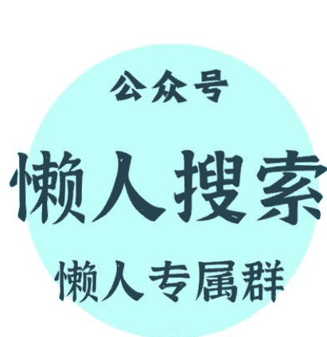
