# 中期复盘｜YouTube AI Shorts 私教陪跑一个月实战复盘

大家好，我是 Gary 曹淦，龙哥盟 YouTube Shorts 航海项目的私教陪跑教练，主攻 AI 内容出海这条赛道。

距离 方波妮教练 与我共同带队的本次 YouTube AI Shorts 私教陪跑启动，已过去整整一个月。原计划在春节档期发布的阶段性复盘，因为我们还在验证新的玩法而有所延后。结营后还会有总复盘。这次中期复盘聚焦第一个月的阶段性成果与交付路径，意图有三：

1. 复盘总结——从交付设计的思路到学员的实操落地，回望这次陪跑做对了哪些关键动作，为最后两周的冲刺校准方向，争取更大的产出。踩过的坑留到总复盘再聊。

2. 提振信心——大航海启动已两个多月，部分航海学员可能因进展缓慢对油管、对自己产生怀疑。希望用这份数据说话的复盘，帮大家重拾信心，明确下一步。

3. 链接共创——一个月下来，我更切实感受到连接与共创的价值。因此想借此机会链接更多在 AI、内容出海、YouTube 探索中已取得结果或正感兴趣的同路人，一起挖掘更新、更强、可复制的玩法，让赚钱成为油管乃至全平台内容出海的根据地。

# 一、第一个月战报

先看陪跑启动后一个月的数据画像：

陪跑周期从 1 月 16 日至 2 月 15 日，累计 104 名学员，已收录账号 84 个，另有 20 个账号待收录。

累计 43 个账号已开通 YPP，涉及 31 位学员，开通率 29.8%，人均 0.41 个 YPP 账号；

其中 21 个达到高级 YPP，4 个达到初级 YPP，18 个已达标待系统更新，基本均为高级 YPP，YouTube 数据更新通常在一周内完成。

需要强调的是，YPP 通行的审核周期普遍在半年至一年。以上 30 余位新开通学员中，除个位数在陪跑前已开通外，其余皆在陪跑期内达成，这在过往油管陪跑案例中实属罕见。先向为结果付出努力的全体学员与赚钱同学致敬，你们真的很强！

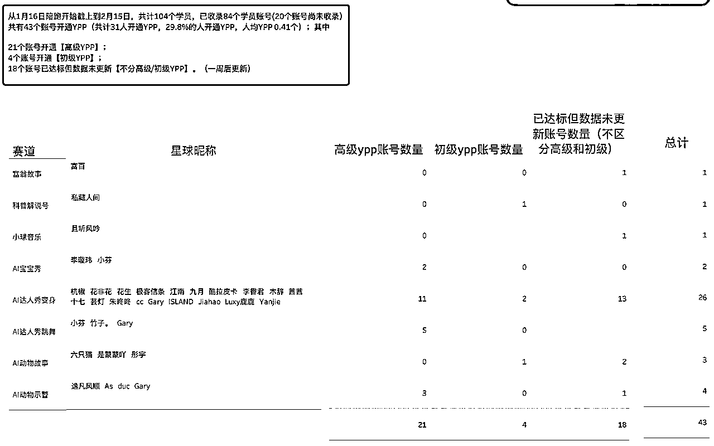

学员 YouTube 账号数据总览，22 天新增播放量约 2.6 亿，累计播放量达 3.5 亿。

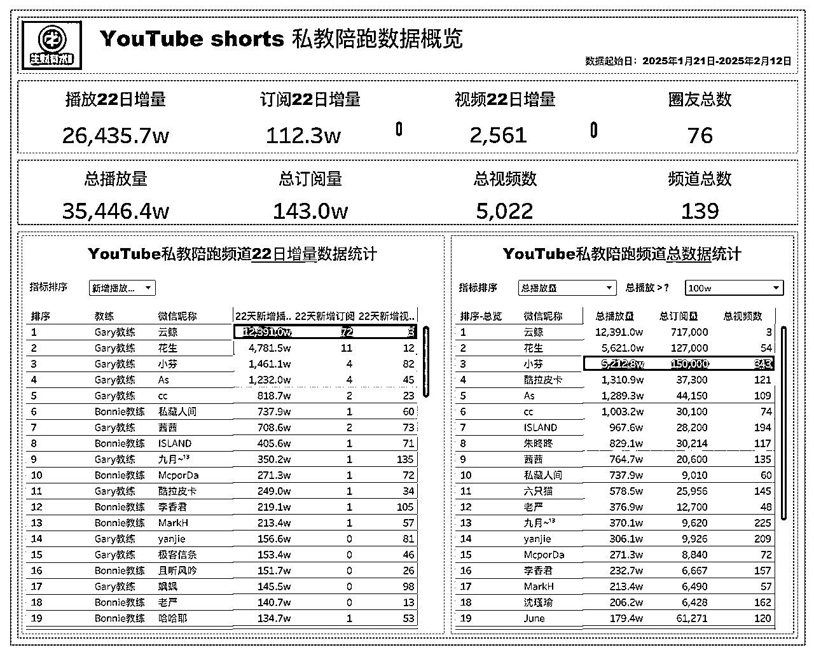

部分学员在开通 YPP 后的收益截图：

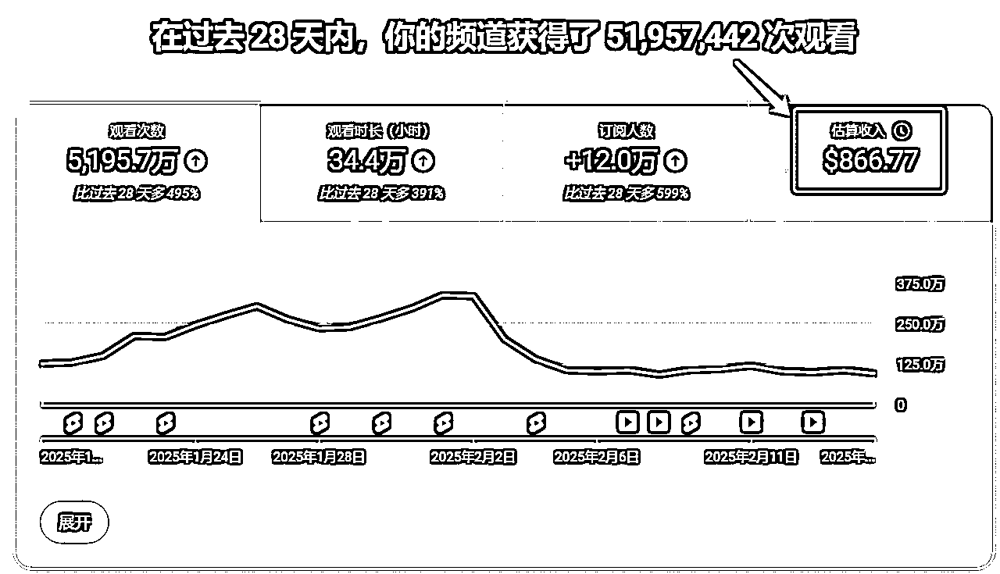

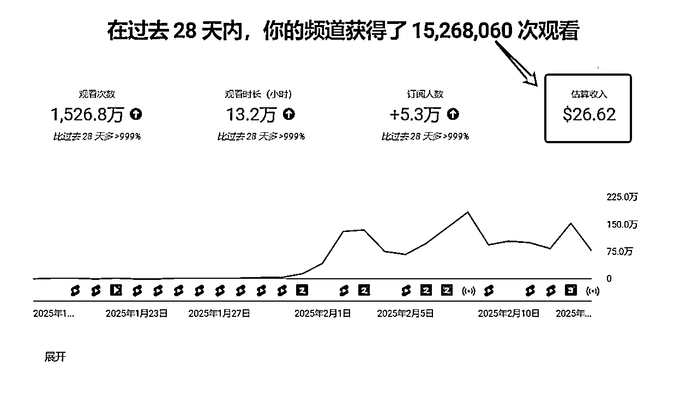

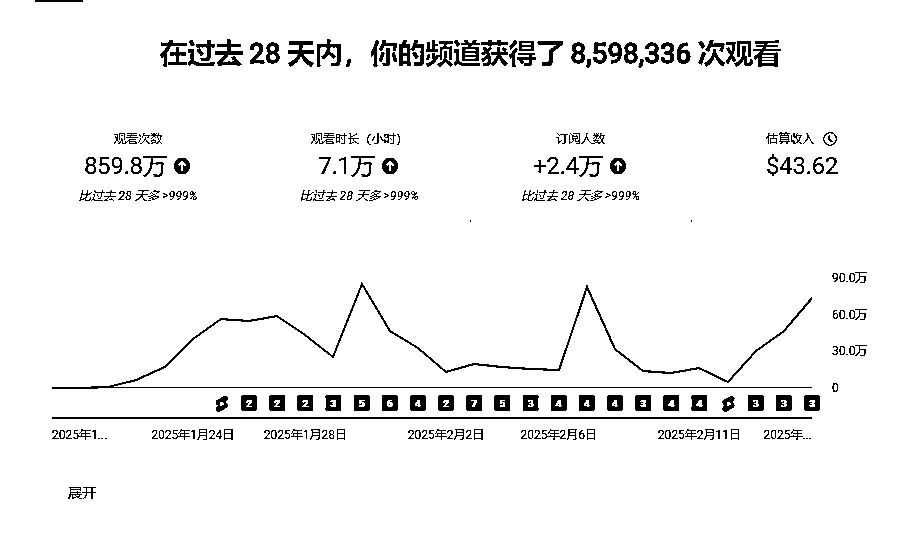

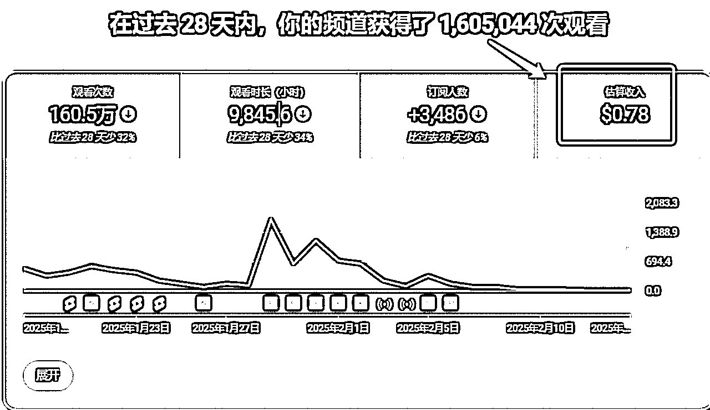

# 二、交付体系如何搭建

方波妮教练与我如何设计这次首届私教陪跑，让大家能在正确赛道上稳定发力？诞生背景坤汀哥已有介绍，这里聚焦交付环节的具体打法。

整体交付拆分为四大模块：

## 2.1 私教陪跑手册

手册是这次陪跑的核心弹药库，覆盖赛道筛选、内容生产、运营打法、变现路径、常见问题等全流程，并根据学员反馈与新挖掘的玩法持续迭代。目前纯文字部分已达 5.5 万字。

这份资料目前在国内应该是覆盖最全、最前沿的 AI 油管实操指南。目录预览如下：

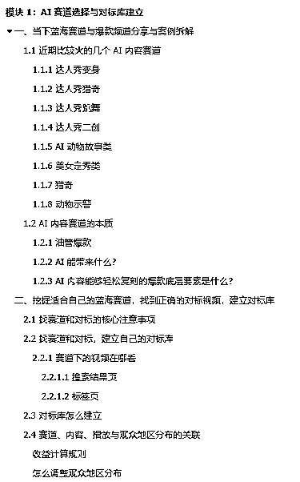

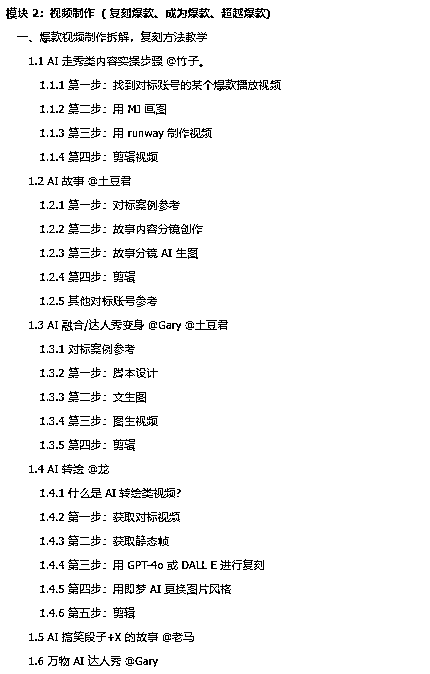

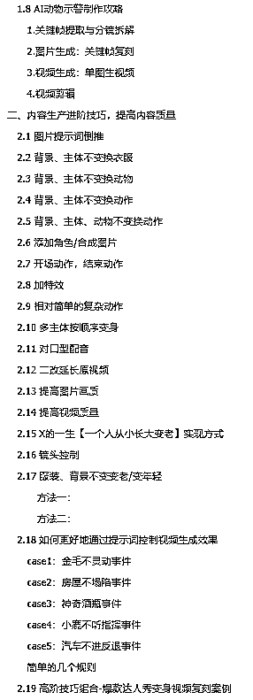

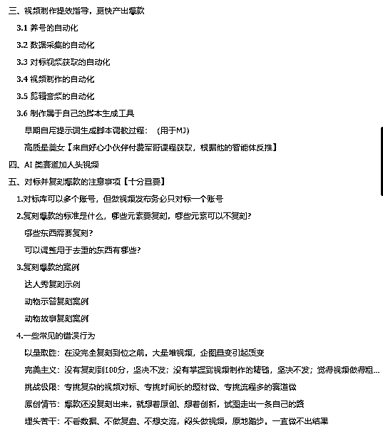

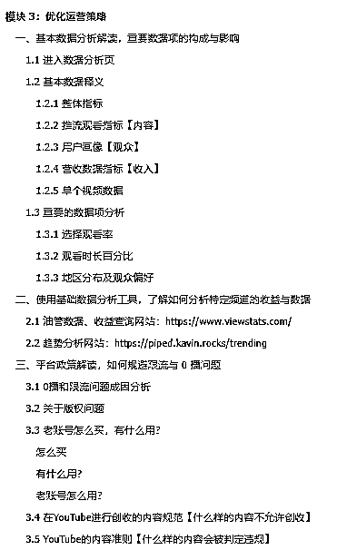

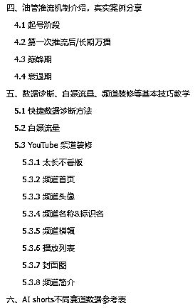

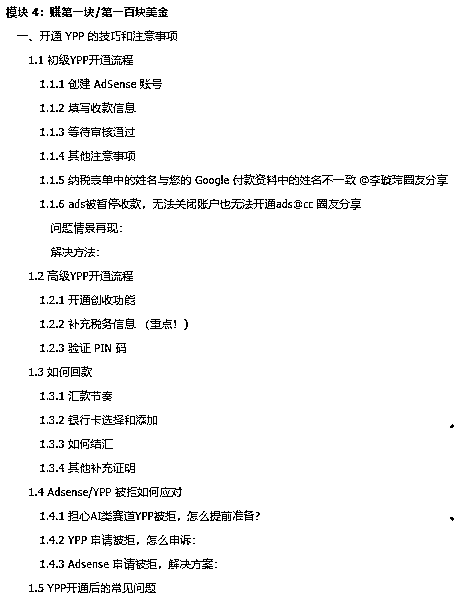

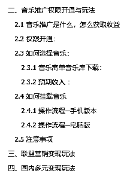

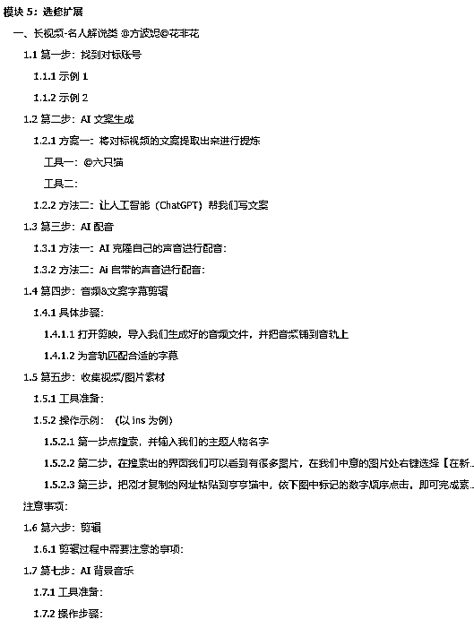

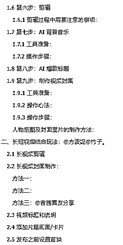

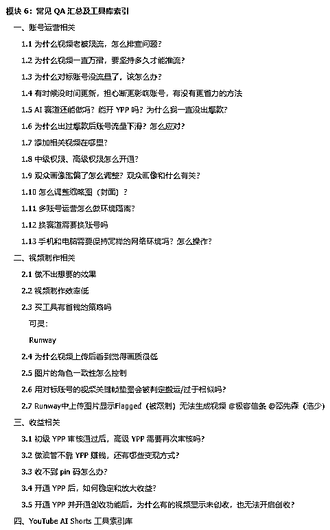

陪跑启动前，我们提前锁定了 5 个以上航海手册未覆盖、门槛较高且具备蓝海潜力的赛道，并配对爆款标杆账号。筛选标准之严苛，可见下图：

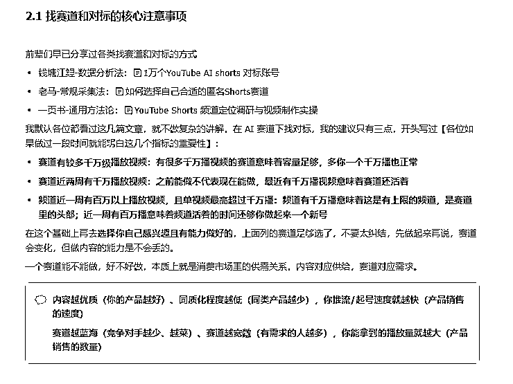

为何要如此严格？多数人做油管往往道听途说赛道，未经验证就照搬对标开干，忽略了最基础的原则：起步选错方向，后续再怎么努力也只是偏离更远。仍有部分学员在陪跑中沿用旧习惯，需要回到手册与陪跑指引上来。

赛道与对标确认后，剩下的就是持续做内容，静待结果。因此手册在赛道选择、对标研究与内容制作上的篇幅占比最大，目的就是把“路”铺好。

同时，手册针对“爆款复刻”和“推流逻辑”两大痛点，结合我们同赛道的大量实操沉淀，做了系统化拆解，既是加速器也是定心丸，助力更快触达爆款与 YPP，也帮助学员建立对账号生命周期的全局观。

变现层面除 YPP 外，手册还梳理了音乐商单、联盟营销及国内平台分发等路径。例如 @NANA 学员一条视频在视频号斩获 4000 万+ 播放、2600+ 元收益，且数据仍在上涨；多平台累计粉丝与播放量相当可观。

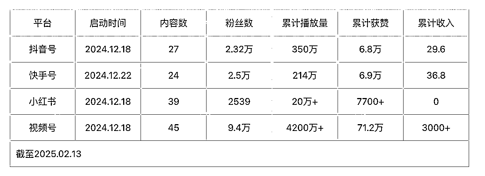

还有大量细节与巧思未尽述，陪跑结束后我们会择优提炼回流至航海手册。顺带宣传一下，对手册感兴趣的伙伴请关注下一期私教陪跑。本次手册凝聚百余位学员与教练心血，是 YouTube 航海手册的 Pro Max 版本，仅对陪跑学员开放。

## 2.2 1 对 1 咨询

为解决起号与运营关键卡点，每位学员提供两次一对一咨询机会。这是我们最头疼也最看重的一环。

两位教练共约 50*2*0.5 = 至少 50 小时咨询时长，实际常超时，且每次需提前排查账号与视频问题、准备答疑材料、后续跟进反馈，交付成本至少翻倍。每周固定两天投入其中。

价值何在？陪跑的本质除了陪伴教学，更在于提供“开天眼”式的复盘视角。视野受限时人容易做短期最优但长期次优的决策。1 对 1 让我们能近距离观察个案问题，从微观与宏观双视角给出方向性指导，为整体交付提供关键反馈。

咨询流程要求学员先自检问题，梳理账号与对标库，锁定卡点后再约谈。会飞书共享屏幕演示，现场解答并整理文档、录屏回看。

以下为咨询产出文档样本，对学员与我们都极具参考价值：

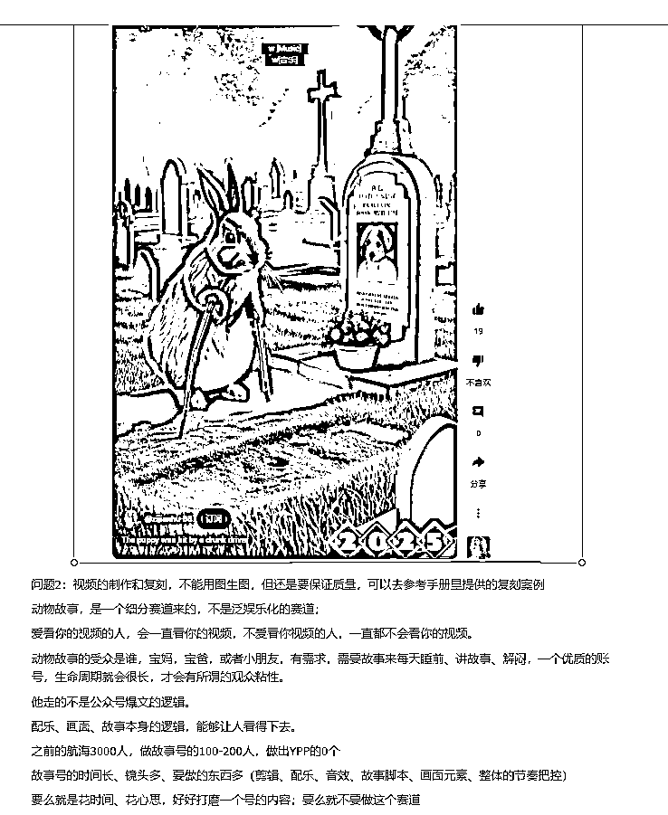

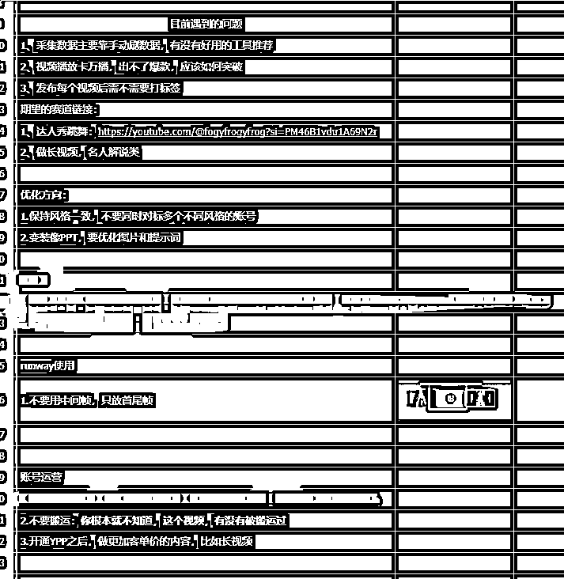

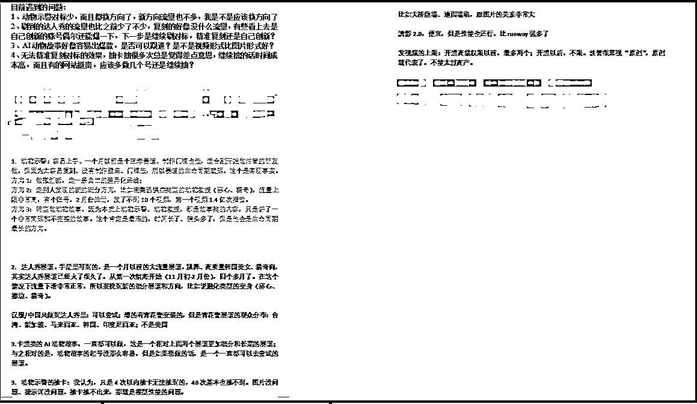

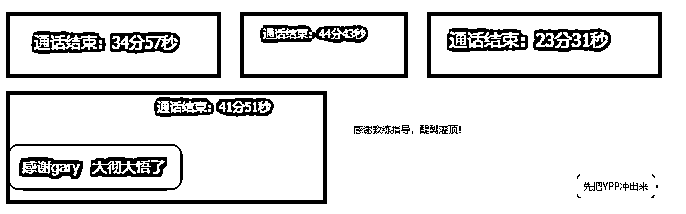

## 2.3 每周直播

直播是陪跑交付的重要补充，手册虽全面，直播的信息密度与即时互动是文字无法替代的。一个半月周期内，共设 6 场周四直播。

第一周聚焦赛道与对标，助力快速启动；

第二周讲解内容制作方法与爆款复刻，适配春节期间稳定更新；

第四周分享最新运营策略与新赛道玩法，放大流量冲击 YPP；

第五周即上周，讲解 YPP 开通技巧并开启选修模块，让大家少走弯路。

每场均含数据分享与答疑，数据分享帮助学员抬头看天，答疑确保手册内容吃透。

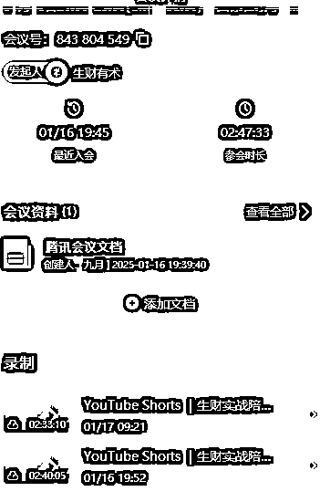

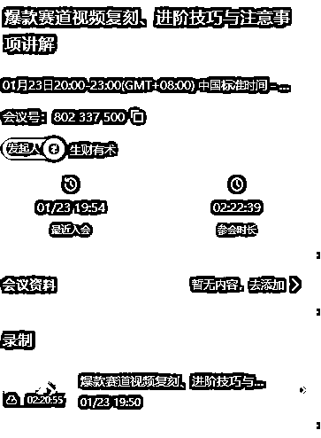

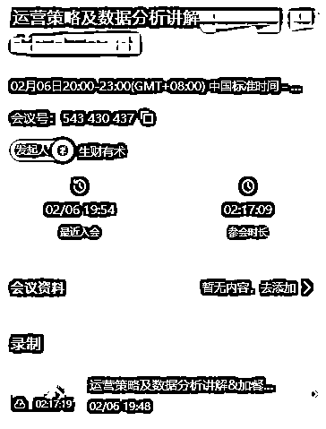

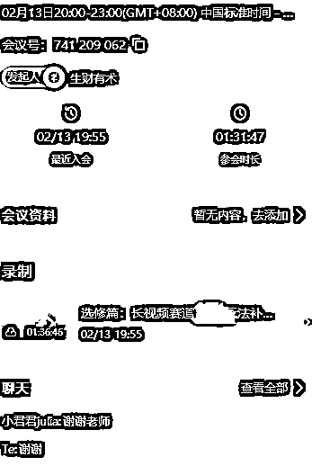

这些直播与回放将在本次陪跑结束后继续发挥长效价值。

## 2.4 加餐分享

加餐分享是方波妮教练与我推动的共创机制，邀请在陪跑中取得独创成果的学员分享心得与打法，为大家提供行动指引与精神激励。

如 @coco 分享 X 的一生实现路径；

@茜茜 分享多赛道试错后开通 YPP 的经验，赚钱帖子：

@李香君 分享 AI 提效 15 分钟制作 AI 达人秀视频的工作流，赚钱精华帖：

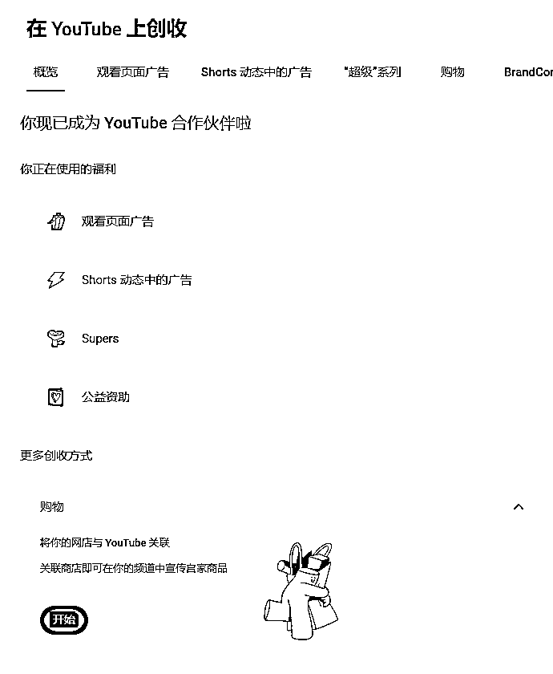

加餐让学员身份从参与者转为分享者与共建者，部分内容沉淀为精华帖。这也是私教陪跑的核心目标之一：共创，师徒同修，亦师亦友。AI 内容出海水深，个体局限明显，只有链接高手与资源，共创探索，才能走得更远。

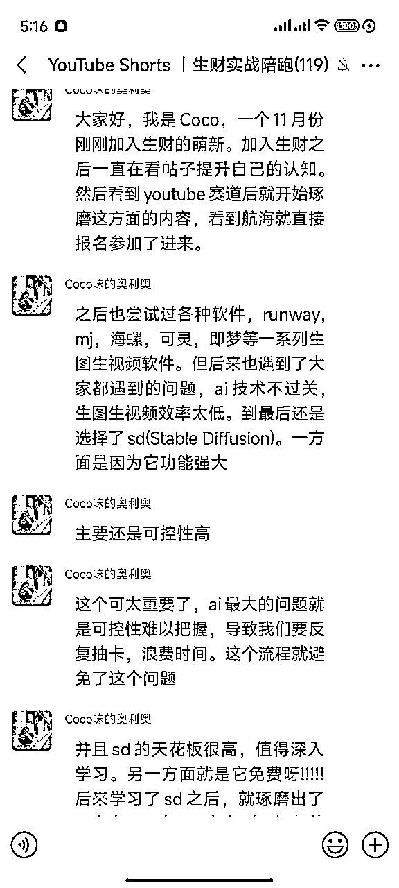

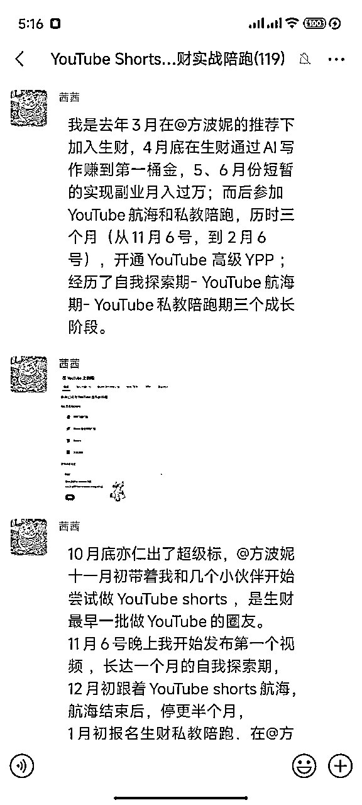

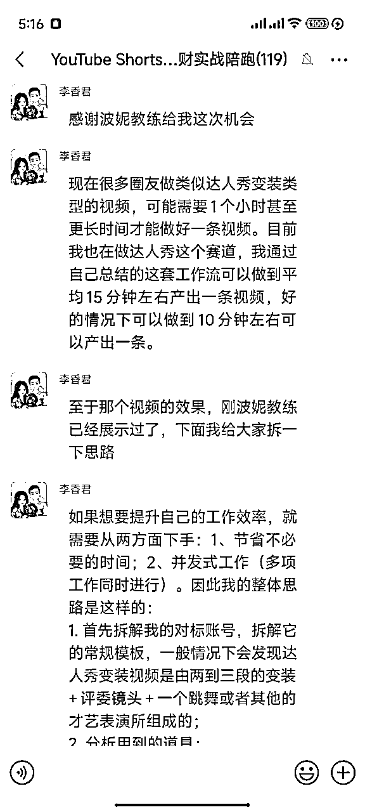

本周已安排 @NANA 分享国内短视频平台玩法；@逸凡风顺 分享 AI 动物赛道的爆点拆解与万能提示词模板搭建，敬请期待。越分享越幸运！

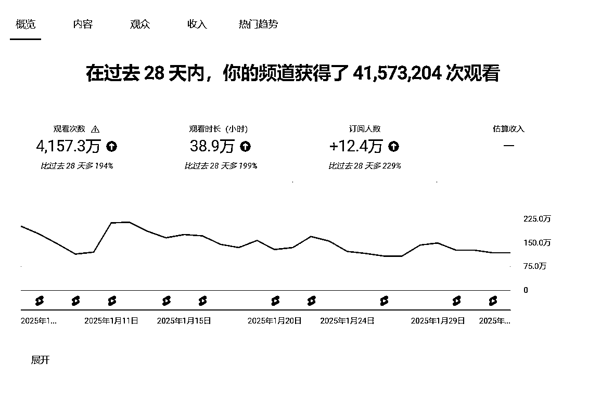

## 2.5 共创群

承接加餐机制，共创群应运而生。借鉴赚钱传术师群模式，采用筛选制，鼓励学员互助分享，仅向积极互助、热心分享且已开通 YPP 的学员开放邀请。

群内聚焦油管变现新打法、爆款路径与 AI 长视频挖掘，从数人起步扩张至二十余人，产出多场加餐与优质共创内容，部分成果将同步至赚钱 YouTube 小组。大家已从各自为战转向分工协作，按兴趣与专长深耕。虽然体量尚小，但未来有望成长为与传术师群同级别的集合体，在国内乃至国际油管圈拥有姓名。

# 三、目前做对的四件事

1. 决策与执行：感谢坤汀与赚钱团队的果断决策与高效执行。方案两三天内落地，报名一小时即满员，让这次首届私教陪跑起跑即领先。若推迟至春节后，机会窗口将错失。

2. 全情交付与参与：为对得起龙哥、坤汀与学员信任，我与方波妮教练几乎放下其他事务，春节期间持续测试新赛道、新内容、新玩法并即时沉淀为文档或直播。手册、一对一、直播全程用心交付，也换来了学员的高配合与高执行力。

3. 共创机制：没有共创就没有加餐分享、共创群，也不会有学员精华帖与手册的持续迭代。共创是放大结果的关键，后续我们会坚定深化。

4. 无限进步：感谢龙哥老大、老马教练及出海前辈的点拨，陪跑始终保持抬头看天，在已知赛道深耕、在未知赛道探索。借用影视飓风的 Slogan：无限进步，这正是赚钱与我们保持领先的核心。

# 四、最后两周冲刺

剩余两周将聚焦两大目标：

* YPP 开通量冲刺，目标 100 个 YPP 账号；

* 跑通除 YPP 外的可复制变现路径，形成可放大打法。

持续关注私教陪跑进展，下一期报名欢迎踊跃。结营后我们将发布更详尽的总复盘，公开更多细节与干货，评论区也欢迎留言你想看到的内容。谢谢观看，2025 一起出海、一起龙哥盟！