# 云天小和尚会说话，7天万粉（第3版教程）

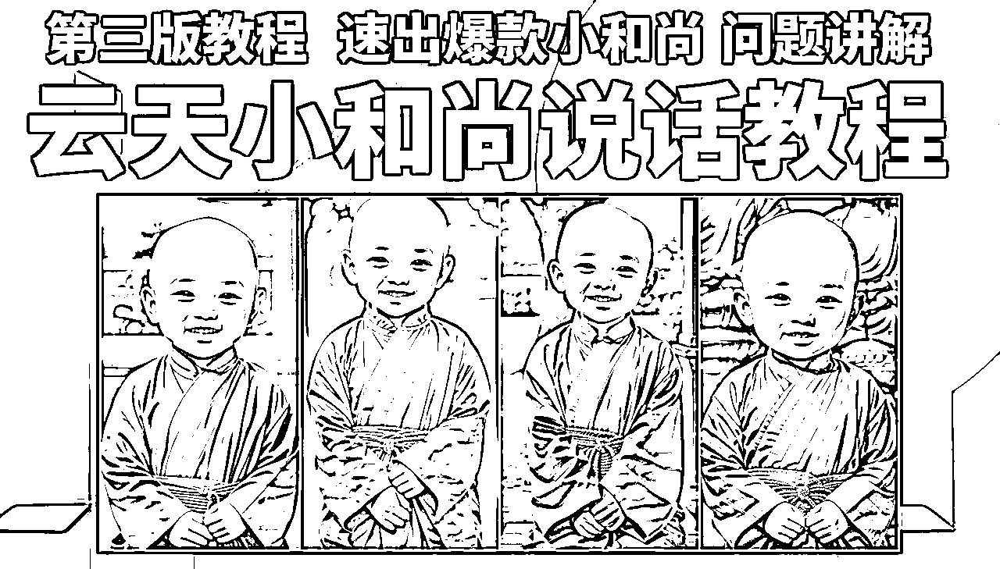

大家好，我是龙哥，一个爱分享的网赚自媒体人。目前我做知识分享社群，也研究各种网络黑科技。

之前把“老者思维”和“小和尚说话”的玩法分享给圈友后，收到了好多反馈。不少朋友私信告诉我视频火了、粉丝涨了，我听着也替大家开心。紧接着，又有人来问：云天，这种小和尚的图片到底是怎么做出来的？能不能给个咒语？

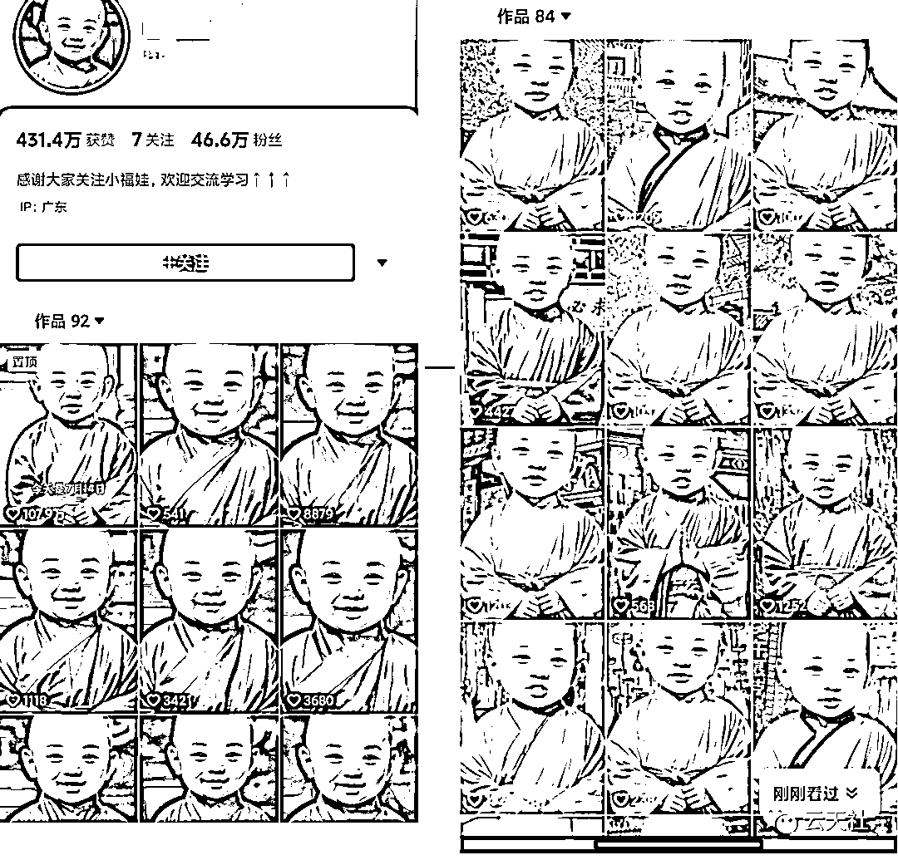

说实话，我哪有什么秘密咒语。不过今天我就把方法摊开讲：不用魔法，不用花钱，照样能快速做出好看的图片。下面先看文字步骤，文末还是照例附上视频教程。

首先，进入这个完全免费的网站，无需魔法和付费：

https://rightbrain.art?inviteCode=PKEUUFMC

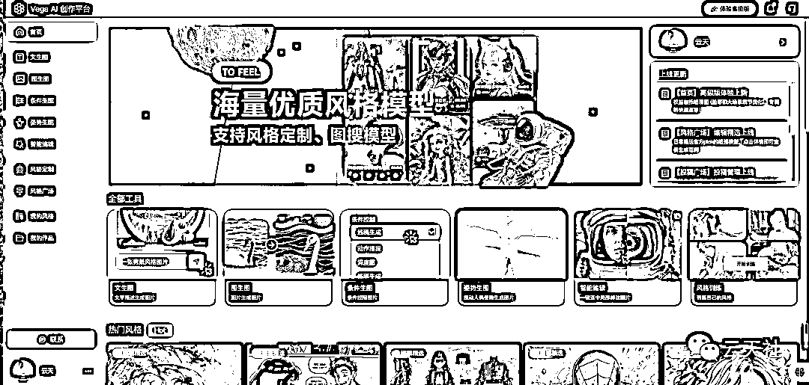

在页面左侧找到“风格广场”，点进去。

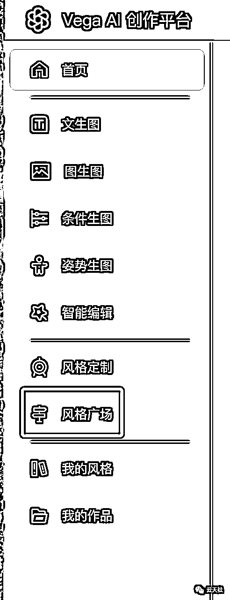

在搜索框里输入“云天”。

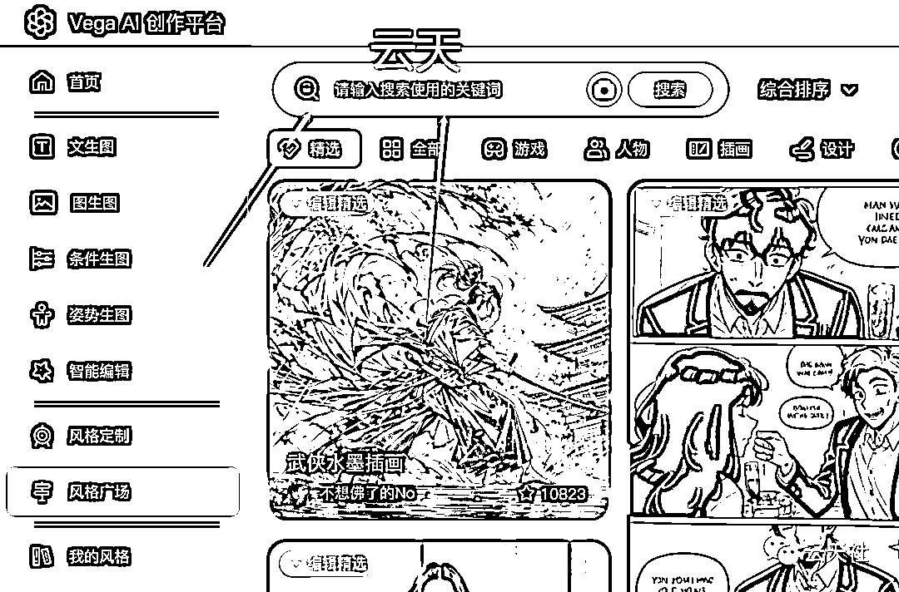

看到小和尚那张图，点击它。

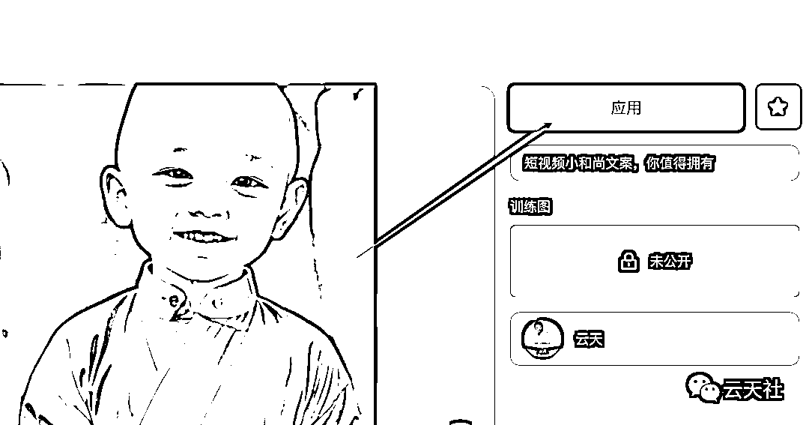

这一页把比例设为9:16，张数选4，画质用普通。高清和超清每次只能生成2张，效率太低；普通画质后期用修复工具放大就够用了。

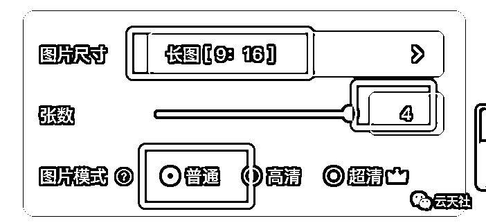

接着在下方输入你的描述语。

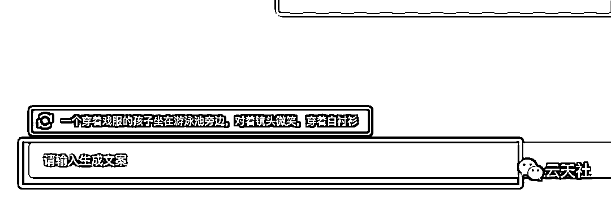

举个例子，我输入了下面这句话。

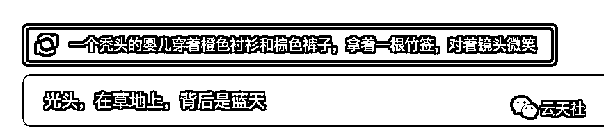

很快，系统就给出了四张候选图。

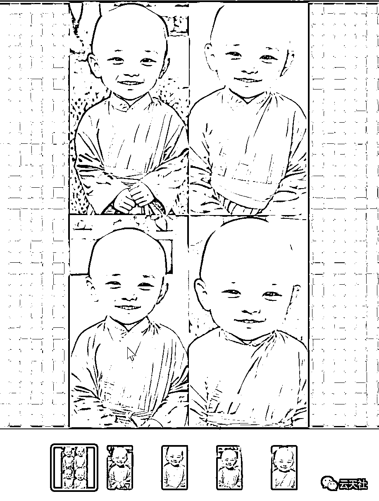

挑一张满意的下载下来，再用高清修复软件或网站把它做成高清。推荐一个免费工具：

https://arc.tencent.com/zh/ai-demos/faceRestoration

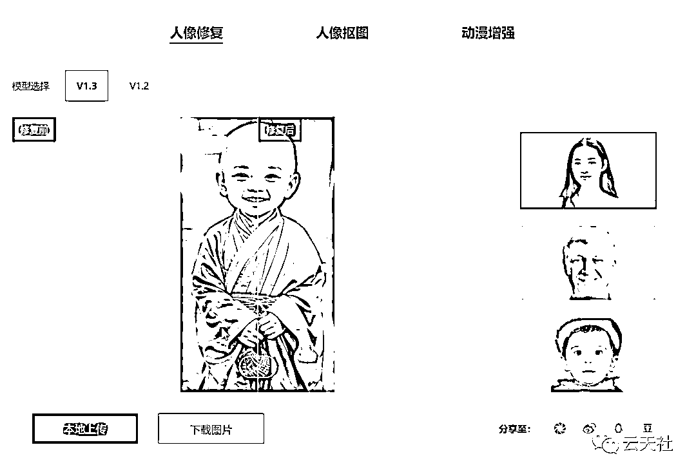

上传图片，然后下载修复后的成片就搞定了。

这样，爆款小和尚图片就能按你的“咒语”批量生产了。后面再结合上一期教的方法，就可以剪出视频。

接下来，再聊一个高阶玩法。我也把教学资料放到了网盘里，先给你链接：

链接：https://pan.baidu.com/s/1F_Y6ggy8-m6lQQnmofpICw?pwd=tvs9

提取码：tvs9

（来自百度网盘超级会员V10的分享）

这个高阶思路是借助vegaAI训练你自己的风格模型，让图片风格更多样。操作步骤如下：

进入工具后，先点击“风格定制”。

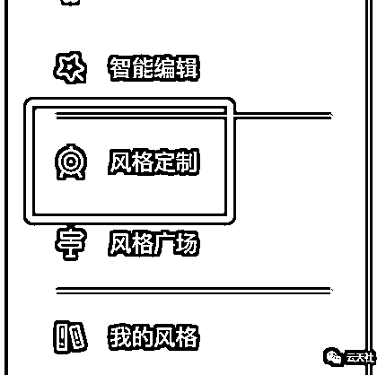

接着点击“开始训练”。

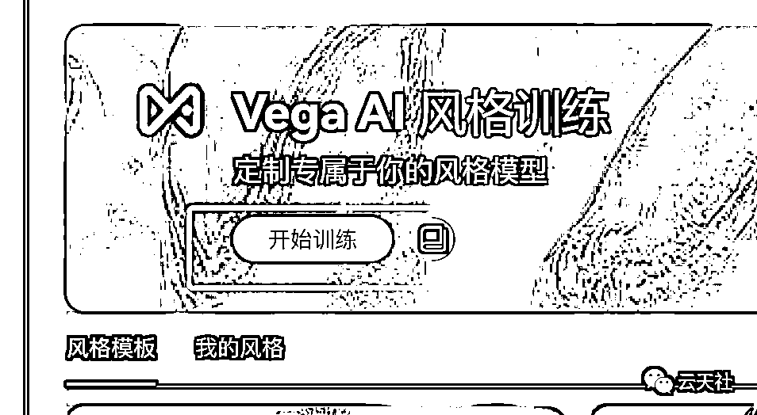

输入一个名字，比如“我的小和尚”。

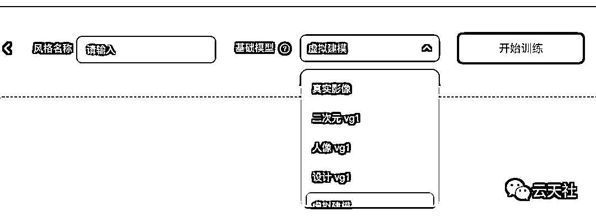

点击“上传”，注意看页面上的提示。

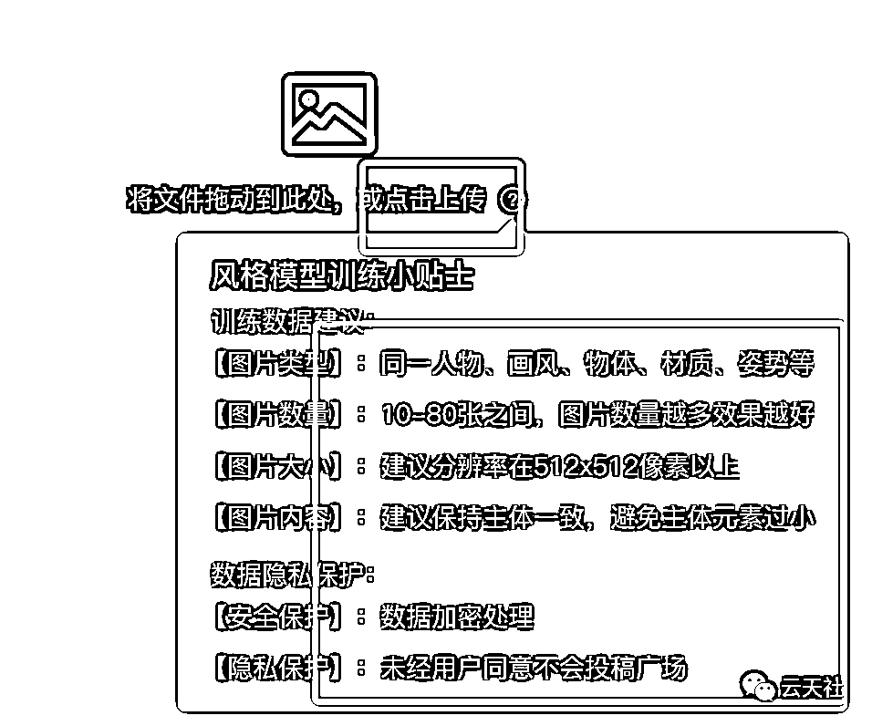

把你原创的图片批量导进去。

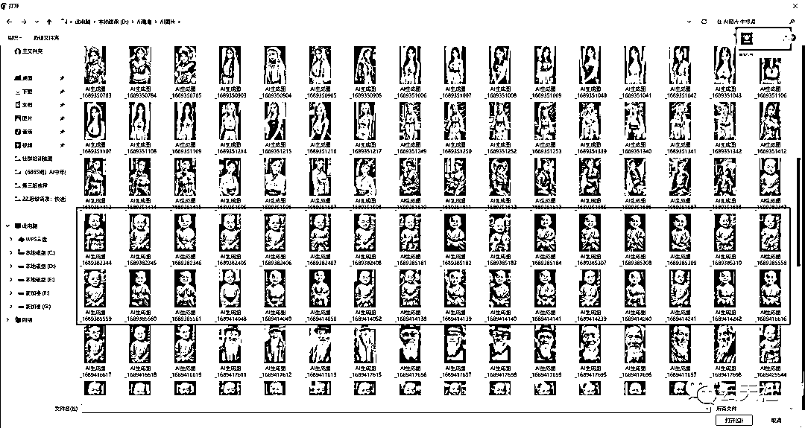

耐心等待训练完成就行。

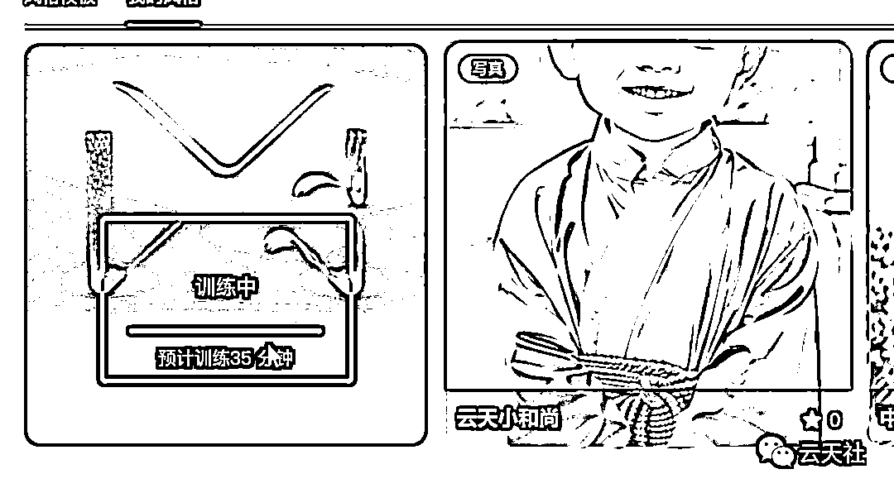

好了，教程到这儿就结束了，抓紧去落地实操吧。

对了，我是80后互联网创业者，专注内容自媒体引流、网赚项目分享、短视频营销及变现。为了便于你保存学习，我也把完整版教程整理成了网盘文件：

百度网盘版本教程

链接：https://pan.baidu.com/s/1F_Y6ggy8-m6lQQnmofpICw?pwd=tvs9

提取码：tvs9

写这么多，其实就是想告诉你：如果你对我的“思维语录图片会说话”项目感兴趣，不妨直接去操作一遍。这类视频现在的流量相当可观，真正动手会发现，操作起来并不复杂。市面上有人拿这个项目做培训，收费499到999，完全没必要花那个冤枉钱。你看完我这份拆解，基本就能自己上手了。有问题的话，随时来找我交流，我很乐意帮你。