# 互联网初创阶段避坑指南1.0

最近在社群里潜水，看到不少朋友要么是超级个体，要么刚拉起小团队就急着跑项目。作为一路踩坑过来的工作室创业者，我想把初期最容易翻车的几个环节一次讲清楚：设备、账号、微信、收款、管理、场地。真正能让你跑得更快的，不是多拼命，而是别在起步阶段就把自己绊倒。

# 01 设备：别在硬件上交学费

做私域类项目，号太少没量，号太多又管不过来。个人玩家建议控制在 5-12 个号，工作室可以做到 30-100 个号。原则很简单：一台手机、一张卡、一个号，别混着用。

苹果设备里，iPhone 7 堪称工作室“钉子户”，便宜、流程跑得快；iPhone 8 适合短视频和游戏，功耗低、运行顺；iPhone SE2 虽然存在感一般，但做直播电商、短视频都够用；iPhone X 拿来养号、做直播短视频也没问题。苹果整体保值，很多工作室都爱用。

安卓机怎么选？红米 10X 属于中规中矩的稳妥款；小米 10 青春版 8+128G 性能在线；小米 8 青春版和小米 8 SE 是不少人的选择；OPPO R17 性价比高。

购机原则也给你整理好了：能买二手就别买全新；能买原装就别碰组装，没指纹、没面容的大概率是拆机货，闲鱼尤其要谨慎；优先国行，别贪外版；看配置别看外观；认准品牌，杂牌碰都别碰；存储尽量选 8+128G；安卓机别超过 4 年，苹果机别超过 6 年。

多开微信的话，我自己实测过摩托罗拉和联想拯救者 Y70，这两款官方系统自带应用分身，不容易被封号。具体参数去官网看，或者找测评视频了解。电脑设备我就不推荐了，办公也好、游戏也罢，按业务需求去 B 站看数码博主就行。

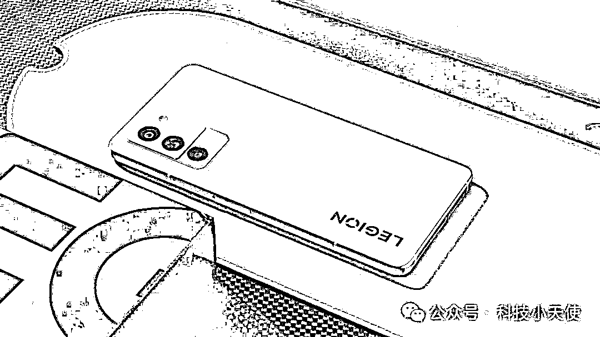

# 02 设备风控：封号不可怕，连坐才可怕

以小红书为例，账号被封太多，设备也会被盯上；就算没封设备，新号也容易吞评论、吞私信。所以一台手机上只要封过 1-3 个号，就赶紧刷机。

安卓设备这么做：先打开“设置”里的“隐私”或“权限与隐私”，把“限制广告跟踪”关掉，按钮变灰即可，然后点“重置广告标识符”。接着卸载小红书，在开机状态下还原出厂设置 1-2 次，再关机，同时按住开机键和音量减键刷一次，基本就干净了。不会刷机的话，可以参考 onfix.cn/rom。刷完之后，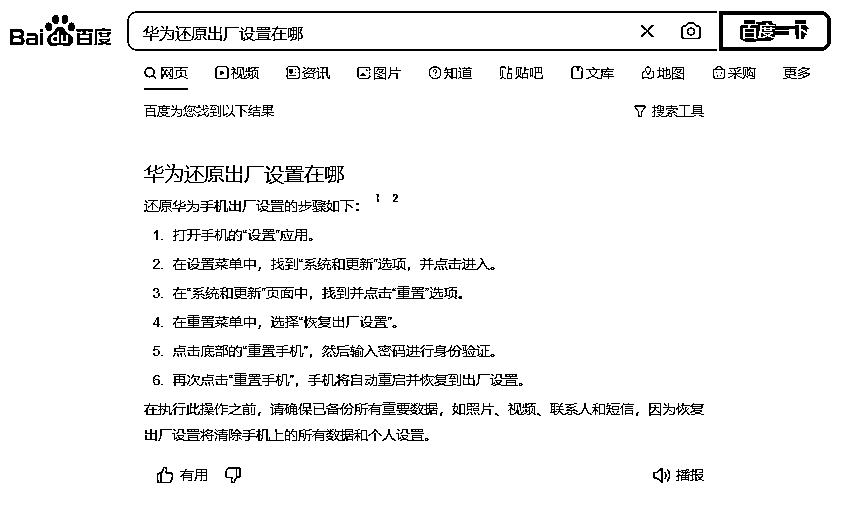重启手机，用流量下载小红书，千万别连 WiFi，装好也别急着登录注册。

网络环境也很关键。现在封号会连同 IP 一起拉黑，所以要换动态 IP。我的落地做法是：用 ST 加速器换纯净 IP，每次用完切换一下，用多少买多少，建议直接上独享版。

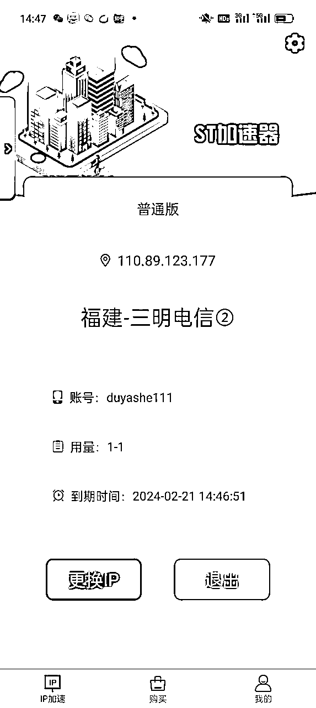

苹果设备也别偷懒：先“还原 iPhone”一两次，再用爱思助手刷一遍。路径是“设置-通用-传输还原 iPhone-抹除所有内容和设置”，然后打开爱思助手，选智能刷机、iTunes 刷机，连接数据线、下载固件、点击防数据恢复刷机，最后立即刷机。爱思助手官网是 i4.cn。

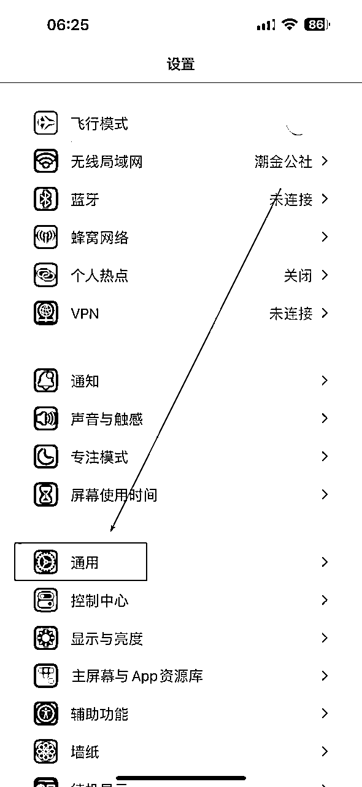

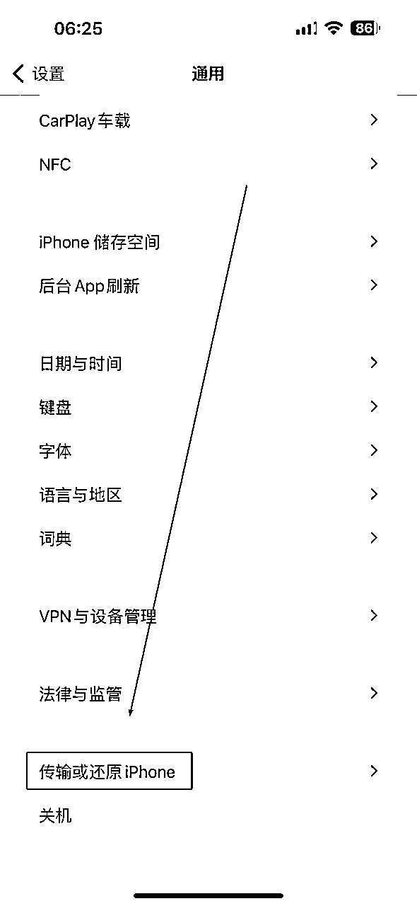

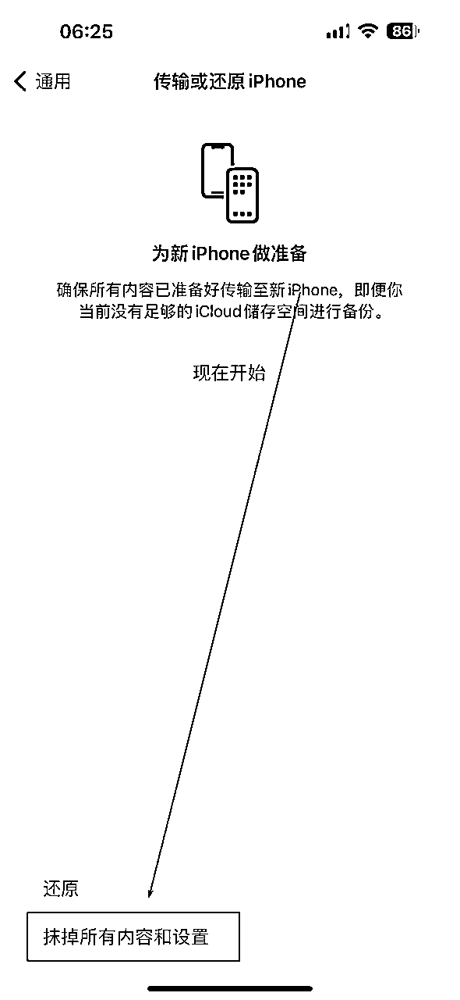

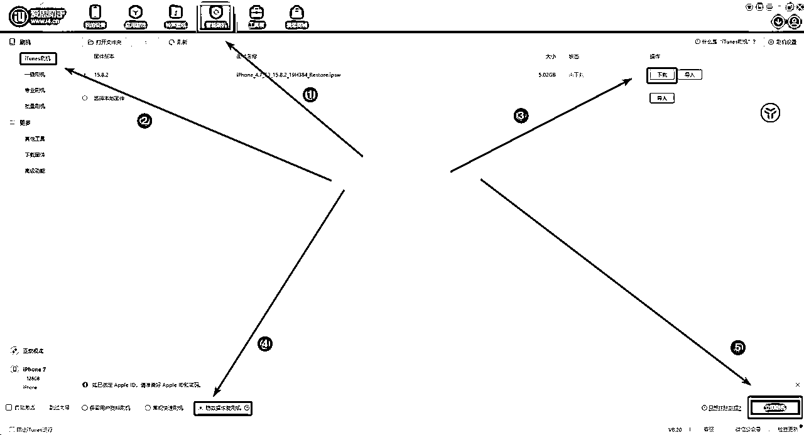

# 03 设备管理：细节决定资产安全

多口充电器属于锦上添花，不是必须品，但能省不少事。

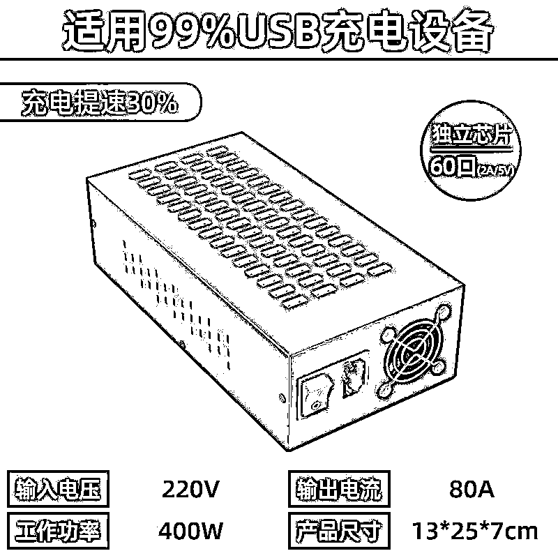

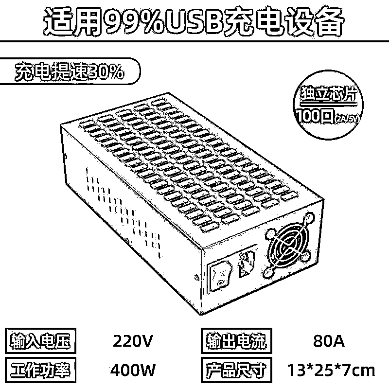

每台设备背后都要贴标签，号卡对应哪台手机、谁在用，全部登记成台账。这不是形式主义，是防止资产“蒸发”的基本操作。

如果你有员工或线下合伙人，这几条要写进制度里：手机在养号和干活时，号、卡、手机必须确保安全，丢一个号按制度罚款；微信注册人和使用人必须分离，不准用自己的私人号办公；所有信息严格保密；员工离职后第一时间更换实名认证。

号卡不够怎么办？三个办法：

1. 员工入职后，联系三大运营商合作门店上门办卡，签好协议或发个红包。

2. 发动家人亲戚帮忙办。

3. 做素人分发。第一步一定自己拿几个号先测素材，素材和流量形式确认没问题再铺量。短视频本质是素材逻辑，内容不行，发一千条、一万条都没用。最好找学生团队，质量很高，别找宝妈——我是做私域的，这句话不多解释。玩法是找两个学生头子，一个负责招人，一个负责管理和发钱。结算要降本增效，学生每月多赚两三百就很开心，不用花冤枉钱。如果哪个号跑爆了，花几百块收过来投放，我自己试过旅游粉，最猛的时候不到一块钱一个客咨。不会找学生，也可以用 Boss 直聘，不用自己充会员，买渠道发居家客服，成本更低。

# 04 账号：红线千万别碰

先说重点：任何账号买卖都是违法的！

市面上常见的账号类型，简单科普一下：

- 实卡号：自己去营业厅或网上办理的号，正规来源。

- 接码号：通过渠道接收短信验证码弄来的号。

- 地推号：线下送小礼品，让别人接收验证码注册，你再登录。

- 拦截号：查别人还没注册的号，相当于“拦截新号”；如果是注册过的号，那就等于盗号。

- 老美号：美国区的小红书号，优点是老号权重高、价格低，缺点是有使用门槛。

除了正规实名卡，其他接码类账号都是违规甚至违法的，轻则请去喝茶，重则“银手镯”安排。很多用这种号的人都在搞擦边或违法生意。新手千万别图方便，碰都不要碰。

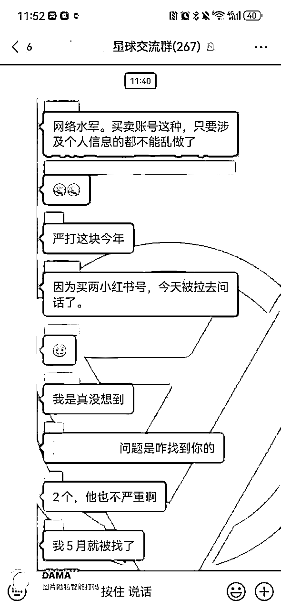

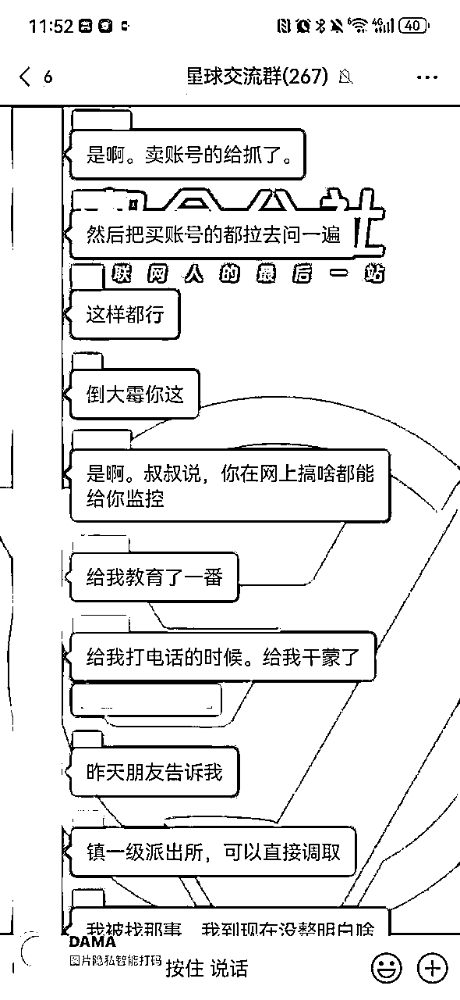

上面就是社群圈友的真实遭遇，因为买了两个账号做项目，直接被带去喝茶了。

# 05 微信：一个号就是一家店

对做私域的人来说，微信号就是最值钱的资产。一个微信等于一家店，谁的店多、活得久，谁就赢。

养号核心只有四个字：真人化 + 社交行为。

注册阶段，用手机卡流量，别用 WiFi；几张卡不要同一时间注册，分开时段操作。手机通讯录不要空着，先加 5-8 个号码；每个号用不同密码，建议字符+手机号。个人资料别一次填完，当天先设置头像、背景和昵称，不要和其他号用相同头像；第二天加一个正能量签名；微信号等 28 天再设置；性别、地区、绑卡放到 5-7 天内逐步完成。

新号注册好，加 3-5 个自己人的老号，互动聊几句，文字、表情、图片都要有；7 天内加人别超过 12 个。让老号给你备注、加标签、存电话。摇一摇、附近的人千万别用，很伤权重。营销软件不要碰，多开、虚拟定位、自动抢红包、群广告这类插件统统不装。微信保持挂机 24 小时，APP 别退出，后台运行即可。

绑卡实名后，拉老号建群发红包，增加活跃度。每天手动发 1-3 条朋友圈，图文都要有，时间错开；平时刷刷腾讯新闻，转发订阅号文章并配一句分享语；关注几个腾讯公众号，用用表情包和微信小游戏。新号聊天不要提钱、银行、支付宝、账号、期货这些敏感词，非要聊就等 15 天之后。三个月内的号都算新号，加人和营销都要低调。

消费养号也很重要：每周做 1-2 次有效消费，线下超市、水果店、早餐店扫码支付都可以，金额不限；或者买 10 元理财、充话费、打滴滴；线上走微信里的京东小程序。钱包余额别低于 1 元。语音聊天累计 30 分钟，至少两次，开着不说话就行；视频聊天 5 分钟，至少两次。再加 5-10 个熟悉的好友，万一封号能辅助解封；手机收回来后可以屏蔽他们的朋友圈，但不能拉黑删除。

微信被封，联系腾讯客服有 6 种方式：公众号“腾讯客服”、小程序“腾讯客服”、腾讯客服帮助中心、微信安全中心 AI、电话 0755-83765566（09:00-22:00）、支付/红包/零钱相关打 95017。永久封号怎么解？视频里那位老江湖的骚操作，可以自己看。

# 06 收款：别让风控卡住现金流

远程收款，尤其大额，很容易触发风控。解决办法是使用商家版收款或第三方收款渠道；个人微信号想长久，不建议直接收款。

营业执照办理，类目可以参考下表。没地址的话，淘宝、拼多多都能办；有地址就去当地市场监督管理局。

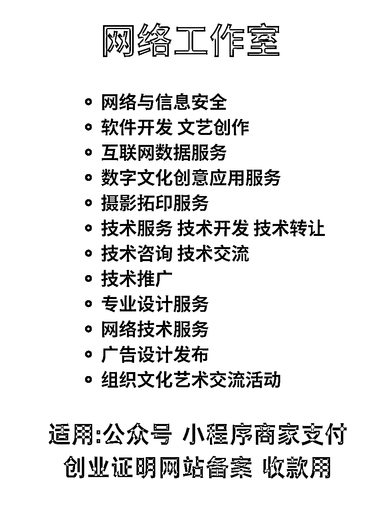

微信商家码直接去微信支付官网 pay.weixin.qq.com，按官方教程开通。支付宝商家码路径：打开支付宝“我的”-“商家服务”，找不到就搜索“商家服务”，同意协议开通后，点右上角设置-“我的收钱码”。有实体门店可以直接去银行办商户码；线上可以考虑虎皮椒、易支付、上海富友这类第三方，注意提现费率。

# 07 人员：合同永远比人情可靠

初创公司基本很难招到人才。比如招电商运营，Boss 直聘、智联上面，往往一个能打的都没有。但人还得招，怎么面？

优先看有没有同品类经验，不管之前做成功还是失败；没经验就看简历，然后问三个问题：行业前三的店铺和他们的渠道打法、产品大词的平均点击率和 PPC、上一年的运营预算花费。这三个问题你不需要会做，但必须懂，否则运营随便就能把你忽悠瘸了。

问得差不多就招进来开工，从产品正式上线算起一个月内，如果毛利都跑不平台里的工资，就是水货，直接开掉，别听借口。

每一阶段都要签书面合同，从找渠道、面试、签约、工作到离职，留好字据。很多小老板就是不懂法，最后被员工坑惨。招聘渠道方面，大学生适合线上兼职，走校园墙、非官方公众号、兼职群；社招稳定，用 Boss 直聘或抖音招聘。

# 08 场地：办公室是最容易烧钱的地方

创业初期，能别租办公室就别租。太多热血青年拿着几十万创业，事没做成，钱先烧在办公室上。办公室再好看也不是你的，跟业绩也没有半毛钱关系。省钱才是王道，别为面子买单，把钱砸向流量。家里改造、居民楼、商业公寓都可以，一条网线就能开干。

业务起来了，确实需要写字楼，那也有不少坑：

- 租期一般至少一年，但别签三年以上，业主也未必愿意。

- 价格分“包票”和“净到手”，“包票”含税发票，“净到手”不含，要问清楚。

- 物业管理费要主动问，20 元以下多数没有中央空调或空调费另算，20 元以上一般有中央空调。

- 中央空调开放时间大多只有 8:30-18:30，加班可能要另外付费；少数能装独立空调，要主动问。

- 写字楼通常不能住宿，也不能明火做饭，微波炉倒是可以用；复式或商住楼能不能住人，记得问一嘴。

- 停车月卡费用问清楚，承租面积大的客户可以争取 1-2 个免费车位。

- 毛坯办公室一定要跟业主要免租期，1-3 个月都有可能；带装修的也会有 1 周左右的免费期，毕竟搬家也要时间。

- 租期超过一年，租金一般从第二、三年开始递增 5%-8%，有些管理费也会跟着涨。

- 签约前问清楚对方是大业主、二房东还是小业主。

- 交定金后如果业主反悔，需要双倍返还。

# 09 写在最后

创业一定要把时间花在刀刃上，有侧重点：做私域就把精力放在搞流量上；做电商就死磕选品；做实体就盯紧产品和选址。其他事情，能省则省，能外包就外包。

地基不稳，楼盖得再高也会塌。初创团队的关键是人才；超级个体的关键是把执行力拉满；合伙创业的关键是股权架构。共苦容易，同甘难，很多公司都死在分钱这件事上。合伙人之间丑话说在前面，个体创业者把执行力放在第一位。

希望这份经验，能帮你少踩一点坑，走快一点路。