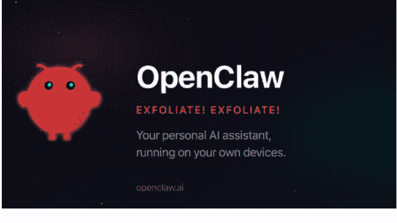
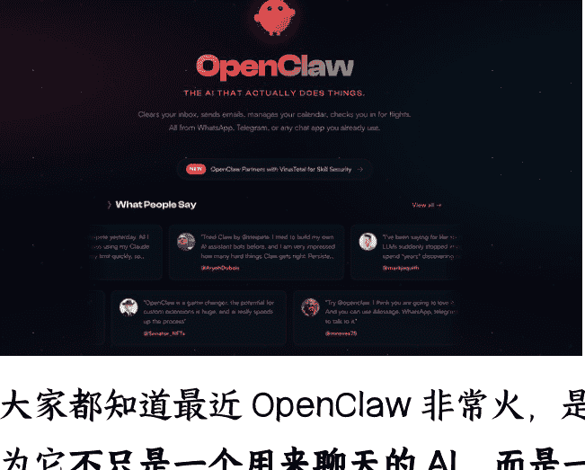
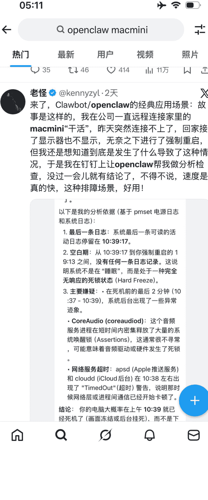
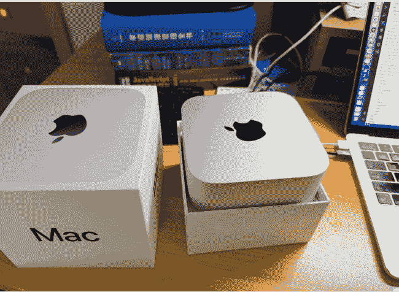
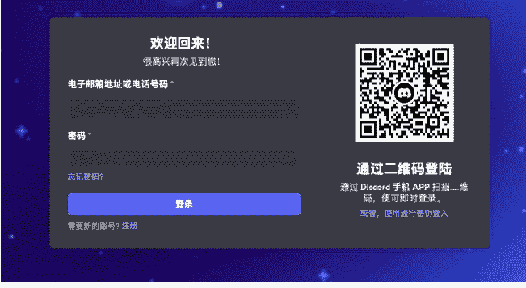

# 从 0 到 1 手把手教你搭建 OpenClaw 私人助理 (超详细)

# 从零到一完整拆解 OpenClaw 私人助理搭建全流程

260213 副业 SC 精华


| 文档版本 | 更新描述 | 作者 | 更新日期 |

| V1.0.0 | 新建文档 | 科学羊 | 2026-02-09 |



大家好，我是龙哥。

- 10W+ 爆文公众号专栏持续更新的作者;

- 时间管理工具「时迹-TimeFriend」创作者;

- 知名媒体签约编辑;

- 海外内容创业实操者;

- YT 海外游戏内容制作者;

- 赚钱垂直号航海教练及传道人;

- 赚钱 ClaudeCode 航海教练;

- AI 产品研发与商业化实践者;

本期内容聚焦最近讨论度极高的 OpenClaw，我会把搭建思路、选型逻辑以及踩坑经验一次性讲清。话不多说，直接进入主题。

# 一、OpenClaw 为何迅速走红



当前 OpenClaw 被热议，并非因为它能闲聊，而是因为它能执行。过往我们使用大模型，通常是人工拆解任务：先让模型生成文案，再手动去制图工具排版；先让模型整理资料，再自行归类归档；先让模型给出方案，再逐项操作落地。

OpenClaw 的逻辑是把这一串动作交给系统。用户描述目标，系统自行规划步骤并调用不同能力完成闭环。这一转变正对应 AI 从“信息回应”向“任务代理”的演进。

除此之外，OpenClaw 支持接入 Discord、WhatsApp、企业微信、飞书等常见沟通渠道。Discord 本身具备强扩展性，能挂载机器人与自动化流程，与 OpenClaw 结合后形成了一个可随时下指令的 AI 工作台，这也是出圈的关键。

我近期在 X 上也收集了不少使用者的反馈。



openclaw macmini

热门 最新 用户 视频 照片

49

> **TuTu 生活志** @tutulifestyle · 4 天

> OpenClaw 真正恐怖的能力在于——它不只改代码，还能改硬件。对我这种纯小白来说，有了想法就能落地，门槛直接归零，设备接到 Mac Mini 上面，仅用聊天就能搞定全部。给大家看看最新整活：《户子机器人 1.0》🤖

> 

> 84 112 843 18 万

> **Do Xuan Hien** · 2 天

徽言 @iamcheyan · 2/1/26

> 用了 OpenClaw 之后，第一次真切感觉到电脑活了。

>

> 昨天在 NAS 上跑了一个，先是让他给我分析了一下我的文件构成，并给了我一些清理文件的优化建议。当时人在电车里边，觉得这东西还挺有用的。

>

> 想晚上要给他装一个新的虚拟机。就让他自己去下载 ubuntu 的系统镜像。几分钟后就下好了，告诉我说，等我回家后直接就能装了。于是就用他下好的镜像，给他配了一台单独的机器。

>

> 装好之后给了他最高的权限，让他自己再去装需要的软件。他就配置好了 SSH 和 RDP，又自己下了一个 chrome 浏览器。我让他尝试发一条推特，也发出去了。

>

> 于是给他设了几个长期指令：

>

> 每天定时抓新闻，翻成日语，用符合我当前水平的词汇，通过 Telegram 推送给我。这样早上醒来的时候能看看新闻。

>

> 把我所有的开发代码放在他控制的机器上。出于好奇，我是真的想试试。真的不是为了炫耀或者跟风，就是单纯热爱和好奇心，哪怕这个玩意真的对很多人来说可能只是一个泡沫....，其实那也无所谓。

>

> > 就像数字生命卡兹克所说：好奇心这个东西，可能比聪明更重要

## 好奇心在 AI 时代会被显著放大

我长期观察下来，好奇心很难靠后天训练出来。有人见到新事物就想拆开看看，即便最后发现价值有限，也觉得过程值得。另一些人更偏好确定性，倾向于把路径想清楚再动手。

两种态度都合理，但在模型能够自主执行的时代，愿意先试的人优势会被放大。

我见过不少案例。有一个同行，专业背景并不算顶尖，但他对新工具的敏感度很高。DeepResearch 上线他立刻上手，Claude Code 也比大多数人早，Clawbot 等新品一出他马上研究。

如今他独立完成的事务量，相当于过去三到四人的工作量。

我曾和一位业内人士交流过，他的一句话印象深刻：在这个阶段，会用模型的人与不会用的人，差距像人和猿。我觉得表述激烈，但效率差距确实存在。模型把大量重复劳动降维后，会用的人能把省下的精力投入决策与创造，不会用的人仍在做手工搬运。

那么如何切入 OpenClaw？

目前社区里流行的部署方案很多：Mac Mini、树莓派、云主机、Windows 虚拟机、ESP32 以及一些改装硬件。

究其本质，树莓派与部分改装设备都是 Linux 运行环境。综合算力、生态成熟度与维护成本，我最终选择了 Mac Mini。

于是直接下单了一台。既然要深度验证，就把它当成必要投入。

有人会问，MacBook 已经有了为何再买一台？因为 OpenClaw 需要开放较高权限做实验，而我的主力本里存放着重要资产，风险承受度不高。单独隔离一台设备，即使出问题也不影响日常。



# 二、Mac 端搭建与安装要点

下面以 macOS 为例说明流程，其他平台思路相近。本次以 Discord 结合 OpenClaw 为主线，其他第三方接入原理可类推。

前置提醒：需要🪜环境，自行解决。我这台机器配置了家庭住宅静态 IP，想了解搭建细节可查看过往精华帖；机场节点也能满足。

## 2.1 Discord 准备工作

### 第一步：注册账号

官网地址：https://discord.com/




注册完成后新建个人服务器，进入主页即可。基础操作可自行搜索教程，流程简单。

### 第二步：开发者配置

### 2.1.1 新建应用

### 2.1.2 配置机器人

### 2.1.3 配置授权

### 2.1.4 安装应用

复制截图中红色标注的链接，新开窗口打开：


保持默认权限即可完成安装。


打开刚创建的应用：


此时随便发一条指令测试，通常会无响应或返回一段代码。这个现象很重要，先保留，后续配对时会用到。

至此 Discord 部分完成，进入 OpenClaw 安装。

## 2.2 OpenClaw 本地部署

### 第一步：通过终端拉取安装脚本

访问官网：https://openclaw.ai/


终端执行官方提供的安装命令：

```bash
curl -fsSL https://openclaw.ai/install.sh | bash
```

若提示权限不足，可在前面加上 sudo：

```bash
sudo curl -fsSL https://openclaw.ai/install.sh | bash
```

之后无需干预，等待自动完成。期间可以休息片刻。

### 第二步：初始化设置

安装完成后若出现下图所示界面，即表示基础部署成功。

```text
/Users/yang/.openclaw/completions/openclaw.zsh:3570: command not found: compdef
yang@madeMac-mini ~ % clawbot config
zsh: command not found: clawbot
yang@madeMac-mini ~ % clawbot config
zsh: command not found: clawbot
yang@madeMac-mini ~ % clawbot
zsh: command not found: clawbot
yang@madeMac-mini ~ % openclaw config
🦀 OpenClaw 2026.2.6-3 (85ed6c7) — I read logs so you can keep pretending you don't have to.
▓▓▓▓▓▓▓▓▓▓▓▓▓▓▓▓▓▓▓▓▓▓▓▓▓▓▓▓
OPENCLAW 🦀
OpenClaw configure
Existing config detected
workspace: ~/.openclaw/workspace
model: moonshot/kimi-k2.5
gateway.mode: local
gateway.port: 18789
gateway.bind: loopback
skills.nodeManager: npm
```

按图中提示逐步填写：


出现警告提示时选择 yes 即可。


### 进入 QuickStart 引导


模型选择上，我采用的是 Kimi K2。大家可按需挑选，但密钥需提前准备。以 Kimi 为例，密钥获取地址：

https://platform.moonshot.cn/console/api-keys


### 为何选用 Kimi？

社区里有用户给出过具体理由：


填入密钥后继续下一步。


选择 Keep... 之后继续。随后会进入聊天工具选择页，这里存在一个常见坑点：建议先选择 [Skip for now]。不要在此处直接绑定，我当初就卡在这里，后续仍需重配。先跳过，等主体跑通后再接入 Discord。


Gateway 端口保持默认值 18789 即可。Skills 与包管理器推荐选择 npm，其余选项默认 Yes 即可。

关于 Skills，可直接跳过，也可用空格键勾选真正需要的能力，不必全选。

示例参考：


### 界面选择

随后会自动弹出 Web UI：


在 Chat 页面发送测试消息，若能正常返回，则说明主体已安装成功。

补充一句个人经历：在安装过程中我失败过多次，后来判定是密钥或配置细节问题。重新生成一次 Kimi 密钥后顺利通过。所以遇到失败不必气馁，多半是细节遗漏。

## 2.3 建立 Discord 与 OpenClaw 的关联

另开一个终端，输入对应指令：

```bash
openclaw config
```

进入配置向导：


注意以下选择：


平台选择界面挑选 Discord。


随后需要粘贴机器人 Token。

Token 的获取路径：

https://discord.com/developers/applications


在对应应用的 Bot 页面复制 Token，粘贴回终端。


后续步骤按提示完成即可。

最后，将 Discord 机器人之前返回的那段配对码复制到终端提交。


格式为：`openclaw pairing approve discord` + 你的配对码，例如 `openclaw pairing approve discord TCWXRTTQ`。


完成以上步骤，连接即建立。

## 2.4 交互验证

第一种方式是直接使用网页端，功能可用但体验相对单一。


第二种方式是通过 Discord 与机器人对话，指令发出后能得到正常回复，即表示全流程打通。


# 三、进阶部署与常用操作

## 3.1 云端 + 企业微信

除了本地 Mac Mini，也可将 OpenClaw 部署在云服务器，再对接企业微信实现远程操控。我曾测试过腾讯云海外轻量服务器：

https://cloud.tencent.com/act/pro/double12-2025

注意需选购海外节点，轻量配置即可。


安装流程与本地基本一致。

若要接入企业微信，需先申请企业开发者权限，再通过相关接口调用 Agent，大致效果如下：


企业微信的详细配置本文暂不展开，感兴趣后续再整理。

## 3.2 常用指令清单

### 启动 TUI 界面

```bash
openclaw tui
```

### 重启网关服务

```bash
openclaw gateway restart
```

### 新建会话

```bash
/new
```

### 追加备用模型

```bash
openclaw models fallbacks add [模型公司代号/模型名称]
```

例如：`openai-codex/gpt-5.2-codex`

### 切换默认模型

```bash
openclaw models set [模型公司代号/模型名称]
```

例如：`kimi-code/kimi-for-coding`

### 网关相关命令

```bash
openclaw gateway start    # 启动
openclaw gateway restart  # 重启
openclaw gateway stop     # 停止
```

### 其他操作

```bash
openclaw tui        # 命令行对话
openclaw config     # 配置 (修改模型，通道，网关，等。。。)
npm update -g openclaw    # 更新 OpenClaw 主程序
npm uninstall -g openclaw # 卸载 OpenClaw
```

### 模型管理

添加备用模型后，主模型不可用时可自动切换。

```bash
openclaw models fallbacks add [提供商代号/模型名称]
```

示例：添加 OpenAI Codex 作为备选。

```bash
openclaw models fallbacks add openai-codex/gpt-5.2-codex
```

设置默认模型：

```bash
openclaw models set [提供商代号/模型名称]
```

示例：把 Kimi 设为默认编程模型。

```bash
openclaw models set kimi-code/kimi-for-coding
```

## 3.3 给你的日常新闻推送加上新燃料

开启这项功能只需要执行一条终端指令：

```bash
openclaw configure --section web
```

执行后会弹出输入框让你填入 API Key，直接把密钥粘贴上去即可。


还没拿到 Brave 的 API Key 怎么办：

- 1. 打开 https://brave.com/search/api/

- 2. 用邮箱注册一个免费账号，每月提供 2000 次搜索额度

- 3. 在控制台里新建一个 API Key 并复制保存

- 4. 回到刚才的命令中，把密钥粘进去完成配置

操作实拍如下：


## 四、Discord 推送突然不响了该怎么排查

第一步先打开 OpenClaw 的 TUI 界面，确认对话本身是否正常响应。

```
openclaw tui
```

## 常见故障点

- 1. Gateway 通道中断 — Discord 的连接可能掉线，需要重新拉起

- 2. Bot Token 失效 — Discord 机器人令牌可能已过期或被重置

- 3. 频道权限变更 — 机器人可能被禁言，或丢失了读写消息的权限

## 排查与修复流程

- 1. 查看 Gateway 是否在线

在终端里执行：

```
openclaw gateway status
```

- 2. 若状态不正常，尝试重启 Gateway

```
### 先启用重启权限
openclaw config set commands.restart true
```

```
### 然后重启
openclaw gateway restart
```

- 3. 核验 Discord Bot Token 是否可用

登录 Discord Developer Portal https://discord.com/developers/applications：

- 进入你的应用 → Bot 页面，确认 Token 状态是否有效

- 若提示 Invalid 或你刚重新生成过，需要把新 Token 更新到配置中

- 4. 复核频道权限

- 机器人是否仍在目标频道内

- 是否拥有 Read Messages 和 Send Messages 权限

### 每次开机手动拉起服务

打开终端后运行：

```
openclaw gateway start
```

到这里今天的干货就先到这了。OpenClaw 的进阶玩法和实操技巧我会持续学习，学到手就会第一时间更新到文章里，欢迎持续关注和支持。

## 最后，给你安利一个付费小圈子：


📌 它是你对抗信息噪音的护城河。

这个群组已稳定运营 7 年，累计拆解研读 3000+ 份互联网商业实战案例、行业前沿内参以及时政宏观深度文章。

我们不做低质搬运，只做高质量信息的筛选器和放大镜。

```
https://hk57gvlx7u.feishu.cn/docx/H0kRdZbSbolBR0xkaXtcuVEOnTg
```

【免责声明】本资料归档于社群内部知识库，仅供成员课题研究与学术交流，请在查阅后 24 小时内删除。