# 从变现需求倒推 SD 实操：Stable Diffusion 的上手思路与案例拆解
## SD 工具的实操方法和案例应用分享
作者： 龙哥
日期：2023-06-28
5 月 30 日《SD 工具的实操方法和案例应用分享》@大刘
一、开场自我介绍
大家好，我是龙哥。很感谢子安老师的邀请，今天来跟大家聊聊 SD 的落地用法和实操细节。我本职是程序员，对营销相对技术研究更感兴趣一些。所以分享的重点是：当你在风向标或其他渠道看到用 AI 图片做的变现案例很不错，想复刻类似效果时，可以从哪几个角度入手。
二、别被工具绑住，先选顺手的工具
前几天航行下来，有人已经小有进展，也有人还在卡。出图随机性大、要反复抽卡浪费时间；有的伙伴想用 MJ 又被账号问题困扰，想换网页小工具或自己装 SD 本地；还有刚会出图的朋友在问，到底画什么图才能变现。
这些问题我以前也都遇到过。我的看法是，手上所有东西都是工具，别让工具框住思路。AI 绘图不一定非得靠 AI 软件完成，AI+人工往往更快。工具选择的核心标准就一个：你更熟悉、能更快达成目标的就先用。
目前 AI 画图工具很多，我个人一直用 Stable diffusion webUI，下面就以这个界面为例来演示需求实现方式。
三、SD 到底是什么
安装细节可以参考航海手册，这里不展开。市面上常说的 SD 全称是 Stable Diffusion，稳定扩散模型，指的其实是模型本身。真正被广泛使用的是基于它开发的可视化操作面板 Stable diffusion webUI，我们口语里说的 SD 基本就是指这个页面：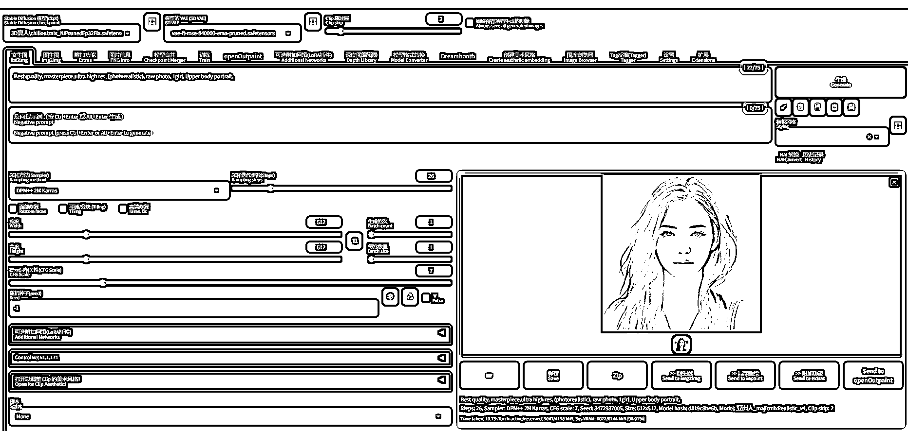
SD 的核心优势在于开源免费，能装在本地电脑或云服务器上用。开源带来的最大红利是插件生态，其中最火的就是 ControlNet。它能把参考图做不同预处理后，结合模型和描述词，大幅提升出图可控性。
接下来就用真实需求来演示 SD 如何解决问题。
四、实战案例拆解
4.1 AI 画作变现到线下实物
线下很多服装、产品包装都需要配图。去年天辉老师跟我说，能帮我把喜欢的画印到帆布袋上，这是我第一次看到 AI 绘画真正落地到现实。我选的图是：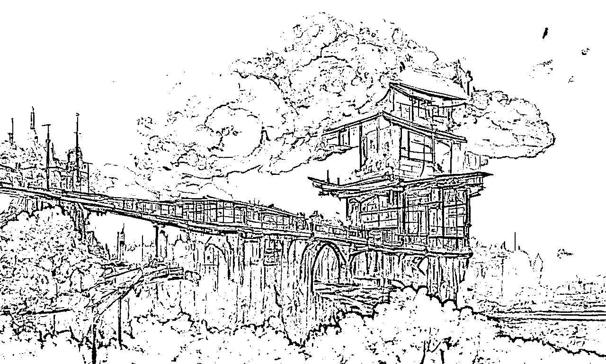
描述词：A beautiful painting of a building full of sakura, bridge, clouds, sunset, fairy tale, distant town, light effect, dream, Josan Gonzalez, artstation,8k
最终成效果图：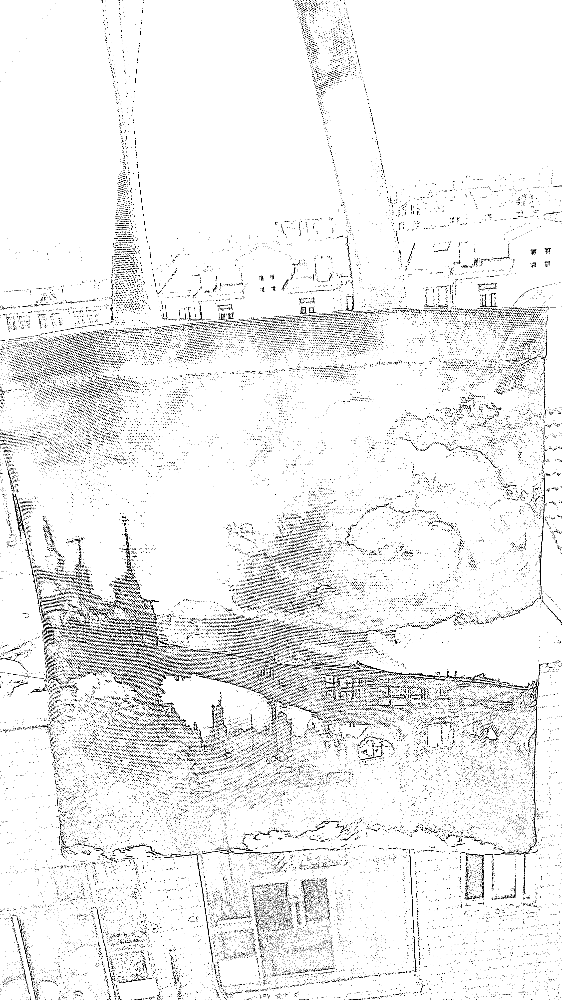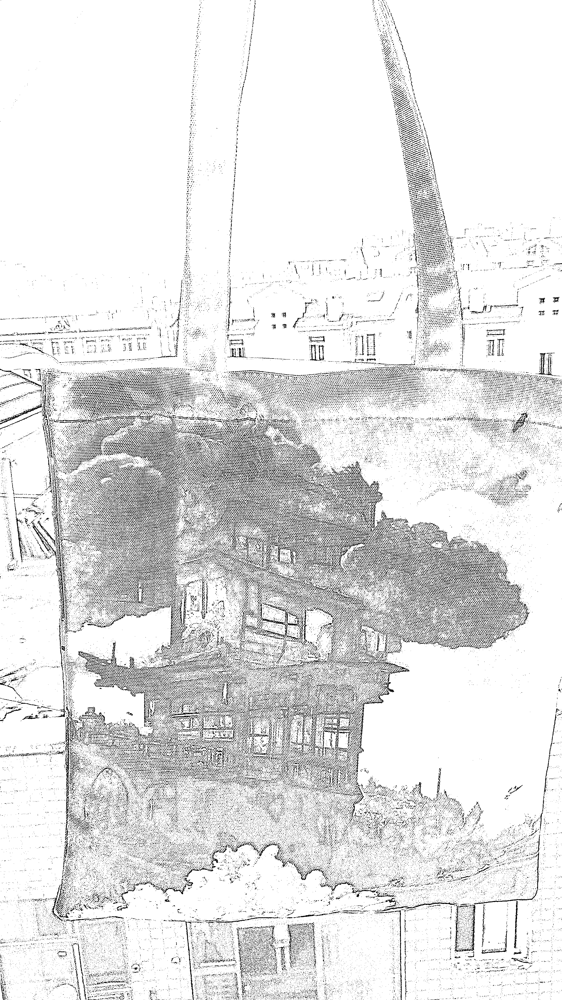
整个流程很简单，网页写描述词 -> 生成图片 -> 发给商家制作 -> 等货。没有复杂操作。媳妇现在出门买东西经常带这个袋子，她觉得很好看。这种需求对随机性容忍度高，只需会基础操作即可。除了帆布袋，T 恤、外包装、宣传海报、鼠标垫等思路都一样，这里不再展开。
4.2 头像、壁纸的快速制作
接下来演示小红书、抖音很火的头像玩法。照片转二次元、二次元转照片，几分钟就能搞定。下文工具统一为 Stable diffusion webUI，具体步骤可对照航海手册「五、学会用 Stable Diffusion 完成 AI 绘画」：https://i.shengcaiyoushu.com/docx/S38TdhmTsosK6Uxlo9tcYec9nxh
常用组合：图生图 + ControlNet
4.2.1 图生图 + ControlNet 线稿
比如有一张二次元图想换成三次元，可以这样做：
把原图放到图生图位置，设置尺寸，切换大模型，写描述词，ControlNet 预处理器选 lineart_coarse，处理模型选 canny。
原图：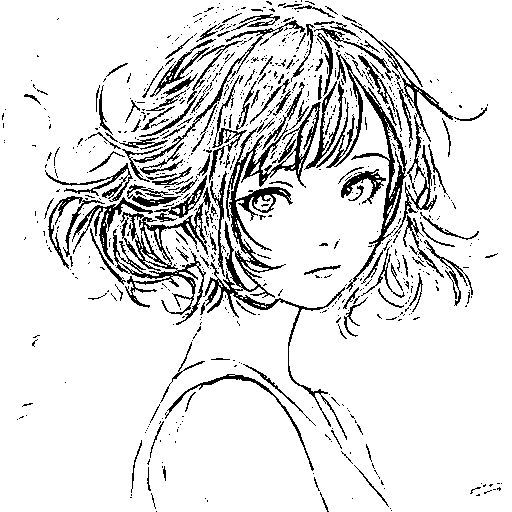
效果图：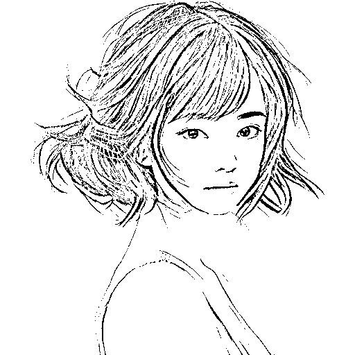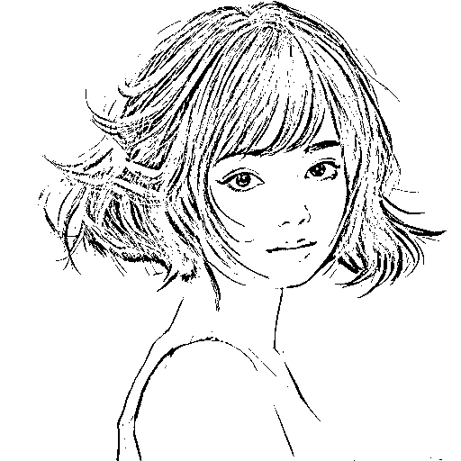
配合参数图理解会更清晰：
这里用的是真人向大模型，所以结果是真人风格：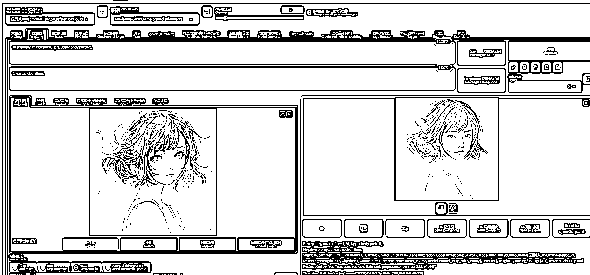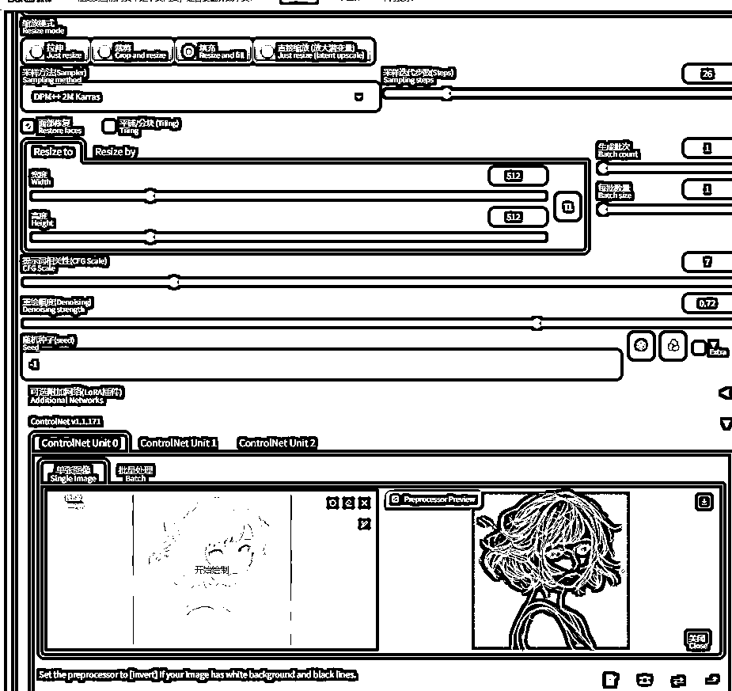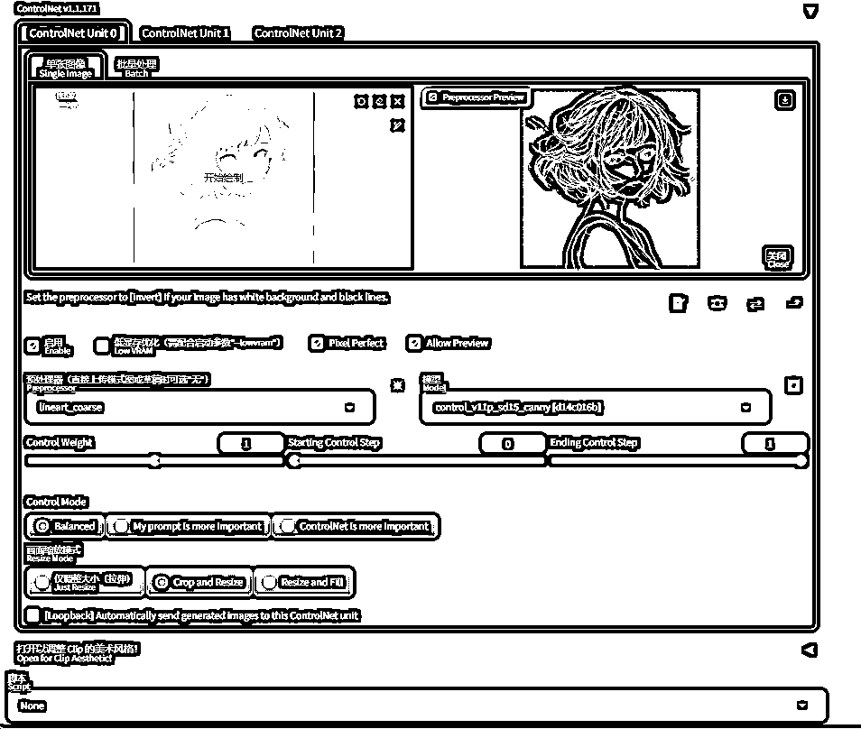
补充细节：
动漫转真人建议勾选面部修复，真人转动漫不要勾选，否则脸易崩；
重绘幅度两种打法。想快速转换，设 0.6-0.9，出几张选一版；想精细控制，用小步多次，重绘幅度每次 0.2，生成后把结果放回参考区继续迭代。2 次元转 3 次元同理。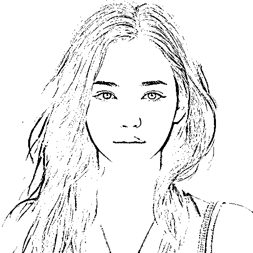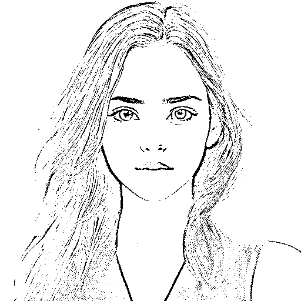
再复现风向标 17 号圈友分享的信息，原理相同：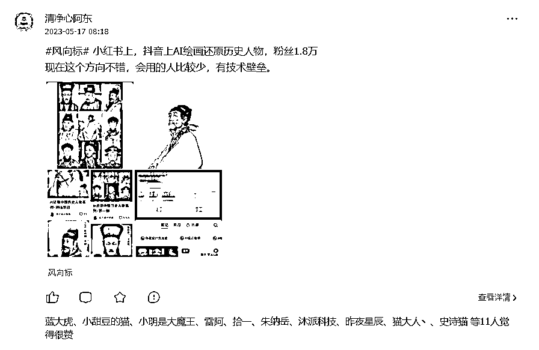
网上找了张韩愈的照片，用上述方法还原，大部分特征保留，类似这种不必完全一致，反而流量更好：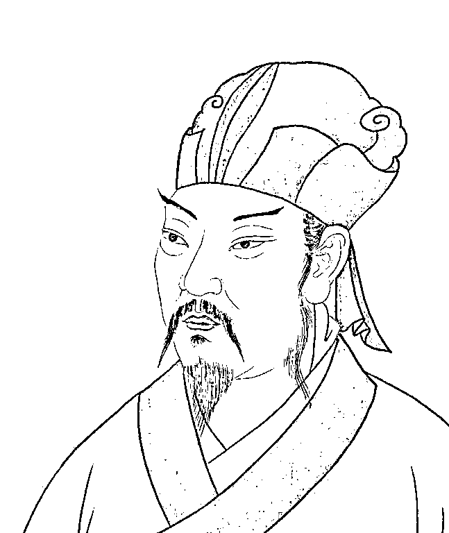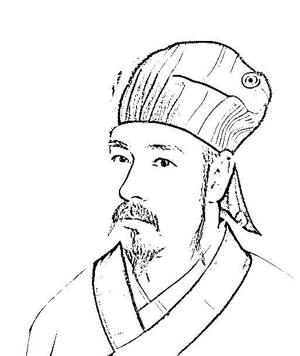
还原韩愈用的参数：
正向标签：(Best quality， masterpiece)，ultra high res， (photorealistic)， raw photo，1 old man， solo， male focus， facial hair， Red phoenix eye， mustache， beard， hanfu，(raised eyebrows)，  hat， simple background， black hair， black eyes， upper body，
负向标签：lineart， motion lines，
底模：chilloutmix_NiPrunedFp32Fix
重绘幅度：0.63
ControlNet 预处理器：lineart_realistic 模型 canny
4.3 四维彩超风格案例
原图与案例图：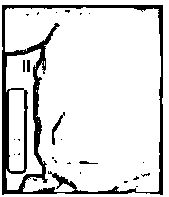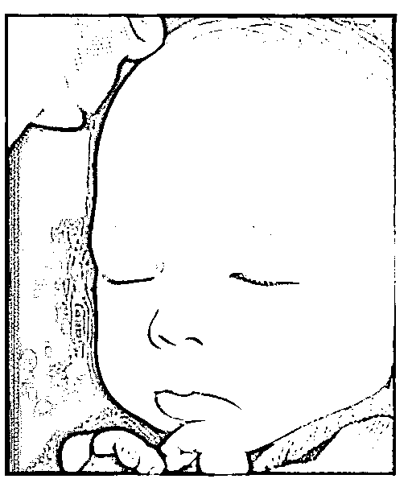
操作要点：
图生图，无插件
底模：braBeautifulRealistic_v40
懒人正向标签：(Best quality， masterpiece)，ultra high res， (photorealistic)， raw photo，a newborn baby who has just been born is sleeping peacefully。 The photo is realistic and captured through photography with a simple background. There are numerous authentic details in the photo, including the pores on the baby's skin, realistic hair, and the use of natural lighting or artificial lighting through a daylight-simulating bulb, highlighting the baby's features. The photo has no black borders, providing a full view of the baby and its surroundings.
重绘幅度：0.6
Steps: 31
采样器： DPM++ 2M Karras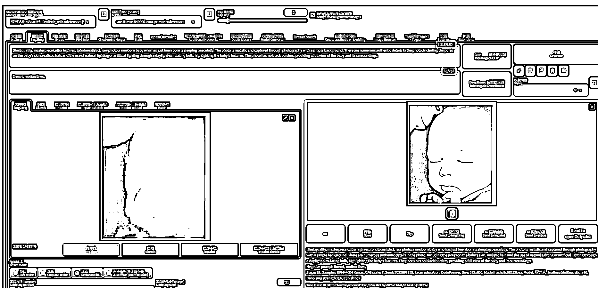
从几个案例可以看出，核心其实都是图生图+ControlNet，区别在于模型选择和少量参数微调。想把一张图换成另一种风格，SD 的图生图就能完成。MJ 也能做，这里不展开。技术上并不难，关键是先想清楚变现路径，技术只是出图手段，先理解原理即可，真有需求再深入研究也不迟。
五、ControlNet 的更新与预处理器
SD 的灵魂插件就是 ControlNet，建议及时更新。秋叶启动器可直接点击更新：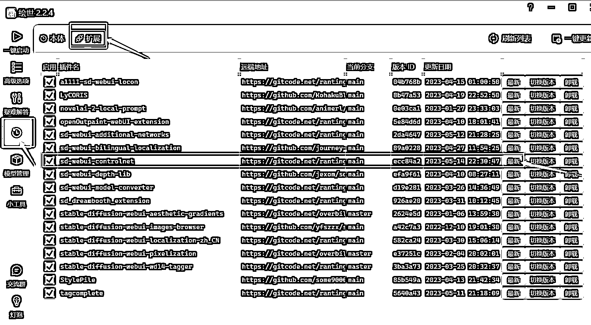
使用星空包或其他安装包的，进入 ControlNet 文件夹，右键空白处 -> Git Bash Here -> 输入 git pull 即可。
最近 ControlNet 频繁更新，不仅模型，预处理器也在迭代。预处理器的作用是把上传的参考图解析成不同模板，生成时以此为依据出图。如果你用秋叶安装包，可把这份文件复制到 extensions\stable-diffusion-webui-localization-zh_CN\localizations 目录，能实现中文翻译：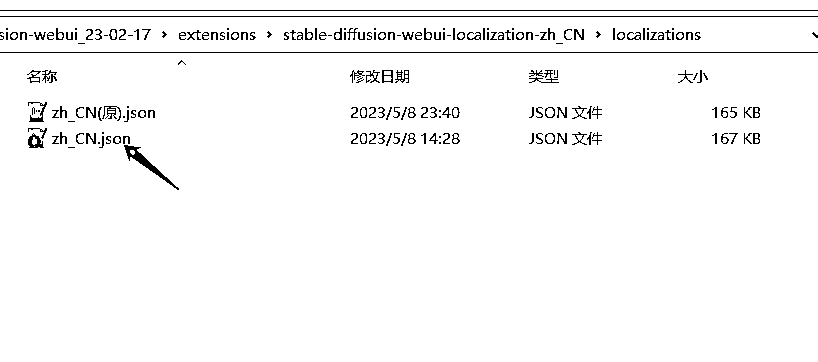
更新后效果：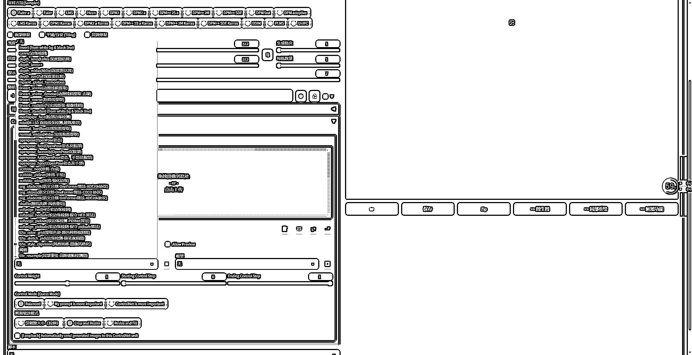
选择逻辑可参考官方文档：https://github.com/lllyasviel/ControlNet-v1-1-nightly/blob/main/github_docs/annotator.md
常用类型包括线稿提取、直线线条、openpose 姿态，最新的 tile 作者尚未完成：
六、如何模仿爆款风格
6.1 模型挑选
看到好风格想复刻，核心是找到对应模型。比如小红书半个月前爆火的治愈系图：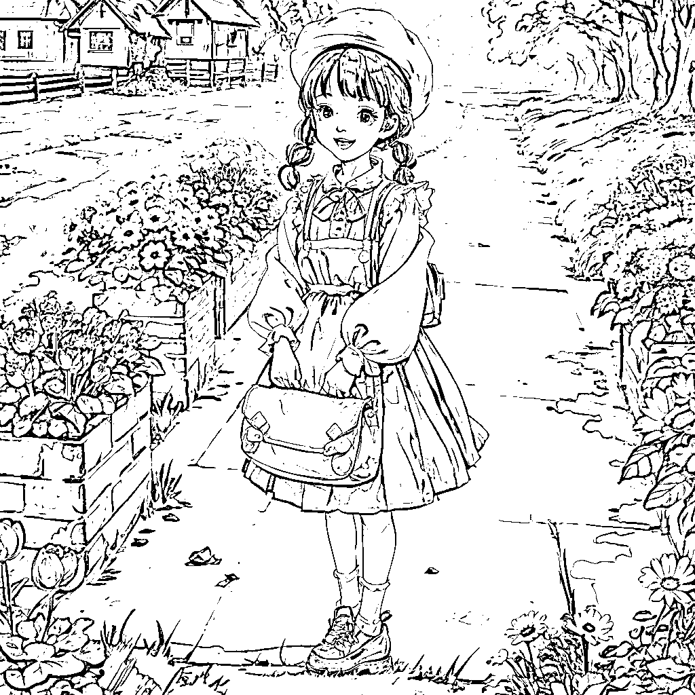
底模用 revAnimated_v11，配合两个 LoRA：墨心 + 吉卜力
大模型决定整体画风，LoRA 则在大模型基础上针对人物或风格做精细化训练。熟练玩家会准备一套模型库，按场景切换。
推荐几个我常用的：
3D 写实大模型：
ChilloutMix: https://civitai.com/models/6424?modelVersionId=11745
Realistic Vision V2.0: https://civitai.com/models/4201?modelVersionId=29460
majicMIX realistic: https://civitai.com/models/43331?modelVersionId=48289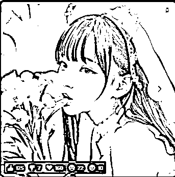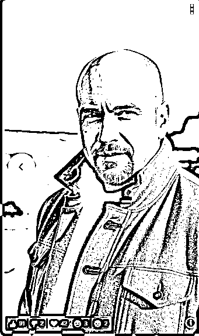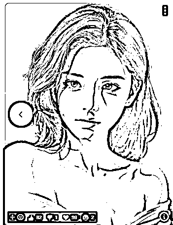
2D：
Anything: https://civitai.com/models/9409?modelVersionId=30163
Counterfeit: https://civitai.com/models/4468?modelVersionId=57618
ReV Animated: https://civitai.com/models/7371?modelVersionId=46846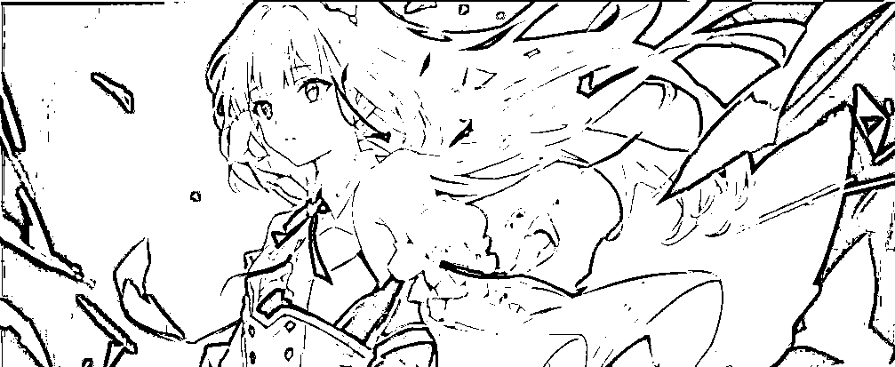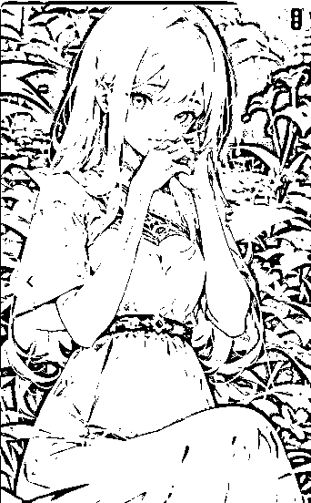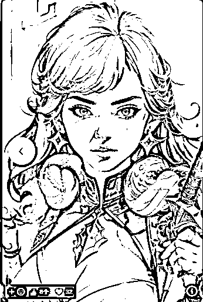
LoRA：
盲盒风格：https://civitai.com/models/25995/blindbox
Studio Ghibli Style LoRA 吉卜力：https://civitai.com/models/6526/studio-ghibli-style-lora
墨心 MoXin：https://civitai.com/models/12597/moxinhanfu
汉服：https://civitai.com/models/15365/hanfu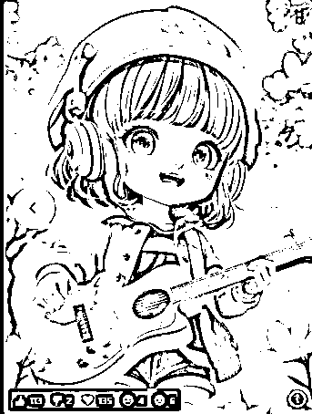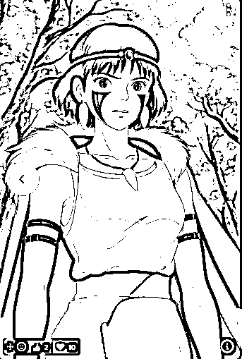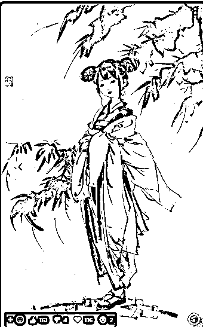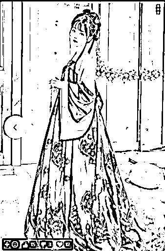
6.2 模型切换
底模切换点左上角，下方刷新按钮用于新模型无需重启即可加载：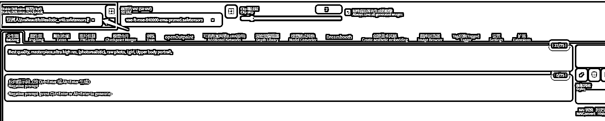
LoRA 使用位置：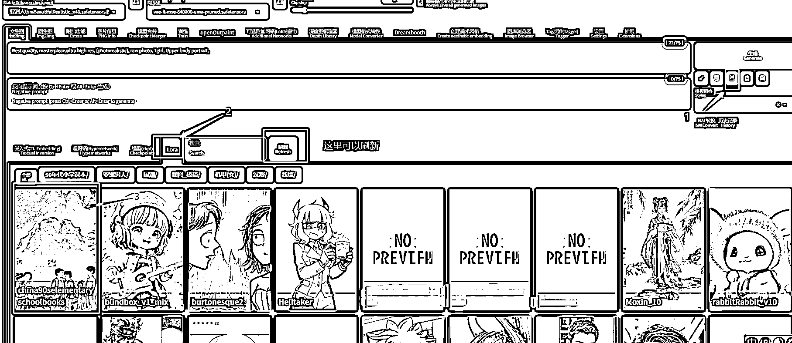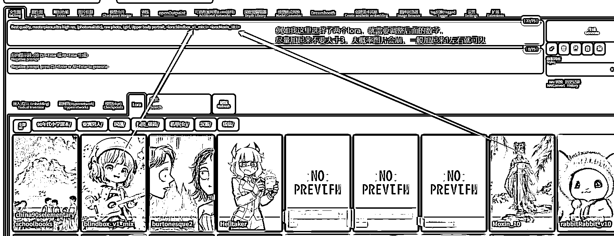
七、抠图需求补充
把图放到实物上需要抠图，若不想学 PS，可用美图秀秀、佐糖网页版、可画、即时设计、master go 等。关键是选熟悉且能解决问题的工具。
以佐糖网页版为例，网页免费，首次需登录：https://picwish.cn/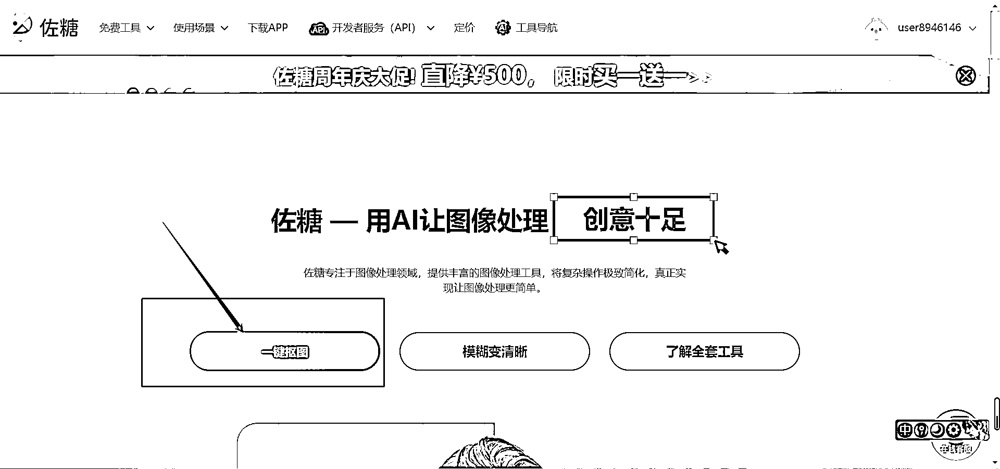
上传图片：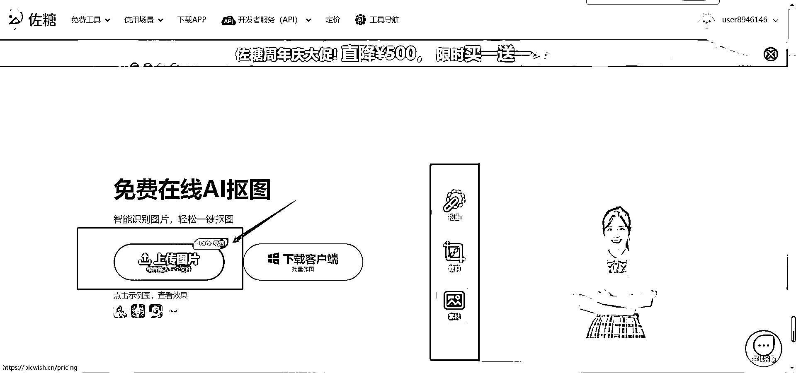
自动跳转下载页：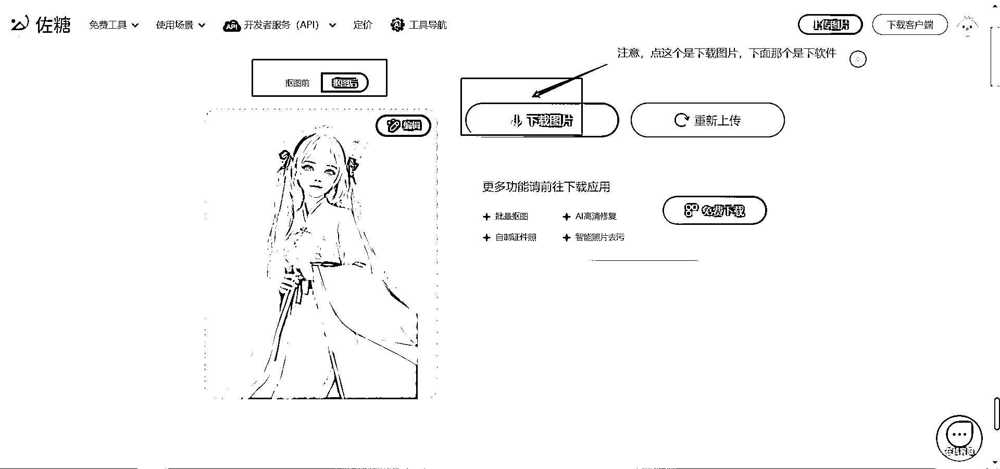
注意，立即下载可忽略，等进度条 100% 后会弹出保存框，自行选择路径：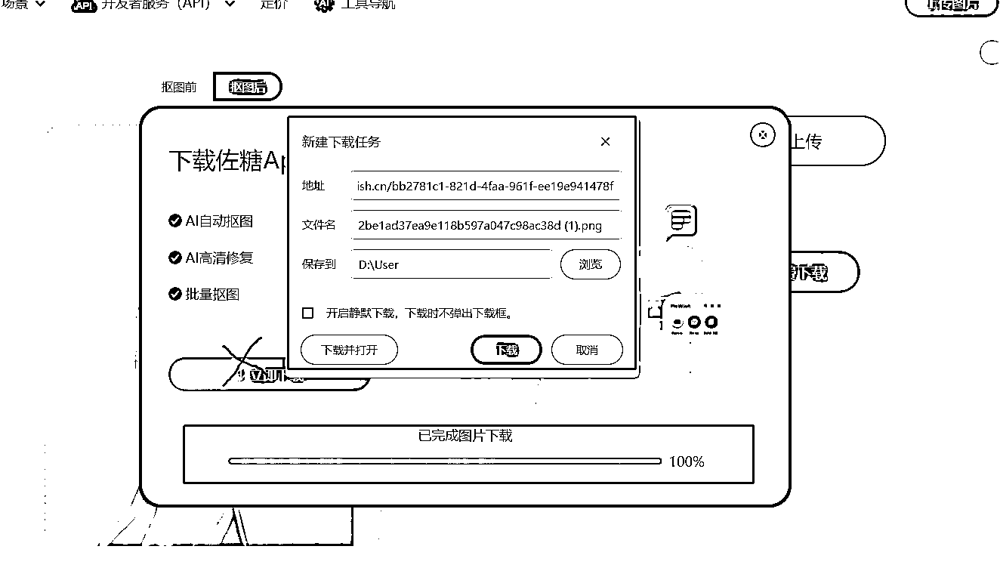
到此基础流程结束。若需引流，建议出成品图，即把图片与产品结合，让用户更直观。比如加到包装袋、杯子上等，可自由发挥：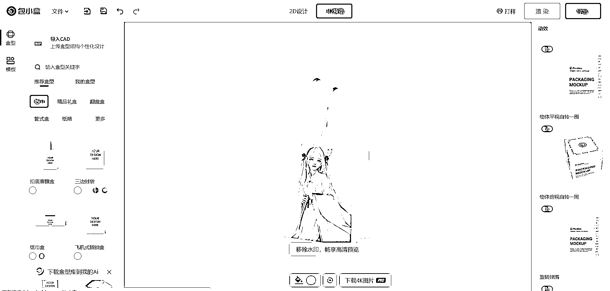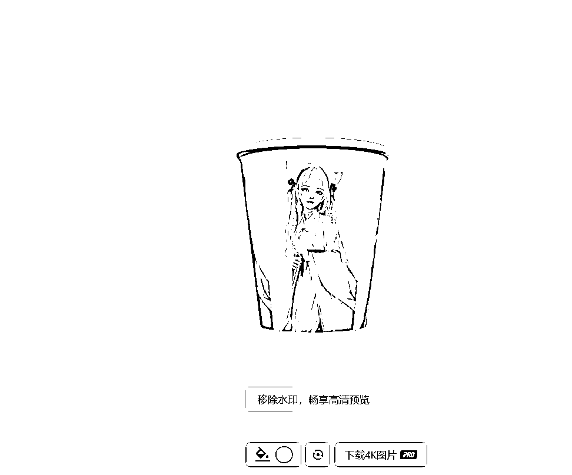
具体操作可参考航海手册章节 7.2 刘楚宾教练内容，这里不再赘述。
总结一句话：工具无贵贱，能用顺手且服务变现的才是好工具。技术流大佬随意，感谢大家时间。
评论区：
飞向云端 : 给教练点赞👍 … : 哇塞 很及时，感谢大佬 大刘 : 多谢~ 大刘 : 能用上就是最好的啦~ … : 哈哈哈，必须用上它！！ 大刘 : [嘿哈][嘿哈][嘿哈] Yoga : 武汉圈友好，线下面基过 大刘 : 阿里大佬[呲牙][呲牙][呲牙]